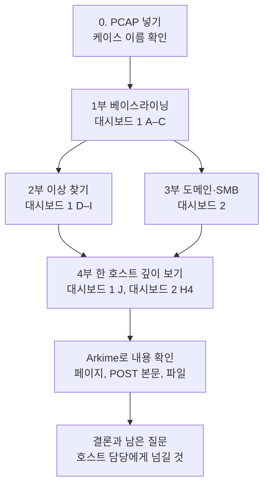

# 대시보드로 PCAP 분석하는 순서 { #analysis-workflow }

<div class="dfir-meta" markdown>
**분류:** Splunk · **쓰는 것:** 대시보드 1(트래픽 개요), 대시보드 2(SMB·도메인), Arkime · **마지막 수정:** 2026-11-26
</div>

!!! abstract "이 페이지에서 하는 일"
    새 PCAP을 받았을 때 **어떤 패널을 어떤 순서로 보고, 무엇을 메모하는지** 체크리스트로 정리했어요. 그다음 **공격 유형마다 어느 패널에 보이는지** 표로 찾을 수 있게 했고, 실제 실습(Night Dew)의 한 장면을 대시보드로 읽어 봐요. 마지막에 호스트 담당에게 넘길 **Windows 이벤트 ID**를 모았어요.

## 큰 흐름 { #flow }



**원칙:** 처음부터 나쁜 것을 찾지 않아요. **평소 모습을 먼저 그리고**(베이스라이닝), 그 그림에 **안 맞는 것**을 찾아요. 메모할 때는 본 것(**[데이터]**)과 짐작한 것(**[추측]**)을 나눠 적어요.

## 1부 — 베이스라이닝 (대시보드 1, A–C) { #baseline }

- [ ] **Case**를 고르고 **Time range = All time**, Host IP = `*`.
- [ ] **A1–A3** 캡처 시작·끝·길이를 적어요. → Timeline bucket을 길이에 맞춰요(30분 → `1m`, 몇 시간 → `5m`–`10m`).
- [ ] **A4–A8** 연결 수, 내부 호스트 수, 바깥 목적지 수, 보낸·받은 양. 보낸 양 > 받은 양이면 **유출 의심**으로 메모.
- [ ] **B1** 어떤 로그가 있고 없는지. `kerberos`/`smb_*`/`dce_rpc`가 있으면 3부를 꼭 해요. `http`가 없으면 F 섹션은 비어요.
- [ ] **B2–B4** 서비스, 연결 상태, 프로토콜. `(not recognised)`와 `S0`/`REJ`가 많은지.
- [ ] **B6** 포트 목록에서 낯선 포트를 메모.
- [ ] **C1** 내부 호스트 목록 — 주인공 PC(연결이 가장 많은 곳)는?
- [ ] **C2** IP마다 이름, 도메인, 사용자, MAC, OS.
- [ ] **C3** 서버 역할 — DC, DNS, DHCP, 게이트웨이, 파일·웹·메일 서버. **PC가 서버처럼 보이면** 메모.
- [ ] **C4** DHCP가 있으면 MAC 제조사와 이름 확인.

베이스라이닝이 끝나면 이런 문장을 쓸 수 있어야 해요:

> 2026-01-20 01:00–01:43 UTC(43분), 내부 3대(DC01 10.0.0.10, PC-01 10.0.0.101 alice, PC-02 10.0.0.102 bob), 도메인 LAB. 바깥 목적지 41곳, 대부분 HTTPS. DC가 DNS·Kerberos·LDAP·SMB를 맡고 게이트웨이 10.0.0.1이 DHCP를 해요. PC-02가 SMB 서버로도 보여요(확인 필요).

## 2부 — 이상 찾기 (대시보드 1, D–I) { #hunt }

- [ ] **D1** 바깥 목적지 — 이름 없음, 낯선 포트, 작은 바이트가 반복되는 줄.
- [ ] **D2** 한 번만 간 드문 곳(시간 순) — 다운로드 서버 후보.
- [ ] **D3** 80/443/53/123이 아닌 포트로 나간 연결과 상태.
- [ ] **D4** jitter가 작은(0.2 아래) 반복 연결 — 비콘 후보. 이름(D1, G2)으로 정상 서비스인지 확인.
- [ ] **D5** 많이 보낸 쌍 — 유출 후보.
- [ ] **E5** DNS 이름을 **처음 물어본 순서**로 훑어요 — 사건의 줄거리.
- [ ] **E4, E6** 드문 이름, 길고 이상한 이름, NXDOMAIN, TXT.
- [ ] **F5** 드문 User-Agent — 브라우저가 아닌 프로그램?
- [ ] **F6** POST 반복 — C2 체크인?
- [ ] **F7** 내려받은 프로그램·문서, **이름을 속인 EXE**(빨강).
- [ ] **F9** Referer 사슬 — 해킹된 사이트 → 리다이렉트 → 페이로드.
- [ ] **G3, G4** SNI 없는 TLS, 443이 아닌 TLS, **자체 서명 인증서**.
- [ ] **H3, H4** 파일 해시와 Windows 프로그램(PE) 정보.
- [ ] **I1–I4** Snort 알림, Zeek weird, notice — 알림 시각을 다른 패널과 맞춰 봐요.

## 3부 — Windows 도메인과 SMB (대시보드 2) { #domain }

- [ ] **A 숫자** — 빨간 칸(HIGH RPC, 관리자 공유, NTLM 실패, Kerberos 오류)이 있나.
- [ ] **B1** SMB 쌍 — **PC → PC**가 있나? 보낸 양이 큰 쌍은?
- [ ] **B4** 445 스캔 — 한 곳에서 여러 IP로 실패.
- [ ] **C1–C3** 파이 세 개로 파이프·엔드포인트·오퍼레이션 분포. 한 조각이 꽉 차면 **C8 몰아치기**.
- [ ] **C5** 위험한 RPC 호출 (HIGH부터).
- [ ] **D6, D7** 관리자 공유의 프로그램, PsExec·C2 파이프 이름.
- [ ] **D8, D9** 대량 삭제·이름 바꾸기(랜섬웨어), 민감한 파일 이름.
- [ ] **E6, E8** 관리자 공유, DC가 아닌 곳으로의 SMB.
- [ ] **F6, F7** 비밀번호 추측·스프레이, 여러 곳에 쓰인 계정.
- [ ] **G3, G4** Kerberos 오류 뜻, RC4 티켓(Kerberoasting).
- [ ] **H1** 횡적 이동 체크리스트 — 쌍마다 판정.
- [ ] **H4** 도메인 이야기 타임라인 — 의심 시각 앞뒤를 한 줄씩.

## 4부 — 한 호스트 깊이 보기와 Arkime { #deep-dive }

1. 수상한 IP를 **Host IP** 상자에 넣어요. 두 대시보드의 모든 패널이 그 IP만 보여요.
2. 대시보드 1 **J1**에서 그 호스트의 모든 일을 시간 순서로 읽어요. 의심 시각의 줄을 눌러 **J2**(uid의 모든 기록)를 봐요.
3. Splunk로 안 보이는 것 — 페이지 내용, POST 본문, 파일 내용 — 은 **Arkime**에서 봐요. 시각, IP, 포트로 찾아요: `ip == 10.0.0.101 && port == 445`. pcapbox에서는 `tags == <케이스>`를 함께 써요.
4. 알아낸 것을 **시간 순서**로 정리해요(H4 표를 그대로 쓰면 편해요).

## 공격 유형 → 어디에 보이나 { #pattern-map }

| 공격 / 행동 | 대시보드 1 | 대시보드 2 | 한 줄 단서 |
|---|---|---|---|
| 해킹된 사이트 → 익스플로잇 킷 | F9, F7, E5 | — | Referer 사슬 끝에 Flash·EXE·이상한 페이지 |
| 악성 문서·스크립트 다운로드 | F7, H3, F5 | — | Referer 없음 + 새 User-Agent, 이름을 속인 EXE |
| HTTP C2 비콘 | D4, F6, F5 | — | 같은 주소로 일정한 POST, 낯선 UA |
| HTTPS C2 | D4, G3, G4 | — | SNI 없음, 443 외 포트, 자체 서명 인증서 |
| 죽은·막힌 C2 | D3, B3 | — | `S0`/`REJ`만 일정 간격으로 |
| DNS 터널·DGA | E6, E2 | — | 긴 무작위 이름, TXT, NXDOMAIN 많음 |
| 데이터 유출 | A7, D5 | B3 | 보낸 양 ≫ 받은 양 |
| SMB 스캔·웜 (EternalBlue) | B6 | B4, I1 | 한 곳에서 445로 여러 IP, 대부분 실패 |
| 비밀번호 추측 (SMB/NTLM) | — | F6, A11 | 한 사용자 실패 많음 |
| 비밀번호 추측 (netlogon 전달) | — | C8, C3 | `NetrLogonSamLogonWithFlags` 수백 번 |
| 비밀번호 스프레이 | — | F6, G3 | 사용자 여러 명, 각 1–2번 실패, `PREAUTH_FAILED` |
| 사용자 이름 알아내기 | — | G3 | `KDC_ERR_C_PRINCIPAL_UNKNOWN` 많음 |
| Kerberoasting | — | G4, G7 | RC4 TGS 여러 서비스, SPN 검색 |
| AD 정찰 (BloodHound) | — | C5, C8, G7 | samr 목록, `NetrSessionEnum`, 넓은 LDAP 검색 |
| PsExec / smbexec | C3 | H1, D6, D7, C5 | ADMIN$ + EXE + svcctl `CreateServiceW` + `PSEXESVC` 파이프 |
| 원격 예약 작업 (atexec) | — | H1, C5 | atsvc `JobAdd`, `SchRpcRegisterTask` |
| WMI / DCOM 원격 실행 | — | H1, H2, C5 | 135 다음 높은 포트, `IWbemServices ExecMethod` |
| Pass-the-hash | — | F5, F7, H1 | 관리자 계정 NTLM으로 PC → PC, 여러 곳 |
| DCSync | — | H3, C5 | PC에서 `DRSGetNCChanges` |
| 하이브·NTDS 훔치기 | — | D9, H3 | `ntds.dit`, `sam`/`system` 사본, `BaseRegSaveKey` |
| 인증 강요 (PetitPotam, PrinterBug) | — | C5, H3 | `EfsRpc*`, `RpcRemoteFindFirstPrinterChangeNotificationEx` |
| 랜섬웨어 (공유 암호화) | — | D8, D4 | 몇 분 안에 수백 개 `FILE_RENAME`, 같은 새 확장자 |
| RDP / WinRM 이동 | B6 | H2 | 내부 → 내부 3389, 5985 |

## 예: Night Dew의 netlogon 몰아치기를 대시보드로 읽기 { #night-dew-example }

[Night Dew 사례](../../investigations/night-dew-hancitor-pony-zeus-panda-tls-c2.md)에서 실제로 본 값으로 따라가 봐요.

1. **대시보드 1 C1** — PC(10.0.14.129)가 보낸 양이 약 948 KB인데, **A7**(바깥으로 보낸 양)은 그보다 훨씬 작아요. 나머지는 **내부로** 갔다는 뜻이에요. **B6** 포트 표에 DC(10.0.14.3)의 높은 포트 `49158`이 보여요.
2. **대시보드 2 A6** — DCE/RPC 호출 수가 크게 나와요. **C3 RPC Operations** 파이가 거의 한 색이에요.
3. **C8 몰아치기**:

    ```text
    minute            id_orig_h     id_resp_h   endpoint  operation                    calls
    2018-05-11 02:08  10.0.14.129   10.0.14.3   netlogon  NetrLogonSamLogonWithFlags   1522
    ```

4. **C3 조각을 눌러** operation 상자에 `NetrLogonSamLogonWithFlags`를 넣어요. **C9 DCE_RPC Timeline**에서 02:08 칸만 우뚝 솟아요. **C10**에서 첫 호출이 **02:08:12.836**이에요.
5. **C1**의 파이프가 `49158` — SMB 파이프가 아니라 **TCP 높은 포트로 바로** 간 RPC예요.
6. **H4 도메인 이야기**에서 그 앞을 보면 02:06:52의 정상 로그온 묶음(`ept_map`, `NetrServerReqChallenge`, `NetrServerAuthenticate3`, `DRSCrackNames`) 다음, 대시보드 1 **F6**의 두 번째 악성 POST(02:08:12.248) **0.6초 뒤**에 몰아치기가 시작돼요.
7. 결론 — **[데이터]** PC가 32초 동안 DC에 NTLM 확인을 1,522번 요청. **[추측]** 악성코드가 가진 비밀번호 목록으로 계정을 맞혀 보는 중. 어떤 계정·비밀번호였는지, 성공했는지는 암호화돼서 트래픽으로는 알 수 없어요 → DC 이벤트 **4776**을 호스트 담당에게 요청.

## 호스트 담당에게 넘길 이벤트 ID { #host-handoff }

트래픽으로 **누가, 언제, 어디서 어디로**는 알 수 있지만 **무엇이 실행됐는지, 성공했는지**는 호스트 로그가 답해요.

| 트래픽에서 본 것 | 확인할 호스트 | 이벤트 ID (로그) | 뜻 |
|---|---|---|---|
| NTLM/Kerberos 로그온 | 받은 PC | **4624** (Security) | 로그온 성공. 타입 3 = 네트워크(SMB), 10 = RDP |
| 로그온 실패 | 받은 PC | **4625** (Security) | 로그온 실패. 하위 상태 `0xC000006A` 틀린 비밀번호, `0xC0000064` 없는 사용자 |
| NTLM 확인 몰아치기 | DC | **4776** (Security) | DC가 NTLM 자격증명을 확인함. 결과 `0x0` = 성공 |
| Kerberos 비밀번호 오류 | DC | **4771** (Security) | Kerberos 사전 인증 실패 |
| RC4 서비스 티켓 | DC | **4769** (Security) | 서비스 티켓 요청. 암호 형식 `0x17` = RC4 |
| 계정 잠김 | DC | **4740** (Security) | 계정 잠김 |
| 공유 연결 (ADMIN$, C$) | 받은 PC | **5140** (Security) | 네트워크 공유에 접근함 |
| 공유 안 파일·파이프 | 받은 PC | **5145** (Security) | 공유 안의 개체 접근 검사 (파이프 이름도 나옴) |
| svcctl `CreateServiceW` | 받은 PC | **7045** (System), **4697** (Security) | 새 서비스 설치됨 — 서비스 이름과 실행 파일 경로 |
| 원격 예약 작업 | 받은 PC | **4698** (Security), **106** (TaskScheduler) | 예약 작업 만들어짐 |
| 원격 WMI 실행 | 받은 PC | **4688** (Security) | 새 프로세스. 부모가 `WmiPrvSE.exe` |
| DCSync | DC | **4662** (Security) | 디렉터리 개체 접근 — 복제 권한 GUID |
| 계정 만들기·그룹 추가 | DC | **4720**, **4728**, **4732** | 사용자 만들어짐, 전역·로컬 그룹에 추가 |
| 원격 로그 지우기 | 받은 PC | **1102** (Security), **104** (System) | 감사 로그 / 시스템 로그 지워짐 |

관련 페이지: [Windows 이벤트 ID](../../../basics/windows-event-ids.md) · [측면 이동 / 도메인 플레이북](../../playbooks/lateral-domain.md) · [PsExec과 SMB](../../../adversary/psexec-smb.md)
