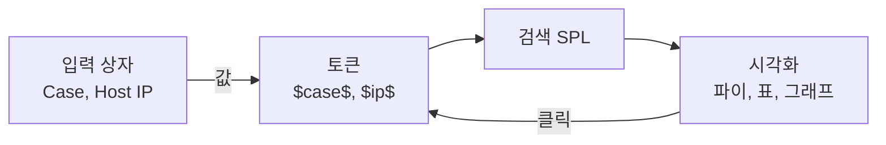

# 대시보드 만들기 기초 (Simple XML) { #dashboard-basics }

<div class="dfir-meta" markdown>
**분류:** Splunk · **대상:** 대시보드를 처음 만드는 사람 · **마지막 수정:** 2026-11-26
</div>

!!! abstract "이 페이지에서 배우는 것"
    검색 하나를 패널로 저장하는 것부터 시작해서, 두 대시보드에 쓰인 **모든 Simple XML 기능**(입력 상자, 토큰, `$$`, CDATA, 베이스 검색, 클릭 필터, 색칠, 패널 안 드롭다운)을 작은 예제로 하나씩 익혀요. 마지막에 패널 하나를 직접 추가해 봐요.

## 왜 Classic(Simple XML)인가 { #why-classic }

Splunk 대시보드는 두 종류예요.

| | Classic (Simple XML) | Dashboard Studio |
|---|---|---|
| 형식 | XML 글 | JSON 글 |
| 손으로 쓰기·복사하기 | 쉬움. 패널 하나가 몇 줄 | 길고 복잡함 |
| 클릭 필터, 패널 안 입력, 베이스 검색 | 모두 됨 | 됨 (방식이 다름) |
| 자료·예제 | 아주 많음 | 적음 |

이 가이드는 **붙여 넣기 쉽고, 한 줄씩 이해하기 쉬운** Classic을 써요. 익숙해지면 Dashboard Studio의 **Import → Classic dashboard**로 옮길 수도 있어요.

## 대시보드는 무엇으로 이루어지나 { #parts }



- **검색(search)** — 패널 하나마다 SPL 검색이 하나 있어요.
- **시각화** — 검색 결과를 숫자, 파이, 막대, 표로 그려요.
- **입력 상자(input)** — 사용자가 고른 값을 **토큰**에 넣어요.
- **토큰(token)** — `$이름$` 모양의 빈칸이에요. 검색 안의 `$case$`가 상자 값으로 바뀐 다음 검색이 돌아요.
- **드릴다운(drilldown)** — 패널을 클릭했을 때 할 일. 보통 클릭한 값을 토큰에 넣어요.

## 1. 첫 패널 만들기 — 검색 화면에서 { #first-panel }

1. **Search & Reporting** 앱에서 아래 검색을 돌려요. 시간 범위는 **All time**.

    ```spl
    index=zeek sourcetype=zeek:conn
    | fillnull value="(not recognised)" service
    | stats count by service
    | sort - count
    ```

    - 1줄: Zeek 연결 로그만 가져와요.
    - 2줄 `fillnull value="..." service` — `service`가 **비어 있는** 이벤트에 `(not recognised)`를 채워요. Zeek가 프로토콜을 못 알아본 연결이에요. 채우지 않으면 다음 줄 `stats ... by service`가 그 이벤트를 **빼 버려요**(by 필드가 비면 그 줄은 사라져요).
    - 3줄 `stats count by service` — 서비스마다 몇 개인지 세요.
    - 4줄 `sort - count` — 많은 순서.

    ```text
    service            count     ← 결과 예시
    dns                5310
    ssl                2190
    (not recognised)   1874
    http               1120
    krb_tcp            61
    smb,gssapi,krb     18
    ```

2. 결과 위 **Visualization** 탭 → 차트 종류에서 **Pie Chart**.
3. 오른쪽 위 **Save As → Existing Dashboard**(또는 **New Dashboard**). New면 제목을 쓰고 **Classic Dashboards**를 골라요. **Panel Title**: `Connections by service` → **Save**.
4. **View Dashboard**를 누르면 파이 하나짜리 대시보드가 보여요.

이제 이 대시보드가 속으로는 어떻게 생겼는지 봐요.

## 2. Source 보기 — XML 뼈대 { #skeleton }

대시보드 → **Edit** → **Source**. 아래와 비슷한 글이 보여요.

```xml
<dashboard version="1.1" theme="dark">
  <label>My first dashboard</label>
  <row>
    <panel>
      <title>Connections by service</title>
      <chart>
        <search>
          <query>index=zeek sourcetype=zeek:conn | fillnull value="(not recognised)" service | stats count by service | sort - count</query>
          <earliest>0</earliest>
          <latest></latest>
        </search>
        <option name="charting.chart">pie</option>
      </chart>
    </panel>
  </row>
</dashboard>
```

| 줄 | 뜻 |
|---|---|
| `<dashboard version="1.1" theme="dark">` | 대시보드 시작. `version="1.1"` = 최신 Classic 형식, `theme="dark"` = 어두운 화면 |
| `<label>` | 대시보드 제목 |
| `<row>` | **가로 한 줄**. 안에 패널을 여러 개 넣으면 같은 폭으로 나란히 놓여요 |
| `<panel>` | 상자 하나 |
| `<title>` | 패널 제목 |
| `<chart>` | 시각화 종류. 파이·막대·선은 모두 `<chart>`이고 `charting.chart` 옵션으로 모양을 정해요. 숫자 하나는 `<single>`, 표는 `<table>` |
| `<search>` / `<query>` | 이 패널의 SPL |
| `<earliest>0</earliest><latest></latest>` | 시간 범위. `0` = 1970년부터 = **All time**, 빈 latest = 지금까지 |
| `<option name="..">` | 모양 설정 |

XML 규칙 두 가지만 기억하면 돼요. **여는 태그 `<x>`는 꼭 `</x>`로 닫아요.** 그리고 **`<` `>` `&` 글자는 그대로 쓰면 안 돼요** — 해결법은 [4번](#dollar-cdata)에 있어요.

## 3. 입력 상자와 토큰 { #inputs-tokens }

입력 상자를 쓰려면 맨 바깥을 `<dashboard>`에서 **`<form>`**으로 바꿔요. 그리고 `<fieldset>` 안에 상자를 둬요.

```xml
<form version="1.1" theme="dark">
  <label>Token practice</label>
  <fieldset submitButton="false" autoRun="true">
    <input type="time" token="tp" searchWhenChanged="true">
      <label>Time range</label>
      <default>
        <earliest>0</earliest>
        <latest></latest>
      </default>
    </input>
    <input type="text" token="idx" searchWhenChanged="true">
      <label>Zeek index</label>
      <default>zeek</default>
    </input>
    <input type="text" token="ip" searchWhenChanged="true">
      <label>Host IP</label>
      <default>*</default>
    </input>
  </fieldset>
  <row>
    <panel>
      <title>Connections by service</title>
      <chart>
        <search>
          <query>index=$idx$ sourcetype=zeek:conn (id_orig_h="$ip$" OR id_resp_h="$ip$") | fillnull value="(not recognised)" service | stats count by service</query>
          <earliest>$tp.earliest$</earliest>
          <latest>$tp.latest$</latest>
        </search>
        <option name="charting.chart">pie</option>
      </chart>
    </panel>
  </row>
</form>
```

- `<fieldset submitButton="false" autoRun="true">` — 상자 묶음. `submitButton="false"` = **Submit** 버튼 없이 값이 바뀌면 바로 검색, `autoRun="true"` = 처음 열 때 바로 검색.
- `<input type="time" token="tp">` — 시간 선택 상자. 고른 범위가 **`$tp.earliest$`**, **`$tp.latest$`** 두 토큰이 돼요.
- `<input type="text" token="idx">` — 글 상자. 쓴 글이 **`$idx$`**가 돼요. `<default>zeek</default>` = 처음 값.
- `searchWhenChanged="true"` — 값을 바꾸면 그 토큰을 쓰는 검색을 다시 돌려요.
- 검색 안 `index=$idx$` → 상자가 `zeek`면 `index=zeek`로 바뀐 뒤 돌아요.
- `(id_orig_h="$ip$" OR id_resp_h="$ip$")` → 상자가 `*`면 `id_orig_h="*"` = **모든 값**이라 필터가 없는 것과 같아요. `10.0.14.129`를 넣으면 그 IP가 **보낸 쪽이든 받은 쪽이든** 걸려요.

!!! warning "상자를 비우지 마세요"
    토큰 값이 비면 그 토큰을 쓰는 패널은 모두 **"Search is waiting for input…"** 상태로 멈춰요. 전체를 보려면 비우지 말고 `*`를 넣어요.

## 4. `$`를 글자로 쓰기, 그리고 CDATA { #dollar-cdata }

**① `$$`** — Simple XML은 `$...$`를 모두 토큰으로 읽어요. 그런데 SMB에는 `IPC$`, `ADMIN$`, `C$`처럼 `$`가 들어간 이름이 많고, 컴퓨터 계정도 `PC-01$`처럼 `$`로 끝나요. 검색 안에서 **글자 `$`는 `$$` 두 번**으로 써요.

| 하고 싶은 것 | Search 화면 | 대시보드 XML |
|---|---|---|
| ADMIN$ 공유 | `share="ADMIN$"` | `share="ADMIN$$"` |
| `$`로 끝나는 이름 | `like(share,"%$")` | `like(share,"%$$")` |
| 정규식 끝(`$`) | `match(f,"\.exe$")` | `match(f,"\.exe$$")` |

대시보드의 쿼리를 **Search 화면에 복사해서 돌릴 때는 `$$`를 `$`로** 바꿔야 해요. 이 가이드 페이지에 적힌 쿼리는 이미 `$` 하나로 바꿔 두었어요.

**② CDATA** — SPL에는 `<`, `>`(예: `where count>=50`)가 자주 나와요. XML에서 이 글자는 태그로 읽혀서 오류가 나요. `<![CDATA[`와 `]]>` 사이에 쓰면 XML이 그 안을 **그냥 글로** 봐요.

```xml
<query><![CDATA[
index=$idx$ sourcetype=zeek:dce_rpc
| stats count by operation
| where count>=50
]]></query>
```

- CDATA 안에서도 **토큰은 바뀌어요**(`$idx$` → `zeek`). `$$` 규칙도 그대로예요.
- 두 대시보드의 모든 쿼리는 CDATA 안에 있어요. 그래서 여러 줄로 써도 되고 `<`, `>`를 마음껏 써도 돼요.

## 5. 드롭다운 — 고정 값과 검색으로 채운 값 { #dropdown }

**Case** 드롭다운은 Splunk에 있는 케이스 이름을 검색으로 가져와요.

```xml
<input type="dropdown" token="case" searchWhenChanged="true">
  <label>Case (pcap_case)</label>
  <choice value="*">All data</choice>
  <default>*</default>
  <fieldForLabel>pcap_case</fieldForLabel>
  <fieldForValue>filter</fieldForValue>
  <search>
    <query><![CDATA[
index=$idx$ sourcetype=zeek:conn
| stats count by pcap_case
| eval filter="pcap_case=\"".pcap_case."\""
| sort pcap_case
]]></query>
    <earliest>0</earliest>
    <latest>now</latest>
  </search>
</input>
```

- `<choice value="*">All data</choice>` — 항상 있는 **고정 선택지**. 고르면 `$case$` = `*`.
- `<search>` — 나머지 선택지를 이 검색 결과로 채워요. 결과 한 줄 = 선택지 하나.
- `<fieldForLabel>pcap_case</fieldForLabel>` — 화면에 **보이는** 글은 `pcap_case` 열.
- `<fieldForValue>filter</fieldForValue>` — 고르면 토큰에 **들어가는 값**은 `filter` 열.
- `eval filter="pcap_case=\"".pcap_case."\""` — `pcap_case="20180511_NIGHT_DEW"` 같은 **검색 조건 전체**를 만들어요. `.`은 글자 이어 붙이기, `\"`는 큰따옴표 글자예요.

**왜 값을 `pcap_case="..."` 통째로 넣나요?** 만약 검색에 `pcap_case="$case$"`라고 쓰고 All을 `*`로 두면, `pcap_case="*"`는 **`pcap_case` 필드가 있는 이벤트만** 찾아요. 팀 환경처럼 이 필드가 아예 없으면 아무것도 안 나와요. 대신 검색에 **`$case$`만** 쓰고, All일 때는 맨 `*`(= 모든 이벤트), 케이스를 고르면 `pcap_case="이름"`이 들어가게 하면 두 환경 모두에서 돌아요.

## 6. 시각화 종류와 자주 쓰는 옵션 { #visualizations }

| 시각화 | 태그 | 검색 결과 모양 | 자주 쓰는 옵션 |
|---|---|---|---|
| 숫자 하나 | `<single>` | 1줄 1열 (`stats count as v`) | `underLabel`, `colorMode`(`none`/`block`), `rangeValues`, `rangeColors` |
| 파이 | `<chart>` + `charting.chart=pie` | 2열: 이름, 숫자 | `charting.chart.showPercent`, `charting.chart.sliceCollapsingThreshold`(작은 조각을 "other"로 묶는 기준) |
| 세로 막대 | `<chart>` + `column` | `timechart` 결과 또는 이름 + 숫자들 | `charting.chart.stackMode=stacked`(쌓기), `charting.legend.placement=bottom` |
| 가로 막대 | `<chart>` + `bar` | 이름 + 숫자들 | `charting.legend.placement` |
| 표 | `<table>` | 아무 모양 | `count`(한 쪽 줄 수), `wrap`, `drilldown`(`none`/`row`/`cell`) |

모든 시각화에 `<option name="height">300</option>`으로 높이를 정할 수 있어요.

## 7. 시간 그래프 — `eval _time=ts` + `timechart` { #timechart }

```spl
index=zeek sourcetype=zeek:dce_rpc
| eval _time=ts
| timechart span=1m limit=12 useother=t count by endpoint
```

- `eval _time=ts` — Splunk의 시간 필드 `_time`을 **Zeek가 기록한 시각 `ts`**로 덮어써요. 환경에 따라 `_time`이 로그를 넣은 날(2026년)로 찍히는 경우가 있어서, 그래프는 항상 `ts`로 그려요. pcapbox처럼 `_time`이 이미 맞으면 아무것도 안 바뀌어요.
- `timechart` — `_time`을 일정한 칸으로 나눠 칸마다 계산해요.
- `span=1m` — 칸 하나 = 1분. 대시보드에서는 `span=$span$`(Timeline bucket 상자).
- `count by endpoint` — 칸마다, `endpoint` 값마다 개수. 값 하나가 그래프의 색 하나가 돼요.
- `limit=12 useother=t` — 많은 순서로 12개까지만 따로 그리고, 나머지는 `OTHER` 하나로 묶어요.

```text
_time               epmapper  lsarpc  netlogon  drsuapi    ← Night Dew 실습 값 (표로 보면)
2018-05-11 02:06    4         0       4         8
2018-05-11 02:07    0         0       0         0
2018-05-11 02:08    0         1       1522      0
```

`column` + `stacked`로 그리면 칸마다 쌓인 막대가 돼요. **갑자기 높은 막대**가 보이면 그 시각을 상세 표에서 확인해요.

## 8. 베이스 검색과 후처리 { #base-search }

파이 세 개(파이프, 엔드포인트, 오퍼레이션)가 모두 `dce_rpc` 로그를 센다면 같은 데이터를 세 번 읽을 필요가 없어요. **베이스 검색**을 한 번 돌리고, 각 패널은 그 결과에 **후처리**만 붙여요.

```xml
<search id="b_dce">
  <query><![CDATA[
index=$idx$ sourcetype=zeek:dce_rpc $case$
| eval pipe=lower(mvindex(split(named_pipe,"\\"),-1))
| fillnull value="-" pipe endpoint operation
| stats count by id_orig_h id_resp_h pipe endpoint operation
]]></query>
  <earliest>$tp.earliest$</earliest>
  <latest>$tp.latest$</latest>
</search>
...
<chart>
  <search base="b_dce">
    <query><![CDATA[
| stats sum(count) as calls by endpoint
]]></query>
  </search>
  <option name="charting.chart">pie</option>
</chart>
```

- `<search id="b_dce">` — `<form>` 바로 안(첫 `<row>` 앞)에 두는 **이름 붙은 검색**이에요. 혼자서는 아무것도 그리지 않아요.
- `<search base="b_dce">` — "b_dce 결과를 받아서 이어서 계산해"라는 뜻. 쿼리는 **`|`로 시작**해요. 시간 범위는 베이스를 따르니 쓰지 않아요.
- 후처리 `stats sum(count) as calls by endpoint` — 베이스가 이미 `count`를 세어 두었으니 **더하기(`sum`)**&#8203;만 해요. 다시 `count`를 쓰면 줄 수를 세게 되어 틀린 숫자가 나와요.

**베이스 검색 규칙**

1. 베이스는 **`stats` 같은 집계 명령으로 끝내요**. 이벤트를 그대로 넘기면 Splunk가 최대 50만 개까지만 넘기고 나머지는 말없이 버려요.
2. `stats ... by` 앞에 **`fillnull`**로 by 필드의 빈 값을 채워요. 안 채우면 그 줄이 빠져서 숫자가 모자라요.
3. 후처리에서 필요한 필드는 베이스의 `by`나 결과 필드에 있어야 해요.

## 9. 클릭으로 필터 걸기 (드릴다운) { #drilldown }

**① 파이 조각 → 입력 상자**

```xml
<input type="text" token="ep" searchWhenChanged="true">
  <label>RPC endpoint</label>
  <default>*</default>
</input>
...
<chart>
  <search base="b_dce"><query>| stats sum(count) as calls by endpoint</query></search>
  <option name="charting.chart">pie</option>
  <drilldown>
    <set token="form.ep">$click.value$</set>
  </drilldown>
</chart>
...
<query><![CDATA[
index=$idx$ sourcetype=zeek:dce_rpc
| search endpoint="$ep$"
| table ts endpoint operation
]]></query>
```

- `$click.value$` — 누른 파이 조각의 **이름**(예: `netlogon`).
- `<set token="form.ep">` — `form.`을 붙이면 토큰뿐 아니라 **화면의 입력 상자 글자**도 바뀌어요. 그래서 지금 어떤 필터가 걸렸는지 눈에 보이고, `*`로 지워서 풀 수 있어요.
- 다른 패널의 `search endpoint="$ep$"`가 `endpoint="netlogon"`이 되어 그 값만 보여요.

!!! note "`other` 조각을 누르면"
    작은 조각들을 묶은 **other**는 실제 값이 아니라서, 누르면 결과가 비어요. 상자에 `*`를 넣어 풀어요.

**② 표의 줄 → 토큰, 숨은 패널 보이기**

```xml
<table>
  <search>...| table time id_orig_h id_resp_h operation uid</search>
  <option name="drilldown">row</option>
  <drilldown>
    <set token="sel_uid">$row.uid$</set>
  </drilldown>
</table>
...
<panel depends="$sel_uid$">
  <title>Every Zeek log for the clicked connection (uid)</title>
  ...
</panel>
```

- `$row.uid$` — 누른 줄의 **`uid` 열 값**. 그래서 표에 `uid` 열이 있어야 해요.
- `<panel depends="$sel_uid$">` — `sel_uid` 토큰이 **생기기 전에는 숨어 있는** 패널. 한 줄을 누르면 나타나요.
- **uid**는 Zeek가 연결마다 붙이는 이름표예요. 같은 연결에서 나온 conn, smb_files, dce_rpc, ntlm 로그가 모두 같은 uid를 가져서, uid 하나로 그 연결의 모든 기록을 모아 볼 수 있어요.

## 10. 패널 안의 "Split by" 드롭다운 { #panel-input }

입력 상자는 `<fieldset>` 말고 **패널 안**에도 둘 수 있어요. 그 패널만을 위한 선택지예요.

```xml
<panel>
  <title>DCE_RPC Timeline</title>
  <input type="dropdown" token="dce_split" searchWhenChanged="true">
    <label>Split by</label>
    <choice value="endpoint">Endpoint</choice>
    <choice value="operation">Operation</choice>
    <choice value="id_orig_h">Client</choice>
    <default>endpoint</default>
  </input>
  <chart>
    <search>
      <query>index=$idx$ sourcetype=zeek:dce_rpc | eval _time=ts | timechart span=$span$ count by $dce_split$</query>
      ...
```

- 토큰에 **필드 이름**을 넣어 `by $dce_split$`를 바꿔요. 같은 데이터를 "어떤 서비스별로", "어떤 PC별로" 바꿔 가며 볼 수 있어요.
- `<input>`은 패널 안에서 **시각화 태그보다 먼저** 와야 해요.

## 11. 색칠하기 { #colors }

**표의 열 — 값마다 색**

```xml
<format type="color" field="sev">
  <colorPalette type="map">{"HIGH":#DC4E41,"MEDIUM":#F1813F,"LOW":#F8BE34,"INFO":#708794}</colorPalette>
</format>
```

- `field="sev"` — 색칠할 열. `type="map"` — `{"값":색}` 짝으로 정확히 같은 값에 색을 입혀요.

**숫자 패널 — 0이면 초록, 1 이상이면 빨강**

```xml
<option name="useColors">1</option>
<option name="colorBy">value</option>
<option name="colorMode">block</option>
<option name="rangeValues">[0]</option>
<option name="rangeColors">["0x53a051","0xdc4e41"]</option>
```

- `rangeValues [0]` — 경계가 0 하나 → 칸이 두 개(0 이하, 0 초과). `rangeColors` — 칸마다 색.
- 두 대시보드는 **나쁜 일일 때만 빨갛게** 되는 숫자(HIGH RPC 호출, 관리자 공유, NTLM 실패, Snort 알림)에 이 설정을 썼어요.

**파이·막대 — 시리즈 이름마다 색**

```xml
<option name="charting.fieldColors">{"FAILED":0xDC4E41,"success":0x53A051}</option>
```

## 12. 연습 — 패널 하나 직접 추가하기 { #exercise }

**목표:** 대시보드 1에 "내부 PC끼리의 RDP(3389) 연결" 표를 더해요.

**① Search 화면에서 먼저 만들어 보기**

```spl
index=zeek sourcetype=zeek:conn pcap_case="<case>" id_resp_p=3389
| stats count as conns sum(orig_bytes) as sent sum(resp_bytes) as received min(ts) as first max(ts) as last values(conn_state) as states by id_orig_h id_resp_h
| eval first=strftime(first,"%Y-%m-%d %H:%M:%S"), last=strftime(last,"%Y-%m-%d %H:%M:%S")
| sort - conns
```

- `id_resp_p=3389` — 목적지 포트가 RDP인 연결만.
- `values(conn_state) as states` — 연결 상태를 모두 모아요. `S0`/`REJ`만 있으면 **시도만 하고 실패**한 거예요.

**② 토큰으로 바꾸기** — `zeek` → `$idx$`, `pcap_case="<case>"` → `$case$`, IP 필터 `(id_orig_h="$ip$" OR id_resp_h="$ip$")`를 더해요.

**③ Source에 붙이기** — 대시보드 → Edit → Source → 마지막 `</row>` 다음, `</form>` 바로 앞에 붙여요.

```xml
<row>
  <panel>
    <title>X1. RDP connections (port 3389)</title>
    <table>
      <search>
        <query><![CDATA[
index=$idx$ sourcetype=zeek:conn $case$ (id_orig_h="$ip$" OR id_resp_h="$ip$") id_resp_p=3389
| stats count as conns sum(orig_bytes) as sent sum(resp_bytes) as received min(ts) as first max(ts) as last values(conn_state) as states by id_orig_h id_resp_h
| eval first=strftime(first,"%Y-%m-%d %H:%M:%S"), last=strftime(last,"%Y-%m-%d %H:%M:%S")
| sort - conns
]]></query>
        <earliest>$tp.earliest$</earliest>
        <latest>$tp.latest$</latest>
      </search>
      <option name="count">10</option>
      <option name="drilldown">none</option>
    </table>
  </panel>
</row>
```

**④ Save** → 맨 아래에 새 패널이 생겨요. 오류가 나면 [자주 나는 오류](#errors)를 보세요.

## 자주 나는 오류 { #errors }

| 메시지 / 증상 | 원인 | 고치기 |
|---|---|---|
| 저장할 때 `XML Syntax Error` | 닫는 태그 빠짐, `<` `&`를 CDATA 밖에 씀 | 줄 번호를 보고 태그 짝 확인, 쿼리를 CDATA로 감싸기 |
| "Search is waiting for input…" | 쓰인 토큰 중 값이 없는 것이 있음 | 상자를 `*`로 채우기, 토큰 이름 오타 확인 |
| 패널 제목에 `$`가 사라짐 | 제목의 `$`도 토큰으로 읽힘 | 제목에서도 `$$` |
| 패널은 "No results"인데 Search에서는 나옴 | 대시보드의 시간 범위나 토큰 값이 달라요 | 패널 오른쪽 아래 돋보기(Open in Search)로 **실제로 돈 쿼리**를 확인 |
| 파이 숫자가 너무 작음 | 후처리에서 `count`를 다시 셈 | `sum(count)` |
| 숫자가 모자람 | `stats by` 필드가 빈 이벤트가 빠짐 | `fillnull value="-" 필드들` |
| 클릭해도 아무 일 없음 | `charting.drilldown`이 `none`, 또는 `<drilldown>` 없음 | `<option name="charting.drilldown">all</option>`과 `<drilldown>` |

다음: [대시보드 1 — 트래픽 개요](overview-dashboard.md)
