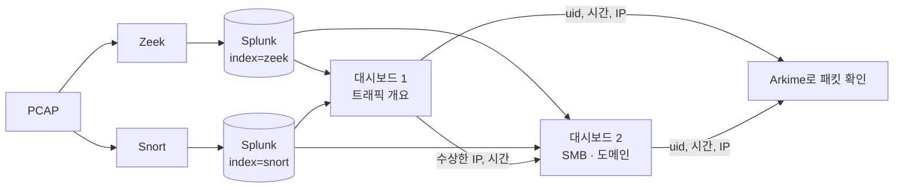

# 트래픽 분석 대시보드 (Zeek + Splunk) { #traffic-analysis-dashboards }

<div class="dfir-meta" markdown>
**분류:** Splunk · **데이터:** Zeek 로그(`index=zeek`), Snort 알림(`index=snort`) · **마지막 수정:** 2026-11-26
</div>

!!! abstract "한 문장 요약"
    PCAP을 Zeek로 돌려 Splunk에 넣으면, 이 페이지의 **대시보드 두 개**로 베이스라이닝(평소 모습 파악)부터 악성 행위 찾기까지 대부분의 트래픽 분석을 할 수 있어요. 하나는 **전체 트래픽 개요**, 하나는 **SMB와 Windows 도메인 전용**이에요. 초보자도 따라 할 수 있게 설치, 패널마다 쓰인 SPL, 결과 읽는 법을 한 줄씩 설명해요.

## 무엇을 만드나요 { #what-you-get }

| 대시보드 | 파일 | 패널 | 답하는 질문 |
|---|---|---|---|
| **Zeek Traffic Analysis - Overview** | `zeek_traffic_overview.xml` | 57개, 섹션 A–J | 캡처는 언제부터 언제까지? 어떤 PC와 서버가 있나? 누가 밖의 누구와 얼마나 이야기했나? 수상한 DNS, HTTP, TLS, 파일, 비콘, 알림은? 한 호스트가 한 일을 시간 순서로 |
| **Zeek SMB and Windows Domain Analysis** | `zeek_smb_ad.xml` | 66개, 섹션 A–I | 누가 누구의 어떤 공유 폴더에 붙었나? 어떤 파일을 열고 지웠나? 어떤 RPC 기능을 불렀나(파이프, 엔드포인트, 오퍼레이션)? NTLM·Kerberos 로그온 성공·실패는? PsExec, WMI, 예약 작업, DCSync 같은 횡적 이동 흔적은? |



## 이 섹션의 페이지 { #pages }

<div class="grid cards" markdown>

-   **[대시보드 만들기 기초](dashboard-basics.md)** — Simple XML 뼈대, 입력과 토큰, `$$`와 CDATA, 베이스 검색, 클릭 필터, 색칠, 패널 하나 직접 추가하기
-   **[대시보드 1 — 트래픽 개요](overview-dashboard.md)** — 섹션 A–J 패널마다 쿼리, 한 줄씩 설명, 결과 예시, 읽는 법
-   **[대시보드 2 — SMB와 Windows 도메인](smb-dashboard.md)** — SMB·DCE/RPC·NTLM·Kerberos 기초, 파이 차트와 타임라인, 횡적 이동 체크리스트, RPC 위험 규칙
-   **[대시보드로 PCAP 분석하는 순서](analysis-workflow.md)** — 어떤 패널을 어떤 순서로 보는지, 공격 유형별로 어디에 보이는지, 호스트 쪽에 넘길 이벤트 ID

</div>

## 준비물 { #prerequisites }

이 대시보드는 홈 랩 **pcapbox** VM이 Splunk에 넣는 Zeek 로그 모양에 맞춰 만들었어요. 모양이 다르면 [다른 환경에 맞추기](#adapt)를 보세요.

| 항목 | pcapbox 값 | 대시보드에서 쓰는 곳 |
|---|---|---|
| Zeek 인덱스 | `index=zeek` | 화면 위 **Zeek index** 상자 (기본값 `zeek`) |
| Snort 인덱스 | `index=snort sourcetype=snort:alert` (`sid`, `msg`, `src_ip`, `dest_ip`, `dest_port`) | **Snort index** 상자 (기본값 `snort`) |
| sourcetype | `zeek:conn`, `zeek:dns`, `zeek:http`, `zeek:ssl`, `zeek:x509`, `zeek:files`, `zeek:smb_mapping`, `zeek:smb_files`, `zeek:dce_rpc`, `zeek:ntlm`, `zeek:kerberos`, `zeek:ldap_search` … | 모든 패널 |
| 필드 이름 | 점 대신 **밑줄**: `id_orig_h`, `id_resp_p`, `times_created`, `certificate_subject` | 모든 패널 |
| 시간 | **`ts`** = UTC epoch 초 | 표의 시간, 타임라인(`eval _time=ts`) |
| 케이스 | `pcap_case` = PCAP 파일 이름 | **Case** 드롭다운 |
| files.log | `tx_hosts`, `rx_hosts`, `file_source`(= Zeek의 `source`), 해시 `md5`/`sha1`/`sha256` | H 섹션, D10 |

**Splunk 시간대를 UTC로:** 오른쪽 위 사용자 이름 → **Preferences** → **Time zone** → `(GMT) Coordinated Universal Time`. 대시보드의 시간은 `strftime(ts, ...)`로 만드는데, 이 함수는 사용자 시간대를 따라요. UTC로 두면 Zeek, Arkime, Snort 시간이 모두 같아져요.

## 0단계 — 데이터 모양 확인 { #check-data }

대시보드를 넣기 전에 **Search & Reporting** 앱에서 세 가지를 확인해요.

**① 어떤 Zeek 로그가 있나**

```spl
| tstats count where index=zeek by sourcetype
| sort - count
```

- `|`로 시작 — 이벤트를 찾는 검색이 아니라 **명령으로 시작**한다는 뜻이에요.
- `tstats count` — 이벤트를 하나씩 읽지 않고 색인 정보로 **아주 빠르게** 세요.
- `where index=zeek` — `zeek` 인덱스만 봐요. 회사 지침대로 `index=*`는 쓰지 않아요.
- `by sourcetype` — 로그 종류마다 한 줄. `sort - count` — 많은 순서(`-` = 내림차순).

```text
sourcetype          count        ← 결과 예시
zeek:conn           12840
zeek:dns            5310
zeek:ssl            2207
zeek:http           1122
zeek:files          980
zeek:dce_rpc        411
zeek:smb_mapping    66
zeek:smb_files      58
zeek:ntlm           21
zeek:kerberos       145
```

없는 로그가 있어도 괜찮아요. 그 로그를 쓰는 패널만 "No results found"가 나와요. 예: `zeek:smb_*`가 없으면 그 캡처에 파일 공유가 없었다는 뜻이에요.

**② 필드 이름 모양**

```spl
index=zeek sourcetype=zeek:conn
| head 1
```

- `head 1` — 첫 이벤트 하나만. 왼쪽 **필드 목록**에서 `id_orig_h`(밑줄)인지 `id.orig_h`(점)인지 봐요. 밑줄이면 그대로 쓰면 돼요.

**③ 케이스 목록**

```spl
index=zeek sourcetype=zeek:conn
| stats count min(ts) as first max(ts) as last by pcap_case
| eval first=strftime(first,"%Y-%m-%d %H:%M:%S"), last=strftime(last,"%Y-%m-%d %H:%M:%S")
```

- `stats ... by pcap_case` — 케이스마다 연결 수와 처음·마지막 시각.
- `strftime(필드, "형식")` — epoch 숫자를 읽을 수 있는 날짜로 바꿔요. `%Y-%m-%d %H:%M:%S` = `2018-05-11 02:06:52` 모양.

```text
pcap_case               count  first                last          ← 결과 예시
LAB_PSEXEC_EXAMPLE      1840   2026-01-20 01:00:03  2026-01-20 01:42:55
LAB_WEB_EXAMPLE         729    2026-01-21 09:10:15  2026-01-21 09:42:06
```

이 이름들이 대시보드 **Case** 드롭다운에 그대로 나와요.

## 1단계 — 대시보드 넣기 { #install }

### 방법 A — 웹 화면에 붙여 넣기 (추천) { #install-ui }

1. 이 페이지 맨 아래 [XML 내려받기](#xml)에서 `zeek_traffic_overview.xml`을 내려받아 메모장으로 열고 **전체 복사**해요 (Ctrl+A → Ctrl+C).
2. Splunk에서 **Search & Reporting** 앱 → 위 메뉴 **Dashboards** → **Create New Dashboard**.
3. **Dashboard Title**: `Zeek Traffic Analysis - Overview`. **Permissions**: `Private`(나만) 또는 `Shared in App`.
4. 만드는 방식에서 **Classic Dashboards**를 골라요 (Dashboard Studio가 아니에요). **Create**.
5. 빈 대시보드가 열리면 **Source** 버튼(편집 화면 위쪽, `</>` 모양)을 눌러요.
6. 안에 있는 글을 **모두 지우고** 복사한 XML을 붙여 넣어요 → **Save**.
7. `zeek_smb_ad.xml`도 같은 방법으로 만들어요 (제목 `Zeek SMB and Windows Domain Analysis`).

!!! tip "Source 버튼이 안 보이면"
    대시보드 오른쪽 위 **Edit** → 편집 화면 위쪽의 **Source**. 새 버전 Splunk에서는 **Edit** 옆 `...` 메뉴에 있을 수도 있어요.

!!! warning "Dashboard Studio에 붙이면 안 돼요"
    이 파일은 **Classic(Simple XML)** 형식이에요. Dashboard Studio는 JSON 형식이라 붙여 넣으면 오류가 나요. Classic을 고른 이유는 [기초 페이지](dashboard-basics.md#why-classic)에 있어요.

### 방법 B — pcapbox에 파일로 넣기 { #install-file }

pcapbox에 SSH로 들어가서 파일을 Splunk 앱 폴더에 두는 방법이에요. 파일은 호스트 PC에서 `\\10.50.10.60\incoming`이 아니라 SSH(scp)로 옮겨요.

```bash
# 호스트 PC (PowerShell)에서
scp zeek_traffic_overview.xml zeek_smb_ad.xml analyst@10.50.10.60:/tmp/

# pcapbox에서
sudo mkdir -p /opt/splunk/etc/apps/pcapbox/local/data/ui/views
sudo cp /tmp/zeek_traffic_overview.xml /tmp/zeek_smb_ad.xml /opt/splunk/etc/apps/pcapbox/local/data/ui/views/
sudo chown -R splunk:splunk /opt/splunk/etc/apps/pcapbox/local/data
```

- `scp 파일 사용자@주소:폴더` — SSH로 파일을 복사해요.
- `.../apps/pcapbox/local/data/ui/views/` — Splunk 앱의 **대시보드 폴더**예요. 파일 이름(확장자 뺀 것)이 대시보드 주소가 돼요.
- `chown splunk:splunk` — Splunk 프로그램이 읽을 수 있게 주인을 바꿔요.

그다음 브라우저에서 `http://10.50.10.60:8000/en-US/debug/refresh`를 열고 **Refresh**를 눌러요(또는 `sudo /opt/splunk/bin/splunk restart`). pcapbox 앱의 **Dashboards** 목록에 두 개가 나와요.

## 2단계 — 화면 위 입력 상자 { #inputs }

두 대시보드 모두 맨 위에 같은 입력 상자가 있어요. 상자 값은 **토큰**(`$이름$`)이 되어 모든 패널의 검색에 들어가요. 토큰은 [기초 페이지](dashboard-basics.md#inputs-tokens)에서 자세히 설명해요.

| 상자 | 토큰 | 기본값 | 하는 일 |
|---|---|---|---|
| **Time range** | `$tp.earliest$`, `$tp.latest$` | All time | 검색 시간 범위. 옛날 PCAP은 **All time**으로 둬요 |
| **Zeek index** | `$idx$` | `zeek` | 다른 인덱스 이름이면 여기만 바꿔요 |
| **Snort index** | `$sidx$` | `snort` | Snort 알림 인덱스 |
| **Case (pcap_case)** | `$case$` | All data(`*`) | 케이스를 고르면 `pcap_case="이름"`이 검색에 들어가요 |
| **Host IP** | `$ip$` | `*` | IP 하나(`10.0.14.129`)나 와일드카드(`10.0.14.*`)를 넣으면 모든 패널이 그 IP가 들어간 연결만 봐요 |
| **Timeline bucket** | `$span$` | `1m` | 시간 그래프의 막대 하나 = 몇 초/분. 30분짜리 PCAP은 `1m`, 몇 시간짜리는 `5m`–`10m` |

SMB 대시보드에는 **클릭 필터 상자** 6개가 더 있어요 — RPC named pipe, RPC endpoint, RPC operation, SMB file action, SMB share, NTLM user. 파이 차트 조각을 누르면 값이 상자에 들어가고, 타임라인과 상세 표가 그 값만 보여 줘요. 상자에 `*`를 넣으면 다시 전체가 보여요.

## 3단계 — 처음 열었을 때 확인 { #first-run }

1. **Case**에서 케이스 하나를 골라요. **Time range**는 **All time**.
2. 대시보드 1 맨 위 **A1–A10** 숫자가 나오면 데이터 연결은 성공이에요. A1·A2 시각이 0단계 ③과 같아야 해요.
3. 패널 하나가 "No results found"면 대개 **그 로그가 이 캡처에 없는 것**이에요(예: HTTP가 없는 캡처의 F 섹션). 오류 메시지(빨간 느낌표)는 [문제 해결](#troubleshooting)을 보세요.
4. 패널 오른쪽 아래 **돋보기(Open in Search)**를 누르면 그 패널 검색이 Search 화면에서 열려요. 쿼리를 고쳐 보며 배우기 좋아요.

## 다른 환경(팀 환경)에 맞추기 { #adapt }

| 다른 점 | 확인 방법 | 고치는 법 |
|---|---|---|
| 인덱스 이름이 다름 | **Settings → Indexes** 에서 확인 | 대시보드의 **Zeek index** 상자에 입력 |
| sourcetype 이름이 다름 (`bro:conn:json`, `corelight_conn` …) | 0단계 ① | Source 편집기에서 **찾아 바꾸기**: `sourcetype=zeek:` → 그 환경 이름 |
| 필드에 점 (`id.orig_h`) | 0단계 ② | 찾아 바꾸기: `id_orig_h` → `id.orig_h` 등. 단 `eval`·`where` 안에서는 `'id.orig_h'`처럼 작은따옴표로 감싸야 해요 |
| files.log에 `file_source` 대신 `source` | `sourcetype=zeek:files | head 1` | `file_source` → 그 환경 필드 이름 |
| `_time`이 색인 시각 | `_time`과 `ts` 비교 | 대시보드는 이미 `ts`를 써요. Time range만 **All time**으로 |
| `pcap_case`가 없음 | — | Case 드롭다운은 **All data**만 나와요. 그대로 쓰면 돼요 |

## 문제 해결 { #troubleshooting }

| 증상 | 원인 | 해결 |
|---|---|---|
| 모든 패널이 "Search is waiting for input…" | 토큰 값이 비어 있음 (상자를 지웠음) | 비운 상자에 `*` 입력 |
| 모든 패널이 "No results found" | Time range가 좁음 / 인덱스 이름 다름 | All time, Zeek index 확인 |
| 한 패널만 "No results found" | 그 로그가 캡처에 없음, 또는 조건에 맞는 것이 없음 | 정상인 경우가 많아요. B1 로그 목록과 비교 |
| `Error in 'eval' command` | 필드 이름이 다름 (점/밑줄) | [다른 환경에 맞추기](#adapt) |
| 시간이 2026년으로 나옴 | 표가 `_time`을 썼음 | 이 대시보드는 `ts`를 써요. 직접 만든 패널이면 `strftime(ts, ...)` |
| 대시보드가 느림 | 데이터가 많음 | Case를 하나로 고르기, Host IP로 좁히기 |
| 저장할 때 XML 오류 | 붙여 넣기가 잘림 | 처음부터 다시 전체 복사 |

## XML 내려받기 { #xml }

- [zeek_traffic_overview.xml 내려받기](zeek_traffic_overview.xml){: download } — 대시보드 1
- [zeek_smb_ad.xml 내려받기](zeek_smb_ad.xml){: download } — 대시보드 2

**복사해서 붙여 넣으려면:** 파일을 내려받아 메모장(또는 VS Code)으로 열고 **Ctrl+A → Ctrl+C**. 또는 GitHub에서 열고 오른쪽 위 **Copy raw file** 버튼을 눌러요 — [zeek_traffic_overview.xml](https://github.com/DFIDwiz-sketch/dfir-handbook/blob/main/docs/blueteam/splunk/traffic-dashboards/zeek_traffic_overview.xml) · [zeek_smb_ad.xml](https://github.com/DFIDwiz-sketch/dfir-handbook/blob/main/docs/blueteam/splunk/traffic-dashboards/zeek_smb_ad.xml).

폐쇄망 환경에는 내려받은 `.xml` 파일 두 개를 옮겨 가서 [방법 A](#install-ui)나 [방법 B](#install-file)로 넣으면 돼요.

다음: [대시보드 만들기 기초](dashboard-basics.md) — XML이 어떻게 생겼는지 알면 패널을 직접 고치고 더할 수 있어요.
