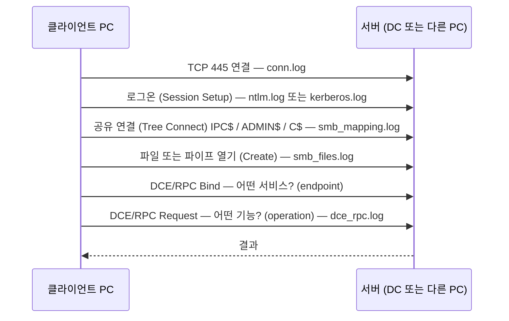

# 대시보드 2 — SMB와 Windows 도메인 { #smb-dashboard }

<div class="dfir-meta" markdown>
**분류:** Splunk · **대시보드:** `zeek_smb_ad.xml` (패널 66개) · **데이터:** Zeek `conn`, `smb_mapping`, `smb_files`, `dce_rpc`, `ntlm`, `kerberos`, `ldap_search`, `files` · **마지막 수정:** 2026-11-26
</div>

!!! abstract "이 대시보드로 하는 일"
    Windows PC끼리, 그리고 PC와 도메인 컨트롤러(DC) 사이의 대화를 모두 펼쳐 봐요. **파이 차트**로 RPC Named Pipe, DCE_RPC Endpoint, RPC Operations, SMB Files action, 공유 종류, NTLM 결과를 한눈에 보고, 조각을 누르면 **DCE_RPC / SMB Files / SMB Mapping / NTLM 타임라인**과 상세 표가 그 값만 보여 줘요. 그 위에 **위험 규칙**(RPC 호출 30여 개를 HIGH/MEDIUM/LOW로 분류, ATT&CK 번호), **횡적 이동 체크리스트**(PsExec, 서비스, 예약 작업, WMI, DCOM, 원격 레지스트리, DCSync), 비밀번호 추측·스프레이, Kerberoasting, LDAP 정찰, 민감한 파일 이름, 한 줄로 이어 본 **도메인 이야기 타임라인**까지 들어 있어요.

!!! tip "이 페이지 읽는 법"
    처음이면 [SMB 기초](#smb-basics)와 [Zeek 기본 설정](#zeek-defaults)을 먼저 읽어요. 그다음 섹션 A–I는 대시보드 순서 그대로예요. 쿼리는 Search 화면에 붙여 돌릴 수 있는 모양이고(`pcap_case="<case>"`를 바꾸세요), 결과 예시는 설명용 랩 데이터예요 — DC01 `10.0.0.10`, PC-01 `10.0.0.101`(사용자 alice), PC-02 `10.0.0.102`(사용자 bob), 도메인 `LAB`. 이 예시 랩에서는 01:20에 PC-01이 PC-02로 **PsExec**을 써요. **Night Dew 실습 값**이라고 적힌 결과만 실제 캡처 값이에요.

## SMB 기초 — 초보자용 { #smb-basics }

**SMB**(Server Message Block, TCP **445**)는 Windows의 **파일 공유** 프로토콜이에요. 그런데 파일만 나르는 게 아니라, **다른 컴퓨터의 Windows 기능을 원격으로 부르는 통로**로도 써요. 그래서 공격자가 옆 PC로 옮겨 갈 때(횡적 이동) 가장 많이 쓰는 길이에요.



| 용어 | 쉬운 뜻 | 예 |
|---|---|---|
| **공유(share)** | 네트워크로 열어 둔 폴더. 주소는 `\\서버\공유` | `\\DC01\SYSVOL`, `\\FS01\Projects` |
| **관리자 공유** | Windows가 자동으로 만드는 숨은 공유. 이름이 `$`로 끝나요 | `ADMIN$`(= `C:\Windows`), `C$`(= C 드라이브 전체) |
| **IPC$** | 파일이 아니라 **파이프**를 여는 특별한 공유 | `\\PC-02\IPC$` |
| **named pipe** | 프로그램끼리 이야기하는 **문**. IPC$ 안의 파일처럼 열어요 | `svcctl`, `samr`, `lsarpc`, `PSEXESVC` |
| **DCE/RPC** | 다른 컴퓨터의 **함수를 부르는** 방법. 파이프로도, 높은 TCP 포트로도 가요 | 서비스 만들기, 사용자 목록 받기 |
| **endpoint** (interface) | RPC로 부르는 **서비스 이름**(UUID로 고름) | `svcctl` = 서비스 관리, `samr` = 계정 관리 |
| **operation** (opnum) | 그 서비스의 **함수 이름** | `CreateServiceW`, `SamrEnumerateUsersInDomain` |
| **NTLM** | 옛 Windows 로그온 방식. 사용자·PC 이름이 그대로 보여요 | `alice@LAB`, `PC-01` |
| **Kerberos** | 도메인의 기본 로그온 방식. 티켓을 받아 써요 | `alice/LAB.LOCAL` → `cifs/PC-02` |
| **uid** | Zeek가 연결마다 붙이는 이름표. 같은 연결의 모든 로그를 이어요 | `CfA9x2...` |

**정상과 이상을 가르는 한 문장:** 평소에는 **PC → DC**(로그온, 그룹 정책: `IPC$`, `SYSVOL`, `NETLOGON`)와 **PC → 파일 서버**가 대부분이에요. **PC → PC**, `ADMIN$`/`C$`, 공유에 프로그램 쓰기, 서비스·예약 작업·WMI 호출은 관리자 작업이거나 **공격**이에요.

## Zeek가 남기는 로그 { #zeek-logs }

| 로그 (sourcetype) | 한 줄 = | 중요한 필드 |
|---|---|---|
| `zeek:conn` | 연결 하나 | `id_orig_h`, `id_resp_h`, `id_resp_p`(445, 139, 135), `conn_state`, `orig_bytes`, `resp_bytes`, `service`(`smb`, `gssapi`, `ntlm`, `krb`) |
| `zeek:smb_mapping` | 공유 연결 하나 | `path`(`\\SERVER\SHARE`), `share_type`(`DISK`, `PIPE`, `PRINT`), `service`, `native_file_system` |
| `zeek:smb_files` | 파일·파이프 동작 하나 | `action`(`SMB::FILE_OPEN` …), `path`, `name`, `size`, `prev_name`(이름 바꾸기 전), `times_created`/`times_modified`, `fuid` |
| `zeek:dce_rpc` | RPC 호출 하나 | `named_pipe`, `endpoint`, `operation`, `rtt`(요청→응답 시간) |
| `zeek:ntlm` | NTLM 로그온 하나 | `username`, `domainname`, `hostname`(클라이언트 PC 이름), `server_nb_computer_name`, `server_dns_computer_name`, `success` |
| `zeek:kerberos` | Kerberos 요청 하나 | `request_type`(`AS`, `TGS`), `client`, `service`, `success`, `error_msg`, `cipher` |
| `zeek:ldap_search` | LDAP 검색 하나 | `base_object`, `scope`, `filter`, `result_count` |
| `zeek:files` | 지나간 파일 하나 | `file_source=SMB`, `is_orig`(방향), `filename`, `md5`, `sha256` |

## Zeek 기본 설정에서 알아 둘 것 { #zeek-defaults }

결과를 잘못 읽지 않으려면 **Zeek가 기본으로 안 남기는 것**을 알아야 해요.

1. **`smb_files`는 기본으로 열기·이름 바꾸기·지우기만 남겨요.** Zeek 기본값(`SMB::logged_file_actions`)은 `FILE_OPEN`, `FILE_RENAME`, `FILE_DELETE`, `PRINT_OPEN`, `PRINT_CLOSE`예요. **`FILE_READ`, `FILE_WRITE`는 안 나와요.** 파일을 썼는지(업로드)는 `zeek:files`의 `is_orig`로 봐요([D10](#d10)).
2. **`dce_rpc`에서 시끄러운 호출 몇 개는 빠져요.** Zeek 기본값(`DCE_RPC::ignored_operations`)이 `winreg`의 `BaseRegOpenKey`, `BaseRegQueryValue`, `BaseRegCloseKey`, `OpenLocalMachine` 등과 `spoolss`의 `RpcSplOpenPrinter`, `RpcClosePrinter`, `wkssvc`의 `NetrWkstaGetInfo`를 버려요. 원격 레지스트리 **읽기**는 잘 안 보이고 **쓰기**(`BaseRegSetValue`, `BaseRegCreateKey`, `BaseRegSaveKey`)는 보여요.
3. **`named_pipe`에 포트 번호가 들어갈 수 있어요.** 이 값은 RPC 응답의 "secondary address"에서 와요. SMB 파이프로 가면 `\PIPE\lsass` 같은 이름, TCP로 바로 가면 `135`, `49158` 같은 **포트 번호**예요. 대시보드는 `\PIPE\`를 떼고 소문자로 바꿔 `lsass`, `135`처럼 보여 줘요.
4. **파이프 이름과 엔드포인트가 다를 수 있어요.** 예: `svcctl` 서비스는 `\PIPE\ntsvcs`로, `samr`·`lsarpc`는 `\PIPE\lsass`로 응답해요([C7](#c7)).
5. **SMB3 암호화가 켜진 공유**는 Zeek가 안을 못 봐요. `conn` 연결만 남고 `smb_*`, `dce_rpc`가 비어요.
6. **TCP LDAP은 Windows가 보통 암호화해요**(sign & seal). `ldap_search`에는 주로 UDP 389의 **DC 찾기 핑**(`NtVer`)과 암호화하지 않는 도구의 검색만 남아요.
7. **Kerberos AP 요청**의 계정 이름은 암호화된 부분에 있어서 빈 값으로 나와요. 정상이에요.

??? note "(선택) pcapbox에서 SMB 읽기·쓰기도 남기기"
    pcapbox의 Zeek 설정 파일 `/opt/pcapbox/zeek/pcapbox.zeek` 끝에 한 줄을 더하면 `smb_files`에 `FILE_READ`, `FILE_WRITE`도 나와요. 그다음 PCAP을 **다시 넣어야** 적용돼요.

    ```bash
    echo 'redef SMB::logged_file_actions += { SMB::FILE_READ, SMB::FILE_WRITE };' | sudo tee -a /opt/pcapbox/zeek/pcapbox.zeek
    zeek -a /opt/pcapbox/zeek/pcapbox.zeek && echo "Zeek 설정 OK"
    ```

    - `redef 이름 += { 값들 };` — Zeek 설정 값에 항목을 더해요. `tee -a` — 파일 끝에 덧붙여요.
    - `zeek -a` — 문법만 검사. `Zeek 설정 OK`가 나오면 성공.
    - 읽기·쓰기는 **조각마다 한 줄**이 생겨서 로그가 많아져요. 팀 환경 설정은 바꾸지 마세요.

## 섹션 지도 { #map }

| 섹션 | 질문 | 주요 패널 |
|---|---|---|
| **A** 한눈에 | 얼마나 많은 SMB·RPC·로그온? 위험 신호가 있나? | 숫자 12개 (위험한 것은 빨강) |
| **B** SMB 연결 | 누가 누구와? 실패·스캔? 데이터 양? | 쌍 표, 상태 파이, 막대, 스캔 표, 시간 그래프 |
| **C** DCE/RPC | 어떤 파이프, 서비스, 함수? 위험한 호출? 몰아치기? | **파이 4개**, 위험 표, 지도, 몰아치기, **DCE_RPC Timeline** + 상세 |
| **D** SMB 파일 | 어떤 파일을 열고, 지우고, 바꿨나? 프로그램? 파이프? | **파이 3개**, **SMB Files Timeline** + 상세, 프로그램, 파이프, 삭제, 민감 파일, 전송 해시 |
| **E** SMB 매핑 | 어떤 공유에? 관리자 공유? PC → PC? | **파이 3개**, **SMB Mapping Timeline** + 상세, 관리자 공유, 매트릭스, DC가 아닌 곳 |
| **F** NTLM | 누가 로그온? 실패? 스프레이? 한 계정이 여러 곳? | **파이 3개**, **NTLM Timeline** + 상세, 패턴, 퍼짐 |
| **G** Kerberos, LDAP | 오류의 뜻? Kerberoasting? 정찰 검색? | 파이 2개, 오류 표, RC4 표, 서비스 표, 시간 그래프, LDAP 표 |
| **H** 횡적 이동 | PsExec·서비스·작업·WMI·DCSync? 원격 접속 방법? 자격증명 접근? 전체 이야기 | 체크리스트, 방법 표, 자격증명 표, **도메인 이야기 타임라인**, uid |
| **I** Snort | Windows 포트의 알림 | 표 |

---

## A. 한눈에 숫자 { #a-glance }

숫자 패널은 모두 아래 섹션의 **베이스 검색**에 한 줄 후처리를 붙인 거예요.

| 패널 | 베이스 | 후처리 | 읽는 법 |
|---|---|---|---|
| A1 SMB connections | `b_smbconn` | `| stats sum(sessions) as v` | 445/139 연결 수 |
| A2 SMB clients / A3 servers | `b_smbconn` | `| stats dc(id_orig_h) as v` / `dc(id_resp_h)` | 서버가 DC 한 대뿐이면 보통. PC가 서버로 나오면 B1 확인 |
| A4 Shares mapped | `b_map` | `| stats dc(path) as v` | 서로 다른 `\\서버\공유` 수 |
| A5 Files touched | `b_smbf` | `| where share!="IPC$" | stats dc(name) as v` | 파이프 말고 진짜 파일 수 |
| A6 DCE/RPC calls · A7 operations | `b_dce` | `sum(count)` · `dc(operation)` | 호출 수, 서로 다른 함수 수 |
| **A8 HIGH-risk RPC calls** | `b_dce` | `| where sev="HIGH" | stats sum(count) as v | eval v=coalesce(v,0)` | **0이 아니면 빨강** → C5 |
| **A9 Admin share mappings** | `b_map` | `| where like(share,"%$") AND share!="IPC$" | ...` | **0이 아니면 빨강** → E6 |
| A10 NTLM logons | `b_ntlm` | `sum(count)` | |
| **A11 NTLM failures** | `b_ntlm` | `| where result="FAILED" | ...` | **0이 아니면 빨강** → F6 |
| **A12 Kerberos errors** | `b_krb` | 정상 오류(`PREAUTH_REQUIRED`, `RESPONSE_TOO_BIG`) 빼고 | **0이 아니면 빨강** → G3 |

- `coalesce(v,0)` — 결과가 없어 `v`가 비면 0을 넣어요. 빈 칸 대신 초록 0이 보여요.
- `like(share,"%$")` — 이름이 `$`로 끝남. `%` = 아무 글자 여러 개.

---

## B. 누가 누구와 SMB를 하나 { #b-conn }

베이스 **`b_smbconn`** — conn 로그에서 SMB 연결만 묶어요.

```spl
index=zeek sourcetype=zeek:conn pcap_case="<case>" (id_resp_p=445 OR id_resp_p=139 OR service="*smb*")
| fillnull value="-" conn_state service
| stats count as sessions sum(orig_bytes) as out sum(resp_bytes) as in sum(duration) as dur min(ts) as first max(ts) as last values(service) as service by id_orig_h id_resp_h id_resp_p conn_state
```

- 1줄: `(id_resp_p=445 OR id_resp_p=139 OR service="*smb*")` — 목적지 포트가 445(SMB) 또는 139(NetBIOS 위의 옛 SMB)이거나, Zeek가 SMB로 알아본 연결. `*smb*` = smb가 들어간 아무 값.
- 2줄: 빈 `conn_state`, `service`를 `-`로 채워요(by에서 빠지지 않게).
- 3줄: **쌍(출발 → 목적지:포트) + 연결 상태**마다 연결 수, 보낸·받은 바이트, 총 시간, 처음·마지막.

### B1. SMB 클라이언트 → 서버 쌍 { #b1 }

```spl
| stats sum(sessions) as sessions sum(out) as out sum(in) as in sum(dur) as dur min(first) as first max(last) as last values(conn_state) as states by id_orig_h id_resp_h id_resp_p
| eval KB_sent=round(out/1024,1), KB_received=round(in/1024,1), seconds=round(dur,1)
| eval first=strftime(first,"%Y-%m-%d %H:%M:%S"), last=strftime(last,"%Y-%m-%d %H:%M:%S")
| table id_orig_h id_resp_h id_resp_p sessions KB_sent KB_received seconds states first last
| sort - sessions
```

- 베이스가 상태별로 나눠 둔 줄을 **쌍마다 다시 더해요**(`sum`). `values(conn_state) as states` — 그 쌍에서 본 상태들.

```text
id_orig_h   id_resp_h   id_resp_p  sessions  KB_sent  KB_received  seconds  states   first                last          ← 결과 예시
10.0.0.101  10.0.0.10   445        8         41.2     88.0         301.5    SF       2026-01-20 01:00:12  2026-01-20 01:40:05
10.0.0.102  10.0.0.10   445        6         30.9     61.7         240.2    SF       2026-01-20 01:00:15  2026-01-20 01:40:11
10.0.0.101  10.0.0.102  445        3         402.8    12.4         95.0     SF RSTO  2026-01-20 01:20:03  2026-01-20 01:22:40
```

**읽는 법:** 위 두 줄은 PC → DC — 정상. 셋째 줄은 **PC-01 → PC-02**이고, 보낸 양(402.8 KB)이 받은 양보다 훨씬 커요 → **PC-01이 PC-02로 무언가를 올렸어요**. 이 쌍을 C, D, E, H 섹션에서 따라가요.

### B2. SMB 연결 상태 · B3. 쌍마다 데이터 양 { #b2 }

```spl
| eval state=case(conn_state="SF","SF - opened and closed normally", conn_state="S0","S0 - no reply", conn_state="REJ","REJ - rejected", conn_state="S1","S1 - open, never closed", conn_state="S2","S2 - client closed, no server reply", conn_state="S3","S3 - server closed, no client reply", conn_state="RSTO","RSTO - client sent reset", conn_state="RSTR","RSTR - server sent reset", conn_state="RSTOS0","RSTOS0 - SYN then reset, no reply", conn_state="RSTRH","RSTRH - server SYN-ACK then reset", conn_state="SH","SH - SYN then FIN, no reply", conn_state="SHR","SHR - server SYN-ACK and FIN only", conn_state="OTH","OTH - no SYN seen (mid-stream)", true(), conn_state)
| stats sum(sessions) as sessions by state
| sort - sessions
```

```spl
| stats sum(out) as out sum(in) as in by id_orig_h id_resp_h
| eval total=out+in
| sort - total
| head 10
| eval pair=id_orig_h." > ".id_resp_h, KB_sent=round(out/1024,1), KB_received=round(in/1024,1)
| table pair KB_sent KB_received
```

- B2 — [대시보드 1 B3](overview-dashboard.md#b3)과 같은 상태 이름표를 붙여요. `S0`, `REJ`가 많으면 대답 없는 445 시도 → B4.
- B3 `eval total=out+in` → 큰 순 10쌍. 막대 두 개(보냄, 받음).

**읽는 법:** 큰 **보냄** 막대 = 클라이언트가 서버에 파일을 씀(프로그램 복사, 자료 모으기). 큰 **받음** 막대 = 서버에서 가져감(파일 서버에서 대량 복사 = 유출 준비?).

### B4. 실패한 SMB 연결과 스캔 { #b4 }

```spl
| eval failed=if(conn_state="S0" OR conn_state="REJ" OR conn_state="RSTOS0" OR conn_state="SH" OR conn_state="RSTRH", sessions, 0)
| stats sum(sessions) as attempts sum(failed) as failed dc(id_resp_h) as targets values(id_resp_h) as target_list min(first) as first max(last) as last by id_orig_h
| eval fail_pct=round(100*failed/attempts,0), target_list=mvindex(target_list,0,9)
| eval verdict=case(targets>=10 AND fail_pct>=50,"Likely SMB scanning or worm spread", targets>=5,"Many SMB targets - check", attempts>=10 AND fail_pct>=80,"Repeated failed SMB connections", true(),"")
| eval first=strftime(first,"%Y-%m-%d %H:%M:%S"), last=strftime(last,"%Y-%m-%d %H:%M:%S")
| table id_orig_h attempts failed fail_pct targets target_list verdict first last
| sort - targets
```

- 1줄 `failed=if(conn_state="S0" OR ..., sessions, 0)` — 대답 없음(`S0`), 거절(`REJ`), 반쯤 열림(`RSTOS0`, `SH`, `RSTRH`)을 **실패**로 세요.
- 2줄: **출발 IP마다** 시도 수, 실패 수, 목적지 수, 목적지 목록.
- 3줄 `fail_pct` — 실패 비율(%). `mvindex(target_list,0,9)` — 목적지는 10개까지만.
- 4줄 `verdict` — 목적지 10곳 이상 + 실패 50% 이상 = **스캔 또는 웜**, 5곳 이상 = 확인 필요, 실패가 계속 = 반복 실패.

**읽는 법:** 한 PC가 짧은 시간에 445로 **여러 IP를 두드리고 대부분 실패**하면 SMB 스캔이에요. WannaCry 같은 **웜**(EternalBlue, MS17-010)이 이렇게 퍼져요 → [EternalBlue (SMBv1)](../../../adversary/eternalblue-smbv1.md).

### B5. 시간에 따른 SMB 연결 { #b5 }

```spl
index=zeek sourcetype=zeek:conn pcap_case="<case>" (id_resp_p=445 OR id_resp_p=139 OR service="*smb*")
| eval _time=ts
| timechart span=1m limit=10 useother=t count by id_resp_h
```

- 패널 안 **Split by**: 서버별(기본), 클라이언트별, 연결 상태별.

**읽는 법:** DC로 가는 SMB가 **주기적으로** 생기는 건 그룹 정책 새로고침 같은 Windows 동작이에요(PC는 기본 90분 + 0–30분 무작위) — 규칙적이라 비콘처럼 보여도 목적지가 DC이고 공유가 `IPC$`·`SYSVOL`이면 정상이에요. **PC → PC** 색이 갑자기 나타나는 시각을 기억해요.

---

## C. DCE/RPC { #c-dcerpc }

베이스 **`b_dce`** — 호출을 묶고, 줄마다 **위험 규칙**을 붙여요.

```spl
index=zeek sourcetype=zeek:dce_rpc pcap_case="<case>"
| eval pipe=lower(mvindex(split(named_pipe,"\\"),-1))
| fillnull value="-" pipe endpoint operation
| stats count min(ts) as first max(ts) as last avg(rtt) as rtt by id_orig_h id_resp_h id_resp_p pipe endpoint operation
| eval ep_l=lower(endpoint), op_l=lower(operation)
| eval rule=case(
    ep_l="drsuapi" AND op_l="drsgetncchanges", "HIGH|Credential access|DCSync - AD replication of password data (normal only DC to DC)|T1003.006",
    ep_l="drsuapi" AND op_l="drsreplicaadd", "HIGH|Defense evasion|New replication partner added (DCShadow)|T1207",
    match(op_l,"^efs"), "HIGH|Credential access|EFSRPC call - authentication coercion (PetitPotam)|T1187",
    ep_l="spoolss" AND match(op_l,"^rpcremotefindfirstprinterchangenotification"), "HIGH|Credential access|Printer change notification - authentication coercion (PrinterBug)|T1187",
    ep_l="spoolss" AND match(op_l,"^rpcaddprinterdriver"), "HIGH|Privilege escalation|Remote printer driver install (PrintNightmare)|T1068",
    ep_l="dfsnm" AND match(op_l,"^netrdfs(add|remove)stdroot"), "HIGH|Credential access|DFS root change - authentication coercion (DFSCoerce)|T1187",
    ep_l="svcctl" AND match(op_l,"^(createservice|startservice|changeserviceconfig)"), "HIGH|Execution|Remote service created or started (PsExec, smbexec)|T1569.002",
    ep_l="svcctl" AND match(op_l,"^deleteservice"), "MEDIUM|Defense evasion|Remote service deleted (clean-up after remote execution)|T1070",
    ep_l="svcctl", "LOW|Discovery|Remote Service Control Manager opened or queried|T1007",
    ep_l="atsvc" AND op_l="jobadd", "HIGH|Execution|Remote scheduled job created (at)|T1053.002",
    ep_l="itaskschedulerservice" AND match(op_l,"^schrpc(registertask|run|enabletask)"), "HIGH|Execution|Remote scheduled task created or run (schtasks /s, atexec)|T1053.005",
    ep_l="itaskschedulerservice" AND op_l="schrpcdelete", "MEDIUM|Defense evasion|Remote scheduled task deleted|T1070",
    ep_l="iwbemservices" AND match(op_l,"^execmethod"), "HIGH|Execution|Remote WMI method run (wmic process call create, wmiexec)|T1047",
    ep_l="iwbemlevel1login", "MEDIUM|Execution|Remote WMI logon (comes before WMI execution)|T1047",
    (ep_l="iremotescmactivator" OR ep_l="isystemactivator") AND op_l="remotecreateinstance", "MEDIUM|Lateral movement|Remote DCOM object created (WMI or DCOM execution)|T1021.003",
    ep_l="winreg" AND op_l="baseregsavekey", "HIGH|Credential access|Registry hive saved remotely (SAM/SYSTEM/SECURITY dump)|T1003.002",
    ep_l="winreg" AND match(op_l,"^basereg(createkey|setvalue|deletevalue|deletekey|restorekey|replacekey)"), "MEDIUM|Persistence|Remote registry write|T1112",
    ep_l="winreg", "LOW|Discovery|Remote registry read|T1012",
    ep_l="samr" AND match(op_l,"^samr(createuser2indomain|createuserindomain|addmembertogroup|addmembertoalias)"), "HIGH|Persistence|Account created or added to a group|T1136.002",
    ep_l="samr" AND match(op_l,"^samr(setinformationuser|changepassworduser|unicodechangepassworduser|oemchangepassworduser)"), "MEDIUM|Persistence|Account password or settings changed|T1098",
    ep_l="samr" AND match(op_l,"^samr(enumerate|querydisplayinformation|getmembers|getaliasmembership|querygroupinfo|queryinformationuser|getgroupsforuser|lookupnamesindomain)"), "MEDIUM|Discovery|Account or group enumeration (net user /domain, BloodHound)|T1087.002",
    ep_l="lsarpc" AND match(op_l,"^lsar(retrieveprivatedata|querysecret|opensecret)"), "HIGH|Credential access|LSA secret read|T1003.004",
    ep_l="lsarpc" AND match(op_l,"^lsar(enumerateaccounts|enumerateaccountrights|enumerateaccountswithuserright|enumeratetrusteddomains)"), "MEDIUM|Discovery|Privilege or trust enumeration|T1069",
    ep_l="srvsvc" AND op_l="netrsessionenum", "MEDIUM|Discovery|Session enumeration - who is logged on where (BloodHound)|T1049",
    ep_l="srvsvc" AND op_l="netrshareenum", "MEDIUM|Discovery|Share enumeration (net view, share scanners)|T1135",
    ep_l="wkssvc" AND op_l="netrwkstauserenum", "MEDIUM|Discovery|Logged-on user enumeration|T1033",
    ep_l="eventlog" AND match(op_l,"^elfrclearelf"), "HIGH|Defense evasion|Event log cleared remotely|T1070.001",
    match(ep_l,"backupkey|bkrp"), "HIGH|Credential access|DPAPI domain backup key request|T1555",
    ep_l="netlogon" AND op_l="netrserverpasswordset2", "MEDIUM|Privilege escalation|Machine password set - Zerologon if many NetrServerAuthenticate calls came first|T1210",
    ep_l="netlogon" AND match(op_l,"^netrlogonsamlogon"), "INFO|Credential access|NTLM logon check passed to the DC - many in a short time = password guessing|T1110",
    match(op_l,"^unknown-"), "LOW|Unknown|Operation number Zeek could not name - unusual|-",
    true(), "INFO|-|Normal or not classified|-")
| eval sev=mvindex(split(rule,"|"),0), category=mvindex(split(rule,"|"),1), meaning=mvindex(split(rule,"|"),2), attack=mvindex(split(rule,"|"),3)
| fields - ep_l op_l rule
```

- 2줄 `pipe=lower(mvindex(split(named_pipe,"\\"),-1))` — `\PIPE\lsass`를 `\`로 나눈 마지막 조각 = `lsass`, 소문자로. `"\\"` = SPL 글자 안의 **역슬래시 하나**. 포트 번호(`135`)는 그대로 남아요.
- 3줄: 빈 값을 `-`로.
- 4줄: 출발, 목적지, 포트, 파이프, 엔드포인트, 오퍼레이션 조합마다 호출 수, 처음·마지막, 평균 `rtt`.
- 5줄부터: **[RPC 위험 규칙](#rpc-risk-rules)** — `sev`(HIGH/MEDIUM/LOW/INFO), `category`, `meaning`(뜻), `attack`(MITRE ATT&CK 번호)을 붙여요. 위험 규칙은 페이지 아래에서 자세히 설명해요.

### C1. RPC Named Pipe · C2. DCE_RPC Endpoint · C3. RPC Operations { #c1 }

세 파이 모두 같은 모양이에요 — **베이스가 센 `count`를 값마다 더하기**.

```spl
| stats sum(count) as calls by pipe
| sort - calls
```

```spl
| stats sum(count) as calls by endpoint
| sort - calls
```

```spl
| stats sum(count) as calls by operation
| sort - calls
```

- `stats sum(count) as calls by pipe` — 파이프마다 호출 수 합. C2는 `by endpoint`, C3는 `by operation`.
- 조각을 **누르면** 위쪽 **RPC named pipe / RPC endpoint / RPC operation** 상자에 값이 들어가고, C9 타임라인과 C10 상세 표가 그 값만 보여 줘요.
- 작은 조각은 0.5% 아래면 **other**로 묶여요(`sliceCollapsingThreshold`). other는 누르지 마세요.

```text
C3 operation                     calls     ← Night Dew 실습 값
NetrLogonSamLogonWithFlags       1522
ept_map                          4
DRSCrackNames                    4
DRSBind                          2
DRSUnbind                        2
NetrServerReqChallenge           1
NetrServerAuthenticate3          1
NetrLogonGetCapabilities         1
NetrLogonGetDomainInfo           1
LsarLookupSids3                  1
```

**읽는 법:** 파이 하나가 거의 꽉 차면 **같은 함수가 몰아쳐 불렸다**는 뜻이에요. Night Dew에서는 `NetrLogonSamLogonWithFlags`(= "이 계정과 비밀번호가 맞나요?"를 DC에 묻기)가 32초 동안 1,522번 — **비밀번호 추측**이었어요. 파이프 파이(C1)에 `135`, `49158`, `49155` 같은 **숫자**가 보이면 SMB 파이프가 아니라 **TCP로 바로** 간 RPC예요.

### C4. 위험 수준별 RPC 호출 { #c4 }

```spl
| stats sum(count) as calls by sev
```

- 색이 고정돼 있어요 — HIGH 빨강, MEDIUM 주황, LOW 노랑, INFO 회색(`charting.fieldColors`).

### C5. 위험한 RPC 호출 (ATT&CK 번호 포함) { #c5 }

```spl
| where sev!="INFO"
| stats sum(count) as calls min(first) as first max(last) as last values(pipe) as pipes by sev category meaning attack id_orig_h id_resp_h endpoint operation
| eval order=case(sev="HIGH",1, sev="MEDIUM",2, true(),3)
| sort order, first
| eval first=strftime(first,"%Y-%m-%d %H:%M:%S"), last=strftime(last,"%Y-%m-%d %H:%M:%S")
| table sev category meaning attack id_orig_h id_resp_h endpoint operation pipes calls first last
```

- 1줄: INFO가 아닌 것만.
- 2줄: 위험 내용 + 출발·목적지 + 엔드포인트·오퍼레이션마다 호출 수, 처음·마지막, 파이프.
- 3–4줄 `order=case(sev="HIGH",1, ...)` 다음 `sort order, first` — HIGH 먼저, 같은 수준에서는 이른 시각 먼저.

```text
sev     category        meaning                                              attack     id_orig_h   id_resp_h   endpoint  operation       pipes   calls  first          ← 결과 예시
HIGH    Execution       Remote service created or started (PsExec, smbexec)  T1569.002  10.0.0.101  10.0.0.102  svcctl    CreateServiceW  ntsvcs  1      2026-01-20 01:20:05
HIGH    Execution       Remote service created or started (PsExec, smbexec)  T1569.002  10.0.0.101  10.0.0.102  svcctl    StartServiceW   ntsvcs  1      2026-01-20 01:20:05
MEDIUM  Defense evasion Remote service deleted (clean-up after remote ...)   T1070      10.0.0.101  10.0.0.102  svcctl    DeleteService   ntsvcs  1      2026-01-20 01:22:39
LOW     Discovery       Remote Service Control Manager opened or queried     T1007      10.0.0.101  10.0.0.102  svcctl    OpenSCManagerW  ntsvcs  2      2026-01-20 01:20:04
```

**읽는 법:** **서비스 관리자 열기 → 서비스 만들기 → 시작 → (몇 분 뒤) 지우기** — PsExec의 전형적인 순서예요. 호스트 쪽에서는 PC-02의 **System 로그 7045**(새 서비스 설치됨)와 **Security 로그 4697**(서비스 설치), **4624 로그온 타입 3**(네트워크 로그온)으로 확인해요 → [PsExec과 SMB](../../../adversary/psexec-smb.md).

### C6. 엔드포인트와 오퍼레이션 지도 · C7. 파이프(포트)와 엔드포인트 { #c7 }

```spl
| stats sum(count) as calls dc(id_orig_h) as clients dc(id_resp_h) as servers values(pipe) as pipes min(first) as first max(last) as last by sev endpoint operation meaning
| eval first=strftime(first,"%Y-%m-%d %H:%M:%S"), last=strftime(last,"%Y-%m-%d %H:%M:%S")
| sort - calls
| table sev endpoint operation calls clients servers pipes meaning first last
```

```spl
| stats sum(count) as calls values(endpoint) as endpoints dc(id_orig_h) as clients by pipe id_resp_p
| sort - calls
```

- C6 — 함수마다 호출 수, 부른 PC 수(`clients`), 받은 서버 수(`servers`), 쓴 파이프, 뜻.
- C7 — 파이프 이름(또는 포트)마다 어떤 엔드포인트가 지나갔나.

```text
pipe      id_resp_p  calls  endpoints          clients    ← C7 결과 예시
lsass     445        62     lsarpc samr        3
ntsvcs    445        5      svcctl             1
srvsvc    445        4      srvsvc             2
135       135        9      epmapper           3
49667     49667      14     drsuapi netlogon   3
```

**읽는 법:** C6에서 **`clients`가 1인 함수**가 눈에 띄어요 — 한 PC만 부른 함수는 그 PC만의 특별한 행동이에요. C7은 이름이 다른 이유를 알려 줘요: `svcctl`은 `ntsvcs` 파이프로, `samr`·`lsarpc`는 `lsass` 파이프로 응답해요.

### C8. 몰아치기 — 1분에 같은 RPC 50번 이상 { #c8 }

```spl
index=zeek sourcetype=zeek:dce_rpc pcap_case="<case>"
| fillnull value="-" endpoint operation
| eval _time=ts
| bin _time span=1m
| stats count as calls by _time id_orig_h id_resp_h endpoint operation
| where calls>=50
| eval minute=strftime(_time,"%Y-%m-%d %H:%M")
| sort - calls
| table minute id_orig_h id_resp_h endpoint operation calls
```

- `eval _time=ts | bin _time span=1m` — 시간을 **1분 칸**으로 내림. `bin` = 칸 나누기.
- `stats count as calls by _time id_orig_h id_resp_h endpoint operation` — 1분마다, 쌍마다, 함수마다 호출 수.
- `where calls>=50` — 50번 이상만.

```text
minute            id_orig_h     id_resp_h   endpoint  operation                    calls   ← Night Dew 실습 값
2018-05-11 02:08  10.0.14.129   10.0.14.3   netlogon  NetrLogonSamLogonWithFlags   1522
```

| 몰아친 함수 | 뜻 |
|---|---|
| `netlogon` `NetrLogonSamLogon*` | 비밀번호 추측(무차별 대입). DC Security 로그 **4776**(NTLM 자격증명 확인, 결과 코드 `0xC000006A` = 틀린 비밀번호, `0x0` = 성공) |
| `netlogon` `NetrServerAuthenticate3` 수백 번 | **Zerologon**(CVE-2020-1472) 시도 — 그다음 `NetrServerPasswordSet2`가 오면 성공 의심 |
| `samr` `Samr...Enumerate...`, `lsarpc` `LsarLookupSids` 많음 | 계정·그룹 목록 수집(BloodHound, enum4linux) |
| `srvsvc` `NetrShareEnum` / `NetrSessionEnum` 여러 서버에 | 공유·세션 정찰 |

### C9. DCE_RPC Timeline { #c9 }

```spl
index=zeek sourcetype=zeek:dce_rpc pcap_case="<case>"
| eval pipe=lower(mvindex(split(named_pipe,"\\"),-1))
| fillnull value="-" pipe endpoint operation
| eval _time=ts
| timechart span=1m limit=12 useother=t count by endpoint
```

- 2–3줄: 베이스와 같은 파이프 정리.
- 대시보드에서는 4줄에 `| search pipe="$pipe$" endpoint="$ep$" operation="$op$"`가 붙어요 — C1–C3 조각을 누른 값.
- `timechart ... count by endpoint` — 패널 안 **Split by**로 Endpoint(기본), Operation, Named pipe, Client, Server를 바꿔요.

**읽는 법:** 로그온 시각의 작은 묶음(epmapper, lsarpc, netlogon, drsuapi)은 정상이에요. **혼자 우뚝 솟은 막대**를 찾고, Split by를 **Client**로 바꿔 누가 했는지 봐요.

### C10. DCE_RPC Timeline — 모든 호출 (상세) { #c10 }

```spl
index=zeek sourcetype=zeek:dce_rpc pcap_case="<case>"
| eval pipe=lower(mvindex(split(named_pipe,"\\"),-1))
| fillnull value="-" pipe endpoint operation
| `rpc_risk_rules`
| sort 0 ts
| head 5000
| eval time=strftime(ts,"%Y-%m-%d %H:%M:%S.%3N"), rtt_ms=round(rtt*1000,1)
| table time sev id_orig_h id_resp_h id_resp_p pipe endpoint operation rtt_ms meaning uid
```

- `` | `rpc_risk_rules` `` — Search 화면에서 돌릴 때 쓰는 **매크로** 자리예요. 대시보드 안에는 위험 규칙 전체가 들어 있어요. 매크로 만드는 법은 [RPC 위험 규칙](#rpc-risk-rules)에 있어요.
- `sort 0 ts | head 5000` — 시간 순 처음 5,000개.
- `rtt_ms=round(rtt*1000,1)` — 요청 → 응답 시간(밀리초). 비어 있으면 응답을 못 봤어요.
- 줄을 **누르면** H5 패널에 그 연결의 모든 로그가 나와요.

```text
time                     sev   id_orig_h   id_resp_h   id_resp_p  pipe    endpoint  operation       rtt_ms  meaning                                     ← 결과 예시
2026-01-20 01:20:04.118  LOW   10.0.0.101  10.0.0.102  445        ntsvcs  svcctl    OpenSCManagerW  0.9     Remote Service Control Manager opened ...
2026-01-20 01:20:05.020  HIGH  10.0.0.101  10.0.0.102  445        ntsvcs  svcctl    CreateServiceW  12.4    Remote service created or started ...
2026-01-20 01:20:05.051  HIGH  10.0.0.101  10.0.0.102  445        ntsvcs  svcctl    StartServiceW   210.7   Remote service created or started ...
```

---

## D. SMB 파일 { #d-files }

베이스 **`b_smbf`** — 파일 동작을 묶어요.

```spl
index=zeek sourcetype=zeek:smb_files pcap_case="<case>"
| eval act=replace(action,"SMB::",""), share=upper(mvindex(split(path,"\\"),-1)), fname=mvindex(split(name,"\\"),-1)
| eval ext=if(match(fname,"\.[A-Za-z0-9]{1,6}$"), lower(mvindex(split(fname,"."),-1)), "(none)")
| fillnull value="-" act share name fname ext
| stats count min(ts) as first max(ts) as last max(size) as size by id_orig_h id_resp_h act share name fname ext
```

- 2줄 `act=replace(action,"SMB::","")` — `SMB::FILE_OPEN` → `FILE_OPEN`. `share=upper(mvindex(split(path,"\\"),-1))` — `\\PC-02\ADMIN$`의 마지막 조각 = `ADMIN$`, 대문자. `fname` — `name`의 마지막 조각(폴더 빼고 파일 이름).
- 3줄 `ext` — 파일 이름이 `.` + 1–6글자로 끝나면 그 글자(소문자), 아니면 `(none)`. `{1,6}` = 1번에서 6번 반복.
- 5줄: 쌍, 동작, 공유, 이름마다 개수, 처음·마지막, 가장 큰 `size`.

### D1. SMB Files action · D2. 공유별 · D3. 확장자별 { #d1 }

```spl
| stats sum(count) as events by act
| sort - events
```

```spl
| stats sum(count) as events by share
| sort - events
```

```spl
| where share!="IPC$"
| stats sum(count) as events by ext
| sort - events
```

- D1·D2 조각을 누르면 **SMB file action / SMB share** 상자에 들어가요(D4, D5 필터).
- D3 `where share!="IPC$"` — 파이프는 빼고 진짜 파일만.

| action | 뜻 |
|---|---|
| `FILE_OPEN` | 파일이나 폴더를 열었어요. **내용을 옮겼다는 뜻은 아니에요**(폴더를 보기만 해도 생겨요) |
| `FILE_RENAME` | 이름을 바꿨어요 (`prev_name` = 이전 이름) |
| `FILE_DELETE` | 지웠어요 |
| `PRINT_OPEN` / `PRINT_CLOSE` | 프린터 공유 |
| `FILE_READ` / `FILE_WRITE` | 기본 설정에서는 안 나와요 ([Zeek 기본 설정](#zeek-defaults)) |

### D4. SMB Files Timeline { #d4 }

```spl
index=zeek sourcetype=zeek:smb_files pcap_case="<case>"
| eval act=replace(action,"SMB::",""), share=upper(mvindex(split(path,"\\"),-1)), fname=mvindex(split(name,"\\"),-1)
| eval ext=if(match(fname,"\.[A-Za-z0-9]{1,6}$"), lower(mvindex(split(fname,"."),-1)), "(none)")
| fillnull value="-" act share name fname ext
| eval _time=ts
| timechart span=1m limit=10 useother=t count by act
```

- 대시보드에서는 `| search act="$act$" share="$share$"`가 붙어요.
- **Split by**: Action(기본), Share, Extension, Client, Server.

### D5. SMB Files Timeline — 모든 파일 동작 (상세) { #d5 }

```spl
index=zeek sourcetype=zeek:smb_files pcap_case="<case>"
| eval act=replace(action,"SMB::",""), share=upper(mvindex(split(path,"\\"),-1)), fname=mvindex(split(name,"\\"),-1)
| eval ext=if(match(fname,"\.[A-Za-z0-9]{1,6}$"), lower(mvindex(split(fname,"."),-1)), "(none)")
| fillnull value="-" act share name fname ext
| sort 0 ts
| head 5000
| eval time=strftime(ts,"%Y-%m-%d %H:%M:%S.%3N"), KB=round(size/1024,1), created=strftime(times_created,"%Y-%m-%d %H:%M:%S"), modified=strftime(times_modified,"%Y-%m-%d %H:%M:%S")
| table time id_orig_h id_resp_h act share name prev_name KB created modified uid fuid
```

- `KB=round(size/1024,1)` — 파일 크기. `created`/`modified` — **파일 자체의** 만든·고친 시각(`times_created`, `times_modified`, SMB가 알려 줌).
- `uid`(연결)와 `fuid`(파일) — 줄을 누르면 H5가 열려요.

```text
time                     id_orig_h   id_resp_h   act        share   name                          prev_name  KB     created              ← 결과 예시
2026-01-20 01:00:13.402  10.0.0.101  10.0.0.10   FILE_OPEN  SYSVOL  lab.local\Policies\{31B2F340-016D-11D2-945F-00C04FB984F9}\gpt.ini    0.1    2025-11-02 03:10:44
2026-01-20 01:20:03.877  10.0.0.101  10.0.0.102  FILE_OPEN  IPC$    srvsvc                                   0.0
2026-01-20 01:20:04.010  10.0.0.101  10.0.0.102  FILE_OPEN  ADMIN$  PSEXESVC.exe                             374.9  2026-01-20 01:20:04
2026-01-20 01:20:05.300  10.0.0.101  10.0.0.102  FILE_OPEN  IPC$    PSEXESVC-PC-01-6672-stdin                0.0
```

**읽는 법:** 첫 줄 — DC의 SYSVOL에서 `gpt.ini`(그룹 정책 버전 파일) 열기 = **정상**. 셋째 줄 — **PC-02의 ADMIN$에 `PSEXESVC.exe`가 방금 생김**(`created`가 연 시각과 같아요) → 복사된 거예요.

### D6. SMB 공유의 프로그램·스크립트 { #d6 }

```spl
| where match(ext,"^(exe|dll|scr|sys|ps1|psm1|bat|cmd|vbs|vbe|js|jse|wsf|hta|msi|lnk|jar|py)$")
| eval on_admin_share=if(like(share,"%$") AND share!="IPC$","YES","")
| stats sum(count) as events values(act) as actions max(size) as size min(first) as first max(last) as last by id_orig_h id_resp_h share name on_admin_share
| eval first=strftime(first,"%Y-%m-%d %H:%M:%S"), last=strftime(last,"%Y-%m-%d %H:%M:%S")
| sort first
| table first id_orig_h id_resp_h share name on_admin_share actions size events last
```

- `match(ext,"^(exe|dll|...)$")` — 실행할 수 있는 확장자들.
- `on_admin_share` — `$`로 끝나는 공유(IPC$ 빼고)면 `YES`, 빨강.

**읽는 법:** `ADMIN$`·`C$`에 놓인 EXE·DLL·스크립트는 **원격 실행의 첫 단계**예요(PsExec, Impacket `smbexec`/`psexec`, Cobalt Strike `jump psexec`). SYSVOL의 `.bat`, `.ps1`, `.vbs`는 로그온 스크립트일 수 있어요(관리자에게 확인).

### D7. IPC$로 연 named pipe { #d7 }

```spl
| where share="IPC$"
| eval p=lower(fname)
| eval note=case(match(p,"^psexesvc"),"HIGH - PsExec service pipe", match(p,"^remcom"),"HIGH - RemCom (PsExec clone)", match(p,"^paexec"),"HIGH - PAExec", match(p,"^csexec"),"HIGH - CSExec", match(p,"^(msagent_|postex_|status_|mojo\.5688\.8052)"),"HIGH - Cobalt Strike style pipe name", match(p,"^msse-[0-9]+-server"),"HIGH - Cobalt Strike style pipe name", p="atsvc","MEDIUM - remote scheduled job", p="svcctl" OR p="ntsvcs","MEDIUM - service control", p="winreg","MEDIUM - remote registry", match(p,"^(samr|lsarpc|lsass|netlogon|srvsvc|wkssvc|spoolss|epmapper|browser|eventlog|efsrpc|netdfs|protected_storage|drsuapi|initshutdown)$"),"INFO - common Windows pipe", true(),"LOW - uncommon pipe name, check")
| eval sev=mvindex(split(note," - "),0)
| stats sum(count) as opens dc(id_orig_h) as clients dc(id_resp_h) as servers min(first) as first by sev note fname
| eval order=case(sev="HIGH",1, sev="MEDIUM",2, sev="LOW",3, true(),4)
| sort order, -opens
| eval first=strftime(first,"%Y-%m-%d %H:%M:%S")
| table sev note fname opens clients servers first
```

- `p=lower(fname)` — 파이프 이름 소문자.
- `note=case(...)` — 알려진 이름표를 붙여요. `^psexesvc` = PsExec, `^remcom` / `^paexec` / `^csexec` = PsExec 비슷한 도구, `msagent_`, `postex_`, `status_`, `msse-숫자-server` = Cobalt Strike 기본 파이프 이름, `atsvc` / `svcctl` / `winreg` = 원격 작업·서비스·레지스트리, 나머지 흔한 Windows 파이프 = INFO, 모르는 이름 = LOW.

```text
sev   note                                  fname                         opens  clients  servers  first           ← 결과 예시
HIGH  HIGH - PsExec service pipe            psexesvc                      1      1        1        2026-01-20 01:20:05
HIGH  HIGH - PsExec service pipe            psexesvc-pc-01-6672-stdin     1      1        1        2026-01-20 01:20:05
INFO  INFO - common Windows pipe            lsarpc                        14     3        2        2026-01-20 01:00:12
```

**읽는 법:** PsExec은 `PSEXESVC` 파이프와 `PSEXESVC-<보낸PC>-<PID>-stdin/stdout/stderr` 파이프 세 개를 만들어요 — **보낸 PC 이름이 파이프 이름에** 들어 있어요. 공격 도구는 이름을 바꿀 수 있으니, 처음 보는 이름(LOW)도 시각과 함께 확인해요.

### D8. 지우고 이름 바꾼 파일 · D9. 민감한 파일 이름 { #d8 }

```spl
| where act="FILE_DELETE" OR act="FILE_RENAME"
| stats sum(count) as events dc(name) as files values(ext) as exts min(first) as first max(last) as last by id_orig_h id_resp_h share act
| eval minutes=round((last-first)/60,1)
| eval first=strftime(first,"%Y-%m-%d %H:%M:%S"), last=strftime(last,"%Y-%m-%d %H:%M:%S")
| sort - files
| table id_orig_h id_resp_h share act files events minutes exts first last
```

```spl
| eval f=lower(fname)
| eval why=case(f="ntds.dit","AD database (all password hashes)", match(f,"^(sam|system|security)(\.(save|bak|hiv|hive|old))?$"),"Registry hive copy (local hashes, LSA secrets)", match(f,"\.dmp$"),"Memory dump (lsass?)", match(f,"\.(kirbi|ccache)$"),"Kerberos ticket file", f="groups.xml" OR f="services.xml" OR f="scheduledtasks.xml" OR f="datasources.xml","Group Policy Preferences file (may hold a password, T1552.006)", match(f,"\.(kdbx|pfx|p12|pem|key)$"),"Password vault, certificate or key", match(f,"^(unattend|sysprep)\.xml$"),"Install answer file (may hold a password)")
| where isnotnull(why)
| stats sum(count) as events values(act) as actions min(first) as first by id_orig_h id_resp_h share name why
| eval first=strftime(first,"%Y-%m-%d %H:%M:%S")
| sort first
```

- D8 — 쌍·공유·동작마다 파일 수, 확장자들, 걸린 분(`minutes`).
- D9 `why=case(...)` — 이름으로 뜻을 붙여요: `ntds.dit`(AD 데이터베이스 — 모든 비밀번호 해시), `sam`/`system`/`security`(레지스트리 하이브 사본), `.dmp`(메모리 덤프 — lsass?), `.kirbi`/`.ccache`(Kerberos 티켓), `groups.xml` 등(그룹 정책 기본 설정 — 비밀번호가 들어 있을 수 있음, T1552.006), `.kdbx`/`.pfx`/`.key`, `unattend.xml`.

**읽는 법:** 몇 분 안에 **파일 수백 개 이름 바꾸기**, 그리고 새 확장자가 하나로 같으면 **랜섬웨어 암호화**예요. 지우기만 있으면 흔적 지우기(PsExec이 끝나고 `PSEXESVC.exe`를 지워요). D9에 `ntds.dit`나 하이브가 나오면 **자격증명 탈취** → [SAM·NTDS 추출](../../../adversary/sam-ntds-extraction.md).

### D10. SMB로 오간 파일 — 방향과 해시 { #d10 }

```spl
index=zeek sourcetype=zeek:files pcap_case="<case>" file_source=SMB
| eval direction=if(is_orig="true" OR is_orig="T","upload: client > server","download: server > client")
| sort 0 ts
| eval time=strftime(ts,"%Y-%m-%d %H:%M:%S"), KB=round(seen_bytes/1024,1), tx=mvjoin(tx_hosts,","), rx=mvjoin(rx_hosts,",")
| table time tx rx direction filename mime_type KB md5 sha256 fuid
```

- `file_source=SMB` — files.log 중 SMB로 지나간 파일.
- `direction=if(is_orig="true" ..., "upload: client > server", "download: server > client")` — `is_orig`가 참 = 연결을 **시작한 쪽(클라이언트)이 보낸** 파일 = 업로드.

```text
time                 tx          rx          direction                 filename      mime_type              KB     md5                               ← 결과 예시
2026-01-20 01:20:04  10.0.0.101  10.0.0.102  upload: client > server   PSEXESVC.exe  application/x-dosexec  374.9  (해시)
```

**읽는 법:** `smb_files`가 "열었다"만 알려 줄 때, 여기서 **정말 옮겨졌는지, 어느 방향인지, 해시가 무엇인지** 확인해요. 같은 해시가 다른 PC에도 보이면 같은 도구가 퍼진 거예요.

---

## E. SMB 공유 연결 (매핑) { #e-mapping }

베이스 **`b_map`**.

```spl
index=zeek sourcetype=zeek:smb_mapping pcap_case="<case>"
| eval share=upper(mvindex(split(path,"\\"),-1)), server_name=upper(mvindex(split(path,"\\"),2))
| eval share_class=case(share="IPC$","IPC$ - named pipes for RPC", share="ADMIN$","ADMIN$ - Windows folder (admin only)", match(share,"^[A-Z]\$$"),"Drive admin share (C$ etc.)", share="SYSVOL" OR share="NETLOGON","SYSVOL / NETLOGON - Group Policy and logon scripts", like(share,"%$"),"Other hidden share", true(),"Normal share")
| fillnull value="-" share server_name share_type service native_file_system share_class
| stats count min(ts) as first max(ts) as last by id_orig_h id_resp_h path share server_name share_class share_type service native_file_system
```

- 2줄: `\\PC-02\ADMIN$` → `share=ADMIN$`, `server_name=PC-02`(조각 2번째 = 0부터 세어 `2`).
- 3줄 `share_class` — 공유 종류: `IPC$`(파이프), `ADMIN$`, `C$` 같은 드라이브 관리자 공유(`^[A-Z]\$$` = 영문자 하나 + `$`), `SYSVOL`/`NETLOGON`(그룹 정책, 로그온 스크립트), 다른 숨은 공유(`$`로 끝남), 보통 공유.

### E1. 공유 형식 · E2. 공유 이름 · E3. 공유 종류 { #e1 }

```spl
| stats sum(count) as maps by share_type
```

```spl
| stats sum(count) as maps by share
| sort - maps
```

```spl
| stats sum(count) as maps by share_class
| sort - maps
```

- E2 조각을 누르면 **SMB share** 상자에 들어가요(E4, E5, 그리고 D4, D5도 함께 걸러져요).
- `share_type`: `DISK` = 폴더, `PIPE` = IPC$, `PRINT` = 프린터.

### E4. SMB Mapping Timeline · E5. 모든 공유 연결 (상세) { #e4 }

```spl
index=zeek sourcetype=zeek:smb_mapping pcap_case="<case>"
| eval share=upper(mvindex(split(path,"\\"),-1)), server_name=upper(mvindex(split(path,"\\"),2))
| eval share_class=case(share="IPC$","IPC$ - named pipes for RPC", share="ADMIN$","ADMIN$ - Windows folder (admin only)", match(share,"^[A-Z]\$$"),"Drive admin share (C$ etc.)", share="SYSVOL" OR share="NETLOGON","SYSVOL / NETLOGON - Group Policy and logon scripts", like(share,"%$"),"Other hidden share", true(),"Normal share")
| fillnull value="-" share server_name share_type service native_file_system share_class
| eval _time=ts
| timechart span=1m limit=10 useother=t count by share
```

```spl
index=zeek sourcetype=zeek:smb_mapping pcap_case="<case>"
| eval share=upper(mvindex(split(path,"\\"),-1)), server_name=upper(mvindex(split(path,"\\"),2))
| eval share_class=case(share="IPC$","IPC$ - named pipes for RPC", share="ADMIN$","ADMIN$ - Windows folder (admin only)", match(share,"^[A-Z]\$$"),"Drive admin share (C$ etc.)", share="SYSVOL" OR share="NETLOGON","SYSVOL / NETLOGON - Group Policy and logon scripts", like(share,"%$"),"Other hidden share", true(),"Normal share")
| fillnull value="-" share server_name share_type service native_file_system share_class
| sort 0 ts
| head 5000
| eval time=strftime(ts,"%Y-%m-%d %H:%M:%S.%3N")
| table time id_orig_h id_resp_h path share share_class share_type service native_file_system uid
```

- **Split by**: Share(기본), Share category, Share type, Client, Server.
- E5 — `native_file_system`(보통 `NTFS`), `service`(SMB1의 `A:`, `IPC` 등).

```text
time                     id_orig_h   id_resp_h   path               share    share_class                              share_type   ← E5 결과 예시
2026-01-20 01:00:12.950  10.0.0.101  10.0.0.10   \\DC01\IPC$        IPC$     IPC$ - named pipes for RPC               PIPE
2026-01-20 01:00:13.390  10.0.0.101  10.0.0.10   \\DC01\SYSVOL      SYSVOL   SYSVOL / NETLOGON - Group Policy ...     DISK
2026-01-20 01:20:03.870  10.0.0.101  10.0.0.102  \\PC-02\IPC$       IPC$     IPC$ - named pipes for RPC               PIPE
2026-01-20 01:20:03.990  10.0.0.101  10.0.0.102  \\PC-02\ADMIN$     ADMIN$   ADMIN$ - Windows folder (admin only)     DISK
```

### E6. 관리자·숨은 공유 · E7. 누가 어떤 공유에 { #e6 }

```spl
| where like(share,"%$") AND share!="IPC$"
| stats sum(count) as maps min(first) as first max(last) as last by id_orig_h id_resp_h path share_class
| eval first=strftime(first,"%Y-%m-%d %H:%M:%S"), last=strftime(last,"%Y-%m-%d %H:%M:%S")
| sort first
```

```spl
| stats sum(count) as maps values(share) as shares min(first) as first max(last) as last by id_orig_h id_resp_h server_name
| eval first=strftime(first,"%Y-%m-%d %H:%M:%S"), last=strftime(last,"%Y-%m-%d %H:%M:%S")
| sort - maps
```

**읽는 법:** `ADMIN$`/`C$` 연결은 **관리자 권한**이 있어야 해요. 관리 도구(SCCM, 백업, 백신 배포)도 쓰지만, 평범한 PC가 다른 PC의 `ADMIN$`에 붙으면 **횡적 이동**을 먼저 의심해요. 호스트 쪽에서는 받은 PC의 **Security 로그 5140**(공유에 접근함)과 **5145**(공유 안의 파일·파이프 접근 검사)로 확인해요.

### E8. DC가 아닌 곳으로의 SMB { #e8 }

```spl
index=zeek pcap_case="<case>" (sourcetype=zeek:smb_mapping OR sourcetype=zeek:kerberos)
| eval kdc=if(sourcetype="zeek:kerberos", id_resp_h, null())
| eventstats values(kdc) as dcs
| where sourcetype="zeek:smb_mapping"
| eval dclist=",".coalesce(mvjoin(dcs,","),"").","
| eval target=if(like(dclist,"%,".id_resp_h.",%"),"domain controller","NOT a domain controller")
| eval share=upper(mvindex(split(path,"\\"),-1))
| stats count as maps values(share) as shares min(ts) as first max(ts) as last by id_orig_h id_resp_h target
| eval first=strftime(first,"%Y-%m-%d %H:%M:%S"), last=strftime(last,"%Y-%m-%d %H:%M:%S")
| sort target, -maps
```

- 1줄: smb_mapping과 kerberos를 함께 가져와요.
- 2줄 `kdc=if(sourcetype="zeek:kerberos", id_resp_h, null())` — Kerberos 요청을 **받은 IP = DC**.
- 3줄 `eventstats values(kdc) as dcs` — 모든 줄에 **DC 목록**을 붙여요. `eventstats`는 `stats`처럼 계산하지만 줄을 없애지 않고 결과를 **각 줄에 덧붙여요**.
- 4줄: 이제 smb_mapping 줄만 남겨요.
- 5–6줄 `dclist=",".coalesce(mvjoin(dcs,","),"")."," ` → `,10.0.0.10,` 같은 글. `like(dclist,"%,".id_resp_h.",%")` — 목적지 IP가 그 안에 있으면 DC. 앞뒤 쉼표는 `10.0.0.1`이 `10.0.0.10`에 잘못 걸리지 않게 해요.
- 8줄 `sort target, -maps` — "NOT a domain controller"가 먼저(알파벳 순서), 그다음 많은 순.

**읽는 법:** 주황색 **NOT a domain controller** 줄 = DC가 아닌 곳(파일 서버 또는 **다른 PC**)으로의 SMB. 파일 서버면 정상이고, 그 목적지가 C 섹션에서 **PC로 보였다면**(대시보드 1 C3) 횡적 이동 후보예요. Kerberos 로그가 없는 캡처(도메인 아님)에서는 모든 줄이 NOT으로 나와요.

---

## F. NTLM { #f-ntlm }

베이스 **`b_ntlm`**.

```spl
index=zeek sourcetype=zeek:ntlm pcap_case="<case>"
| eval result=case(success="true" OR success="T","success", success="false" OR success="F","FAILED", true(),"no result seen")
| eval user=if(len(username)>0, username."@".coalesce(domainname,"?"), "(no user name seen)")
| fillnull value="-" hostname server_nb_computer_name server_dns_computer_name server_tree_name domainname
| stats count min(ts) as first max(ts) as last by id_orig_h id_resp_h id_resp_p user hostname server_nb_computer_name result
```

- 2줄 `result` — `success`가 `true`/`T` = 성공, `false`/`F` = **FAILED**, 없음 = 결과를 못 봄(응답 패킷이 캡처에 없음).
- 3줄 `user` — `username@domainname` 모양. 이름이 없으면 `(no user name seen)`(익명 로그온이거나 AUTHENTICATE 메시지를 못 봄). 역슬래시(`LAB\alice`) 대신 `@`를 쓴 건 클릭 필터가 역슬래시 때문에 깨지지 않게 하려는 거예요.
- 4줄: 빈 필드를 `-`로.

### F1. NTLM 결과 · F2. NTLM 사용자 · F3. 클라이언트 PC 이름 { #f1 }

```spl
| stats sum(count) as logons by result
```

```spl
| stats sum(count) as logons by user
| sort - logons
```

```spl
| stats sum(count) as logons by hostname
| sort - logons
```

- F2 조각을 누르면 **NTLM user** 상자에 들어가요(F4, F5 필터).
- F3 `hostname` — 클라이언트가 **스스로 밝힌** 컴퓨터 이름. 공격 도구는 이 값을 비우거나 지어내기도 해요.

```text
user                    logons        ← F2 결과 예시
PC-01$@LAB              6
alice@LAB               4
administrator@LAB       2
```

**읽는 법:** `$`로 끝나는 사용자 = **컴퓨터 계정**(PC가 DC에 로그온, 정상). 사람 계정 중 **administrator**나 서비스 계정이 PC → PC로 쓰이면 주의해요. F3에서 **실제 PC 이름과 다른 이름**(예: `WIN-ABC123`, `kali`, 빈 값)이 보이면 공격 도구나 외부 장치예요.

### F4. NTLM Timeline · F5. 모든 NTLM 로그온 (상세) { #f4 }

```spl
index=zeek sourcetype=zeek:ntlm pcap_case="<case>"
| eval result=case(success="true" OR success="T","success", success="false" OR success="F","FAILED", true(),"no result seen")
| eval user=if(len(username)>0, username."@".coalesce(domainname,"?"), "(no user name seen)")
| fillnull value="-" hostname server_nb_computer_name server_dns_computer_name server_tree_name domainname
| eval _time=ts
| timechart span=1m limit=10 useother=t count by result
```

```spl
index=zeek sourcetype=zeek:ntlm pcap_case="<case>"
| eval result=case(success="true" OR success="T","success", success="false" OR success="F","FAILED", true(),"no result seen")
| eval user=if(len(username)>0, username."@".coalesce(domainname,"?"), "(no user name seen)")
| fillnull value="-" hostname server_nb_computer_name server_dns_computer_name server_tree_name domainname
| sort 0 ts
| head 5000
| eval time=strftime(ts,"%Y-%m-%d %H:%M:%S.%3N")
| table time id_orig_h id_resp_h id_resp_p user hostname server_nb_computer_name server_dns_computer_name server_tree_name result uid
```

- F4 — 기본 **Split by = Result**. FAILED 빨강, success 초록.
- F5 — `server_nb_computer_name`(서버의 NetBIOS 이름), `server_dns_computer_name`(서버 DNS 이름), `server_tree_name`(도메인 DNS 이름). `result` 열도 색칠돼요.

```text
time                     id_orig_h   id_resp_h   id_resp_p  user                hostname  server_nb_computer_name  result    ← F5 결과 예시
2026-01-20 01:00:12.940  10.0.0.101  10.0.0.10   445        PC-01$@LAB          PC-01     DC01                     success
2026-01-20 01:20:03.861  10.0.0.101  10.0.0.102  445        administrator@LAB   PC-01     PC-02                    success
```

**읽는 법:** 두 번째 줄 — 01:20:03에 PC-01이 **administrator 계정으로 PC-02에 NTLM 로그온**, 바로 뒤에 ADMIN$ 연결(E5)과 서비스 만들기(C5)가 와요. 도메인에서 Kerberos 대신 **NTLM으로 PC에 로그온**하는 것은 IP로 접속했거나 **해시로 로그온(pass-the-hash)**&#8203;했을 때 자주 보여요 → [Pass-the-Hash](../../../adversary/pass-the-hash.md).

### F6. 비밀번호 추측, 스프레이, 퍼짐 — 출발지별 { #f6 }

```spl
| eval failed=if(result="FAILED",count,0)
| stats sum(count) as attempts sum(failed) as failures dc(user) as users dc(id_resp_h) as targets dc(hostname) as client_names values(hostname) as names min(first) as first max(last) as last by id_orig_h
| eval verdict=case(users>=5 AND failures>=5,"Password spraying - many users fail", users<=2 AND failures>=10,"Brute force - one user, many failures", targets>=5,"One source logs on to many hosts - lateral movement / pass-the-hash?", client_names>=2,"Source sends more than one computer name - check", true(),"")
| eval first=strftime(first,"%Y-%m-%d %H:%M:%S"), last=strftime(last,"%Y-%m-%d %H:%M:%S")
| sort -failures, -targets
| table id_orig_h attempts failures users targets client_names names verdict first last
```

- 1줄 `failed=if(result="FAILED",count,0)` — 실패만 세는 칸.
- 2줄: 출발 IP마다 시도, 실패, 서로 다른 사용자 수, 목적지 수, 스스로 밝힌 PC 이름 수.
- 3줄 `verdict`:
    - 사용자 5명 이상 + 실패 5번 이상 → **비밀번호 스프레이**(비밀번호 하나로 여러 계정)
    - 사용자 2명 이하 + 실패 10번 이상 → **무차별 대입**(계정 하나에 비밀번호 여러 개)
    - 목적지 5곳 이상 → **한 곳에서 여러 PC로 로그온** — 횡적 이동, pass-the-hash?
    - PC 이름 2개 이상 → 한 IP가 여러 이름을 댐 — 확인 필요

### F7. 여러 곳에 쓰인 계정 { #f7 }

```spl
| stats sum(count) as logons dc(id_orig_h) as sources dc(id_resp_h) as targets values(id_resp_h) as target_list values(result) as results min(first) as first by user
| where targets>=2
| eval target_list=mvindex(target_list,0,9)
| eval first=strftime(first,"%Y-%m-%d %H:%M:%S")
| sort - targets
```

**읽는 법:** 한 계정이 짧은 시간에 **여러 PC**에 로그온하면 관리자 작업이거나 **훔친 자격증명이 퍼지는 중**이에요. 호스트 쪽 확인: 받은 PC들의 **4624**(로그온 성공, 타입 3 = 네트워크), **4625**(로그온 실패), DC의 **4776**(NTLM 확인).

---

## G. Kerberos와 LDAP { #g-kerberos }

SMB 로그온은 도메인에서 보통 **Kerberos**로 해요. 그래서 SMB를 보려면 Kerberos도 같이 봐야 해요. 베이스 **`b_krb`**.

```spl
index=zeek sourcetype=zeek:kerberos pcap_case="<case>"
| eval result=case(success="true","success", isnotnull(error_msg), error_msg, success="false","failed", true(),"no reply seen")
| eval account=lower(mvindex(split(client,"/"),0)), acct_type=case(like(account,"%$"),"computer", len(account)>0,"user", true(),"(hidden in ticket)")
| fillnull value="-" request_type service cipher account
| stats count min(ts) as first max(ts) as last by id_orig_h id_resp_h request_type account acct_type service cipher result
```

- 2줄 `result` — 성공이면 `success`, 오류가 있으면 **오류 이름 그대로**(`KDC_ERR_PREAUTH_FAILED` 등).
- 3줄 `account` — `client`(`alice/LAB.LOCAL`)의 앞 조각, 소문자. `acct_type` — `$`로 끝나면 computer, 이름이 있으면 user, 없으면 `(hidden in ticket)`.
- **`request_type`**: `AS` = 로그온할 때 **TGT**(입장권) 받기, `TGS` = 서비스(예: `cifs/PC-02` = PC-02의 SMB)용 **티켓** 받기.

### G1. Kerberos 결과 · G2. 요청 형식과 암호 { #g1 }

```spl
| stats sum(count) as events by result
| sort - events
```

```spl
| eval t=request_type." ".cipher
| stats sum(count) as events by t
| sort - events
```

- G2 `t=request_type." ".cipher` — 예: `TGS aes256-cts-hmac-sha1-96`, `TGS rc4-hmac`.

**읽는 법:** `KDC_ERR_PREAUTH_REQUIRED`는 **정상**이에요 — "먼저 비밀번호로 만든 증명을 보내 주세요"라는 첫 대답이고, 클라이언트는 바로 다시 보내요. 요즘 도메인은 **AES**를 써요. **RC4(`rc4-hmac`)** 티켓이 많으면 오래된 설정이거나 공격 도구가 일부러 약한 암호를 고른 거예요 → G4.

### G3. Kerberos 오류 설명 { #g3 }

```spl
| where result!="success"
| stats sum(count) as events dc(account) as accounts values(account) as account_list min(first) as first by id_orig_h result
| eval account_list=mvindex(account_list,0,9)
| eval meaning=case(result="KDC_ERR_PREAUTH_REQUIRED","Normal - first step of a logon, the client then sends pre-authentication", result="KDC_ERR_PREAUTH_FAILED","Wrong password", result="KDC_ERR_C_PRINCIPAL_UNKNOWN","User name does not exist (user enumeration if many)", result="KDC_ERR_S_PRINCIPAL_UNKNOWN","Service name (SPN) does not exist", result="KDC_ERR_CLIENT_REVOKED","Account disabled or locked out", result="KDC_ERR_KEY_EXPIRED","Password expired", result="KDC_ERR_ETYPE_NOSUPP","Encryption type not supported", result="KRB_AP_ERR_SKEW","Clock difference too big", result="KDC_ERR_BADOPTION","Option not allowed (sometimes delegation abuse)", result="KRB_ERR_RESPONSE_TOO_BIG","Normal - reply too big for UDP, client retries over TCP", result="KDC_ERR_WRONG_REALM","Wrong domain name", true(),"")
| eval first=strftime(first,"%Y-%m-%d %H:%M:%S")
| sort - events
| table id_orig_h result meaning events accounts account_list first
```

| 오류 | 뜻 | 많으면 |
|---|---|---|
| `KDC_ERR_PREAUTH_REQUIRED` | 정상 첫 단계 | — |
| `KDC_ERR_PREAUTH_FAILED` | 비밀번호 틀림 | 비밀번호 추측·스프레이 (DC 이벤트 **4771**: Kerberos 사전 인증 실패) |
| `KDC_ERR_C_PRINCIPAL_UNKNOWN` | 없는 사용자 | **사용자 이름 알아내기**(kerbrute 같은 도구) |
| `KDC_ERR_S_PRINCIPAL_UNKNOWN` | 없는 서비스 이름(SPN) | 설정 오류, 정찰 |
| `KDC_ERR_CLIENT_REVOKED` | 계정 잠김·사용 안 함 | 추측 때문에 잠김 (DC 이벤트 **4740**: 계정 잠김) |
| `KDC_ERR_ETYPE_NOSUPP` | 암호 형식 안 맞음 | 오래된 장치, RC4 강요 |
| `KRB_AP_ERR_SKEW` | 시계 차이가 큼 | 시간 설정 문제 |
| `KRB_ERR_RESPONSE_TOO_BIG` | UDP로는 너무 큼 → TCP로 다시 | 정상 |

### G4. 계정별 RC4 서비스 티켓 (Kerberoasting 확인) { #g4 }

```spl
| where request_type="TGS" AND match(cipher,"rc4") AND NOT like(service,"krbtgt%")
| stats sum(count) as tickets dc(service) as services values(service) as service_list min(first) as first by id_orig_h account
| eval verdict=if(services>=3,"Possible Kerberoasting - many RC4 service tickets",""), service_list=mvindex(service_list,0,9)
| eval first=strftime(first,"%Y-%m-%d %H:%M:%S")
| sort - services
```

- `where request_type="TGS" AND match(cipher,"rc4") AND NOT like(service,"krbtgt%")` — RC4로 받은 서비스 티켓(입장권 갱신 `krbtgt`는 빼고).
- `verdict` — 한 계정이 서로 다른 서비스 3개 이상 → **Kerberoasting 의심**.

**읽는 법:** **Kerberoasting** = 서비스 계정의 티켓을 받아 가서 **집에서 비밀번호를 푸는** 공격이에요. RC4 티켓이 풀기 쉬워서 도구가 RC4를 골라요. DC 이벤트 **4769**(서비스 티켓 요청, 암호 형식 `0x17` = RC4)로 확인해요 → [Kerberoasting](../../../adversary/kerberoasting.md).

### G5. 요청한 서비스 · G6. Kerberos 시간 그래프 { #g5 }

```spl
| where request_type="TGS"
| eval svc_type=mvindex(split(service,"/"),0)
| stats sum(count) as tickets dc(account) as accounts values(account) as account_list min(first) as first by service svc_type
| eval account_list=mvindex(account_list,0,9)
| eval first=strftime(first,"%Y-%m-%d %H:%M:%S")
| sort - tickets
```

```spl
index=zeek sourcetype=zeek:kerberos pcap_case="<case>"
| eval result=case(success="true","success", isnotnull(error_msg), error_msg, success="false","failed", true(),"no reply seen")
| eval account=lower(mvindex(split(client,"/"),0)), acct_type=case(like(account,"%$"),"computer", len(account)>0,"user", true(),"(hidden in ticket)")
| fillnull value="-" request_type service cipher account
| eval _time=ts
| timechart span=1m limit=10 useother=t count by result
```

- G5 `svc_type=mvindex(split(service,"/"),0)` — `cifs/PC-02.lab.local` → `cifs`.

| svc_type | 뜻 |
|---|---|
| `cifs` | 그 호스트의 **SMB**(파일 공유) |
| `host` | 그 호스트의 여러 서비스(예약 작업, WMI 등) |
| `ldap` | DC의 LDAP |
| `HTTP` | 웹(WinRM도 `HTTP/`) |
| `MSSQLSvc` | SQL 서버 |
| `krbtgt` | 입장권 갱신 |

**읽는 법:** **`cifs/PC-02`** 티켓이 보이면 누군가 Kerberos로 PC-02의 SMB에 접속했어요. NTLM(F)에 안 보이는 PC → PC SMB를 여기서 찾을 수 있어요.

### G7. Zeek가 읽은 LDAP 검색 { #g7 }

```spl
index=zeek sourcetype=zeek:ldap_search pcap_case="<case>"
| eval fl=lower(filter)
| eval flag=case(match(fl,"ntver"),"DC locator ping (normal)", match(fl,"serviceprincipalname"),"SPN search - Kerberoasting recon", match(fl,"4194304"),"No pre-auth search - AS-REP roasting recon", match(fl,"admincount"),"adminCount search - privileged accounts", match(fl,"msds-allowedtodelegateto|524288|msds-allowedtoactonbehalfofotheridentity"),"Delegation search", match(fl,"\(objectclass=\*\)"),"Everything search - bulk directory dump", match(fl,"objectcategory=computer|objectclass=computer"),"Computer list", match(fl,"samaccounttype=805306368|objectcategory=person|objectclass=user"),"User list", match(fl,"objectclass=group|objectcategory=group"),"Group list", match(fl,"trusteddomain"),"Domain trust search", true(),"")
| stats count as searches sum(result_count) as results values(flag) as flags min(ts) as first by id_orig_h id_resp_h base_object scope filter
| eval first=strftime(first,"%Y-%m-%d %H:%M:%S")
| sort - results
```

- `fl=lower(filter)` — 검색 조건 소문자.
- `flag=case(...)` — 정찰에 자주 쓰는 조건에 이름표: `ntver`(DC 찾기 핑, 정상), `serviceprincipalname`(SPN 찾기 → Kerberoasting 준비), `4194304`(사전 인증 안 하는 계정 → AS-REP Roasting 준비), `admincount`(관리자 계정), 위임 관련, `(objectclass=*)`(전부 가져오기), 컴퓨터·사용자·그룹 목록, 신뢰 관계.
- `sum(result_count) as results` — 돌려받은 항목 수.

**읽는 법:** 한 PC가 **결과 수천 개**짜리 넓은 검색을 여러 번 하면 BloodHound/SharpHound 같은 AD 정찰이에요. 다만 Windows의 TCP LDAP은 보통 암호화되어 여기 안 나와요([Zeek 기본 설정](#zeek-defaults) 6번). 안 보인다고 없는 게 아니에요.

---

## H. 횡적 이동과 전체 이야기 { #h-lateral }

### H1. 횡적 이동 체크리스트 — 클라이언트 > 서버 쌍마다 { #h1 }

이 패널이 SMB 대시보드의 **핵심 판정표**예요. 세 로그(smb_mapping, smb_files, dce_rpc)에서 신호를 하나씩 찾아 **쌍마다 0/1로** 보여 줘요.

```spl
index=zeek pcap_case="<case>" (sourcetype=zeek:smb_mapping OR sourcetype=zeek:smb_files OR sourcetype=zeek:dce_rpc)
| eval share=upper(mvindex(split(path,"\\"),-1)), fname=lower(mvindex(split(name,"\\"),-1)), ep=lower(endpoint), op=lower(operation)
| eval s_admin=if(sourcetype="zeek:smb_mapping" AND like(share,"%$") AND share!="IPC$",1,0)
| eval s_exe=if(sourcetype="zeek:smb_files" AND like(share,"%$") AND share!="IPC$" AND match(fname,"\.(exe|dll|bat|ps1|cmd|vbs|scr)$"),1,0)
| eval s_svc=if(sourcetype="zeek:dce_rpc" AND ep="svcctl" AND match(op,"^(createservice|startservice|changeserviceconfig)"),1,0)
| eval s_pipe=if(sourcetype="zeek:smb_files" AND share="IPC$" AND match(fname,"^(psexesvc|remcom|paexec|csexec)"),1,0)
| eval s_task=if(sourcetype="zeek:dce_rpc" AND (ep="atsvc" OR ep="itaskschedulerservice") AND match(op,"^(jobadd|schrpcregistertask|schrpcrun|schrpcenabletask)"),1,0)
| eval s_wmi=if(sourcetype="zeek:dce_rpc" AND ((ep="iwbemservices" AND match(op,"^execmethod")) OR ep="iwbemlevel1login"),1,0)
| eval s_dcom=if(sourcetype="zeek:dce_rpc" AND (ep="iremotescmactivator" OR ep="isystemactivator") AND op="remotecreateinstance",1,0)
| eval s_reg=if(sourcetype="zeek:dce_rpc" AND ep="winreg" AND match(op,"^basereg(createkey|setvalue|savekey)"),1,0)
| eval s_dcsync=if(sourcetype="zeek:dce_rpc" AND ep="drsuapi" AND op="drsgetncchanges",1,0)
| eval exe_name=if(s_exe=1, share."\\".fname, null()), rpc_call=if(s_svc+s_task+s_wmi+s_dcom+s_reg+s_dcsync>0, endpoint."::".operation, null())
| stats max(s_admin) as admin_share max(s_exe) as exe_copied max(s_svc) as service max(s_pipe) as psexec_pipe max(s_task) as task max(s_wmi) as wmi max(s_dcom) as dcom max(s_reg) as reg_write max(s_dcsync) as dcsync values(exe_name) as files values(rpc_call) as rpc_calls min(ts) as first max(ts) as last by id_orig_h id_resp_h
| eval score=admin_share+exe_copied+service+psexec_pipe+task+wmi+dcom+reg_write+dcsync
| where score>0
| eval verdict=case(dcsync=1,"HIGH - DCSync (replication request)", exe_copied=1 AND (service=1 OR psexec_pipe=1),"HIGH - PsExec-style: program copied, then run as a service", service=1,"HIGH - remote service created or started", task=1,"HIGH - remote scheduled task", wmi=1,"HIGH - remote WMI execution", psexec_pipe=1,"HIGH - PsExec pipe", dcom=1,"MEDIUM - remote DCOM activation", exe_copied=1,"MEDIUM - program copied to an admin share", reg_write=1,"MEDIUM - remote registry write", admin_share=1,"LOW - admin share opened", true(),"")
| eval sev=mvindex(split(verdict," - "),0)
| eval first=strftime(first,"%Y-%m-%d %H:%M:%S"), last=strftime(last,"%Y-%m-%d %H:%M:%S")
| sort - score
| table sev verdict id_orig_h id_resp_h admin_share exe_copied service psexec_pipe task wmi dcom reg_write dcsync files rpc_calls first last
```

- 2줄: 공유 이름, 파일 이름, 엔드포인트, 오퍼레이션을 정리(소문자).
- 3–11줄: 신호마다 **0 또는 1** 칸을 만들어요.

| 칸 | 조건 | 뜻 |
|---|---|---|
| `admin_share` | smb_mapping에서 `$`로 끝나는 공유(IPC$ 빼고) | 관리자 공유를 열었어요 |
| `exe_copied` | smb_files에서 관리자 공유에 `.exe`, `.dll`, `.bat`, `.ps1`, `.cmd`, `.vbs`, `.scr` | 프로그램을 놓았어요 |
| `service` | svcctl `CreateService*` / `StartService*` / `ChangeServiceConfig*` | 원격 서비스 만들기·시작 |
| `psexec_pipe` | IPC$의 `psexesvc`, `remcom`, `paexec`, `csexec` | PsExec류 파이프 |
| `task` | atsvc `JobAdd` / ITaskSchedulerService `SchRpcRegisterTask`·`SchRpcRun`·`SchRpcEnableTask` | 원격 예약 작업 |
| `wmi` | IWbemServices `ExecMethod*` / IWbemLevel1Login | 원격 WMI 실행 |
| `dcom` | IRemoteSCMActivator·ISystemActivator `RemoteCreateInstance` | 원격 DCOM 객체 만들기 |
| `reg_write` | winreg `BaseRegCreateKey`·`BaseRegSetValue`·`BaseRegSaveKey` | 원격 레지스트리 쓰기·저장 |
| `dcsync` | drsuapi `DRSGetNCChanges` | DC 복제 요청 = DCSync |

- 12줄 `exe_name`, `rpc_call` — 실제 파일 이름과 호출 이름을 모아 둬요.
- 13줄 `stats max(...) by id_orig_h id_resp_h` — 쌍마다 **한 번이라도 1이면 1**(`max`).
- 14줄 `score` — 1의 개수. 15줄 `where score>0` — 신호가 있는 쌍만.
- 16줄 `verdict` — 강한 것부터: DCSync → 복사 + 서비스(PsExec) → 서비스 → 작업 → WMI → PsExec 파이프 → DCOM → 복사만 → 레지스트리 → 관리자 공유만.

```text
sev   verdict                                                    id_orig_h   id_resp_h   admin_share exe_copied service psexec_pipe task wmi dcom reg_write dcsync files                rpc_calls                                     ← 결과 예시
HIGH  HIGH - PsExec-style: program copied, then run as a service 10.0.0.101  10.0.0.102  1           1          1       1           0    0   0    0         0      ADMIN$\psexesvc.exe  svcctl::CreateServiceW svcctl::StartServiceW
```

**읽는 법:** 한 줄이 곧 "**누가 누구에게 어떤 방법으로**"예요. 방법별 공격 설명: [PsExec과 SMB](../../../adversary/psexec-smb.md), [WMI와 WinRM](../../../adversary/wmi-winrm.md), [DCSync](../../../adversary/dcsync.md). 정상 예외: SCCM·백신 배포 서버는 많은 PC에 서비스를 만들어요 — 출발지가 **관리 서버인지** 확인해요.

### H2. 내부 호스트끼리의 원격 접속 { #h2 }

```spl
index=zeek sourcetype=zeek:conn pcap_case="<case>"
| eval src_scope=case(match(id_orig_h,"^(22[4-9]|23[0-9]|255)\.|\.255$|^ff"),"multicast/broadcast", match(id_orig_h,"^(10\.|192\.168\.|172\.(1[6-9]|2[0-9]|3[01])\.|127\.|169\.254\.|0\.0\.0\.0$|fe80:|fc|fd)"),"internal", true(),"external")
| eval dst_scope=case(match(id_resp_h,"^(22[4-9]|23[0-9]|255)\.|\.255$|^ff"),"multicast/broadcast", match(id_resp_h,"^(10\.|192\.168\.|172\.(1[6-9]|2[0-9]|3[01])\.|127\.|169\.254\.|0\.0\.0\.0$|fe80:|fc|fd)"),"internal", true(),"external")
| where src_scope="internal" AND dst_scope="internal" AND NOT (conn_state="S0" OR conn_state="REJ")
| eval method=case(id_resp_p=445 OR id_resp_p=139,"SMB", id_resp_p=135,"RPC endpoint mapper (DCOM / WMI start)", id_resp_p=3389,"RDP", id_resp_p=5985 OR id_resp_p=5986,"WinRM / PowerShell remoting", id_resp_p=22,"SSH", id_resp_p=23,"Telnet", id_resp_p=5900,"VNC", true(),null())
| where isnotnull(method)
| stats count as conns values(method) as methods sum(orig_bytes) as out sum(resp_bytes) as in min(ts) as first max(ts) as last by id_orig_h id_resp_h
| eval KB_sent=round(out/1024,1), KB_received=round(in/1024,1)
| eval first=strftime(first,"%Y-%m-%d %H:%M:%S"), last=strftime(last,"%Y-%m-%d %H:%M:%S")
| sort - conns
| table id_orig_h id_resp_h methods conns KB_sent KB_received first last
```

- 내부 → 내부, 대답한 연결 중 포트로 방법을 정해요: 445/139 SMB, 135 RPC(DCOM·WMI 시작), 3389 RDP, 5985/5986 WinRM, 22 SSH, 23 Telnet, 5900 VNC.

**읽는 법:** SMB 말고 **RDP**나 **WinRM**으로 옮겨 갈 수도 있어요. 한 PC에서 여러 방법이 같은 목적지로 가면 수상해요 → [RDP](../../../adversary/rdp.md).

### H3. 자격증명 접근 신호 { #h3 }

```spl
index=zeek pcap_case="<case>" (sourcetype=zeek:dce_rpc OR sourcetype=zeek:smb_files)
| `rpc_risk_rules`
| eval f=lower(mvindex(split(name,"\\"),-1))
| eval finding=case(sourcetype="zeek:dce_rpc" AND category="Credential access" AND sev!="INFO", endpoint."::".operation." - ".meaning, sourcetype="zeek:smb_files" AND f="ntds.dit", "File ntds.dit - AD database", sourcetype="zeek:smb_files" AND match(f,"^(sam|system|security)(\.(save|bak|hiv|hive|old))?$"), "File ".f." - registry hive copy", sourcetype="zeek:smb_files" AND match(f,"\.dmp$"), "File ".f." - memory dump", sourcetype="zeek:smb_files" AND match(f,"\.(kirbi|ccache)$"), "File ".f." - Kerberos ticket", sourcetype="zeek:smb_files" AND f="groups.xml", "File groups.xml - GPP password file")
| where isnotnull(finding)
| stats count min(ts) as first max(ts) as last by id_orig_h id_resp_h finding
| eval first=strftime(first,"%Y-%m-%d %H:%M:%S"), last=strftime(last,"%Y-%m-%d %H:%M:%S")
| sort first
```

- dce_rpc 중 위험 규칙의 **Credential access**(DCSync, 하이브 저장, LSA 비밀, DPAPI 백업 키, 인증 강요 — INFO 제외)와 smb_files의 민감한 파일 이름을 **하나의 목록**으로 모아요.

**읽는 법:** DCSync(`DRSGetNCChanges`)는 **DC끼리만** 정상이에요. 출발지가 PC면 공격이에요. DC의 **4662**(디렉터리 개체 접근 — 복제 권한 GUID `1131f6aa-...`, `1131f6ad-...`)로 확인해요. PetitPotam·PrinterBug 같은 **인증 강요**는 DC가 공격자 쪽으로 로그온하게 만들어 NTLM 릴레이로 이어져요 → [LLMNR·NTLM 릴레이](../../../adversary/llmnr-ntlm-relay.md), [PrintNightmare](../../../adversary/printnightmare.md).

### H4. Windows 도메인 이야기 — 한 줄 타임라인 { #h4 }

dce_rpc, smb_mapping, smb_files, ntlm, kerberos, ldap_search를 **시간 순서 한 표**로 이어요. 사건 보고서의 타임라인을 쓸 때 가장 많이 써요.

```spl
index=zeek pcap_case="<case>" (sourcetype=zeek:dce_rpc OR sourcetype=zeek:smb_mapping OR sourcetype=zeek:smb_files OR sourcetype=zeek:ntlm OR sourcetype=zeek:kerberos OR sourcetype=zeek:ldap_search)
| `rpc_risk_rules`
| eval log=replace(sourcetype,"zeek:",""), share=upper(mvindex(split(path,"\\"),-1)), fname=lower(mvindex(split(name,"\\"),-1))
| eval what=case(
    log="dce_rpc", "RPC ".coalesce(endpoint,"?")."::".coalesce(operation,"?")." via ".coalesce(named_pipe,"?"),
    log="smb_mapping", "MAP ".coalesce(path,"?")." (".coalesce(share_type,"?").")",
    log="smb_files", replace(coalesce(action,"?"),"SMB::","")." ".coalesce(path,"")." ".coalesce(name,"?"),
    log="ntlm", "NTLM ".coalesce(username,"?")."@".coalesce(domainname,"?")." from ".coalesce(hostname,"?")." success=".coalesce(success,"?"),
    log="kerberos", "KRB ".coalesce(request_type,"?")." ".coalesce(client,"?")." > ".coalesce(service,"?")." ".if(success="true","ok",coalesce(error_msg,"failed")),
    log="ldap_search", "LDAP search base=".coalesce(base_object,"")." filter=".coalesce(filter,""))
| eval sev=case(log="dce_rpc", sev,
    log="smb_mapping" AND like(share,"%$") AND share!="IPC$", "MEDIUM",
    log="smb_files" AND like(share,"%$") AND share!="IPC$" AND match(fname,"\.(exe|dll|bat|ps1|cmd|vbs|scr)$"), "HIGH",
    log="smb_files" AND share="IPC$" AND match(fname,"^(psexesvc|remcom|paexec|csexec)"), "HIGH",
    log="ntlm" AND success="false", "LOW",
    log="kerberos" AND match(error_msg,"PREAUTH_FAILED|PRINCIPAL_UNKNOWN|CLIENT_REVOKED"), "LOW",
    true(), "INFO")
| sort 0 ts
| head 5000
| eval time=strftime(ts,"%Y-%m-%d %H:%M:%S.%3N")
| table time sev log id_orig_h id_resp_h id_resp_p what uid
```

- `` | `rpc_risk_rules` `` — dce_rpc 줄에 위험 수준을 붙여요(대시보드는 전체 규칙이 들어 있음).
- `what=case(log="dce_rpc", "RPC 엔드포인트::오퍼레이션 via 파이프", log="smb_mapping", "MAP 경로 (형식)", ...)` — 로그마다 한 줄 요약.
- `sev=case(...)` — dce_rpc는 위험 규칙 값, 관리자 공유 연결 = MEDIUM, 관리자 공유의 프로그램 = HIGH, PsExec 파이프 = HIGH, NTLM 실패·Kerberos 비밀번호 오류 = LOW, 나머지 INFO.

```text
time                     sev     log          id_orig_h   id_resp_h   id_resp_p  what                                                      ← 결과 예시
2026-01-20 01:20:03.861  INFO    ntlm         10.0.0.101  10.0.0.102  445        NTLM administrator@LAB from PC-01 success=true
2026-01-20 01:20:03.870  INFO    smb_mapping  10.0.0.101  10.0.0.102  445        MAP \\PC-02\IPC$ (PIPE)
2026-01-20 01:20:03.990  MEDIUM  smb_mapping  10.0.0.101  10.0.0.102  445        MAP \\PC-02\ADMIN$ (DISK)
2026-01-20 01:20:04.010  HIGH    smb_files    10.0.0.101  10.0.0.102  445        FILE_OPEN \\PC-02\ADMIN$ PSEXESVC.exe
2026-01-20 01:20:04.118  LOW     dce_rpc      10.0.0.101  10.0.0.102  445        RPC svcctl::OpenSCManagerW via \PIPE\ntsvcs
2026-01-20 01:20:05.020  HIGH    dce_rpc      10.0.0.101  10.0.0.102  445        RPC svcctl::CreateServiceW via \PIPE\ntsvcs
2026-01-20 01:20:05.051  HIGH    dce_rpc      10.0.0.101  10.0.0.102  445        RPC svcctl::StartServiceW via \PIPE\ntsvcs
2026-01-20 01:20:05.300  HIGH    smb_files    10.0.0.101  10.0.0.102  445        FILE_OPEN \\PC-02\IPC$ PSEXESVC-PC-01-6672-stdin
```

**읽는 법:** 로그온 → IPC$ → ADMIN$ → 프로그램 놓기 → 서비스 관리자 → 서비스 만들기 → 시작 → PsExec 파이프. **2초 안에** 일어난 일이 한눈에 보여요. 줄을 누르면 H5에 그 연결의 모든 기록이 나와요.

### H5. 누른 연결의 모든 Zeek 기록 { #h5 }

```spl
index=zeek pcap_case="<case>" (uid="<uid>" OR conn_uids="<uid>" OR uids="<uid>")
| sort 0 ts
| eval time=strftime(ts,"%Y-%m-%d %H:%M:%S.%3N")
| table time sourcetype _raw
```

- C10, D5, E5, F5, H4의 줄을 누르면 나타나요. `_raw` = Zeek JSON 원문.

---

## I. Windows 포트의 Snort 알림 { #i-snort }

```spl
index=snort sourcetype=snort:alert pcap_case="<case>" (dest_port=445 OR dest_port=139 OR dest_port=135 OR dest_port=88 OR dest_port=389 OR src_port=445 OR src_port=139)
| stats count min(_time) as first max(_time) as last by sid msg src_ip dest_ip dest_port
| eval first=strftime(first,"%Y-%m-%d %H:%M:%S"), last=strftime(last,"%Y-%m-%d %H:%M:%S")
| sort first
```

- 445, 139(SMB), 135(RPC), 88(Kerberos), 389(LDAP) 포트의 알림만.

**읽는 법:** `ET EXPLOIT ... MS17-010`, `ETERNALBLUE`, `DOUBLEPULSAR` 같은 이름은 SMB 취약점 공격이에요. 알림 시각에 B4(스캔)와 H1(체크리스트)을 함께 봐요. 직접 룰을 쓰는 법: [DC SMB 공격과 Snort 룰](../../../training/pcap-ir-labs/dc-smb-and-snort-rules.md).

---

## RPC 위험 규칙 { #rpc-risk-rules }

C 섹션과 H 섹션이 쓰는 분류 규칙 전체예요. 대시보드 안에 그대로 들어 있어요.

```spl
| eval ep_l=lower(endpoint), op_l=lower(operation)
| eval rule=case(
    ep_l="drsuapi" AND op_l="drsgetncchanges", "HIGH|Credential access|DCSync - AD replication of password data (normal only DC to DC)|T1003.006",
    ep_l="drsuapi" AND op_l="drsreplicaadd", "HIGH|Defense evasion|New replication partner added (DCShadow)|T1207",
    match(op_l,"^efs"), "HIGH|Credential access|EFSRPC call - authentication coercion (PetitPotam)|T1187",
    ep_l="spoolss" AND match(op_l,"^rpcremotefindfirstprinterchangenotification"), "HIGH|Credential access|Printer change notification - authentication coercion (PrinterBug)|T1187",
    ep_l="spoolss" AND match(op_l,"^rpcaddprinterdriver"), "HIGH|Privilege escalation|Remote printer driver install (PrintNightmare)|T1068",
    ep_l="dfsnm" AND match(op_l,"^netrdfs(add|remove)stdroot"), "HIGH|Credential access|DFS root change - authentication coercion (DFSCoerce)|T1187",
    ep_l="svcctl" AND match(op_l,"^(createservice|startservice|changeserviceconfig)"), "HIGH|Execution|Remote service created or started (PsExec, smbexec)|T1569.002",
    ep_l="svcctl" AND match(op_l,"^deleteservice"), "MEDIUM|Defense evasion|Remote service deleted (clean-up after remote execution)|T1070",
    ep_l="svcctl", "LOW|Discovery|Remote Service Control Manager opened or queried|T1007",
    ep_l="atsvc" AND op_l="jobadd", "HIGH|Execution|Remote scheduled job created (at)|T1053.002",
    ep_l="itaskschedulerservice" AND match(op_l,"^schrpc(registertask|run|enabletask)"), "HIGH|Execution|Remote scheduled task created or run (schtasks /s, atexec)|T1053.005",
    ep_l="itaskschedulerservice" AND op_l="schrpcdelete", "MEDIUM|Defense evasion|Remote scheduled task deleted|T1070",
    ep_l="iwbemservices" AND match(op_l,"^execmethod"), "HIGH|Execution|Remote WMI method run (wmic process call create, wmiexec)|T1047",
    ep_l="iwbemlevel1login", "MEDIUM|Execution|Remote WMI logon (comes before WMI execution)|T1047",
    (ep_l="iremotescmactivator" OR ep_l="isystemactivator") AND op_l="remotecreateinstance", "MEDIUM|Lateral movement|Remote DCOM object created (WMI or DCOM execution)|T1021.003",
    ep_l="winreg" AND op_l="baseregsavekey", "HIGH|Credential access|Registry hive saved remotely (SAM/SYSTEM/SECURITY dump)|T1003.002",
    ep_l="winreg" AND match(op_l,"^basereg(createkey|setvalue|deletevalue|deletekey|restorekey|replacekey)"), "MEDIUM|Persistence|Remote registry write|T1112",
    ep_l="winreg", "LOW|Discovery|Remote registry read|T1012",
    ep_l="samr" AND match(op_l,"^samr(createuser2indomain|createuserindomain|addmembertogroup|addmembertoalias)"), "HIGH|Persistence|Account created or added to a group|T1136.002",
    ep_l="samr" AND match(op_l,"^samr(setinformationuser|changepassworduser|unicodechangepassworduser|oemchangepassworduser)"), "MEDIUM|Persistence|Account password or settings changed|T1098",
    ep_l="samr" AND match(op_l,"^samr(enumerate|querydisplayinformation|getmembers|getaliasmembership|querygroupinfo|queryinformationuser|getgroupsforuser|lookupnamesindomain)"), "MEDIUM|Discovery|Account or group enumeration (net user /domain, BloodHound)|T1087.002",
    ep_l="lsarpc" AND match(op_l,"^lsar(retrieveprivatedata|querysecret|opensecret)"), "HIGH|Credential access|LSA secret read|T1003.004",
    ep_l="lsarpc" AND match(op_l,"^lsar(enumerateaccounts|enumerateaccountrights|enumerateaccountswithuserright|enumeratetrusteddomains)"), "MEDIUM|Discovery|Privilege or trust enumeration|T1069",
    ep_l="srvsvc" AND op_l="netrsessionenum", "MEDIUM|Discovery|Session enumeration - who is logged on where (BloodHound)|T1049",
    ep_l="srvsvc" AND op_l="netrshareenum", "MEDIUM|Discovery|Share enumeration (net view, share scanners)|T1135",
    ep_l="wkssvc" AND op_l="netrwkstauserenum", "MEDIUM|Discovery|Logged-on user enumeration|T1033",
    ep_l="eventlog" AND match(op_l,"^elfrclearelf"), "HIGH|Defense evasion|Event log cleared remotely|T1070.001",
    match(ep_l,"backupkey|bkrp"), "HIGH|Credential access|DPAPI domain backup key request|T1555",
    ep_l="netlogon" AND op_l="netrserverpasswordset2", "MEDIUM|Privilege escalation|Machine password set - Zerologon if many NetrServerAuthenticate calls came first|T1210",
    ep_l="netlogon" AND match(op_l,"^netrlogonsamlogon"), "INFO|Credential access|NTLM logon check passed to the DC - many in a short time = password guessing|T1110",
    match(op_l,"^unknown-"), "LOW|Unknown|Operation number Zeek could not name - unusual|-",
    true(), "INFO|-|Normal or not classified|-")
| eval sev=mvindex(split(rule,"|"),0), category=mvindex(split(rule,"|"),1), meaning=mvindex(split(rule,"|"),2), attack=mvindex(split(rule,"|"),3)
| fields - ep_l op_l rule
```

- 1줄 `ep_l=lower(endpoint), op_l=lower(operation)` — 소문자로 맞춰 비교를 쉽게.
- 2줄 `rule=case(조건, "수준|분류|뜻|ATT&CK", ...)` — 위에서부터 **처음 맞는 규칙** 하나. 네 가지 정보를 `|`로 이어 한 글에 넣어요(SPL 따옴표 안의 `|`는 명령 구분이 아니라 그냥 글자예요).
- 마지막 두 줄: `split(rule,"|")`로 다시 나눠 `sev`, `category`, `meaning`, `attack` 네 열을 만들고, 쓰고 난 임시 필드는 `fields -`로 지워요.
- 규칙 순서가 중요해요. 예: `svcctl` + `CreateService`(HIGH)가 `svcctl` 전체(LOW)보다 **위에** 있어야 해요.

### Search 화면용 매크로 만들기 { #macro }

이 페이지의 쿼리 중 `` `rpc_risk_rules` ``가 들어간 것은 **매크로**를 쓰는 자리예요. 한 번 만들어 두면 Search 화면에서도 그대로 돌아요.

1. **Settings → Advanced search → Search macros → New Search Macro**.
2. **Destination app**: `search`(또는 `pcapbox`), **Name**: `rpc_risk_rules`.
3. **Definition**에 아래 글을 붙여요 (맨 앞 `|` 없이 시작).
4. **Save** → **Permissions**에서 **This app only** 또는 **All apps**, 읽기 권한 **Everyone** → Save.

```spl
eval ep_l=lower(endpoint), op_l=lower(operation)
| eval rule=case(
    ep_l="drsuapi" AND op_l="drsgetncchanges", "HIGH|Credential access|DCSync - AD replication of password data (normal only DC to DC)|T1003.006",
    ep_l="drsuapi" AND op_l="drsreplicaadd", "HIGH|Defense evasion|New replication partner added (DCShadow)|T1207",
    match(op_l,"^efs"), "HIGH|Credential access|EFSRPC call - authentication coercion (PetitPotam)|T1187",
    ep_l="spoolss" AND match(op_l,"^rpcremotefindfirstprinterchangenotification"), "HIGH|Credential access|Printer change notification - authentication coercion (PrinterBug)|T1187",
    ep_l="spoolss" AND match(op_l,"^rpcaddprinterdriver"), "HIGH|Privilege escalation|Remote printer driver install (PrintNightmare)|T1068",
    ep_l="dfsnm" AND match(op_l,"^netrdfs(add|remove)stdroot"), "HIGH|Credential access|DFS root change - authentication coercion (DFSCoerce)|T1187",
    ep_l="svcctl" AND match(op_l,"^(createservice|startservice|changeserviceconfig)"), "HIGH|Execution|Remote service created or started (PsExec, smbexec)|T1569.002",
    ep_l="svcctl" AND match(op_l,"^deleteservice"), "MEDIUM|Defense evasion|Remote service deleted (clean-up after remote execution)|T1070",
    ep_l="svcctl", "LOW|Discovery|Remote Service Control Manager opened or queried|T1007",
    ep_l="atsvc" AND op_l="jobadd", "HIGH|Execution|Remote scheduled job created (at)|T1053.002",
    ep_l="itaskschedulerservice" AND match(op_l,"^schrpc(registertask|run|enabletask)"), "HIGH|Execution|Remote scheduled task created or run (schtasks /s, atexec)|T1053.005",
    ep_l="itaskschedulerservice" AND op_l="schrpcdelete", "MEDIUM|Defense evasion|Remote scheduled task deleted|T1070",
    ep_l="iwbemservices" AND match(op_l,"^execmethod"), "HIGH|Execution|Remote WMI method run (wmic process call create, wmiexec)|T1047",
    ep_l="iwbemlevel1login", "MEDIUM|Execution|Remote WMI logon (comes before WMI execution)|T1047",
    (ep_l="iremotescmactivator" OR ep_l="isystemactivator") AND op_l="remotecreateinstance", "MEDIUM|Lateral movement|Remote DCOM object created (WMI or DCOM execution)|T1021.003",
    ep_l="winreg" AND op_l="baseregsavekey", "HIGH|Credential access|Registry hive saved remotely (SAM/SYSTEM/SECURITY dump)|T1003.002",
    ep_l="winreg" AND match(op_l,"^basereg(createkey|setvalue|deletevalue|deletekey|restorekey|replacekey)"), "MEDIUM|Persistence|Remote registry write|T1112",
    ep_l="winreg", "LOW|Discovery|Remote registry read|T1012",
    ep_l="samr" AND match(op_l,"^samr(createuser2indomain|createuserindomain|addmembertogroup|addmembertoalias)"), "HIGH|Persistence|Account created or added to a group|T1136.002",
    ep_l="samr" AND match(op_l,"^samr(setinformationuser|changepassworduser|unicodechangepassworduser|oemchangepassworduser)"), "MEDIUM|Persistence|Account password or settings changed|T1098",
    ep_l="samr" AND match(op_l,"^samr(enumerate|querydisplayinformation|getmembers|getaliasmembership|querygroupinfo|queryinformationuser|getgroupsforuser|lookupnamesindomain)"), "MEDIUM|Discovery|Account or group enumeration (net user /domain, BloodHound)|T1087.002",
    ep_l="lsarpc" AND match(op_l,"^lsar(retrieveprivatedata|querysecret|opensecret)"), "HIGH|Credential access|LSA secret read|T1003.004",
    ep_l="lsarpc" AND match(op_l,"^lsar(enumerateaccounts|enumerateaccountrights|enumerateaccountswithuserright|enumeratetrusteddomains)"), "MEDIUM|Discovery|Privilege or trust enumeration|T1069",
    ep_l="srvsvc" AND op_l="netrsessionenum", "MEDIUM|Discovery|Session enumeration - who is logged on where (BloodHound)|T1049",
    ep_l="srvsvc" AND op_l="netrshareenum", "MEDIUM|Discovery|Share enumeration (net view, share scanners)|T1135",
    ep_l="wkssvc" AND op_l="netrwkstauserenum", "MEDIUM|Discovery|Logged-on user enumeration|T1033",
    ep_l="eventlog" AND match(op_l,"^elfrclearelf"), "HIGH|Defense evasion|Event log cleared remotely|T1070.001",
    match(ep_l,"backupkey|bkrp"), "HIGH|Credential access|DPAPI domain backup key request|T1555",
    ep_l="netlogon" AND op_l="netrserverpasswordset2", "MEDIUM|Privilege escalation|Machine password set - Zerologon if many NetrServerAuthenticate calls came first|T1210",
    ep_l="netlogon" AND match(op_l,"^netrlogonsamlogon"), "INFO|Credential access|NTLM logon check passed to the DC - many in a short time = password guessing|T1110",
    match(op_l,"^unknown-"), "LOW|Unknown|Operation number Zeek could not name - unusual|-",
    true(), "INFO|-|Normal or not classified|-")
| eval sev=mvindex(split(rule,"|"),0), category=mvindex(split(rule,"|"),1), meaning=mvindex(split(rule,"|"),2), attack=mvindex(split(rule,"|"),3)
| fields - ep_l op_l rule
```

- 매크로는 검색 안에서 `` `이름` ``(백틱으로 감싸기)으로 불러요. Splunk가 검색을 돌리기 전에 정의 글로 바꿔 끼워요.

### 규칙 한눈에 보기 { #rules-table }

| 수준 | 엔드포인트 · 오퍼레이션 | 뜻 | ATT&CK | 호스트에서 확인 |
|---|---|---|---|---|
| HIGH | drsuapi `DRSGetNCChanges` | DCSync | T1003.006 | DC 4662 |
| HIGH | drsuapi `DRSReplicaAdd` | DCShadow | T1207 | DC 4742, 5137 |
| HIGH | `EfsRpc*` | PetitPotam 인증 강요 | T1187 | 대상 서버의 이상한 바깥 로그온 |
| HIGH | spoolss `RpcRemoteFindFirstPrinterChangeNotification*` | PrinterBug 인증 강요 | T1187 | |
| HIGH | spoolss `RpcAddPrinterDriver*` | PrintNightmare | T1068 | PrintService 로그 808, 316 |
| HIGH | dfsnm `NetrDfsAddStdRoot` / `RemoveStdRoot` | DFSCoerce | T1187 | |
| HIGH | svcctl `CreateService*` / `StartService*` / `ChangeServiceConfig*` | 원격 서비스 (PsExec) | T1569.002 | 7045, 4697 |
| HIGH | atsvc `JobAdd`, ITaskSchedulerService `SchRpcRegisterTask` / `Run` / `EnableTask` | 원격 예약 작업 | T1053 | 4698, TaskScheduler 106 |
| HIGH | IWbemServices `ExecMethod*` | 원격 WMI 실행 | T1047 | 4688 부모 `WmiPrvSE.exe` |
| HIGH | winreg `BaseRegSaveKey` | 하이브 저장 (secretsdump) | T1003.002 | |
| HIGH | samr `SamrCreateUser*` / `SamrAddMemberTo*` | 계정 만들기·그룹 추가 | T1136.002 | 4720, 4728, 4732 |
| HIGH | lsarpc `LsarRetrievePrivateData` / `LsarQuerySecret` / `LsarOpenSecret` | LSA 비밀 읽기 | T1003.004 | |
| HIGH | eventlog `ElfrClearELF*` | 원격 로그 지우기 | T1070.001 | 1102 |
| HIGH | BackupKey / bkrp | DPAPI 도메인 백업 키 | T1555 | DC 4662 |
| MEDIUM | svcctl `DeleteService`, ITaskSchedulerService `SchRpcDelete` | 원격 실행 뒤 청소 | T1070 | |
| MEDIUM | IWbemLevel1Login, `RemoteCreateInstance` | WMI 로그온, DCOM | T1047, T1021.003 | |
| MEDIUM | winreg 쓰기 (`CreateKey`, `SetValue`, `Delete*`, `Restore`, `Replace`) | 원격 레지스트리 쓰기 | T1112 | 4657 (감사 설정 시) |
| MEDIUM | samr 비밀번호·설정 바꾸기 | 계정 변경 | T1098 | 4724, 4738 |
| MEDIUM | samr 목록 (`Enumerate*`, `QueryDisplayInformation`, `GetMembers*` …) | 계정·그룹 목록 | T1087.002 | 4661, 4799 |
| MEDIUM | lsarpc `LsarEnumerateAccounts*` / `AccountRights` / `TrustedDomains` | 권한·신뢰 목록 | T1069 | |
| MEDIUM | srvsvc `NetrSessionEnum` | 세션 정찰 (BloodHound) | T1049 | |
| MEDIUM | srvsvc `NetrShareEnum` | 공유 정찰 | T1135 | 5145 |
| MEDIUM | wkssvc `NetrWkstaUserEnum` | 로그온 사용자 정찰 | T1033 | |
| MEDIUM | netlogon `NetrServerPasswordSet2` | 컴퓨터 비밀번호 설정 (Zerologon?) | T1210 | DC 4742 |
| LOW | svcctl 나머지 | 서비스 관리자 열기·조회 | T1007 | |
| LOW | winreg 나머지 | 원격 레지스트리 읽기 | T1012 | |
| LOW | `unknown-숫자` | Zeek가 이름을 모르는 함수 | — | |
| INFO | netlogon `NetrLogonSamLogon*` | DC에 NTLM 확인 (많으면 C8) | T1110 | DC 4776 |
| INFO | 그 밖 | 정상 또는 분류 안 됨 | — | |

**이벤트 ID 뜻:** 4662 디렉터리 개체 접근 · 4742 컴퓨터 계정 변경 · 5137 디렉터리 개체 만들어짐 · 7045 새 서비스 설치(System 로그) · 4697 서비스 설치(Security) · 4698 예약 작업 만들어짐 · 4688 새 프로세스 · 4720 사용자 만들어짐 · 4728/4732 전역/로컬 그룹에 구성원 추가 · 4724 비밀번호 재설정 시도 · 4738 사용자 계정 변경 · 4661 개체 핸들 요청(SAM) · 4799 로컬 그룹 구성원 조회 · 5145 공유 안의 개체 접근 검사 · 4657 레지스트리 값 변경 · 1102 감사 로그 지워짐 · 4776 NTLM 자격증명 확인 · 808/316 프린터 드라이버 로드 오류/추가.

## 참고표 — 자주 보는 파이프와 엔드포인트 { #reference }

| 엔드포인트 | 파이프 (응답에 보이는 이름) | 하는 일 | 평소 |
|---|---|---|---|
| `epmapper` | `135` | "서비스 X는 몇 번 포트?" | 흔함 |
| `lsarpc` | `lsass` | 보안 정책, SID ↔ 이름 | 로그온 때 흔함 |
| `samr` | `lsass` | 계정·그룹 관리 | 조금. **목록 수집이 많으면 정찰** |
| `netlogon` | `lsass` 또는 높은 포트 | DC와 보안 채널, 로그온 확인 | 시작할 때 흔함 |
| `drsuapi` | 높은 포트 | AD 복제, 이름 변환 | `DRSCrackNames`는 흔함, `DRSGetNCChanges`는 DC끼리만 |
| `srvsvc` | `srvsvc` | 공유·세션 정보 | 탐색기에서 가끔 |
| `wkssvc` | `wkssvc` | 워크스테이션 정보 | 가끔 |
| `svcctl` | `ntsvcs` | 서비스 관리 | **PC → PC면 드묾** |
| `atsvc`, `ITaskSchedulerService` | `atsvc` 또는 높은 포트 | 예약 작업 | 드묾 |
| `winreg` | `winreg` | 원격 레지스트리 | 드묾 |
| `spoolss` | `spoolss` | 인쇄 | 프린트 서버로만 |
| `IObjectExporter`, `ISystemActivator`, `IRemoteSCMActivator` | `135` | DCOM | 가끔 |
| `IWbemLevel1Login`, `IWbemServices` | 높은 포트 | WMI | 관리 서버에서만 |
| `efsrpc` | `efsrpc`, `lsarpc` | 암호화 파일 시스템 | 거의 없음 — **있으면 PetitPotam 의심** |

다음: [대시보드로 PCAP 분석하는 순서](analysis-workflow.md)
