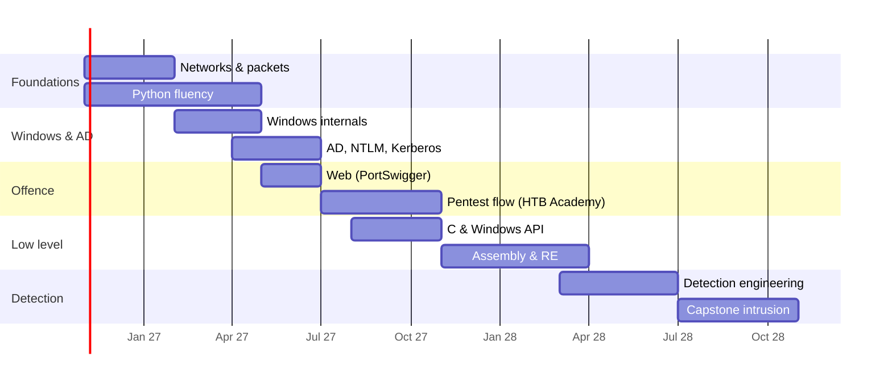

# 24개월 커리큘럼 { #24-month-curriculum }

**분류:** 학습 계획 · **속도:** 업무와 병행하여 주당 약 8–10시간 · **최종 수정:** 2026-10-07

!!! abstract "요약"
    [로드맵](roadmap.md)의 순서를 따르는 2년 계획입니다: **네트워크 → Windows 내부 구조와 AD → 공격 → 악성코드와 리버스 엔지니어링 → 탐지 엔지니어링**. Python/C를 함께 공부하고, [퍼플팀 주간 루프](purple-team-loop.md)를 꾸준한 습관으로 유지합니다. 각 단계는 **체크포인트**로 끝납니다 — 강의를 하나 끝낸 것이 아니라, 직접 보여 줄 수 있는 결과물입니다.

## 개요 { #overview }

막대의 날짜는 11월에 시작한다고 가정한 예시입니다. 자신의 시작 월에 맞춰 옮기세요.

## 1단계 — 1–3개월: 네트워크와 Python { #phase-1-months-13-networks-and-python }

| 월 | 공부 | 실습 | 체크포인트 |
|---|---|---|---|
| 1 | Wireshark로 보는 TCP/IP, ARP, DHCP, DNS; [잘 알려진 포트](../basics/well-known-ports.md) | 자신의 랩 트래픽을 캡처하고, DNS 조회와 TCP 핸드셰이크의 모든 패킷에 이름을 붙입니다 | pcap을 보며 3-way handshake와 DNS 질의 과정을 설명하기 |
| 2 | HTTP, TLS, SSH, SMB; [Zeek 로그](../network/zeek/index.md) | Python: Zeek `conn.log`를 파싱해 요약 만들기(트래픽 상위 호스트, 오래 지속된 연결) | GitHub에 올린 첫 Python 도구 |
| 3 | 네트워크상의 LDAP, RPC, Kerberos; Suricata 규칙 기초 | 로컬 Suricata 규칙 3개 작성; [헌팅 워크플로](../network/arkime/hunting-workflows.md)를 따라 Arkime 헌팅 | 퍼플 루프 16–17주차(HTTP 및 DNS C2) 완료 |

## 2단계 — 4–8개월: Windows 내부 구조와 Active Directory { #phase-2-months-48-windows-internals-and-active-directory }

| 월 | 공부 | 실습 | 체크포인트 |
|---|---|---|---|
| 4 | 프로세스, 스레드, 서비스, 레지스트리, 토큰, 무결성 수준(*Windows Internals* Part 1 1–3장, Sysinternals) | 평소 활동을 Process Explorer/Process Monitor로 관찰; [이벤트 ID](../basics/windows-event-ids.md) | 실행 중인 서비스의 프로세스 트리와 토큰 설명하기 |
| 5 | 이벤트 로깅, Sysmon 설정, 아티팩트([Prefetch](../windows/prefetch.md), [Amcache](../windows/amcache.md), [레지스트리](../windows/registry-keys.md)) | 랩 구축: DC + 워크스테이션 2대 + Splunk + Sysmon | 로그가 Splunk로 들어오는 랩 가동 |
| 6 | NTLM 심화 → [Pass-the-Hash](../adversary/pass-the-hash.md), [relay](../adversary/llmnr-ntlm-relay.md) | 퍼플 루프 5, 21주차 | NTLM 흐름도 + 각 공격이 끼어드는 지점 |
| 7 | Kerberos: TGT/TGS, SPN, 위임(delegation) | 퍼플 루프 6, 22주차; [Golden/Silver](../adversary/golden-silver-tickets.md) | Kerberoasting이 왜 통하는지, 무엇이 그것을 막는지 설명하기 |
| 8 | 자격 증명 구조: LSASS, SAM, LSA secrets, DPAPI, Credential Guard | 퍼플 루프 7, 8주차; [하드닝 매트릭스](../adversary/hardening-by-version.md) | Splunk의 자격 증명 탈취 탐지 세트 |

## 3단계 — 7–12개월: 랩에서 하는 공격 (2단계와 겹침) { #phase-3-months-712-offence-in-a-lab-overlaps-phase-2 }

| 월 | 공부 | 실습 | 체크포인트 |
|---|---|---|---|
| 7–8 | PortSwigger: 인증, 접근 제어, SQLi, XSS, SSRF | 모든 apprentice 랩 + 일부 practitioner 랩 | 각 취약점 유형과 그것이 남기는 로그/HTTP 증거 설명하기 |
| 9–12 | HTB Academy Penetration Tester path: 정찰 → 열거 → 익스플로잇 → 권한 상승 → 횡적 이동 | HTB 머신(retired 머신, 풀고 나서 write-up 확인); 퍼플 루프 9–15주차 | 모든 머신마다 공격자 write-up **그리고** 방어자 write-up |

## 4단계 — 9–16개월: C, 어셈블리, 리버스 엔지니어링 { #phase-4-months-916-c-assembly-and-reverse-engineering }

| 월 | 공부 | 실습 | 체크포인트 |
|---|---|---|---|
| 9–10 | C: 포인터, 메모리, 스택/힙, 구조체; Windows API 호출 | 작성하기: 프로세스 목록 도구, 파일 해시 도구, 간단한 인젝터(랩 전용) | C 인젝터를 읽고 각 API를 [프로세스 인젝션](../adversary/process-injection.md) 아티팩트에 매핑하기 |
| 11 | PE 포맷, import/export, Python의 `pefile` | Python PE 트리아지 도구(import, 섹션, 엔트로피) | 패킹되었거나 의심스러운 PE를 표시하는 도구 |
| 12–13 | x86/x64 어셈블리, 호출 규약; Malware Unicorn RE101 | 직접 작성한 C 프로그램을 Ghidra와 x64dbg로 리버싱 | 디스어셈블리에서 반복문, 호출, 문자열 복호화 알아보기 |
| 14–16 | 격리된 VM에서 정적 + 동적 악성코드 분석 | 공개 학습용 샘플 세트; 같은 샘플의 [메모리 포렌식](../memory/index.md) | 보고서: 파일 → 지속성 → 자격 증명 접근 → C2, ATT&CK에 매핑 |

## 5단계 — 17–24개월: 탐지 엔지니어링과 캡스톤 { #phase-5-months-1724-detection-engineering-and-capstone }

| 월 | 공부 | 실습 | 체크포인트 |
|---|---|---|---|
| 17–18 | Detection-as-code: Sigma, SPL 모범 사례, 오탐 테스트; [헌팅 패턴](../splunk/hunting-patterns.md) | 퍼플 루프 쿼리 10개를 Sigma로 변환하고 Git으로 버전 관리 | 테스트가 포함된 탐지 라이브러리 |
| 19–20 | 위협 인텔리전스 기반 헌팅: [북한 TTP](../threat-intel/dprk-ttps-hunting.md), 다른 위협 행위자 보고서 | 행위자 하나를 골라 기법 5개짜리 에뮬레이션 계획을 세우고, 실행하고, 헌팅하기 | 공백과 새 탐지를 담은 헌팅 보고서 |
| 21–22 | DFIR 사례 실습: CyberDefenders / BTLO 사례, [Plaso](../tools/plaso-timelines.md)와 [KAPE](../tools/kape.md)로 전체 타임라인 작성 | 2주에 사례 하나, 실제 사고 보고서처럼 작성 | 사례 보고서 4개 |
| 23–24 | **캡스톤**: 랩에서 피싱 → 유출까지 전체 침입을 만들고, 사전 정보 없이 조사하기(가능하면 친구가 공격을 실행) | 이 사이트의 모든 도구 활용 | 처음부터 끝까지의 사고 보고서 + 탐지 + 교훈 |

## 계획을 지속시키는 규칙 { #rules-that-keep-the-plan-alive }

- **주간 루프는 절대 멈추지 않습니다** — 바쁜 달에도 기법 하나는 합니다.
- **모든 것을 여기에 기록하세요.** 이 사이트의 페이지가 학습의 증거입니다. 글로 쓸 수 없다면 아직 아는 것이 아닙니다.
- 공격 실습은 **랩에서만**, 업무 네트워크와 집 네트워크에서 격리해서 합니다.
- **분기마다 계획을 다시 세우세요**: 월 순서는 바꿔도 되지만, 기둥의 순서는 지킵니다.

## 참고 자료 { #references }

- 관련 페이지: [로드맵](roadmap.md) · [퍼플팀 루프](purple-team-loop.md) · [학습 자료](resources.md)
