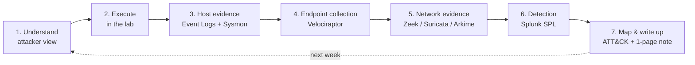

# 퍼플팀 주간 루프 { #purple-team-weekly-loop }

<div class="dfir-meta" markdown>
**분류:** 학습 방법 · **주기:** 1주 = ATT&CK 기법 1개 · **최종 수정:** 2026-10-07
</div>

!!! abstract "요약"
    일반적인 입문 커리큘럼 대신, 이미 갖고 있는 블루팀 스택 — **Splunk, Zeek, Suricata, Arkime, Velociraptor** — 을 활용해 **일주일에 MITRE ATT&CK 기법 하나**를 배웁니다: 공격자 입장에서 이해하고, 랩에서 실행하고, 남는 흔적을 모두 찾고, 탐지 쿼리를 작성하고, 한 페이지 노트로 마무리합니다. 1년이 지나면 양쪽 관점에서 설명할 수 있는 기법이 약 50개가 됩니다.

## 루프 { #the-loop }



| 요일 | 단계 | 결과물 |
|---|---|---|
| 1 | ATT&CK 페이지와 공격 절차 예시 1–2개를 읽고, 이 사이트에서 해당 기법 페이지를 읽습니다 | 기법이 **왜** 통하는지 5줄 설명 |
| 2 | 랩에서 실행합니다(직접 및/또는 Atomic Red Team으로) — 먼저 VM 스냅샷을 찍습니다 | 정확한 명령어 + 타임스탬프 |
| 3 | 호스트 증거를 찾습니다: Security, Sysmon, PowerShell, System 로그; 레지스트리/파일 아티팩트 | 흔적을 보여 주는 이벤트 ID와 필드 목록 |
| 4 | Velociraptor로 수집하고, Zeek/Suricata/Arkime에서 네트워크 쪽을 확인합니다 | 아티팩트 이름, pcap/로그 증거 |
| 5 | SPL을 작성하고 튜닝합니다; 노이즈에 대해 테스트합니다(평소 관리 작업도 함께 실행) | 저장된 검색 + 오탐 메모 |
| 6–7 | 한 페이지 노트를 작성하고(아래 템플릿), 가시성 공백을 정리합니다 | 이 사이트에 커밋한 노트 |

## 실습 예시 — 1주차: T1059.001 PowerShell { #worked-example-week-1-t1059001-powershell }

### 1 · 이해하기 (공격자 관점) { #1-understand-attacker-view }

PowerShell은 .NET과 Windows API에 바로 접근할 수 있는 완전한 스크립트 언어이며, 최신 Windows 호스트라면 어디에나 설치되어 있습니다. 공격자는 이것으로 **코드를 다운로드해 메모리에서 실행하고**(`IEX (New-Object Net.WebClient).DownloadString(...)`), `-EncodedCommand`(UTF-16LE 텍스트를 Base64로 인코딩한 것)로 명령을 숨기고, 프로필이나 창 없이 실행합니다(`-nop -w hidden`). 공격자 쪽 전체 내용은 [PowerShell 크래들](../adversary/powershell-cradles.md)을 참고하세요.

### 2 · 랩에서 실행하기 (무해한 페이로드) { #2-execute-in-the-lab-harmless-payload }

```powershell
# Build an encoded command for a harmless action
$cmd   = 'Write-Output "purple-test"; Get-Process | Select-Object -First 3'
$bytes = [System.Text.Encoding]::Unicode.GetBytes($cmd)
$b64   = [Convert]::ToBase64String($bytes)

# Run it the way an attacker would (hidden window, no profile, encoded)
powershell.exe -nop -w hidden -enc $b64

# Optional: same idea through Atomic Red Team (list tests first, pick a benign one)
Invoke-AtomicTest T1059.001 -ShowDetailsBrief
```

실행하기 전에 랩에서 다음이 켜져 있는지 확인하세요: **Script Block Logging**(GPO *Administrative Templates › Windows Components › Windows PowerShell › Turn on PowerShell Script Block Logging*), **명령줄을 포함한 프로세스 생성 기록**(4688), 그리고 **Sysmon**.

### 3 · 호스트 증거 { #3-host-evidence }

| 소스 | 이벤트 | 보이는 내용 |
|---|---|---|
| Sysmon | **1** — 프로세스 생성 | `Image=...\powershell.exe`, `CommandLine`에 `-enc` 포함, `ParentImage`(누가 실행했는지) |
| Security | **4688** — 프로세스 생성 | 위와 같은 내용이지만, "Include command line in process creation events"가 켜져 있을 때만 |
| PowerShell/Operational | **4104** — 스크립트 블록 기록 | **디코딩된** 스크립트 텍스트 — 공격자가 명령줄을 인코딩해도 4104는 실제로 실행된 내용을 기록합니다 |
| PowerShell/Operational | **4103** — 모듈 로깅 | 파이프라인/명령 세부 정보(모듈 로깅이 켜져 있을 때) |
| Windows PowerShell (classic) | **400 / 600** | `HostApplication` = 전체 명령줄이 담긴 엔진 시작 이벤트 — 오래된 시스템에도 남아 있어 유용합니다 |

### 4 · Splunk 탐지 — 한 줄씩 { #4-splunk-detection-line-by-line }

```spl
index=botsv3 sourcetype="XmlWinEventLog:Microsoft-Windows-Sysmon/Operational" EventID=1 Image="*\\powershell.exe"
| where match(CommandLine, "(?i)\s-(e|en|enc|enco|encod|encode|encoded|encodedcommand)\s")
| rex field=CommandLine "(?i)-e\w*\s+(?<b64>[A-Za-z0-9+/=]{20,})"
| table _time, host, User, ParentImage, CommandLine, b64
```

- `index=botsv3 sourcetype=... EventID=1` — Sysmon 프로세스 생성 이벤트입니다.
- `Image="*\\powershell.exe"` — PowerShell 프로세스만 고릅니다(`*` = 앞에 무엇이 와도 됨, `\\` = 백슬래시 한 개).
- `where match(CommandLine, "...")` — `-EncodedCommand`의 어떤 축약형이든 들어 있는 명령줄만 남깁니다(PowerShell은 `-e`, `-en`, `-enc` … 모두 받아들입니다). `(?i)`는 정규식이 대소문자를 구분하지 않게 합니다.
- `rex field=CommandLine "...(?<b64>...)"` — Base64 덩어리를 `b64`라는 새 필드로 추출해서 디코딩할 수 있게 합니다.
- `table` — 필요한 열만 보여 줍니다.

**결과:**

| _time | host | User | ParentImage | CommandLine | b64 |
|---|---|---|---|---|---|
| 2026-10-07 21:04:11 | LAB-WIN10 | LAB\analyst | C:\Windows\explorer.exe | `powershell.exe -nop -w hidden -enc VwByAGkAdABlAC0A...` | `VwByAGkAdABlAC0A...` |

그다음 스크립트 블록 로그에서 실제로 무엇이 실행됐는지 확인합니다:

```spl
index=botsv3 sourcetype="XmlWinEventLog:Microsoft-Windows-PowerShell/Operational" EventCode=4104
| search ScriptBlockText="*purple-test*" OR ScriptBlockText="*DownloadString*" OR ScriptBlockText="*FromBase64String*"
| table _time, host, ScriptBlockText
```

- `EventCode=4104` — 스크립트 블록 로깅: 디코딩된 스크립트 텍스트입니다.
- `search ScriptBlockText="*...*"` — 테스트 표식과 대표적인 공격자 키워드 두 개를 찾습니다.
- 결과에 `Write-Output "purple-test"; Get-Process | Select-Object -First 3`가 평문으로 나타납니다 — 4104가 인코딩을 무력화한다는 증거입니다.

### 5 · Velociraptor { #5-velociraptor }

| 아티팩트 | 이유 |
|---|---|
| `Windows.EventLogs.PowershellScriptblock` | 4104 이벤트가 SIEM에 전달되지 않았더라도 엔드포인트에서 직접 가져옵니다 |
| `Windows.System.Powershell.PSReadline` | 사용자별 대화형 명령 기록(`ConsoleHost_history.txt`) |
| `Windows.Forensics.Prefetch` | `POWERSHELL.EXE`가 실행됐다는 사실과 시점을 증명합니다(워크스테이션) — [Prefetch](../windows/prefetch.md) 참고 |

헌트 실행 방법은 [Velociraptor](../tools/velociraptor.md)를 참고하세요.

### 6 · 네트워크 쪽 { #6-network-side }

- **Zeek `http.log`**: 스크립트가 HTTP로 다운로드하면 기본 `user_agent`에 `WindowsPowerShell`이 들어 있습니다 — `zeek-cut ts id.orig_h host uri user_agent < http.log | grep -i powershell`.
- **Suricata** — 같은 아이디어를 로컬 규칙으로 만든 것입니다:

    ```text
    alert http $HOME_NET any -> $EXTERNAL_NET any (msg:"LOCAL PowerShell user-agent outbound"; flow:established,to_server; http.user_agent; content:"WindowsPowerShell"; nocase; sid:1000001; rev:1;)
    ```

- **Arkime**: `http.user-agent == *PowerShell*`로 세션을 찾고 pcap을 내려받습니다.
- HTTPS에서는 user agent가 보이지 않습니다 — 대신 JA3/JA4와 목적지를 보세요([Zeek SSL](../network/zeek/ssl-x509.md)).

### 7 · 한 페이지 노트 (템플릿) { #7-the-one-page-note-template }

```markdown
# T1059.001 — PowerShell
**Why it works:** built-in, trusted, runs .NET in memory; -enc hides intent.
**Lab commands:** powershell -nop -w hidden -enc <b64>   (2026-10-07 21:04, LAB-WIN10)
**Host evidence:** Sysmon 1 / 4688 (command line), 4104 (decoded script), 400 (HostApplication)
**Endpoint collection:** Velociraptor PowershellScriptblock, PSReadline, Prefetch
**Network evidence:** Zeek http.log UA "WindowsPowerShell"; Suricata sid 1000001
**Detection:** [SPL saved search name] — FP: SCCM/Intune scripts using -enc
**ATT&CK:** T1059.001 (Execution)
**Gaps:** 4104 not forwarded on servers; no TLS inspection
```

## 추천 기법 순서 { #suggested-order-of-techniques }

각 행은 공격자 관점과 탐지 세부 내용을 이미 담고 있는 이 사이트의 페이지로 연결됩니다.

| 주차 | 기법 | ATT&CK | 페이지 |
|---|---|---|---|
| 1 | PowerShell / 명령 인터프리터 | T1059.001 | [PowerShell 크래들](../adversary/powershell-cradles.md) |
| 2 | 예약된 작업(Scheduled Task) | T1053.005 | [지속성](../adversary/persistence.md) |
| 3 | Windows 서비스 | T1543.003 | [지속성](../adversary/persistence.md) |
| 4 | 레지스트리 Run 키 | T1547.001 | [지속성](../adversary/persistence.md) |
| 5 | NTLM과 Pass-the-Hash | T1550.002 | [Pass-the-Hash](../adversary/pass-the-hash.md) |
| 6 | Kerberos와 Kerberoasting | T1558.003 | [Kerberoasting](../adversary/kerberoasting.md) |
| 7 | 자격 증명 덤프(LSASS) | T1003.001 | [LSASS 덤프](../adversary/lsass-dumping.md) |
| 8 | SAM / NTDS 추출 | T1003.002/.003 | [SAM과 NTDS](../adversary/sam-ntds-extraction.md) |
| 9 | SMB / PsExec | T1021.002 | [PsExec와 SMB](../adversary/psexec-smb.md) |
| 10 | RDP | T1021.001 | [RDP](../adversary/rdp.md) |
| 11 | WMI | T1047 | [WMI와 WinRM](../adversary/wmi-winrm.md) |
| 12 | WinRM | T1021.006 | [WMI와 WinRM](../adversary/wmi-winrm.md) |
| 13 | LOLBins (certutil, mshta, rundll32) | T1218, T1105 | [LOLBins](../adversary/lolbins.md) |
| 14 | 피싱 → 사용자 실행 | T1566, T1204 | [피싱 유포](../adversary/phishing-delivery.md) |
| 15 | 웹 셸 | T1505.003 | [웹 셸 플레이북](../playbooks/webshell-server.md) |
| 16 | HTTP(S) C2와 비커닝 | T1071.001 | [비커닝과 C2](../network/beaconing-c2.md) |
| 17 | DNS C2 / 터널링 | T1071.004 | [Zeek dns.log](../network/zeek/dns-log.md) |
| 18 | 프로세스 인젝션 | T1055 | [프로세스 인젝션](../adversary/process-injection.md) |
| 19 | UAC 우회 | T1548.002 | [UAC 우회](../adversary/uac-bypass.md) |
| 20 | 토큰 가장 | T1134 | [토큰 가장과 Potato](../adversary/token-impersonation-potato.md) |
| 21 | LLMNR 포이즈닝과 NTLM relay | T1557.001 | [LLMNR과 NTLM relay](../adversary/llmnr-ntlm-relay.md) |
| 22 | DCSync | T1003.006 | [DCSync](../adversary/dcsync.md) |
| 23 | 방어 무력화와 로그 삭제 | T1562, T1070.001 | [방어 무력화](../adversary/impair-defenses-log-clearing.md) |
| 24 | 웹 서비스를 통한 유출 | T1567 | [데이터 유출 플레이북](../playbooks/data-exfiltration.md) |

24주차가 끝나면 이것들을 연결하세요: 14 → 1 → 2 → 7 → 9 → 16 → 24주차를 **하나의 침입**으로 실행하고, 처음부터 끝까지 하나의 사건으로 조사합니다.

## 참고 자료 { #references }

- [MITRE ATT&CK — T1059.001 PowerShell](https://attack.mitre.org/techniques/T1059/001/)
- [Atomic Red Team](https://github.com/redcanaryco/atomic-red-team) — ATT&CK 기법별로 정리된 작은 테스트 모음
- [Microsoft — about_Logging_Windows (script block logging)](https://learn.microsoft.com/powershell/module/microsoft.powershell.core/about/about_logging_windows)
- 관련 페이지: [로드맵](roadmap.md) · [24개월 커리큘럼](curriculum-24-months.md) · [헌팅 패턴](../splunk/hunting-patterns.md)
