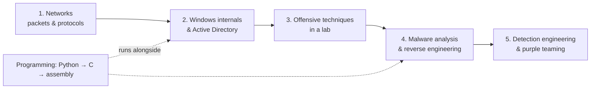

# 로드맵 { #roadmap }

**분류:** 학습 계획 · **목표:** 고급 위협 헌팅 / DFIR / 악성코드 분석 · **최종 수정:** 2026-10-07

!!! abstract "요약"
    최상급 공격자가 뛰어난 이유는 도구를 많이 알아서가 아니라 컴퓨터를 깊이 이해하기 때문입니다. 그들을 잡아내는 방어자도 마찬가지입니다. 이 로드맵은 블루팀 도구 스택(Splunk, Zeek, Suricata, Arkime, Velociraptor) 위에 **저수준 시스템 지식과 공격자의 관점**을 의도한 순서대로 쌓아 올립니다.

## 권장 학습 순서 { #the-recommended-order }

지금 단계에서는 자격증을 더 모으는 것보다 **Windows/AD와 프로그래밍을 깊이 파는 것**이 실력을 훨씬 더 많이 끌어올립니다.

## 여덟 가지 기둥 { #the-eight-pillars }

### 1. 컴퓨터 기초 — 깊이 있게 { #1-computer-fundamentals-deeply }

- **GUI 없는 Linux**: 프로세스, 권한, systemd, 로그, `/proc`, 네트워크 명령어. [Linux 명령어](../basics/linux-commands.md)를 참고하세요.
- **Windows**: 프로세스, 서비스, 레지스트리, 권한, **액세스 토큰**, 이벤트 로그가 실제로 어떻게 동작하는지.
- **네트워크**: TCP/IP만이 아니라, 패킷을 보고 **ARP, DNS, DHCP, HTTP, TLS, SSH, SMB, LDAP, RPC**를 설명할 수 있어야 합니다. 자신의 트래픽에 [Wireshark/tshark](../network/wireshark-tshark.md)와 [Zeek](../network/zeek/index.md)를 직접 써 보세요.
- Windows 환경은 다음 순서로 공부합니다: **NTLM → Kerberos → Active Directory → Windows 자격 증명 구조**(LSASS, SAM, LSA secrets, DPAPI).

**이 단계를 마쳤다고 볼 수 있는 기준:** SMB 세션이나 Kerberos 티켓 교환 과정을 외워서 그릴 수 있고, pcap에서 각 단계를 짚어 낼 수 있을 때입니다.

### 2. 프로그래밍 — Python을 능숙하게, 그다음 C { #2-programming-python-fluently-then-c }

- **Python**은 편해질 때까지: 로그 파싱, pcap 처리(`scapy`, `pyshark`), API 호출(Splunk REST, VirusTotal), 파일 분석(`pefile`), 트리아지 자동화.
- **C**: 포인터, 메모리, 스택과 힙, 프로세스, DLL, 시스템 콜. Windows API(`CreateProcess`, `OpenProcess`, `ReadProcessMemory`)를 호출하는 작은 프로그램을 직접 작성해 보세요.
- **심화**: x86/x64 **어셈블리**. 여기서부터 악성코드 분석과 익스플로잇 이해가 본격적으로 열립니다.

**이 단계를 마쳤다고 볼 수 있는 기준:** 원본 증거를 CSV 타임라인으로 바꿔 주는 Python 도구를 만들 수 있고, 프로세스에 인젝션하는 50줄짜리 C 프로그램을 읽고 각 호출을 설명할 수 있을 때입니다.

### 3. 공격 — 단, 랩에서만 { #3-attack-but-only-in-a-lab }

- **웹**부터 시작합니다: HTTP, 인증, 접근 제어, SQL injection, XSS, SSRF — PortSwigger Web Security Academy(무료, 랩 포함).
- 그다음 전체 **침투 테스트 흐름**: 정찰 → 열거 → 익스플로잇 → 권한 상승 → 횡적 이동(HTB Academy Penetration Tester path).
- 본인 소유가 아니거나 서면으로 테스트 허가를 받지 않은 시스템에는 절대 하지 않습니다.

### 4. Windows와 Active Directory 공격 *그리고* 방어 { #4-windows-active-directory-attack-and-defence }

- NTLM 인증 → [Pass-the-Hash](../adversary/pass-the-hash.md) → [NTLM relay](../adversary/llmnr-ntlm-relay.md).
- Kerberos: TGT/TGS, SPN, 위임(delegation), 서비스 계정 → [Kerberoasting](../adversary/kerberoasting.md), [AS-REP roasting](../adversary/asrep-roasting.md), [Golden/Silver 티켓](../adversary/golden-silver-tickets.md), [DCSync](../adversary/dcsync.md), [ADCS](../adversary/adcs-abuse.md).
- 목표는 명령어 암기가 아니라 <strong>"이 인증 설계의 어떤 특성 때문에 이 공격이 가능한가?"</strong>를 설명하는 것이고, 그래서 어떤 통제가 그 공격을 끊는지 아는 것입니다.

### 5. 리버스 엔지니어링 { #5-reverse-engineering }

- PE 포맷, import/export, 문자열, Windows API, x86/x64 어셈블리, 디버거(x64dbg)와 디스어셈블러(Ghidra).
- 직접 작성한 작은 프로그램부터 시작해서, 격리된 VM에서 실제 샘플로 넘어갑니다. Malware Unicorn의 RE101이 정적·동적 분석을 단계별로 안내합니다.
- 다음 질문에 답하는 연습을 하세요: **이 샘플은 어떻게 파일을 만들고 → 지속성을 확보하고 → 자격 증명을 훔치고 → C2에 접속하는가?** 그리고 각 답을 ATT&CK에 매핑합니다.

### 6. 공격과 탐지를 한 세트로 (퍼플팀) { #6-attack-and-detection-as-one-set-purple-team }

가장 중요한 습관입니다. 랩에서 어떤 기법을 실행했다면 거기서 멈추지 마세요:

1. **Windows 이벤트 로그와 Sysmon**에서 흔적을 찾습니다.
2. **Velociraptor**로 엔드포인트 아티팩트를 확인합니다.
3. **Zeek / Suricata / Arkime**에서 네트워크 쪽을 봅니다.
4. **Splunk SPL** 탐지 쿼리를 작성합니다.
5. **MITRE ATT&CK** 기법에 매핑합니다.

이 과정은 [퍼플팀 루프](purple-team-loop.md) 페이지에서 주간 루틴으로 정리되어 있습니다.

### 7. 하나의 공격을 처음부터 끝까지 따라가기 { #7-follow-one-attack-from-start-to-finish }

침입 전체를 하나의 사건으로 다룹니다:
`Phishing / web exploit → Execution → Persistence → Privilege escalation → Credential access → Discovery → Lateral movement → C2 → Exfiltration`.
실제 그룹의 공격 절차가 가장 좋은 시나리오 소스입니다 — 예를 들어 [북한 TTP](../threat-intel/dprk-ttps-hunting.md) 페이지와 MITRE의 Lazarus Group 항목이 있습니다. [공격자 기법 색인](../adversary/index.md)에서는 전형적인 침입을 이 사이트의 페이지에 매핑해 보여 줍니다.

### 8. CTF만이 아니라 실제 사건처럼 조사하기 { #8-investigate-like-a-real-case-not-only-ctfs }

- **pwn.college**는 Linux와 저수준 보안 이해를 단계별로 쌓아 줍니다.
- **CyberDefenders**(그리고 Blue Team Labs Online)는 실제 사고 형태로 된 DFIR, 위협 헌팅, 네트워크 포렌식, 악성코드 분석 사례를 제공합니다.
- 모든 사례를 관리자가 읽을 보고서처럼 작성하세요: 타임라인, 범위, 근본 원인, 증거, 권고 사항.

## 약 1년 뒤 도달하는 곳 { #where-this-leads-after-about-a-year }

"Splunk를 쓸 줄 아는 사람"이 아니라, 다음을 할 수 있는 사람입니다:

**패킷을 읽고 공격을 이해 → Windows/Linux 내부 구조 이해 → 공격자 행위 재현 → 엔드포인트·네트워크 증거 확보 → 악성코드 분석 → 탐지 로직 구축.**

## 참고 자료 { #references }

- [MITRE ATT&CK — Lazarus Group (G0032)](https://attack.mitre.org/groups/G0032/) — 랩 시나리오를 만들 때 쓸 공격 절차 예시
- [PortSwigger Web Security Academy](https://portswigger.net/web-security)
- [HTB Academy — Penetration Tester path](https://academy.hackthebox.com/path/preview/penetration-tester)
- [Malware Unicorn — RE101](https://malwareunicorn.org/workshops/re101)
- [pwn.college](https://pwn.college/dojos) · [CyberDefenders](https://cyberdefenders.org/)
- 관련 페이지: [퍼플팀 루프](purple-team-loop.md) · [24개월 커리큘럼](curriculum-24-months.md) · [학습 자료](resources.md)
