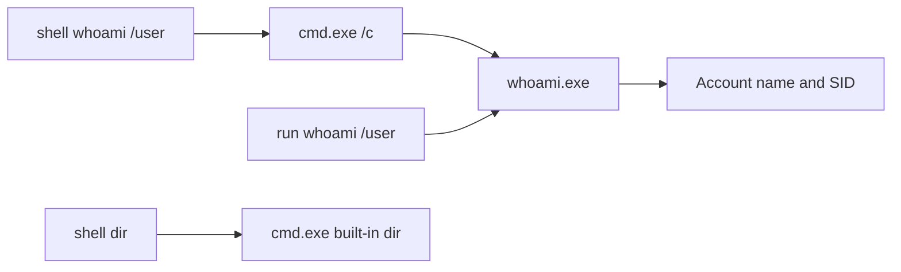
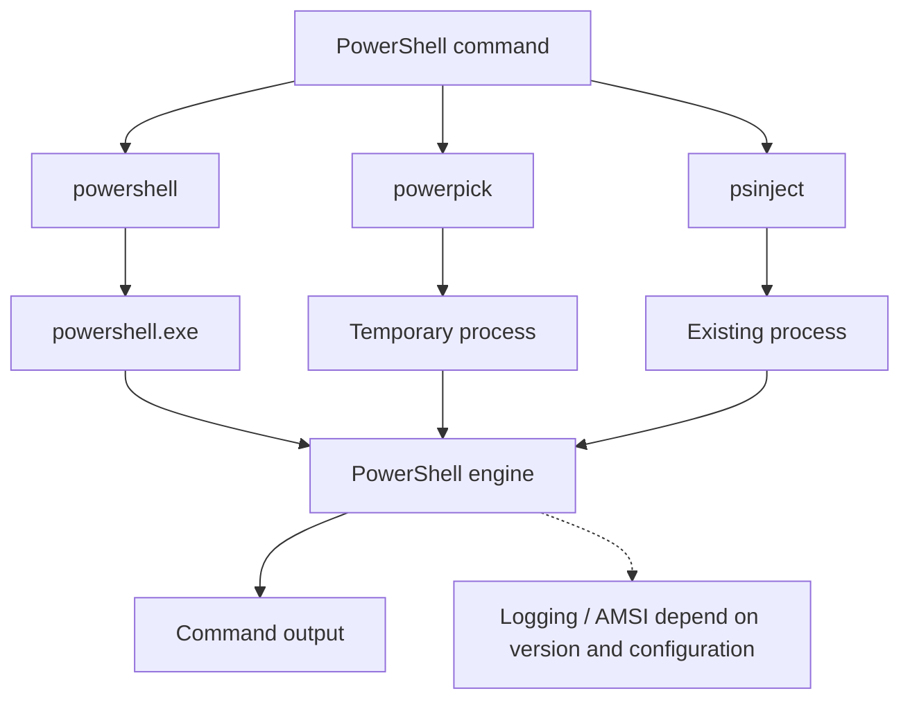
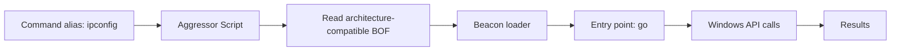

# 3.4 명령 실행과 외부 도구 { #execution-tools }

shell/run, PowerShell 세 가지 방식, .NET, BOF와 Aggressor를 비교합니다.

[Post-Exploitation 목차](index.md) · 교재 기반 강의 · 보충 자료 확인: 2026-10-27

## 12. `shell`과 `run`: 출력은 같아도 실행 경로는 다릅니다 { #chapter-12 }



교재 예제:

```text
shell whoami /user
run whoami /user
```

둘 다 사용자 이름과 SID를 출력하지만 실행 방식이 다릅니다.

```text
shell whoami /user
  → cmd.exe /c whoami /user
```

```text
run whoami /user
  → whoami 프로그램 직접 실행
```

SID는 Windows가 계정을 구분하는 보안 식별자입니다. 화면에 표시되는 계정 이름과 구분해야 합니다.

| 항목 | `shell` | `run` |
|---|---|---|
| `cmd.exe` 경유 | 예 | 아니요 |
| 독립 실행 파일 실행 | 가능 | 가능 |
| `cmd` 내장 명령 | 가능 | 직접 실행 불가 |
| 셸 문법 해석 | `cmd`가 처리 | 같은 방식으로 처리하지 않음 |

대표적인 내장 명령이 `dir`입니다. 일반적인 Windows 환경에서 `dir.exe`라는 독립 실행 파일을 호출하는 방식이 아닙니다.

따라서 다음 차이가 생깁니다.

```text
shell dir
```

은 가능하지만 `run dir`은 같은 의미로 동작하지 않습니다.

교재는 파일 목록에는 `ls`, 사용자 확인에는 `getuid` 같은 내장 기능을 소개합니다.

여기서 학습할 것은 “어느 명령은 무조건 안전하다”가 아니라 **새 프로세스 생성 여부와 셸 의존성**입니다.

## 13. 외부 도구: 이름보다 목적과 실행 위치를 구분하세요 { #chapter-13 }

교재에서 소개하는 도구들은 다음과 같습니다.

| 도구 | 교재에서 소개하는 주요 목적 |
|---|---|
| Seatbelt | 로컬 시스템·보안 설정 조사 |
| PowerView | Active Directory 도메인 조사 |
| Certipy·Certify | AD CS 인증서 서비스 보안 평가 |
| Rubeus | Kerberos 관련 보안 평가 |
| Impacket | Windows 네트워크 프로토콜 기반 보안 테스트 |

이 도구들이 모두 `execute-assembly`로 실행되는 것은 아닙니다.

- PowerShell 스크립트인지.
- .NET Framework 어셈블리인지.
- 네이티브 프로그램인지.
- Python 기반 도구인지.
- 대상 내부에서 실행해야 하는지.
- 네트워크를 통해 동작하는지.

이 구분이 먼저입니다. 교재도 네트워크에서 동작하는 도구의 상세 활용은 Pivoting 장으로 넘깁니다.

## 14. PowerShell의 세 실행 경로 { #chapter-14 }



| 명령 | 교재의 실행 방식 |
|---|---|
| `powershell` | `powershell.exe` 실행 |
| `powerpick` | 임시 프로세스에서 PowerShell 엔진 호스팅 |
| `psinject` | 기존 프로세스에서 PowerShell 엔진 호스팅 |

### `powershell`

```text
powershell [commandlet] [arguments]
```

교재 예제:

```text
powershell $env:computername
```

`$env:computername`은 컴퓨터 이름 환경 변수입니다.

교재는 내부적으로 다음 옵션을 사용하는 인코딩된 명령 실행을 설명합니다.

```text
powershell -nop -exec bypass -EncodedCommand ...
```

- `-nop`: 프로필을 로드하지 않음.
- `-exec bypass`: 해당 PowerShell 실행의 실행 정책 관련 옵션.
- `-EncodedCommand`: 인코딩된 명령 문자열 전달.

**Base64 인코딩은 암호화가 아닙니다.** 문자열 표현을 바꾸는 것이므로 원래 명령을 복원할 수 있습니다.

또한 실행 정책 `Bypass`는 관리자 권한 획득이나 보안 제품 비활성화를 의미하지 않습니다. Microsoft도 PowerShell 실행 정책을 사용자 동작을 강제 차단하는 보안 경계로 정의하지 않습니다. [PowerShell 실행 정책 문서](https://learn.microsoft.com/en-us/powershell/module/microsoft.powershell.core/about/about_execution_policies?view=powershell-5.1)

### `powerpick`

```text
powerpick [commandlet] [arguments]
```

교재는 Unmanaged PowerShell을 기반으로, `powershell.exe` 대신 다른 프로세스 안에서 PowerShell 엔진을 호출하는 방식이라고 설명합니다.

```text
임시 프로세스 생성
  → PowerShell 호스팅용 DLL 주입
  → 명령 실행
  → 이름 있는 파이프로 출력 회수
```

“Unmanaged”는 PowerShell 엔진 자체가 없어졌다는 뜻이 아닙니다. 엔진을 호스팅하는 방식에 주목해야 합니다.

### `psinject`

```text
psinject [pid] [arch] [commandlet] [arguments]
```

교재 예제:

```text
psinject 3020 x64 $PID
```

`$PID`는 PowerShell을 호스팅하는 프로세스 번호입니다. 출력이 `3020`이면 그 프로세스에서 실행되었다는 뜻입니다.

이 예제는 사용자 권한 상승을 증명하는 것이 아니라 **실행 위치**를 보여줍니다. 다른 사용자 프로세스에 접근하려면 별도의 권한·보호 조건을 충족해야 합니다.

교재의 `powerpick`, `execute-assembly` 도움말에는 `PATCHES` 선택 인자도 등장합니다. 이는 실행 프로세스의 메모리 내 함수를 수정하는 규칙을 전달하는 고급 기능입니다. 교재 본문에는 실제 패치 규칙 예제가 없으므로, 기본 실행에 필수인 요소로 외울 필요가 없습니다.

## 15. `powershell-import`: 스크립트 경로는 어디의 경로일까요? { #chapter-15 }

형식:

```text
powershell-import [/path/to/local/script.ps1]
```

교재 예제:

```text
powershell-import C:\Tools\PowerSploit\Recon\PowerView.ps1
```

이 경로는 **Cobalt Strike Client가 실행되는 운영자 컴퓨터의 경로**입니다.

대상 PC에 `C:\Tools\PowerSploit\...` 폴더가 있어야 한다는 뜻이 아닙니다.

가져온 스크립트의 함수는 이후 `powershell`, `powerpick`, `psinject` 실행에서 사용할 수 있다고 설명합니다. 교재 구현에서는 실행 시 내부 웹서버를 통해 스크립트 내용을 가져와 세션에 로드합니다.

교재 예제:

```text
powerpick Get-Domain
```

`Get-Domain`은 기본 PowerShell cmdlet이 아니라, 여기서는 가져온 PowerView 스크립트의 함수입니다.

출력 항목은 다음과 같습니다.

| 항목 | 의미 |
|---|---|
| Forest | 도메인이 속한 포리스트 |
| DomainControllers | 도메인 컨트롤러 |
| Children | 하위 도메인 |
| DomainMode·DomainModeLevel | 도메인 기능 수준 표현 |
| Parent | 상위 도메인 |
| PdcRoleOwner | PDC Emulator 역할 소유자 |
| RidRoleOwner | RID Master 역할 소유자 |
| InfrastructureRoleOwner | Infrastructure Master 역할 소유자 |
| Name | 도메인 이름 |

`DomainMode : Unknown`이 보인다고 도메인이 고장 났다는 뜻은 아닙니다. 사용 라이브러리가 해당 기능 수준을 이름으로 해석하지 못하는 경우도 고려해야 합니다.

교재는 한 번에 하나의 imported script를 유지한다고 설명합니다. 또 **스크립트 import와 지속적인 대화형 PowerShell 세션 유지**는 같은 개념이 아닙니다.

## 16. `execute-assembly`: .NET 어셈블리 실행 { #chapter-16 }

형식:

```text
execute-assembly [/path/to/file.exe] [arguments]
```

교재 예제:

```text
execute-assembly C:\Tools\Seatbelt\Seatbelt\bin\Release\Seatbelt.exe AntiVirus
```

구성 요소:

- 경로: 운영자 측에서 제공할 어셈블리.
- `Seatbelt.exe`: 실행 대상 .NET 도구.
- `AntiVirus`: 도구에 전달하는 조사 항목.

교재의 내부 구조는 다음과 같습니다.

```text
임시 프로세스
  → CLR 로딩·호스팅
  → .NET 어셈블리를 메모리에서 로드
  → 실행 결과 반환
```

교재에는 CLR을 “Command Language Runtime”이라고 적었지만, 정확한 명칭은 **Common Language Runtime**입니다.

교재에서 설명하는 방식은 **.NET Framework 어셈블리**를 대상으로 하며, 현대적인 .NET/.NET Core 프로그램까지 자동으로 호환되는 것으로 해석하면 안 됩니다.

또한 `.exe`라는 확장자만으로 호환성을 판단할 수 없습니다. 네이티브 EXE와 .NET 어셈블리는 다릅니다.

출력의 `Engine`, `ProductEXE`, `ReportingEXE`는 보안 제품 등록·보고 정보를 이해하는 데 쓰입니다. 이 결과 하나로 실시간 보호의 실제 상태나 모든 EDR 구성까지 확정할 수는 없습니다.

도움말에 나오는 `data-store`는 이미 적재된 항목을 재사용하는 기능과 관련됩니다. 따라서 어셈블리를 실행할 때마다 반드시 같은 방식으로 파일을 다시 읽는다고 가정하지 않는 편이 좋습니다.

## 17. BOF와 Aggressor Script의 관계 { #chapter-17 }



교재의 기본 명령은 다음과 같습니다.

```text
inline-execute [/path/to/file.o] [args]
```

하지만 실무 도구는 BOF를 별도의 명령 이름으로 감싸 제공하기도 합니다.

교재 예제:

```text
ipconfig
```

여기서는 TrustedSec의 Situational Awareness BOF 프로젝트가 제공하는 명령입니다. Windows의 `ipconfig.exe`를 실행하는 것과 구분해야 합니다.

```text
shell ipconfig
```

는 `cmd.exe`를 거쳐 외부 프로그램을 실행하는 경로이고, BOF 별칭인 `ipconfig`는 BOF 코드를 Beacon 안에서 실행하는 경로입니다.

교재의 Aggressor 코드:

```text
beacon_inline_execute(
    $1,
    readbof($1, "ipconfig", $null, "T1016"),
    "go",
    $null
);
```

구성 요소를 읽으면 다음과 같습니다.

| 부분 | 의미 |
|---|---|
| `beacon_inline_execute` | Beacon에서 BOF를 실행하는 Aggressor 함수 |
| `$1` | 이 호출 문맥에서 대상 Beacon 식별자 |
| `readbof(...)` | 해당 도구가 제공하는 BOF 읽기 보조 함수 |
| `"ipconfig"` | 사용할 BOF 이름 |
| `"go"` | 호출할 진입 함수 |
| 마지막 `$null` | 추가 실행 인자를 제공하지 않음 |
| `"T1016"` | 네트워크 구성 탐색에 대응하는 ATT&CK 기법 식별자 |

핵심은 **Aggressor Script가 운영자용 명령을 등록하고, 실제 기능은 BOF가 수행할 수 있다는 구조**입니다.

따라서 같은 명령 이름이라도 설치한 스크립트에 따라 내부 동작이 달라질 수 있습니다.

---

[← 3.3 프로세스와 정보 수집](processes-collection.md) · [3.5 최신 방어 관점과 복습 →](modern-defense.md)
