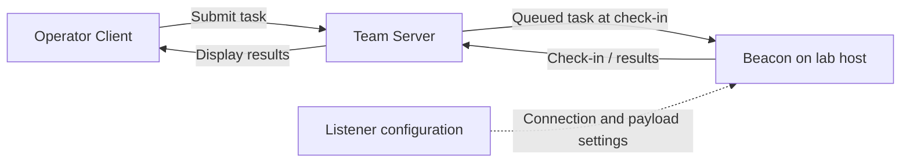
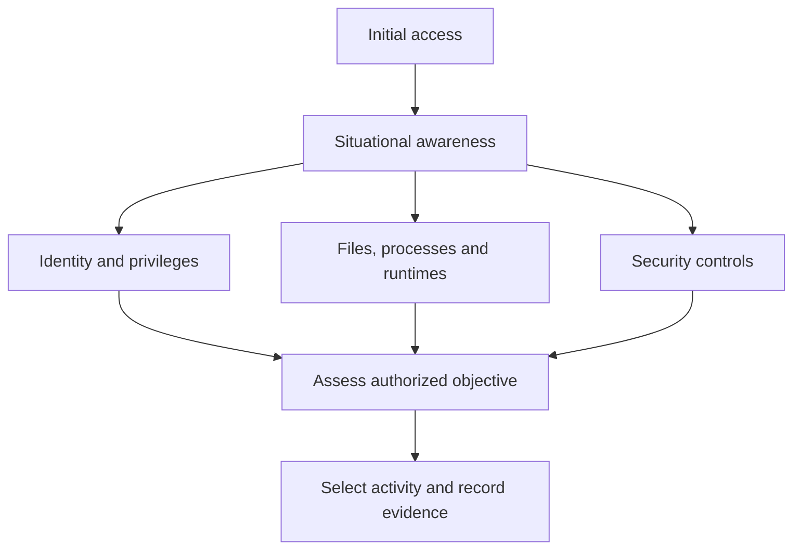
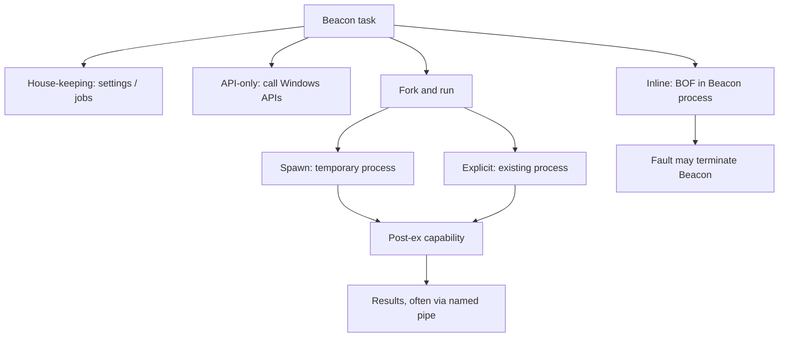

# 03.1 구조와 명령어 실행 모델 { #fundamentals }

Client·Team Server·Beacon, 상황 파악, API·BOF·fork & run을 비교합니다.

[Post-Exploitation 목차](index.md) · 교재 기반 강의 · 보충 자료 확인: 2026-10-27

## 1. 먼저 Cobalt Strike의 세 구성 요소를 이해합시다 { #chapter-1 }



교재를 읽다가 혼동하는 가장 큰 이유는 “이 파일이 어느 컴퓨터에 있는가?”입니다.

| 구성 요소 | 쉬운 설명 | 주요 역할 |
|---|---|---|
| Cobalt Strike Client | 운영자의 조종석 | 명령 입력, 결과 확인 |
| Team Server | 중앙 작업 서버 | 작업 전달, 결과와 수집 파일 보관 |
| Beacon | 실습 대상에서 실행되는 에이전트 | 실제 명령 수행 |
| Listener | 연결 방식과 접속 정보를 정의한 설정 | Beacon 통신·페이로드 구성에 사용 |

기본 흐름은 다음과 같습니다.

```text
운영자 Client → Team Server → Beacon이 실행되는 실습 PC
운영자 Client ← Team Server ← 작업 결과
```

Beacon이 일정 간격으로 서버에 연락하는 것을 **check-in**이라고 합니다.

예를 들어 연락 간격이 60초라면, 파일 브라우저를 클릭해도 결과가 즉시 나오지 않을 수 있습니다. GUI의 반응 속도 역시 뒤에서 동작하는 Beacon의 통신 주기에 영향을 받습니다.

또한 **Beacon 세션**, **Windows 로그인 세션**, **사용자 계정**은 서로 다릅니다. 한 사용자 계정으로 여러 Windows 세션이나 여러 Beacon이 존재할 수 있습니다.

## 2. Post-Exploitation: 접근 이후 무엇을 알아야 할까요? { #chapter-2 }



Post-exploitation은 최초 접근 이후 목표와 관련된 환경을 조사하고 필요한 권한과 접근 경로를 평가하는 단계입니다.

교재가 제시하는 첫 단계는 **situational awareness**, 즉 현재 상황 파악입니다.

건물에 들어갔다고 가정해 봅시다. 바로 모든 문을 여는 대신, 현재 층과 출입 권한, 방의 용도, 관리 체계를 파악하는 과정에 가깝습니다.

| 교재의 조사 항목 | 실제로 알아내려는 것 |
|---|---|
| 파일·공유 폴더·매핑 드라이브 | 업무 자료와 접근 가능한 저장 위치 |
| 실행 중인 프로세스 | 사용 중인 프로그램과 서비스 |
| AV·EDR | 보안 제품 및 관찰·차단 기능 |
| LAPS | 로컬 관리자 암호 관리 여부 |
| Sysmon | 상세한 시스템 활동 기록 여부 |
| .NET·PowerShell 버전 | 실행 환경과 도구 호환성 |
| 로그인 사용자·권한 | 현재 보안 컨텍스트 |
| 브라우저 북마크·저장 자격 증명 | 업무 시스템과 인증 정보의 노출 가능성 |
| UAC·SMB signing 정책 | 권한 상승과 네트워크 인증에 적용되는 제약 |
| 도메인의 다른 시스템·서비스 | 환경 구조와 접근 관계 |
| 시스템에 접근 가능한 사용자 | 계정과 자원 사이의 권한 관계 |

이 항목들이 모두 같은 종류의 보안 제품은 아닙니다. **LAPS는 암호 관리**, **Sysmon은 이벤트 기록**, **EDR은 탐지·조사·대응**에 초점이 있습니다.

또한 이 장에서 권한 상승, 자격 증명 덤프, 사용자 가장, 횡적 이동을 언급하지만, 각각의 상세 절차까지 다루지는 않습니다. 이 장의 중심은 **조사 및 실행 기능의 기초**입니다.

## 3. Command Behaviour: 명령어는 내부 동작으로 분류해야 합니다 { #chapter-3 }



교재는 명령어를 네 가지 실행 유형으로 설명합니다.

| 유형 | 실행 위치·방식 | 이해할 핵심 |
|---|---|---|
| House-keeping | Beacon 설정·상태 관리 | 이후 작업의 동작에 영향 |
| API-only | Windows API 직접 호출 | 별도 명령행 프로그램이 불필요할 수 있음 |
| Inline execution | Beacon 프로세스 내부에서 추가 코드 실행 | 실패가 Beacon에 직접 영향을 줄 수 있음 |
| Fork & run | 다른 프로세스에서 기능 실행 | 프로세스 생성·주입·통신 등의 활동 발생 |

이 분류를 **안전 등급표처럼 읽으면 안 됩니다.** API-only라고 해도 파일 삭제처럼 영향이 큰 작업을 할 수 있습니다.

### House-keeping

교재에 나오는 명령은 다음과 같습니다.

| 명령 | 의미 |
|---|---|
| `sleep` | Beacon의 통신 간격 설정 |
| `spawnto` | 특정 후속 작업에 사용할 임시 실행 프로세스 설정 |
| `jobs` | 장시간 실행 중인 작업 조회 |
| `ppid` | 이후 프로세스 생성에 사용할 부모 프로세스 관련 설정 |

예를 들어:

```text
sleep 60
jobs
```

첫 번째는 통신 간격을 설정하고, 두 번째는 현재 작업을 확인합니다.

`ppid` 설정은 현재 실행 중인 Beacon의 과거 생성 기록을 고쳐 쓰는 기능으로 이해하면 안 됩니다. 이후 생성 동작에 관련된 설정입니다.

### API-only

교재는 다음을 예로 듭니다.

| 명령 | 의미 |
|---|---|
| `cd` | 작업 디렉터리 변경 |
| `cp` | 파일 복사 |
| `ls` | 파일·디렉터리 목록 조회 |
| `mv` | 파일 이동·이름 변경 |
| `ps` | 프로세스 목록 조회 |
| `pwd` | 현재 작업 디렉터리 확인 |
| `rm` | 파일 삭제 |
| `upload` | 운영자 측 파일을 대상으로 전송 |

예를 들어 `ls`는 `cmd.exe`를 실행해서 `dir`을 입력하는 방식과 다릅니다.

하지만 **새 프로세스를 만들지 않는다는 사실과 관찰되지 않는다는 사실은 다릅니다.** 파일 접근, 파일 변경, API 사용 등은 여전히 관찰 대상입니다.

### Inline execution과 BOF

BOF는 **Beacon Object File**입니다.

일반적인 프로그램은 다음 단계를 거칩니다.

```text
소스 코드 → 컴파일 → 오브젝트 파일 → 링크 → 실행 파일
```

전통적인 BOF는 오브젝트 파일을 Beacon이 읽어 필요한 연결과 로딩 처리를 수행하고 실행하는 방식입니다.

```text
소스 코드 → 오브젝트 파일 → Beacon이 로딩·실행
```

교재의 기본 형식:

```text
inline-execute [/path/to/file.o] [args]
```

대괄호 속 경로와 인자는 실제 값으로 바꿔 넣는 자리입니다.

장점은 별도 임시 프로세스 없이 기능을 실행할 수 있다는 점입니다. 단점은 **Beacon 안에서 잘못된 메모리 접근 등이 발생하면 Beacon도 종료될 수 있다는 점**입니다.

교재는 `dllload`, `getsystem`, `timestomp`를 BOF 구현의 예로 제시합니다.

- `dllload`: DLL 로딩 관련 기능.
- `getsystem`: SYSTEM 권한 획득을 시도하는 기능. 항상 성공하는 명령이 아닙니다.
- `timestomp`: 파일 시간 정보 변경 기능. 다른 로그나 파일 시스템 증거까지 모두 제거하지는 않습니다.

이는 교재의 구현 분류이며, 버전과 확장 구성에 따라 달라질 수 있습니다.

### Fork & run

기본 구조는 다음과 같습니다.

```text
Beacon
  → 임시 프로세스 생성
  → 후속 작업용 DLL 주입
  → 해당 프로세스에서 기능 실행
  → 이름 있는 파이프 등으로 출력 회수
```

여기서 *fork*는 Unix의 `fork()` 호출을 그대로 사용한다는 뜻이 아니라 실행 패턴의 이름입니다.

**Reflective DLL**은 일반적인 DLL 로딩 경로와 다른 방식으로 메모리에 적재되어 실행될 수 있도록 구성한 DLL입니다. **Named pipe**는 프로세스 사이에서 데이터를 주고받는 통신 통로입니다.

교재는 두 변형을 구분합니다.

| 변형 | 대상 프로세스 |
|---|---|
| Spawn | 새로 만든 임시 프로세스 |
| Explicit | 이미 실행 중인 프로세스 |

도움말을 보면 차이가 드러납니다.

```text
execute-assembly [/path/to/file.exe] [arguments]
psinject [pid] [arch] [commandlet] [arguments]
mimikatz [pid] [arch] [module::command] <args>
mimikatz [module::command] <args>
```

- `pid`: 실행 대상 프로세스 번호.
- `arch`: 일반적으로 `x86` 또는 `x64` 아키텍처.
- `module::command`: 도구 내부의 모듈과 명령 지정 형식.
- `arguments`: 해당 기능에 전달할 인자.

교재에서 `execute-assembly`, `powerpick`은 spawn 방식, `psinject`는 explicit 방식입니다. `mimikatz`, `portscan`, `keylogger`는 두 형태를 지원하는 예입니다.

이 장에서는 `mimikatz`의 자격 증명 추출 명령이나 `portscan`의 상세 옵션을 설명하지 않습니다. **도움말 형식으로 실행 모델을 판별하는 사례**로 등장합니다.

---

[← 학습 목차](index.md) · [03.2 세션과 파일 시스템 →](sessions-files.md)
