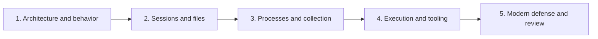

# Post-Exploitation { #post-exploitation }

**명령어의 결과와 시스템 내부의 실행 과정을 함께 배우는 Cobalt Strike 강의입니다.** 최초 접근 이후 환경을 이해하고, 사용자·프로세스·파일·실행 모델을 구분하는 데 초점을 둡니다.

기존 강의의 **19개 절**을 아래 **5개 학습 페이지**로 나눴습니다. 각 페이지에는 명령어 해설, 비교표, 흐름도가 있으며 오른쪽 목차로 세부 항목에 바로 이동할 수 있습니다.

!!! note "학습 범위와 출처"
    제공된 「7 - Post-Exploitation」을 참고해 작성한 독립적인 한국어 해설입니다. 원본 교재나 스크린샷을 배포하는 페이지가 아닙니다. 명령 예제는 허가된 실습 환경을 전제로 하며, 명령을 실행하는 웹 기능은 없습니다. 교재의 설명과 **2026-10-27 확인한 공식 보충 자료**를 구분했습니다. 제품 버전별 실제 동작은 설치된 버전의 도움말과 대조하세요.

## 학습 순서 { #learning-path }

| 순서 | 페이지 | 원래 강의의 절 | 학습 목표 |
| --- | --- | --- | --- |
| 1 | [3.1 구조와 명령어 실행 모델](fundamentals.md) | 1–3 | Client·Team Server·Beacon, 상황 파악, API·BOF·fork & run을 비교합니다. |
| 2 | [3.2 세션과 파일 시스템](sessions-files.md) | 4–6 | 새 Beacon, 사용자 컨텍스트, 작업 디렉터리, 파일 전송 경로를 이해합니다. |
| 3 | [3.3 프로세스와 정보 수집](processes-collection.md) | 7–11 | 프로세스·작업 ID, 레지스트리, 키 입력·클립보드·화면 수집을 구분합니다. |
| 4 | [3.4 명령 실행과 외부 도구](execution-tools.md) | 12–17 | shell/run, PowerShell 세 가지 방식, .NET, BOF와 Aggressor를 비교합니다. |
| 5 | [3.5 최신 방어 관점과 복습](modern-defense.md) | 18–19 | 버전 변화, PowerShell 관찰, Credential Guard, SMB 정책을 복습합니다. |

## 명령을 읽는 네 가지 질문 { #four-questions }

| 질문 | 구체적으로 확인할 것 | 예 |
| --- | --- | --- |
| 어디서 실행되는가? | Beacon 내부 / 임시 프로세스 / 기존 프로세스 | BOF와 fork & run |
| 누구의 권한인가? | 사용자, 토큰, 무결성 수준, 세션 | spawn과 spawnas |
| 무엇을 바꾸는가? | 파일, 프로세스, 클립보드, 네트워크 상태 | printscreen의 클립보드 영향 |
| 결과는 어디로 가는가? | 콘솔 / 전용 결과 탭 / Team Server / Client | download와 Sync Files |

## 자주 혼동하는 개념 { #common-confusions }

| 혼동 | 정확한 구분 |
| --- | --- |
| 메모리 실행 = 무흔적 | 디스크 저장 여부와 메모리·프로세스·네트워크 관찰은 별개 |
| 관리자 계정 = 항상 높은 권한 | 현재 프로세스 토큰과 UAC 상태를 확인 |
| 새 Beacon = 권한 상승 | 세션 추가와 권한 변화는 다른 작업 |
| PID = JID | Windows 프로세스 ID와 Beacon 작업 ID는 다름 |
| 다운로드 = Client에 저장 | 먼저 Team Server에 저장하고 Sync Files로 로컬 회수 |
| PowerShell = powershell.exe | 엔진은 다른 프로세스에서도 호스팅 가능 |

**처음 읽는다면 [3.1 구조와 명령어 실행 모델](fundamentals.md)부터 시작하세요.** 기존 [Red Team 목차](../index.md)로 돌아갈 수도 있습니다.
