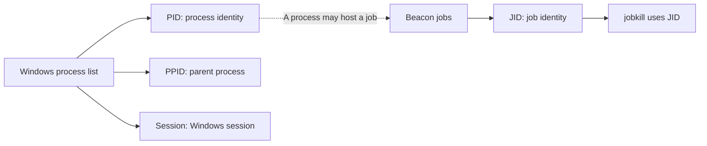
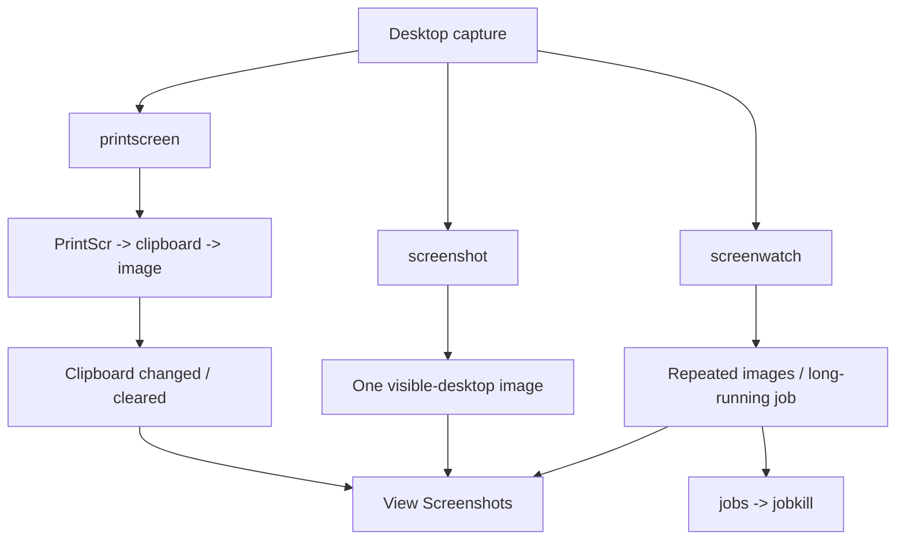

# 03.3 프로세스와 정보 수집 { #processes-collection }

프로세스·작업 ID, 레지스트리, 키 입력·클립보드·화면 수집을 구분합니다.

[Post-Exploitation 목차](index.md) · 교재 기반 강의 · 보충 자료 확인: 2026-10-27

## 7. Processes: 프로세스 목록 읽기 { #chapter-7 }



```text
ps
```

교재 출력에 나오는 필드는 다음과 같습니다.

| 필드 | 뜻 |
|---|---|
| PID | 해당 프로세스의 식별 번호 |
| PPID | 부모 프로세스 번호 |
| Name | 프로세스 이름 |
| Arch | 실행 아키텍처 |
| Session | Windows 세션 번호 |
| User | 프로세스의 사용자 |

예를 들어:

```text
PID   PPID   Name
4     0      System
88    4      Registry
388   4      smss.exe
```

`Registry`와 `smss.exe`가 부모 PID 4를 가진다는 의미입니다. 본문 설명의 `smss.exe` PID와 예제 표의 PID가 다르지만, PID는 환경마다 달라지는 값이므로 숫자를 외울 필요가 없습니다.

교재는 권한이 낮으면 다른 사용자 프로세스의 상세 정보를 읽지 못할 수 있다고 설명합니다. 다만 **“관리자 권한이 아니면 다른 프로세스 정보는 전혀 볼 수 없다”는 절대 규칙은 아닙니다.** 조회 항목, 요청 권한, 접근 제어, 보호 프로세스 여부에 따라 다릅니다.

또한 관리자 계정 소속과 현재 프로세스의 높은 무결성 수준은 다릅니다. UAC 때문에 관리자 계정의 프로그램도 제한된 토큰으로 실행될 수 있습니다. [Microsoft UAC 동작 설명](https://learn.microsoft.com/en-us/windows-server/security/user-account-control/how-user-account-control-works)

프로세스 브라우저:

```text
process_browser
```

교재 메뉴는 `Explore → Process List`입니다. GUI에서도 같은 프로세스 관계를 살펴봅니다.

## 8. Keylogger와 Clipboard: 서로 다른 수집 방식 { #chapter-8 }

`keylogger` 도움말 형식:

```text
keylogger [pid] [x86|x64]
keylogger
```

교재에서 인자가 있는 형태는 지정한 프로세스를 이용하고, 없는 형태는 임시 프로세스를 만들어 기능을 실행합니다.

개념적으로는 해당 실행 컨텍스트에서 사용자의 키 입력을 관찰하는 기능입니다. **같은 컴퓨터에 있다는 이유만으로 모든 사용자·모든 세션의 입력을 자동으로 얻는 것은 아닙니다.** 권한과 세션·데스크톱 경계가 영향을 줍니다.

출력은 일반 Beacon 콘솔이 아니라 다음 위치로 전달됩니다.

```text
View → Keystrokes
```

교재의 작업 관리 예:

```text
jobs
jobkill 0
```

`0`은 예시 작업 ID입니다. PID와 다릅니다.

- **PID**: Windows 프로세스 번호.
- **JID**: Beacon이 관리하는 작업 번호.

GUI의 `Save`는 결과를 로컬 파일로 저장하고, `Delete`는 해당 수집 결과를 삭제하는 기능입니다.

`clipboard`는 키 입력을 계속 기록하는 대신 **현재 클립보드의 텍스트**를 읽는 명령입니다.

```text
clipboard
```

교재 출력에는 암호처럼 보이는 문자열이 등장합니다. 이 사례는 복사한 민감 정보가 클립보드에 남을 수 있음을 보여줍니다. 클립보드를 읽는 것과 과거의 모든 복사 기록을 복원하는 것은 다릅니다.

## 9. Registry: 시스템 설정을 읽는 방법 { #chapter-9 }

레지스트리를 “설정값이 들어 있는 계층형 데이터베이스”로 생각하면 쉽습니다.

- **Key**: 폴더 같은 구조.
- **Subkey**: 하위 폴더.
- **Value**: 이름과 데이터를 가진 설정 항목.

교재 형식:

```text
reg query [x86|x64] [root\path]
reg queryv [x86|x64] [root\path] [value-name]
```

교재 도움말은 마지막 자리를 `subkey`라고 표현하지만, 실제 예제의 `ConsentPromptBehaviorAdmin`은 **값 이름**입니다.

| 루트 | 의미 |
|---|---|
| `HKLM` | 컴퓨터 전역 설정 |
| `HKCU` | 현재 사용자 설정 |
| `HKU` | 로드된 사용자 하이브 |
| `HKCR` | 파일 연결·클래스 등록 관련 뷰 |
| `HKCC` | 현재 하드웨어 구성 관련 설정 |

`x86`과 `x64`는 레지스트리의 32비트·64비트 뷰를 지정합니다. 모든 키가 두 뷰에서 다르다는 뜻은 아닙니다.

교재 예제:

```text
reg query x64 HKLM\SOFTWARE\Microsoft\Windows\CurrentVersion\Policies\System
```

특정 값만 조회:

```text
reg queryv x64 HKLM\SOFTWARE\Microsoft\Windows\CurrentVersion\Policies\System ConsentPromptBehaviorAdmin
```

출력에서 주요 보안 관련 값은 다음처럼 읽습니다.

| 값 | 해석 |
|---|---|
| `EnableLUA = 1` | UAC 활성화 관련 설정 |
| `ConsentPromptBehaviorAdmin = 5` | 비-Windows 바이너리의 관리자 권한 상승에 동의 프롬프트를 사용하는 정책 |
| `PromptOnSecureDesktop = 1` | 권한 상승 프롬프트에 보안 데스크톱 사용 |
| `EnableInstallerDetection = 1` | 설치 프로그램 탐지 관련 설정 |
| `ValidateAdminCodeSignatures = 0` | 해당 UAC 정책으로 서명 검증을 요구하지 않음 |

마지막 값이 0이라고 해서 시스템의 모든 서명 검사나 애플리케이션 통제가 꺼졌다는 뜻은 아닙니다. [Microsoft UAC 설정 문서](https://learn.microsoft.com/en-gb/windows/security/application-security/application-control/user-account-control/settings-and-configuration)

`LocalAccountTokenFilterPolicy`는 로컬 계정의 원격 관리 연결에서 적용되는 토큰 필터링과 관련됩니다. 교재의 값 `1`은 해당 필터링을 완화하는 설정으로 읽어야 하며, 전체 UAC 비활성화와 같지 않습니다. [Microsoft 원격 UAC 제한 설명](https://github.com/MicrosoftDocs/SupportArticles-docs/blob/main/support/windows-server/windows-security/user-account-control-and-remote-restriction.md)

나머지 출력은 설치·시작 작업, UI 접근, 가상화, 로그온 화면, 스마트카드 요구, 종료·도킹 등의 정책입니다. `Audit\`, `Kerberos\`, `UIPI\`는 하위 키입니다.

이 예제의 핵심은 **설정값 조회와 유효한 보안 상태 판정을 구분하는 것**입니다. 한 값만 보고 전체 보안 상태를 결론 내릴 수 없습니다.

## 10. Screenshots: 세 가지 화면 캡처 방식 { #chapter-10 }



| 명령 | 교재의 동작 | 주된 차이 |
|---|---|---|
| `printscreen` | PrintScr 입력 후 클립보드에서 캡처 회수 | 클립보드 내용에 영향 |
| `screenshot` | 후속 작업 DLL로 화면 캡처 | 클립보드에 의존하지 않는 일회성 방식 |
| `screenwatch` | 반복적인 화면 캡처 | 장시간 작업으로 관리 |

도움말 형식:

```text
printscreen [pid] [x86|x64]
printscreen

screenshot [pid] [x86|x64]
screenshot

screenwatch [pid] <x86|x64>
screenwatch
```

교재에서 PID를 지정하면 기존 프로세스, 생략하면 임시 프로세스를 사용하는 구분입니다.

`printscreen`은 클립보드를 사용하고 끝난 뒤 내용을 지운다고 설명합니다. 따라서 사용자가 복사한 내용이 사라지는 등 실제 작업에 영향을 줄 수 있습니다.

`screenshot`은 보이는 데스크톱을 한 번 캡처합니다. 모든 숨겨진 창, 잠긴 화면, 보안 데스크톱까지 보장하는 기능으로 이해하면 안 됩니다.

`screenwatch`의 교재 설명은 다음과 같습니다.

- Beacon check-in과 연계해 이미지를 전달.
- 사용자 유휴 상태에서는 3분 간격으로 새 캡처.
- `jobs`, `jobkill`로 작업 조회·종료.

교재는 다음 예를 들어 통신 주기의 영향을 설명합니다.

```text
sleep 5
sleep 60
```

다만 **통신 주기와 정확한 실시간 캡처 주기는 동일하지 않습니다.** 지연, 유휴 상태, 작업 처리 등에 따라 차이가 납니다.

결과 위치:

```text
View → Screenshots
```

교재에는 행의 `Save`·`Delete`, 이미지의 확대·축소, Beacon 및 Process Browser의 캡처 메뉴도 소개되어 있습니다.

## 11. VNC: 화면을 보는 것과 조작하는 것 { #chapter-11 }

VNC 기능은 데스크톱 화면을 전달하고 키보드·마우스를 제어하는 기능입니다.

교재 형식:

```text
desktop [pid] [x86|x64] [high|low]
desktop [high|low]
```

교재 예제:

```text
desktop high
```

`high`와 `low`는 화면 품질입니다. 사용자 권한 수준을 의미하지 않습니다.

교재 설명상 VNC DLL과 포트 포워딩을 이용해 대상 데스크톱과 Team Server, Client 사이에 통신을 구성합니다. 출력에 나온 `5117`은 예시이며 항상 고정된 포트로 외울 값이 아닙니다.

기본 상태는 **view only**입니다. GUI에서 입력 제어를 활성화하면 키보드와 마우스를 조작할 수 있습니다. 교재에서는 탭을 닫으면 관련 포트 바인딩이 해제된다고 설명합니다.

화면 캡처와 달리 조작 모드는 사용자의 실제 데스크톱 상태를 변경할 수 있다는 차이가 있습니다.

---

[← 03.2 세션과 파일 시스템](sessions-files.md) · [03.4 명령 실행과 외부 도구 →](execution-tools.md)
