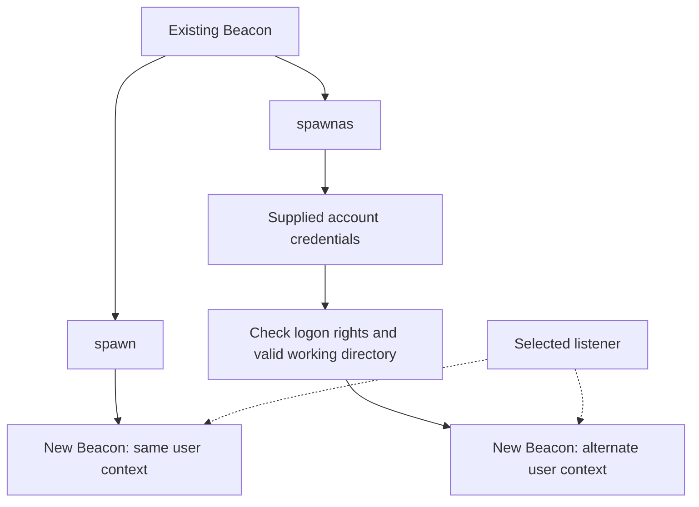
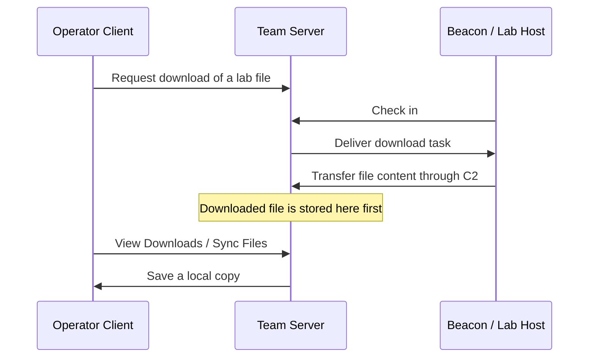

# 02. 세션과 파일 시스템 { #sessions-files }

새 Beacon, 사용자 컨텍스트, 작업 디렉터리, 파일 전송 경로를 이해합니다.

[Post-Exploitation 목차](index.md) · 교재 기반 강의 · 보충 자료 확인: 2026-10-27

## 4. Session Passing: 기존 Beacon에서 새 Beacon 만들기 { #chapter-4 }



Session passing은 기존 Beacon을 이용해 새 Beacon 세션을 만드는 것입니다.

예를 들어 기존 세션과 다른 통신 설정을 사용하는 세션을 추가할 수 있습니다. **기존 세션이 자동으로 다른 프로토콜로 변환되는 것은 아닙니다.**

`spawn` 형식:

```text
spawn [x86|x64] [listener]
spawn [listener]
```

교재 예제:

```text
spawn x64 http
```

의미는 “`http`라는 이름의 listener 설정을 사용해 x64 프로세스에 새 Beacon을 실행하라”입니다.

여기서 `http`는 **listener 이름**입니다. 이름만 보고 실제 통신 설정 전체를 판단하면 안 됩니다. 교재 출력의 외부 도메인도 실습에 사용해야 하는 주소로 해석하지 않습니다.

새 Beacon은 교재 설명상 기존 Beacon과 같은 사용자로 실행됩니다. 세션을 추가하는 것이 곧 권한 상승을 의미하지는 않습니다.

`spawnas` 형식:

```text
spawnas [DOMAIN\user] [password] [listener]
```

이 명령은 지정한 사용자 자격 증명으로 새 Beacon 실행을 시도합니다.

- `DOMAIN\user`: 계정 식별.
- `password`: 해당 계정의 암호.
- `listener`: 새 Beacon에 사용할 설정.
- 도메인을 생략하면 교재 설명상 로컬 사용자로 인증을 시도합니다.

교재는 SYSTEM 컨텍스트에서 실패할 수 있다는 도움말과 `make_token` 대안을 언급합니다. 이는 Windows의 프로세스 생성·로그온 API 제약과 관련됩니다.

`make_token`은 자격 증명을 사용해 토큰 기반 인증 컨텍스트를 만드는 기능으로, **현재 프로세스의 로컬 사용자 정체성과 모든 접근 권한을 일괄적으로 바꾸는 마법 같은 명령은 아닙니다.**

### 오류 267 사례

교재 사례에서 기존 Beacon의 작업 디렉터리는 다음과 같습니다.

```text
C:\Users\pchilds\Documents
```

다른 사용자 `rsteel`로 프로세스를 만들 때 그 작업 디렉터리를 사용할 수 없어 실패합니다.

교재의 확인 명령:

```text
windows_error_code 267
pwd
```

교재는 접근 가능한 디렉터리로 변경한 뒤 다시 시도하는 흐름을 보여줍니다.

```text
cd C:\
```

이 사례의 교훈은 **프로세스 생성 실패가 반드시 암호 오류는 아니라는 것**입니다. 실행 파일뿐 아니라 작업 디렉터리도 유효해야 합니다.

정확히는 Win32 오류 `267`은 `ERROR_DIRECTORY`, 즉 디렉터리 이름이 유효하지 않다는 뜻입니다. 모든 267 오류를 권한 문제로 단정하면 안 되며, 교재 출력의 `STATUS_NOTIFY_CLEANUP`을 동일한 Win32 오류 의미로 외우지 않는 편이 좋습니다. [Microsoft 오류 코드 문서](https://learn.microsoft.com/en-us/windows/win32/debug/system-error-codes--0-499-)

## 5. File System: 파일과 디렉터리 다루기 { #chapter-5 }

교재의 기본 명령:

```text
pwd
ls
ls C:\Users
ls Users
cd C:\
drives
```

각각은 다음과 같습니다.

| 명령 | 설명 |
|---|---|
| `pwd` | 현재 기준 디렉터리 확인 |
| `ls` | 현재 디렉터리 내용 조회 |
| `ls C:\Users` | 절대 경로 조회 |
| `ls Users` | 현재 디렉터리를 기준으로 상대 경로 조회 |
| `cd C:\` | 작업 디렉터리 변경 |
| `drives` | 사용 가능한 드라이브 조회 |

현재 위치가 `C:\`일 때 `ls Users`는 `C:\Users`를 가리킵니다. 현재 위치가 달라지면 의미도 달라집니다.

출력의 `Size`, `Type`, `Last Modified`, `Name`은 각각 크기, 파일·디렉터리 구분, 수정 시간, 이름입니다.

여기서 알아둘 점은 다음과 같습니다.

- 사용자 이름의 폴더가 있다고 그 사용자가 현재 로그인한 것은 아닙니다.
- 파일 목록이 보인다고 모든 파일의 내용을 읽을 수 있는 것은 아닙니다.
- 네트워크 드라이브는 사용자·로그온 컨텍스트에 따라 다르게 보일 수 있습니다.
- 수정 시간 하나만으로 파일의 전체 이력을 판정할 수 없습니다.

### File Browser

접근 방식은 다음과 같습니다.

```text
file_browser
```

또는 교재의 메뉴:

```text
Explore → File Browser
```

첫 화면은 Beacon의 현재 작업 디렉터리입니다. 교재에서 회색 디렉터리는 아직 조회하지 않은 위치를 의미합니다.

이 브라우저는 대상 디스크를 직접 실시간으로 읽는 창이 아니라, **Beacon에 조회 작업을 보내고 반환된 결과를 표시하는 창**입니다.

교재 버전에서는 탭이 열려 있는 동안 결과를 보관하고, 탭을 닫았다 다시 열면 이전 탐색 상태를 유지하지 않습니다.

## 6. Downloading Files: 다운로드의 목적지를 구분하세요 { #chapter-6 }



형식:

```text
download [file]
```

교재 예제:

```text
download C:\Users\pchilds\Desktop\desktop.ini
```

가장 중요한 데이터 흐름:

```text
대상 파일 → Beacon의 통신 경로 → Team Server
```

운영자의 Client 컴퓨터로 바로 저장되는 것이 아닙니다.

관련 명령:

| 명령 | 의미 |
|---|---|
| `download` | 파일 다운로드 시작 |
| `downloads` | 진행 중인 다운로드 조회 |
| `cancel` | 해당 다운로드 취소에 사용 |

`cancel`의 인자와 취소 범위는 설치 버전의 도움말을 확인해야 합니다. 최신 버전에서는 작업 상태와 취소 처리도 변경되었습니다.

운영자 컴퓨터로 가져오는 교재의 GUI 흐름은 다음과 같습니다.

```text
View → Downloads → 파일 선택 → Sync Files
```

`Delete Files`는 Team Server에 보관된 다운로드 파일을 삭제하는 기능입니다. 대상 PC의 원본 파일 삭제와 구분해야 합니다.

교재는 같은 Team Server의 운영자들이 다운로드 파일을 보거나 삭제할 수 있다고 설명합니다. 따라서 수집 결과는 중앙 서버의 접근 통제와 보관 정책에도 영향을 받습니다.

전송 속도에는 다음 요소가 함께 작용합니다.

- 통신 프로토콜과 데이터 전달 방식.
- Beacon의 통신 간격.
- 파일 크기.
- 네트워크 지연과 중간 연결.
- 제품 설정.

교재는 DNS A 레코드를 사용하는 경로가 HTTP POST보다 대용량 파일 전달에 불리한 예를 제시합니다. 이를 모든 DNS·HTTP 구성의 고정된 성능 법칙으로 일반화하면 안 됩니다.

---

[← 01. 구조와 명령어 실행 모델](fundamentals.md) · [03. 프로세스와 정보 수집 →](processes-collection.md)
