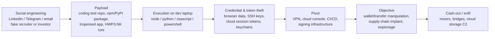

# 북한(DPRK) — 그룹과 사건 { #north-korea-dprk-groups-incidents }

**분류:** 위협 행위자 프로필 · **배후:** 정찰총국(RGB) 및 관련 국가 기관 · **최종 수정:** 2026-10-07

!!! abstract "요약"
    북한은 세계에서 가장 유능하면서도 가장 **금전적 동기가 강한** 국가 사이버 프로그램 중 하나를 운영합니다. MITRE ATT&CK는 Lazarus Group을 정찰총국(RGB)에 귀속하고, FBI는 2025년 2월 Bybit 거래소에서 약 **15억 달러(US$1.5 billion)** 규모의 암호화폐가 탈취된 사건을 북한의 "TraderTraitor" 활동으로 지목했습니다 — 기록상 단일 탈취로는 가장 큰 규모입니다. 같은 생태계가 전통적인 첩보 활동(국방, 정부, 싱크탱크, 한국)과 파괴 공격도 수행합니다. 이들이 위험한 이유는 특이한 도구가 아니라 **끈질긴 사회공학, 공급망을 노리는 사고방식, 빠른 작전 전환** 때문입니다 — 바로 방어자가 알아보는 법을 익혀야 하는 부분입니다.

## 방어자가 북한 행위자를 공부하는 이유 { #why-defenders-study-dprk-actors }

- **돈이 곧 임무입니다.** 국가 수입(제재 회피)이 대부분의 작전을 이끌기 때문에 은행, SWIFT 운영 기관, 암호화폐 거래소, DeFi 프로젝트, 그리고 *그 개발자들*이 주요 표적입니다.
- **네트워크만이 아니라 사람을 노립니다.** 가짜 채용 담당자, 가짜 코딩 테스트, 가짜 투자자, 가짜 구직자(IT 인력) — 초기 접근은 사람을 통해 이루어집니다.
- **여러 플랫폼을 다룹니다.** Windows, **macOS**(개발자와 암호화폐 업계 직원), Linux 서버, npm/PyPI 패키지, 클라우드 콘솔.
- **알아볼 수 있는 행위 패턴을 반복해서 씁니다.** 이 패턴은 ATT&CK에 깔끔하게 매핑됩니다 — [TTP와 헌팅](dprk-ttps-hunting.md)을 참고하세요.

## 클러스터와 이름 { #the-clusters-and-their-names }

업체마다 같은 활동을 다른 이름으로 부릅니다. "Lazarus"는 하나의 그룹을 가리킬 때도 있고, 정찰총국(RGB) 활동 전체를 묶는 우산 용어로 쓰일 때도 있습니다. 이 표는 그 이름들을 나란히 정리한 것입니다(업체 평가 기준이며, 겹치는 것이 정상입니다).

| 클러스터 (통칭) | 다른 이름 | ATT&CK | 주요 임무 | 알려진 사건/특징 |
|---|---|---|---|---|
| **Lazarus Group** (우산 / 핵심) | Hidden Cobra, Diamond Sleet (ZINC), Labyrinth Chollima, Selective Pisces | [G0032](https://attack.mitre.org/groups/G0032/) | 첩보, 파괴, 탈취 | Sony Pictures (2014), WannaCry (2017), 국방·항공우주 분야를 노린 가짜 채용 "Operation Dream Job" |
| **APT38 / BlueNoroff** | Sapphire Sleet, Stardust Chollima, Alluring Pisces | [G0082](https://attack.mitre.org/groups/G0082/) | 금전 탈취 | 방글라데시 은행 SWIFT 탈취 사건(2016), 은행, ATM, 암호화폐 기업; macOS 악성코드(RustBucket, KANDYKORN) |
| **TraderTraitor** | Jade Sleet, UNC4899, Slow Pisces | — | 개발자와 공급망을 통한 암호화폐 탈취 | Ronin (2022), JumpCloud (2023), DMM Bitcoin (2024), **Bybit (2025)** |
| **AppleJeus 클러스터** | Citrine Sleet, Gleaming Pisces, (3CX 건은 Mandiant 기준 UNC4736) | — | 암호화폐 탈취 | 트로이 목마가 심긴 암호화폐 거래 앱; **3CX** 이중 공급망 침해(2023) |
| **Andariel** | Onyx Sleet, Silent Chollima, Jumpy Pisces | [G0138](https://attack.mitre.org/groups/G0138/) | 첩보 + 자금 마련용 랜섬웨어 | 국방, 의료, 엔지니어링; 미국 의료 기관을 노린 Maui 랜섬웨어 |
| **Kimsuky** | APT43, Emerald Sleet (THALLIUM), Velvet Chollima, Sparkling Pisces | [G0094](https://attack.mitre.org/groups/G0094/) | 정보 수집 | 한국 정부, 통일·외교 정책 전문가, 싱크탱크, 언론인; HWP/LNK/CHM 미끼를 이용한 스피어피싱 |
| **APT37** | ScarCruft, Reaper, InkySquid, Ricochet Chollima | [G0067](https://attack.mitre.org/groups/G0067/) | 첩보 | 한국, 탈북민, 언론인; HWP 익스플로잇, 클라우드 스토리지 C2 |
| **IT 인력 / "Contagious Interview"** | Famous Chollima, Jasper Sleet | — | 수입(급여), 내부자 접근, 갈취 | 북한 국적자가 "랩톱 팜"을 이용해 가짜 신원으로 원격 채용됨; 구직자를 노린 가짜 면접 악성코드(BeaverTail, InvisibleFerret) |

!!! tip "실무 규칙"
    보고서에는 **어느 업체의 이름**을 인용하는지 적으세요. 한 업체의 "Lazarus가 X를 했다"와 다른 업체의 "Sapphire Sleet가 X를 했다"는 같은 사건일 수도 있고 — 아닐 수도 있습니다.

## 주요 공개 사건 연표 { #timeline-of-major-public-incidents }

| 연도 | 사건 | 클러스터 (보고 기준) | 무슨 일이 있었나 | 방어자를 위한 교훈 |
|---|---|---|---|---|
| 2014 | **Sony Pictures** | Lazarus | 데이터 탈취, 유출, 그리고 와이퍼 악성코드로 수천 대의 호스트 파괴 | 파괴 공격은 길고 조용한 접근 뒤에 옵니다 — 와이퍼만이 아니라 그 접근을 헌팅하세요 |
| 2016 | **방글라데시 은행** | APT38 | 부정 SWIFT 송금; 약 8,100만 달러 손실(시도 금액은 9억 5,100만 달러) | 공격자는 은행 자체의 결제 절차를 익혔습니다; IT만이 아니라 *업무* 시스템도 로그를 남기세요 |
| 2017 | **WannaCry** | Lazarus | EternalBlue / MS17-010을 이용한 웜형 랜섬웨어 | SMBv1을 패치하세요 — [EternalBlue](../adversary/eternalblue-smbv1.md) 참고 |
| 2022 | **Ronin Network (Axie Infinity)** | TraderTraitor | 엔지니어가 가짜 채용 제안 문서를 연 뒤 약 6억 2,000만 달러 탈취 | 서명/검증자(validator) 키를 가진 개발자는 최우선 보호 대상(crown-jewel) 사용자입니다 |
| 2023 | **3CX** | AppleJeus 클러스터 | 트로이 목마가 심긴 3CX 데스크톱 앱이 고객에게 배포됨; 3CX 자체도 그 전에 트로이 목마가 심긴 다른 앱(X_Trader)을 통해 침해당함 — 알려진 최초의 *연쇄* 공급망 공격 | 서명된 신뢰할 수 있는 업체 바이너리가 곧 임플란트일 수 있습니다 — 그 네트워크 행위의 기준선을 잡아 두세요 |
| 2023 | **JumpCloud** | TraderTraitor | 신원/MDM 제공 업체를 침해해 소수의 암호화폐 고객에게 접근 | SaaS 제공 업체의 관리 영역(admin plane)도 내 공격 표면입니다 |
| 2024 | **DMM Bitcoin** | TraderTraitor | 지갑 소프트웨어 회사 직원이 악성 "입사 전 테스트"를 실행한 뒤 약 3억 800만 달러 상당의 BTC 탈취 | 모르는 사람이 보낸 코딩 테스트는 악성코드 전달 수단입니다 |
| 2025 | **Bybit** | TraderTraitor | 약 15억 달러 상당의 ETH 탈취. Safe{Wallet} 개발자의 macOS 기기가 침해되었고, 탈취한 AWS 세션 토큰으로 지갑 프런트엔드 JavaScript를 변조해 평범한 송금이 다른 곳으로 향하게 만듦 | 클라우드 세션 토큰 + 프런트엔드 무결성; FBI PSA I-022625-PSA |
| 진행 중 | **IT 인력 위장 취업** | Famous Chollima | 수천 명의 원격 개발자가 도용/가짜 신원으로 근무, 미국 법무부(DOJ)가 미국 내 "랩톱 팜"을 적발 | 인사(HR), 신원 확인, VPN/지역 이상 징후도 보안 통제입니다 |

## 이들의 공격 방식 한눈에 보기 { #what-their-tradecraft-looks-like-one-picture }

단계별 분석, ATT&CK 매핑, 헌팅 쿼리는 다음 페이지에 있습니다: [북한 — TTP와 헌팅](dprk-ttps-hunting.md).

## 참고 자료 { #references }

- [MITRE ATT&CK — Lazarus Group (G0032)](https://attack.mitre.org/groups/G0032/) · [APT38 (G0082)](https://attack.mitre.org/groups/G0082/) · [Kimsuky (G0094)](https://attack.mitre.org/groups/G0094/) · [APT37 (G0067)](https://attack.mitre.org/groups/G0067/) · [Andariel (G0138)](https://attack.mitre.org/groups/G0138/)
- [FBI PSA I-022625-PSA — North Korea responsible for $1.5 billion Bybit hack](https://www.ic3.gov/PSA/2025/PSA250226)
- [Unit 42 — Threat assessment: North Korean threat groups](https://unit42.paloaltonetworks.com/threat-assessment-north-korean-threat-groups-2024)
- [Wiz — TraderTraitor deep dive](https://www.wiz.io/blog/north-korean-tradertraitor-crypto-heist)
- [CISA — North Korea cyber threat overview and advisories](https://www.cisa.gov/topics/cyber-threats-and-advisories/nation-state-cyber-actors/north-korea)
- 페이지: [TTP와 헌팅](dprk-ttps-hunting.md) · [피싱 전달](../adversary/phishing-delivery.md) · [EternalBlue](../adversary/eternalblue-smbv1.md)
