# Day 4 — Responder, 인터넷 허용 목록, 취약점 관리, 웹 보안, AD 하드닝 { #day-4 }

<div class="dfir-meta" markdown>
**과정:** Information Security Core Skills · **강사:** John Strand (BHIS) · **4일차 범위:** Responder 실습 해설 → NTLM 크래킹·릴레이·서명 → 인터넷 허용 목록 → 취약점 관리 → Nessus 보고서 실습 → 웹 애플리케이션 보안 → ZAP 실습 → AD 하드닝(BloodHound·PlumHound·Mimikatz) → Ping Castle 실습 → 과정 마무리
</div>

!!! abstract "4일차 한눈에"
    3일차에 준비한 **Responder 실습**으로 시작합니다. 같은 네트워크의 공격자는 트래픽을 돌려 **NTLMv2 챌린지·응답**을 가로채고, 오프라인으로 크래킹하거나 그대로 **릴레이**합니다 — 그래서 호스트 간 통신 차단, LLMNR 끄기, **SMB 서명**이 필요합니다. 이어서 공격자가 **새로 산 도메인을 짧게 쓰고 버리는** 습성을 역이용해, 웹 필터에서 **"미분류(Uncategorized)"를 차단**하는 것만으로 사실상의 **인터넷 허용 목록**을 만드는 법을 봅니다. 마지막으로 AI 시대의 **취약점 관리** — CVSS를 한 단계 올려 보고, 무시되던 Low·Informational도 살피고, 시스템별이 아니라 **취약점별로 묶어** 처리하기 — 와 **Nessus 보고서 실습**, 그리고 **웹 애플리케이션 보안** — 보안을 마지막에 "덧붙이지" 말고 개발 내내 **SAST·DAST**로 시험하고, **Burp·ZAP**으로 스캔하면서 **우리 탐지가 그 스캔을 잡는지**도 함께 확인하기 — 와 **ZAP 실습**입니다. 마지막 4부는 **AD 하드닝**입니다 — **BloodHound**로 도메인 관리자까지 가는 경로를 그래프로 보고, **PlumHound**로 그것을 고칠 일 목록으로 바꾸고, 지금은 막다른 길인 경로도 미리 끊습니다. **Mimikatz**가 해시 추출 이상을 한다는 점과 그 탐지, **Ping Castle 보고서 실습**, 그리고 과정 마무리로 끝납니다.

!!! note "표기 규칙"
    **💡 보충 (강의 외)** = 강의에 없던 제 추가 설명. **(재구성)** = 강사가 말로만 설명하거나 화면으로만 보여 줘 제가 일반적인 형태로 복원한 내용. 공부하며 생긴 질문에 대한 답은 **"깊이 보기"** 소단원으로 따로 정리했습니다. 공격 도구를 쓰는 실습은 무엇을 보여 주는지와 방어·탐지 포인트 위주로 정리했습니다.

**4일차 지도**

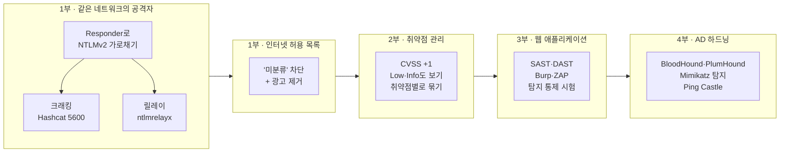

---

## 1. Responder 실습 해설 { #responder-lab }

### 왜 Kali 대신 Ubuntu인가 { #why-ubuntu }

대부분의 강의에서 Kali는 Metasploit·Nmap·패스워드 크래킹 정도에 쓰입니다. 앞으로는 **Docker 컨테이너**나 **허니팟 기술**을 다룰 예정이라, 도구를 더 쉽게 설치할 수 있는 Ubuntu로 옮겼습니다. 새 환경은 화면 위쪽에 **리눅스 IP를 바로 보여 줘서** 매번 `ifconfig`를 칠 필요가 없습니다.

### 클라우드에서는 포이즈닝이 안 된다 — 그래서 실습은 "흉내" { #cloud-limitation }

Responder는 **LLMNR, NBT-NS, mDNS** 포이즈너를 켭니다(1일차 9장 — 이름을 못 찾을 때 네트워크 전체에 "이 이름 누구예요?"라고 외치는 방식들). 그런데 이 방식들은 **AWS에서 동작하지 않습니다.** VM 사이의 **2계층(Layer 2) 통신을 격리**하기 때문입니다. 그래서 실습에서는 Windows가 **리눅스 쪽으로 직접 접속하게** 해서 흉내 냅니다.

> 공격자가 같은 네트워크에 있다면, 할 일은 **트래픽을 자기 쪽으로 돌리는 것**뿐이다. 그건 ARP 캐시 포이즈닝이나 LLMNR로 아주 쉽게 된다.

Responder 화면을 보면 **HTTP, HTTPS, SMB, Kerberos** 등 여러 가짜 서버가 자격 증명을 훔칠 준비를 하고 있습니다(**WPAD**는 이 실습에서는 꺼 둠).

> **분할(segmentation)이면 이 공격은 막힌다.** 다만 실제로 그런 분할을 해 둔 조직은 아주 드물다.

**공격 흐름과 막는 지점** — 점선은 각 단계를 끊는 방어입니다.

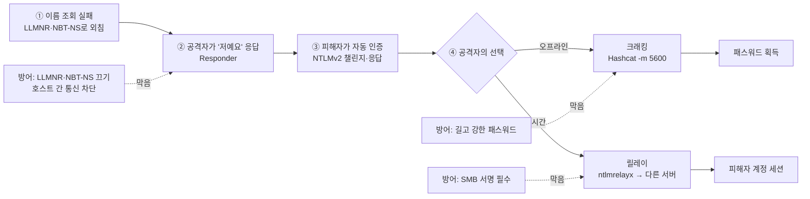

### 인증을 가로채는 순간 { #capture }

Windows 탐색기 주소창에 `\\<리눅스 IP>`를 넣고 엔터를 치자마자 Responder에 **administrator 계정의 인증 정보**가 잡힙니다. 사용자가 패스워드를 다시 입력하면 그 값도 또 잡힙니다. 보이는 것은 **NTLMv2 인증**입니다.

- **사용자 이름**
- **챌린지(challenge)** — 서버가 보내는 무작위 값
- **응답(response)** — 패스워드 해시와 챌린지로 계산한 값

> 챌린지도 평문으로 오가고, 응답도 평문으로 오간다. 그러면 그 목적이 거의 무너진다. 같은 네트워크에서 이 트래픽을 가로채면 이걸 가지고 **크래킹**할 수 있다.

!!! note "💡 보충 (강의 외) — 조금 더 정확하게"
    강의에서는 "16바이트 챌린지", "인증을 되돌린다(reverse)"고 표현했는데, NTLMv2의 **서버 챌린지는 8바이트**이고 응답은 NT 해시를 열쇠로 한 HMAC-MD5 계산 결과입니다. 이 계산은 거꾸로 풀 수 없습니다. 공격자는 가로챈 **챌린지와 응답을 가지고 후보 패스워드를 하나씩 넣어 같은 응답이 나오는지 오프라인으로 대입**합니다. 그래서 **패스워드가 약하면 깨지고, 길고 강하면 버틴다**는 1일차의 결론이 그대로 적용됩니다.

### 크래킹 — Hashcat 5600 모드 { #hashcat-5600 }

패스워드 크래킹 폴더에서 Hashcat으로 크래킹합니다. 실습 파일 안의 **IP 주소가 환경마다 달라서**, 파일 속 IP를 방금 가로챈 값에 맞게 고쳐야 합니다. 이번에는 **5600번 모드** — Hashcat에서 **NetNTLMv2**(NTLMv2 챌린지·응답)를 크래킹하는 모드입니다. 중첩 가상화 환경이라 시작이 느리지만, 결과에는 **admin 계정, 챌린지, 그 안의 해시, 맨 끝에 크래킹된 패스워드**가 나옵니다. 나머지 패스워드는 사전에 없어 깨지지 않으니 거기서 멈춥니다.

| Hashcat 모드 | 값의 종류 | 어디서 얻나 |
|---|---|---|
| **`-m 0`** | MD5 | 웹 DB 등 |
| **`-m 1000`** | NT 해시 | SAM, NTDS.dit, LSASS 메모리 — Pass-the-Hash에 쓰임 |
| **`-m 5600`** | NetNTLMv2 | 네트워크에서 가로챈 챌린지·응답 — Responder로 잡은 값 |

같은 "Windows 패스워드"라도 **어디서 얻은 값이냐**에 따라 모드가 다릅니다.

### 크래킹 말고 릴레이도 있다 — ntlmrelayx { #ntlmrelayx }

**ntlmrelayx**는 가로챈 인증을 **크래킹하지 않고 그대로 다른 여러 시스템에 넘겨서(relay)** 인증해 버립니다. 그래서 이 실습의 결론은 3일차와 같습니다.

> 그래서 **방화벽이 중요하다.** 누군가 바로 옆으로 뛰어넘어 올 수 있는 네트워크에서 **호스트끼리 통신하게 두면 안 된다.**

**Sysmon은 이걸 잡을까?**

> 크래킹은 공격자 컴퓨터에서 일어나니 **Sysmon이 볼 수 없다.** Sysmon이 볼 수 있는 건 **피해자 시스템에서 공격자 시스템으로 나간 네트워크 연결** 정도다.

!!! note "💡 보충 (강의 외) — 네트워크 쪽에서 보기"
    - **LLMNR(UDP 5355)·NBT-NS(UDP 137) 응답**이 정상 DNS 서버가 아닌 **일반 워크스테이션 IP**에서 나오면 의심 신호
    - 워크스테이션이 서버가 아닌 **다른 워크스테이션·낯선 IP로 SMB(445) 인증**을 시도 (Zeek `smb_mapping.log`, `ntlm.log`)
    - 피해자 쪽 Sysmon **3**(네트워크 연결)에서 `System` 프로세스가 낯선 내부 IP의 445로 연결

    방어는 **LLMNR·NBT-NS 끄기**, **SMB 서명 강제**(릴레이 차단), **워크스테이션 간 통신 차단**, 인터넷으로 나가는 **SMB 445 차단**. 자세히: [LLMNR과 NTLM 릴레이](../../../adversary/llmnr-ntlm-relay.md)

### 깊이 보기 ① 가로챈 값으로 할 수 있는 것 — 크래킹 vs 릴레이 vs Pass-the-Hash { #deep-dive-relay }

*강의 외 보충 설명입니다.*

NTLM 인증은 "질문과 대답" 방식입니다. 서버가 무작위 **질문(챌린지)**을 던지면, 클라이언트는 자기 **NT 해시를 열쇠로 써서** 그 질문에 대한 **대답(응답)**을 계산해 돌려줍니다.

- **NT 해시**는 패스워드에서 나온 **고정된 열쇠**입니다. 이 열쇠를 가진 사람은 **어떤 질문이 와도** 맞는 대답을 계산할 수 있으니, 언제든 어느 서버에든 몇 번이든 로그인할 수 있습니다 → **Pass-the-Hash**.
- **NetNTLMv2**는 그 열쇠로 **특정 질문 하나에 대해 계산한 한 번짜리 대답**입니다. 다음 로그인 때는 서버가 **다른 질문**을 던지므로 녹음해 둔 옛 대답은 쓸모가 없습니다 → 재사용 불가, **오프라인 크래킹**만 가능.
- **릴레이**는 값을 저장했다가 나중에 쓰는 게 아니라, **피해자와 진짜 서버 사이에 끼어 질문과 대답을 실시간으로 양쪽에 전달**하는 것입니다.

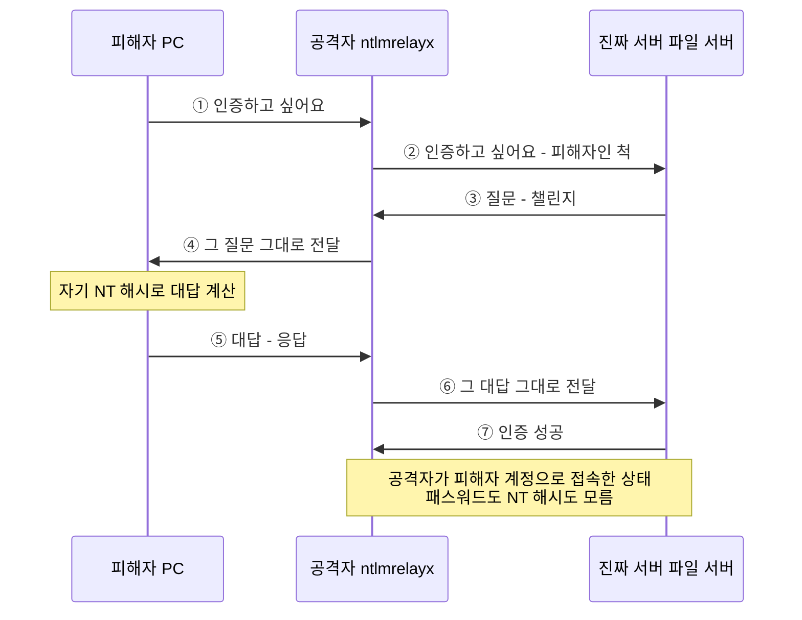

진짜 서버의 질문을 피해자에게 넘기니, 피해자는 **바로 그 질문**에 대한 대답을 계산하고, 그 대답이 지금 서버가 기다리는 정답이라 그대로 통과합니다. 공격자는 **패스워드도 NT 해시도 모르는 채로** 피해자 계정 세션을 얻습니다. 그래서 릴레이는 **패스워드가 아무리 강해도** 통합니다.

| | 공격자가 가진 것 | 할 수 있는 것 |
|---|---|---|
| **Pass-the-Hash** | NT 해시(고정된 열쇠) | 언제든, 아무 서버에나, 반복해서 로그인 |
| **가로챈 NetNTLMv2** | 한 번짜리 대답 | 재사용 불가 → 오프라인 크래킹만 가능 |
| **NTLM 릴레이** | 아무것도 저장 안 함 (실시간 중계) | 피해자가 인증을 시도하는 **그 순간에만** 다른 서버로 로그인 |

**릴레이의 조건:** ① **실시간**이어야 함, ② 피해자 계정이 대상 서버에서 **권한**이 있어야 의미가 있음, ③ 같은 PC로 되돌려 보내는 것(반사)은 오래전 패치로 기본적으로 막힘.

**로그에서는 (DFIR 관점):** 릴레이가 성공하면 **대상 서버**에 **4624**(로그온 성공), 로그온 유형 **3**(네트워크), 인증 패키지 **NTLM**이 남습니다. 단서는 **계정과 출발지가 맞지 않는다**는 점 — 계정은 피해자(예: `CORP\alice`)인데 출발지 IP(`IpAddress`)는 **공격자 PC**이고, 워크스테이션 이름(`WorkstationName`)과 IP가 서로 맞지 않습니다.

### 깊이 보기 ② SMB 서명은 어떻게 릴레이를 막나 { #deep-dive-smb-signing }

*강의 외 보충 설명입니다.*

**은행 창구**에 비유하면 이렇습니다.

- **릴레이 = 남의 신분 확인을 대신 통과한 것.** 공격자는 창구 직원(서버)의 질문을 진짜 손님(피해자)에게 전달하고, 손님의 대답을 다시 직원에게 전달해 **손님인 척 창구를 통과**합니다.
- **SMB 서명 = 통과한 뒤에도 출금 전표마다 "인감 도장"을 요구하는 규칙.** 로그인 후에 오가는 모든 요청(파일 열기, 명령 실행 등)마다 **본인만 만들 수 있는 도장**이 찍혀 있어야 서버가 받아 줍니다.
- **공격자는 도장이 없다.** 그래서 인증은 통과해도, **첫 번째 요청부터 서버가 거절**합니다. 창구까지는 들어왔지만 아무 일도 처리하지 못합니다.

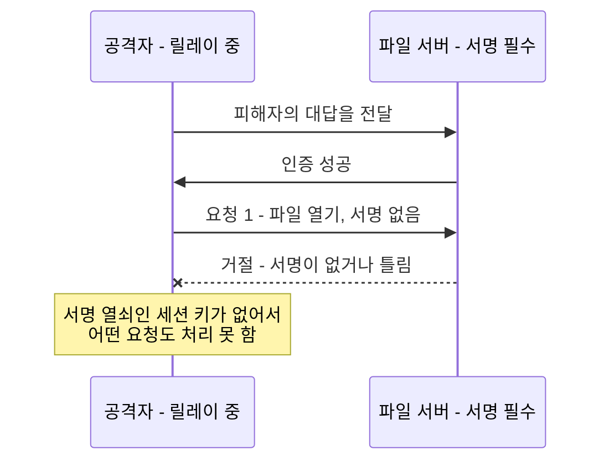

**주의: "가능"이 아니라 "필수"여야 한다.**

- **사용 가능(enabled):** "도장 찍어도 되고 안 찍어도 됩니다." → 공격자가 "도장 없이 할게요"라고 하면 받아 줌 → **릴레이를 못 막음**
- **필수(required):** "도장 없으면 무조건 거절" → **릴레이를 막음**

최근 Windows(Windows 11 24H2, Windows Server 2025)부터는 SMB 서명이 **기본으로 필수**로 바뀌고 있지만, 예전 버전이나 설정을 바꾼 환경은 여전히 필수가 아닐 수 있으니 실제 설정을 확인해야 합니다.

### 깊이 보기 ③ 서명은 NT 해시가 있어야만 만들 수 있나 { #deep-dive-signing-key }

*강의 외 보충 설명입니다.*

**NTLM으로 로그인한 경우에는 사실상 그렇습니다.** (흔히 "NTLM 해시"라고 부르는 것은 정확히는 **NT 해시**입니다.)

1. 피해자 PC가 서버의 질문에 대답을 계산하면서,
2. 동시에 **NT 해시 + 이번 질문과 대답에 들어간 값들**을 섞어 **"이번 대화 전용 열쇠(세션 키)"**를 계산합니다.
3. 서명은 이 **세션 키**로 만듭니다. 세션 키 자체는 **네트워크로 전송되지 않습니다.**

**그럼 파일 서버는 어떻게 아나?** 파일 서버는 사용자의 NT 해시를 모르므로 **도메인 컨트롤러(DC)에 물어봅니다.** DC가 대답을 확인하고 세션 키도 계산해 **안전한 전용 통로(Netlogon 보안 채널)**로 파일 서버에 알려 줍니다. 그래서 세션 키를 아는 것은 **피해자 PC, DC, 파일 서버** 셋뿐이고, 전달만 한 공격자는 모릅니다. (**Kerberos**로 로그인하면 NT 해시 대신 **Kerberos 티켓 안의 세션 키**로 서명합니다 — 원리는 같습니다.)

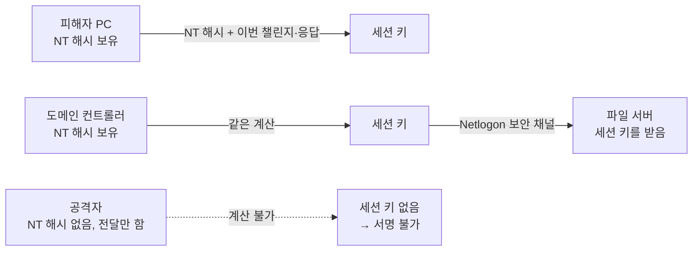

**중요한 결론 — 해시를 이미 가졌다면 이야기가 다르다.** 공격자가 **NT 해시를 이미 가지고 있다면** 세션 키를 직접 계산할 수 있으므로 **서명도 직접 만들 수 있습니다.** 즉 **Pass-the-Hash는 SMB 서명으로 막히지 않습니다.**

| 공격 | 공격자가 NT 해시를 아나? | SMB 서명(필수)으로 막히나? |
|---|---|---|
| **NTLM 릴레이** | 모름 (전달만 함) | **막힘** |
| **Pass-the-Hash** | 앎 (훔침) | **안 막힘** |
| **가로챈 NetNTLMv2 크래킹** | 크래킹에 성공하면 패스워드까지 앎 | 크래킹 후에는 **안 막힘** |

그래서 방어도 따로 필요합니다. **SMB 서명 = 릴레이 대책**, **Pass-the-Hash 대책 = 3일차의 LAPS·워크스테이션 간 통신 차단·Credential Guard**([Pass-the-Hash](../../../adversary/pass-the-hash.md)), **크래킹 대책 = 1일차의 길고 강한 패스워드**.

### 오늘 남은 실습 예고 { #upcoming-labs }

- **웹 테스트 실습** — 일부러 취약하게 만든 작은 웹 앱(Damn Small Vulnerable Web App)을 **ZAP(Zed Attack Proxy)**으로 공격 ([3부](#zap-lab))
- **Ping Castle 실습** — VM 없이 웹 사이트에서 **Ping Castle 보고서를 분석** ([4부](#ping-castle))

---

## 2. 인터넷 허용 목록 (Internet Allow Listing) { #internet-allowlisting }

1일차의 애플리케이션 허용 목록과 아주 비슷합니다. **효과가 매우 크지만**, "회사가 쓰는 웹사이트를 전부 등록해야 한다"는 걱정 때문에 하지 않습니다.

> 그럴 필요 없다. 사용자가 인터넷에 나갈 때 거치는 **웹 프록시의 간단한 설정**만으로 쉽게 할 수 있다.

이렇게 하면 **초기 침해**와 **C2 통신**의 상당 부분이 막히고, 2일차의 RITA·AC-Hunter와 좋은 짝이 됩니다.

### 왜 차단 목록으로는 안 되나 { #why-not-denylist }

> 인터넷은 크다. 정말 크다. 얼마나 어마어마하게 거대한지 믿기 힘들 정도다. 그리고 그 대부분은 쓸모없고 사악하다.

### 공격자는 도메인을 어떻게 쓰나 { #attacker-domains }

**① 사서 쓰고, 환불받는다.** GoDaddy 같은 곳에서 도메인을 **4.99달러** 정도에 살 수 있고, 인터넷 규칙(ICANN)상 **1~2주 정도 환불 기간**이 있습니다. 공격자는 도메인을 사서 공격에 쓰고 **환불받습니다** — "공격자는 무엇보다 **알뜰하다**".

**② 다른 조직을 뚫어서 그 도메인을 쓴다.** John은 **Shodan**(인터넷에 노출된 장비 검색 엔진)으로 보여 줍니다.

- **MongoDB** 검색 → 노출된 데이터베이스 **93,624개**, 상당수가 **지원 종료(EOL)**·미패치
- 엔터프라이즈 라이선스(비쌈)가 있으면 **취약하거나 이미 침해된 시스템**까지 검색
- 이미지 검색에서 **5900번 포트(VNC)** → 화면이 그대로 보이는 세션들, **ICS 태그** → **인증 없이 들어갈 수 있는 산업 제어 시스템**들

**왜 짧게 쓸까?** 돈 때문만이 아니라, 공격에 쓴 도메인은 보통 **1~2주면 "타 버려서(burnt)"** 차단 목록에 오르기 때문입니다.

### 펜테스터는 다르게 한다 — 이미 분류된 도메인 { #pentester-domains }

BHIS 같은 펜테스터는 **만료된 도메인을 사서, URL과 위험 평가(SimilarWeb·ACR 점수)로 정렬해 주는 도구**를 씁니다(자동 자막으로는 도구 이름이 분명하지 않습니다). 예전에 누군가 쓰다 만료되어 다시 매물로 나온 도메인이라, 보안 업체들이 이미 **증권·거래, 정부·법률(예: Oregon City Parks .org), 엔터테인먼트, 기술·인터넷** 같은 **정상 분류**를 붙여 둔 상태입니다. 목적은 **도메인 필터링 우회**입니다.

> 실제 공격자는 이렇게 잘 안 한다. **새 도메인을 사서 쓴다.** 이 차이가 아래 방어책의 핵심이다.

| | 실제 공격자 | 펜테스터 (BHIS) |
|---|---|---|
| 어떤 도메인 | **새로 산** 도메인 (또는 뚫은 서버의 도메인) | 만료 후 **다시 매물로 나온** 도메인 |
| 쓰는 기간 | 1~2주 쓰고 버림 (곧 차단 목록에 오름), 환불 | 평가 기간 동안 |
| 보안 업체의 분류 | 없음 → **"미분류"** | 이미 **정상 분류**가 붙어 있음 |
| "미분류" 차단에 | **걸린다** | 피해 갈 수 있다 |

### 사이트는 허용하고, 광고는 지운다 { #ads }

사람들이 하루에 가는 웹사이트는 **대부분 몇 개 안 됩니다.** 예외는 링크를 다 누르는 사람들과 뉴스 사이트를 많이 보는 사람들인데, Yahoo처럼 **뉴스 기사처럼 생긴 광고**가 섞인 사이트에서 그걸 누르는 사람도 있습니다. 하지만 아주 드뭅니다.

> 사람들이 가고 싶어 하는 사이트는 허용해 주고(Yahoo여도 좋다), 대신 **광고를 지운다** — Ghostery나 AdBlock Plus 같은 것을 **환경 전체에** 돌린다. 이것만으로도 차단 목록 방식보다 노출이 **훨씬** 줄어든다.

차단 목록 방식이 불리한 이유: Cisco나 Fortinet 같은 업체가 나쁜 사이트를 분류하는 데는 **시간차**가 있습니다 — 사이트가 공격을 시작한 시점과 업체가 막기 시작하는 시점 사이에 **빈틈**이 생깁니다.

### 핵심 — "미분류(Uncategorized)"를 차단하라 { #block-uncategorized }

대부분의 웹 필터에는 **분류 목록**(애드웨어, 주류, 익명화 도구, 포르노, 도박 …)이 있습니다. 회사들은 성인물·도박 같은 것은 차단하지만, **오른쪽 아래의 "미분류(Uncategorized)"는 무시합니다.**

> 이걸 차단하면 **큰 수고 없이 사실상의 허용 목록**이 된다. 알려진 사이트만 갈 수 있게 되기 때문이다.

공격자는 **완전히 새로 산 도메인**을 쓰므로, 방화벽·프록시 업체는 그 도메인을 **한 번도 본 적이 없습니다.**

> Cisco 같은 업체가 한 번도 본 적 없는 도메인에 사용자가 가게 두고 싶은가? 나쁜 생각 같지 않나?

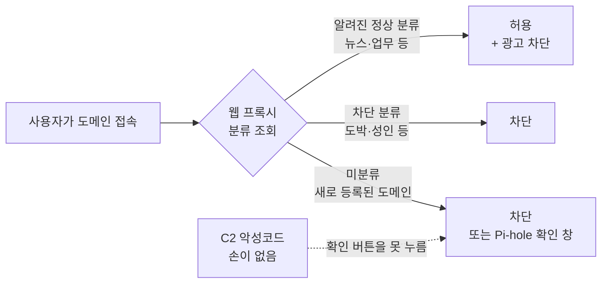

!!! note "💡 보충 (강의 외)"
    요즘 많은 프록시·DNS 필터에는 **"새로 등록된 도메인(Newly Registered Domains, NRD)"** 분류가 따로 있습니다(예: 등록 30일 이내). "미분류"와 함께 차단하면 공격자가 막 사서 쓰는 도메인을 효과적으로 걸러 냅니다.

### 허용 목록 방식 세 가지 { #allowlist-approaches }

- **① 모든 사이트를 하나하나 허용** — 대부분의 경우 **멍청한 방법**
- **② 분류 기준으로 허용** — 위의 방식("미분류" 차단 포함)
- **③ 사용자가 직접 허용** — **Pi-hole**로 가능. 처음 보는 도메인이면 **"정말 가시겠습니까?"** 팝업을 띄움

> 이렇게 하면 **C2 통신이 밖으로 나가기 아주 어려워진다.** C2 악성코드에는 **손이 없어서** 그 버튼을 누를 수 없다.

### 정상 사이트에서도 감염된다 — 범인은 광고 { #malvertising }

허용 목록을 써도 감염은 뉴스 사이트, Facebook, 영화 사이트, 성인 사이트 같은 **정상 사이트**에서 일어날 수 있고, 그건 **거의 언제나 광고를 통해서**입니다.

> 처음 감염시키는 서버는 보통 **C2 서버가 아니다.** 익스플로잇을 전달하는 서버와 명령·제어 서버가 **따로** 있다.

그래서 감염 단계를 놓쳐도 **C2로 나가는 통신**을 막을 기회가 한 번 더 있습니다. 이런 분류 필터링은 **OpenDNS** 같은 DNS 기반 필터로도 할 수 있습니다.

!!! note "💡 보충 (강의 외) — Splunk로 \"처음 보는 도메인\" 찾기"
    ```spl
    index=zeek sourcetype=zeek_dns earliest=-30d
    | stats earliest(_time) AS first_seen count BY query
    | where first_seen > relative_time(now(), "-1d")
    | sort - count
    ```

    - **`index=zeek sourcetype=zeek_dns earliest=-30d`** — 최근 30일치 Zeek DNS 로그(인덱스·sourcetype 이름은 환경에 맞게).
    - **`stats earliest(_time) AS first_seen count BY query`** — 도메인(`query`)별로 **처음 나타난 시각**(`first_seen`)과 **조회 횟수**.
    - **`where first_seen > relative_time(now(), "-1d")`** — 처음 나타난 시각이 **최근 24시간 안**인 것만 = "30일 동안 없다가 오늘 처음 등장한 도메인".
    - **`sort - count`** — 조회가 많은 순.

    ```text
    query                         first_seen   count
    timeserversync.com            1729555200   168
    cdn-update-check.net          1729560000    42
    ```

    새로 나타났는데 조회가 **규칙적으로 많은** 도메인(2일차 AC-Hunter의 WhatTime처럼 시간당 168회)은 C2를 의심해 볼 만합니다.

### DNS over HTTPS(DoH)에 대한 John의 생각 { #doh }

**DoH**는 이름 조회를 **암호화된 HTTPS로** 보내는 기술로, 사생활 보호에는 좋습니다. 하지만 John은 불편해합니다.

- 위험한 나라에 있는 사람이라도 John은 **VPN을 권합니다.**
- DoH 업체 상당수가 "시민의 권리를 돕는다"는 겉모습 뒤에서 **DNS 데이터를 모아 광고에 쓴다**고 봅니다("좀 수상하다").
- **회사에서는 DoH를 쓰지 말라:**

> DNS는 암호화되어 있지 않아서, 사람들이 **어디로 가는지 볼 수 있다.** 그게 우리에게 어느 정도의 보호를 준다. DoH를 쓰면 그 **가시성을 잃는다.**

!!! note "💡 보충 (강의 외)"
    회사에서는 그룹 정책으로 **브라우저 자체 DoH를 끄고**, 알려진 공개 DoH 서버(예: `1.1.1.1`, `8.8.8.8`, `dns.google`의 443 포트)로 나가는 통신을 막아 **사내 DNS만 쓰게** 하는 것이 일반적입니다. 그래야 2일차의 DNS 기반 탐지(dnscat2 같은 DNS 백도어 찾기)도 계속할 수 있습니다.

---

## 3. 취약점 관리 { #vulnerability-management }

### 10년째 그대로다 { #unchanged }

> 취약점 스캐너를 돌린다 → 외부에 노출된 취약점을 찾는다 → 보고서가 나온다. 아주아주 단순하다.

일부 회사는 **인증 스캔(credentialed scan)** — 스캐너에 계정을 주고 설치된 프로그램을 다 조사 — 으로 옮겨 가지만, 많은 팀이 **쏟아지는 데이터에 압도됩니다.** 그리고 AI 시대에는 **보고되는 취약점, 새 CVE와 익스플로잇이 폭증**할 것이므로, 사람이 그 과정 안에 반드시 있어야 합니다.

### "높음·치명적만 고친다"는 망가졌다 { #broken-prioritization }

**중간·낮음**이나 **공개 익스플로잇이 없는 것**을 무시하면 AI 시대에는 문제가 생깁니다. 약간의 실력과 AI 도구, 시간, 토큰만 있으면 **누구나** 그런 취약점에서 **익스플로잇까지 뽑아낼 수 있기** 때문입니다.

> 예전에 "중간"이던 것이 이제는 아마 "높음"이 되고 있다.

**John의 제안 — CVSS를 최소 1점씩 올려서 보라:** 6.5 → **7.5**, 8.5 → **9.5**, 9.5 → 곧 익스플로잇이 나올 것으로.

| CVSS 점수 | 등급 |
|---|---|
| 0.1 ~ 3.9 | 낮음 (Low) |
| 4.0 ~ 6.9 | 중간 (Medium) |
| 7.0 ~ 8.9 | 높음 (High) |
| 9.0 ~ 10.0 | 치명적 (Critical) |

"실제 익스플로잇이 없으면 패치하지 않는다"는 방식에 대해서는:

> 익스플로잇이 나왔을 때는 **이미 늦었다.**

예전에는 익스플로잇·웜이 **무차별로** 퍼졌고 방어자에게 **시간**이 있었지만, 이제는 특정 조직을 노린 공격에서도 **AI의 도움으로 맞춤형 익스플로잇을 비교적 빨리 개발**할 수 있습니다.

!!! note "💡 보충 (강의 외) — CVSS 말고 함께 볼 것"
    - **CISA KEV** — 실제로 악용된 것이 확인된 취약점 목록
    - **EPSS** — 앞으로 30일 안에 악용될 **확률**

    둘 다 유용하지만 "이미 악용됐다/될 것 같다"는 **신호가 쌓인 뒤** 올라가므로, AI로 익스플로잇이 빨리 나오는 시대에는 늦을 수 있습니다. KEV·EPSS로 앞쪽을 정하되 그 아래도 무시하지 마세요.

**정리 — 예전 방식과 AI 시대의 차이**

| | 예전 방식 | AI 시대 (John의 제안) |
|---|---|---|
| 우선순위 | High·Critical만 | **CVSS를 +1 해서** 보기 |
| 익스플로잇 없는 취약점 | 나중에 | AI로 금방 익스플로잇이 나올 수 있음 → **미리** |
| Low·Informational | 무시 | **사람이 읽고 맥락으로 판단** |
| 처리 단위 | 시스템별 | **취약점별 + 자동화** |

### 더 큰 문제 — 무시되는 Low·Informational { #lows-and-infos }

> 더 큰 문제는, **낮음(Low)과 정보(Informational)**는 애초에 무시하면 안 되는 것이었다는 점이다.

어떤 조직의 서버 팜에 **Telnet 서버가 1,000대** 있다고 해 봅시다(레거시 환경에서 실제로 있는 일). 스캔하면 접속 시 처음 나오는 **배너**가 이렇게 보입니다.

```text
login
login
login
mushroom
mushroom
login
router
login
...
```

*(재구성 — John이 말로 설명한 예)*

대부분은 `login`인데, **`router`라고 뜬 한 대**는 **인증 없이 바로 들어갈 수 있는 Telnet 서버**입니다. 엄청나게 큰 취약점이지만, 배너 문구는 **아무 문자열**이나 될 수 있어서 스캐너는 "그냥 로그인 배너"와 "큰 취약점일 수 있는 배너"를 구분하지 못하고 **Informational**로 분류합니다.

> AI 시대가 오기 전부터, 우리는 이미 **놓치고 있는 Low·Informational**을 엄청나게 안고 있었다. 그리고 대부분의 조직은 그걸 **그냥 무시한다.**

### 깊이 보기 ④ 배너가 `router`로 나오면 왜 위험한가 { #deep-dive-router-banner }

*강의 외 보충 설명입니다.*

위험한 건 `router`라는 **단어가 아니라**, **로그인 요청 없이 바로 장비의 명령 입력 화면이 나왔다**는 사실입니다. 정상적인 Telnet 서버는 먼저 누구냐고 묻습니다.

```text
$ telnet 10.1.0.1
Connected to 10.1.0.1.

User Access Verification

Username:
```

`router`라고 나온 서버는 이렇게 생겼을 가능성이 높습니다.

```text
$ telnet 10.1.0.9
Connected to 10.1.0.9.

Router>
```

`Router>`는 **로그인이 이미 끝난 뒤에 나오는 "명령을 입력하세요" 화면(프롬프트)**입니다. Cisco 장비는 이름을 정하지 않으면 기본 이름이 `Router`라서 프롬프트가 `Router>`로 나옵니다. 즉 **접속하자마자 라우터 안에 들어와 있는 상태** — 문 앞에서 신분 확인을 해야 하는데, 문을 여니 바로 기계실 안인 것과 같습니다.

라우터는 네트워크의 **교차로**라서, 들어오면 설정을 보고 **네트워크 구조 파악**, 경로를 바꿔 **트래픽을 자기 쪽으로 돌리기**(Responder와 같은 효과), **ACL을 바꿔 막힌 길 열기**, 다른 구간으로 넘어가는 **발판**으로 쓰기가 가능합니다. 게다가 Telnet은 **암호화되지 않아** 정상 로그인의 패스워드도 평문으로 흐릅니다.

`mushroom`은 **"배너 문구는 아무거나 될 수 있다"**는 예입니다. 글자만 봐서는 그다음에 로그인 요청이 나올지 모릅니다. 스캐너는 배너의 **첫 문구만 기록**할 뿐 그게 "로그인 요청 화면"인지 "이미 들어온 명령 화면"인지 이해하지 못합니다. 사람이 읽어 봐야 압니다.

### 시스템별이 아니라 취약점별로 묶어라 { #group-by-vuln }

시스템 하나하나 기준으로 보면 **IP 1,000개 × IP당 취약점 약 25개 = 25,000개** — 불가능해 보여 막막해집니다. John은 이 접근이 **거의 언제나 틀렸다**고 합니다.

> 사실 25,000개의 취약점이 있는 게 아니다. 보통은 **수백 개의 취약점**이 여러 시스템에서 **계속 반복**되는 것이다.

질문을 뒤집습니다 — ❌ "이 시스템에는 어떤 취약점이 있나?" → ⭕ "**이 취약점은 어떤 시스템들에 있나?**" 그러면 **수백 개**만 쫓으면 되고, **Microsoft 패치 관리, Ansible 스크립트** 같은 **자동화로 같은 수정을 여러 시스템에 한꺼번에** 밀어 넣을 수 있습니다.

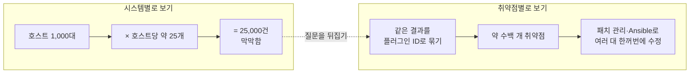

!!! note "💡 보충 (강의 외) — Splunk로 \"취약점별로 묶기\""
    Nessus 결과를 CSV로 내보내 Splunk에 **조회 파일(lookup)** `nessus_scan.csv`로 올렸다고 해 봅시다(열: `Plugin ID`, `Name`, `Risk`, `Host`, `Port`, `Plugin Output` 등).

    ```spl
    | inputlookup nessus_scan.csv
    | stats dc(Host) AS host_count values(Host) AS hosts BY "Plugin ID" Name Risk
    | sort - host_count
    ```

    - **`| inputlookup nessus_scan.csv`** — 인덱스 대신 올려 둔 CSV 파일을 불러옴(맨 앞에 `|`).
    - **`stats ... BY "Plugin ID" Name Risk`** — 취약점별로 묶음. 필드 이름에 **공백**이 있으면 큰따옴표로 감쌈.
        - **`dc(Host) AS host_count`** — `dc`는 **고유 개수** — 이 취약점이 있는 **서로 다른 호스트 수**.
        - **`values(Host) AS hosts`** — 그 호스트들의 **목록**.
    - **`sort - host_count`** — 영향받는 호스트가 **많은 순**.

    ```text
    Plugin ID  Name                              Risk    host_count  hosts
    42263      Unencrypted Telnet Server         Medium  1000        10.1.0.1, 10.1.0.2, ...
    57608      SMB Signing not required          Medium   812        10.2.0.5, 10.2.0.6, ...
    ...        Web Server Office File Inventory  None      14        10.3.1.20, ...
    ```

    *(숫자는 설명용 예시)* 25,000줄이 **수백 줄**로 줄고, "한 번 고치면 수백 대가 해결되는 것"이 맨 위에 보입니다. **"SMB 서명이 필수 아님"**은 [깊이 보기 ②](#deep-dive-smb-signing)의 **릴레이 방어**와 바로 연결되는 항목 — Nessus는 Medium이지만 812대가 릴레이에 노출돼 있다는 뜻입니다. Nessus CSV에서 Informational은 `Risk`가 **`None`**으로 들어가니 **걸러 내지 말고** 같이 보세요.

    배너처럼 **드문 값**(2일차의 롱테일 분석)을 찾으려면:

    ```spl
    | inputlookup nessus_scan.csv
    | search "Plugin ID"=42263
    | stats count BY "Plugin Output"
    | sort count
    ```

    - **`search "Plugin ID"=42263`** — Telnet 서버 항목만.
    - **`stats count BY "Plugin Output"`** — 배너 내용이 같은 것끼리 개수.
    - **`sort count`** — **적은 순**(`-`가 없으면 오름차순).

    ```text
    Plugin Output        count
    router                   1
    mushroom                 2
    login                  997
    ```

    맨 위에 1개뿐인 `router`가 바로 그 **인증 없는 Telnet 서버**입니다.

**취약점 스캔이 보는 범위는 좁다.** MITRE ATT&CK 중 **공개 애플리케이션 익스플로잇**과 **외부 원격 서비스** 정도뿐이고, 매트릭스의 대부분과 **침투 후 횡적 이동 기회**는 보이지 않습니다. 그래서 3일차의 BloodHound나 4부의 Ping Castle 같은 도구가 따로 필요합니다.

---

## 4. Nessus 보고서 실습 — 보물찾기 { #nessus-lab }

Windows VM의 `IntroLabs` 폴더에 있는 **Nessus 보고서**(오래됐지만 개념은 같음)에서, 사람들이 흔히 무시하는 **Low·Medium 중 반드시 고쳐야 할 것**을 찾는 "보물찾기"입니다. 보고서 맨 아래에 John의 해설이 있습니다.

### ① Office File Inventory (Low) { #office-file-inventory }

`Ctrl+F`로 **"office"** 검색 → 웹 서버에 올라와 있는 **Office 문서 목록**을 알려 주는 **Low** 항목.

> 이건 우리가 **아주 자주** 보는 Low 항목이고, **실제로 이걸로 시스템에 들어간다.**

사람들이 웹 서버에 말도 안 되는 것들을 올리기 때문입니다 — **`passwords.doc`**, 시스템 설치를 **단계별로** 적은 **설치 안내서** 등.

### ② 백업 파일 (.bak) { #backup-files }

**`.bak`** 검색 → 웹사이트 페이지 목록에 이런 것들이 보입니다.

```text
/admin/
/admin/backup/backup.bak
/admin/telnet
```

많은 웹사이트가 **정기 백업**을 `.001`, `.002`, `.bak` 같은 이름으로 같은 폴더에 저장해 두고, 그 안에는 **서버 측 포함 파일(server-side includes)**처럼 **사용자 ID와 패스워드**가 들어 있는 경우가 많습니다. 다른 사이트에서는 **`sourcecode.tar`**(소스 코드 묶음)도 보입니다.

!!! note "💡 보충 (강의 외) — 백업 파일이 위험한 이유"
    웹 서버는 `config.php`를 받으면 **실행해서 결과만** 보여 주므로 그 안의 DB 패스워드는 보이지 않습니다. 그런데 `config.php.bak`이라는 이름이면 실행할 파일로 인식하지 않고 **그냥 텍스트로 내려 줍니다** → **소스 코드와 DB 패스워드가 그대로 노출**. 방어는 웹 루트에 백업 파일을 두지 않는 것, 그리고 `.bak`, `.old`, `.tar`, `.zip` 같은 확장자를 아예 내려 주지 않도록 막는 것입니다.

### ③ config term (Telnet) { #config-term }

마지막은 앞의 **Telnet** 사례입니다.

```text
Welcome to the configure terminal.
Please authenticate.
Please authenticate.

Router(config)#
```

*(재구성 — 실제 보고서 화면 문구는 조금 다를 수 있음)*

계속 "인증하세요"라고 하다가, 결국 **설정 모드(`config term`)가 그냥 열려 있어서** 누구든 접속하면 바로 설정을 바꿀 수 있습니다.

### 깊이 보기 ⑤ "인증하세요"라고 하다가 왜 `config term`이 나오나 { #deep-dive-config-term }

*강의 외 보충 설명입니다.*

> 화면의 **"Please authenticate"는 실제로 인증을 확인하는 단계가 아니라, 그냥 적어 둔 안내 문구**다.

장비에는 설정이 따로 두 개 있습니다.

- **배너(banner)** — 접속하면 보여 주는 **안내문**. 아무 글이나 넣을 수 있음.
- **인증(login)** — 실제로 **아이디·패스워드를 묻고 확인**하는 설정.

이 장비는 **배너에는 "인증하세요"라고 써 놓고 정작 인증 설정은 하지 않은 것**입니다. 문에 **"출입 시 신분증을 제시하세요"라는 안내문**은 붙어 있는데 **문은 잠겨 있지 않은** 것과 같습니다.

`config term`은 Cisco의 **`configure terminal`** — 장비의 **설정을 바꾸는 모드**로 들어가는 명령입니다.

| 프롬프트 | 단계 | 할 수 있는 것 |
|---|---|---|
| `Router>` | 일반 사용자 모드 | 상태를 일부 볼 수 있음 |
| `Router#` | 관리자(특권) 모드 | 모든 정보를 보고, 설정 모드로 들어갈 수 있음 |
| `Router(config)#` | **설정 모드** | **장비 설정을 무엇이든 바꿀 수 있음** |

그래서 깊이 보기 ④의 `Router>`보다 **더 나쁜 상태**입니다 — 인증이 없을 뿐 아니라 **곧바로 최고 권한으로 설정을 바꿀 수 있는 곳**에 들어와 있습니다.

**왜 이런 일이 생기나:** 원격 접속 회선(VTY)에 **인증을 안 걸어 둠**(`no login`), 원격 접속 시 **곧바로 최고 권한(privilege level 15)**을 주도록 설정, 테스트하려고 풀어 뒀다가 **되돌리지 않음**, 오래된 장비라 **아무도 설정을 확인하지 않음**.

**방어:** **Telnet을 끄고 SSH만**(`transport input ssh`), 원격 접속에 **반드시 로그인**(AAA나 로컬 계정), 관리 접속은 **관리용 IP에서만** 허용하는 ACL. 점검할 때는 23번 포트가 열린 장비의 **배너를 모아 드문 것부터** 보면 `login`이 아닌 이상한 화면을 빨리 찾을 수 있습니다.

### 이 실습이 말하는 것 { #nessus-takeaway }

> 높음·치명적만 보면 안 된다. **Low·Informational도 봐야 한다.** 그리고 이걸 조직에서 효과적으로 하려면, **플러그인 ID와 취약점 ID 기준으로 정렬**해서 봐야 한다.

지금까지 본 것은 **일반적인 취약점 평가 스캔**이고, 이것은 **웹 애플리케이션, 모바일 애플리케이션, API** 테스트와는 근본적으로 다릅니다 → 3부의 웹 애플리케이션 보안으로 이어집니다.

---

## 5. 웹 애플리케이션 보안 { #web-app-security }

일반 취약점 평가 스캔은 **웹 애플리케이션, 모바일 앱, API**를 시험하는 것과 근본적으로 다릅니다. 그러면 우리 앱을 어떻게 빠르고 효과적으로 지킬까요? 걸림돌은 세 가지입니다 — **교육**은 터무니없이 비싸고, **도구**도 비쌀 수 있고, 개발 **절차 전체를 바꿔** 보안을 넣는 것은 아주 어렵습니다.

### 보안은 마지막에 "덧붙여진다" { #bolted-on }

소프트웨어 개발 생명 주기(SDLC)는 계속 빌드하고, 기능을 더하고, 개선합니다. 그런데 보안은 거의 **나중에 생각난 것처럼 맨 끝에 덧붙여집니다(bolted on).** BHIS에 오는 흔한 전화:

> "웹 애플리케이션 보안 평가가 필요합니다. 아, 그리고 **한 달 뒤에 오픈**하니까 빨리 해 주세요."

그때까지 보안은 하나도 안 했으면서 BHIS가 와서 **보안을 뿌려 주기를** 기대합니다. 이건 **비싸고 위험합니다.** 보안은 앱의 생명 주기 **전체에 걸쳐 계속** 해야 하는 일입니다.

### AI가 짠 코드는 안전한가 { #ai-code }

BHIS도 Anthropic의 Claude, OpenAI의 ChatGPT 등을 다 씁니다. 그런데 John이 알아챈 것이 있습니다.

> AI는 코드를 써 준다. 하지만 **안전하게** 써 주지는 않는다. 이상한 건, 같은 AI에게 그 코드에서 **보안 취약점을 찾아 달라**고 하면 **잔뜩** 찾아낸다는 점이다.

이건 **서로 다른 두 가지 능력**이기 때문입니다.

| 능력 | AI는 어떻게 배웠나 | 코드를 쓸 때 쓰이나 |
|---|---|---|
| **코드를 쓰는 능력** | 인터넷의 수십억 줄 코드를 학습(John: "표절해서") | 쓰임 |
| **코드를 안전하게 만드는 능력** | 별개의 기술 | **빠져 있음** |

!!! note "💡 보충 (강의 외)"
    그래서 AI로 코드를 쓸 때는 "기능 구현"과 "보안 검토"를 **따로 요청**하는 것이 좋습니다. 아래의 **SAST 도구**를 저장소에 켜 두면, AI가 쓴 코드도 사람이 쓴 코드와 똑같이 자동으로 검사됩니다.

요즘 많은 조직이 외부 SaaS 대신 **자체 앱을 직접 만들고** 있습니다(John: "SaaS 종말"). 만들기는 쉬워졌지만 결국 같은 문제로 돌아옵니다 — **보안은 어렵다.**

### 그런데 사실은 별로 어렵지 않다 { #not-that-hard }

> 보안은 어렵다. **사실은 아니지만.**

- 대부분의 보안 테스터는 **개발자보다 개발을 잘 모릅니다.** 서로 다른 기술입니다.
- 그래서 **웹 개발자에게 보안을 가르치는 것**이 **테스터에게 개발을 가르치는 것**보다 쉽습니다.
- **무료 도구**가 아주 많습니다.
- **파레토 원칙(80/20)** — 취약점의 **80%는 20%의 노력**으로 찾을 수 있습니다.

### 언제, 어디서 시험하나 { #when-to-test }

이 도구들은 너무 쓰기 쉬워서 빌드 주기의 **모든 단계**에서, **매일 밤(nightly)** 돌려야 합니다.

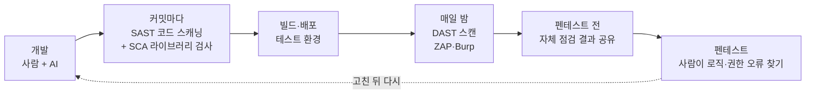

- **소스 코드 분석(SAST)** — John은 GitHub의 **Advanced Security → 코드 스캐닝(Code scanning)**을 보여 줍니다. 저장소 안의 코드를 분석해 보안 취약점을 찾아 줍니다. "소스 코드 분석을 위해 **이걸 켜 둬야 한다.**"
- **동적 분석(DAST)** — **실행 중인 앱**을 스캔해 실제 반응을 봅니다. 코드는 **Apache·Nginx 같은 엔진 안에서** 돌아가므로 **실행될 때 추가로 생기는 취약점**이 있고, 코드 스캐닝은 **비즈니스 로직 오류**를 잘 못 찾기 때문입니다.

!!! note "💡 보충 (강의 외) — 세 가지 분석 정리"
    | 이름 | 무엇을 보나 | 예 |
    |---|---|---|
    | **SAST** (정적 분석) | 실행하지 않은 **소스 코드** | GitHub 코드 스캐닝(CodeQL) |
    | **DAST** (동적 분석) | **실행 중인 앱**의 반응 | ZAP, Burp 액티브 스캔 |
    | **SCA** (구성 요소 분석) | 앱이 쓰는 **외부 라이브러리**의 알려진 취약점 | GitHub Dependabot |

    셋은 서로 다른 것을 잡으니 함께 쓰는 것이 좋습니다. AI가 짠 코드는 **오래된 라이브러리 버전**을 쓰는 경우가 있어서 SCA도 쓸모가 큽니다.

### 도구가 잡는 것과 놓치는 것 { #what-tools-catch }

| 자동 도구가 잘 잡는 것 (전체의 약 80~85%) | 사람이 찾아야 하는 것 |
|---|---|
| 크로스 사이트 스크립팅(XSS) | **로직 오류** — 쿠폰을 여러 번 쓰기, 주문 단계 건너뛰기 |
| SQL 인젝션 | **권한 오류** — 남의 주문 번호를 넣으면 그 사람 정보가 보임 |
| 명령 인젝션 | **저장형 공격** 일부 (저장형 XSS 등) |
| 흔한 설정 실수 | 그 앱의 **비즈니스 맥락**이 필요한 것 |

> 도구가 전부를 잡나? 아니다. 그냥 **못 잡는다.** — 이런 것은 사람이 손으로 하는 테스트가 필요하고, BHIS가 많이 하는 일이 바로 이것이다.

!!! note "💡 보충 (강의 외) — 인젝션 계열 쉽게 이해하기"
    - **SQL 인젝션** — 로그인 창에 이름 대신 `' OR '1'='1` 같은 글자를 넣으면, 앱이 이걸 데이터베이스 명령의 **일부로 착각**해서 패스워드 확인을 건너뛰는 식입니다.
    - **명령 인젝션** — 앱이 사용자 입력을 서버 운영체제 명령에 그대로 붙이면, 입력에 `;` 같은 기호를 섞어 **다른 명령까지 실행**시킬 수 있습니다.
    - **XSS** — 입력한 글자가 웹페이지에 그대로 다시 출력되면, 그 글자에 스크립트를 넣어 **다른 사용자의 브라우저에서 실행**되게 할 수 있습니다.

    셋 다 뿌리는 같습니다 — **사용자 입력을 믿고 그대로 썼다.** OWASP Top 10의 "인젝션" 계열입니다.

### 펜테스트 전에 스스로 먼저 돌려 보라 { #self-test }

> 보안 평가를 받기 **전에** 직접 도구를 돌려 **자체 점검**을 하라. 결과를 테스터에게 주며 말하라. "이건 우리가 알고 있다. **자동 도구가 못 찾는 걸** 찾아 달라."

비싼 펜테스트 시간을 도구로도 찾을 수 있는 것에 쓰지 않게 됩니다. 그리고 좋은 테스터라면 누구나 **찾기 어려운 취약점** 쪽으로 가고 싶어 합니다 — 그게 더 재밌으니까.

---

## 6. 도구 — Burp와 ZAP { #burp-and-zap }

BHIS가 주로 쓰는 것은 **Burp Suite Pro**(유료지만 싸고 정말 좋음), 그 밖에 **W3AF**, 그리고 이번 실습의 **ZAP**(무료)입니다.

> 이 도구들은 **2만 달러 넘게 주고 사는 대부분의 상용 도구보다 훨씬 낫다.** 다만 **쓸 줄 알아야** 한다.

| | Burp Suite Pro | ZAP (Zed Attack Proxy) |
|---|---|---|
| 가격 | 약 **500달러** (유료지만 저렴) | **무료** |
| 만든 곳 | **PortSwigger** — 처음부터 별개의 도구 (ZAP 확장판 아님) | **Paros Proxy** → **OWASP ZAP** → 현재 ZAP 핵심 팀 |
| 화면 | 군더더기를 뺀 기본 화면 — "전부 알맹이, 군더더기 없음" | 자동 스캔 마법사 등 입문자에게 쉬움 |
| 주요 기능 | 가로채기·수정, 크롤링, 액티브 스캔 | 가로채기·수정, 액티브 스캔, **완전 자동 스캔** |
| BHIS에서 | **주력 도구**, 웹 테스터가 가장 많이 씀 | 이번 실습 도구 |

John은 Burp가 화려하지 않은 것이 **장점**이라고 합니다. "URL만 넣으면 알아서 스캔" 버튼 대신, 사이트를 둘러보면 왼쪽에 목록이 생기고 거기서 액티브 스캔을 시작합니다. 필요한 것이 딱 있어야 할 곳에 있는데, 입문자들은 오히려 **화려한 도구**에 끌리는 경향이 있다고 합니다. ZAP에 대해서는 이렇게 늘어놓습니다.

> 액티브 스캔이 된다. **무료다.** 개발 핵심 팀이 탄탄하다. **무료다.** 요청을 가로채서 바꿀 수 있다. **무료다.** 완전 자동 스캔도 된다. 가격은 "공짜 점 93". **모두의 예산 안에 있다.**

!!! note "💡 보충 (강의 외) — ZAP의 현재 운영 주체"
    강의에서는 ZAP을 지금 "Crash Override"가 맡고 있다고 했는데, ZAP 공식 문서 기준으로 정리하면 — **2023년 9월 OWASP를 떠났고**, **2024년 9월부터 Checkmarx가 지원**합니다(핵심 팀원 3명을 Checkmarx가 고용). 지금도 **ZAP 핵심 팀이 운영하는 독립 오픈소스 프로젝트**이고 무료입니다.

### John이 좋아하는 방법 — 결과를 AI에 넣기 { #burp-ai }

1. Burp로 웹 서버를 둘러보면, 찾아낸 페이지와 요청이 **상태 파일(state file)**에 저장됩니다.
2. 그 파일을 **AI 에이전트에 올리고** "이 상태 파일을 분석해서 이런 취약점을 찾아 줘"라고 합니다.
3. AI가 실제로 찾아냅니다 — 어떤 도구든 AI를 붙이면 **분석 능력이 크게 늘어납니다.**

!!! warning "💡 보충 (강의 외) — 올리기 전에 확인할 것"
    이런 파일에는 실제 요청이 그대로 들어 있어 **세션 쿠키, 토큰, 사용자 데이터**가 섞여 있을 수 있습니다. 외부 AI 서비스에 올릴 때는 회사·고객의 정책을 먼저 확인하고, 민감한 값을 지운 뒤 올리세요.

### 웹 프록시 도구 쓰는 순서 { #proxy-workflow }

Burp와 ZAP 모두 같습니다.

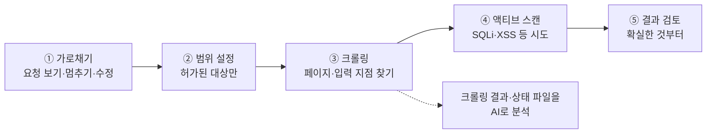

| 단계 | 하는 일 | 왜 중요한가 |
|---|---|---|
| ① **가로채기(Intercept)** | 오가는 요청을 보고, 멈춰 세우고, 무엇이든 바꿔서 보냄. 퍼징 지점 지정 | 앱이 입력을 어떻게 다루는지 직접 봄 |
| ② **범위(Scope)** | 시험할 대상만 지정 | 안 하면 **제3자 사이트까지 둘러보고 공격** — 허가 범위 밖 |
| ③ **크롤링(Spidering)** | 모든 페이지와 **입력 파라미터**를 찾아냄 | 공격·분석할 목록. AI 분석 재료로도 아주 좋음 |
| ④ **액티브 스캔** | SQL 인젝션·XSS 등을 줄줄이 시도 | 자동으로 찾을 수 있는 80%를 처리 |
| ⑤ **결과 검토** | Burp: **빨간 바탕·흰 글씨 = 확실**, **흰 바탕·빨간 글씨 = 치명적일 가능성 높음** | 먼저 볼 문제로 눈을 바로 끌어 줌 |

---

## 7. 탐지 통제도 시험하라 { #test-detective-controls }

> 취약점을 계속 찾아야 하는 건 물론이다. 하지만 **동시에, 우리의 탐지 통제(detective controls)도 시험해야 한다.**

웹 앱 스캔을 돌릴 때 **IDS·IPS·SIEM·AI 엔진이 그 스캔을 탐지하는지**도 확인합니다.

> "우리가 해킹당할 수 있나?"에서 **"우리가 실제로 무엇을 탐지할 수 있나?"**로 옮겨 가야 한다.

MITRE ATT&CK이라는 분류 체계로 찾은 것을 공격 방식에 맞춰 정리할 수 있습니다. 3일차의 "믿되 검증하라"가 웹 쪽에도 그대로 적용됩니다.

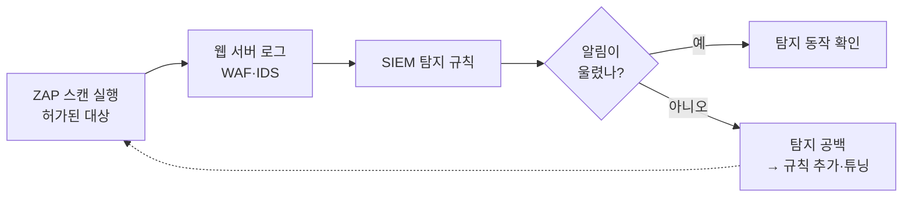

!!! note "💡 보충 (강의 외) — 웹 서버 로그로 스캔 탐지하기 (Splunk)"
    스캐너를 돌리면 웹 서버 접근 로그에 **한 출처에서 아주 많은 요청**, **아주 많은 서로 다른 경로**, **서버 오류(500번대)의 급증**이 남습니다.

    ```spl
    index=web sourcetype=access_combined earliest=-1h
    | stats count AS requests dc(uri_path) AS unique_paths count(eval(status>=500)) AS server_errors BY clientip
    | where requests > 500 AND server_errors > 20
    | sort - requests
    ```

    - **`index=web sourcetype=access_combined earliest=-1h`** — 최근 1시간의 웹 서버 접근 로그(Apache/Nginx 일반 형식). 인덱스 이름은 환경에 맞게.
    - **`stats ... BY clientip`** — 요청을 보낸 IP별로 묶음.
        - **`count AS requests`** — 전체 요청 수.
        - **`dc(uri_path) AS unique_paths`** — 서로 다른 경로 수. 스캐너는 수많은 경로를 두드림.
        - **`count(eval(status>=500)) AS server_errors`** — 상태 코드 500 이상만 셈. `eval(...)` 안의 조건이 참인 것만 세는 문법. 인젝션 시도는 서버 오류를 많이 일으킴.
    - **`where requests > 500 AND server_errors > 20`** — 요청도 서버 오류도 많은 IP만(기준값은 환경에 맞게).
    - **`sort - requests`** — 요청이 많은 순.

    ```text
    clientip       requests  unique_paths  server_errors
    10.10.239.50   18452     2210          640
    ```

    사람은 한 시간에 수천 개의 서로 다른 경로를 열지 않습니다. 걸리면 탐지가 동작하는 것이고, 안 걸리면 그게 바로 **3일차에서 말한 탐지 공백**입니다. 상태 코드의 뜻: [HTTP 상태 코드](../../../basics/http-status-codes.md).

---

## 8. ZAP 실습 { #zap-lab }

### 준비 { #zap-setup }

**새 실습 환경(antilab)**을 씁니다(예전 "Active Defense and Cyber Deception" 환경이 아님).

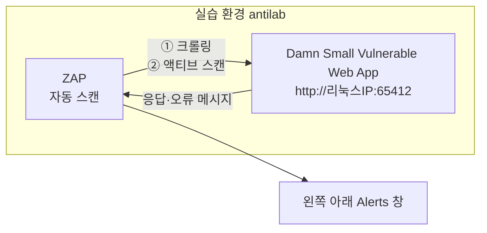

1. Windows VM 안에서 **Ubuntu 셸**을 엽니다.
2. 웹 테스트 실습 폴더로 이동하고 **리눅스 IP**를 확인합니다.
3. **Damn Small Vulnerable Web App(DSVW)** 파이썬 스크립트를 실행합니다 — 예쁘지는 않지만 **취약점이 고루 들어 있는** 아주 작은 웹 앱입니다.
4. **ZAP**을 시작합니다(처음엔 시간이 걸리고, **세션 유지 여부**를 물음).
5. **자동 스캔(Automated Scan)** → 주소에 **리눅스 IP와 포트** 입력(실습에서는 `http://10.10.239.83:65412` 형식, IP는 환경마다 다름) → **공격(Attack)**.
6. 스캔 중에 DSVW가 **죽으면 다시 실행**합니다.

!!! warning "허가된 대상에만"
    이 실습은 **일부러 취약하게 만든 연습용 앱**을 **자기 실습 환경 안에서** 스캔하는 것입니다. ZAP의 액티브 스캔은 실제 공격 요청을 보내므로, 실무에서는 반드시 **허가받은 대상과 범위**에만 써야 합니다 — John이 범위(Scope) 설정을 강조한 이유입니다.

### 실습 해설 { #zap-walkthrough }

ZAP 업데이트 중이라 처음엔 주소 입력이 잘 안 되다가, 다시 **자동 스캔 → 주소 입력 → 공격**으로 시작합니다. 요청들이 지나가는 것이 보이고, 금방 이것이 나옵니다.

> 벌써 **명령 인젝션(command injection)** 취약점을 찾은 것 같다.

ZAP은 먼저 **크롤링**하고 그다음 **액티브 스캔**으로 넘어갑니다. 진행되는 동안 **왼쪽 아래의 알림(Alerts)** 창에서 발견 내용을 봅니다. 중간에 DSVW가 한 번 죽어서 다시 실행합니다(John은 "실습을 반복문으로 계속 다시 켜지게 고쳐야겠다"고 함). 마지막에 확인해 보니 스캔이 **100%** 끝나 있었습니다.

| 찾은 것 | 무슨 뜻인가 | 왜 위험한가 | 고치는 법 |
|---|---|---|---|
| **명령 인젝션** | 입력이 서버 OS 명령에 그대로 붙음 | 서버에서 임의 명령 실행 | 입력을 명령에 붙이지 않기, 허용된 값만 받기 |
| **SQL 인젝션 (SQLite)** | 입력이 SQL 문장 안으로 들어감, DB 종류까지 드러남 | DB 조회·변조 | **매개변수 쿼리**(입력을 문장에 이어 붙이지 않기) |
| **DB 오류 메시지 노출** | `sqlite3.OperationalError ... syntax error`가 그대로 보임 | 공격자에게 **힌트** | 오류 상세는 **로그에만**, 사용자에게는 일반 오류 화면 |
| **UNION SQL 인젝션** | 원래 결과에 **다른 테이블 데이터를 붙여** 빼냄 | 데이터 유출 | 매개변수 쿼리, **최소 권한 DB 계정** |
| **원격 파일 포함 (RFI)** | 입력한 경로로 **다른 파일을 불러옴** | 정상 화면 안에 피싱 콘텐츠 삽입 등 | 불러올 수 있는 파일을 **미리 정한 목록으로만** |

**SQL 인젝션 알림을 열어 보면** 위에는 요청, 아래에는 응답이 보이고, 응답에 **서버 내부 오류(Internal Server Error)**와 이런 메시지가 있습니다.

```text
sqlite3.OperationalError: near "...": syntax error
```

> 데이터베이스의 이런 오류가 **사용자에게 그대로 보이면 절대 안 된다.**

!!! note "💡 보충 (강의 외) — 오류 메시지가 왜 힌트가 되나"
    이 메시지는 "이 앱은 SQLite를 쓴다", "내가 넣은 글자가 SQL 문장 안으로 들어갔다", "문법이 어디서 깨졌다"를 알려 줍니다. 공격자는 그걸 보고 다음 시도를 정확하게 다듬을 수 있습니다. **파일 포함 취약점**도 두 종류가 있습니다 — **LFI**(서버 안의 다른 파일을 읽음)와 **RFI**(외부 서버의 파일을 불러옴). 둘 다 "사용자가 넣은 경로를 그대로 믿고 파일을 열었다"는 같은 실수에서 나옵니다.

### 사람마다 결과가 다른 이유 { #zap-variance }

> 아마 여러분 중 일부는 **서로 다른 취약점**을 얻었을 것이다. 아주 흔한 일이다. 웹 서버가 **과부하**가 걸리면 일부 요청에 대한 응답이 제대로 오지 않아 결과가 달라질 수 있다.

!!! note "💡 보충 (강의 외)"
    자동 스캔 결과에 **어떤 취약점이 없다고 해서 정말 없는 것은 아닙니다.** 서버가 느려지거나 일부 요청이 실패하면 놓칠 수 있습니다. 중요한 앱은 스캔 속도를 낮추거나 여러 번 돌리고, 결국 사람이 확인하는 단계가 필요합니다.


---

## 9. AD 하드닝 — 마지막 통제 { #ad-hardening }

ZAP 실습을 마치고 John은 10번째 통제인 **액티브 디렉터리(AD) 하드닝**으로 넘어갑니다. 강의에서는 짧게 지나가지만, 앞의 3일 동안 배운 공격이 결국 모두 여기로 모입니다.

!!! note "💡 보충 (강의 외) — 왜 마지막이 AD인가"
    AD는 회사의 계정·그룹·PC·서버·권한을 한곳에서 관리하는 시스템이고, 그 꼭대기 권한이 **도메인 관리자(Domain Admin, DA)**입니다. DA를 얻으면 모든 PC에 로그인하고, 모든 계정의 비밀번호를 바꾸고, 그룹 정책으로 모든 PC에 프로그램을 뿌릴 수 있습니다. 그래서 내부망에 들어온 공격자의 최종 목표는 거의 항상 DA입니다. 지금까지 배운 공격은 모두 **DA로 올라가는 계단**이었고, AD 하드닝은 그 계단을 끊는 작업입니다.

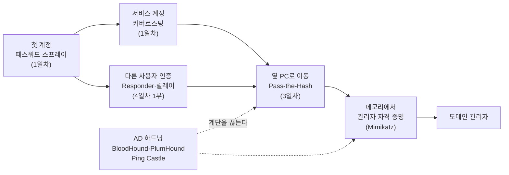

### BloodHound — 도메인 관리자까지 가는 모든 길 { #bloodhound }

첫 번째 도구는 3일차에도 나온 **BloodHound**(SpecterOps)입니다.

> BloodHound는 권한 없는 일반 사용자 하나에서 시작해서, 그 사용자가 **도메인 관리자가 될 수 있는 모든 경로**를 찾아 나열한다.

BloodHound는 AD를 **그래프**로 봅니다. 사용자·그룹·컴퓨터·그룹 정책(GPO)이 점(노드)이고, 그 사이의 관계가 선(엣지)입니다. 하나하나는 평범한 설정인데, 이어 붙이면 길이 됩니다.

| 엣지(관계) | 뜻 |
|---|---|
| **MemberOf** | 이 사용자·그룹은 저 그룹의 멤버다 |
| **AdminTo** | 이 사용자·그룹은 저 PC의 로컬 관리자다 |
| **HasSession** | 저 PC에 이 사용자가 로그인해 있다(메모리에 자격 증명이 남아 있다) |
| **GenericAll** 등 권한 엣지 | 이 개체가 저 개체를 마음대로 바꿀 수 있다(비밀번호 재설정, 그룹 추가 등) |

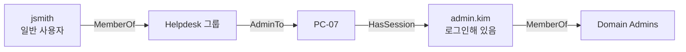

읽는 법: jsmith는 Helpdesk 그룹이니 PC-07의 관리자가 될 수 있고, PC-07의 메모리에는 로그인해 있던 admin.kim의 자격 증명이 남아 있으니 그것을 꺼내면(뒤의 [Mimikatz](#mimikatz)) 도메인 관리자가 됩니다. 이 중 어느 것도 **취약점 스캐너에는 안 잡힙니다.** 패치가 빠진 게 아니라 **권한 관계**의 문제이기 때문입니다 — 2부에서 "취약점 스캔은 침투 후 횡적 이동 기회를 못 본다"고 한 이유입니다.

!!! note "💡 보충 (강의 외) — 목록과 그래프"
    Microsoft의 John Lambert가 2015년에 남긴 유명한 말입니다.

    > 방어자는 목록으로 생각하고, 공격자는 그래프로 생각한다. 이것이 사실인 한 공격자가 이긴다.

    방어자는 "관리자 계정 목록", "패치 목록"을 보지만 공격자는 "이것과 저것이 어떻게 이어지나"를 봅니다. BloodHound는 **방어자도 그래프로 볼 수 있게** 해 주는 도구입니다.

#### 💡 보충 (강의 외) — BloodHound 수집도 흔적을 남긴다 { #detect-bloodhound }

BloodHound는 **일반 도메인 사용자 권한**만으로 데이터를 모읍니다(수집기 이름: SharpHound). DC에는 LDAP으로 사용자·그룹·권한을 묻고, 각 PC에는 "지금 누가 로그인해 있나", "로컬 관리자가 누구인가"를 묻습니다. 뒤쪽 질문은 PC마다 **`IPC$`** 라는 특수 공유에 붙어 `srvsvc`, `samr` 같은 **네임드 파이프**(프로그램끼리 대화하는 통로)를 여는 방식이라, **한 PC가 짧은 시간에 수십~수백 대의 PC에 같은 통로를 여는** 패턴이 생깁니다. 공격자가 같은 도구를 쓰면 이것이 탐지 포인트입니다.

**이벤트 5145** = "네트워크 공유 개체에 대한 접근 검사". 누가(계정), 어디서(원본 IP), 어떤 공유의 어떤 파일·파이프에 접근했는지를 **접근을 당한 PC 쪽에** 기록합니다. 기본으로 꺼져 있고, 고급 감사 정책의 **개체 액세스 → 세부 파일 공유 감사**를 켜야 남습니다. 양이 많아서 보통 서버나 중요 PC에만 켭니다.

```spl
index=wineventlog source="WinEventLog:Security" EventCode=5145 Share_Name="*IPC$" Relative_Target_Name IN ("srvsvc", "samr", "lsarpc")
| bin _time span=10m
| stats dc(host) AS target_count values(Relative_Target_Name) AS pipes BY _time, Source_Address, Account_Name
| where target_count > 20
| sort - target_count
```

- **1줄** — 보안 로그의 **5145**만, 공유 이름이 `IPC$`로 끝나는 것(실제 값은 `\\*\IPC$` 꼴)만, 접근 대상이 세 파이프 중 하나인 것만 남깁니다. `IN (...)`은 "괄호 안 값 중 하나와 같으면"이라는 뜻입니다.
    - **`srvsvc`** — 서버 서비스. 누가 로그인해 있는지(세션) 조회.
    - **`samr`** — 보안 계정 관리자. 로컬 그룹 멤버(누가 관리자인지) 조회.
    - **`lsarpc`** — 로컬 보안 기관. SID와 이름을 서로 바꿔 줌.
- **2줄 `bin _time span=10m`** — 시간을 10분 단위 칸으로 묶습니다. 이걸 해야 "10분 동안 몇 대"를 셀 수 있습니다.
- **3줄 `stats ...`**
    - **`dc(host) AS target_count`** — `dc`는 서로 다른 값의 개수(distinct count). 5145는 접근을 당한 PC에 남으니 `host`가 곧 대상 PC → "몇 대를 건드렸나".
    - **`values(Relative_Target_Name) AS pipes`** — 쓴 파이프 목록.
    - **`BY _time, Source_Address, Account_Name`** — 10분 칸·원본 IP·계정별로.
- **4줄 `where target_count > 20`** — 10분에 20대 넘게 건드린 것만(기준값은 환경에 맞게).
- **5줄 `sort - target_count`** — 많은 순.

```text
_time                Source_Address  Account_Name  target_count  pipes
2026-10-27 14:10:00  10.0.5.23       jsmith        143           lsarpc
                                                                 samr
                                                                 srvsvc
2026-10-27 02:00:00  10.0.1.15       svc_sccm      38            samr
```

첫 줄 — **일반 사용자가 일반 PC에서 10분 동안 143대** → BloodHound류 수집 의심, 조사 1순위. 둘째 줄 — 관리 도구 서비스 계정의 새벽 정기 작업 → 정상일 가능성이 높으니 확인 후 예외 목록에.

!!! tip "필드 이름은 로그 형식에 따라 다르다"
    `renderXml = false`(클래식 형식)이면 위처럼 `Share_Name`, `Relative_Target_Name`, `Source_Address`, `Account_Name`이고, XML 형식이면 `ShareName`, `RelativeTargetName`, `IpAddress`, `SubjectUserName`입니다. 이벤트 번호의 뜻은 [Windows 이벤트 ID](../../../basics/windows-event-ids.md)에 모아 두었습니다.

### PlumHound — 그래프를 "할 일 목록"으로 { #plumhound }

> BHIS의 Kent가 만든 **PlumHound**라는 작은 도구가 있다. PlumHound는 BloodHound 결과 데이터를 받아서 **작업 목록(work effort)**을 만들어 준다.

BloodHound는 공격자의 눈으로 "DA까지 가는 전체 경로"를 보여 줍니다. 그런데 방어자는 그래프를 보는 것만으로는 "그래서 월요일에 뭘 고치지?"가 바로 나오지 않습니다. PlumHound는 같은 데이터를 **표 형태 보고서**로 바꿔 하나씩 처리할 수 있게 해 줍니다. John이 예로 든 항목은 **도메인 사용자, RDP가 되는 워크스테이션, 커버로스팅 가능한 사용자, 그룹 정책 개체, DA까지의 경로**입니다.

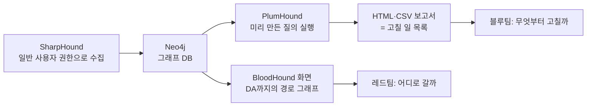

| | BloodHound | PlumHound |
|---|---|---|
| **질문** | "DA까지 갈 수 있나? 어떻게?" | "무엇을 고쳐야 하나? 무엇부터?" |
| **결과물** | 경로 그래프(화면) | 보고서 목록(HTML·CSV) |
| **막다른 길** | DA로 안 이어지면 잘 안 보임 | 목록에 그대로 남음 |
| **주 사용자** | 공격자·펜테스터, 방어자 | 방어자·시스템 관리자 |

!!! note "💡 보충 (강의 외) — PlumHound 조금 더 (BHIS 블로그 기준)"
    **Kent Ickler와 Jordan Drysdale**가 만든 Python 도구입니다. BloodHound가 데이터를 저장하는 **Neo4j** 그래프 DB에 접속해 미리 준비된 질의(**Cypher**)를 돌리고, 결과를 **HTML이나 CSV 보고서**로 만듭니다. 기본 작업 목록 하나로 **보고서 69개와 목차 페이지**가 나오고, 각 보고서에 쓴 질의가 함께 들어 있어 다른 도구에서도 재사용할 수 있습니다. 예: 높은 권한의 커버로스팅 가능 계정, LAPS 배포 현황, 비밀번호가 만료되지 않는 계정, 설명 칸에 비밀번호를 적어 둔 계정.

    - **AnalyzePath** — 특정 사용자·그룹에서 시작하는 경로를 끊으려면 **어떤 관계 하나를 끊으면 되는지** 알려 줍니다.
    - **BusiestPath** — **가장 많은 사용자에게 영향을 주는 경로**부터 보여 줘서, 무엇부터 고칠지 우선순위를 잡게 해 줍니다.

### 막다른 길도 고쳐야 하는 이유 — 호그와트의 움직이는 계단 { #moving-staircases }

> BloodHound는 도메인 관리자까지 이어지는 완전한 경로를 찾는다. 그런데 **막다른 길(dead end)**이 아주 많다. 호그와트를 떠올려 보라. 학생들이 기숙사로 갈 때 계단이 계속 바뀌고 움직였다. AD의 취약점도 그렇다. 어떤 계단은 기숙사로 데려다주지만, 어떤 계단은 엉뚱한 방에 떨어뜨린다. 핵심은, **지금은 도메인 관리자로 끝나지 않는 경로가 몇 주, 몇 달 뒤에는 그렇게 될 수 있다**는 것이다.

AD는 매일 바뀝니다. 사람이 입사·퇴사하고, 그룹에 추가되고, 관리자가 문제를 고치러 PC에 로그인하고, 새 GPO가 생깁니다 — 계단이 움직이는 것입니다.

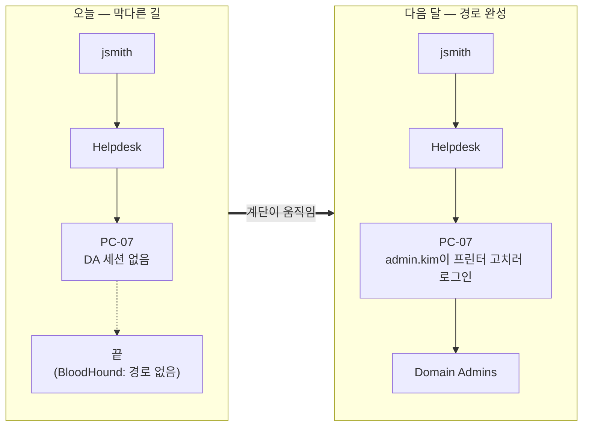

오늘 BloodHound의 "DA까지 경로"만 보면 "문제 없음"이지만, PlumHound 목록에는 **"Helpdesk가 PC 300대의 로컬 관리자"** 같은 항목이 그대로 남아 있어 미리 고칠 수 있습니다. 2부에서 **Low·Informational을 무시하지 말라**고 한 것과 같은 이야기입니다 — 지금은 치명적이지 않은 것도 다른 것과 이어지면 치명적이 됩니다.

---

## 10. Mimikatz — 해시 추출기 그 이상 { #mimikatz }

> 많은 사람들이 Mimikatz를 메모리에서 **패스워드 해시와 평문 패스워드를 꺼내는 데만** 쓴다. 그건 아주 잘한다. 하지만 그보다 **훨씬, 엄청나게 많은 일**을 하고, **개별 워크스테이션을 평가**하는 데 쓸 수 있다.

Windows는 로그인한 사용자의 자격 증명을 **LSASS** 프로세스 메모리에 보관합니다(그래야 파일 서버 등에 접속할 때 비밀번호를 다시 묻지 않고 자동으로 인증할 수 있습니다). Mimikatz는 이 메모리를 읽습니다.

!!! note "💡 보충 (강의 외) — 무엇을 더 할 수 있나 (개념)"
    | 할 수 있는 일 | 개념 | 관련 페이지 |
    |---|---|---|
    | **메모리 자격 증명** | LSASS에서 해시·티켓·(옛 설정이면) 평문 비밀번호 | [LSASS 덤프](../../../adversary/lsass-dumping.md) |
    | **Kerberos 티켓** | 메모리의 티켓을 보고 내보내 재사용 | [Pass-the-Hash](../../../adversary/pass-the-hash.md) |
    | **저장된 비밀** | Windows가 암호화해 둔 비밀(자격 증명 관리자, 브라우저 저장 비밀번호 등) 풀기 | — |
    | **DCSync** | 복제 권한이 있는 계정이면 **DC 복제를 흉내 내** DC에 로그인하지 않고도 모든 계정의 해시를 받아 감 | [DCSync](../../../adversary/dcsync.md) |
    | **티켓 위조** | krbtgt 해시로 아무 사용자의 티켓이나 위조(골든 티켓) | [골든·실버 티켓](../../../adversary/golden-silver-tickets.md) |

**"워크스테이션 평가"의 뜻** — 승인된 점검에서 한 PC에 무엇이 남아 있는지 보면 **AD 관리 습관**이 드러납니다. 일반 사용자 PC의 메모리에 **DA 자격 증명**이 있다면, DA 계정으로 일반 PC에 로그인했다는 뜻(관리자 티어링 실패)이고, 공격자는 그 PC 하나만 장악하면 끝입니다.

| 방어 | 하는 일 |
|---|---|
| **Credential Guard** | LSASS의 비밀을 가상화 기반 격리 공간으로 옮겨, 메모리를 읽어도 꺼낼 수 없게 함 |
| **LSA 보호 (RunAsPPL)** | LSASS를 보호된 프로세스로 만들어, 관리자 권한 프로그램도 쉽게 메모리에 접근하지 못하게 함 |
| **Protected Users 그룹** | 이 그룹 계정은 NTLM·약한 암호화를 안 쓰고, 자격 증명이 캐시로 남지 않음 |
| **관리자 티어링** | DA 계정은 DC에만 로그인, 일반 PC에는 PC 전용 관리자 계정 |
| **LAPS** | PC마다 로컬 관리자 비밀번호를 다르게(3일차 Pass-the-Hash 확산 차단) |
| **WDigest 끄기** | 메모리에 평문 비밀번호를 남기던 옛 방식 비활성(최신 Windows는 기본 꺼짐) |

!!! note "💡 보충 (강의 외)"
    아래 두 탐지는 강의에 없던 추가 내용입니다. 둘 다 [3일차](day-3.md)의 원칙대로 **직접 시험해서 실제로 잡히는지 확인**해야 의미가 있습니다.

### 탐지 ① LSASS 메모리 접근 — Sysmon 이벤트 10 { #detect-lsass }

**Sysmon 이벤트 10 (ProcessAccess)** = 어떤 프로세스가 다른 프로세스를 열어 접근했는지 기록합니다. `SourceImage` = 접근한 프로그램, `TargetImage` = 접근을 당한 프로그램, `GrantedAccess` = 요청한 권한(숫자).

```spl
index=wineventlog source="WinEventLog:Microsoft-Windows-Sysmon/Operational" EventCode=10 TargetImage="*\\lsass.exe"
| search NOT SourceImage IN ("C:\\Windows\\System32\\wininit.exe", "C:\\Windows\\System32\\csrss.exe", "C:\\Windows\\System32\\svchost.exe", "C:\\ProgramData\\Microsoft\\Windows Defender\\Platform\\*\\MsMpEng.exe")
| stats count values(GrantedAccess) AS access BY host, SourceImage
| sort - count
```

- **1줄** — Sysmon 로그의 이벤트 10 중 **접근을 당한 프로그램이 lsass.exe**인 것만. `\\`는 SPL 문자열 안에서 역슬래시 하나를 뜻합니다.
- **2줄 `search NOT SourceImage IN (...)`** — 정상적으로 LSASS에 접근하는 Windows 기본 프로세스와 Defender(MsMpEng)를 뺍니다. **이름만이 아니라 전체 경로로** 빼는 게 중요합니다 — 공격자가 악성 파일 이름을 `svchost.exe`로 지어 다른 폴더에 두는 경우가 많아서, 이름만으로 빼면 그것까지 같이 빠집니다.
- **3줄 `stats count values(GrantedAccess) AS access BY host, SourceImage`** — PC·접근한 프로그램별로 건수와 요청한 권한 목록.
- **4줄 `sort - count`** — 많은 순.

**GrantedAccess 읽는 법** — 숫자는 권한 비트의 합입니다.

| 값 | 뜻 |
|---|---|
| `0x0010` | 메모리 읽기 |
| `0x0400` | 정보 조회 |
| `0x1000` | 제한된 정보 조회 |
| `0x1010` | `0x1000 + 0x0010` → 제한된 정보 조회 + **메모리 읽기** (자격 증명 탈취 도구에서 자주 보임) |
| `0x1410` | `0x1000 + 0x0400 + 0x0010` → 역시 **메모리 읽기** 포함 |
| `0x1FFFFF` | 모든 권한 |

핵심은 **"0x10(메모리 읽기)이 들어 있는가"**입니다.

```text
host    SourceImage                                         count  access
WS-07   C:\Users\Public\update.exe                          2      0x1010
WS-07   C:\Program Files\VMware\VMware Tools\vmtoolsd.exe   14     0x1000
```

첫 줄 — Public 폴더의 낯선 exe가 **메모리 읽기 권한**으로 접근 → 1순위 조사. 둘째 줄 — `0x1000`은 제한된 정보 조회뿐, 메모리 읽기 없음 → 정상 도구일 가능성이 높음. 랩에서는 Atomic Red Team의 **T1003.001 (LSASS 메모리)** 테스트로 이 검색이 실제로 잡히는지 확인할 수 있습니다.

### 탐지 ② DCSync — 이벤트 4662 { #detect-dcsync }

**이벤트 4662** = "개체에 대한 작업이 수행되었습니다". AD 개체에 접근할 때 **DC에** 기록됩니다. 켜려면 DC에서 **DS 액세스 → 디렉터리 서비스 액세스 감사**를 켜고, 도메인 개체에 **감사 설정(SACL)**을 해 둬야 합니다. DCSync는 복제 요청이라 4662에 **복제 권한을 뜻하는 GUID**가 찍힙니다.

| GUID | 권한 |
|---|---|
| `1131f6aa-9c07-11d1-f79f-00c04fc2dcd2` | 디렉터리 변경 내용 복제 |
| `1131f6ad-9c07-11d1-f79f-00c04fc2dcd2` | 비밀(비밀번호 해시)을 포함한 **모든** 변경 내용 복제 |

```spl
index=wineventlog source="WinEventLog:Security" EventCode=4662 ("1131f6aa-9c07-11d1-f79f-00c04fc2dcd2" OR "1131f6ad-9c07-11d1-f79f-00c04fc2dcd2")
| search NOT Account_Name="*$"
| stats count min(_time) AS first_seen BY host, Account_Name
| convert ctime(first_seen)
```

- **1줄** — 보안 로그의 4662 중 두 GUID 중 하나라도 들어 있는 이벤트. GUID를 필드가 아니라 **원문 글자로** 검색하는 이유: 클래식 형식에서는 이 정보가 여러 줄로 기록돼 필드 추출이 들쭉날쭉해서, 원문 검색이 더 안전합니다.
- **2줄 `search NOT Account_Name="*$"`** — `$`로 끝나는 **컴퓨터 계정**을 뺍니다. DC끼리 서로 복제하는 것은 정상이기 때문입니다.
- **3줄 `stats count min(_time) AS first_seen BY host, Account_Name`** — DC·계정별 건수와 **가장 이른 시각**(= 처음 본 시각).
- **4줄 `convert ctime(first_seen)`** — 숫자(epoch)로 나온 시각을 사람이 읽는 날짜로 바꿉니다.

```text
host   Account_Name        count  first_seen
DC01   helpdesk02          2      10/27/2026 14:03:11
DC01   MSOL_8a1f2c3d4e5f   96     10/27/2026 00:00:04
```

첫 줄 — 헬프데스크 계정이 복제를 요청 → 정상 업무가 아니므로 **즉시 조사**. 둘째 줄 — `MSOL_`로 시작하는 계정은 **Microsoft Entra Connect(옛 Azure AD Connect)**의 동기화 계정으로, 원래 복제 권한으로 비밀번호 해시를 동기화합니다 → 정상, 확인 후 예외.

---

## 11. Ping Castle 실습 { #ping-castle }

> 이제 이야기할 것은 **Ping Castle**이다. 액티브 디렉터리 환경에서 Ping Castle이 찾아낸 취약점들을 보는 실습을 할 것이다.

Ping Castle은 **AD 보안 점검 도구**입니다. **일반 도메인 사용자 권한**으로 실행하면 **HTML 보고서**가 나옵니다 — AD의 건강검진표라고 생각하면 됩니다.

### 점수 읽는 법 { #pingcastle-score }

!!! note "💡 보충 (강의 외)"
    보고서는 4개 범주로 나뉘고, 각 범주는 **최대 100점**입니다. 점수는 **높을수록 나쁩니다**(0 = 문제 없음, 100 = 최대 위험). 골프처럼 낮을수록 좋다고 생각하면 됩니다.

| 범주 | 보는 것 |
|---|---|
| **오래된 개체 (Stale Objects)** | 안 쓰는 계정·PC, 오래된 OS, 오래된 위임 설정 |
| **특권 계정 (Privileged Accounts)** | 관리자 수, 관리자 계정 설정 |
| **신뢰 관계 (Trusts)** | 다른 도메인과의 신뢰 관계 |
| **이상 항목 (Anomalies)** | 나머지 보안 설정(LLMNR, SMB 서명, krbtgt 등) |

**전체 점수 = 4개 범주 중 가장 높은 점수**입니다. 가장 약한 곳이 그 도메인의 수준이라는 뜻입니다 — 관리자 관리를 아무리 잘해도 신뢰 관계 하나가 뚫려 있으면 끝입니다. 각 규칙은 걸리면 점수가 붙고, 클릭하면 **설명과 해결 방법**이 나옵니다.

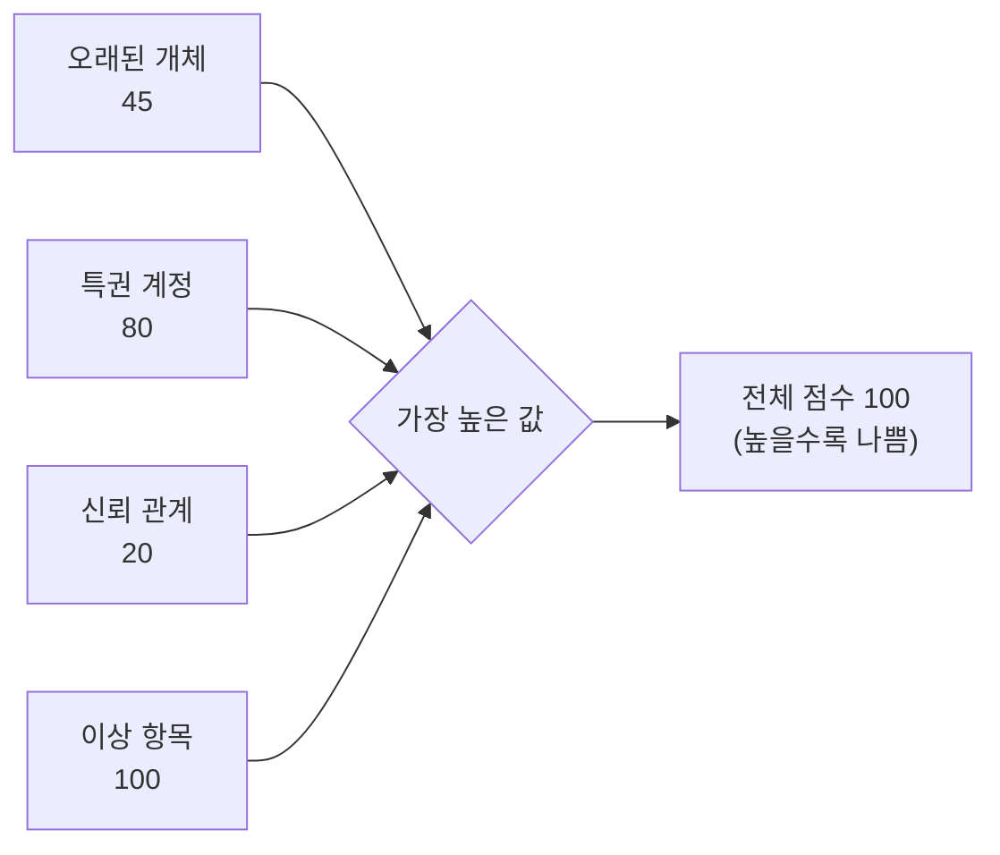

(숫자는 예시입니다.)

### 실습 — VM 없이 보고서 읽기 { #pingcastle-lab }

1부에서 예고한 대로 이 실습은 **VM이 필요 없습니다.** 웹 사이트에 접속해 **미리 만들어진 Ping Castle 보고서**를 분석하고, 위에 있는 **질문들에 답하는** 방식입니다.

> 솔직히 말하면, 이 Ping Castle 보고서를 돌린 환경을 어떻게 만들었는지 나도 모르겠다. 정말 엄청나다. **취약점이 말도 안 되게 많다.** 이 도메인 컨트롤러가 어떻게 불타 버리지 않았는지 모르겠다.

목적은 **Ping Castle의 출력 형식**과, 보고서에서 찾게 되는 **취약점 종류**에 익숙해지는 것입니다.

> 다시 말하지만, 이런 걸 찾으려고 **엘리트 해커일 필요가 없다.** Ping Castle 보고서만 있으면 된다. **싸다** — 컨설팅이 아니면 싸고, 컨설팅에 쓰면 더 비싸다. 해킹을 잔뜩 하지 않고도 아주 좋은 취약점 분석을 얻을 수 있다.

!!! note "💡 보충 (강의 외) — 라이선스"
    Ping Castle은 현재 **Netwrix** 소유입니다. 무료 **Community 판**으로 **자기 환경**을 점검할 수 있습니다(기술 지원·상업적 사용 권리 없음). **다른 조직을 점검(컨설팅)**하려면 상업용 **Service Provider** 라이선스가 필요하고, 자기 회사 보호용 **Enterprise** 판도 유료입니다 — John이 "컨설팅에 쓰면 더 비싸다"고 한 것이 이것입니다.

### 보고서 읽는 순서 { #pingcastle-reading }

!!! note "💡 보충 (강의 외)"
    실습 질문 대부분은 "이 항목이 무엇이고 왜 위험한가"를 묻습니다. 이 순서로 읽으면 빠릅니다.

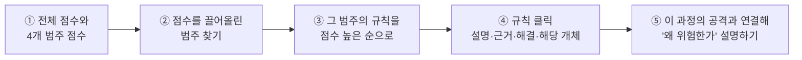

### 보고서에 자주 나오는 항목과 이 과정의 연결 { #pingcastle-findings }

| 보고서 항목 | 왜 위험한가 | 연결 | 고치는 법 |
|---|---|---|---|
| **LLMNR·NBT-NS가 꺼져 있지 않음** | Responder로 인증 가로채기 | [4일차 1부](#responder-lab) · [LLMNR·NTLM 릴레이](../../../adversary/llmnr-ntlm-relay.md) | GPO로 LLMNR 끄기, NBT-NS 끄기 |
| **SMB 서명이 "필수"가 아님** | NTLM 릴레이 | [깊이 보기 ②](#deep-dive-smb-signing) | 모든 서버·PC에 서명 필수 |
| **SPN이 붙은 계정(특히 관리자)** | 커버로스팅 → 오프라인 크래킹 | [1일차](day-1.md) · [커버로스팅](../../../adversary/kerberoasting.md) | 긴 비밀번호나 **gMSA**, 관리자 그룹에서 빼기 |
| **LAPS 미사용** | 모든 PC 로컬 관리자 비밀번호가 같아 Pass-the-Hash로 확산 | [3일차](day-3.md) · [Pass-the-Hash](../../../adversary/pass-the-hash.md) | Windows LAPS |
| **관리자 수가 많음·비밀번호 만료 없음** | 공격 대상이 늘고 비밀번호가 오래됨 | [1일차](day-1.md) | 최소 인원, 정기 검토 |
| **krbtgt 비밀번호가 오래됨** | 예전에 유출됐다면 위조 티켓이 계속 유효 | [Mimikatz](#mimikatz) · [골든·실버 티켓](../../../adversary/golden-silver-tickets.md) | 정해진 절차로 **두 번** 변경 |
| **제약 없는 위임 (Unconstrained Delegation)** | 그 서버가 뚫리면 접속한 사용자의 티켓을 빼앗김 | [BloodHound](#bloodhound) | 제한된 위임으로, 민감 계정은 "위임 불가" |
| **오래된 OS, 안 쓰는 계정·PC** | 패치 안 되는 시스템, 주인 없는 계정 | [2부 취약점 관리](#vulnerability-management) | 정리·비활성화 |
| **DC에서 Print Spooler 실행** | DC가 강제로 인증하게 만드는 공격 경로 | [4일차 1부 릴레이](#ntlmrelayx) · [PrintNightmare](../../../adversary/printnightmare.md) | DC에서 Spooler 끄기 |

!!! note "💡 보충 (강의 외) — 표에 나온 두 용어"
    - **gMSA (그룹 관리 서비스 계정)** — AD가 긴 비밀번호를 자동으로 만들고 바꿔 주는 서비스 계정. 커버로스팅으로 크래킹하는 것이 사실상 불가능해집니다.
    - **krbtgt** — 모든 Kerberos 티켓에 서명하는 계정. 이 해시가 있으면 아무 사용자의 티켓이나 위조할 수 있습니다(골든 티켓). 비밀번호를 **두 번** 바꾸는 이유는 AD가 **직전 비밀번호를 하나 더 기억**하기 때문입니다 — 한 번만 바꾸면 예전 해시가 아직 통합니다.

### 💡 보충 (강의 외) — Ping Castle 실행도 감시 대상 { #detect-pingcastle }

Ping Castle도 BloodHound처럼 **일반 사용자 권한으로 돌아갑니다.** 공격자도 돌릴 수 있고, 그러면 우리 AD의 약점 지도를 공짜로 얻는 셈입니다. 그래서 **보안팀이 아닌 계정·PC에서의 실행**은 알림 대상입니다(Sigma에도 Ping Castle 실행 탐지 규칙이 있습니다).

```spl
index=wineventlog source="WinEventLog:Microsoft-Windows-Sysmon/Operational" EventCode=1 (Image="*\\PingCastle.exe" OR OriginalFileName="PingCastle.exe")
| table _time, host, Image, ParentImage, CommandLine
```

- **1줄** — **Sysmon 이벤트 1 (프로세스 생성)** 중 실행 파일 경로가 PingCastle.exe로 끝나거나, `OriginalFileName`이 PingCastle.exe인 것. `OriginalFileName`은 **실행 파일 안에 박힌 원래 이름**이라, 공격자가 파일 이름을 `upd.exe`로 바꿔도 그대로여서 잡힙니다.
- **2줄 `table ...`** — 시각·PC·실행 파일·부모 프로세스·명령줄을 표로.

```text
_time                host   Image                              ParentImage                                                CommandLine
2026-10-27 15:22:41  WS-12  C:\Users\jsmith\Downloads\upd.exe  C:\Windows\System32\WindowsPowerShell\v1.0\powershell.exe  upd.exe --healthcheck --server corp.local
```

일반 사용자의 다운로드 폴더에서, **이름을 바꾼 채** PowerShell로 실행됐습니다 → 조사 대상입니다.

---

## 12. 과정 마무리 { #wrap-up }

녹화에서는 AMA로 넘어가겠다고 한 뒤 별도 질문 없이 바로 마무리로 들어갑니다. John은 Pay-What-You-Can 강의에 온 **두 그룹**에게 감사를 전합니다.

첫째, **돈을 낸 사람들.** 안 내도 되는데 낸 것을 "호구"라고 하는 사람도 있지만, BHIS는 그것을 업계에 **받은 것을 다음 사람에게 돌려주는(pay it forward)** 행동으로 봅니다.

둘째, **돈을 내지 않은 사람들.** 요즘은 25달러도 어떤 가정에는 큰돈이라는 것을 "110%" 이해한다고 말합니다.

> **시간은 여러분의 가장 소중한 자원이다.** 가족과, 친구와 보낼 수도 있었고, 몸과 마음을 쉴 수도 있었는데, 여러분은 여기 오기로 선택했다.

부탁은 하나 — **신호를 증폭해 달라(amplify the signal).** LinkedIn이나 Bluesky에서 새 Pay-What-You-Can 강의 소식을 보면 공유해서, 열정과 능력이 있는 사람들이 이 업계에 들어올 수 있게 도와 달라는 것입니다.

진행자의 안내:

- **수료증**은 그날 밤 발송(스트리밍으로 본 사람도 등록하면 받을 수 있음) — 받으면 SNS에 공유해 달라.
- **Threat Hunt Summit**, 금요일마다 열리는 **Pay-What-You-Can 워크숍**(다음 날은 Wade Wells의 CTI).
- John의 다음 강의는 약 한 달 뒤 **Active Defense and Cyber Deception**.

### 💡 보충 (강의 외) — 4일 과정 한눈에 보기 { #course-recap }

공격이 진행되는 단계마다 어떤 통제가 막아 주는지 한 장으로 보면 이렇습니다. 한 통제가 놓쳐도 다음 통제가 잡도록 **겹쳐 두는 것**이 3일차에서 말한 심층 방어(곱셈의 원리)입니다.

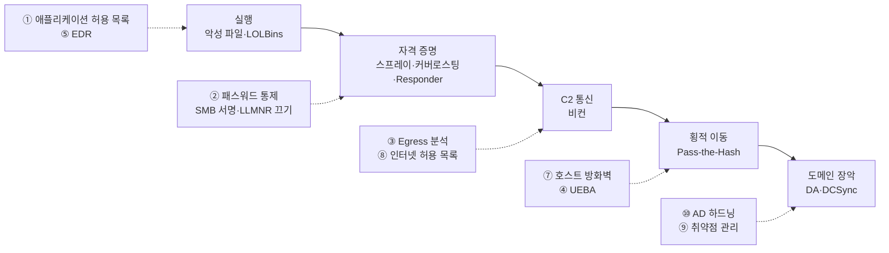

**⑥ 로깅(Sysmon)**은 특정 단계가 아니라 **모든 단계의 흔적**을 남겨, 위의 통제들이 놓친 것을 나중에라도 찾게 해 줍니다.

| # | 통제 | 날 | 핵심 한 줄 | 대표 도구·로그 |
|---|---|---|---|---|
| 1 | 애플리케이션 허용 목록 | [1일차](day-1.md) | 정해진 프로그램만 실행 | AppLocker, 이벤트 8003(감사 모드: 막혔을 것)·8004(차단) |
| 2 | 패스워드 통제 | [1일차](day-1.md) | 긴 패스프레이즈로 스프레이·커버로스팅 대비 | 4625·4624, 4769(암호화 0x17) |
| 3 | 나가는 트래픽 분석 | [2일차](day-2.md) | 밖으로 나가는 연결에서 비컨 찾기 | Zeek, RITA, AC-Hunter |
| 4 | UEBA | [2일차](day-2.md) | 평소와 다른 사용자 행동 | LogonTracer, 4624 로그온 유형 |
| 5 | EDR | [3일차](day-3.md) | 겹쳐 쓰면 효과가 곱해진다 | Atomic Red Team으로 검증 |
| 6 | 로깅 | [2일차](day-2.md)·[3일차](day-3.md) | 기본 Windows 로그로는 부족 → Sysmon | Sysmon 1·3·10, Deep Blue CLI |
| 7 | 호스트 방화벽 | [3일차](day-3.md) | PC끼리 직접 통신을 막아 횡적 이동 차단 | Windows 방화벽(netsh advfirewall) |
| 8 | 인터넷 허용 목록 | [4일차](#internet-allowlisting) | "미분류" 차단, 광고 제거 | 웹 프록시, Pi-hole |
| 9 | 취약점 관리 | [4일차](#vulnerability-management) | 취약점별로 묶고 Low·Info도 | Nessus, ZAP |
| 10 | AD 하드닝 | [3일차](day-3.md)·[4일차](#ad-hardening) | DA까지 가는 계단 끊기 | BloodHound, PlumHound, Ping Castle |

---

여기까지가 4일차 전체이자 과정의 끝입니다. 한 줄 요약:

> **같은 네트워크의 공격자는 NTLMv2를 가로채 크래킹하거나 릴레이한다 — 호스트 간 통신 차단·LLMNR 끄기·SMB 서명(필수)이 답이고, 해시를 훔친 Pass-the-Hash는 따로 막아야 한다. 공격자는 새 도메인을 짧게 쓰고 버리므로 "미분류" 차단과 광고 제거만으로 사실상의 인터넷 허용 목록이 된다. 취약점은 CVSS를 한 단계 올려 보고, Low·Informational도 살피고, 취약점별로 묶어 자동화로 고쳐라. 웹 앱은 개발 내내 SAST·DAST로 시험하고, 스캔할 때 우리 탐지가 그걸 잡는지도 확인하라. AD는 그래프로 보라 — BloodHound로 경로를, PlumHound로 할 일 목록을, Ping Castle로 건강검진표를 얻고, 지금은 막다른 길인 것도 미리 끊어라.**

다음 강의: John Strand의 **Active Defense and Cyber Deception**. 과정 전체 개요는 [Information Security Core Skills](index.md)에 있습니다.

## 참고 자료 { #references }

- [Antisyphon Training](https://www.antisyphontraining.com/) · [Black Hills Information Security](https://www.blackhillsinfosec.com/)
- [Responder](https://github.com/lgandx/Responder) · [Impacket (ntlmrelayx)](https://github.com/fortra/impacket) · [Hashcat 예시 해시(모드 번호)](https://hashcat.net/wiki/doku.php?id=example_hashes)
- [Microsoft — SMB signing](https://learn.microsoft.com/windows-server/storage/file-server/smb-signing) · [CISA KEV](https://www.cisa.gov/known-exploited-vulnerabilities-catalog) · [FIRST EPSS](https://www.first.org/epss/) · [FIRST CVSS](https://www.first.org/cvss/)
- [MITRE ATT&CK — T1557.001 LLMNR/NBT-NS Poisoning and SMB Relay](https://attack.mitre.org/techniques/T1557/001/)
- [ZAP](https://www.zaproxy.org/) · [ZAP 운영 주체(Ownership)](https://zaproxy.org/docs/zap-ownership) · [Burp Suite](https://portswigger.net/burp) · [Damn Small Vulnerable Web](https://github.com/stamparm/DSVW)
- [GitHub 코드 스캐닝](https://docs.github.com/code-security/code-scanning) · [OWASP Top 10](https://owasp.org/www-project-top-ten/)
- [BloodHound (SpecterOps)](https://bloodhound.specterops.io/) · [PlumHound](https://github.com/PlumHound/PlumHound) · [PlumHound 소개 (BHIS)](https://www.blackhillsinfosec.com/plumhound-reporting-engine-for-bloodhoundad/)
- [PingCastle](https://www.pingcastle.com/) · [PingCastle 사용자 가이드 (Netwrix)](https://docs.netwrix.com/docs/pingcastle/3_5) · [PingCastle 판 비교 (Netwrix)](https://netwrix.com/en/products/pingcastle/pingcastle-comparison/)
- [MITRE ATT&CK — T1003.001 LSASS Memory](https://attack.mitre.org/techniques/T1003/001/) · [T1003.006 DCSync](https://attack.mitre.org/techniques/T1003/006/)
- [Microsoft — Credential Guard](https://learn.microsoft.com/windows/security/identity-protection/credential-guard/) · [LSA 보호](https://learn.microsoft.com/windows-server/security/credentials-protection-and-management/configuring-additional-lsa-protection) · [Protected Users](https://learn.microsoft.com/windows-server/security/credentials-protection-and-management/protected-users-security-group) · [Windows LAPS](https://learn.microsoft.com/windows-server/identity/laps/laps-overview)
- 관련 페이지: [LLMNR과 NTLM 릴레이](../../../adversary/llmnr-ntlm-relay.md) · [Pass-the-Hash](../../../adversary/pass-the-hash.md) · [SAM과 NTDS 추출](../../../adversary/sam-ntds-extraction.md) · [Zeek](../../../network/zeek/index.md) · [잘 알려진 포트](../../../basics/well-known-ports.md) · [HTTP 상태 코드](../../../basics/http-status-codes.md) · [커버로스팅](../../../adversary/kerberoasting.md) · [DCSync](../../../adversary/dcsync.md) · [골든·실버 티켓](../../../adversary/golden-silver-tickets.md) · [LSASS 덤프](../../../adversary/lsass-dumping.md) · [PrintNightmare](../../../adversary/printnightmare.md) · [Windows 이벤트 ID](../../../basics/windows-event-ids.md)
