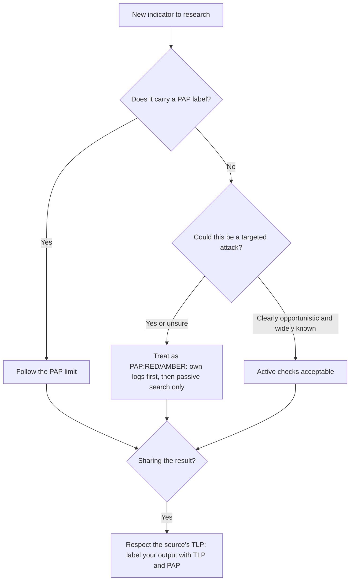

# 분석 OPSEC — 무엇이고 누구를 지키나, TLP와 PAP로 정하는 공유 규칙 { #opsec-tlp-pap }

!!! abstract "이 페이지에서 다루는 것"
    바깥 세상에 닿는 조사 단계는 하나하나가 공격자에게 무언가를 알려 줄 수도 있습니다. 이 페이지로 **분석 OPSEC** 섹션을 시작합니다. 첫째, **작전 보안(OPSEC, Operational Security)이 무슨 뜻인지**: 우리가 무엇을 알고, 무엇을 할 수 있고, 무엇을 계획하는지 적이 모르게 한다는 군사 개념, 그리고 그게 SOC에 거의 그대로 옮겨지는 이유. 둘째, **표적 공격과 기회주의 공격에 필요한 조심의 정도가 왜 다른지**: 표적 공격에서는 "우리가 공격자를 알아챘다"는 사실 자체가 전술적 이점인데, 부주의한 조회 한 번이 그걸 날려 버릴 수 있습니다. 표적 피싱 링크 하나를 따라가며, 분석가의 행동 하나하나가 공격자 자신의 웹·DNS 로그에 어떻게 찍히는지 보여 주는 예제가 이어집니다. 셋째, **사이버 OPSEC의 세 종류**(개인, 공격자, 분석가)와 새어 나가는 평범한 행동들: DNS 조회, URL 열기, 공개 샌드박스·멀티 스캐너 제출, 공격자 인프라로 가는 모든 트래픽. 넷째, 누구와 정보를 나눠도 되는지 알려 주는 **신호등 프로토콜(TLP, Traffic Light Protocol)** 의 현재 2.0 버전(CLEAR, GREEN, AMBER, AMBER+STRICT, RED), 이메일과 문서에 표시하는 법, 가상 보고서 네 건에 라벨을 붙이고 처리하는 예. 다섯째, 지표로 무엇을 *해도* 되는지 알려 주는 **허용 행동 프로토콜(PAP, Permissible Actions Protocol)**, MISP 형식으로 태그된 이벤트를 한 줄씩 읽기, 지표별 허용 행동 표. 2026년 관점과 확인 문제가 이어집니다.

!!! note "표기"
    **[보충]** = 꼭 알아야 할 실무 보충, **[정정]** = 흔히 잘못 알려진 내용 정정, **[변경됨]**/**[주의]** = 최근 바뀐 점과 옛 방식대로 하면 위험한 점. 회사(Wattle Ridge Energy, `wattleridge.example`), 사람, 호스트 이름, 도메인, IP, 로그 줄은 모두 설명용 가상 값(`.example`, 문서용·사설 IP)입니다. 프레임워크, 프로토콜, 표준 기관, 제품은 실제이며 제 말로 설명했습니다.

## 한눈에 보는 핵심 8가지 { #key-points }

1. **OPSEC은 우리가 아는 걸 적에게 알려 주지 않는 것이다.** 군사적으로는 우리 편의 배치, 능력, 의도를 적이 모르게 하는 것이다. 분석가에게는 우리가 공격을 *알아챘다는 사실*, *무엇을* 찾았는지, *무엇을* 할 계획인지 숨기는 것이다.
2. **표적 공격자를 먼저 알아챈 건 앞서 출발한 것이다 — 날리지 말자.** 공격자가 안 들켰다고 믿는 동안 우리는 그들의 도구를 연구하고 한 번에 끝내는 정리 작전을 짤 수 있다. 들킨 걸 알면 도메인, 악성코드, 방법을 바꾸고, 탐지는 처음부터 다시 시작이다.
3. **기회주의 공격은 훨씬 덜 조심해도 된다.** 대량 스팸과 흔한 악성코드는 수천 팀이 동시에 조사한다. 우리 조회는 그중 하나일 뿐이다. 능동적인 단계를 밟기 *전에* "이게 표적 공격일 수 있나?"를 묻는다.
4. **사이버 OPSEC은 세 종류다.** 개인(사생활 지키기), 공격자(안 들키기), **분석가**(우리가 아는 걸 공격자에게 숨기기). 이 섹션은 세 번째 이야기다.
5. **평범한 행동이 많이 샌다.** DNS 조회, URL 열기("좋은" 호스팅 도메인이라도), 공개 멀티 스캐너나 샌드박스에 URL·파일 제출, 그 밖에 공격자가 운영하거나 지켜볼 수 있는 인프라로 패킷을 보내는 모든 것.
6. **TLP는 공유를 정한다.** TLP 2.0의 라벨은 다섯 개다. **CLEAR**(제한 없음), **GREEN**(우리 커뮤니티까지, 공개는 안 됨), **AMBER**(우리 조직과 그 고객, 알아야 할 사람만), **AMBER+STRICT**(우리 조직만), **RED**(그 대화의 이름 있는 사람만). 라벨은 이메일 제목과 본문, 문서 모든 페이지의 머리글과 바닥글에 쓴다.
7. **PAP는 행동을 정한다.** 같은 색을 쓰지만 "이 지표로 무엇을 해도 되나?"에 답한다. **CLEAR/WHITE** 제한 없음, **GREEN** 능동 행동 허용(접속, 차단), **AMBER** 제3자 서비스로 수동 확인만, **RED** 바깥에서 알아챌 수 있는 건 아무것도 안 됨 — 우리 로그 검색만.
8. **둘은 서로 독립이다.** 한 지표가 TLP:GREEN(널리 공유해도 됨)이면서 PAP:RED(하지만 아무도 건드리면 안 됨)일 수 있다. 둘 다 지키고, *우리가* 공유할 때도 둘 다 붙인다.

## SOC에서 왜 중요한가 { #why }

한 형사가 범죄 조직이 쓰는 집을 막 알아냈다고 해 봅시다. 그 집 앞에 경찰차를 대 놓고 문을 두드리며 "몇 가지 여쭤볼게요" 하면, 조직은 그날 밤 증거를 챙겨 이사 갑니다. 거리를 두고 누가 드나드는지 지켜보고, 등기부를 확인하고, 이미 뭔가 본 이웃에게 물어보면, 모두를 한 번에 잡는 단속을 계획할 수 있습니다. 의심 내용은 하나도 안 바뀌었고, 그걸 얼마나 *티 나게* 행동했는지만 달랐습니다.

기술 이야기로 돌아오면, 피싱 URL을 공개 스캐너에 붙여 넣거나 회사 노트북으로 여는 분석가가 바로 그 경찰차입니다. 공격자는 자기 웹 서버, DNS 서버, 파일 호스트를 직접 운영하므로(T1583.001 Domains, T1583.002 DNS Server) 들어오는 요청을 모두 자기 로그로 봅니다. 게다가 우리가 쓰는 공개 스캔·평판 사이트를 공격자도 똑같이 검색할 수 있어서, 자기만의 도메인이나 파일 해시가 갑자기 거기 나타나면 알아챕니다. 대량 캠페인이라면 별문제가 안 됩니다. 하지만 우리 조직을 노린 침해라면, 막을 수 있던 사고가 긴 추격전이 됩니다. 공격자의 다음 도메인, 백도어, 접근 경로는 우리가 한 번도 못 본 것들이니까요. 분석 OPSEC은 바깥을 향하는 단계마다 "이걸 또 누가 보고, 그게 그들에게 무엇을 알려 줄까?"를 묻는 습관입니다. 그리고 SOC들은 서로 정보를 나누므로, 무엇을 넘겨도 되는지(TLP), 받은 걸로 무엇을 해도 되는지(PAP) 정하는 규칙도 여기에 들어갑니다.

## OPSEC이란 { #what-is-opsec }

이 말은 군대에서 왔습니다. NATO 용어집은 작전 보안을, 수동적이거나 능동적인 수단으로 작전에 알맞은 보안을 갖춰서 적이 우리 편의 **배치(dispositions)**(무엇이 어디 있나), **능력(capabilities)**(무엇을 할 수 있나), **의도(intentions)**(무엇을 하려 하나)를 모르게 하는 과정이라고 설명합니다. 정보 보안에서도 뜻은 거의 같습니다. 공격자가 **우리가 아는 것**을 알게 되면 안 됩니다.

SOC 분석가에게 이 세 단어는 이렇게 옮겨집니다.

| 군사 용어 | SOC 조사에서의 뜻 | 새는 예 |
| --- | --- | --- |
| 배치 | 공격자가 손댄 호스트·계정·데이터 중 우리가 **찾아낸** 것 | 아는 C2 도메인 하나만 지금 당장 차단하기 |
| 능력 | 우리 도구와 가시성 — 우리가 무엇을 **보고 탐지할** 수 있나 | 샌드박스가 티 나는 "헤드리스" 브라우저로 그들 페이지를 방문 |
| 의도 | 우리가 무엇을 **할 계획**인지 — 지켜보기, 격리, 쫓아내기 | 전사 메일로 "우리 공격받고 있어요, 비밀번호 바꾸세요" |

### 표적형 대 기회주의형: OPSEC이 얼마나 필요한가 { #targeted-vs-opportunistic }

공격은 크게 두 진영으로 나뉘고([앞 섹션](../investigation/targeted-clicks-bec.md#targeted)에서 구별법을 봤습니다), 필요한 조심의 정도가 아주 다릅니다.

**기회주의 공격(opportunistic attack)** 은 누가 받든 상관없이 인터넷 전체에 스팸과 악성코드를 뿌립니다. 같은 순간에 수천 개 보안팀, 연구자, 자동 피드가 같은 도메인과 파일을 조사하고 있습니다. 우리가 한 번 더 조회해도 공격자가 새로 알게 되는 건 없으니, OPSEC은 작은 걱정거리입니다.

**표적 공격(targeted attack)** 은 다릅니다. 하나를 알아냈다면 우리는 작은 **전술적 이점**을 쥐고 있습니다. 우리는 그들을 알고, 그들은 우리가 안다는 걸 모릅니다. 그게 유지되는 동안 그들의 지표와 파일을 조용히 분석하고, 무엇을 노리는지 알아내고, 손댄 호스트를 모두 찾고, **한꺼번에 효과를 내는 정리 작전**을 준비할 수 있습니다. 백도어를 모두 지우고, 훔친 자격 증명을 모두 재설정하고, C2 경로를 모두 같은 시간에 막아서 한 번에 쫓아내는 겁니다. 공격자가 우리를 알아채면 이런 계획은 불가능해질 수 있습니다. 놀란 공격자는 새 인프라와 악성코드로 갈아타거나, 가진 접근을 서둘러 써 버리거나(지금 당장 데이터를 훔치거나 랜섬웨어를 터뜨림), 조용히 숨어 기다립니다. 어느 쪽이든 우리는 탐지와 분석으로 되돌아갑니다.

**[보충]** 처음 보는 순간 공격이 표적형인지 *확실히* 아는 일은 드뭅니다. 그래서 안전한 습관은 표적형*일 수 있는* 건 아니라고 밝혀질 때까지 표적형으로 대하고, 수동적인 방법부터 쓰는 겁니다. 기회주의 공격이었다 해도 손해 볼 건 없습니다.

### 예제: 표적 링크 하나, 공격자 쪽에서 보기 { #attacker-view }

Wattle Ridge Energy SOC에 피싱 신고가 들어왔습니다. 엔지니어 세 명이 "SCADA 공급업체 포털 업데이트 — 금요일까지 재등록하세요"라는 메일을 받았습니다. 링크는 이렇습니다.

```text
https://wattleridge-portal.example/sso/login?t=8f3k2a
```

도메인은 회사 이름을 흉내 내고, 엿새 전에 등록됐고, `t=8f3k2a` 값은 받는 사람마다 다릅니다(일부러 준비한 수신자별 토큰: T1608.005 Link Target). 모든 표시가 **표적형**을 가리킵니다. 그런데 근무 중인 분석가가 서두르다가 처음 5분 안에 세 가지를 합니다. 아래는 공격자가 보는 장면입니다. 공격자가 이 도메인의 권한 DNS 서버와, 도메인이 가리키는 웹 서버를 직접 운영하기 때문입니다.

**행동 1: 분석가 PC에서 `nslookup wattleridge-portal.example`.** 질의는 Wattle Ridge 내부 리졸버로 가고, 리졸버가 그 도메인의 권한 서버에 묻습니다. 공격자의 DNS 질의 로그에 이렇게 찍힙니다(BIND 형식).

```text
12-Nov-2026 02:13:55.412 client 198.51.100.53#40122 (wattleridge-portal.example): query: wattleridge-portal.example IN A -E(0)DC (203.0.113.53)
```

필드별로 읽어 봅시다.

- `12-Nov-2026 02:13:55.412` — 질의가 공격자 서버에 닿은 시각(UTC).
- `client 198.51.100.53#40122` — 물어본 리졸버의 IP와 출발 포트. `198.51.100.53`은 Wattle Ridge의 재귀 리졸버이고, 그 주소로 WHOIS를 해 보면 "Wattle Ridge Energy"가 나옵니다. **공격자는 이제 표적 조직 안의 누군가가 도메인을 조회했다는 걸 압니다.**
- `(wattleridge-portal.example): query: wattleridge-portal.example IN A` — 물어본 이름, 클래스(`IN`, 인터넷), 레코드 종류(`A`, IPv4 주소).
- `-E(0)DC` — 플래그. `-`는 재귀 요청 안 함(리졸버가 권한 서버에 물을 땐 보통 이렇습니다), `E(0)`는 EDNS 버전 0 사용, `D`는 DNSSEC 레코드 요청, `C`는 검증 끔. 여기선 중요하지 않습니다.
- `(203.0.113.53)` — 질의를 받은 공격자 서버 주소.

조회 하나만 보면 사용자가 막 누르려던 걸 수도 있습니다. 하지만 그 네트워크에서 웹 요청이 뒤따르지 않으면, 연결 없는 DNS 질의는 링크에 *속은* 게 아니라 *확인하는* 것처럼 보입니다.

**행동 2: 분석용 VM의 브라우저로 URL을 연다. 그런데 여전히 회사 네트워크에서.** 공격자 웹 서버 로그입니다.

```text
198.51.100.23 - - [12/Nov/2026:02:14:07 +0000] "GET /sso/login?t=8f3k2a HTTP/1.1" 200 5120 "-" "Mozilla/5.0 (X11; Linux x86_64; rv:132.0) Gecko/20100101 Firefox/132.0"
```

- `198.51.100.23` — 출발 IP. Wattle Ridge의 회사 인터넷 출구입니다. 역시 WHOIS가 회사 이름을 알려 줍니다.
- `- -` — 원격 신원과 인증 사용자, 둘 다 비어 있음(보통 그렇습니다).
- `[12/Nov/2026:02:14:07 +0000]` — 요청 시각.
- `"GET /sso/login?t=8f3k2a HTTP/1.1"` — **토큰까지 포함한** 정확한 경로. `8f3k2a`는 엔지니어 한 명에게만 보냈으니, 공격자는 *누구의* 메일이 열렸는지 압니다.
- `200 5120` — 상태 200(페이지 보냄), 5,120바이트 전송.
- `"-"` — 리퍼러 없음. Outlook이나 웹메일에서 누른 사용자라면 보통 모양이 다릅니다.
- `"Mozilla/5.0 (X11; Linux x86_64 ...) Firefox/132.0"` — **Linux** 데스크톱 브라우저. 엔지니어들은 관리되는 Windows 노트북을 씁니다. 현지 시각 새벽 2시에 Linux 브라우저가 Windows 사용자의 토큰을 열고, 그 뒤 로그인 시도는 없다? 분석가처럼 보입니다.

**행동 3: 기본 설정(공개)으로 공개 URL 스캐너에 제출.** 1분 뒤 로그 두 줄이 생깁니다.

```text
192.0.2.80 - - [12/Nov/2026:02:15:31 +0000] "GET /sso/login?t=8f3k2a HTTP/1.1" 200 5120 "-" "Mozilla/5.0 (Windows NT 10.0; Win64; x64) AppleWebKit/537.36 (KHTML, like Gecko) HeadlessChrome/131.0.0.0 Safari/537.36"
192.0.2.80 - - [12/Nov/2026:02:15:32 +0000] "GET /sso/assets/logo-wattleridge.png HTTP/1.1" 200 18233 "https://wattleridge-portal.example/sso/login?t=8f3k2a" "Mozilla/5.0 (Windows NT 10.0; Win64; x64) ... HeadlessChrome/131.0.0.0 ..."
```

- `192.0.2.80` — 잘 알려진 스캔 서비스의 클라우드 대역에 속한 주소.
- `HeadlessChrome/131.0.0.0` — 화면 없이 돌아가는 Chrome. 자동 스캐너의 대표적인 표시입니다.
- 두 번째 줄은 스캐너가 페이지의 리소스(로고)까지 불러온 것으로, 리퍼러가 피싱 페이지입니다. 페이지를 끝까지 그렸다는 뜻입니다.

더 나쁜 건, 스캔 결과가 이제 **공개**라는 겁니다. 공격자를 포함해 누구든 그 서비스에서 `wattleridge-portal.example`을 검색하면 누군가 언제 스캔했는지, 페이지 스크린숏까지 볼 수 있습니다. 많은 공격자가 자기 도메인을 이렇게 늘 확인합니다.

**공격자의 결론:** 표적 조직 네트워크가 도메인을 조회했고, Linux 브라우저가 엔지니어 한 명의 토큰을 열었고, 스캐너가 그걸 공개적으로 그렸다. 2분 안에, 자격 증명 제출은 하나도 없이. "들켰다." 02:40에 도메인은 다른 곳을 가리키고, 다음 미끼(다음 주, 다른 도메인, 다른 주제)는 SOC가 지금 지켜보는 지표 없이 들어옵니다.

**분석가가 대신 할 수 있었던 것:**

| 필요한 것 | 새는 방법 | 더 조용한 방법 |
| --- | --- | --- |
| 도메인이 어디를 가리키나? | 회사 네트워크에서 `nslookup` | **패시브 DNS** 이력(다른 사람들이 이미 모아 둔 기록) 검색 — 다음 페이지 |
| 페이지가 어떻게 생겼나? | 회사 출구에서 열기 | 기존 스캔 결과부터 검색. 꼭 직접 봐야 하면 비공개 스캔이나 추적되지 않는 연결과 진짜 같은 Windows 브라우저로, 토큰은 **지우거나 바꿔서** — 다음 페이지 |
| 다른 데서도 보이나? | 공개 스캐너에 제출 | 인텔 플랫폼을 제출이 아니라 검색. 믿을 만한 동료에게 TLP:AMBER로 묻기 |
| 누가 눌렀나? | — | 공격자에게 아무것도 안 알려 주는 **우리** 프록시, DNS, 메일 클릭 로그 검색([앞 섹션](../investigation/targeted-clicks-bec.md#tracking-clicks)) |

**[보충]** 우리 로그는 우리 분석가의 실수도 기록합니다. Windows에서 Sysmon 이벤트 ID 22(DNSEvent)는 프로세스가 하는 DNS 질의를 프로세스 이름과 함께 모두 남깁니다. 조사 중인 지표를 분석가 PC가 조회한 기록을 찾아보면 OPSEC 실수를 싸게 찾을 수 있고, 같은 조사에서 분석가의 조회를 피해자의 클릭으로 착각하는 일도 막을 수 있습니다.

## 사이버 OPSEC의 종류 { #opsec-types }

사이버 보안에서 "OPSEC"은 세 가지 뜻으로 쓰입니다.

1. **개인 OPSEC — 사생활을 사생활로 지키기.** 여행 계획, 회사 출입증, 집 주소를 올리지 않는 것. 분석가에게도 해당합니다. 중요한 조직을 지키는 사람은 그 자체로 사회공학의 표적이 됩니다.
2. **공격자 OPSEC — 안 들키게 자기를 지키기.** 공격자는 흔적을 안 남기려 합니다. 실패하면 — 이메일 주소 재사용, 서버에 남긴 디버그 파일, 공개 스캐너에 올린 시험용 샘플 — 연구자들이 그들을 찾아냅니다. 공개된 귀속(attribution) 이야기의 상당수가 공격자의 OPSEC 실패에서 시작합니다.
3. **분석가 OPSEC — 공격에 대해 아는 걸 공격자에게 숨기기.** 이게 우리 주제입니다. 이미 잡았더라도, 그게 우리에게 쓸모 있는 동안은 공격자가 안 잡혔다고 계속 믿게 하고 싶습니다.

분석가가 흔히 아는 걸 흘리는 방법:

- 공격자 도메인의 **DNS 조회**(공격자가 권한 서버를 운영하면 그쪽에 보입니다).
- URL **열기, 시험하기, 찔러 보기** — "좋은" 도메인이라도. 유명한 파일 공유 서비스에 있는 악성 파일이라도 계정 주인은 다운로드 수나 접근 기록을 볼 수 있습니다.
- URL이나 파일을 **멀티 스캐너에 제출**: 파일이나 URL이 알려지고, 내려받을 수 있게 될 수도 있습니다.
- 샘플을 **공개 샌드박스**에서 실행: 보고서가 공개되어 해시로 검색되는 경우가 많습니다.
- 공격자가 운영하거나 지켜보는 인프라로 **능동적으로 트래픽을 보내는** 모든 것: 포트 스캔, 배너 수집, `wget`이나 `curl`로 내려받기.

대신 안전하게 조사하는 법 — 수동 출처, 검색 대 스캔, 추적되지 않는 연결, Tor, "섣부른 차단" — 은 다음 페이지에서 다룹니다.

## 정보 공유하기: 신호등 프로토콜 { #tlp }

위협 인텔리전스는 친구가 있을 때 더 좋습니다. 어제 한 에너지 회사가 찾은 피싱 도메인을 오늘 이웃 회사가 막을 수 있으니까요. 하지만 모든 걸 모두와 나눌 수는 없습니다. 정보를 만든 쪽은 **출처**(제보자, 협력사, 이름이 알려지길 원하지 않는 피해자)나 **방법**(공격자가 알면 안 되는 탐지)을 보호해야 할 때가 있습니다. **신호등 프로토콜(TLP)** 은 정보가 어디까지 가도 되는지 말하는 공통 언어입니다. FIRST(사고 대응·보안팀 포럼, Forum of Incident Response and Security Teams)가 관리하며, TLP 2.0은 2022년 8월에 나왔고, CISA(US-CERT를 흡수한 미국 기관)가 2022년 11월에 채택했습니다.

TLP 라벨은 정보의 **출처**가 정하고, **받는 쪽**이 지켜야 합니다. 비밀 등급 분류가 아니라 공유 범위를 말합니다.

| 라벨 | 받을 수 있는 사람 | 흔한 용도 |
| --- | --- | --- |
| **TLP:CLEAR**(예전 TLP:WHITE) | 누구나. 일반 저작권 외에는 제한 없음. | 공개 권고문, 블로그 글, 공개된 IOC |
| **TLP:GREEN** | 우리 커뮤니티(같은 업계나 커뮤니티의 동료·협력 조직). 단, 공개 채널에는 **올리면 안 됨** | ISAC 안에서 도는 업계 피싱 도메인 목록 |
| **TLP:AMBER** | 우리 조직, 그리고 스스로를 지키려면 알아야 하는 **고객**까지, 알아야 할 사람만. 출처가 더 좁은 제한을 붙일 수 있고, 그건 반드시 지켜야 함. | 몇몇 동료 SOC와 그들의 관리 고객에게 나누는 사고 세부 내용 |
| **TLP:AMBER+STRICT** | **우리 조직만** — 고객은 안 됨 | 퍼지면 협력사가 곤란해지는 탐지 세부 내용 |
| **TLP:RED** | **이름이 지정된 받는 사람**, 또는 그 회의나 통화에 있던 사람만. 아주 심하면 말로만, 직접 만나서만. | 피해자를 특정할 수 있는 진행 중인 조사 세부 내용 |

**[정정]** 오래된 문서와 도구에는 아직 TLP:WHITE가 보입니다. TLP 2.0에서 **TLP:CLEAR**로 바뀌었는데, "흰색"이 라벨 없는 평범한 정보와 헷갈릴 수 있다는 이유도 있었습니다. **AMBER+STRICT**는 2.0에서 새로 생겼고, AMBER는 이제 알아야 할 고객과의 공유를 명시적으로 허용합니다.

### 표시하는 법 { #tlp-marking }

- **이메일:** 라벨을 **제목**에, 그리고 **본문에서 공유 정보보다 앞에** 씁니다. 대문자로, 콜론 뒤에 띄어쓰기 없이: `TLP:AMBER`, `TLP:AMBER+STRICT`.
- **문서:** **모든 페이지의 머리글과 바닥글**에 씁니다. 다른 표시 체계와 헷갈리지 않게 보통 오른쪽 정렬, 대문자, 12포인트 이상.
- **기계가 읽는 데이터:** 플랫폼이 지원하는 TLP 태그나 마킹을 씁니다(예: MISP의 `tlp:amber` 태그, STIX의 TLP 2.0 마킹 객체).
- **[보충]** 라벨이 없는 정보에 남의 데이터 라벨을 마음대로 지어 붙이지 마세요. 출처에 물어보세요. **우리가** 보고서를 만들 때는 일부러 고민해서 라벨을 붙이고, 흔치 않은 선택이면 이유를 적습니다.

### 예제: 어느 아침의 보고서 네 건 { #tlp-example }

Wattle Ridge SOC 팀장이 인텔리전스 네 건을 받고 각각 어떻게 할지 정해야 합니다.

| 보고서 | 라벨 | 회사의 외주 OT 보안 업체에 전달해도 되나? | 업계 ISAC 채팅에 지표를 붙여 넣어도 되나? | 블로그 글로 공개해도 되나? |
| --- | --- | --- | --- | --- |
| R1: VPN 장비 취약점에 대한 국가 CERT 권고문 | TLP:CLEAR | 예 | 예 | 예 |
| R2: 에너지 회사를 흉내 낸 피싱 도메인 ISAC 목록 | TLP:GREEN | 예(커뮤니티 안의 협력사) | 예 — 그 커뮤니티에서 온 것 | **아니요** — GREEN은 절대 공개하지 않음 |
| R3: 같은 SCADA 포털 미끼에 대한 이웃 전력사 보고서, "공급업체와 공유 금지" | TLP:AMBER + 추가 제한 | **아니요** — 출처가 붙인 제한이 기본 "고객" 허용보다 우선 | 아니요 | 아니요 |
| R4: 의심 행위자를 언급한 정부 연락관과의 통화 | TLP:RED | 아니요 | 아니요 | 아니요 — 통화에 있던 사람 말고는 자기 SOC에도 브리핑할 수 없음 |

이 표가 피하는 흔한 실수 두 가지: GREEN을 "공개"로 여기는 것(아닙니다 — 커뮤니티 안에 머뭅니다), 그리고 AMBER의 "고객" 허용이 출처가 명시한 추가 제한보다 앞선다고 여기는 것(출처의 제한이 이깁니다).

Wattle Ridge가 자기 사고를 정리해 공유할 때, 분석가는 ISAC용 버전에 **TLP:GREEN**(도메인, 메일 제목, 미끼 주제. 단, 표적이 된 엔지니어 이름은 빼고)을, 이웃 전력사 두 곳용 버전에 **TLP:AMBER**(수신자별 토큰 패턴과 타임라인까지 추가)를 붙입니다. 받는 사람에 따라 버전을 나눠 라벨을 달리 붙이는 건 흔한 일입니다.

## 정보로 행동하기: 허용 행동 프로토콜 { #pap }

이웃 조직에게서 지표를 받고 "이걸로 내가 뭘 해도 되지?" 하고 고민한 적 있나요? TLP는 *누구에게* 말해도 되는지 답할 뿐, 그 서버에 접속하거나 스캔하거나 어딘가에 제출해도 되는지는 답하지 않습니다. TLP로 그걸 대신 판단하는 건 잘해야 대충 맞을 뿐입니다. MISP 커뮤니티에서 만들어 MISP 택소노미(taxonomy)로 공개된 **허용 행동 프로토콜(PAP)** 이 이 빈자리를 채웁니다. PAP는 **지표 하나하나에** 붙일 수 있고, 받는 쪽이 그 지표와 어디까지 상호작용해도 되는지 — 다시 말해 출처가 공격자에게 들킬 위험을 어디까지 감수하는지 — 를 알려 줍니다.

| 라벨 | 해도 되는 것 | 실제로는 |
| --- | --- | --- |
| **PAP:CLEAR**(옛 버전: PAP:WHITE) | 제한 없음 | 마음대로 써도 됨 |
| **PAP:GREEN** | **능동 행동** 허용 | ping, 접속, 오가는 트래픽 차단, 상호작용하는 허니팟 설정 |
| **PAP:AMBER** | **수동 교차 확인**만 | 제3자 서비스로 조회(평판·스캔 사이트 검색, 패시브 DNS), 감시용 허니팟 — 직접 접촉은 안 됨 |
| **PAP:RED** | **들키지 않는 행동만** | 네트워크에서 아예 쓰지 않음. 우리 로그와 데이터만 검색해서, 바깥에서 아무것도 안 보이게 |

**[보충]** 프로토콜 이름은 "노랑(yellow)"이 아니라 "AMBER"입니다. 오래된 글 중에 둘을 섞어 쓴 게 있습니다. 또 PAP:AMBER의 "제3자 조회"도 이미 있는 데이터를 *검색*하는 것이지, 서버에 직접 접속하고 결과를 공개하는 새 스캔을 *제출*하는 게 아닙니다. 그 차이는 다음 페이지에서 다룹니다.

### 예제: 태그된 이벤트를 한 줄씩 읽기 { #pap-example }

이웃 전력사가 SCADA 포털 캠페인에 대한 MISP 이벤트를 공유했습니다. 중요한 부분만 간단히 하면 이렇습니다.

```json
{
  "Event": {
    "info": "SCADA vendor-portal credential phishing against energy sector",
    "Tag": [
      { "name": "tlp:amber" },
      { "name": "PAP:AMBER" }
    ],
    "Attribute": [
      { "type": "domain", "value": "wattleridge-portal.example",
        "Tag": [ { "name": "PAP:AMBER" } ] },
      { "type": "url", "value": "https://grid-vendor-sso.example/sso/login?t=u77qd1",
        "Tag": [ { "name": "PAP:RED" } ] },
      { "type": "ip-dst", "value": "203.0.113.45",
        "Tag": [ { "name": "PAP:GREEN" } ] },
      { "type": "email-subject", "value": "Updated SCADA vendor portal - re-register by Friday",
        "Tag": [ { "name": "tlp:green" }, { "name": "PAP:CLEAR" } ] }
    ]
  }
}
```

- `"info"` — 이벤트 제목. 무엇에 관한 건지 사람이 읽는 요약입니다.
- 이벤트 단위의 `"Tag": [ tlp:amber, PAP:AMBER ]` — 이벤트 전체의 **기본값**: 우리 조직 안과 알아야 할 고객까지 공유, 수동 확인만.
- 첫 번째 속성인 **도메인**, `PAP:AMBER` — 패시브 DNS와 평판 데이터베이스에서 찾아봐도 되지만, 직접 조회하거나 방문하면 안 됩니다.
- 두 번째 속성인 **토큰이 붙은 URL**, `PAP:RED` — 이 URL의 토큰은 이웃 회사의 피해자를 특정합니다. 익명 연결로라도 접촉하면, 바로 그 피해자의 미끼가 조사됐다고 공격자에게 알려 주는 셈입니다. 우리 프록시 로그에서 찾기만 하고, 절대 열거나 스캔하지 않습니다.
- 세 번째 속성인 **IP**, `PAP:GREEN` — 이 호스팅 IP는 여러 캠페인이 같이 쓰고 이미 널리 알려졌으니, 방화벽에서 막고 접속에 경보를 거는 건 괜찮습니다.
- 네 번째 속성인 **메일 제목**, `tlp:green`과 `PAP:CLEAR` — 속성 단위 태그가 이벤트 기본값보다 우선합니다. 제목은 커뮤니티 전체와 나눠도 되고, 무엇에든 써도 됩니다(예: 메일 필터 규칙).

이걸 바탕으로 분석가는 간단한 행동 계획을 짭니다.

| 지표 | 허용 | 계획한 행동 |
| --- | --- | --- |
| `wattleridge-portal.example` | 수동 교차 확인 | 패시브 DNS 이력, 스캔 사이트는 스캔 말고 검색, 우리 DNS 로그에서 헌팅 |
| `https://grid-vendor-sso.example/...?t=u77qd1` | 우리 로그만 | 프록시 로그에서 도메인과 경로 검색. 방문·스캔 없음 |
| `203.0.113.45` | 능동 | 방화벽 차단, 접속 시도에 경보 |
| 메일 제목 | 무엇이든 | 메일 게이트웨이 격리 규칙, ISAC에 공유 |

### TLP와 PAP를 함께 { #tlp-pap-together }

두 라벨은 **서로 독립**입니다. TLP는 *사람*에 관한 것이고, PAP는 *패킷*에 관한 것입니다. 널리 알려진 스캔 IP는 TLP:CLEAR에 PAP:GREEN일 수 있습니다. 피해자를 특정하는 URL은 TLP:RED에 PAP:RED일 수 있습니다. 그리고 **TLP:GREEN에 PAP:RED** 같은 조합도 아주 말이 됩니다. "업계 모두에게 자기 로그에서 이 도메인을 찾아보라고 알려 주세요. 하지만 조사가 아직 진행 중이니 아무도 건드리지는 마세요." 공유받은 지표로 행동하기 전에 둘 다 읽고, 공유할 때도 둘 다 붙이세요.

바깥을 향한 단계를 밟기 전에 떠올릴 간단한 판단 흐름입니다.



위에서부터 읽으면: 출처가 PAP 라벨을 줬다면 그게 정합니다. 없다면 "표적형인가 아닌가"에 대한 우리 판단이 정하고, 확실하지 않으면 조심하는 쪽이 기본입니다. 무엇을 찾든 누구에게 말해도 되는지는 출처의 TLP가 정하고, 우리가 내보내는 것에는 두 라벨을 모두 붙입니다.

## 2026년 관점 { #trends }

!!! success "[2026 현재] 지금도 그대로 유효"
    핵심 생각은 그대로입니다. 표적 침해에서 공격자가 우리가 안다는 걸 모르는 건 이점이고, 바깥을 향한 조사가 그걸 날려 버릴 수 있습니다. 공격자는 여전히 자기 인프라 로그를 지켜보고, 공개 스캔·평판 서비스에서 자기 도메인과 해시를 검색합니다. TLP는 CERT, ISAC, 보안 업체 사이에서 여전히 표준 공유 라벨이고, PAP도 MISP, OpenCTI 같은 인텔리전스 플랫폼에서 계속 쓰입니다. "표적일 수 있으면" 표적으로 대하기, 우리 로그부터 검색하기, 공유하는 것에 라벨 붙이기는 여전히 모범 사례입니다.

!!! info "[변경됨] 바뀐 점"
    - **TLP 2.0**(FIRST, 2022년 8월. CISA는 2022년 11월 채택)이 TLP 1.0을 대체했습니다. WHITE는 **CLEAR**가 됐고, **AMBER+STRICT**가 추가됐고, AMBER는 알아야 할 고객과의 공유를 명시적으로 허용합니다. "US-CERT"를 인용하는 옛 지침은 이제 그걸 흡수한 **CISA**를 가리킵니다.
    - **PAP**에는 옛 PAP:WHITE와 나란히 **PAP:CLEAR**가 생겼고, MISP뿐 아니라 STIX 2.1 공통 객체의 표준 마킹으로도 쓸 수 있습니다.
    - **플랫폼이 바뀌었습니다.** RiskIQ의 커뮤니티 패시브 DNS 서비스는 Microsoft Defender Threat Intelligence가 됐고, 2025년에 Microsoft는 Defender TI 기능을 추가 비용 없이 Defender XDR과 Sentinel에 합친다고 발표했습니다. 옛 자료에 나오는 공개 샌드박스 사이트 일부(예: 예전 malwr.com)는 사라졌고, 다른 건 남아 있습니다. 지금 쓰는 도구 하나하나가 무엇을 누구와 공유하는지 확인하세요.
    - **공격자가 더 많이 봅니다.** 피싱 킷에는 분석 방해 기능이 흔합니다. 알려진 스캐너 IP 대역과 헤드리스 브라우저 차단, 한 번만 쓰는 토큰, CAPTCHA나 Cloudflare 식 확인 화면, 지역 제한(geofencing). 이건 분석가에게 페이지를 숨기는 동시에, 누군가 시도했다는 걸 공격자에게 알려 줍니다. 수신자별 토큰을 피해자가 아닌 누군가 방문하면 너무 뻔한 신호입니다.
    - **AI와 공유.** SOC 코파일럿과 AI 비서는 지표를 요약하고 보강해 줍니다. 하지만 TLP:AMBER나 TLP:RED 보고서를 외부 AI 서비스에 붙여 넣는 건 그 서비스와 공유하는 것입니다. 그 등급의 데이터에 조직이 승인한 도구만 쓰고, 프롬프트가 보관되는지 확인하세요.
    - 이 페이지의 **ATT&CK ID**: T1583.001 Domains, T1583.002 DNS Server, T1608.005 Link Target, T1566.002 Spearphishing Link. 현재 버전은 ATT&CK v20(2026년 10월)이며, 이 ID들은 바뀌지 않았습니다.

!!! warning "[주의] 옛 방식대로 하면 틀리거나 위험한 점"
    - **표적일 수 있는 공격의 지표를 회사 네트워크에서 "그냥 확인차" 조회하거나 열지 마세요.** 공격자가 기다리는 바로 그 신호입니다.
    - **TLP:GREEN을 공개로 여기지 마세요.** SNS나 공개 블로그에 올리면 프로토콜도, 정보를 나눠 준 커뮤니티의 신뢰도 깨집니다.
    - **AMBER의 "고객" 허용이 출처의 추가 제한보다 앞선다고 여기지 마세요.** 출처가 붙인 제한은 언제나 적용됩니다.
    - **TLP를 PAP 대신 쓰지 마세요.** TLP:CLEAR 지표라고 스캔해도 안전한 건 아닙니다. 물어보거나, 기본은 수동으로.
    - **도구 사이에 데이터를 옮기면서 라벨을 지우거나 무시하지 마세요**(메일 → 티켓 → SIEM 감시 목록 → AI 도구). 라벨은 데이터와 함께 다녀야 합니다.
    - **TLP는 법적 등급이나 보안 등급 분류가 아닙니다.** 조직 자체의 분류 규칙을 대신하지 않습니다(국방 업무라면 보호 표시와 취급 규칙이 TLP 위에 그대로 적용됩니다).

## 확인 문제 { #quiz }

### 문제 1

분석가가 이름이 적힌 재무팀 직원 두 명에게 온 피싱 링크 `https://payroll-wattleridge.example/view?id=a19x` 신고를 받았습니다. 곧바로 그 도메인에 `nslookup`을 하고, 업무용 노트북 브라우저로 링크를 엽니다. 각 행동으로 공격자가 자기 로그에서 무엇을 볼 수 있는지, 이번 경우 그게 왜 중요한지, 분석가가 먼저 했어야 할 것은 무엇인지 설명하세요.

??? success "정답과 해설"
    **`nslookup`:** 공격자가 그 도메인의 권한 DNS 서버를 운영한다면, 질의 로그에 회사 리졸버 IP(WHOIS가 회사를 알려 줌)에서 온 조회가 찍힙니다. 웹 요청이 뒤따르지 않으면 클릭이 아니라 확인처럼 보입니다.

    **링크 열기:** 웹 로그에 회사 출구 IP에서 온 요청, `id=a19x`까지 포함한 전체 경로(어느 재무팀 직원의 메일이 열렸는지 특정), 시각, 사용자 에이전트가 찍힙니다. 그 뒤 아무것도 없으면(자격 증명 제출 없음) 조사처럼 보입니다.

    **왜 중요한가:** 미끼가 회사 이름을 흉내 내고, 이름 적힌 두 명에게 갔고, 수신자별 ID가 있습니다. **표적 공격**의 표시이고, 표적 공격에서는 들키면 공격자가 인프라를 바꿔 안 보이게 돌아옵니다.

    **먼저 할 것:** **우리 로그**(프록시, DNS, 메일 클릭 기록)에서 두 직원이 눌렀는지, 자격 증명을 냈는지 찾습니다. 직접 조회하거나 방문하는 대신 **패시브 DNS**와 기존 스캔 결과를 검색합니다. 꼭 직접 봐야 하면 추적되지 않는 연결과 진짜 같은 브라우저로, ID를 지우거나 바꿔서 봅니다(다음 페이지).

### 문제 2

"공급업체 제외"라는 메모와 함께 `TLP:AMBER`가 붙은 보고서를 받았습니다. 회사는 EDR을 운영해 주는 관리형 보안 업체(외부 공급업체)를 씁니다. 그 업체와 보고서를 공유해도 되나요? `TLP:GREEN` 보고서라면 그 도메인들을 공개 블로그에 올려도 되나요? 그리고 `TLP:WHITE`는 무엇으로 바뀌었나요?

??? success "정답과 해설"
    **"공급업체 제외"가 붙은 TLP:AMBER:** 안 됩니다. AMBER는 보통 우리 조직 안과 알아야 할 고객까지 공유를 허용하지만, 출처가 제한을 더 붙일 수 있고 그건 지켜야 합니다. 여기서는 공급업체를 명시적으로 뺐습니다. (메모가 없었다면 우리를 대신해 일하는 업체와의 공유는 신중한 판단이나 출처에 묻기가 필요했겠지만, 메모가 있으니 답은 분명합니다.)

    **TLP:GREEN을 공개 블로그에:** 안 됩니다. GREEN은 커뮤니티(업계나 보안 커뮤니티의 동료·협력사) 안에서는 널리 돌려도 되지만, 누구나 볼 수 있는 공개 채널로는 안 됩니다.

    **TLP:WHITE**는 TLP 2.0(2022년 8월)에서 **TLP:CLEAR**가 됐고, 이때 **TLP:AMBER+STRICT**(조직만, 고객 제외)도 추가됐습니다.

### 문제 3

공유받은 지표 묶음에 `PAP:RED`가 붙은 C2 도메인, `PAP:GREEN`이 붙은 호스팅 IP가 있고, 이벤트 전체는 `TLP:GREEN`입니다. 도메인과 IP 각각으로 해도 되는 것과 안 되는 것을 적고, 한 이벤트에 TLP:GREEN과 PAP:RED가 같이 있는 게 어떻게 말이 되는지 설명하세요.

??? success "정답과 해설"
    **도메인(`PAP:RED`):** 바깥에서 알아챌 수 없는 행동만 됩니다 — 우리 DNS, 프록시, 방화벽, EDR 로그에서 검색하기. 조회, 방문, 스캔, 제출은 **안 되고**, 그 도메인에 접촉하게 되는 방식의 검색도 안 됩니다. (방화벽 차단도 비컨이 끊기면 공격자가 알아챌 수 있는 행동이니, 막기 전에 출처와 상의하세요.)

    **IP(`PAP:GREEN`):** 능동 행동 허용 — 오가는 트래픽 차단, 접속 경보, ping이나 접속, 허니팟 연결.

    **두 라벨을 함께:** TLP는 **누구에게 말해도 되나**, PAP는 **무엇을 해도 되나**에 관한 것입니다. 출처는 커뮤니티의 모든 조직이 자기 로그에서 그 도메인을 *헌팅*하길 원하고(그래서 널리 공유: GREEN), 조사가 계속되는 동안 아무도 그걸 *건드리지* 않길 원합니다(그래서 PAP:RED). 두 라벨은 다른 질문에 답하므로 서로 다를 수 있습니다.

## 관련 레퍼런스 { #related }

- [분석 OPSEC](index.md) — 섹션 개요
- [표적 공격, 클릭, 털린 비밀번호, BEC](../investigation/targeted-clicks-bec.md) — 표적형과 기회주의형 구별하기
- [조사 시작하기](../investigation/questions-and-data.md#osint) — OSINT와 제출의 함정
- [위협 인텔리전스 수준, 인텔리전스 주기, F3EAD](../mental-models/threat-intel-cycles.md) — 인텔리전스를 누가 쓰고 어떻게 나누나
- [피싱 전달과 최초 실행](../../../adversary/phishing-delivery.md)
- [위협 인텔리전스](../../../threat-intel/index.md)
