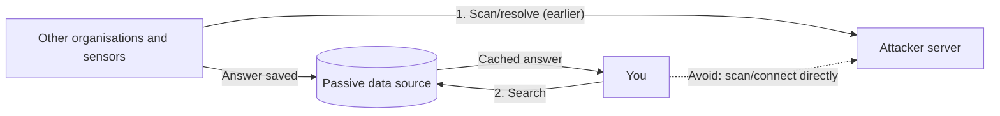

# 안전하게 조사하기 — 수동 출처, 검색 대 스캔, 흔한 OPSEC 실패, 추적되지 않는 연결과 Tor { #passive-osint-failures }

!!! abstract "이 페이지에서 다루는 것"
    [앞 페이지](opsec-tlp-pap.md)는 바깥을 향한 조사가 왜 공격자에게 신호가 되는지 보여 줬습니다. 이 페이지는 실전 "이렇게 하지 마세요" 편입니다. 첫째, **이상적인 방법: 수동 검색(passive searching)** — 공격자에게 직접 닿는 대신 이미 답을 아는 출처(패시브 DNS 같은)에 묻기. 가상 패시브 DNS 결과를 한 줄씩 읽고 그걸로 피벗(pivot)합니다. 둘째, **OSINT 도구 알기**: 어떤 서비스든 물어야 할 세 질문(새 스캔을 돌리나, 올린 걸 보관하고 공유하나, 누가 찾아봤는지 남에게 알려 주나), 그리고 네임서버를 우리가 쥔 카나리아(canary) 도메인으로 도구를 안전하게 시험하는 법. 셋째, 결과가 가장 크게 갈리는 선택인 **검색 대 스캔** — 파일 업로드 대신 해시 조회, 절대 올리지 말았어야 할 청구서, URL 스캔 공개 범위. 이어서 **흔한 OPSEC 실패 세 가지**: (1) **공개 IOC 제출**, (2) **공격자 인프라와 상호작용**(DNS 조회, 찔러 보기, 회사 네트워크나 티 나는 도구로 악성코드 내려받기) — 공격자 쪽 가상 로그와, 조심스러운 다운로드 명령을 옵션 하나씩 풀어 봅니다, (3) C2 채널 하나를 끊었더니 공격자가 우리가 한 번도 못 본 예비 채널로 옮겨 가는 **섣부른 차단**. 그 사이에 **추적되지 않는 연결과 전용 분석 PC**, 그리고 **Tor** — 무엇을 숨기고 무엇은 못 숨기는지, 중계 서버를 세 개 거쳐도 고유 URL 하나가 왜 우리를 드러내는지. 정리, 2026년 관점, 확인 문제로 이 페이지와 섹션을 마칩니다.

!!! note "표기"
    **[보충]** = 꼭 알아야 할 실무 보충, **[정정]** = 흔히 잘못 알려진 내용 정정, **[변경됨]**/**[주의]** = 최근 바뀐 점과 옛 방식대로 하면 위험한 점. 회사(Wattle Ridge Energy, `wattleridge.example`), 사람, 호스트 이름, 도메인, IP, 해시, 로그 줄은 모두 설명용 가상 값(`.example`, 문서용·사설 IP)입니다. 실제 도구와 서비스 이름은 제 말로 설명했습니다. 동작은 바뀌니 늘 최신 문서를 확인하세요.

## 한눈에 보는 핵심 8가지 { #key-points }

1. **이상은 수동이다.** 이미 답을 모아 둔 출처 — 패시브 DNS, 과거 스캔 결과, 인텔 데이터베이스 — 에 물어서, 새 패킷이 공격자 근처에 하나도 안 가게 한다.
2. **OSINT 도구가 우리 입력으로 무엇을 하는지 안다.** 답을 이미 알아도 새 스캔을 돌리나? 올린 파일을 보관하고 공유하나? 누가 이미 찾아봤다고 다음 사람에게 알려 주나? 문서에 없으면 먼저 의미 없는 데이터로 시험한다.
3. **기본은 스캔이 아니라 검색이다.** 검색은 데이터베이스를 읽는다. 스캔이나 업로드는 대상에 접속하고, 결과를 저장하고, 공개하는 경우가 많다. 제출은 되돌릴 수 없다.
4. **세상이 다 봐도 괜찮지 않은 건 절대 올리지 않는다.** 올린 파일은 유료 구독자가 내려받을 수 있다. 먼저 **해시**를 확인한다. "피싱" PDF가 알고 보니 진짜 기밀 청구서일 수 있다.
5. **실패 1 — 공개 IOC 제출:** 공격자는 공개 서비스에서 자기 도메인과 해시를 지켜본다. 우리 제출이 답을 "모름"에서 "앎"으로 뒤집는다.
6. **실패 2 — 그들의 인프라와 대화하기:** 연결 없는 DNS 조회, 포트 스캔, 회사 IP에서 `wget`으로 내려받기는 모두 방어자처럼 보인다. 꼭 해야 한다면 **전용 분석 PC**에서 **추적되지 않는 연결**로, 공격자가 기대하는 모습으로 한다.
7. **Tor는 IP를 숨기지, 내용을 숨기지 않는다.** 피해자별 고유 URL, 쿠키, Tor 밖으로 새는 DNS 조회는 여전히 우리를 드러낸다. 그리고 Tor 출구에서 온 "피해자"는 그 자체로 수상하다.
8. **실패 3 — 섣부른 차단:** 능숙한 공격자의 C2 채널 하나를 막으면, 그들이 예비 채널이나 우리가 못 찾은 두 번째 백도어로 옮겨 갈 수 있다. 표적 공격자라면 먼저 범위를 잡고, 그다음 한꺼번에 걷어 낸다.

## SOC에서 왜 중요한가 { #why }

자꾸 사무실로 전화하는 낯선 사람이 사기꾼인지 알고 싶다고 해 봅시다. 내 책상 전화로 다시 걸어서 물어볼 수도 있습니다. 아니면 다른 회사들이 이미 채워 둔 공유 사기 신고 목록을 확인하고, 옛 신문 기사를 찾아보고, 이미 그 사람을 겪은 동료에게 물어볼 수도 있습니다. 두 번째 방법으로도 거의 비슷하게 알 수 있고 — 그 사람은 우리가 눈치챘다는 걸 끝내 모릅니다. 정말 꼭 전화해야 한다면, 우리 사무실로 추적되지 않는 전화로, 조사관이 아니라 평범한 손님처럼 말합니다.

기술 이야기로 돌아오면, 분석가가 도메인, IP, 파일에 대해 알고 싶은 것 — 어디를 가리키나, 무엇을 호스팅했나, 언제 나타났나, 남들도 봤나 — 은 대개 이미 누군가 기록해 두었습니다. 패시브 DNS 센서, URL 스캐너, 평판 서비스, 악성코드 저장소에는 몇 년 치 이력이 있습니다. 조심해서 쓰면 공격자에게 새 트래픽 하나 없이 답을 얻습니다. 부주의하게 쓰면("검색" 대신 "스캔"을 누르거나, 샘플을 올리거나, 그냥 회사 네트워크에서 도메인을 조회하면) 알면 안 되는 단 한 사람에게 우리 조사를 알리게 됩니다. 그리고 이 페이지의 마지막 실수, 너무 이른 차단은 조사 실수가 아니라 대응 결정입니다. 쫓아내기 작전 전체를 망칠 수 있습니다.

## 이상적인 방법: 수동 검색 { #passive }

수상한 도메인을 분석할 때, 특히 표적 공격의 일부일 수 있을 때는 필요 없는 패킷을 공격자 쪽으로 하나도 보내지 않는 게 좋습니다. DNS 요청도 마찬가지입니다. 공격자가 여러 피해자에게 같은 인프라를 쓰니 상관없을 때도 있습니다. 하지만 상관있을 때도 있고, 지금 어느 쪽인지 알 수 있는 경우는 드무니, 더 좋은 습관은 **언제나 수동 정보 출처부터 시도하는 것**입니다.



읽는 법: (1) 다른 사람, 센서, 서비스가 예전에 그 도메인을 조회하거나 스캔했고, 답이 날짜와 함께 저장됐습니다. (2) 우리는 그 저장된 이력을 검색합니다. 공격자에게 새 트래픽을 하나도 만들지 않고 알려진 걸 얻습니다. 점선은 우리가 피하는 것, 즉 공격자 서버에 직접 닿는 것입니다.

### 예제: 미끼 도메인의 패시브 DNS { #passive-dns-example }

Wattle Ridge 분석가가 패시브 DNS 서비스에서 `wattleridge-portal.example`(앞 페이지의 표적 미끼)을 검색합니다.

```text
query                          type  answer          first_seen            last_seen             count
wattleridge-portal.example     A     203.0.113.45    2026-11-06 22:41:09   2026-11-12 01:58:30   37
wattleridge-portal.example     NS    ns1.dnsbox.example  2026-11-06 22:40:02   2026-11-12 01:58:30   12
wattleridge-portal.example     MX    (none)          -                     -                     0
```

열 하나씩 읽어 봅시다.

- `query`와 `type` — 조회된 이름과 관찰된 레코드 종류(`A`는 IPv4 주소, `NS`는 네임서버, `MX`는 메일 서버).
- `answer` — 조회가 돌려준 값. `A` 레코드는 `203.0.113.45`를 가리키고, 네임서버는 `ns1.dnsbox.example`입니다.
- `first_seen` / `last_seen` — 어떤 센서든 이 답을 처음과 마지막으로 본 시각. 도메인은 피싱 메일보다 엿새 앞선 11월 6일에 조회되기 시작했습니다. 이 캠페인을 위해 차린 인프라와 맞아떨어집니다.
- `count` — 센서가 이 답을 본 횟수. 수백만이 아니라 수십 정도로 낮다는 건 이걸 조회한 사람이 아주 적다는 뜻이고, 이것도 표적 미끼의 표시입니다.
- `MX` 레코드 없음 — 메일을 받도록 설정되지 않았습니다. 페이지를 호스팅하려고만 있는 도메인입니다.

이제 IP로 **피벗**합니다. 역시 수동으로 — `203.0.113.45`를 가리켰던 다른 이름은 무엇일까요?

```text
answer          query                          first_seen            last_seen
203.0.113.45    wattleridge-portal.example     2026-11-06 22:41:09   2026-11-12 01:58:30
203.0.113.45    grid-vendor-sso.example        2026-11-04 03:12:55   2026-11-11 19:20:41
203.0.113.45    scada-support-login.example    2026-10-29 07:05:13   2026-11-02 08:44:02
```

지난 한 달 사이 "공급업체 포털" 닮은꼴 도메인 두 개가 더 같은 서버를 썼습니다. 이걸로 Wattle Ridge의 미끼가 이웃 전력사 보고서(`grid-vendor-sso.example`)와 이어지고, 에너지 업계를 노린 캠페인으로 보이며, SOC는 자기 DNS·프록시 로그에서 찾아볼 도메인 두 개를 더 얻습니다 — 공격자에게 패킷 하나 안 보내고.

**[보충]** 패시브 DNS는 센서만큼만 좋습니다. 막 생겼거나 거의 안 쓰인 도메인은 이력이 **아예** 없을 수 있습니다. "결과 없음"은 "이 센서들이 본 적 없음"이지 "존재하지 않음"이 아닙니다. 그리고 표적 공격일 수 있다면, 그게 직접 조회할 이유가 되지도 않습니다.

## OSINT 도구 알기 { #know-your-tools }

VirusTotal이나 Microsoft Defender Threat Intelligence(RiskIQ PassiveTotal 커뮤니티 서비스의 후속) 같은 서비스는 대부분의 경우 대상에 트래픽을 보내지 않고 과거 호스트 이름-IP 조회 결과를 보여 줍니다. 다른 사람들이 이미 한 조회를 저장해 두고, 답마다 날짜와 IP를 붙여 보관하기 때문입니다. 그런데 "대부분의 경우"에 함정이 숨어 있습니다. 어떤 서비스는 누가 도메인을 검색했다는 걸 기록해 다음 사람에게 보여 줍니다. 어떤 서비스는 데이터를 새로 고치려고 직접 도메인을 조회하거나 스캔합니다 — 데이터베이스를 어떻게든 채워야 하니까요. 그래서 민감한 조회에 서비스를 쓰기 전에 세 질문의 답을 알아야 합니다.

| 질문 | 왜 중요한가 | 안전한 답의 모습 |
| --- | --- | --- |
| 1. 답을 이미 알아도 **새 조회나 스캔**을 돌리나? 그걸 우리가 정할 수 있나? | 새 스캔은 서비스의 IP에서 공격자 서버로 접속한다 | "검색은 저장된 데이터만 돌려줌. 스캔은 따로, 명시적으로 하는 행동" |
| 2. **올린 파일을 보관**하고, 나중에 보고서를 여는 사용자에게 제공하나? 빼 달라고 할 수 있나? | 우리 샘플 — 또는 우리 기밀 문서 — 를 남이 내려받을 수 있게 된다 | "비공개 제출: 우리나 우리 팀만 볼 수 있음" |
| 3. 다른 방문자가 이 도메인이나 해시를 **이미 누가 조회했는지**, 이 해시의 파일이 제출됐는지 볼 수 있나? | 공격자가 자기 지표가 "알려졌는지" 확인할 수 있다 | "검색은 기록되지도, 남에게 보이지도 않음" |

답은 **입력 종류**마다 다를 수 있습니다. 해시 검색은 흔적을 안 남기는데 파일 업로드는 공유될 수 있고, 아는 도메인 검색은 수동인데 모르는 도메인 검색은 새 WHOIS·DNS 질의를 일으킬 수 있습니다.

### 도구를 안전하게 시험하기 { #testing-tools }

문서가 세 질문에 답하지 않으면, 필요해지기 전에 아무 의미 없는 데이터로 시험합니다.

1. **반복 시험:** 존재하지 않는다는 걸 아는 지어낸 도메인을 한 번 검색하고, 나중에 다시 검색합니다. 두 번째 결과가 첫 조회를 언급하나요("처음 제출됨", "마지막 분석", 조회 수)? 그렇다면 그 서비스는 조회를 기록하고 드러냅니다.
2. **트래픽 시험:** 권한 네임서버를 **우리가** 쥔 시험용 도메인을 등록하고, 서비스를 쓰는 동안 그 질의 로그를 지켜봅니다.

트래픽 시험의 예입니다. Wattle Ridge 실험실이 `canary-7731.wattleridge-lab.example`을 등록하고 네임서버를 실험실 서버에 둡니다. 분석가가 09:00:00에 어떤 도구의 **검색** 칸에 이 이름을 입력합니다. 실험실 네임서버 로그입니다.

```text
27-Nov-2026 09:00:02.118 client 192.0.2.140#53211 (canary-7731.wattleridge-lab.example): query: canary-7731.wattleridge-lab.example IN A -E(0)DC (198.51.100.90)
27-Nov-2026 09:00:02.371 client 192.0.2.140#18890 (canary-7731.wattleridge-lab.example): query: canary-7731.wattleridge-lab.example IN NS -E(0)DC (198.51.100.90)
```

- `09:00:02` — "검색"을 누르고 2초 뒤.
- `client 192.0.2.140` — 그 서비스 자신의 대역에 속한 주소(WHOIS로 확인).
- `IN A` 다음 `IN NS` — 서비스가 이름과 그 네임서버를 조회했습니다.

결론: **이 도구의 "검색"은 처음 보는 도메인이면 직접 조회합니다.** 자기 DNS를 운영하는 진짜 공격자였다면 그 질의가 그들에게 닿았을 겁니다. 분석가는 SOC 도구 런북에 이렇게 적습니다. "도구 X: 알려진 지표에는 안전. 처음 보는 도메인에는 대신 패시브 DNS 서비스 Y를 쓸 것."

## OSINT: 스캔이냐 검색이냐 — 잘 고르기 { #scan-vs-search }

평판 사이트는 보통 두 가지 행동을 제공합니다. 이미 가진 데이터를 보는 수동 **검색**, 그리고 능동 **스캔**이나 **제출**. 이 차이가 큰 결과를 낳습니다.

**검색.** 보통 데이터베이스만 확인하고 능동적인 일은 하지 않습니다. 예외가 있어서(카나리아 시험에서 봤듯 처음 보는 도메인은 새 WHOIS·DNS 조회를 일으킬 수 있음), 시험해 봐야만 알 수 있습니다. 그래도 언제나 첫 시도는 검색이어야 합니다.

**파일 제출.** 파일 내용을 넘기는 겁니다. 서비스는 아마 그걸 보관하고 협력사·연구자와 나눌 겁니다. 큰 멀티 스캐너 서비스에서는 프리미엄 등급 구독자가 제출된 샘플을 내려받을 수 있는 게 보통입니다. 흔히 벌어지는 상황에서 특히 위험합니다. 분석가가 PDF나 Word 문서를 피싱 미끼로 여겨 확인하려고 올렸는데, 나중에 보니 진짜 회사 청구서, 계약서, 급여 명세서였던 경우입니다. 공개 서비스에서 나중에 지워 달라고 해도 받아들여질 가능성은 낮습니다. **세상이 다 봐도 괜찮지 않은 건 아무것도 제출하지 마세요.**

**URL 제출.** 대부분의 서비스가 자기 도구로 그 URL에 직접 접속하고, 페이지와 스크린숏을 저장하고, 다음에 그 URL을 검색하는 사람에게 언제 스캔됐는지 보여 줍니다. 앞 페이지에서 봤듯 공격자 서버도 스캐너가 오는 걸 봅니다.

### 예제: 해시 먼저, 파일은 안 올림(꼭 필요하지 않으면) { #hash-first }

사용자가 첨부 파일 `Remittance_Nov.pdf`를 신고했습니다. 공개적인 일을 하기 전에, 분석가가 분석 PC에서 해시를 계산합니다.

```console
$ sha256sum Remittance_Nov.pdf
4d1e7a0c9b2f63e85a11c0d7f4a29b6e13c58f07a9d2e64b1f0c3a87e5d92b16  Remittance_Nov.pdf
```

- `sha256sum` — 파일의 SHA-256 지문을 계산합니다. 바이트가 같으면 해시도 같고, 한 바이트만 달라도 완전히 다른 해시가 나옵니다.
- 출력은 16진수 64자리 해시, 공백 두 칸, 그리고 파일 이름입니다.

분석가는 파일이 아니라 해시를 **검색**합니다. 나올 수 있는 결과는 셋입니다.

| 검색 결과 | 뜻 | 다음 단계 |
| --- | --- | --- |
| 알려짐, 여러 엔진이 악성으로 표시, 몇 주 전 처음 보임 | 알려진, 아마 기회주의형 미끼. 우리 검색이 새로 알려 준 건 없음 | 기존 보고서 활용, 차단하고 메일함에서 삭제 |
| 알려짐, 깨끗함, 남들이 올림 | 아마 흔한 정상 문서 | 아는 연락처로 보낸 사람에게 확인 |
| **모름** | 새로운, 표적일 수 있는 미끼 — 또는 비공개 정상 파일 | **올리지 않음.** 내부 분석(정적 확인, 내부 샌드박스, 조직에 있다면 비공개 제출) |

이번에는 해시가 알려지지 않았습니다. 내부 분석 결과 스크립트도, 링크도, 숨은 파일도 없었고, 재무팀이 공급업체가 보낸 진짜 송금 통지서라고 확인합니다. 공개적으로 올렸다면 계좌 정보가 담긴 기밀 지급 문서를 지금쯤 낯선 사람들이 내려받을 수 있었을 겁니다.

## 흔한 OPSEC 실패 1: 공개 IOC 제출 { #failure-submission }

**표적일 수 있는** 공격의 아티팩트에서 가장 흔하면서 가장 피하기 쉬운 실수는 지표 — 해시, URL, 도메인, IP 등 그 공격만의 것 — 를 공개 서비스에 제출하는 겁니다. (기회주의 공격이라면 훨씬 덜 중요합니다. 정의상 공격자는 누가 보든 신경 쓰지 않으니까요.)

공격자 입장에서 생각해 봅시다. 신중한 공격자는 공개 서비스에 계속 묻습니다. "내 도메인 알아? 내 파일은?" 발견되기 전에는 답이 **아니요**입니다. 방어자가 제출하는 순간 답이 **예**로 바뀝니다. "공격이 잡혔거나 조사 중"이라는 신호탄입니다. 파일이면 더 나쁩니다. 공격자가 들킨 걸 알게 될 뿐 아니라, 그 서비스에 접근할 수 있는 누구든 샘플 — *우리를* 노린 공격의 증거 — 을 무기한 내려받을 수 있습니다.

도구가 너무 많아서 하나하나 설명할 수는 없지만, 우리 SOC가 쓰는 도구가 어떻게 동작하는지는 반드시 알아야 합니다. 모르면 업체 지원팀에 묻거나 가짜 데이터로 시험하세요(위 참고). 제출된 걸 **다른** 서비스나 협력사로 넘기는지도 포함해서요.

**[보충]** **자동** 제출도 조심하세요. 이메일 보안 게이트웨이, SOAR 플레이북, 브라우저 확장, 일부 EDR 제품은 모르는 파일이나 URL을 클라우드 분석 서비스로 보내도록 설정될 수 있습니다. 그 설정을 확인하세요. 자동 플레이북은 실패 1을 기계 속도로 저지를 수 있습니다.

## 흔한 OPSEC 실패 2: 공격자 인프라와 상호작용 { #failure-interaction }

두 번째 실패는 조사당하고 있다고 알려 주는 방식으로 공격자 시스템에 접촉하는 겁니다. 허용 행동 프로토콜(PAP)이 있는 이유가 바로 이것입니다. 한 조직이 공유한 지표 때문에 다른 조직 분석가가 실수로 공격자에게 신호를 주지 않게 하려는 것이죠. 흔한 형태는 이렇습니다.

1. **DNS 조회** — 뒤따르는 연결이 없는 조회는 공격자 DNS 서버 입장에서 속은 사람이 아니라 확인하는 사람으로 보입니다.
2. 인프라를 **찔러 보거나 포트 스캔**하기.
3. **티 나게 악성코드 내려받기** — 우리 조직의 IP 대역이나 ASN에서, 또는 뻔한 도구로.

세 번째가 공격자의 다운로드 서버에서 어떻게 보이는지 봅시다.

```text
198.51.100.23 - - [12/Nov/2026:03:02:44 +0000] "GET /d/upd_7731.bin HTTP/1.1" 200 482304 "-" "Wget/1.21.4"
198.51.100.23 - - [12/Nov/2026:03:03:10 +0000] "GET /d/ HTTP/1.1" 403 199 "-" "curl/8.5.0"
```

- `198.51.100.23` — 또다시 표적 조직 자신의 출구 IP.
- `"GET /d/upd_7731.bin"`과 `200 482304` — 페이로드가 내려받아졌습니다(약 471KB).
- `"Wget/1.21.4"` — 이 페이로드는 피해자 PC의 Windows 스크립트나 문서가 가져가도록 만든 겁니다. Linux 다운로드 도구가 가져간다면 피해자가 아니라 방어자입니다.
- 두 번째 줄: `curl`로 `GET /d/` — 누군가 **디렉터리 목록을 보려** 합니다. 피해자는 절대 그런 짓을 안 합니다. `403`으로 거절됐어도 상관없습니다. 시도 자체가 로그에 남았습니다.

피하는 법:

- 할 수 있는 곳에서는 **수동 출처를 씁니다**. 조회 결과는 패시브 DNS로(공격자가 자기 DNS를 운영한다면 공격자 시점에서 안전합니다. 그들이 DNS를 소유·운영하지 않는다고 확인할 수 있다면 일반 조회가 드러내는 건 더 적습니다), 웹 내용은 과거 URL 스캔 결과로.
- **꼭 상호작용해야 한다면 익명으로, 또는 진짜 피해자처럼 합니다.** 가장 그럴듯한 방법은 — 악성코드 분석 영역에 속하지만 — 격리된 실험실에서 전달 과정을 돌려서 진짜 클라이언트가 다음 단계를 정확히 어떻게 요청하는지(사용자 에이전트, 헤더, 경로) 보고, 그 요청을 추적되지 않는 연결에서 똑같이 재현하는 겁니다. 그러면 공격자 쪽에서는 공격이 전달은 됐는데 제대로 된 장악으로 이어지지 않은 것처럼 보이고 — 들켰는지 아닌지 확신하지 못하게 됩니다.

### 예제: 조심스러운 다운로드 한 번 { #careful-fetch }

분석가는 내부 분석을 위해 페이로드가 필요합니다. URL에는 피해자 토큰이 없고, 지표의 PAP가 허용하며, 실험실은 미끼 문서가 그걸 어떻게 요청하는지 기록해 두었습니다. **분석 PC**에서(회사 네트워크가 아니라), Tor를 거쳐:

```console
$ curl -sS \
    --proxy socks5h://127.0.0.1:9050 \
    -A "Mozilla/5.0 (Windows NT 10.0; Win64; x64; Trident/7.0; rv:11.0) like Gecko" \
    -H "Accept: */*" \
    -o upd_7731.bin \
    "https://files-cdn-update.example/d/upd_7731.bin"
$ sha256sum upd_7731.bin
9a0c...e41f  upd_7731.bin
```

한 줄씩:

- `curl -sS` — URL을 가져옵니다. `-s`는 조용히(진행 막대 없음), `-S`는 그래도 **오류는 보여 줍니다**.
- `--proxy socks5h://127.0.0.1:9050` — 로컬 Tor 클라이언트의 SOCKS 포트로 요청을 보냅니다. `socks5h`의 **`h`** 가 중요합니다. "호스트 이름 조회를 프록시에게 맡긴다"는 뜻입니다. 그냥 `socks5://`면 `curl`이 이름을 **직접**, 분석 회선의 일반 DNS로 조회합니다 — 목적을 무너뜨리는 DNS 누출(DNS leak)입니다.
- `-A "..."` — `curl/8.5.0` 대신, 실험실에서 본 진짜 미끼의 사용자 에이전트(여기선 오래된 Windows 구성 요소의 문자열).
- `-H "Accept: */*"` — 진짜 클라이언트가 보낸 헤더와 맞춥니다.
- `-o upd_7731.bin` — 바이트를 파일로 저장합니다. 절대 셸로 바로 넘기지 않습니다.
- 그다음 `sha256sum` — 사건 기록과, 제출이 아니라 **검색**에 쓸 해시를 남깁니다.

**[주의]** 이것도 공짜 통행증이 아니라 판단의 문제입니다. 인프라가 우리 조직 전용이라면 *어떤* 접촉이든 눈에 띌 수 있습니다. 그리고 많은 공격자 서버는 기대하는 IP 대역, 나라, 토큰에만 페이로드를 내줍니다. 거절도 하나의 결과지만, 우리가 물어봤다는 사실도 남습니다.

## 추적되지 않는 연결과 분석용 PC { #unattributed }

두 가지 관행이 조사와 조직을 함께 지켜 줍니다.

**1. 추적되지 않는 연결(unattributed connection).** 공격자 인프라와 상호작용할 때는 우리 조직과 연결 지을 수 없는 인터넷 회선을 씁니다. 예를 들어 SOC가 같이 쓰는 별도의 업무용 인터넷 회선이나 모바일 핫스팟, 그 위에 VPN이나 Tor를 더해서. 공격자가 같은 인프라를 여러 피해자에게 쓰고 있어서 우리 방문이 묻혀 버리길 기대하는 겁니다. 이게 중요한 단서입니다. **인프라가 우리 전용이라면, 어디서 오든 어떤 상호작용이든 그들에게 알려질 수 있습니다.** 그래도 추적되지 않는 회선을 쓰는 건 모범 사례입니다. 공격자 로그에 굳이 우리 회사 이름을 넘겨줄 이유가 없으니까요.

**2. 일회용 VM을 쓰는 전용 분석 PC.** 경보에 악성코드 다운로드 링크나 직접 조사해야 할 도메인이 있으면, 회사 노트북이 아니라 지표만 별도 회선의 별도 PC로 옮겨서 — 직접 입력하거나, 티켓 메모로, 또는 승인된 전송 방법으로 — 거기서 작업합니다.

- 분석 PC는 **절대 회사 네트워크에 연결하지 않습니다.** 알려진 악성 URL을 방문하고 악성코드를 다루는 데 쓰니까요.
- 분석은 사건마다 **깨끗한 스냅숏으로 되돌릴 수 있는** **가상 머신** 안에서 합니다. 실수로(또는 일부러) 감염돼도 호스트를 밀 필요가 없습니다.
- 호스트와 VM은 보통 **Linux**, 흔히 이런 작업용으로 만든 **REMnux** 같은 배포판을 씁니다. 대부분의 Windows 악성코드의 표적이 되지 않고, 분석 도구가 깔려 나옵니다. (실제 같은 Windows 동작이 필요하면 별도의 격리된 Windows VM을 일부러 씁니다.)
- **회사 계정, 데이터, 브라우저 프로필을 두지 않습니다.** 그래야 정체를 드러내지 않고 인터넷의 무엇이든 조사할 수 있습니다.

```text
[Corporate desktop] --(indicator text only)--> [Analysis host: Linux, own internet line]
                                                    |-- VM 1 (REMnux, snapshot "clean-2026-11")
                                                    |-- VM 2 (isolated Windows, snapshot "clean")
                                                    `-- egress: separate line -> VPN/Tor -> internet
```

그림 읽기: 회사 쪽에서 넘어오는 건 지표의 **글자**뿐입니다. 모든 트래픽은 별도 회선으로, 필요하면 VPN이나 Tor를 거쳐 나가므로, 공격자 로그에는 Wattle Ridge와 아무 관련 없는 IP가 찍힙니다. 사건이 끝나면 두 VM 모두 깨끗한 스냅숏으로 돌아갑니다.

## Tor: 어니언 라우터 { #tor }

Tor(The Onion Router)는 출발 주소를 숨기는 또 다른 방법입니다. 이름은 작동 방식에서 왔습니다. 클라이언트가 데이터를 **여러 겹의 암호화**로 — 중계 서버(relay)마다 한 겹씩 — 감싸고, 데이터가 지나갈 때 각 중계 서버가 한 겹씩 벗깁니다. 양파 껍질처럼요.

```text
You --[3 layers]--> Guard relay --[2 layers]--> Middle relay --[1 layer]--> Exit relay --(plain or TLS)--> Destination
```

- 클라이언트는 중계 서버 세 개로 경로를 고르고, 데이터를 먼저 **출구(exit)** 의 키로, 그다음 **중간(middle)**, 그다음 **가드(guard)** 의 키로 암호화합니다. 그래서 바깥 껍질이 첫 번째 중계 서버용입니다.
- **가드** 중계 서버는 자기 껍질을 벗기고 다음에 어디로 보낼지만 압니다. 우리 IP는 알지만 목적지는 모릅니다.
- **중간** 중계 서버는 가드와 출구만 압니다.
- **출구** 중계 서버는 마지막 껍질을 벗기고 목적지에 접속합니다. 목적지는 알지만 우리는 모릅니다.
- **목적지는 우리가 아니라 출구 중계 서버의 IP를 기록합니다.**

이론상 우리를 드러내려면 경로의 양 끝을 동시에 봐야 합니다. 자원봉사 중계 서버가 많고 경로가 무작위로 골라지는 한 어렵습니다. 하지만 실제로는 자원이 많은 상대의 트래픽 타이밍 분석과 사용자의 단순한 실수가 가능하니, Tor를 절대 안전하다고 여기지 마세요.

**Tor가 해 주지 않는 것:**

- **애플리케이션 데이터는 익명으로 만들지 않습니다.** Tor로 어떤 서비스에 로그인하면, 그 서비스는 누가 로그인했는지 압니다. Tor는 우리가 *어디* 있는지 숨기지, *무엇을 보내는지* 숨기지 않습니다.
- **DNS는 클라이언트가 Tor로 보낼 때만 보호됩니다.** 어떻게 연결하느냐에 달렸습니다(위의 `socks5h` 참고). 평소 리졸버로 가는 조회 하나가 노력을 헛되게 합니다.
- **고유 URL은 어차피 우리를 드러냅니다.** 공격자가 우리 조직에만 보낸 토큰 붙은 링크라면, Tor로 방문해도 *우리* 링크가 열렸다는 걸 — Tor 뒤에 숨은 누군가가 열었다는 걸 — 알려 줍니다.
- **[보충]** **Tor 출구 IP는 공개 목록에 있습니다.** 호주 기업 네트워크의 Windows 피해자를 기다리던 공격자가 Tor 출구에서 온 방문을 보면, 방문자가 숨고 있다는 걸 압니다. 많은 피싱 킷은 Tor 출구를 아예 막습니다. Tor는 인터넷의 일반 소음 속에 섞이는 데 좋지, 특정 피해자를 흉내 내는 데 좋은 건 아닙니다.

Tor를 더 안전하게 쓰는 방법 중 하나는 **Tails**입니다. 모든 네트워크 트래픽을 Tor로만 보내고 식별 정보를 남기지 않게 설계된 Linux 시스템입니다. Tails(또는 Whonix 같은 비슷한 Tor 전용 구성)에서 작업하면 단순한 실수를 많이 막을 수 있지만 — 고유 URL이나 쿠키 같은 식별 내용을 보내지 않는 건 여전히 우리 몫입니다.

## 흔한 OPSEC 실패 3: 섣부른 차단 { #premature-block }

악성코드나 명령·제어(C2, Command and Control) 트래픽을 갑자기 막는 것 자체가 공격자에게 신호가 될 수 있습니다. 대개는 괜찮습니다 — 알려진 흔한 악성 도메인을 막는 건 일상 업무입니다. 하지만 공격자가 이미 네트워크 **안에** 있을 수 있다면, 서두르다 일을 더 키울 수 있습니다. 며칠 동안 몇 분마다 연락하던 백도어가 갑자기 조용해지면, 공격자는 들켰다고 판단합니다. 진짜 질문은 그들이 그동안 **예비 백도어**를 만들어 두었느냐이고 — 능숙한 공격자라면 답은 아마 "예"입니다.

이렇게 흘러갈 수 있습니다.

1. 공격자가 **PC1**을 **백도어 A**로 장악하고(C2 서버 1과 통신), 그걸로 **PC2**를 **백도어 B**로 감염시킵니다. C2 서버가 다른, 다른 악성코드입니다.
2. SOC가 PC1이 C2 서버 1과 통신하는 걸 찾고, PC1을 격리하려고 그 도메인을 막습니다.
3. 백도어 A는 예비 채널인 **C2 서버 2**로 넘어갑니다. 다른 프로토콜일 수도 있습니다(T1008 Fallback Channels).
4. SOC는 이걸 알아채지 못하고, 공격자는 C2 서버 2로 — 또는 아무도 찾지 못한 PC2로 — 통제를 되찾습니다.

SOC가 백도어 A를 지우고 C2 서버 1을 완전히 막아도, 백도어 B가 있는 PC2는 그대로입니다. 팀은 모든 기기에서 백도어 A와 C2 서버 1로 가는 트래픽을 찾아보고, 더 못 찾고, 공격자는 남습니다.

### 예제: 로그에 나타난 예비 채널 { #fallback-example }

Wattle Ridge가 10:00에 방화벽에서 `sync-telemetry.example`(C2 서버 1)을 막았습니다. 그 뒤 PC1(`10.20.4.17`)의 Zeek `dns.log`입니다(열 일부 생략).

```text
ts                   id.orig_h    query                         qtype  rcode    answers
2026-11-13T10:04:12  10.20.4.17   sync-telemetry.example        A      NOERROR  198.51.100.77
2026-11-13T10:09:12  10.20.4.17   sync-telemetry.example        A      NOERROR  198.51.100.77
2026-11-13T10:14:13  10.20.4.17   sync-telemetry.example        A      NOERROR  198.51.100.77
2026-11-13T10:15:02  10.20.4.17   a8f3.cdn-metrics-edge.example TXT    NOERROR  "v=1;k=q2..."
2026-11-13T10:15:32  10.20.4.17   c41d.cdn-metrics-edge.example TXT    NOERROR  "v=1;k=x9..."
```

- `ts`, `id.orig_h` — 시각과 질의한 호스트(PC1).
- 1–3행: PC1이 막힌 C2 도메인을 5분마다 계속 조회합니다. 백도어는 여전히 돌고 있고, 연결만 실패하는 겁니다.
- 4–5행: 세 번 실패한 뒤 **새** 도메인이 나타납니다. 무작위처럼 보이는 하위 도메인에 `TXT` 질의를 하고, 인코딩된 데이터가 돌아옵니다. 이번엔 DNS 자체를 통로로 쓰는 예비 채널입니다(T1071.004 DNS). C2 서버 1에 건 방화벽 차단은 이걸 전혀 건드리지 못했습니다.

SOC가 먼저 범위를 잡았다면 — PC1의 메모리·EDR 분석에서 백도어 설정 속 두 번째 도메인이 보였을 겁니다 — 두 채널을 같은 순간에 막고, 행동하기 전에 공격자의 알려진 인프라 중 무엇이든 쓰는 다른 호스트(PC2)를 헌팅할 수 있었을 겁니다. 지금 행동하느냐, 한꺼번에 행동하느냐 사이의 저울질은 다음 섹션 **침해 발견 후 대응**의 주제입니다.

**[보충]** "너무 일찍 막지 말라"는 절대 "피해를 그냥 두라"가 아닙니다. 데이터가 빠져나가거나 랜섬웨어가 퍼지고 있다면 바로 격리합니다. 핵심은 이미 자리 잡은 표적 공격자를 상대로 *일부러 판단*하라는 것이지, 처음 찾은 지표를 반사적으로 막지 말라는 것입니다.

## 정리: 분석 OPSEC { #summary }

악성코드 샘플과 공격자 인프라를 다뤄야 할 때가 있습니다. 대부분의 함정은 쉽게 피할 수 있습니다.

- **충분한 이유 없이 공격자 인프라를 찔러 보지 않는다.**
- 할 수 있는 곳에서는 **패시브 DNS**와 다른 수동 출처를 쓴다.
- URL 조사에는 **기존 스캔 결과**(기록된 응답)를 쓴다. 스캔하기 전에 검색한다.
- **꼭 상호작용해야 하면** 추적되지 않는 회선, 분석 PC, 그리고 방어자가 찔러 보는 게 아니라 공격이 먹히는 것처럼 보이는 요청을 쓴다.
- 공유 규칙이 달리 말하지 않으면 **IOC와 파일은 우리끼리만** 둔다. 해시는 먼저, 업로드는 마지막에(또는 절대 안 함).
- **TLP는 무엇을 나눠도 되는지, PAP는 무엇을 건드려도 되는지 알려 준다.** 내보내는 모든 것에 둘 다 붙인다.
- **능숙한 공격자의 C2 채널 하나를, 나머지를 알기 전에 끊지 않는다.**

## 2026년 관점 { #trends }

!!! success "[2026 현재] 지금도 그대로 유효"
    수동 먼저, 스캔 전에 검색, 업로드 전에 해시, 일회용 VM을 쓰는 추적되지 않는 분석 인프라, 표적 공격자를 막기 전에 범위 잡기는 모두 여전히 표준 관행입니다. 공격자는 여전히 공개 스캔·평판 서비스에서 자기 지표를 지켜보고, 사람이 직접 하는 침해에서는 예비 채널과 여러 백도어가 여전히 흔합니다(T1008, T1071.004). VirusTotal, urlscan.io, Hybrid Analysis는 여전히 널리 쓰이고, REMnux와 Tails도 계속 관리되고 있습니다.

!!! info "[변경됨] 바뀐 점"
    - **비공개 선택지가 흔해졌습니다.** urlscan.io는 공개 범위를 **Public**, **Unlisted**(공개 검색에는 안 나오지만 심사받은 urlscan Pro 고객에게는 보임), **Private**(제출자와 그 팀만)로 나눕니다. VirusTotal(Google Threat Intelligence의 일부)은 유료 비공개 스캔을 제공합니다. 그래도 기본값이 중요합니다. 자동화에 쓰는 API 키까지 포함해 우리 기본값이 무엇인지 확인하세요.
    - **패시브 DNS가 자리를 옮겼습니다.** RiskIQ의 커뮤니티 서비스는 Microsoft Defender Threat Intelligence가 됐고, 2025년에 Microsoft는 그 기능을 추가 비용 없이 Defender XDR과 Sentinel에 합친다고 발표했습니다. 다른 상용 패시브 DNS 업체들도 있습니다. 옛 자료에 나오는 일부 사이트(예: 예전 malwr.com)는 사라졌으니, 어떤 서비스든 기대기 전에 현재 상태를 확인하세요.
    - **피싱 킷이 반격합니다.** 많은 킷이 알려진 스캐너·클라우드·Tor IP 대역을 막고, 한 번만 쓰는 토큰을 요구하고, 자동 브라우저에는 CAPTCHA나 확인 화면을 보여 줍니다. 직접 확인은 덜 믿을 만하면서 *더* 눈에 띕니다. 우리 로그와 기존 스캔 이력이 더욱 중요해졌습니다.
    - **Tor와 Tails는 2024년에 조직을 합쳤고**, Tails는 이제 `tails.net`에 있습니다. 방어자들은 추적되지 않는 조사에 상용 VPN이나 주거용 IP 같은 출구 서비스를 점점 더 많이 쓰는데, 각각 기록 정책과 법적 조건을 검토해야 합니다.
    - **자동화가 실패 1의 새 원인이 됐습니다.** SOAR 플레이북, 이메일 게이트웨이, AI 비서가 URL과 파일을 자동으로 제출할 수 있습니다. 어떤 보강 단계가 *검색*이고 어떤 게 *제출*인지 점검하고, 표적 공격일 수 있는 지표는 비공개 분석으로 보내세요.
    - 이 페이지의 **ATT&CK ID**: T1008 Fallback Channels, T1071.004 DNS, T1105 Ingress Tool Transfer, T1608.005 Link Target. 현재 버전은 ATT&CK v20(2026년 10월)이며, 이 ID들은 바뀌지 않았습니다.

!!! warning "[주의] 옛 방식대로 하면 틀리거나 위험한 점"
    - **"검색"이 언제나 수동이라고 여기지 마세요.** 어떤 도구는 처음 보는 지표를 직접 조회하거나 스캔합니다. 우리가 쥔 카나리아 도메인으로 시험하세요.
    - **"피싱인지 확인하려고" 문서를 공개 멀티 스캐너에 올리지 마세요.** 해시 검색이 먼저이고, 모르는 파일은 비공개로 분석합니다.
    - **`socks5h://`를 써야 할 때 `socks5://`를 쓰지 마세요**(터널 밖에서 DNS를 조회하는 어떤 구성이든 마찬가지). DNS 누출이 익명성을 무효로 만듭니다.
    - **피해자별 토큰이 붙은 URL을 Tor로 "안전하게" 방문하지 마세요.** 토큰만으로 피해 조직이 드러납니다.
    - **분석 PC를 회사 네트워크에 연결하거나**, 거기서 회사 계정에 로그인하거나, 사건 사이에 VM을 되돌리는 걸 건너뛰지 마세요.
    - **표적일 수 있는 침입자의 첫 C2 지표를 반사적으로 막지 마세요.** 하지만 실제 피해가 진행 중일 때 "OPSEC"을 핑계로 격리를 미루는 일도 절대 없어야 합니다.

## 확인 문제 { #quiz }

### 문제 1

동료가 말합니다. "나는 스캔 버튼이 아니라 검색 칸만 썼으니까, 공격자는 아무것도 못 봤을 거야." 이 말이 틀릴 수 있는 경우를 설명하고, 특정 OSINT 도구가 어떻게 동작하는지 안전하게 알아내는 방법을 쓰세요.

??? success "정답과 해설"
    적어도 두 가지로 틀릴 수 있습니다. (1) 어떤 서비스는 **처음 보는** 도메인을 물으면 데이터베이스를 채우려고 직접 조회하고 WHOIS를 가져옵니다. 그러면 "검색"이 공격자 DNS로 트래픽을 보냅니다. (2) 어떤 서비스는 **조회를 기록하고 보여 줍니다**("처음 검색됨", 조회 수). 그러면 자기 도메인을 검색해 본 공격자가 누군가 찾아봤다는 걸 알 수 있습니다.

    알아내는 법: 서비스 문서에서 세 질문(새 스캔? 파일 보관·공유? 조회 노출?)의 답을 찾습니다. 없다면 의미 없는 데이터로 시험합니다. 지어낸 도메인을 두 번 검색해 두 번째 결과가 첫 번째를 언급하는지 보고, **네임서버를 우리가 쥔** 카나리아 도메인을 등록해 검색한 뒤, 검색한 시각에 그 서비스 IP에서 온 요청이 네임서버 질의 로그에 있는지 확인합니다.

### 문제 2

분석을 위해 2단계 페이로드를 내려받아야 합니다. URL에는 피해자 토큰이 없고, 지표는 PAP:GREEN이며, 실험실에서 진짜 미끼가 Windows 사용자 에이전트로 그걸 요청하는 걸 봤습니다. 어떤 환경과 명령 옵션을 쓸지 설명하고, `socks5`가 아니라 `socks5h`가 왜 중요한지 설명하세요.

??? success "정답과 해설"
    환경: 회사 네트워크에 연결되지 않은 **전용 분석 PC**, **추적되지 않는 인터넷 회선**, 작업 후 되돌릴 **일회용 VM**(예: REMnux). 회사 쪽에서는 URL 글자만 가져옵니다.

    명령: Tor나 VPN을 거치는 `curl`. **진짜 클라이언트가 보낸 것과 같은 사용자 에이전트와 헤더**(`-A`, `-H`), 파일로 저장하는 `-o`(절대 실행하거나 셸로 넘기지 않음), 조용하지만 오류는 보여 주는 `-sS`. 그다음 파일 해시를 구해서 업로드가 아니라 **검색**합니다.

    `socks5h://`는 curl에게 호스트 이름 조회를 프록시에 맡기라고 해서, DNS 조회도 Tor로 갑니다. `socks5://`면 curl이 평소 리졸버로 직접 이름을 조회합니다. 익명화된 요청이 시작되기도 전에 공격자 DNS 서버에 우리 진짜 네트워크에서 온 조회를 보여 줄 수 있는 **DNS 누출**입니다.

### 문제 3

SOC가 표적 침해로 보이는 사건에서, 한 워크스테이션의 백도어가 C2 도메인으로 비컨을 보내는 걸 찾았습니다. 당직 관리자는 방화벽에서 그 도메인을 당장 막고 싶어 합니다. 그게 어떤 위험을 안고 있는지, 먼저 무엇을 확인할지, 그래도 바로 막는 데 동의할 때는 언제인지 쓰세요.

??? success "정답과 해설"
    **위험:** **섣부른 차단**. 공격자는 비컨이 끊긴 걸 보고 들켰다고 판단해 **예비 채널**(T1008)로 넘어가거나, 우리가 못 찾은 **다른 호스트의 다른 백도어**를 씁니다. 그러면 공격자는 접근을 유지한 채 우리 시야에서 사라집니다.

    **먼저 확인:** 백도어를 분석(메모리·EDR, 설정)해 **예비 C2 도메인이나 프로토콜**을 찾습니다. 모든 호스트에서 공격자의 알려진 인프라, 도구, 계정을 헌팅합니다. DNS·프록시 로그에서 예비 채널일 수 있는 낯선 새 도메인(예: TXT가 많은 무작위 하위 도메인)을 찾습니다. 그다음 모든 채널 차단, 모든 거점 제거, 관련 자격 증명 재설정을 **같은 시간에** 하도록 계획합니다.

    **그래도 바로 막을 때:** 피해가 진행 중이고 정보 가치보다 클 때입니다. 데이터가 빠져나가고 있거나, 랜섬웨어나 파괴 행위가 시작되거나, 안전에 중요한 시스템이 위험하거나, 분명히 기회주의적인 흔한 악성코드일 때. OPSEC은 격리의 *시점*을 정하는 데 참고할 뿐, 심각한 피해를 그냥 두는 이유가 되지 않습니다.

## 관련 레퍼런스 { #related }

- [분석 OPSEC — 무엇이고 누구를 지키나, TLP와 PAP](opsec-tlp-pap.md) — 앞 페이지
- [분석 OPSEC](index.md) — 섹션 개요
- [조사 시작하기](../investigation/questions-and-data.md#osint) — OSINT와 제출의 함정
- [네트워크 이벤트를 계층별로 분석하기](../investigation/analysing-network-events.md) — 패시브 DNS, 보급도, 인증서
- [DNS](../dns/index.md) — DNS 터널링과 안전한 조사
- [공격 기법](../../../adversary/index.md)
