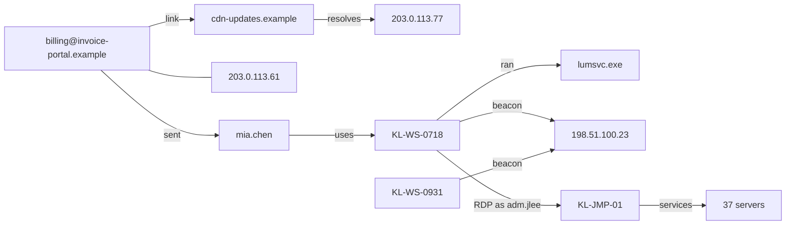

# 링크 분석, 이벤트 매트릭스, 사고 추적 양식 — 사건을 그려야 사건이 보인다 { #link-analysis-event-matrix }

!!! abstract "이 페이지에서 다루는 것"
    구조화된 분석의 '정리하는' 기법들입니다. 사건을 머릿속에서 꺼내 종이 위에 올려, 나와 다른 사람이 그 모양을 볼 수 있게 하는 방법이죠. 먼저 범죄 수사에서 빌려 온 <strong>링크 분석(link analysis)</strong>: 개체와 관계를 함께 그려서 공통점과 빠진 연결이 눈에 띄게 합니다. 예제는 ACH 페이지의 관리자 계정 침해를 이어 갑니다. 이메일 헤더, Zeek `dns.log`·`conn.log` 줄, EDR 이벤트를 필드 하나씩 읽고, 연결마다 출처와 확신 정도를 단 연관 목록으로 만들고, 그래프로 그리고, 해석합니다. 그러자 두 번째 감염 노트북과 확인해 볼 만한 가설 하나가 드러납니다. 다음은 <strong>도구</strong>: Maltego와 변환(transform), 그리고 요즘 에디션 구성, 무료 yEd와 다른 선택지, 그리고 정보 보강이 내 지표를 제3자에게 보낸다는 OPSEC 함정. 이어서 <strong>이벤트 매트릭스 차트(event matrix chart)</strong>: 호스트별·시간별로 이벤트를 깔면, 차트의 빈칸이 아직 아무도 못 본 이벤트를 예측해 줍니다. 그리고 예측한 SQL Server 연결을 실제로 로그에서 찾아냅니다. 그다음 <strong>미리 만든 사고 추적 양식</strong>을 시스템, 계정, 지표, 타임라인으로 채워 봅니다. 구조화된 분석 섹션 전체 정리, 2026년 관점, 확인 문제로 마칩니다.

!!! note "표기"
    **[보충]** = 꼭 알아야 할 실무 보충, **[정정]** = 흔히 잘못 알려진 내용 정정, **[변경됨]**/**[주의]** = 최근 바뀐 점과 옛 방식대로 하면 위험한 점. 회사(Kestrel Logistics), 호스트 이름, 계정, 도메인, IP, 파일 이름, 로그 줄은 모두 설명용 가상 값(`.example`, 문서용·사설 IP)입니다. 도구와 그 회사는 실제이며 제 말로 설명했습니다.

## 한눈에 보는 핵심 8가지 { #key-points }

1. **정리 기법은 사실 더미를 그림으로 바꾼다.** 사건 전체에 적용한 분해와 외부화다. 한번 그려 놓으면 작업 기억으로는 절대 못 들고 있을 무늬가 보인다.
2. **링크 분석은 개체와 그 사이의 관계를 그린다.** 호스트, 계정, IP, 도메인, 파일, 이메일이 노드(node)가 되고, "로그온함", "해석됨", "보냄", "내려받음"이 선(edge)이 된다. 이야기를 들려주고 공통점을 드러낸다.
3. **그림보다 연관 목록을 먼저 만든다.** 데이터를 모으고, 관계 있는 개체 쌍을 출처와 확신 정도와 함께 전부 적고, 그다음 손으로든 소프트웨어로든 그린다. 차트를 믿을 수 있게 해 주는 건 목록이다.
4. **좋은 차트는 아직 못 찾은 연결을 시사한다.** 인프라를 공유하는 피해자 둘, 모든 것에 이어진 노드 하나는 다음에 볼 곳을 가리킨다. 발견이 아니라 시험할 가설로서.
5. **Maltego는 변환으로 정보 보강을 자동화하고, yEd 같은 도구는 그리기만 한다.** 변환은 대규모로 해석하고, 조회하고, 피벗한다. 하지만 내 지표를 제3자 서비스에 보내기도 하니, 매번 OPSEC 판단이다.
6. **이벤트 매트릭스는 개체별 타임라인 위에 이벤트를 깐다.** 행은 호스트나 사람, 열은 시간, 노드는 모두 이벤트. 화살표는 시간의 흐름을 보여 준다.
7. **이벤트 매트릭스의 빈칸이 빠진 증거를 예측한다.** 데이터가 어떤 호스트에서 나갔는데 그 호스트가 데이터가 있던 서버를 건드린 흔적이 없다면, 못 본 단계가 반드시 있다. 차트가 어디를, 언제를 볼지 알려 준다.
8. **표준 추적 양식이 사건을 빠짐없게 지켜 준다.** 시스템, 계정, 호스트·네트워크 지표, 타임라인 탭이 있는 공용 추적표가 있으면 찾은 것이 기록되고, 보존되고, 쓸 수 있게 된다. 차트도 거기서 만든다.

## SOC에서 왜 중요한가 { #why }

범죄 드라마마다 나오는 형사의 벽을 떠올려 보세요. 사진들이 꽂혀 있고, 그 사이를 실이 잇고, 사진마다 날짜가 적혀 있죠. 뻔한 장면인 이유는 그게 통하기 때문입니다. 용의자, 장소, 통화 마흔 개를 머릿속에 들고 있을 수 있는 사람은 없지만, 벽을 보면 실 두 가닥이 같은 주차장에서 만난다는 건 누구나 봅니다.

기술 이야기로 돌아오면, 실제 침해 사건 이틀째쯤 되면 SOC 사건 하나에 호스트 수십 대, 계정 여러 개, 도메인과 IP 한 줌, 로그 줄 수백 개, 그리고 점점 늘어나는 미해결 질문이 쌓입니다. 작업 기억이 다룰 수 있는 "대략 일곱 개"를 한참 넘죠(기억 페이지에서 이유를 봤습니다). 정리 기법이 조사관의 벽입니다. *누가, 무엇이 무엇과 이어져 있나*에는 <strong>링크 분석</strong>, *어디서 무엇이 어떤 순서로 일어났나*에는 <strong>이벤트 매트릭스</strong>, 찾은 것을 하나도 잃지 않으려면 <strong>추적 양식</strong>. 잊기 쉬운 두 번째 쓸모도 있습니다. 잘 그린 차트는 관리자, 경영진, 다음 근무조에게 사건을 설명하는 가장 빠른 방법이고, 최종 보고서에도 들어갑니다.

## 링크 분석 { #link-analysis }

### 무엇인가 { #link-what }

<strong>링크 분석</strong>(관계 분석, 네트워크 분석이라고도 함)은 범죄 정보 분석에서 왔습니다. 문제와 관련된 모든 개체 — 사람, 계정, 호스트, 전화번호, 주소, 조직, 우리 세계에서는 IP, 도메인, 파일, 이메일까지 — 를 판 위에 올리고, 그 사이의 연결을 그립니다. 그렇게 나온 그래프로 할 수 있는 것:

- **이야기를 들려준다** — 무슨 일이 있었는지를 이어진 개체의 사슬로.
- **공통점을 찾는다** — 보낸 사람, 도메인, IP를 공유하는 피해자 둘.
- **아직 못 찾은 연결을 가설로 세운다** — 차트의 모양이 연결이 있을 법한 곳을 가리킨다.

<strong>분해와 외부화</strong>에 아주 뛰어난 방법입니다. 사건을 조각(개체와 연결)으로 쪼개 종이 위에 올리면 무늬가 보입니다.

일반적인 순서:

1. 질문과 관련된 데이터를 **모은다**.
2. **연관 매트릭스나 목록을 만든다**: 관계 있는 개체 쌍마다, 무슨 관계인지, 어디서 알았는지, 얼마나 확신하는지.
3. 손으로, 또는 — 가장 좋게는 — 목록에서 소프트웨어로 **차트를 그린다**.
4. **해석한다**: 이야기를 읽고, 중심점(hub), 무리(cluster), 공유 노드를 찾고, 있을 법한 빠진 연결을 확인할 가설로 바꾼다.

### 예제: `adm.jlee` 침해의 범위 잡기 { #link-example }

ACH 페이지에서는 공격자가 훔친 `adm.jlee` 자격 증명으로 영업 노트북 KL-WS-0718에서 점프 서버 KL-JMP-01을 거쳐 서버 37대로 갔다고 결론 냈습니다. 이제 질문은 범위입니다. *공격자는 KL-WS-0718에 어떻게 들어왔고, 다른 것도 엮여 있나?* 분석가가 네 종류의 데이터를 모읍니다.

**출처 1 — 시작이 된 이메일.** 메일 게이트웨이에 닷새 전 이 노트북 사용자 Mia Chen에게 배달된 메시지가 있습니다. 핵심 헤더 줄:

```
Received: from mail.invoice-portal.example (mail.invoice-portal.example [203.0.113.61])
        by mx1.kestrel.example with ESMTPS id 4Hq2Lw; Fri, 20 Nov 2026 01:12:44 +0000
From: "Accounts Receivable" <billing@invoice-portal.example>
To: mia.chen@kestrel.example
Subject: Overdue invoice INV-20391 - action required
Authentication-Results: mx1.kestrel.example; spf=pass smtp.mailfrom=invoice-portal.example; dkim=pass header.d=invoice-portal.example; dmarc=pass
```

- `Received: from mail.invoice-portal.example … [203.0.113.61]` — 메시지를 Kestrel 게이트웨이에 넘긴 서버와 그 IP. Kestrel 자기 서버가 적은 줄이라 `Received` 줄 중 가장 믿을 만합니다.
- `by mx1.kestrel.example … Fri, 20 Nov 2026 01:12:44 +0000` — Kestrel이 받은 시각(퍼스 시각 09:12).
- `From: … <billing@invoice-portal.example>` — 사용자에게 보이는 보낸 사람 주소.
- `Subject` — 청구서 미끼. 재무·영업 직원에게 흔히 쓰는 핑계입니다.
- `Authentication-Results: … spf=pass … dkim=pass … dmarc=pass` — 메시지가 정말 `invoice-portal.example`에서 왔다는 뜻. **[보충]** 이건 *누가 보냈는지*를 증명할 뿐, 보낸 쪽이 믿을 만하다는 뜻이 아닙니다. 공격자는 비슷하게 생긴 도메인을 직접 등록하고 SPF, DKIM, DMARC를 제대로 설정합니다. "인증 통과"는 "안전"이 아닙니다.

메시지에는 `https://cdn-updates.example/inv/INV-20391.zip`로 가는 링크가 있었습니다(**T1566.002 Phishing: Spearphishing Link**).

**출처 2 — 노트북의 DNS와 연결.** 내부 센서의 Zeek `dns.log`(읽기 쉽게 필드를 이름=값으로 표시):

```
ts=2026-11-20T01:19:07Z  uid=Dk81Pa  id.orig_h=10.40.7.18  query=cdn-updates.example  qtype_name=A  rcode_name=NOERROR  answers=203.0.113.77  TTLs=300
```

- `id.orig_h=10.40.7.18` — KL-WS-0718이 물었습니다.
- `query=cdn-updates.example`, `qtype_name=A` — 링크 도메인의 IPv4 주소를.
- `answers=203.0.113.77`, `TTLs=300` — 203.0.113.77로 해석됐고, 캐시 시간은 5분. 짧은 TTL은 CDN에도 공격자 인프라에도 흔하니, 그것만으로는 별 뜻이 없습니다.

이틀 뒤, Zeek `conn.log` 줄에 노트북에서 다른 주소로 가는 규칙적인 트래픽이 보입니다.

```
ts=2026-11-22T03:00:14Z  uid=Cm4Rt9  id.orig_h=10.40.7.18  id.orig_p=51533  id.resp_h=198.51.100.23  id.resp_p=443  proto=tcp  service=ssl  duration=0.84  orig_bytes=1210  resp_bytes=3466  conn_state=SF
```

- `id.resp_h=198.51.100.23`, `id.resp_p=443`, `service=ssl` — 외부 주소로 가는 TLS.
- `duration=0.84`, `orig_bytes=1210`, `resp_bytes=3466` — 아주 작고 짧습니다. 이런 줄이 60초마다 되풀이된다면(여러 줄에 걸쳐 보입니다), 명령·제어(C2) 비콘의 전형적인 모양입니다(**T1071.001 Application Layer Protocol: Web Protocols**).

**출처 3 — 센서 전체 검색.** 분석가가 네트워크 데이터에 당연한 다음 질문을 던집니다. *198.51.100.23과 또 누가 이야기했나?* 내부 호스트가 하나 더 나옵니다. 10.40.9.31, 재무팀 노트북 <strong>KL-WS-0931</strong>. 11월 22일부터 같은 60초 무늬입니다.

**출처 4 — KL-WS-0718의 EDR.** 사용자가 내려받은 압축 파일을 연 뒤:

```
2026-11-20T01:21:40Z  KL-WS-0718  mia.chen  C:\Users\mia.chen\Downloads\INV-20391\INV-20391.pdf.lnk  ->  powershell.exe -w hidden -enc <base64>
2026-11-20T01:21:44Z  KL-WS-0718  mia.chen  powershell.exe  wrote  C:\Users\mia.chen\AppData\Roaming\Lumen\lumsvc.exe  sha256=1f3a…e9
```

- `INV-20391.pdf.lnk` — PDF로 위장한 바로 가기 파일. 더블클릭하면 PowerShell이 돌았습니다(**T1204.002 User Execution: Malicious File**, **T1059.001 Command and Scripting Interpreter: PowerShell**).
- `-w hidden -enc <base64>` — 숨긴 창과 인코딩된 명령. 다운로드 크래들(download cradle)의 전형입니다(**T1027 Obfuscated Files or Information**).
- `wrote …\Lumen\lumsvc.exe` — 내려받은 임플란트를 사용자 로밍 프로필에 저장. 해시(여기서는 줄여 씀)가 차트의 개체가 됩니다.

### 연관 목록 { #association-list }

관계마다 한 줄, *어디서 왔는지*와 *얼마나 확신하는지*를 함께 적습니다.

| # | 개체 A | 관계 | 개체 B | 출처 | 확신 |
| --- | --- | --- | --- | --- | --- |
| L1 | billing@invoice-portal.example | 이메일 보냄 | mia.chen | 메일 게이트웨이 | 높음 |
| L2 | invoice-portal.example | 보낸 서버 IP | 203.0.113.61 | `Received` 헤더 | 높음 |
| L3 | 이메일 INV-20391 | 링크 포함 | cdn-updates.example | 메시지 본문 | 높음 |
| L4 | cdn-updates.example | 해석됨 | 203.0.113.77 | Zeek `dns.log` | 높음 |
| L5 | mia.chen | 사용 | KL-WS-0718 | 자산 목록 | 높음 |
| L6 | KL-WS-0718 | 내려받아 실행 | lumsvc.exe (1f3a…e9) | EDR | 높음 |
| L7 | KL-WS-0718 | 비콘 | 198.51.100.23 | Zeek `conn.log` | 높음 |
| L8 | KL-WS-0931 | 비콘 | 198.51.100.23 | Zeek `conn.log` | 높음 |
| L9 | KL-WS-0718 | adm.jlee로 RDP | KL-JMP-01 | 4624 유형 10 | 높음 |
| L10 | KL-JMP-01 | 서비스 생성 | 서버 37대 | 7045 | 높음 |
| L11 | adm.jlee | 자격 증명 노출 | 인포스틸러 덤프 | CTI 보고 | 중간 |

**[보충]** 출처와 확신 칸이 링크 분석과 그냥 그림 그리기를 가릅니다. 누가 "저 선은 왜 있어요?"라고 물으면, 답은 행 번호와 로그 출처입니다. 특히 *공유 인프라*로 이어진 연결을 조심하세요. 수천 개 사이트가 함께 쓰는 IP 주소(CDN이나 클라우드 앞단)는 서로 아무 상관없는 것들을 이어 버립니다.

### 차트 { #link-chart }



위 소스는 Mermaid입니다. 여러 문서 도구가 자동으로 그려 주는 텍스트 형식이에요.

- `graph LR` — 왼쪽에서 오른쪽으로 그래프를 그린다.
- `S["billing@invoice-portal.example"]` — ID가 `S`이고 보이는 이름표가 붙은 노드.
- `-->|sent|` — "sent"라는 이름표가 붙은 화살표. `---`는 방향 없는 선.
- 그 뒤 줄마다 연관 목록의 선 하나를 더합니다.

그래프를 텍스트로 쓰면 실무에서 좋은 점이 있습니다. 사건 노트 안에 같이 살고, 다른 글처럼 검토할 수 있고, 행을 하나 더하면 바로 다시 그려집니다.

### 차트 읽기 { #link-interpret }

- **이야기**는 왼쪽에서 오른쪽으로 흐릅니다. 보낸 사람 → 이메일 → 링크 → KL-WS-0718에서 내려받기 → 비콘 → 훔친 관리자 계정으로 RDP → 서버 37대. 관리자에게 한숨에 들려줄 수 있습니다.
- **공통점**은 C2 노드입니다. KL-WS-0931은 같은 주소로 비콘을 보낸다는 것 *말고는* 차트의 나머지와 아무 관계가 없습니다. 차트가 없으면 KL-WS-0931을 우선순위 낮은 별개 티켓으로 다루기 쉽습니다. 차트가 있으면 같은 침해의 두 번째 발판이라는 게 뻔히 보이죠.
- **빠진 연결**은 차트가 던지는 당연한 질문입니다. *KL-WS-0931은 어떻게 감염됐나?* 모양이 가설 하나를 시사합니다. 같은 미끼를 받았을 수도 있다. 분석가가 메일 게이트웨이에서 `invoice-portal.example`이 보낸 메시지를 찾자, 11월 21일 재무팀 사용자에게 배달된 것이 하나 나옵니다. 확인으로 맞아떨어진 가설이고, L12 행으로 추가됩니다. 두 번째 확인 — *`cdn-updates.example`을 해석한 다른 곳이 있나?* — 은 아무것도 안 나왔고, 이것도 적어 둘 가치가 있습니다.

**[보충]** 차트는 일찍 만들고 진행하면서 고치세요. 끝에 그린 차트는 보고서를 꾸밀 뿐이고, 첫날 그린 차트는 조사를 이끕니다.

## 링크 분석 도구 { #tools }

### Maltego { #maltego }

<strong>Maltego</strong>는 보안과 OSINT 분야에서 링크 분석 하면 가장 먼저 떠오르는 상용 도구입니다. 그래프 위에 <strong>개체(entity)</strong>(도메인, IP, 이메일 주소, 사람, 조직, 해시 …)를 올리고 <strong>변환(transform)</strong>을 돌립니다. 변환은 관련 개체를 돌려받아 자동으로 그려 주는 작은 질의입니다. 도메인 → IP 주소, IP → 그 IP에서 보인 다른 도메인(패시브 DNS로), 도메인 → 등록 정보, 이메일 → 연관 계정 등등, Maltego 자체 데이터와 제3자 데이터 제공자로부터요.

빛나는 건 규모입니다. 수상한 도메인 100개를 그래프에 붙여 넣고, 전부 골라서 "IP로 해석", 이어서 "IP를 넷블록으로", "넷블록을 AS 번호로"를 돌리면 겹치는 부분이 저절로 그려집니다. 같은 호스팅 업체의 IP 두 개를 공유하는 도메인 14개가 한 무리로 툭 튀어나오죠. 손으로 하면 오후 내내, 변환으로 하면 몇 분입니다. 완성된 그래프는 경영진 보고와 사고 보고서의 그림으로도 좋습니다.

**[변경됨]** Maltego의 제품 구성은 많이 바뀌었습니다. 예전 "Classic"과 "XL" 데스크톱 라이선스는 몇 년 전에 끝났고, 옛 Pro·Organization 요금제도 2024년에 판매가 중단됐습니다. 2026년 말 현재 업체 문서에는 무료 Community Edition/Basic 등급과 유료 Entry, Professional, Enterprise 요금제가 있고, 데스크톱 그래프 도구와 브라우저 기반 플랫폼이 함께 있습니다. 무료 등급은 변환 한 번에 돌려받는 결과 수를 적게 제한하고(현재 문서 기준 24개) 데이터 접근도 제한합니다. 변환 없이 사건 그래프만 그릴 때 오래 추천되던 무료 오프라인 전용 에디션 <strong>CaseFile</strong>은 최신 버전에서 더 이상 별도 제품이 아니고, 그 오프라인 기능은 대신 무료 Maltego 계정으로 씁니다. 요금제와 제한은 자주 바뀌니, 예산을 잡기 전에 업체의 현재 요금제 페이지를, 무료 등급을 업무에 쓰기 전에 라이선스 조건을 확인하세요.

### yEd와 다른 그리기 도구 { #yed }

그리기만 필요하다면, yWorks의 <strong>yEd</strong>는 Maltego와 아주 비슷한 차트를 만드는 무료 데스크톱 다이어그램 도구이고, <strong>yEd Live</strong>는 설치 없이 브라우저에서 돕니다. 보안용 아이콘은 기본으로 별로 없지만, 팔레트 관리자에서 아이콘 세트를 찾아 가져올 수 있습니다. 정보 보강은 전혀 못 합니다 — 변환도, 조회도 없음. 그래서 가끔 그리는 사건 차트에 맞고, 인프라 피벗에는 맞지 않습니다.

**[보충]** 알아 둘 만한 다른 선택지:

| 도구 | 잘하는 것 |
| --- | --- |
| diagrams.net (draw.io) | 무료, 빠른 다이어그램. 파일을 사건 노트와 함께 둘 수 있음 |
| 노트·위키 안의 Mermaid | 텍스트로 된 그래프. 사건과 함께 버전 관리되고 자동으로 다시 그려짐 |
| Gephi | 내보낸 큰 데이터셋(노드 수천 개)의 무료 그래프 분석 |
| Neo4j / BloodHound | 아이덴티티와 공격 경로 질문용 그래프 데이터베이스(그래프 사고 페이지 참고) |
| EDR/XDR·SIEM에 내장된 사고 그래프 | 사고 하나의 프로세스, 호스트, 아이덴티티 관계를 자동으로 그려 줌 |

### OPSEC 함정 { #opsec }

**[주의]** 정보 보강 변환, 온라인 조회, "검사 서비스에 제출"은 모두 내 지표를 다른 누군가에게 보냅니다. 공격자가 그 도메인을 쥐고 있거나, 조회 결과를 공개하는 서비스를 지켜보고 있다면, 내가 자기들을 보고 있다는 걸 알아챌 수 있습니다. 진행 중인 사건에서 변환을 돌리기 전에, 변환마다 어느 데이터 제공자에 질의하는지, 이 사건의 민감도에서 그게 괜찮은지 알아 두세요. 분석 OPSEC은 이 노트 뒤쪽에 따로 섹션이 있습니다.

## 이벤트 매트릭스 차트 { #event-matrix }

### 무엇인가 { #event-what }

<strong>이벤트 차트(event charting)</strong>도 범죄 정보 분석에서 온 기법입니다. 링크 차트처럼 보일 수 있지만, 관계가 아니라 <strong>시간</strong>을 기준으로 짭니다. 차이를 만드는 규칙 셋:

- **노드는 모두 같은 종류, 즉 이벤트다.** 호스트도 계정도 아니고, "PC 감염", "데이터베이스 덤프", "이메일 수신" 같은 것.
- **화살표는 시간의 흐름을 보여 준다.** 흔히 원인과 결과, 즉 한 이벤트가 다음 이벤트로 이어짐.
- **가지는 갈라지고 합쳐질 수 있다.** 서로 다른 호스트나 사람의 따로 진행된 활동, 그리고 그것들이 만나는 지점을 보여 준다.

<strong>이벤트 매트릭스</strong> 형태에서는 개체(호스트, 계정, 사람)마다 가로 한 줄을 주고, 시간은 열로 흐르고, 각 이벤트를 *어디서*와 *언제*가 만나는 칸에 놓습니다. 분석에 가장 먼저 필요한 게 모든 개체에 걸친 분명한 공통 타임라인일 때 쓰세요.

### 예제: 이벤트를 예측하는 빈칸 { #event-example }

이틀째, 새 증거가 들어옵니다. 데이터 유출 방지 도구가 11월 25일 <strong>KL-WS-0931</strong>(재무 노트북)에서 `crm_export.7z`라는 2.3 GB 압축 파일 업로드를 잡았습니다. 파일 이름과 크기가 서버 <strong>KL-DB-02</strong>에 있는 CRM 데이터베이스 전체 내보내기와 맞습니다. 분석가가 매트릭스를 만듭니다(날짜는 퍼스 현지 시각).

| 개체 | 11월 20일 | 11월 21일 | 11월 22일 | 11월 24일 | 11월 25일 |
| --- | --- | --- | --- | --- | --- |
| KL-WS-0718(영업) | ① 피싱 이메일, ② 임플란트 설치 | | ③ 비콘 시작 | ⑤ adm.jlee로 KL-JMP-01에 RDP | |
| KL-WS-0931(재무) | | ④ 피싱 이메일 | ④a 임플란트 설치, 비콘 시작 | | ⑧ `crm_export.7z` 업로드(2.3 GB) |
| KL-JMP-01 | | | | ⑥ 서버 37대에 서비스 생성 | |
| KL-DB-02(CRM DB) | | | | | ⑦ ??? 데이터베이스 내보내짐 |

순서대로 읽으면: KL-WS-0718에서 ① → ② → ③, KL-WS-0931에서 ④ → ④a, 점프 서버를 거쳐 ⑤ → ⑥, 그리고 ⑧ — KL-WS-0931에서 데이터가 나감.

이제 빠진 걸 보세요. 데이터는 KL-DB-02에서 왔는데, <strong>차트의 어떤 것도 KL-DB-02를 건드리지 않습니다</strong>. KL-DB-02는 서버 37대에 없었습니다. 내보낸 데이터가 KL-WS-0931에 도착하려면 *어떤* 이벤트 ⑦이 있었어야 합니다. 침해된 호스트 중 하나에서 누군가 또는 무언가가 KL-DB-02에 연결해 데이터를 빼냈고, 아마 관리자 자격 증명을 훔친 뒤인 11월 24일이나 25일이었을 겁니다. 차트는 ⑦이 무엇이었는지 알려 주지 않습니다. 대신 <strong>어디를, 언제를 볼지</strong> 알려 줍니다. 11월 24일 이후, KL-WS-0931(또는 KL-WS-0718, KL-JMP-01)과 KL-DB-02 사이의 연결.

분석가가 KL-DB-02 주소로 Zeek `conn.log`를 찾아보자 이게 나옵니다.

```
ts=2026-11-24T22:41:09Z  uid=Hq7Ve2  id.orig_h=10.40.9.31  id.orig_p=50811  id.resp_h=10.10.8.12  id.resp_p=1433  proto=tcp  service=-  duration=1384.2  orig_bytes=88213  resp_bytes=2417893110  conn_state=SF
```

- `ts=2026-11-24T22:41:09Z` — 퍼스 시각 11월 25일 06:41, 재무 사용자가 보통 일을 시작하기 전.
- `id.orig_h=10.40.9.31` → `id.resp_h=10.10.8.12` — KL-WS-0931에서 KL-DB-02로.
- `id.resp_p=1433` — Microsoft SQL Server 기본 포트. 재무 노트북은 보통 웹 애플리케이션을 통해 CRM에 닿지, 데이터베이스와 직접 이야기하지 않습니다.
- `duration=1384.2` — 23분.
- `resp_bytes=2417893110` — 데이터베이스 서버*에서* 노트북*으로* 보낸 약 2.4 GB. 내보내기입니다(**T1213 Data from Information Repositories**, 이어서 **T1074.001 Data Staged: Local Data Staging**, 나중에 C2 채널로 유출 **T1041**).
- `service=-` — Zeek가 프로토콜 이름을 못 붙였지만, 포트와 양만으로도 할 말은 충분합니다.

KL-DB-02의 22:41 UTC <strong>4624</strong>에는 `adm.jlee`, 로그온 유형 3, 10.40.9.31에서 — 같은 훔친 계정을 이번엔 두 번째 발판에서 썼습니다. 이벤트 ⑦을 찾아 차트에 놓습니다. 이제 사건 범위에 고객 데이터가 든 데이터베이스 침해가 들어가고, 법적·통지 상황이 완전히 달라집니다.

이게 이벤트 매트릭스의 힘입니다. *아는 것*을 공통 타임라인 위에 깔면 구멍이 보이고, 구멍 하나하나가 정확한 검색이 됩니다.

**[주의]** 이벤트 차트는 *순서*를 보여 주는데, 화살표마다 *원인*으로 읽고 싶어집니다. 차례로 일어난 두 이벤트가 꼭 이어진 건 아닙니다. 확인된 화살표(한 이벤트가 다른 이벤트로 이어졌음을 로그가 보여 줌)와 추론한 화살표를 다르게 표시하고, 무엇이든 놓기 전에 모든 시각을 한 시간대로 바꾸세요.

## 미리 만든 사고 추적 양식 { #tracking-forms }

중요한 데이터를 빠짐없이 모으는 간단한 방법은 <strong>반드시 채워야 하는 표준 양식</strong>입니다. 사고 대응에서 잘 알려진 무료 예가 CrowdStrike 서비스 팀이 커뮤니티에 공개한 사고 대응 추적 스프레드시트입니다. 경험 많은 대응자들이 추적하는 데이터 종류마다 탭이 하나씩 있는 통합 문서죠. 이런 추적표를 흔히 "스프레드시트 오브 둠(spreadsheet of doom)"이라고 부릅니다. 어떤 양식을 쓰든 보통 이런 탭이 있습니다.

- **시스템** — 관련된 모든 호스트, 왜 범위에 들어갔는지, 상태, 무엇을 수집했는지.
- **계정** — 관련된 모든 계정, 어떻게 쓰였는지, 무슨 조치를 했는지.
- **호스트 지표** — 파일, 해시, 경로, 서비스, 예약 작업, 레지스트리 키.
- **네트워크 지표** — 도메인, IP, URL, 인증서, 처음 본 때와 마지막 본 때.
- **타임라인** — UTC 시각의 이벤트, 호스트, 출처, 확신 정도. 이벤트 매트릭스의 원재료.
- **증거와 할 일** — 무엇을 수집했고, 어디 보관했고, 다음에 누가 무엇을 하는지.

우리 사건으로 채우면(탭마다 몇 줄씩):

**시스템**

| 호스트 | IP | 역할 | 범위에 든 이유 | 첫 악성 활동(UTC) | 상태 | 증거 |
| --- | --- | --- | --- | --- | --- | --- |
| KL-WS-0718 | 10.40.7.18 | 영업 노트북 | 피싱, 임플란트, 비콘, RDP 출발지 | 2026-11-20 01:21 | 격리됨 | 메모리, 분류 이미지 |
| KL-WS-0931 | 10.40.9.31 | 재무 노트북 | 피싱, 임플란트, DB 내보내기, 업로드 | 2026-11-21 23:50 | 격리됨 | 메모리, 분류 이미지 |
| KL-JMP-01 | 10.10.5.20 | 점프 서버 | adm.jlee RDP, 서비스 확산 | 2026-11-24 18:28 | 격리됨 | 이벤트 로그, 분류 이미지 |
| KL-DB-02 | 10.10.8.12 | CRM 데이터베이스 | KL-WS-0931에서 SQL로 내보내짐 | 2026-11-24 22:41 | 감시 중 | SQL 로그, 이벤트 로그 |

**계정**

| 계정 | 유형 | 어떻게 악용됐나 | 조치 | 시각 |
| --- | --- | --- | --- | --- |
| KESTREL\adm.jlee | 도메인 관리자(개인) | 점프 호스트에 RDP, 서버 37대와 KL-DB-02에 네트워크 로그온 | 비활성화, 비밀번호 두 번 초기화, 세션 취소 | 2026-11-25 03:20 |
| mia.chen | 사용자 | 피싱당함, 그 세션에서 임플란트 실행 | 비밀번호 초기화, MFA 다시 등록 | 2026-11-25 04:05 |

**호스트 지표**

| 지표 | 유형 | 본 곳 | 메모 |
| --- | --- | --- | --- |
| `%APPDATA%\Lumen\lumsvc.exe` (sha256 1f3a…e9) | 파일 | KL-WS-0718, KL-WS-0931 | 임플란트 |
| 무작위 8글자 이름의 서비스, `%COMSPEC% /c C:\Windows\Temp\s.bat` | 서비스(7045) | 서버 37대 | 원격 실행 |
| `crm_export.7z` | 파일 | KL-WS-0931 | 모아 둔 데이터 |

**네트워크 지표**

| 지표 | 유형 | 처음 봄 | 마지막 봄 | 메모 |
| --- | --- | --- | --- | --- |
| invoice-portal.example / 203.0.113.61 | 도메인 / IP | 2026-11-20 | 2026-11-21 | 피싱 발신 |
| cdn-updates.example / 203.0.113.77 | 도메인 / IP | 2026-11-20 | 2026-11-21 | 페이로드 호스트 |
| 198.51.100.23:443 | IP | 2026-11-22 | 2026-11-25 | C2, 60초 비콘 |

양식의 가치는 스프레드시트 자체가 아니라 규율에 있습니다. 사건을 맡은 모든 분석가가 같은 필드를 적으니 야간 근무에 찾은 게 아침까지 사라지지 않고, 모든 행을 출처까지 따라갈 수 있고, 링크 차트와 이벤트 매트릭스를 언제든 여기서 (다시) 만들 수 있습니다.

**[보충]** 요즘 많은 팀이 이 데이터를 스프레드시트 대신 사건 관리 플랫폼(예: 오픈 소스 DFIR-IRIS, TheHive, 또는 SIEM/SOAR의 사건 기능)에 두고, 타임라인은 Timesketch 같은 도구에 둡니다. 2026년에는 WithSecure가 Kanvas라는 오픈 소스 데스크톱 도구도 내놓았는데, "스프레드시트 오브 둠" 형태의 추적표를 읽어서 타임라인, 옆 이동 그래프, 보고서를 만들어 줍니다. 스프레드시트가 진실의 원본으로 남고, 이 페이지의 차트들이 거기서 자동으로 나오는 셈이죠.

## 구조화된 분석: 섹션 정리 { #summary }

이 섹션의 기법들에는 공통점이 넷 있었습니다.

- **정리되고, 눈에 보이고, 머리 밖으로 꺼낸 감사 추적을 남긴다** — 가설 목록, 매트릭스, 차트, 추적표 — 결론에 어떻게 도달했는지 보여 준다.
- **분석을 나누고 비판받을 수 있게 한다.** 동료는 내 머릿속을 검토할 수 없지만, 매트릭스를 보고 칸 하나를 가리킬 수는 있다.
- **전문가의 직감과 규율 있는, 증거에 기반한 절차를 합친다.** 제안은 여전히 시스템 1이 하고, 시스템 2와 구조가 확인한다.
- **분석 실수의 위험을 크게 줄인다** — 분석가를 더 똑똑하게 만들어서가 아니라, 모든 분석가가 가진 지각과 기억의 한계를 돌아가게 해서.

이 방법들은 오랫동안 주로 정부 정보기관 안에서만 가르쳤습니다. 지금은 책, 안내서, 예제가 공개돼 있고, SOC가 같은 방식으로 일하지 못할 이유가 없습니다. 쌓여 가는 전문 지식과 함께라면 직감과 구조화된 사고는 서로 돕습니다. 빨라도 되는 곳에서는 빠르게, 중요한 곳에서는 신중하게, 그리고 내내 기록하면서.

## 2026년 관점 { #trends }

!!! success "[2026 현재] 지금도 그대로 유효"
    링크 분석, 이벤트 차트, 표준 추적 양식은 2026년에도 사고 대응의 핵심 실무이고, 논리는 그대로입니다. 개체와 관계를 그려 공통점을 찾고, 이벤트를 타임라인에 깔아 빈칸을 찾고, 찾은 것을 모두 하나의 구조화된 기록에 둔다. 이 페이지의 사건 모양 — 여러 사용자에게 피싱, 공유된 C2, 훔친 관리자 자격 증명, 이어서 데이터베이스 직접 추출과 유출 — 은 요즘 침해 보고서에서도 전형적이고, "스프레드시트 오브 둠"은 제대로 된 사건 플랫폼과 나란히 많은 IR 팀에 여전히 있습니다.

!!! info "[변경됨] 바뀐 점"
    - **도구가 첫 그래프를 그려 준다.** EDR/XDR 콘솔과 SIEM이 이제 사고 그래프(프로세스 트리, 호스트 간 이동, 아이덴티티 관계)를 자동으로 만들고, 여러 경보를 하나의 "사고 이야기"로 묶기도 합니다. 시간을 아껴 주지만, 어떤 연결이 진짜인지 확인하고 도구가 못 보는 것(이메일, 면담, 업무 맥락)을 더하는 건 여전히 분석가 몫입니다.
    - **Maltego 에디션이 바뀌었다.** Classic/XL은 오래전에 끝났고, 옛 요금제는 2024년에 끝났고, CaseFile은 더 이상 별도 제품이 아니고, 무료 등급은 제한이 있습니다(현재 문서 기준 변환 한 번에 결과 24개). 요금제는 자주 바뀌니 특정 제한에 기대기 전에 확인하세요.
    - **AI 도우미가 노트에서 타임라인과 그래프를 만든다.** 코파일럿이 사건 노트나 내보낸 로그를 몇 초 만에 타임라인, 연관 목록, Mermaid 코드로 바꿔 줍니다. 쓸모 있지만, 모든 행은 여전히 실제 출처까지 따라갈 수 있어야 합니다. AI는 이름이 비슷한 호스트 둘을 합치거나 "들어맞는" 연결을 지어낼 수 있습니다.
    - **공격 흐름(attack flow) 형식이 흔해졌다.** ATT&CK에 매핑한 공격 순서의 구조화된 기술(MITRE의 Center for Threat-Informed Defense가 만든 Attack Flow 형식 등)이 팀 간 이벤트 사슬 공유에 쓰입니다. 기계가 읽을 수 있는 이벤트 차트라고 보면 됩니다.
    - **그래프의 중심은 아이덴티티다.** 2026년 침해에서 가장 중요한 연결은 IP보다 계정, 세션, 토큰, 클라우드 앱인 경우가 많습니다. 호스트와 IP만 담은 링크 차트는 이야기의 대부분을 놓칩니다.

!!! warning "[주의] 옛 방식대로 하면 틀리거나 위험한 점"
    - **공유 인프라는 가짜 연결을 만든다.** 클라우드·CDN IP, 공유 호스팅, 공용 리졸버, VPN 출구 노드는 상관없는 것들을 잇습니다. 이런 IP를 거친 연결은 의미 있다고 보기 전에 독립된 두 번째 연결이 필요합니다.
    - **정보 보강은 샌다.** 변환과 온라인 조회는 내 지표를 제3자에게 보냅니다. 민감하거나 표적형인 사건이라면 무엇을 조회해도 되는지 시작 전에 정하세요.
    - **차트는 증거가 아니다.** 선마다 출처와 확신 정도가 필요합니다. 기록 없는 선은 슬라이드에 올라가는 순간 "사실"이 됩니다.
    - **순서는 원인이 아니다.** 이벤트 매트릭스에서 확인된 화살표와 추론한 화살표를 다르게 표시하고, 이벤트를 놓기 전에 모든 시각을 한 시간대(UTC가 가장 안전)로 맞추세요.
    - **추적표를 침해된 네트워크에 두지 마세요.** 공격자가 도메인 관리자 권한을 갖고 있다면, 공유 드라이브의 스프레드시트나 도메인에 붙은 도구의 티켓을 공격자가 읽을 수 있습니다. 진행 중인 사고 추적은 대역 외(out-of-band) 저장소를 쓰세요. 침해 발견 후 대응 섹션에서 더 다룹니다.

## 확인 문제 { #quiz }

### 문제 1

피싱 사건의 링크 차트가 있습니다. 서로 아무 연결도 없는 노트북 두 대가 같은 외부 IP 주소로 이어져 있습니다. 동료가 말합니다. "같은 IP면 같은 공격자야, 사건 합치자." 동의하기 전에 무엇을 확인해야 하고, 차트 자체가 판단에 어떻게 도움이 될까요?

??? success "정답과 해설"
    **그 IP가 무엇인지** 확인합니다. CDN, 큰 클라우드 업체, 공유 호스팅, 공용 서비스 것이라면 상관없는 사이트와 클라이언트 수천 개가 그 IP를 쓰니, 그 연결은 아무 뜻이 없을 수 있습니다. 각 연결의 세부를 봅니다. 쓴 도메인 이름(DNS/SNI), 시각과 무늬(예: 둘 다 60초마다 비콘), 연결을 만든 프로세스, TLS 인증서나 JA3/JA4 지문.

    차트는 두 노트북 사이에 **독립된 두 번째 연결**이 있는지 보여 줌으로써 돕습니다. 같은 보낸 사람, 같은 미끼, 같은 임플란트 해시나 설치 경로, 같은 침해된 계정. 공유 IP 하나는 단서이고, 독립된 공유 개체가 둘이면 "같은 침해"가 강한 결론이 됩니다. 어느 쪽이든 연결마다 출처와 확신 정도를 적어 둡니다.

### 문제 2

이벤트 차트를 링크 차트와 다르게 만드는 규칙 셋은 무엇인가요? 그리고 KL-DB-02 예제로, 이벤트 매트릭스의 빈칸이 어떻게 구체적인 검색으로 이어졌는지, 무엇이 그 검색을 구체적으로 만들었는지 설명하세요.

??? success "정답과 해설"
    이벤트 차트에서는 (1) **노드가 모두 같은 종류, 즉 이벤트**이고, (2) **화살표가 시간의 흐름**(흔히 원인과 결과)을 보여 주고, (3) **가지가 갈라지고 합쳐져** 서로 다른 호스트나 사람의 따로 된 활동을 보여 줍니다. 링크 차트는 대신 개체 종류를 섞고, 시간이 아니라 관계를 보여 줍니다.

    예제에서 KL-DB-02의 데이터가 KL-WS-0931에서 네트워크 밖으로 나갔는데, 차트의 어떤 이벤트도 KL-DB-02를 건드리지 않았습니다. 그러니 관리자 자격 증명을 훔친 때(11월 24일)와 업로드(11월 25일) 사이에, 누군가 KL-DB-02에 접근한 못 본 이벤트가 있었어야 합니다. 차트가 검색을 세 가지로 구체화했습니다. **어느 호스트**(침해된 호스트들과 KL-DB-02), **어느 시간대**(11월 24일부터), **어떤 종류의 이벤트**(데이터베이스로의 연결이나 거기서의 로그온). 그래서 1433번 포트로 가는 Zeek `conn.log` 줄과 KL-DB-02의 4624를 몇 분 만에 찾았습니다.

### 문제 3

팀장이 말합니다. "추적 양식은 필요 없어. 다 티켓 댓글에 있잖아." 며칠짜리 침해 사건에서 이 때문에 생기는 구체적인 문제 셋을 들고, 구조화된 추적표가 각각을 어떻게 해결하는지 말해 보세요.

??? success "정답과 해설"
    1. **근무조 사이에 잃어버린다.** 37번째 댓글에 나온 지표와 호스트를 다음 분석가가 놓칩니다. 추적표는 호스트, 계정, 지표마다 한 줄씩이라 현재 범위가 한눈에 보입니다.
    2. **필드가 제각각이다.** 한 분석가는 현지 시각, 다른 분석가는 UTC로 적고, 한 명은 해시를, 다른 한 명은 파일 이름만 적고, 아무도 출처를 안 적습니다. 추적표는 같은 필드(UTC 시각, 출처, 확신, 상태)를 강제하고, 그래서 행끼리 비교하고 따라갈 수 있게 됩니다.
    3. **차트와 보고서를 만들 수 없다.** 자유 글에서 링크 차트, 이벤트 매트릭스, 차단 목록, 최종 보고서를 만드는 건 느리고 실수가 많습니다. 추적표가 곧 연관 목록이자 타임라인이니, 차트와 IOC 내보내기를 거기서 손으로든 자동으로든 만들 수 있습니다.

    하나 더 보태면: 공격자가 관리자 권한을 가졌다면 도메인에 붙은 티켓 시스템의 댓글을 공격자가 볼 수 있습니다. 진행 중인 침해 동안 추적표는 대역 외에 두어야 합니다.

## 관련 레퍼런스 { #related }

- [경쟁 가설 분석(ACH)](ach.md) — 앞 페이지: 이 페이지가 범위를 잡는 그 침해
- [다이아몬드 모델, 공격 트리, 그래프 사고, 위협 모델링](../mental-models/diamond-attack-trees.md) — 피벗과 그래프 사고
- [기억과 경험](../analyst-cognition/memory-experience.md) — 분해와 외부화가 통하는 이유
- [로그인 이벤트](../important-events/logins.md) · [서비스, 예약 작업, USB 이벤트](../important-events/services-tasks-usb.md)
- [데이터 유출과 파괴 알아보기](../alert-triage/exfil-destruction-sensitive.md) · [피싱 전달](../../../adversary/phishing-delivery.md)
