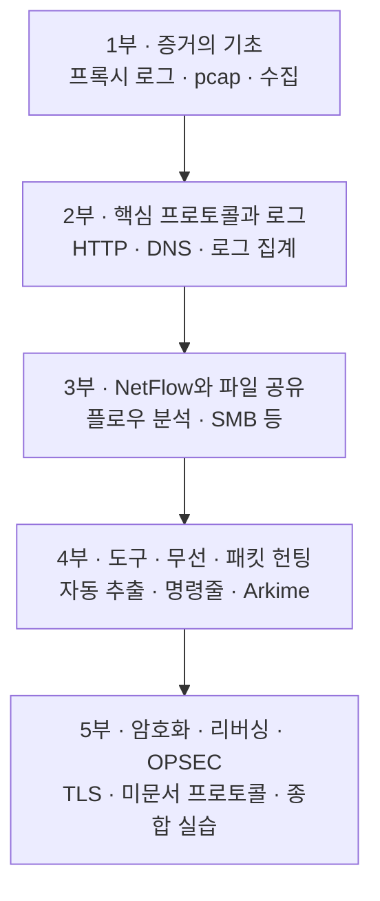

# Network Forensics — 네트워크 포렌식 강의 { #network-forensics }

!!! abstract "이 시리즈의 성격"
    디스크를 볼 수 없거나, 볼 시스템이 수천 대이거나, 공격자가 흔적을 지웠을 때도 네트워크에는 기록이 남습니다. 이 시리즈는 그 기록(프록시 로그, 패킷, 플로우, 각종 장비 로그)을 모으고 읽고 해석하는 방법을 처음부터 차근차근 설명하는 한국어 강의 노트입니다. 각 회차는 **"왜 필요한가 → 원리 → 작은 예제 → 조건을 붙인 예제 → 실제 조사에서의 해석"** 순서로 진행하고, 끝에 복습 문제와 해설을 둡니다.

## 이 시리즈를 읽는 방법 { #how-to-read }

처음이라면 1부부터 순서대로 읽는 것을 권해요. 뒤쪽 회차는 앞에서 배운 개념(pcap, BPF, 디스플레이 필터, 로그 시간 변환 등)을 이미 안다고 보고 진행하기 때문이에요. 이미 익숙한 주제가 있다면 각 부의 첫 페이지에 있는 읽는 순서 표에서 필요한 회차로 바로 가도 됩니다.

위 그림은 시리즈의 흐름입니다. 위에서 아래로 갈수록 "증거를 손에 넣는 법"에서 "증거가 숨겨져 있을 때 읽어 내는 법"으로 넘어가요. 마지막 5부의 종합 실습은 1~4부에서 배운 방법을 한 사건에 모두 써 보는 회차입니다.

## 구성 { #parts }

-   :material-database-search:{ .lg .middle } **1부 · 네트워크 증거의 기초**

    ---

    네트워크 포렌식이 필요한 이유, 웹 프록시 로그와 캐시, pcap 파일과 tcpdump·BPF, Wireshark와 tshark, 증거 수집 위치와 장비(SPAN·탭), 조사를 어렵게 만드는 요소들.

    [:octicons-arrow-right-24: 1부](part-1/index.md)

-   :material-protocol:{ .lg .middle } **2부 · 핵심 프로토콜과 로그 집계·분석**

    ---

    HTTP와 DNS를 포렌식 관점에서 프로파일링하고, 여러 장비의 로그를 한곳에 모아 교차 분석하는 방법.

    :octicons-clock-24: 준비 중

-   :material-chart-timeline-variant:{ .lg .middle } **3부 · NetFlow와 파일 공유 프로토콜**

    ---

    플로우 기록의 원리와 수집·분석 도구, 시각적 분석과 내부 이동(lateral movement) 추적, SMB 같은 파일 공유 프로토콜 세션 재구성.

    :octicons-clock-24: 준비 중

-   :material-tools:{ .lg .middle } **4부 · 분석 도구, 무선, 전체 패킷 헌팅**

    ---

    자동 추출 도구, 명령줄 도구로 대량 분석하기, 무선 네트워크 증거, Arkime로 전체 패킷 헌팅.

    :octicons-clock-24: 준비 중

-   :material-lock-open-variant:{ .lg .middle } **5부 · 암호화, 프로토콜 리버싱, OPSEC과 인텔리전스**

    ---

    SSL/TLS 프로파일링과 복호화, 문서화되지 않은 프로토콜 분석, 조사자의 OPSEC과 위협 인텔리전스, 그리고 종합 조사 실습.

    :octicons-clock-24: 준비 중

## 표기 { #notation }

본문에서 **[변경됨]**은 예전 설명에서 바뀐 점, **[정정]**은 흔히 잘못 알려진 내용, **[주의]**는 옛 방식대로 하면 위험한 점, **[보충]**은 실무에 꼭 필요한 추가 설명입니다. 최신 정보에는 확인한 날짜와 근거 링크를 붙였어요. **(가상 사례)**는 이해를 돕기 위해 만든 예이고, 예제의 IP와 도메인은 문서용 주소(192.0.2.0/24, 198.51.100.0/24, 203.0.113.0/24, example.com 등)를 사용합니다. 실제로 실행한 결과는 **(직접 실행 결과)**, 형태만 보여 주는 출력은 **(예시 출력)**으로 구분합니다.

## 관련 레퍼런스 { #related }

- [Wireshark & tshark](../../network/wireshark-tshark.md)
- [Zeek](../../network/zeek/index.md)
- [Arkime](../../network/arkime/index.md)
- [Beaconing & C2 탐지](../../network/beaconing-c2.md)
- [Blue Team Essentials — DNS](../blue-team-essentials/dns/index.md)

!!! note "이 섹션에 대하여"
    여러 학습 자료를 바탕으로 직접 다시 쓴 개인 학습 노트이며, 어떤 기관의 공식 지침도 아닙니다.
