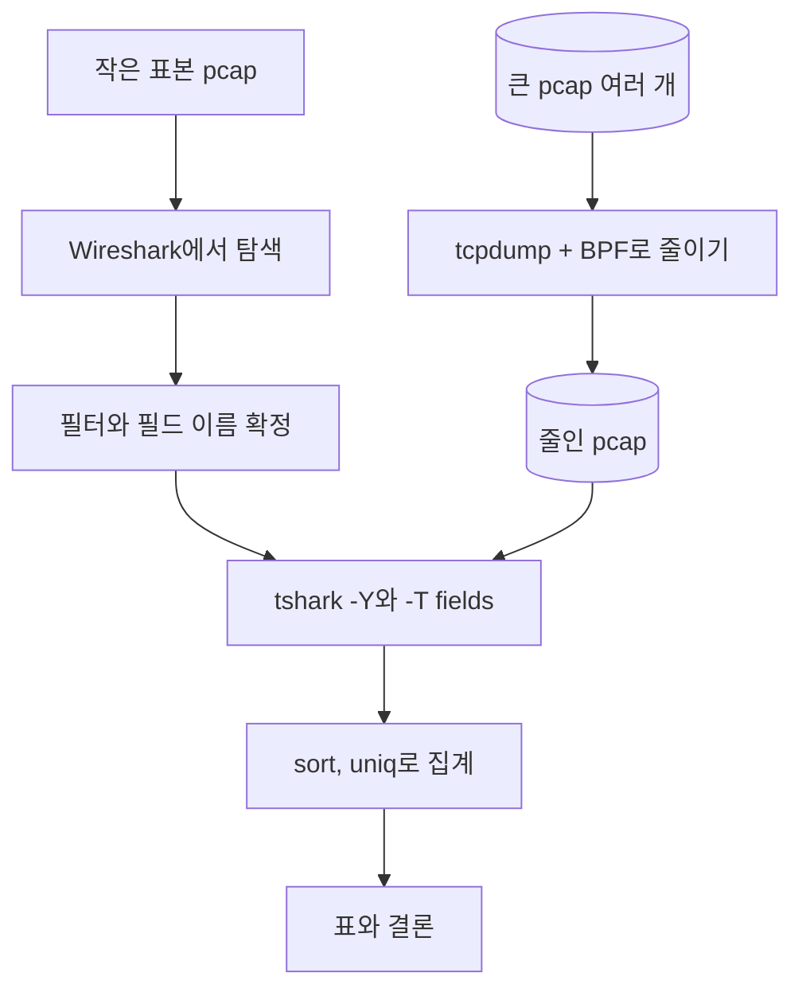

# 1.10강 — 실습 가이드: tcpdump와 Wireshark 손에 익히기 { #lab-tcpdump-wireshark-tshark }

!!! abstract "이번 회차의 범위"
    - tshark가 왜 필요한가: **GUI로 작게 탐색하고, 콘솔로 크게 돌린다**
    - 자주 쓰는 옵션 `-r` `-w` `-n` `-Y` `-T` `-e` `-E` `-G`, 그리고 `-2`
    - [변경됨] `-G`는 보고서 종류를 꼭 적어야 하고(4.6), `-e`에 필드 **표현식**을 쓸 수 있게 됐다(4.4)
    - 실습 A~E: 실시간 수집 → 파일 저장과 해시 → 기본 디스플레이 필터 → `-T fields`로 표 만들기 → 여러 파일을 반복문으로 훑기
    - **데이터 줄이기는 BPF로**: 같은 결과를 tcpdump는 0.25초, tshark는 18초 넘게 걸린 실측
    - [주의] `-Y`와 `-w`를 같이 쓰면, 재조립된 메시지의 앞부분 패킷이 빠질 수 있다

!!! note "실습 환경과 표기"
    **(직접 실행 결과)**는 이 작업 환경(Linux, 4 vCPU)의 tcpdump 4.99.4, libpcap 1.10.4, tshark 4.2.2로 얻었습니다. 실습 A~C는 루프백(`lo`)에 파이썬 웹 서버를 띄우고 `curl`로 요청을 보내 **실제로 수집한** 파일입니다. 실습 D와 E에 쓴 DNS·대용량 pcap은 파이썬으로 직접 조립했고, 사설 주소와 문서용 주소(RFC 5737), 예시 도메인(`.example`)만 씁니다. GUI가 없는 환경이라 Wireshark 화면 조작은 **절차로만** 적었고, 결과는 같은 필터를 tshark에 넣어 확인했습니다.

## 1. 화면에서 찾은 방법을 100개의 파일에 돌리고 싶다 { #why-tshark }

**(가상 사례)** 동료가 Wireshark로 30분 치 pcap을 살펴보다가 수상한 이름 하나를 찾았습니다. `sync.cdn-update.example`. 이제 질문이 커집니다. "지난 일주일 동안 이 이름을 물어본 PC가 또 있나?" 그런데 일주일 치는 1시간 단위로 잘린 파일 168개이고, 합치면 수백 GB예요. 이걸 하나씩 Wireshark로 열어 필터를 치고 눈으로 세는 건 현실적이지 않습니다.

여기서 필요한 게 **tshark**입니다. tshark는 Wireshark의 해석기와 디스플레이 필터를 그대로 쓰는 **명령줄 버전**이에요. 화면이 없으니 그만큼 가볍고, 무엇보다 **셸 스크립트에 넣을 수 있습니다.** 그래서 일하는 순서가 이렇게 정해집니다.

1. **작게 탐색한다.** 작은 표본을 Wireshark로 열어 필드 이름과 필터를 정합니다. 화면이 있어야 "아, 이 필드구나"를 빨리 찾을 수 있어요.
2. **크게 돌린다.** 정한 필터와 필드를 tshark 명령으로 옮기고, 반복문으로 파일 수백 개에 똑같이 적용합니다.
3. **기록으로 남긴다.** 명령줄은 그대로 복사해 보고서에 붙일 수 있고, 다음 사건에도 다시 쓸 수 있습니다. 같은 입력에는 같은 결과가 나오는 **반복 가능한 절차**가 되는 거예요.

!!! info "[보충] GUI에만 있는 기능"
    Wireshark의 기능은 거의 다 tshark에도 있지만, 일부 대화형 기능은 화면에서만 됩니다. 그렇다고 스트림 따라가기나 파일 꺼내기까지 GUI 전용인 건 아닙니다. 이 둘은 tshark의 `-z follow`와 `--export-objects`로도 할 수 있고, 6절에서 직접 돌려 봅니다.

## 2. 비유: 시식 코너와 공장 생산 라인 { #analogy }

요리사가 새 소스를 만들 때는 작은 냄비에서 맛을 보며 비율을 정합니다(GUI). 비율이 정해지면 그 레시피를 공장 라인에 넘겨 하루에 1톤을 만들죠(tshark). 라인에서는 아무도 맛을 보며 손으로 젓지 않습니다. 레시피, 그러니까 명령줄이 전부예요.

이 비유가 실제와 다른 점이 하나 있습니다. **공장 라인도 무한히 빠르지는 않습니다.** tshark는 패킷마다 Wireshark와 똑같이 모든 층을 해석하기 때문에, 1톤짜리 재료를 그대로 넣으면 몹시 느립니다. 그래서 재료를 먼저 **체로 거르는 단계**(tcpdump와 BPF)를 라인 앞에 둡니다. 이게 이번 회차의 핵심 실측인 8절입니다.



**그림 읽는 법:** 위에서 아래로 진행합니다. 왼쪽 갈래(작은 표본 → Wireshark)에서 **무엇을** 볼지 정하고, 오른쪽 갈래(큰 pcap → tcpdump)에서 **얼마나** 볼지 줄입니다. 두 갈래는 tshark에서 만납니다.

## 3. tshark에서 자주 쓰는 옵션 { #options }

각 옵션을 한 줄로 외우기보다 "무엇을 정하는 옵션인가"로 묶으면 기억하기 쉽습니다.

**입력과 출력**

- `-r 파일`: 네트워크 인터페이스가 아니라 **저장된 파일에서** 읽습니다. 조사에서는 거의 항상 이걸 씁니다.
- `-w 파일`: 결과를 글자가 아니라 **패킷 그대로** 파일에 씁니다. 필터와 함께 쓰면 "맞는 패킷만 담은 새 pcap"이 됩니다. 화면에 보이는 글을 저장하고 싶다면 `-w`가 아니라 셸의 `>`를 씁니다.
- **[변경됨] `-F 형식`:** `-w`로 쓸 파일의 형식입니다. tshark의 기본값은 **pcapng**예요. 교재는 "pcap 파일에 쓴다"고 설명하지만, 상대 도구가 pcapng를 못 읽는다면 `-F pcap`을 붙여야 합니다. 형식 목록은 `-F`만 쳐서 볼 수 있습니다.

**해석과 이름**

- `-n`: **모든 이름 해석을 끕니다.** 1.8강에서 직접 확인했듯이, 네트워크 이름 해석을 켜면 Wireshark 계열 도구가 실제 DNS 질의를 내보낼 수 있어요. 증거를 다룰 때는 습관처럼 붙입니다.
- `-2`: 파일을 **두 번** 읽습니다. 첫 번째 읽기에서 "이 요청의 응답은 몇 번 패킷" 같은 앞뒤 관계를 모두 계산하고, 두 번째 읽기에서 출력합니다. 파일을 되감을 수 있어야 하므로 실시간 수집이나 파이프 입력에는 쓸 수 없습니다.
- `-R 필터`: `-2`와 함께 쓰는 **첫 번째 읽기용** 필터입니다. 한 번만 읽을 때는 `-R`이 아니라 `-Y`를 씁니다.

**무엇을 보여 줄지**

- `-Y '필터'`: Wireshark 화면의 필터 막대와 **같은 문법**의 디스플레이 필터입니다(1.9강). 괄호, 공백, 따옴표가 셸에서 다른 뜻으로 읽히지 않도록 **작은따옴표로 감싸세요.** 필터 안에서 문자열은 큰따옴표로 씁니다.
- `-T 형식`: 출력 모양을 고릅니다. 기본값 `text`는 tcpdump처럼 패킷당 한 줄 요약이고, `pdml`(XML), `json`, `ek`(Elasticsearch용 줄 단위 JSON), `psml`, `tabs` 등이 있습니다. 조사에서 가장 많이 쓰는 건 **`fields`**예요.
- `-e 필드`: `-T fields`일 때 **어떤 필드를** 출력할지 정합니다. 여러 번 쓸 수 있고, 쓴 순서대로 열이 됩니다. 필드 이름은 Wireshark 상태 표시줄에 나오는 "기계용 이름"(`dns.qry.name` 같은)을 씁니다.
- `-E 옵션=값`: `-T fields`의 **표 모양**을 다듬습니다. `header=y`(첫 줄에 필드 이름), `separator=,`(구분자, 기본은 탭), `quote=d`(큰따옴표로 감싸기), `occurrence=f|l|a`(한 패킷에 여러 번 나오는 필드의 첫째·마지막·전부), `aggregator=,`(전부를 출력할 때 값 사이의 구분자) 등이 있습니다.

**찾아보기**

- `-G 보고서`: tshark가 아는 것들의 **목록**을 출력하고 끝납니다. `fields`(모든 필드), `protocols`(모든 프로토콜), `fieldcount`(개수) 등이 있습니다.

!!! warning "[변경됨] `-G`는 이제 보고서 종류를 꼭 적어야 한다"
    교재는 "`-G ?`로 쓸 수 있는 보고서 목록을 본다"고 안내합니다. tshark 4.2.2에서 `-G ?`를 치면 보고서 목록이 담긴 사용법이 나왔습니다**(직접 실행 결과)**. 예전에는 `-G`만 치면 `fields` 보고서가 나왔는데, 이 동작은 4.4.0에서 **폐지 예정**이 됐고, 4.6 설명서에는 "보고서 종류는 이제 필수"라고 적혀 있습니다. 4.6 설명서가 목록을 보려면 안내하는 명령은 `-G help`입니다. 오래된 스크립트에 `tshark -G | grep ...`이 있다면 `tshark -G fields | grep ...`으로 고쳐 두세요.

!!! info "[변경됨] `-e`에 쓸 수 있는 것이 넓어졌다"
    - **4.2.0부터** 화면의 열 내용을 `_ws.col.info`, `_ws.col.protocol`처럼 **필드처럼** 꺼낼 수 있습니다. 예전처럼 열 제목(`Info`)으로 꺼내는 방식은 기본 열에 한해서만 호환용으로 남았습니다.
    - **4.4.0부터** `-e`에 단일 필드 이름뿐 아니라 **필드 표현식**(디스플레이 필터 함수, 슬라이스, 산술 계산 등)을 쓸 수 있습니다. 예를 들어 `-e 'len(dns.qry.name)'`처럼 쓰는 식입니다. 단, 이 작업 환경은 4.2.2라 이 기능은 **직접 돌려 보지 못했고**, 4.4.0 릴리스 노트를 근거로 적습니다.

## 4. 실습 안내: 이번 실습은 이렇게 짜여 있다 { #how-to-use }

이번 회차부터 실습 가이드는 다음 네 부분으로 구성합니다. 각 부분의 목적을 알면 어디서 멈추고 무엇을 확인할지 정하기 쉽습니다.

- **목표:** 실습이 끝났을 때 할 수 있어야 하는 것.
- **준비:** 필요한 도구와 파일, 그리고 출발점이 되는 단서.
- **실습:** 단계마다 "명령 → 결과 → 해석"을 둡니다. 명령의 각 부분이 무슨 뜻인지 함께 적었으니, 결과를 보기 전에 **예상부터 해 보고** 맞춰 보세요.
- **정리:** 이 실습에서 가져갈 것.

명령을 그대로 따라 쳐도 되지만, 같은 답에 이르는 길은 여러 가지입니다. 한 번 따라 해 본 뒤에는 해설을 가리고 혼자 풀어 보면 실력이 훨씬 빨리 늡니다. "더 해 보기"로 표시한 부분은 목표에 꼭 필요하지는 않으니 마지막에 하세요.

**목표**

1. tcpdump로 지금 지나가는 트래픽을 화면에서 보고, 파일로 저장한다.
2. 저장한 pcap을 Wireshark(또는 tshark)로 열어 기본 디스플레이 필터를 쓴다.
3. tshark의 `-T fields`로 패킷을 **표**로 바꾸고, 셸 도구로 집계한다.
4. "줄이기는 BPF, 해석은 디스플레이 필터"를 실측으로 확인한다.

**준비**

- tcpdump, Wireshark(tshark 포함, 4.x), `curl`, 파이썬 3
- 실습 A~C: 연습용 웹 서버. 아무 빈 폴더에 텍스트 파일을 몇 개 만들고, 그 폴더에서 `python3 -m http.server 8082 --bind 127.0.0.1`을 실행합니다.
- 실습 D: 1시간 단위로 잘린 DNS pcap 세 개(`dns-00.pcap`, `dns-01.pcap`, `dns-02.pcap`). 내부 DNS 서버는 `10.10.4.53`입니다. 출발점이 되는 단서는 "`sync.cdn-update.example`이 수상하다"입니다.

!!! warning "[주의] 실습은 내 장비, 내 트래픽으로"
    수집은 **권한이 있는 네트워크와 장비**에서만 합니다. 이 가이드는 루프백 인터페이스(`lo`)만 쓰므로 내 컴퓨터 안에서만 오가는 트래픽을 봅니다. 회사 네트워크에서 연습하려면 먼저 허가를 받으세요.

## 5. 실습 A·B: 실시간으로 보고, 파일로 남기기 { #lab-ab }

### 5.1 실습 A: 지나가는 패킷을 화면에서 본다 { #lab-a }

```bash
sudo tcpdump -i lo -nn -c 12 'tcp port 8082'
```

- `-i lo`: 루프백 인터페이스에서 수집합니다.
- `-nn`: 주소와 포트 번호를 이름으로 바꾸지 않습니다(1.8강).
- `-c 12`: 12개를 잡으면 멈춥니다. 연습할 때 화면이 끝없이 흐르지 않게 해 줍니다.
- `'tcp port 8082'`: 웹 서버 포트만 고르는 BPF(1.7강). 작은따옴표로 감쌌습니다.

다른 터미널에서 `curl -s -o /dev/null http://127.0.0.1:8082/report.txt`를 실행하면 이렇게 나옵니다.

**(직접 실행 결과, 옵션 일부 생략)**

```text
03:20:39.926766 IP 127.0.0.1.58600 > 127.0.0.1.8082: Flags [S], seq 3814503150, win 65495, ... length 0
03:20:39.926778 IP 127.0.0.1.8082 > 127.0.0.1.58600: Flags [S.], seq 1889376451, ack 3814503151, ... length 0
03:20:39.926794 IP 127.0.0.1.58600 > 127.0.0.1.8082: Flags [.], ack 1, win 64, ... length 0
03:20:39.926875 IP 127.0.0.1.58600 > 127.0.0.1.8082: Flags [P.], seq 1:88, ack 1, ... length 87
03:20:39.926880 IP 127.0.0.1.8082 > 127.0.0.1.58600: Flags [.], ack 88, ... length 0
03:20:39.927687 IP 127.0.0.1.8082 > 127.0.0.1.58600: Flags [P.], seq 1:190, ack 88, ... length 189
03:20:39.927704 IP 127.0.0.1.58600 > 127.0.0.1.8082: Flags [.], ack 190, ... length 0
03:20:39.927941 IP 127.0.0.1.8082 > 127.0.0.1.58600: Flags [P.], seq 190:5590, ack 88, ... length 5400
03:20:39.927954 IP 127.0.0.1.58600 > 127.0.0.1.8082: Flags [.], ack 5590, ... length 0
03:20:39.927990 IP 127.0.0.1.8082 > 127.0.0.1.58600: Flags [F.], seq 5590, ack 88, ... length 0
03:20:39.928023 IP 127.0.0.1.58600 > 127.0.0.1.8082: Flags [F.], seq 88, ack 5591, ... length 0
03:20:39.928052 IP 127.0.0.1.8082 > 127.0.0.1.58600: Flags [.], ack 89, ... length 0
12 packets captured
24 packets received by filter
0 packets dropped by kernel
```

**해석:** 한 번의 HTTP 요청이 패킷 12개가 됐습니다. 앞의 세 줄이 연결을 맺는 과정(`S`, `S.`, `.`)이고, 87바이트짜리가 요청, 189바이트가 응답 헤더, 5400바이트가 본문(`report.txt`의 크기와 같습니다), 마지막 세 줄이 연결을 닫는 과정(`F.`)입니다. 1.6강에서 본 구조 그대로예요.

**끝의 세 줄**도 읽을 줄 알아야 합니다.

- `captured`는 실제로 출력하거나 저장한 개수, `dropped by kernel`은 버퍼가 넘쳐 **놓친** 개수입니다(1.6강 7.1절). 증거를 수집할 때는 이 숫자를 꼭 기록합니다. 0이 아니면 "수집이 완전하지 않다"는 사실을 보고서에 적어야 하니까요.
- `received by filter`가 `captured`의 정확히 **두 배**(24)인 건 루프백의 특성입니다. 1.6강 7.1절에서는 원인을 확인하지 못했다고 적었는데, 이번에 확인했습니다. 리눅스는 루프백 패킷을 "나가는 것"과 "들어오는 것"으로 두 번 보여 주고, libpcap은 같은 패킷을 두 번 기록하지 않으려고 나가는 쪽을 버립니다(libpcap 1.10.4 `pcap-linux.c`의 설명). 필터를 통과한 개수는 두 번 다 세지만 기록은 한 번만 하는 거예요. 일반 이더넷 인터페이스에서는 이렇게 딱 두 배가 되지 않습니다. 이 숫자가 다르다고 놀라기 전에 **어떤 인터페이스였는지**부터 봅니다.

### 5.2 실습 B: 파일로 저장하고, 해시를 남긴다 { #lab-b }

```bash
sudo tcpdump -i lo -nn -w lab11.pcap 'tcp port 8082'
```

`-w lab11.pcap`이 붙으면 화면에는 패킷이 나오지 않고 파일에 저장됩니다. 이 상태에서 다른 터미널로 요청 세 개를 보냅니다. 하나는 일반 요청, 하나는 User-Agent를 바꾼 요청, 하나는 **없는 파일**에 대한 요청입니다.

```bash
curl -s -o /dev/null http://127.0.0.1:8082/index.html
curl -s -o /dev/null -A "lab-agent/1.0" http://127.0.0.1:8082/report.txt
curl -s -o /dev/null http://127.0.0.1:8082/nope.txt
```

`Ctrl+C`로 멈추면 `36 packets captured`가 나왔습니다**(직접 실행 결과)**. 요청 하나에 12개씩 세 번입니다. 이제 **분석하기 전에 해시부터** 남깁니다.

```bash
sha256sum lab11.pcap
```

**(직접 실행 결과)**

```text
c96571436262a2e4349875121d42d625f180f544d25ee7b664f17bfcb4a01254  lab11.pcap
```

실습 C를 모두 마친 뒤 다시 계산해도 같은 값이 나왔습니다. 읽기만 하는 도구(tshark `-r`, tcpdump `-r`, editcap 입력)는 원본을 바꾸지 않는다는 걸 이렇게 확인할 수 있어요. 결과물은 **늘 새 파일로** 씁니다.

!!! info "[보충] 저장할 때 `-Z root`가 필요했던 이유"
    이 작업 환경에서는 tcpdump가 수집을 시작한 뒤 권한을 낮추는 바람에 `-w` 파일을 쓰지 못하는 문제가 있어 `-Z root`를 붙였습니다(1.6강 7절). 여러분의 환경에서는 필요 없을 수 있습니다. 필요하더라도, 수집 장비에서는 권한 문제를 이런 식으로 넘기기보다 **쓰기 권한이 있는 전용 폴더**를 마련하는 편이 낫습니다.

### 5.3 실습 B(계속): Wireshark에서 기본 필터 쓰기 { #lab-b-wireshark }

Wireshark에서 `lab11.pcap`을 열고, 필터 막대에 다음을 차례로 넣어 보세요. 괄호 안은 같은 필터를 tshark에 넣었을 때 남은 패킷입니다**(직접 실행 결과)**.

- `http.request`: 요청만 보입니다(4, 16, 28번).
- `http.response.code == 404`: 없는 파일에 대한 응답만 보입니다(32번).
- `http.user_agent contains "lab"`: User-Agent를 바꾼 요청만 보입니다(16번).
- `tcp.stream == 2`: 세 번째 연결의 패킷 12개가 모두 보입니다. 스트림 번호는 0부터 셉니다.

화면 조작 절차는 1.8강(창 구성)과 1.9강(필터, 스트림 따라가기)을 참고하세요. 여기서 확인할 건 하나입니다. **필터를 지우면 36개가 다시 다 보인다**는 것. 디스플레이 필터는 보이는 것만 바꾸고 파일은 건드리지 않습니다.

## 6. 실습 C: 패킷을 표로 바꾸기 { #lab-c }

### 6.1 요청과 응답을 한 줄씩 { #fields-basic }

```bash
tshark -n -r lab11.pcap -Y http.request -T fields -E header=y \
  -e frame.number -e tcp.stream -e http.request.method -e http.request.uri -e http.user_agent
```

명령을 쪼개 읽으면 이렇습니다. `-n -r lab11.pcap`은 "이름 해석 없이 이 파일을 읽어라", `-Y http.request`는 "요청만", `-T fields`는 "표로", `-E header=y`는 "첫 줄에 열 이름", `-e`가 다섯 개이니 열도 다섯 개입니다.

**(직접 실행 결과)**

```text
frame.number	tcp.stream	http.request.method	http.request.uri	http.user_agent
4	0	GET	/index.html	curl/8.5.0
16	1	GET	/report.txt	lab-agent/1.0
28	2	GET	/nope.txt	curl/8.5.0
```

응답도 같은 방식으로 뽑습니다. `-Y http.response`로 바꾸고, `-e` 열로 `frame.number`, `tcp.stream`, `http.response.code`, `http.content_length`, `http.response_for.uri`를 줍니다.

**(직접 실행 결과)**

```text
frame.number	tcp.stream	http.response.code	http.content_length	http.response_for.uri
8	0	200	32	http://127.0.0.1:8082/index.html
20	1	200	5400	http://127.0.0.1:8082/report.txt
32	2	404	335	http://127.0.0.1:8082/nope.txt
```

**해석:** 두 표는 `tcp.stream` 열로 이어 붙일 수 있습니다. 스트림 2는 `/nope.txt` 요청이고, 그 응답은 404에 본문 335바이트입니다. 존재하지 않는 파일인데 본문이 335바이트나 있는 이유는 서버가 **오류 안내 페이지**를 보내기 때문입니다. 이 점은 6.3절에서 다시 중요해집니다.

### 6.2 tshark로 찾고, tcpdump로 잘라 낸다 { #carve }

스트림 2만 따로 파일로 만들고 싶다고 해 봅시다. 방법은 두 가지입니다.

```bash
# 방법 1: tshark의 디스플레이 필터로
tshark -n -r lab11.pcap -Y 'tcp.stream == 2' -w s2.pcapng

# 방법 2: 포트를 알아낸 뒤 tcpdump의 BPF로
tshark -n -r lab11.pcap -Y 'http.response.code == 404' -T fields -e tcp.srcport -e tcp.dstport
tcpdump -nn -r lab11.pcap -w p2.pcap 'tcp port 58632'
```

**(직접 실행 결과)** 두 번째 명령은 `8082	58632`를 출력했고, 방법 1과 방법 2 모두 패킷 12개짜리 파일을 만들었습니다.

방법 2가 한 단계 더 많은데 왜 알아 둬야 할까요? `tcp.stream`은 **Wireshark가 파일을 읽으며 매긴 번호**라서 파일마다 달라집니다. 원본이 100GB라면 tshark로 해석하는 데만 한참 걸리고요(8절). 반면 "클라이언트 포트 58632"는 패킷 안에 실제로 있는 값이라 어떤 파일, 어떤 도구에서도 똑같이 통합니다. 작은 파일에서 tshark로 **찾고**, 큰 원본에서는 tcpdump로 **잘라 내는** 분업이에요.

!!! warning "[주의] 포트 하나만으로는 부족할 수 있다"
    클라이언트 포트는 시간이 지나면 다시 쓰입니다. 하루 치 원본에서 `tcp port 58632`만으로 자르면 전혀 다른 시각의 다른 연결이 섞일 수 있어요. 실제 조사에서는 `host 주소 and tcp port 포트`처럼 주소를 함께 쓰고, 결과 파일의 첫 패킷과 마지막 패킷 시각이 예상 범위인지 `capinfos`로 확인합니다.

같은 일을 패킷 번호로 할 수도 있습니다. `editcap -r lab11.pcap first12.pcap 1-12`는 1~12번 패킷만 남긴 새 파일을 만들었습니다**(직접 실행 결과)**. 1.6강에서 본 editcap은 이렇게 **범위로** 자를 때 편합니다.

### 6.3 스트림 따라가기와 파일 꺼내기도 명령줄에서 { #follow-export }

```bash
tshark -n -r lab11.pcap -q -z follow,tcp,ascii,2
tshark -n -r lab11.pcap -q --export-objects http,obj
```

- `-q`: 패킷마다 한 줄씩 나오는 요약을 끄고, 통계(`-z`)나 내보내기 결과만 남깁니다.
- `-z follow,tcp,ascii,2`: 스트림 2를 글자로 따라갑니다. 1.9강의 "TCP 스트림 따라가기"와 같은 기능입니다.
- `--export-objects http,obj`: HTTP로 오간 파일을 `obj` 폴더에 꺼냅니다.

**(직접 실행 결과, 앞부분)**

```text
Follow: tcp,ascii
Filter: tcp.stream eq 2
Node 0: 127.0.0.1:58632
Node 1: 127.0.0.1:8082
85
GET /nope.txt HTTP/1.1
Host: 127.0.0.1:8082
User-Agent: curl/8.5.0
Accept: */*

	186
HTTP/1.0 404 File not found
Server: SimpleHTTP/0.6 Python/3.13.18
...
```

`obj` 폴더에는 `index.html`(32바이트), `report.txt`(5400바이트), `nope.txt`(335바이트) 세 파일이 생겼습니다. 꺼낸 `report.txt`의 SHA-256은 서버 폴더에 있는 원본 `report.txt`와 **정확히 같았습니다**(`265d49f7…7c3e98`). 패킷에서 꺼낸 파일이 원본과 바이트 단위로 같다는 뜻이에요.

**함정은 `nope.txt`입니다.** 파일 이름만 보면 서버에 `nope.txt`가 있었던 것 같지만, 이 파일의 내용은 **서버가 보낸 404 오류 안내 페이지(HTML)**입니다. 내보내기 기능은 응답 본문을 **요청한 주소의 이름으로** 저장할 뿐이에요. 꺼낸 파일을 보고서에 적을 때는 이름만 보지 말고, 그 파일을 실어 보낸 응답의 상태 코드와 `Content-Type`을 함께 확인합니다.

## 7. 실습 D: 여러 파일에서 "누가 그 이름을 물었나" { #lab-d }

### 7.1 한 파일에서 먼저 확인한다 { #one-file }

출발점은 "`sync.cdn-update.example`이 수상하다"입니다. 먼저 한 파일에서 그 이름이 나오는 패킷을 봅니다.

```bash
tshark -n -r dns-01.pcap -Y 'dns.qry.name == "sync.cdn-update.example"'
```

**(직접 실행 결과)**

```text
   39 567.983743   10.10.6.14 → 10.10.4.53   DNS 83 Standard query 0x0079 A sync.cdn-update.example
   40 568.014742   10.10.4.53 → 10.10.6.14   DNS 115 Standard query response 0x0079 A sync.cdn-update.example A 198.51.100.66 A 198.51.100.67
  107 1467.983743   10.10.6.14 → 10.10.4.53   DNS 83 Standard query 0x007a A sync.cdn-update.example
  108 1468.014742   10.10.4.53 → 10.10.6.14   DNS 115 Standard query response 0x007a A sync.cdn-update.example A 198.51.100.66 A 198.51.100.67
  125 2367.983743   10.10.6.14 → 10.10.4.53   DNS 83 Standard query 0x007b A sync.cdn-update.example
  126 2368.014742   10.10.4.53 → 10.10.6.14   DNS 115 Standard query response 0x007b A sync.cdn-update.example A 198.51.100.66 A 198.51.100.67
```

질의와 응답이 함께 나옵니다. **응답에도 질문한 이름이 그대로 들어 있기 때문**이에요(DNS 응답은 질문 부분을 복사해 돌려줍니다). 그래서 "누가 물었나"를 세려면 질의만 골라야 합니다. `dns.flags.response == 0`이 질의, `== 1`이 응답입니다. 이 조건을 빼먹으면 서버 `10.10.4.53`이 "물어본 사람"으로 함께 세어지고, 숫자도 두 배가 됩니다.

여기서 두 번째로 볼 것은 **시간 간격**입니다. 질의가 567초, 1467초, 2367초에 있어요. 정확히 **900초(15분)** 간격입니다. 사람이 브라우저로 접속하면 이렇게 규칙적이기 어렵습니다. 일정 간격으로 서버에 "할 일 있나요?"를 묻는 프로그램(비컨)을 의심해 볼 만한 **관찰**입니다. 다만 업데이트 확인처럼 정상 프로그램도 일정 간격으로 묻기 때문에, 이것만으로 악성이라고 **결론 내릴 수는 없습니다.**

### 7.2 응답의 여러 값 다루기: `-E occurrence`와 `aggregator` { #occurrence }

응답에는 주소가 두 개(`198.51.100.66`, `.67`) 들어 있습니다. 한 패킷에 같은 필드가 여러 번 나오면 `-T fields`는 기본적으로 **모두를 쉼표로 이어** 출력합니다.

```bash
tshark -n -r dns-01.pcap -Y 'dns.flags.response == 1 && dns.qry.name == "sync.cdn-update.example"' \
  -T fields -E header=y -e frame.number -e ip.dst -e dns.a
```

**(직접 실행 결과)**

```text
frame.number	ip.dst	dns.a
40	10.10.6.14	198.51.100.66,198.51.100.67
108	10.10.6.14	198.51.100.66,198.51.100.67
126	10.10.6.14	198.51.100.66,198.51.100.67
```

같은 명령에 `-E occurrence=f`를 더하면 `dns.a` 열에 **첫 번째 값만**(`198.51.100.66`) 남았습니다**(직접 실행 결과)**. 편해 보이지만 조심해야 해요. 두 번째 주소가 표에서 **조용히 사라집니다.** 공격자가 두 주소를 번갈아 쓴다면, 방화벽 기록에서 `.67`을 찾아볼 생각조차 못 하게 됩니다. `occurrence=f`는 "이 필드는 한 번만 나온다"고 확신할 때만 씁니다.

스프레드시트로 넘길 CSV가 필요하다면 이렇게 씁니다.

```bash
tshark -n -r dns-01.pcap -Y 'dns.flags.response == 1 && dns.qry.name == "sync.cdn-update.example"' \
  -T fields -E separator=, -E quote=d -E aggregator=/s -e frame.time -e ip.dst -e dns.a
```

**(직접 실행 결과)**

```text
"Nov  1, 2026 09:10:00.030999000 UTC","10.10.6.14","198.51.100.66 198.51.100.67"
"Nov  1, 2026 09:25:00.030999000 UTC","10.10.6.14","198.51.100.66 198.51.100.67"
"Nov  1, 2026 09:40:00.030999000 UTC","10.10.6.14","198.51.100.66 198.51.100.67"
```

`separator=,`로 열을 쉼표로 나눴기 때문에, 한 칸 안의 여러 값은 `aggregator=/s`로 **공백**으로 이었습니다. 둘 다 쉼표였다면 스프레드시트가 주소 두 개를 서로 다른 열로 쪼갰을 거예요. `quote=d`는 날짜 안의 쉼표(`Nov  1, 2026`) 때문에 필요합니다.

!!! warning "[주의] `frame.time`은 분석 장비의 시간대로 나온다"
    `frame.time`은 pcap에 저장된 UTC 시각을 **분석하는 컴퓨터의 시간대로 바꿔** 보여 줍니다. 이 작업 환경은 UTC로 설정돼 있어 `UTC`로 나왔지만, 같은 명령을 `TZ=Asia/Seoul`로 시간대만 바꿔 돌리자 같은 패킷이 `Nov  1, 2026 18:10:00.030999000 KST`로 나왔습니다**(직접 실행 결과)**. 여러 사람이 결과를 합칠 때 시각이 9시간 어긋나는 흔한 원인이에요. 표로 남길 때는 `frame.time_epoch`(1970년부터 센 초)처럼 시간대가 없는 값을 쓰는 것을 권합니다. 이 실습의 질의 시각은 `frame.time_epoch`로 `1793524200.000000000`처럼 나왔습니다**(직접 실행 결과)**. UTC로 고정된 `frame.time_utc` 필드도 있습니다(tshark 4.2.2의 `-G fields`에서 확인).

### 7.3 반복문으로 모든 파일을 훑는다 { #loop }

이제 1절의 질문 "다른 PC도 물어봤나?"에 답할 차례입니다. 파일 세 개에 같은 명령을 돌려 질의한 주소만 뽑고, `sort | uniq -c`로 셉니다.

```bash
for f in dns-*.pcap; do
  tshark -n -r "$f" -Y 'dns.flags.response == 0 && dns.qry.name == "sync.cdn-update.example"' \
    -T fields -e ip.src
done | sort | uniq -c | sort -rn
```

- `for f in dns-*.pcap; do ... done`: 이름이 `dns-`로 시작하는 pcap마다 한 번씩 실행합니다. `"$f"`를 큰따옴표로 감싸면 파일 이름에 공백이 있어도 깨지지 않습니다.
- `| sort | uniq -c`: 같은 줄끼리 모아 몇 번 나왔는지 셉니다. `uniq`는 **붙어 있는** 같은 줄만 세기 때문에 앞에 `sort`가 꼭 있어야 합니다.
- `| sort -rn`: 센 숫자가 큰 순서로 정렬합니다.

**(직접 실행 결과)**

```text
      6 10.10.6.14
      1 10.10.7.15
```

**해석:** `10.10.6.14`(hq-rd-04) 말고도 `10.10.7.15`(hq-wkstn-05)가 **한 번** 같은 이름을 물었습니다. 1절의 동료가 처음 본 파일(`dns-01.pcap`)에는 없던 PC예요. 언제 처음 나타났는지는 파일 이름을 함께 찍으면 바로 보입니다.

```bash
for f in dns-*.pcap; do
  tshark -n -r "$f" -Y 'dns.flags.response == 0 && dns.qry.name == "sync.cdn-update.example"' \
    -T fields -e ip.src | sed "s/^/$f\t/"
done | sort | uniq -c
```

**(직접 실행 결과)**

```text
      3 dns-01.pcap	10.10.6.14
      3 dns-02.pcap	10.10.6.14
      1 dns-02.pcap	10.10.7.15
```

`sed "s/^/$f\t/"`는 각 줄 앞에 파일 이름과 탭을 붙입니다. 결과를 보면 `dns-00.pcap`(08시대)에는 아무도 묻지 않았고, `10.10.6.14`는 09시대부터, `10.10.7.15`는 10시대에 처음 나타났습니다.

이렇게 정리할 수 있습니다.

- **관찰(사실):** 세 파일에서 그 이름을 질의한 주소는 `10.10.6.14`(6회), `10.10.7.15`(1회)뿐이다. `10.10.6.14`의 질의는 900초 간격이었다.
- **가설:** `10.10.6.14`에서 먼저 무언가가 실행됐고, 10시대에 `10.10.7.15`로 번졌을 수 있다.
- **더 필요한 증거:** 두 PC 사이에 실제로 오간 트래픽이 있는지, 두 PC가 응답 주소(`198.51.100.66`·`.67`)에 실제로 접속했는지(프록시 로그 1.3강, NetFlow), 단말의 실행 기록.
- **관찰의 한계:** 이 pcap은 DNS 서버 앞에서 뜬 것이라, 내부 DNS 서버를 거치지 않고 **외부 DNS 서버나 DoH로 직접 물은 질의는 보이지 않습니다**(1.12강에서 다룹니다). 또 결과가 "없다"는 것은 "이 세 파일에 없다"는 뜻일 뿐입니다.

!!! example "더 해 보기"
    같은 반복문에서 필터를 `dns.flags.response == 0`만 남기고 `-e dns.qry.name`을 뽑아 `sort | uniq -c | sort -rn`으로 세어 보세요. 세 파일에서 가장 많이 물은 이름 순위가 나옵니다. 직접 돌려 보니 `mail.example.org` 52회, `intranet.lab.example` 50회, `www.example.com` 45회, `cdn.example.net` 33회, `sync.cdn-update.example` 7회였습니다. 수상한 이름은 **가장 적게** 나오는 쪽에 있다는 점에 주목하세요. 순위의 위쪽이 아니라 **꼬리**를 보는 습관이 사냥에서 자주 쓰입니다.

### 7.4 필드 이름을 모를 때: `-G fields` { #glossary }

`dns.flags.response`라는 이름은 어떻게 알았을까요? Wireshark 화면에서 그 줄을 누르면 상태 표시줄에 나오지만(1.9강), 화면 없이 찾을 때는 `-G fields`와 `grep`을 씁니다.

```bash
tshark -G fields | grep -P '\tdns\.qry\.name\t|\tdns\.a\t|\tdns\.flags\.response\t'
```

**(직접 실행 결과)**

```text
F	Response	dns.flags.response	FT_BOOLEAN	dns	16	0x8000	Is the message a response?
F	Name	dns.qry.name	FT_STRING	dns		0x0	Query Name
F	Address	dns.a	FT_IPv4	dns		0x0	Response IPv4 Address
```

탭으로 나뉜 열은 순서대로 "F(필드라는 표시), 사람용 이름, 기계용 이름, 값의 형식, 소속 프로토콜, 표시 방식, 비트 마스크, 설명"입니다. `dns.flags.response`의 비트 마스크 `0x8000`은 DNS 헤더의 플래그 16비트 중 **맨 앞 비트**가 응답 여부라는 뜻이에요.

`grep`의 정규식에서 앞뒤에 탭(`\t`)을 둔 이유는 `dns.a`만 정확히 찾기 위해서입니다. 그냥 `dns.a`로 찾으면 `dns.aaaa`나 `dns.a.ch`처럼 앞부분이 같은 필드가 수십 개 함께 나옵니다. 정규식에서 `.`은 "아무 글자 하나"라서 `\.`으로 써야 진짜 점과 맞는다는 것도 함께 기억하세요.

**[변경됨] 숫자로 본 규모:** 교재는 "2,600개 넘는 프로토콜, 210,000개 넘는 필드"라고 적었습니다. tshark 4.2.2의 `-G fieldcount`는 **269,028개 필드, 프로토콜 3,001개**를 보고했습니다**(직접 실행 결과)**. 버전이 오를수록 해석기가 늘어나니, 이 숫자는 "버전마다 다르고 계속 늘어난다"는 정도로만 기억하면 됩니다.

## 8. 실습 E: 데이터 줄이기는 왜 tcpdump로 하나 { #lab-e }

### 8.1 같은 결과, 70배 넘는 시간 차이 { #speed }

패킷 100만 개(약 944MB)짜리 연습용 pcap을 만들었습니다. 3%가 DNS 질의, 나머지는 프록시(3128번 포트)로 가는 TCP예요. 여기서 DNS만 뽑아 새 파일로 저장하는 일을 두 도구로 시켜 봅니다.

```bash
time tcpdump -nn -r big.pcap -w red-bpf.pcap 'udp port 53'
time tshark -n -r big.pcap -Y 'udp.port == 53' -F pcap -w red-df.pcap
```

**(직접 실행 결과, 같은 명령을 두 번씩)**

| 도구 | 1회차 | 2회차 |
| --- | --- | --- |
| tcpdump + BPF | 0.278초 | 0.251초 |
| tshark + 디스플레이 필터 | 29.669초 | 18.212초 |

두 결과 파일은 패킷 수(약 2만 9천 개)뿐 아니라 **MD5 해시까지 똑같았습니다.** 같은 일을 했는데 걸린 시간이 70~100배 넘게 차이 난 거예요.

**왜 이렇게 다를까요?** tcpdump는 BPF로 각 패킷의 **정해진 위치 몇 바이트**만 보고 통과 여부를 정합니다(1.7강). tshark는 디스플레이 필터를 적용하기 전에 패킷마다 이더넷·IP·TCP·그 위 프로토콜까지 **모두 해석**합니다. 이 연습 파일처럼 TCP 패킷마다 900바이트씩 내용이 실려 있으면, tshark는 그 내용이 어떤 프로토콜인지까지 알아보려고 합니다. 버려질 97%의 패킷에도 그 수고를 다 하는 셈이에요.

**측정의 한계도 적어 둡니다.** 이 숫자는 이 작업 환경(4 vCPU)에서 한 파일로 두 번 잰 값입니다. 두 번째에는 파일이 이미 메모리 캐시에 올라와 있었을 가능성이 큽니다. 1회차와 2회차의 tshark 시간 차이가 큰 것도 그런 영향일 수 있어요. 그러니 "정확히 몇 배"가 아니라 **"자릿수가 다르다"**로 읽으세요. 장비와 트래픽 구성이 바뀌면 배율도 바뀝니다.

### 8.2 두 단계로 나누면 둘의 장점을 다 쓴다 { #two-step }

BPF로 먼저 줄이고, 줄인 결과에만 tshark를 쓰면 됩니다. 파일을 따로 저장하지 않고 파이프로 이어도 됩니다.

```bash
time (tcpdump -nn -r big.pcap -w - 'udp port 53' \
  | tshark -n -r - -Y 'dns.qry.name == "www.example.com"' -T fields -e ip.src | wc -l)
```

- `-w -`: 파일 대신 **표준 출력**으로 pcap을 씁니다.
- `-r -`: 파일 대신 **표준 입력**에서 pcap을 읽습니다.

**(직접 실행 결과)** `29815`줄, **0.890초**. DNS 이름까지 따지는 정교한 질문을 1초 안에 끝냈습니다. tshark만으로 같은 일을 했다면 앞 실측처럼 20초 안팎이 걸렸을 거예요.

이게 교재의 실습 정리에 있는 원칙입니다. **2~4계층(주소, 포트, 프로토콜)으로 거를 수 있는 건 tcpdump로, 그 위의 내용을 봐야 하는 건 tshark로.** 단, 파이프로 읽을 때는 `-2`(두 번 읽기)를 쓸 수 없다는 점을 기억하세요. 되감을 수 없는 입력이니까요.

!!! info "[보충] tshark에 BPF를 주면?"
    tshark에도 `-f`라는 BPF 옵션이 있지만 **실시간 수집에서만** 쓸 수 있습니다. 파일을 읽으며 `-f 'udp port 53'`을 주자 tshark 4.2.2는 "파일을 읽을 때는 수집 필터가 아니라 읽기 필터만 쓸 수 있다"는 오류를 내고 멈췄습니다**(직접 실행 결과)**. 저장된 파일을 BPF로 줄이려면 tcpdump(또는 `editcap`처럼 범위로 자르는 도구)를 씁니다.

### 8.3 [주의] `-Y`와 `-w`를 같이 쓸 때 빠지는 패킷 { #y-w-pitfall }

디스플레이 필터로 걸러 **저장**할 때 알아 둘 함정이 있습니다. 1.6강의 루프백 수집 파일(요청 3개)에서 HTTP 응답만 골라 저장해 봤습니다.

```bash
tshark -n -r full.pcap -Y http.response -w resp.pcapng      # 한 번 읽기
tshark -n -2 -r full.pcap -Y http.response -w resp2.pcapng  # 두 번 읽기
```

**(직접 실행 결과, 저장된 파일을 다시 연 모습)**

```text
# resp.pcapng (한 번 읽기): 3개
    1   0.000000    127.0.0.1 → 127.0.0.1    TCP 98 8082 → 36314 [PSH, ACK] Seq=1 Ack=1 Win=64 Len=32 ...
    2   0.010585    127.0.0.1 → 127.0.0.1    TCP 5466 8082 → 36326 [PSH, ACK] Seq=1 Ack=1 Win=64 Len=5400 ...
    3   0.018304    127.0.0.1 → 127.0.0.1    TCP 98 8082 → 36330 [PSH, ACK] Seq=1 Ack=1 Win=64 Len=32 ...

# resp2.pcapng (두 번 읽기): 6개
    1   0.000000    127.0.0.1 → 127.0.0.1    TCP 252 HTTP/1.0 200 OK  [TCP segment of a reassembled PDU]
    2   0.000055    127.0.0.1 → 127.0.0.1    HTTP 98 HTTP/1.0 200 OK  (text/html)
    ...
```

**해석:** 이 서버는 응답 헤더와 본문을 **서로 다른 패킷**으로 보냈습니다. Wireshark는 두 패킷을 이어 붙여(재조립) 하나의 HTTP 응답으로 해석하고, `http.response`는 **마지막 패킷**에 붙습니다. 한 번 읽기로 저장한 파일에는 그 마지막 패킷만 들어가서, 다시 열면 헤더가 없는 본문 조각이라 **HTTP로 해석조차 되지 않습니다**(그냥 `TCP`로 보입니다). `-2`로 두 번 읽었을 때는 앞의 헤더 패킷까지 함께 저장됐습니다.

tshark 설명서는 `-Y`와 `-w`를 함께 쓰면 "맞는 패킷이 **의존하는** 패킷(예: 조각)도 함께 저장된다"고 설명합니다. 그런데 4.2.2의 한 번 읽기에서는 재조립에 쓰인 앞 패킷이 저장되지 않았어요. 최신 버전에서 동작이 같은지는 **직접 확인하지 못했습니다.** 그래서 안전한 방법을 권합니다.

- 메시지 단위로 잘라야 할 때는 `tcp.stream`으로 **연결 전체**를 저장합니다. 먼저 `-T fields -e tcp.stream`으로 번호를 뽑고, `-Y 'tcp.stream in {0, 2}'`로 저장하면 됩니다(집합은 쉼표로, 1.9강).
- 또는 6.2절처럼 주소와 포트를 알아내 tcpdump로 자릅니다.
- 어떤 방법이든 **저장한 파일을 다시 열어** 원하는 내용이 해석되는지 확인합니다.

## 9. 실제 조사에서는 이렇게 씁니다 { #in-practice }

1. **원본은 읽기만 한다.** 받자마자 해시를 계산해 기록하고, 원본 폴더는 읽기 전용으로 둡니다. 모든 결과는 새 파일로 쓰고, 파일 이름이나 메모에 "어느 원본에서, 어떤 명령으로" 만들었는지 남깁니다.
2. **작게 탐색한다.** 표본 한두 개를 Wireshark로 열어 필터와 필드를 정합니다.
3. **BPF로 줄인다.** 주소, 포트, 프로토콜로 거를 수 있는 건 tcpdump로 먼저 줄입니다.
4. **tshark로 표를 만든다.** `-n`을 빼먹지 말고, 시간은 `frame.time_epoch`처럼 시간대가 없는 값으로 뽑습니다. 여러 값 필드는 `occurrence` 기본값(전부)을 유지합니다.
5. **명령줄을 그대로 보고서에 붙인다.** 도구 이름과 버전(`tshark --version`의 첫 줄)도 함께 적습니다. 1.9강의 `!=`나 이번 회차의 `-G`처럼 버전에 따라 결과나 사용법이 바뀌기 때문입니다.
6. **결과를 사실, 가설, 필요한 증거로 나눠 적는다.** 7.3절의 정리처럼요.

## 10. 정리 { #summary }

- tshark는 Wireshark의 해석기와 디스플레이 필터를 명령줄에서 쓰는 도구입니다. **GUI로 작게 탐색하고, tshark로 크게 반복합니다.**
- `-r`(읽기), `-w`(패킷 그대로 쓰기, 기본은 pcapng), `-n`(이름 해석 끄기), `-Y`(디스플레이 필터, 작은따옴표로 감싸기), `-T fields`와 `-e`(표 만들기), `-E`(표 모양), `-G`(목록 찾기), `-2`(두 번 읽기)를 묶어서 기억합니다.
- **[변경됨]** `-G`는 4.6 설명서 기준 보고서 종류가 필수이고(4.4.0에서 폐지 예정), `-e`에는 4.2부터 `_ws.col.*` 열 필드를, 4.4부터 필드 표현식을 쓸 수 있습니다.
- `-T fields`의 여러 값은 기본적으로 쉼표로 이어집니다. `occurrence=f`는 값을 조용히 버리니 조심하고, CSV로 만들 때는 `separator`와 `aggregator`를 다르게 둡니다.
- `frame.time`은 분석 장비의 시간대로 나옵니다. 표로 남길 때는 `frame.time_epoch`를 씁니다.
- 같은 데이터 줄이기에 tcpdump는 0.25초, tshark는 18초 넘게 걸렸고 결과 해시는 같았습니다. **2~4계층으로 거를 수 있는 건 tcpdump로.**
- `-Y`와 `-w`를 함께 쓸 때 재조립에 쓰인 앞 패킷이 빠질 수 있습니다(4.2.2 한 번 읽기에서 확인). 연결 단위(`tcp.stream`)로 저장하고, 저장한 파일을 다시 열어 확인합니다.
- 꺼낸 파일의 이름은 요청한 주소에서 왔을 뿐입니다. `nope.txt`의 내용은 404 오류 페이지였어요.

## 복습 문제 { #review }

**문제 1. (명령 읽기)** 다음 명령의 각 부분이 하는 일을 설명하고, 출력이 어떤 모양일지 말해 보세요.

```bash
tshark -n -r day1.pcap -Y 'http.request and ip.src == 10.10.7.11' -T fields -E header=y -e frame.time_epoch -e http.host -e http.request.uri
```

??? success "정답과 해설"
    `-n`은 이름 해석을 끄고, `-r day1.pcap`은 그 파일을 읽습니다. `-Y '...'`는 "HTTP 요청이면서 출발지가 `10.10.7.11`인 패킷"만 고릅니다. `-T fields`로 표를 만들고, `-E header=y`로 첫 줄에 열 이름을 넣습니다. 열은 세 개로, 시각(1970년부터 센 초), `Host` 헤더 값, 요청 경로 순서입니다. 그래서 첫 줄은 `frame.time_epoch	http.host	http.request.uri`이고, 그 아래로 요청마다 탭으로 나뉜 한 줄씩이 나옵니다. 필터를 작은따옴표로 감쌌기 때문에 공백과 `==`가 셸에서 쪼개지지 않습니다.

**문제 2. (변경된 조건)** 동료의 오래된 스크립트에 `tshark -G | grep -i smb`가 있습니다. Wireshark 4.6이 설치된 새 분석 장비에서 이 스크립트가 어떻게 될지, 어떻게 고치면 좋을지 설명하세요.

??? success "정답과 해설"
    예전 tshark는 `-G`만 주면 `fields` 보고서를 기본으로 출력했지만, 이 동작은 4.4.0에서 폐지 예정이 됐고 4.6 설명서는 보고서 종류를 **필수**로 적고 있습니다. 그래서 새 장비에서는 기대한 필드 목록이 나오지 않을 가능성이 큽니다(4.6에서 정확히 어떤 메시지가 나오는지는 이 강의에서 직접 확인하지 못했습니다). `tshark -G fields | grep -i smb`처럼 보고서 종류를 적어 주면 예전 버전과 새 버전 모두에서 같은 뜻이 됩니다. 이참에 스크립트 첫 줄에 `tshark --version`을 기록하게 해 두면, 나중에 결과가 다를 때 원인을 찾기 쉽습니다.

**문제 3. (흔한 오해)** "tshark는 Wireshark와 같은 엔진이니까, 큰 pcap을 줄일 때도 tshark `-Y`를 쓰는 게 가장 정확하고 좋다." 이 말에서 맞는 부분과 틀린 부분을 나눠 보세요.

??? success "정답과 해설"
    **맞는 부분:** tshark는 Wireshark와 같은 해석기와 필터를 쓰기 때문에, 상위 프로토콜의 내용(DNS 이름, HTTP 헤더)으로 거를 때는 tshark만 할 수 있는 일이 많습니다.

    **틀린 부분:** 주소, 포트, 프로토콜처럼 **2~4계층으로 거를 수 있는 조건**이라면 tcpdump와 BPF로도 결과가 똑같고, 훨씬 빠릅니다. 8.1절의 실측에서 두 결과 파일의 해시가 같았는데, 걸린 시간은 0.25초와 18초 이상이었습니다. "정확도"는 같고 "비용"만 다른 거예요. 그래서 BPF로 먼저 줄이고, 줄인 결과에 tshark를 쓰는 두 단계가 맞습니다.

**문제 4. (해석)** 7.3절의 반복문에서 `dns.flags.response == 0` 조건을 빼먹고 돌렸다면 결과가 어떻게 달라졌을까요?

??? success "정답과 해설"
    DNS 응답에도 질문한 이름이 그대로 들어 있으므로, 응답 패킷도 필터에 걸립니다. 응답의 `ip.src`는 DNS 서버(`10.10.4.53`)이니, 결과에 `7 10.10.4.53`이라는 줄이 하나 더 생깁니다. 서버가 "가장 많이 물어본 PC"처럼 보이게 되는 거예요. 반대로 `-e ip.dst`로 응답의 받는 쪽을 셌다면 질의한 PC를 셀 수도 있지만, 그러면 응답이 오지 않은 질의(타임아웃, 차단)는 빠집니다. 무엇을 세는지 **필터로 명확히 정하는 것**이 숫자의 뜻을 지키는 방법입니다.

**문제 5. (계산과 해석)** `10.10.6.14`의 질의 시각을 `frame.time_utc`로 뽑아 보니 09:10:00, 09:25:00, 09:40:00, 10:10:00, 10:25:00, 10:40:00이었고, `10.10.7.15`는 10:10:07에 한 번 물었습니다. 간격이 일정하다면 빠진 시각이 있나요? 빠진 이유로 무엇을 생각해 볼 수 있고, `10.10.7.15`의 시각에서는 무엇을 읽을 수 있나요?

??? success "정답과 해설"
    대부분의 간격은 **900초(15분)**인데, 09:40과 10:10 사이만 1800초입니다. 같은 간격이었다면 **09:55:00**에 질의가 하나 더 있어야 합니다(이 시각들은 연습용 파일에서 `-e frame.time_utc`로 직접 뽑았습니다). 빠진 이유로는 ① 그 시각에 PC가 잠들었거나 네트워크가 끊겼다, ② 프로그램이 그 차례에 DNS를 묻지 않았다(답을 따로 저장해 뒀다가 재사용), ③ 내부 DNS 서버가 아닌 다른 경로로 물었다(외부 DNS, DoH), ④ **수집이 그 시각에 빠졌다**(1시간 단위 파일이 넘어가는 사이, 장비 재시작) 등이 있습니다. ④는 조사자가 놓치기 쉬운데, `capinfos`로 각 파일의 첫·마지막 패킷 시각과 수집 장비의 기록을 보면 확인할 수 있습니다.

    `10.10.7.15`는 `10.10.6.14`의 10:10:00 질의 **7초 뒤**에 물었습니다. 두 PC가 거의 같은 순간에 같은 드문 이름을 물었다는 건 서로 관련이 있을 수 있다는 **관찰**이지만, 그게 "한 PC가 다른 PC를 감염시켰다"는 증거는 아닙니다. 같은 메일을 두 사람이 비슷한 시각에 열었을 수도 있으니까요. 둘 사이에 직접 오간 트래픽이 있는지를 따로 봐야 합니다.

**문제 6. (변경된 조건)** 7.2절의 CSV 명령을 서울 시간대(KST)로 설정된 노트북에서 돌리면 첫 줄이 어떻게 나올까요? 이게 왜 문제가 될 수 있나요?

??? success "정답과 해설"
    같은 패킷이 `"Nov  1, 2026 18:10:00.030999000 KST","10.10.6.14","198.51.100.66 198.51.100.67"`로 나옵니다(UTC 09:10에 9시간을 더한 값). 7.2절의 주의 상자처럼 `TZ=Asia/Seoul`로 시간대만 바꿔 직접 확인했습니다. 문제는 여러 분석가의 표를 합치거나, UTC로 기록된 방화벽 로그와 맞춰 볼 때 **9시간 어긋난 채로** 비교하게 될 수 있다는 점입니다. 시간대 표시가 붙어 있어도 스프레드시트로 옮기면서 사라지기 쉽고요. `frame.time_epoch`처럼 시간대가 없는 값으로 뽑고, 보고서에서 한 번만 시간대를 정해 바꾸는 편이 안전합니다.

**문제 7. (함정 찾기)** 동료가 `tshark -n -r case.pcap -Y 'http.response.code == 200 && http.content_type contains "zip"' -w zips.pcapng`로 압축 파일 응답만 저장한 뒤, 그 파일에서 `--export-objects http`를 했더니 아무것도 나오지 않았습니다. 무엇을 의심해야 하고, 어떻게 다시 해야 할까요?

??? success "정답과 해설"
    8.3절의 함정을 의심합니다. 응답이 여러 패킷에 걸쳐 재조립됐다면, `http.response.code`는 마지막 패킷에만 붙습니다. 한 번 읽기로 저장하면 앞부분 패킷이 빠질 수 있고, 그러면 저장한 파일에서는 HTTP 응답이 완성되지 않아 꺼낼 파일이 없습니다. 다시 할 때는 ① 원본에서 `-T fields -e tcp.stream`으로 해당 스트림 번호를 뽑고, ② `-Y 'tcp.stream in {…}'`로 연결 전체를 저장하거나, 주소와 포트로 tcpdump를 써서 자르고, ③ 저장한 파일을 다시 열어 HTTP 응답이 온전히 해석되는지 확인한 뒤 내보냅니다. 원본에서 바로 `--export-objects`를 하는 방법도 있습니다.

**문제 8. (해석)** 6.3절에서 꺼낸 `nope.txt`를 보고 신입 분석가가 "서버에 `nope.txt`라는 파일이 있었고 335바이트였다"고 보고서에 적었습니다. 무엇이 틀렸고, 어떻게 확인했어야 하나요?

??? success "정답과 해설"
    `--export-objects`는 응답 본문을 **요청한 주소의 마지막 부분**을 이름으로 삼아 저장할 뿐입니다. 이 응답의 상태 코드는 404였고, 본문 335바이트는 서버가 보낸 **오류 안내 HTML**이었습니다. 즉 서버에 `nope.txt`가 없었다는 게 사실에 더 가깝습니다. 확인 방법은 ① 6.1절처럼 응답의 `http.response.code`와 `http.content_type`을 함께 보는 것, ② 꺼낸 파일을 `file`로 확인하거나 열어 보는 것입니다. 거꾸로, 공격자가 `update.txt`라는 이름으로 실행 파일을 내려받게 할 수도 있으니 **이름이 아니라 내용**으로 판단하는 습관이 중요합니다.

**문제 9. (적용)** 하루 치 pcap 24개(합계 300GB)에서 "`10.10.6.14`가 보낸 HTTP 요청 중 `Host`가 `.example`로 끝나는 것"을 찾아야 합니다. 이번 회차에서 배운 것만으로 명령의 뼈대를 짜 보세요.

??? success "정답과 해설"
    두 단계로 나눕니다. ① 2~4계층 조건(`10.10.6.14`가 보낸 TCP)은 tcpdump로 줄이고, ② HTTP 내용 조건은 tshark로 봅니다.

    ```bash
    for f in day-*.pcap; do
      tcpdump -nn -r "$f" -w - 'src host 10.10.6.14 and tcp' \
        | tshark -n -r - -Y 'http.request and http.host matches "\\.example$"' \
            -T fields -e frame.time_epoch -e http.host -e http.request.uri \
        | sed "s/^/$f\t/"
    done > hits.tsv
    ```

    포트를 80으로 좁히지 않은 건, 1.9강에서 봤듯 HTTP가 다른 포트로 오갈 수 있기 때문입니다(다만 Wireshark가 그 포트를 HTTP로 해석해야 걸립니다). `matches`의 정규식에서 `\\.`은 "진짜 점"이고 `$`는 "끝"입니다. 디스플레이 필터의 문자열 안에서는 역슬래시를 두 번 써야 정규식에 한 번 전달됩니다. 결과에는 파일 이름을 붙여 출처를 남겼습니다. 명령을 돌리기 전에 원본의 해시를, 돌린 뒤에는 명령줄과 tshark 버전을 기록합니다. 디스플레이 필터 부분(`http.host matches "\\.example$"`)은 연습용 pcap에 tshark 4.2.2로 돌려 `intranet.lab.example`이 걸리는 것을 확인했지만, 반복문 전체는 300GB 원본에 돌려 본 것이 아닌 **뼈대**입니다. 작은 표본에서 먼저 시험해 보세요.

## 참고 자료 { #references }

- Wireshark, [tshark 설명서 원본(release-4.6)](https://gitlab.com/wireshark/wireshark/-/blob/release-4.6/doc/man_pages/tshark.adoc) (2026-11-05 확인). `-2`, `-R`, `-Y`(맞는 패킷이 의존하는 패킷도 저장한다는 설명), `-T`의 형식 목록, `-e`와 `-E`의 옵션, "보고서 종류는 이제 필수"인 `-G`, `-F`의 기본값 pcapng.
- Wireshark, [tshark 설명서 원본(v4.4.0)](https://gitlab.com/wireshark/wireshark/-/blob/v4.4.0/doc/man_pages/tshark.adoc) (2026-11-05 확인). `-G`를 인자 없이 쓰는 방식이 폐지 예정이라는 설명.
- Wireshark, [4.2.0 릴리스 노트 원본](https://gitlab.com/wireshark/wireshark/-/blob/v4.2.0/doc/release-notes.adoc) (2026-11-05 확인). `_ws.col.*` 열 필드와 `-e`에서 열 제목 사용의 정리.
- Wireshark, [4.4.0 릴리스 노트 원본](https://gitlab.com/wireshark/wireshark/-/blob/v4.4.0/doc/release-notes.adoc) (2026-11-05 확인). `tshark -e`에 필드 표현식 허용, `-G` 무인자 사용의 폐지 예정.
- tcpdump group, [libpcap 1.10.4 `pcap-linux.c`](https://github.com/the-tcpdump-group/libpcap/blob/libpcap-1.10.4/pcap-linux.c) (2026-11-05 확인). 루프백 장치에서 나가는 방향 패킷을 버리는 처리.
- 버전 정보: 2026-11-05 확인 기준 Wireshark 최신 안정판은 4.6.16, tcpdump는 4.99.7, libpcap은 1.11.0입니다(1.9강과 같은 확인). 이 강의의 실행 결과는 그보다 오래된 tshark 4.2.2, tcpdump 4.99.4로 얻었습니다.

!!! note "이 페이지에 대하여"
    여러 학습 자료를 바탕으로 직접 다시 쓴 개인 학습 노트입니다. 실습 절차와 연습용 파일은 직접 만들었고, 사례는 가상입니다.
