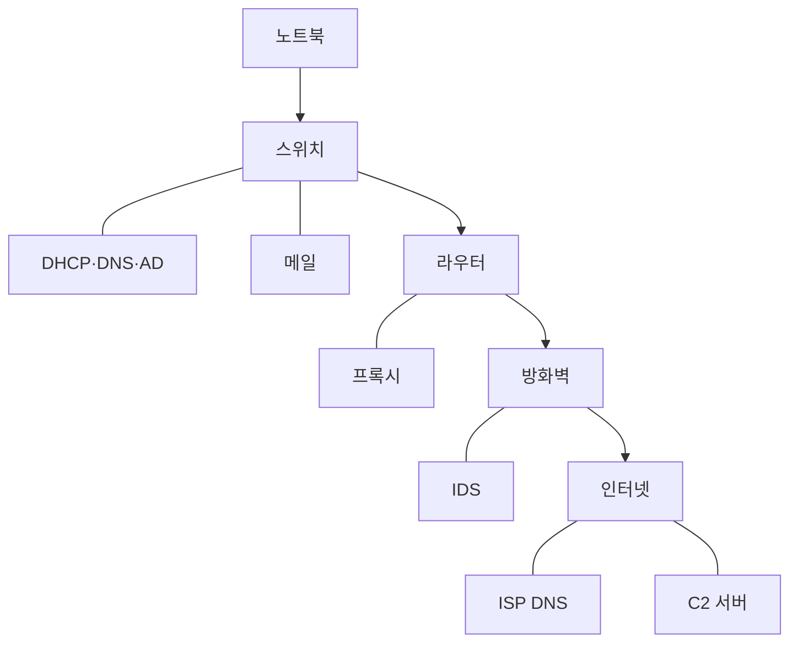
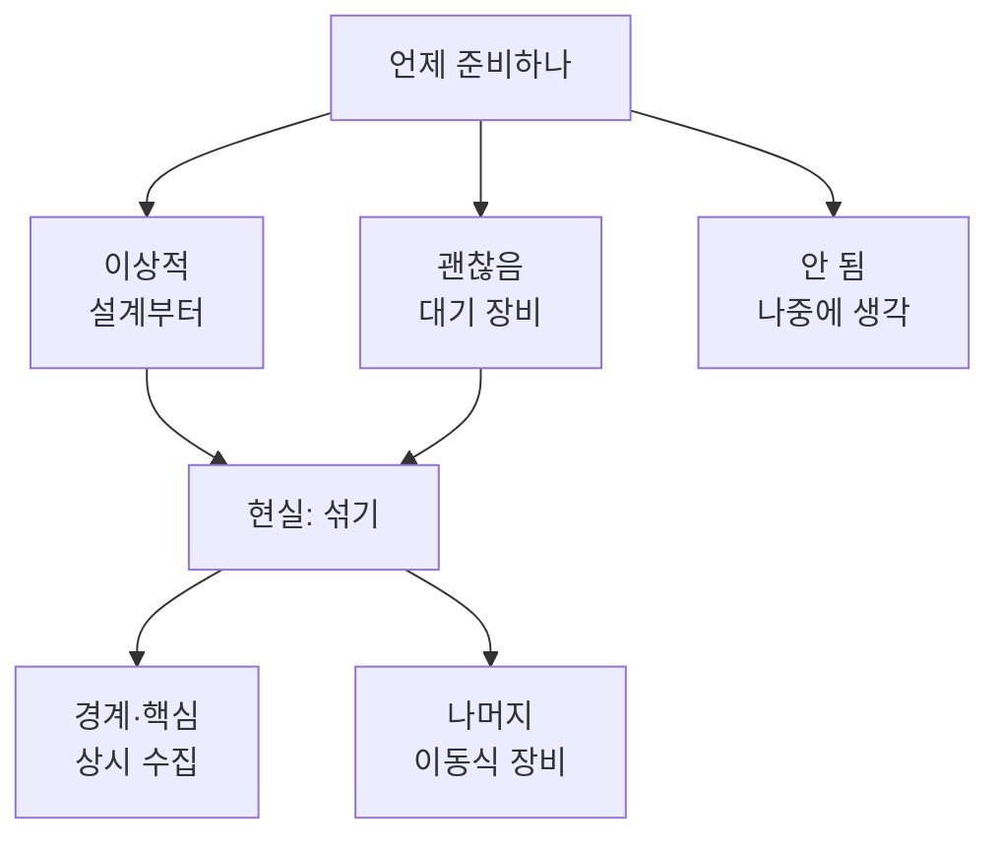

# 1.11강 — 증거 수집: 어디서, 어떤 장비로 패킷을 모으나 { #network-evidence-acquisition }

!!! abstract "이번 회차의 범위"
    - 아무 단서 없이 시작할 때 붙잡을 **네 가지 질문**
    - 피싱 한 건이 13단계로 남기는 흔적: 어느 장비가 무엇을 기록하나
    - 증거의 세 종류 다시 보기: pcap, **NetFlow/IPFIX**(직접 만들어 본 플로우 기록), 로그
    - [정정] 플로우의 바이트는 "페이로드만"이 아니라 **IP 헤더까지** 센다, 플로우는 연결과 같지 않다
    - 패킷을 얻는 길: 스위치 미러링(SPAN), 탭, 클라우드 미러링
    - [변경됨] Azure NSG 플로우 로그는 2027-09-30 퇴역, 새로 만들기는 이미 막혔다
    - 내부·외부 증거원, 수집 계획의 네 가지 경우, 상용 장비와 직접 만든 수집 장비
    - [정정] libpcap은 리눅스에서 이미 `AF_PACKET`을 쓴다
    - 무엇을 수집할 것인가: 사업 목표, 법과 정책, 그리고 "다른 곳에 이미 있는 것"

!!! note "실습 환경과 표기"
    **(직접 실행 결과)**는 이 작업 환경에서 얻었습니다. 플로우 기록은 파이썬으로 조립한 pcap(사설·문서용 주소만 사용)을 **softflowd 1.1.0**으로 읽어 IPFIX로 내보내고, **nfcapd/nfdump 1.7.3**으로 받아서 읽었습니다. 로그 무결성 실습은 이 환경의 리눅스(ext4, root 계정)에서 했습니다. 스위치·탭·클라우드 장비는 이 환경에서 다룰 수 없어 **문서 확인**만 했고, 그 출처와 확인 날짜를 참고 자료에 적었습니다. 클라우드 공급자 문서 일부는 이 환경에서 직접 열 수 없어 **검색 결과의 공식 문서 요약**과 공개 저장소의 문서 원본으로 확인했으며, 해당 부분에 그렇게 표시했습니다.

## 1. "뭔가 이상한데, 뭔지는 모르겠다" { #blank-slate }

**(가상 사례)** 월요일 아침, 보안팀장이 말합니다. "지난주부터 연구소 쪽이 좀 이상하다는 얘기가 있어요. 정확히 뭔지는 모르겠는데, 한번 봐 줄래요?" 단서는 없습니다. IP 주소 하나, 도메인 하나도 없어요.

막막하지만, 조사는 대부분 다음 **네 가지 질문** 중 하나로 정리됩니다. 질문이 정해지면 어떤 증거가 필요한지도 정해집니다.

1. **무엇이 빠져나갔나(피해 평가).** 무엇을, 언제, 어디로, 어떻게 가져갔고, 누가 했나. 피해 조직이 가장 먼저(때로는 법적 의무로) 답해야 하는 질문입니다. "누가"는 보통 가장 중요하진 않지만, 공격자의 의도와 능력을 알면 **무엇을 노렸을지** 짐작하는 데 도움이 됩니다.
2. **그 일의 앞과 뒤에 무엇이 있었나.** 사건 그 자체만큼 **바로 전후**가 중요합니다. 다른 관찰이 왜 중요한지(또는 안 중요한지) 맥락을 주고, 함께 감염된 다른 시스템을 알려 주기도 합니다.
3. **어떻게 들어왔나.** 광고망을 통한 자동 다운로드였나, 피싱 메일의 첨부나 링크였나. 네트워크 기록은 시작점을 꽤 분명하게 보여 주는 경우가 많고, 그 방식 자체가 공격자의 수준을 말해 줍니다.
4. **같은 시각에 다른 시스템들은 무엇을 하고 있었나.** 한 대에서 찾은 행동이 다른 곳에도 있는지 찾는 일, 이것이 **범위 산정(scoping)**입니다. 악성 활동이 한 곳에서만 끝나는 경우는 드뭅니다. 1.10강 7.3절에서 "다른 PC도 그 이름을 물었나?"를 찾은 것이 바로 이 질문이었어요.

## 2. 피싱 한 건이 남기는 흔적 { #phishing-scenario }

### 2.1 13단계로 쪼개 보기 { #thirteen-steps }

**(가상 사례)** 연구소 직원이 노트북을 사내망에 연결하고, 메일의 링크를 눌렀습니다. 브라우저가 공격자가 이 조직만을 노리고 만든 악성 파일을 내려받았고, 단말 보안 제품은 이를 막지 못했습니다. 이 짧은 이야기를 통신 단위로 쪼개면 이렇게 됩니다.

1. 노트북이 DHCP로 IPv4 설정을 받는다
2. 사용자가 도메인 계정으로 로그인한다
3. 메일 프로그램을 연다
4. 피싱 메일의 링크를 누른다
5. 링크 주소의 이름을 DNS로 묻고 답을 받는다
6. 피싱 페이지가 파일을 자동으로 내려보낸다
7. 사용자가 그 파일을 실행한다
8. 그 파일이 2단계 악성코드를 내려받는다
9. 2단계가 자동으로 실행된다
10. 2단계가 1순위 C2(명령 서버) 이름을 묻는다
11. 1순위 C2 주소가 경계 방화벽에서 차단된다
12. 2단계가 예비 C2 이름을 묻는다
13. 예비 C2와 통신이 맺어진다

망 구성은 이렇습니다.



**그림 읽는 법:** 위에서 아래로 갈수록 바깥쪽입니다. 화살표는 노트북에서 인터넷으로 나가는 길이고, 실선(`---`)은 그 길 옆에 붙어 있는 서버나 장비입니다. 각 장비는 자기 앞을 지나간 통신만 볼 수 있다는 점을 기억하며 다음 표를 보세요.

### 2.2 단계마다 누가 목격하나 { #who-sees-what }

1.1강에서 쓴 표기 그대로, **P**는 전체 패킷, **F**는 플로우, **L**은 로그입니다. 아래 표는 장비가 흔히 남기는 기록을 기준으로 한 **(가상 사례)**의 예시이며, 실제로 무엇이 남는지는 장비와 설정에 따라 다릅니다.

| 단계 | 대표 목격자 | 남는 기록의 예 |
| --- | --- | --- |
| 1 DHCP | DHCP 서버 | L: 시각, MAC 주소 → 할당한 IP. **IP를 기기로 되돌리는 열쇠** |
| 2 로그인 | AD 서버 | L: 계정, 시각, 출발지 IP. IP를 **사람**으로 잇는 열쇠 |
| 3 메일 | 메일 서버 | L: 메일 수신 기록(보낸 사람, 제목, 첨부·링크) |
| 4~5 DNS | 내부 DNS 서버 | L: 질의 이름과 답. P: 수집 지점에 따라 질의·응답 패킷 |
| 6 다운로드 | 웹 프록시 | L: URL, 크기, 상태 코드(1.3강). 캐시에 파일 자체가 남을 수도(1.5강) |
| 7·9 실행 | (네트워크 밖) | 단말 기록의 영역. 네트워크에서는 직후의 통신으로 **간접 추정** |
| 8 2단계 | 프록시, 방화벽 | L, F, 탭이 있다면 P |
| 10·12 C2 이름 | 내부 DNS 서버 | L: 평소 안 보이던 이름. 1.10강의 900초 간격 같은 규칙성 |
| 11 차단 | 방화벽, IDS | L: 차단 기록. **막혔다는 기록도 시도가 있었다는 증거** |
| 13 C2 통신 | 방화벽, 라우터, IDS | F: 긴 시간 반복되는 작은 연결. P: 탭이 있다면 내용까지 |

이 표에서 가져갈 것은 두 가지입니다. 첫째, **한 사건이 여러 장비에 조각으로 흩어져 남는다**는 것. 어느 하나만으로는 전체가 안 보입니다. 둘째, 1단계와 2단계(DHCP와 로그인)는 공격과 상관없어 보이지만, **IP 주소를 기기와 사람으로 되돌리는** 데 꼭 필요합니다. 이 로그가 짧게 보관되면 나머지 증거를 다 갖고도 "그 시각 그 IP가 누구였나"에 답하지 못합니다.

## 3. 증거의 세 종류, 다시 자세히 { #evidence-types }

### 3.1 P: pcap 파일 { #pcap }

pcap은 libpcap 계열 도구(tcpdump, Windows의 Npcap을 쓰는 도구 등)가 만드는 사실상의 표준 형식입니다(1.6강). 확장자는 `.pcap`, `.cap`, `.dump` 등 제각각인데 **확장자는 그냥 이름일 뿐**이라서, 파일을 받으면 `file`이나 `capinfos`로 맨 앞의 매직 넘버부터 확인합니다.

더 중요한 건 **어느 인터페이스에서, 어떤 상태로 떴나**입니다. pcap에는 그 인터페이스가 본 것만 들어 있습니다. 무선랜이 좋은 예예요.

- 리눅스 무선랜 인터페이스가 **관리(managed) 모드**, 즉 평소처럼 AP에 붙어 있는 상태라면 pcap에는 **데이터 프레임**만 들어 있고, 보통 이더넷처럼 보입니다.
- **모니터(monitor) 모드**라면 802.11 관리 프레임(비콘, 인증, 연결 등)까지 들어 있지만, **그때 맞춰 둔 채널 하나**의 것뿐입니다. 다른 채널에서 일어난 일은 없습니다.

그래서 pcap을 건네받으면 "어디에, 무엇에 연결해서, 어떤 설정으로 떴나요?"를 꼭 물어 기록합니다. 그게 없으면 "없다"는 결과를 해석할 수 없어요.

### 3.2 F: NetFlow와 IPFIX { #netflow }

**이름 정리.** NetFlow는 Cisco가 만든 기술의 이름이고(버전 5, 7, 9가 널리 쓰였습니다), IETF가 NetFlow 9를 바탕으로 만든 공개 표준이 **IPFIX**(IP Flow Information Export)입니다. 교재가 든 IPFIX 문서 중 프로토콜(RFC 5101)은 **RFC 7011**로, 정보 모델(RFC 5102)은 **RFC 7012**로 대체됐습니다**[변경됨]**. 이 강의에서도 "NetFlow"는 NetFlow, IPFIX, 그리고 비슷한 플로우 기술을 두루 가리키는 말로 씁니다.

**구조.** 패킷을 보는 장비(라우터, 방화벽, 수집 서버)가 **익스포터(exporter)**가 되어 플로우 기록을 만들고, 그것을 **컬렉터(collector)**로 보냅니다. 분석가는 컬렉터에 쌓인 기록을 조회합니다.

**플로우란?** "같은 두 주소, 같은 두 포트, 같은 프로토콜"을 한 묶음으로 보고, 그 묶음에 대해 **패킷 수, 바이트 수, 처음·마지막 시각, TCP 플래그** 등을 세어 둔 한 줄입니다. 내용은 없고 **봉투의 겉면만** 셉니다. 그래서 pcap보다 훨씬 작고, 오래 보관할 수 있습니다.

!!! info "[보충] sFlow·샘플링 플로우는 같지 않다"
    교재는 sFlow, J-Flow 같은 다른 이름도 "우리 목적에서는 같다"고 봅니다. 큰 틀에서는 맞지만 하나는 알아 두세요. **sFlow**나 샘플링을 켠 NetFlow는 패킷을 **N개 중 하나만** 보고 전체를 추정합니다. 그러면 짧은 연결 몇 개는 기록에 아예 안 나타날 수 있어요. 비컨처럼 작고 드문 통신을 찾을 때는 그 플로우 기록이 **샘플링을 했는지, 비율이 얼마인지**부터 확인합니다.

### 3.3 직접 만들어 본 플로우 기록 { #flow-lab }

말로만 보면 감이 잘 안 오니 직접 만들어 봤습니다. 30분짜리 연습용 pcap에는 네 대의 PC가 프록시(`10.10.4.3:3128`)를 통해 웹을 쓴 연결 120개, `10.10.6.14`(hq-rd-04)가 외부 `198.51.100.66:443`에 5분마다 맺은 작은 연결 6개, 그리고 같은 PC가 `203.0.113.80:443`으로 20MB를 올린 연결 1개가 들어 있습니다.

```bash
nfcapd -l ./nf -p 9995 -t 60 &                    # 컬렉터: 9995번 포트로 받아 ./nf에 저장
softflowd -r acq.pcap -n 127.0.0.1:9995 -v 10 -a -A milli -d
```

- `softflowd -r acq.pcap`: 인터페이스 대신 **pcap 파일을 읽어** 플로우를 만듭니다. 이미 떠 둔 pcap에서 플로우를 뽑을 때 유용해요.
- `-n 127.0.0.1:9995`: 만든 플로우를 이 주소의 컬렉터로 보냅니다.
- `-v 10`: 내보내는 형식. `10`이 IPFIX, `5`와 `9`가 NetFlow 버전입니다.
- `-a`: pcap 안의 시각을 플로우 시각으로 씁니다. **이 옵션을 빼고 돌렸더니** 플로우 시각이 실제 패킷 시각(11월 2일)이 아니라 엉뚱한 날짜(12월 22일)로 찍혔습니다**(직접 실행 결과)**. 파일로 플로우를 만들 때는 시각부터 확인하세요.
- `-A milli`: 시각을 밀리초 단위로 내보냅니다.

크기부터 비교해 봅니다.

**(직접 실행 결과)**

```text
-rw-r--r-- 1 root root 25031507 Nov  5 03:32 acq.pcap
-rw-r--r-- 1 root root    26725 Nov  5 03:32 nf2/nfcapd.202611050332
```

패킷 약 1만 8천 개, 25MB짜리 pcap이 플로우 기록 254개, **26.7KB**가 됐습니다. 약 900분의 1이에요(압축하지 않은 nfcapd 파일 기준). 이 비율은 트래픽에 따라 크게 달라집니다. 큰 파일 전송이 많으면 플로우가 훨씬 유리하고, 짧은 연결이 아주 많으면 덜 유리합니다.

**큰 순서로 보기**

```bash
nfdump -r nf2/nfcapd.202611050332 -o long -O bytes -c 3
```

**(직접 실행 결과)**

```text
Date first seen             Duration     Proto      Src IP Addr:Port          Dst IP Addr:Port     Flags Tos  Packets    Bytes Flows
2026-11-02 09:25:00.000     00:00:00.296 TCP         10.10.6.14:52000 ->     203.0.113.80:443   ...AP.SF   0    14290   20.6 M     1
2026-11-02 09:01:31.572     00:00:00.033 TCP          10.10.4.3:3128  ->       10.10.6.11:50027 ...AP.SF   0       45    61693     1
2026-11-02 09:02:25.066     00:00:00.033 TCP          10.10.4.3:3128  ->       10.10.7.11:50099 ...AP.SF   0       45    61230     1
```

`-O bytes`는 바이트가 큰 순서로 정렬, `-c 3`은 세 줄만, `-o long`은 TCP 플래그(`...AP.SF`: ACK, PSH, SYN, FIN을 봤다)까지 보여 주는 형식입니다. 맨 위 한 줄이 바로 20MB 업로드예요. pcap을 한 번도 열지 않고 "**누가, 언제, 어디로, 얼마나**"가 나왔습니다. 1절의 첫 질문(피해 평가)에서 출발점이 되는 정보입니다. 무엇을 보냈는지는 플로우로는 알 수 없고요.

**한 PC가 바깥 443번으로 맺은 연결만 보기**

```bash
nfdump -r nf2/nfcapd.202611050332 -N -o long 'src ip 10.10.6.14 and dst port 443'
```

**(직접 실행 결과, 열 일부 생략)**

```text
2026-11-02 09:02:00.000   0.011 6   10.10.6.14:51000 ->  198.51.100.66:443  ...AP.SF  5       717
2026-11-02 09:07:00.000   0.011 6   10.10.6.14:51001 ->  198.51.100.66:443  ...AP.SF  5       717
2026-11-02 09:12:00.000   0.011 6   10.10.6.14:51002 ->  198.51.100.66:443  ...AP.SF  5       717
2026-11-02 09:17:00.000   0.011 6   10.10.6.14:51003 ->  198.51.100.66:443  ...AP.SF  5       717
2026-11-02 09:22:00.000   0.011 6   10.10.6.14:51004 ->  198.51.100.66:443  ...AP.SF  5       717
2026-11-02 09:25:00.000   0.296 6   10.10.6.14:52000 ->   203.0.113.80:443  ...AP.SF  14290 20571600
2026-11-02 09:27:00.000   0.011 6   10.10.6.14:51005 ->  198.51.100.66:443  ...AP.SF  5       717
```

필터 문법이 1.7강의 BPF와 거의 같다는 점도 눈여겨보세요(`-N`은 바이트를 `20.6 M`처럼 줄이지 않고 그대로 보여 줍니다). 여기서 두 가지 모양이 보입니다. **5분 간격으로 똑같은 크기(717바이트)**의 연결 여섯 개, 그리고 **한 번의 큰 전송**. 플로우 분석에서 흔히 찾는 "규칙적인 작은 연결"(비컨 의심)과 "유난히 큰 바깥 방향 전송"(유출 의심)이 한 화면에 나왔습니다. 물론 둘 다 **관찰**일 뿐입니다. 정기 백업이나 업데이트 확인도 같은 모양을 만들 수 있으니, 목적지가 무엇인지와 다른 증거로 판단해야 합니다.

### 3.4 [정정] 플로우가 세는 바이트, 그리고 플로우는 연결이 아니다 { #flow-corrections }

**바이트는 헤더까지 센다.** 교재는 플로우 기록에 "모든 패킷의 **페이로드** 전체 양"이 담긴다고 설명합니다. 직접 확인해 보니 그렇지 않았습니다. 위 20MB 업로드에서 클라이언트가 보낸 내용은 정확히 20,000,000바이트였는데, 플로우의 바이트는 **20,571,600**이었어요. 같은 패킷들의 IP 전체 길이(`ip.len`)를 tshark로 더하니 **20,571,600**으로 정확히 같았습니다**(직접 실행 결과)**. 패킷 14,290개 × (IP 헤더 20 + TCP 헤더 20바이트) = 571,600바이트가 더해진 거예요. IANA의 IPFIX 정보 요소 등록부도 `octetDeltaCount`가 IP 헤더와 IP 페이로드를 포함한다고 정의합니다. 1.1강에서 "프록시 로그는 HTTP 응답 크기를, 플로우는 IP·TCP 헤더까지 센다"고 한 것이 이것입니다. 그래서 프록시 로그의 크기와 플로우의 바이트가 다르다고 해서 둘 중 하나가 틀린 건 아닙니다.

**플로우는 연결과 1:1이 아니다.** 교재는 TCP의 경우 초기 순서 번호로 서로 다른 플로우를 구분한다고 설명합니다. 이 실습의 도구는 그렇게 동작하지 않았습니다. 같은 주소·포트로 **10초 간격을 두고 두 번** 연결을 맺고 끊은 pcap을 만들어 넣어 봤어요. 두 연결은 각각 SYN부터 FIN까지 완전히 끝났습니다.

**(직접 실행 결과)**

```text
Date first seen             Duration     Proto      Src IP Addr:Port          Dst IP Addr:Port     Flags Tos  Packets    Bytes Flows
2026-11-02 10:00:00.000           10.060 6           10.10.7.11:50500 ->    198.51.100.25:443   ...AP.SF   0       10      600     1
2026-11-02 10:00:00.000           10.060 6        198.51.100.25:443   ->       10.10.7.11:50500 ...A..SF   0        4      160     1
2026-11-02 10:00:00.000           40.000 17          10.10.7.11:53530 ->       10.10.4.53:53    ........   0        3      174     1
```

softflowd 1.1.0은 두 TCP 연결을 **플로우 하나**(10패킷, 10.06초)로 합쳤습니다. 기본 설정에서 FIN을 본 뒤에도 300초(`tcp.fin` 시간 제한) 동안 플로우를 열어 두기 때문입니다. 세 번째 줄은 같은 출발지 포트로 20초 간격 DNS 질의 세 번이 **UDP 플로우 하나**로 묶인 모습이고요. 반대로, 아주 긴 연결은 **활성 시간 제한** 때문에 여러 플로우로 쪼개져 기록되기도 합니다.

정리하면 플로우의 경계는 **익스포터의 시간 제한 설정**이 정합니다. 장비마다 다르니, "플로우 3개 = 연결 3번"으로 읽지 말고 그 익스포터의 설정을 확인하세요. 그리고 플로우는 보통 **한 방향**씩 기록됩니다. 위 결과에서 한 연결이 두 줄(보낸 쪽, 받은 쪽)인 것처럼요.

**준비가 필요하다.** 플로우는 미러링 포트를 켜고 tcpdump를 돌리는 것보다 훨씬 많은 준비가 필요합니다. 익스포터 설정, 컬렉터 구축, 저장 공간과 보관 기간. 그래서 **사고가 나기 전에** 갖춰 둬야 합니다. 대신 갖춰 두면, 대역폭이 큰 망에서는 pcap보다 쓸모가 클 때가 많습니다. pcap은 빠르게 커져서 옮기기도, 분석하기도 어렵거든요.

### 3.5 L: 로그 { #logs }

로그는 네트워크에서 본 활동을 **뒷받침하는** 훌륭한 증거입니다. 장비들은 1.1강에서 말한 "통신의 흔적"을 저마다 남겨요. 대신 이런 성질을 알고 다뤄야 합니다.

- **분석이 필요합니다.** 장비마다 형식이 달라 파싱하고 검색해야 합니다(1.3~1.5강).
- **충분히 오래 남아 있지 않을 수 있습니다.** 1.1강에서 본 것처럼 침입이 발견되기까지 걸리는 시간은 길고, 그사이 로그는 덮어써질 수 있어요.
- **충분히 자세하지 않을 수 있습니다.** 기본 형식에 필요한 필드가 없기도 합니다(1.3강의 Squid 기본 형식처럼).
- **시각 동기화가 핵심입니다.** 장비마다 시계가 다르면 여러 로그를 맞춰 보는 일 자체가 무너집니다.
- **고치기 쉽습니다.** 글자 파일이니까요. 그래서 다루는 방법이 중요합니다. 다음 절에서 직접 해 봅니다.

## 4. 로그를 증거로 다루기: 해시, 읽기 전용, 작업 사본 { #log-handling }

받은 로그는 **받자마자 해시를 남기고, 읽기 전용 저장소**에 두며, 권한 있는 사람만 접근하게 합니다. 분석을 위해 특정 시간대나 주소만 잘라 낸 **작업 파일**은 원본이 아닌 사본에서 만들고, 무엇을 바꿨는지와 원본 파일 이름을 기록합니다. 여기까지는 교재와 같습니다. 그런데 "읽기 전용"이 정말 무엇을 막아 주는지 직접 확인해 봤습니다.

```bash
sha256sum proxy-access.log | tee ../evidence.sha256   # 해시를 증거 폴더 밖에 저장
chmod a-w proxy-access.log                             # 모든 사용자의 쓰기 권한 제거
echo extra >> proxy-access.log                         # (실수로) 덧붙이기 시도
sha256sum -c ../evidence.sha256                        # 원본이 그대로인지 확인
```

**(직접 실행 결과)**

```text
07fc1ccf65edeab18bd0d662dea00b9b3c105a23f4ae1efafef723c75271d267  proxy-access.log
-r--r--r-- 1 root root 168 Nov  5 03:33 proxy-access.log
proxy-access.log: FAILED
sha256sum: WARNING: 1 computed checksum did NOT match
```

권한은 분명히 `r--r--r--`(모두 읽기만)였는데, 덧붙이기가 **오류 없이 성공**했고 해시 검사가 실패했습니다. 이 작업은 **root 계정**으로 했고, root는 파일 권한 비트를 무시하기 때문입니다. 수집 서버에서 관리자 계정으로 작업하는 일은 흔하니, `chmod`만으로는 "읽기 전용"이 되지 않는다는 걸 기억하세요.

같은 파일에 리눅스의 변경 불가 속성(`chattr +i`)을 걸자 이번에는 root의 덧붙이기도 `Operation not permitted`로 막혔습니다**(직접 실행 결과)**. 하지만 root는 `chattr -i`로 그 속성을 **다시 풀 수도 있었습니다.** 결국 같은 컴퓨터 안의 장치만으로는 관리자의 실수나 고의를 완전히 막을 수 없습니다.

이 실습에서 가져갈 원칙은 이렇습니다.

- **해시는 "막아 주는" 장치가 아니라 "알려 주는" 장치입니다.** 바뀌면 반드시 드러나게 합니다. 그러려면 해시 기록을 **증거와 다른 곳**(사건 기록부, 다른 저장소)에 둬야 해요. 같은 폴더에 두면 둘 다 바꿀 수 있습니다.
- **막는 일은 저장소가 합니다.** 분석가 계정에는 읽기 권한만 주는 별도 저장소, 읽기 전용으로 마운트한 공간, 한 번 쓰면 바꿀 수 없게 하는 저장소 기능 등을 씁니다.
- **작업 사본에는 출처를 붙입니다.** 이 실습에서는 `grep 10.10.6.14 evidence/proxy-access.log > work/proxy-access.10.10.6.14.log`처럼 파일 이름에 무엇으로 걸렀는지를 넣었습니다. 실제로는 명령줄 자체를 사건 기록에 함께 남깁니다.

!!! info "[보충] 로그의 양과 보관 기간"
    글자 로그는 압축이 아주 잘 됩니다. 중요한 서버의 로그는 보관 정책이 허락하는 한 오래 두는 것이 좋습니다. 침입이 발견되기까지 걸리는 시간을 생각하면(1.1강), 몇 주 치 로그로는 처음 들어온 시점에 닿지 못할 수 있어요. 어떤 로그를 얼마나 남길지는 사고가 난 뒤가 아니라 **준비 단계**에 정해 둡니다. **[변경됨]** 교재가 기대는 사고 대응 6단계 모델과 달리, 2025년 4월에 나온 NIST SP 800-61 Rev. 3은 사고 대응을 CSF 2.0의 기능(통제, 식별, 보호, 탐지, 대응, 복구)에 맞춰 다시 정리했습니다. 이름은 바뀌었어도 "준비해 두라"는 요구는 그대로입니다.

## 5. 패킷을 얻는 길 ①: 스위치 미러링 { #span }

수집 소프트웨어(libpcap)를 돌리려면 먼저 그 패킷이 **흐르는 자리**에 물리적으로 닿아 있어야 합니다. 대표적인 방법 세 가지를 차례로 봅니다.

### 5.1 미러링이란 { #span-what }

스위치는 효율을 위해 각 포트에 **그 포트에 필요한 패킷만** 보냅니다. 그래서 아무 포트에나 노트북을 꽂으면 내 트래픽과 브로드캐스트 정도만 보여요. 기업용 스위치에는 **포트 미러링** 기능이 있어서, 지정한 포트나 VLAN의 트래픽을 **복사해서** 다른 포트(대상 포트)로 내보냅니다. Cisco의 이름인 **SPAN**(Switch Port ANalyzer)이 흔히 일반 명사처럼 쓰입니다. 일종의 **소프트웨어 탭**이에요. 큰 장비는 프로토콜 같은 조건으로 미러링할 대상을 더 세밀하게 고르기도 합니다.

**장점은 "이미 있다"는 것입니다.** 대부분의 기업에 이미 있는 장비의 설정만 바꾸면 되므로 회선을 끊을 필요가 없습니다. 중단이 허용되지 않거나, 장비 변경 하나하나에 인증·승인이 필요한 환경에서 특히 반갑습니다.

### 5.2 단점: 대상 포트가 넘친다 { #span-oversubscription }

**(계산 예)** 스위치의 세 포트를 한 대상 포트로 미러링한다고 해 봅시다. 세 포트의 트래픽이 각각 525Mbps, 1Gbps, 218Mbps라면 합은 **1,743Mbps**입니다. 대상 포트는 1Gbps짜리 하나예요. 넘치는 약 743Mbps는 어디로 갈까요? 스위치 내부 버퍼가 잠깐 버티다가 **버려집니다.** 장비에 따라서는 미러링이 아예 꺼지는 경우도 있다고 교재는 경고합니다.

여기에 숨은 함정이 하나 더 있습니다. 이 숫자들이 **한 방향**만 센 것이라면, 각 포트는 전이중(보내기와 받기를 동시에)이니 실제로 미러링해야 할 양은 최대 **두 배**가 될 수 있어요. 반면 대상 포트는 수집 장비 쪽으로 **보내기 방향 하나**만 씁니다. 교재 슬라이드가 대상 포트를 "반이중"처럼 표현한 이유가 이것입니다. 1Gbps 포트 **하나를 양방향 모두** 미러링해도, 그 회선이 꽉 찬 순간에는 2Gbps를 1Gbps로 보내야 합니다.

그리고 1.6강 7.1절에서 본 것처럼, 스위치가 버린 패킷은 수집 장비의 `dropped by kernel`에 **나타나지 않습니다.** 수집 장비는 받지도 못한 패킷을 셀 수 없으니까요. 그래서 미러링으로 수집할 때는 **스위치 쪽 통계**도 함께 확인해야 합니다. 장비마다 동작이 다르므로, 쓰려는 장비의 문서를 미리 확인하고 **포트 하나 분량을 넘는 미러링은 특히 조심**합니다.

!!! info "[보충] 미러링은 같은 패킷을 두 번 줄 수도 있다"
    같은 스위치에서 A 포트와 B 포트를 **둘 다** 미러링하는데 A의 PC와 B의 서버가 서로 통신한다면, 같은 패킷이 A에서 들어올 때 한 번, B로 나갈 때 한 번 복사될 수 있습니다. 그러면 pcap 안에서 같은 패킷이 거의 같은 시각에 두 번 보여요. 재전송으로 오해하기 쉬우니, 미러링 설정(어느 포트, 어느 방향)을 수집 기록에 남겨 둡니다.

## 6. 패킷을 얻는 길 ②: 네트워크 탭 { #taps }

### 6.1 탭의 종류 { #tap-kinds }

**탭(tap)**은 트래픽을 복제하는 일만 하는 **전용 장치**입니다. 회선 중간에 끼워 넣으면, 원래 트래픽은 그대로 흘려보내면서 복사본을 모니터링 포트로 내보냅니다.

- **방향 분리형:** 회선의 두 방향을 **모니터링 포트 두 개**로 따로 내보냅니다. 수집 장비가 두 포트로 받아서 하나의 양방향 흐름으로 다시 합쳐야 합니다. 대신 넘칠 일이 없어요.
- **집선형(aggregating):** 두 방향을 합쳐 **모니터링 포트 하나**로 내보냅니다. 수집 장비 연결이 간단하지만, 5.2절과 같은 이유로 회선이 양쪽 다 꽉 차면 모니터링 포트가 넘칠 수 있습니다.
- **재생형(regenerating):** 같은 복사본을 **여러 모니터링 포트**로 내보냅니다. 상시 보안 모니터링 장비와 사고 때 꽂을 임시 수집 장비를 동시에 붙일 수 있어요.

소규모 사고 대응 키트용으로는 저렴한 탭도 있습니다. 교재가 예로 든 Throwing Star LAN Tap은 수동형으로 **10/100 이더넷 전용**이라고 제작사 설계 저장소에 적혀 있습니다. 1Gbps 회선에 끼우면 연결이 그 속도로 맞춰지지 않을 수 있으니 용도를 가려 써야 합니다. 1Gbps용 휴대형 탭도 여러 제조사에서 나옵니다.

### 6.2 장점과 단점 { #tap-pros-cons }

**장점:** 한 가지 일만 하도록 만든 장치라 제대로 고르면 **패킷을 잃지 않습니다.** 좋은 제품은 모니터링 포트를 여러 개 두거나 전원을 이중화하고, 대부분 **전원이 꺼져도 원래 회선은 계속 통하도록**(fail-safe) 만들어집니다. 모니터링은 멈추지만 망 운영자 입장에서는 새로운 장애 지점이 생기지 않는 셈이에요. 탭이 내보낸 복사본은 전체 패킷 저장뿐 아니라 플로우 생성(pmacct, 3.3절의 softflowd 같은 도구)이나 로그 생성(Zeek)에도 쓸 수 있습니다.

**단점:** 첫째, **비쌉니다.** 고급 장비는 대당 수천 달러가 흔해서 망 곳곳에 수십 개를 뿌려 둘 수는 없습니다. 둘째, **설치할 때 회선이 끊깁니다.** 케이블을 탭으로 옮겨 꽂는 몇 초라도, 그것조차 허용되지 않는 환경이 있어요. 그래서 보통은 **전략적인 몇 곳에 미리 설치**해 두고, 필요하면 일정을 조율해 더 설치합니다.

!!! warning "[주의] 거르는 탭, 복호화하는 탭"
    - 상위 프로토콜로 **걸러서** 내보내는 탭도 있습니다. 이건 결국 **수집 필터**입니다. 1.7강에서 본 대로, 수집 필터가 버린 트래픽은 다시 구할 수 없어요. 거르는 조건은 넉넉하게, 그리고 기록으로 남깁니다.
    - TLS를 **복호화**해 주는 탭이나 패킷 중개 장비도 쓰입니다. 강력한 만큼 개인정보 위험과 복잡도가 크게 늘어납니다. 1.2강의 TLS 가로채기와 같은 법적·윤리적 검토가 필요합니다.

## 7. 패킷을 얻는 길 ③: 클라우드의 미러링 { #cloud-mirroring }

서버가 클라우드로 옮겨 가면서, 공급자들도 가상 탭 기능을 내놓았습니다. 모두 **가상 머신의 네트워크 인터페이스**에서 복사해 지정한 대상(수집용 VM이나 부하 분산기)으로 보내는 방식입니다. 2026-11-05 확인 기준으로 정리하면 이렇습니다.

- **AWS VPC Traffic Mirroring:** 지원 인스턴스 유형이 정해져 있습니다(2025년 8월 공지로 Nitro v4 인스턴스 전체로 확대). 미러링된 트래픽은 VXLAN으로 감싸져 대상에 도착하므로, 수집 쪽에서 한 겹을 벗겨 내야 합니다. 공식 문서의 제한 사항에 따르면 **ARP, DHCP, 인스턴스 메타데이터, NTP, Windows 활성화 트래픽은 미러링되지 않고**, 미러링한 트래픽은 인스턴스의 대역폭을 함께 씁니다. 대상이 일반 인스턴스일 때 MTU를 넘는 패킷은 잘릴 수 있습니다.
- **Google Cloud Packet Mirroring:** 서브넷, 네트워크 태그, 인스턴스 이름으로 출처를 고르고, 내부 부하 분산기 뒤의 수집 인스턴스 그룹으로 보냅니다. 문서에 따르면 미러링은 **VM에서** 일어나므로 VM의 대역폭을 추가로 씁니다.
- **Azure Virtual Network TAP:** 2025년 4월 개정된 문서 원본 기준으로 **일부 지역에서 공개 미리 보기** 상태입니다. 미리 보기 단계의 제한(출처 VM의 재시작 필요, 소스 추가·제거 시 최대 60초 중단 등)이 적혀 있습니다.

!!! warning "[주의] 클라우드 미러링이 보여 주지 않는 것"
    AWS 문서의 제한 목록처럼, 클라우드 미러링은 **물리 탭과 같지 않습니다.** DHCP나 메타데이터 서비스 요청처럼 공급자 내부에서 처리되는 트래픽은 빠질 수 있어요. 그리고 출처 VM의 자원을 나눠 쓰므로, 공격자가 그 VM을 장악했다면 미러링 설정 자체를 바꿀 수 있는지도 권한 설계에서 따져 봐야 합니다. 이 항목들은 공급자마다, 시점마다 바뀌니 실제로 쓰기 전에 **그날의 공식 문서**를 다시 확인하세요. 이 강의는 AWS와 Google Cloud 문서를 이 작업 환경에서 직접 열지 못해 검색 결과에 나온 공식 문서 요약으로 확인했습니다.

## 8. 플로우와 로그는 어디서 오나 { #sources }

### 8.1 내부 플로우 { #internal-flow }

- **라우터와 방화벽:** 대부분 플로우를 내보낼 수 있지만 **기본값은 꺼져 있는** 경우가 많습니다.
- **3·4계층을 보는 기업용 스위치:** 일부는 플로우를 내보냅니다.
- **단말이나 수집 서버:** fprobe, pmacct, nProbe, 3.3절의 softflowd 같은 소프트웨어로 직접 만들 수 있습니다. **미러링 포트와 묶으면** 사고 대응이나 헌팅 때 원하는 지점에 임시 플로우 수집기를 세울 수 있어서 특히 쓸모가 있어요.
- **클라우드의 플로우 로그:** AWS와 Google Cloud의 VPC Flow Logs, Azure의 플로우 로그.

!!! warning "[변경됨] Azure NSG 플로우 로그 퇴역"
    교재가 Azure 예로 든 **NSG(네트워크 보안 그룹) 플로우 로그**는 **2027년 9월 30일에 퇴역**합니다. Microsoft 문서 원본(2026-07-30 개정)에 따르면 이미 **새 NSG 플로우 로그는 만들 수 없고**, 퇴역일 이후에는 기존 NSG 플로우 로그 리소스가 삭제됩니다. 다만 저장소에 이미 쌓인 기록은 지우지 않고 설정한 보관 정책을 따릅니다. 대체 기능은 **가상 네트워크(VNet) 플로우 로그**입니다. Azure 환경을 조사할 때는 "어느 플로우 로그가, 언제부터 켜져 있었나"를 먼저 확인하고, NSG 플로우 로그에 기대는 탐지나 보관 절차가 있다면 미리 옮겨야 합니다. 참고로 NSG 플로우 로그 버전 2의 바이트 필드도 "패킷 헤더와 페이로드를 포함한다"고 문서에 적혀 있습니다. 3.4절과 같은 기준이에요.

플로우는 가장 민감한 자료가 있는 곳에 집중할 수도 있지만, 흔히 **경계**에 둡니다. 조회가 아주 빠르고 내용이 없어서 수집 자체의 민감도도 낮으니, 범위 산정에 쓰기 좋고 **새로 알게 된 침해 지표를 과거 기록에 거슬러 대 보기**에도 좋습니다. 3.3절처럼 큰 유출 의심 흐름, 잦고 작은 연결(C2 의심), 알려진 공격자 주소와의 통신을 금방 찾아 줍니다. 그래서 조사 팀은 플로우 기록이 **있는지, 얼마나 보관되는지**를 평소에 확인해 둬야 합니다.

### 8.2 인프라 장비의 로그 { #infrastructure-logs }

무선랜 컨트롤러, DHCP 서버, DNS 서버, 웹 프록시, 네트워크 보안 모니터링 장비, 침입 탐지 시스템, 방화벽. 모두 저마다 로그를 남기고, 모두 관찰한 활동을 **뒷받침합니다.** 다만 각각은 자기 일에 필요한 만큼만 기록하므로 사건을 깊이 알려 주지는 않고, 여러 로그를 **모아 맞춰 봐야** 그림이 됩니다.

현실의 어려움은 로그를 **꺼내는 일**입니다. 보안 장비는 웹 화면으로만 로그를 보여 주고 내보내기가 불편한 경우가 많고, 외부 보안 관제 업체(MSSP)가 운영하는 장비는 특히 그렇습니다. 그러니 평소에 **무엇을, 얼마나, 어떻게 꺼낼 수 있는지** 시험해 둡니다. 직접 접근할 수 없다면 관리자가 빠르게 꺼내 줄 수 있게 하고, 외부 업체라면 최소한 이런 기준을 합의해 둡니다.

- 보관 중에도, 전송 중에도 로그가 보호될 것
- 전송 방법이 실제 파일 크기와 종류를 감당할 것
- 보내는 쪽과 받는 쪽 모두 그 기술과 절차에 익숙할 것

이걸 **정기적으로 연습**하면, 실제 사고 전에 문제가 드러납니다.

### 8.3 바깥의 증거원 { #external-sources }

- **ISP:** 자기 망의 라우터에서 플로우를 수집하는 경우가 많습니다. 관계를 잘 맺어 두면 우리 회선의 기록을 받을 수도 있어요. ISP를 하나만 쓴다면 **들어오고 나간 모든 것**의 기록일 수 있습니다. 공격자가 내부 로그를 지웠거나 보관 기간이 지났을 때 특히 귀합니다. 하지만 모든 조직이 받을 수 있는 건 아니니, 우리 플로우는 **우리가 직접** 모아야 합니다.
- **다른 피해자와 표적:** 우리를 공격하는 데 쓰인 외부의 감염 시스템, 또는 **우리 쪽에서** 공격을 받은 외부 조직이 출발지 포트, 주소, 시각, 패킷 내용을 알려 줄 때가 있습니다. 조직 사이의 상세 로그 공유는 법무 검토에 막히기 쉬우니, 업계별 **ISAC**(정보 공유·분석 센터)처럼 미리 마련된 공유 틀이 도움이 됩니다.
- **DNS:** DNS는 범위 산정과 상세 조사 모두에서 핵심이 됐습니다. 모든 단말이 **내부 DNS 서버만** 쓰도록 강제하면 질의와 응답을 한곳에서 볼 수 있고, 외부 DNS 서비스 중에도 고객에게 질의 기록을 보여 주는 곳이 있습니다. 1.12강에서 볼 DoH(HTTPS 안의 DNS)는 이 가시성을 위협합니다.

## 9. 수집 계획: 네 가지 경우 { #collection-planning }



**그림 읽는 법:** 맨 위의 질문("수집 능력을 언제 준비하나")에서 세 갈래로 나뉘고, 그중 위의 두 갈래가 아래의 "현실" 상자로 합쳐집니다. 세 번째 갈래는 어디로도 이어지지 않습니다.

- **이상적인 경우: 설계에 넣는다.** 망을 설계할 때부터 보안팀이 참여해, 사고 때 쓸모 있는 관찰 지점을 정합니다. 쉬운 예가 웹 프록시의 위치, 그리고 사용자가 프록시를 **우회하지 못하게** 하는 설계예요. 장점은 수집이 **늘 돌고 있거나, 중단 없이 바로 켤 수 있다**는 것입니다. 사고 대응이 회선 몇 분 중단을 허락받지 못해 미뤄지는 일이 실제로 적지 않거든요. 단점은 비용입니다. "언젠가 필요할지도 모르는" 일을 위한 **보험**이라 예산을 설득하기 어렵고, 사고가 수집 장비가 **없는 곳**에서 날 수도 있으며, 제품의 독자 저장 형식에 묶일 위험도 있습니다.
- **괜찮은 경우: 대기 장비와 좋은 계획.** 필요할 때 꽂을 수집 장비를 **미리 만들어 두는** 것입니다. 사고 지점에 바로 둘 수 있어 유연하고, 실제로 쓸 장비로 **훈련**할 수 있으며, 보통 더 쌉니다. 대신 꽂으려면 회선 중단과 조율이 필요할 수 있어요. 교재 저자는 심각한 침해 피해자가 센서 설치를 **닷새나** 미룬 일도 봤다고 적었습니다. 누가, 왜, 어떻게 쓰는지 **문서화된 절차**가 함께 있어야 합니다.
- **절대 안 되는 경우: "일 나면 그때 생각하자".** 비행하면서 비행기를 만드는 격입니다.
- **현실적인 경우: 섞는다.** 경계와 가장 민감한 자료를 다루는 구역에는 상시 수집을 두고, 이동식 장비 몇 대로 나머지를 메웁니다. 그러면 사고 대응이든 헌팅이든 원하는 곳에 빠르게 눈을 둘 수 있습니다.

## 10. 수집 장비: 사거나, 만들거나 { #platforms }

### 10.1 상용 장비 { #commercial }

네트워크 보안은 큰 시장이라 전체 패킷 저장을 포함한 상용 장비가 많습니다. "네트워크 블랙박스(비행 기록 장치)"라고 홍보되곤 하는데 꽤 맞는 비유예요. 핵심은 패킷을 받아 저장하는 능력이고, 제품마다 분석 기능이 더해집니다. 교재는 Endace, LiveAction, NIKSUN, NetWitness 제품군을 예로 듭니다. 제품 이름과 회사 소유는 자주 바뀌므로, 고를 때는 **그 시점의 제품 정보**와 함께 "pcap 같은 공개 형식으로 내보낼 수 있는가"를 꼭 확인하세요.

### 10.2 직접 만든 수집 장비 { #homegrown }

더 전술적이거나, 맞춤형이거나, 싼 장비가 필요하면 직접 만들 수 있습니다. 리눅스 서버에 수집용 네트워크 카드와 충분한 저장 장치를 붙이는 식이에요. 아낀 돈만큼 **만들고 유지하는 시간과 전문성**이 듭니다. 대신 보관 정책, 보안 강화 기준, 예산, 대역폭 같은 우리 요구에 딱 맞출 수 있습니다. 설계할 때 따질 것들을 차례로 봅니다.

**① 어떤 회선을 볼 것인가.** 수집용 카드가 탭이나 미러링 포트의 물리 규격과 속도에 맞아야 합니다. 요즘은 SFP 모듈을 바꿔 끼워 여러 물리 규격(구리선, 광섬유)에 맞추는 경우가 많습니다.

**② 수집 방식.** 교재는 "libpcap의 `AF_INET` 커널 인터페이스는 튜닝 없이는 10Gbps 이상에 맞지 않을 수 있고, `AF_PACKET`이나 PF_RING이 낫다"고 설명합니다.

!!! warning "[정정] 리눅스의 libpcap은 이미 `AF_PACKET`을 쓴다"
    리눅스용 libpcap(`pcap-linux.c`)은 `PF_PACKET`(= `AF_PACKET`) 소켓으로 수집하고, 커널과 메모리를 공유하는 링 버퍼(`TPACKET_V2`/`TPACKET_V3`)를 씁니다. libpcap 1.10.4와 1.11.0 소스 모두에서 확인했고, 1.11.0 소스에는 `TPACKET_V2`를 지원하지 않는 커널에서는 빌드되지 않는다고까지 적혀 있습니다. 즉 "libpcap 대 `AF_PACKET`"은 맞는 대비가 아닙니다. 고속 회선에서 진짜 문제는 **한 프로세스가 모든 패킷을 받아 처리하는 구조**입니다. 그래서 여러 프로세스에 패킷을 나눠 주는 `AF_PACKET`의 팬아웃 기능을 쓰는 도구(예: Suricata), ntop의 PF_RING, 커널을 우회하는 방식, 전용 수집 카드 같은 선택지가 나옵니다. 어느 것이 맞는지는 교재 말처럼 **실제 부하로 시험**해 봐야 압니다.

**③ CPU, 메모리, 그리고 저장 장치.** 예상 부하에 맞춰 CPU와 메모리를 정하고, 가장 큰 고민인 저장 공간은 회선 속도, 평소와 최대 사용률, 보관 기간으로 계산합니다.

**(계산 예)** 1Gbps 회선의 한 방향이 하루 종일 꽉 찬다면 1,000,000,000 ÷ 8 = 초당 125,000,000바이트, 하루 86,400초를 곱하면 **하루 10.8TB**입니다. 탭으로 **양방향**을 받으면 최대 그 두 배인 21.6TB예요. 평균 사용률이 30%라면 양방향 기준 하루 약 6.5TB, 30일 보관이면 **약 194TB**가 필요합니다. 여기에 pcap의 패킷마다 붙는 16바이트 기록 머리말(1.6강)이 더해지는데, 1,500바이트짜리 패킷이라면 약 1%입니다. 작은 패킷이 많을수록 그 비율은 커집니다.

**저장 장치의 쓰기 속도와 연결 버스**도 병목입니다. 교재의 예처럼 USB 2.0은 최대 480Mbps라 1Gbps 회선을 받을 수 없고, USB 3.0(지금 이름으로 USB 3.2 Gen 1)은 이론상 5Gbps입니다. 그리고 **"최대"는 "실제"가 아닙니다.** 꽉 찬 회선을 받기 전에 저장 장치의 실제 지속 쓰기 속도를 꼭 시험하세요.

**④ 관리 방법.** 보안이나 규제 때문에 장비 앞에서 직접만 다뤄야 할 수도, 멀리 떨어져 있어 SSH나 HTTPS 같은 원격 관리가 필요할 수도 있습니다. 슬라이드가 강조하듯 관리용 연결은 **수집 회선과 분리**(대역 외 관리)하는 것이 좋습니다. 어떤 방식이든 운영체제는 내부 정책에 맞게 **보안을 강화**합니다.

**⑤ 믿을 수 있는 시계.** 눈에 덜 띄지만 결정적인 요구입니다. 수집 장비의 시계가 틀리면 그 장비가 만든 모든 증거의 시각이 틀립니다. 전용 GPS 시계까지는 아니어도, 신뢰할 수 있는 NTP 설정은 분석 단계의 많은 골칫거리를 막아 줍니다.

**⑥ 승인된 계획과 훈련된 사람.** 네트워크 트래픽 수집에는 법적 요구와 제약이 따르므로, 언제 어떻게 쓰는지 **경영진이 승인한 표준 계획**이 있어야 하고, 그 계획을 **실제로 따라야** 합니다. 수집을 맡을 사람은 장비와 계획 모두에 대해 훈련받아야 하고요.

## 11. 무엇을 수집할 것인가 { #what-to-capture }

### 11.1 "상황에 따라 다르다" { #it-depends }

정답은 없습니다. 결정에 영향을 주는 것들을 하나씩 따져 볼 뿐이에요.

- **사업(또는 임무) 목표.** 수집 활동이 조직의 핵심 목적에 기여하지 못하면 그냥 비용이 되고, 곧 의심받거나 없어집니다. 그래서 "조직의 목표를 지키는 데 네트워크 수집이 무엇을 해 줘야 하는가"가 출발점입니다.
- **내부 정책과 법.** 예를 들어 직원 개인정보 정책이 이메일 통신의 사생활을 보장한다면, 정책을 바꾸지 않고 이메일 데이터를 수집하는 것은 그 정책과 어긋납니다. 어떤 지역에서는 민간 조직이 직원의 전체 패킷을 저장하는 것 자체가 불법일 수 있습니다.
- **외부 규제와 보관 의무.** 나라, 업계, 조직에 따라 자료 종류별로 **보관할 수 있는 최대 기간**이 정해져 있기도 합니다. 보안 담당자는 다 오래 두고 싶지만, 며칠이나 몇 주로 제한된 정책을 따라야 할 수도 있어요. 이건 pcap만이 아니라 거의 모든 증거에 해당합니다.
- **기술적 한계.** 디스크, CPU, 메모리, 평소 사용률, 회선 속도.

### 11.2 큰 그림: 다른 곳에 이미 있는 것 { #big-picture }

"모든 것을 tcpdump로 디스크에"는 대개 지나칩니다. 한 걸음 물러나 **이미 있는 증거**를 보면 패킷으로 받아야 할 양이 줄어듭니다.

- **프록시 로그.** 1.4강에서 pcap을 하나도 열지 않고 한 사람의 웹 활동, 수상한 검색, 업로드 정황까지 찾아냈습니다. 그런 환경이라면 프록시를 거치는 웹 트래픽 전체를 패킷으로 또 저장하는 건 중복일 수 있고, 빼면 저장 공간이 크게 줄어듭니다.
- **DNS 로그.** 모든 질의와 응답이 남는 로그가 있다면, 그 뒤의 통신에 맥락을 주기에 충분한 경우가 많습니다. DNS 패킷까지 따로 저장할 필요는 보통 없습니다.
- **그 밖의 로그.** 로그는 압축이 잘 되고, 대개 기존의 업무 기록 관련 법과 정책 안에 이미 들어 있습니다. 그래서 **로그가 얼마나 있는지**가 전체 패킷 수집의 종류와 양을 정하는 주요 기준이 됩니다.
- **NetFlow.** 특히 **암호화된 통신**에서 좋은 가시성을 줍니다. 내용을 어차피 못 본다면, 패킷 전체 대신 플로우만으로도 "누가, 언제, 얼마나"는 충분히 답할 수 있으니까요.

!!! warning "[주의] \"다른 데 있으니 빼자\"의 조건"
    빼기 전에 확인할 것이 있습니다. 그 로그가 **정말 모든 경우를 덮는지**(프록시를 우회하는 트래픽은 프록시 로그에 없습니다), **필요한 필드가 있는지**(1.3강의 기본 형식처럼 업로드 크기가 없을 수도 있어요), **보관 기간이 충분한지**. 이 셋 중 하나라도 비면, 빼려던 패킷이 유일한 증거가 될 수 있습니다.

## 12. 실제 조사에서는 이렇게 씁니다 { #in-practice }

1. **질문부터 정한다.** 1절의 네 질문 중 무엇에 답해야 하는지 정하면, 2절의 표처럼 어느 장비의 기록이 필요한지 보입니다.
2. **사라지는 순서대로 확보한다.** 짧게 보관되는 것(DHCP, DNS, 방화벽 로그처럼 덮어써지는 것)부터 먼저 꺼내고, 받자마자 해시를 **다른 곳에** 기록합니다.
3. **플로우로 넓게 본다.** 범위 산정과 시간대 좁히기는 플로우로 합니다. 샘플링 여부, 시간 제한 설정, 바이트가 헤더를 포함한다는 점을 보고서에 함께 적습니다.
4. **패킷은 좁게 받는다.** 필요한 지점에 미러링이나 탭으로 수집을 붙이고, 대상 포트가 넘칠 수 있는지, 스위치 쪽 버림 통계는 어떤지 확인합니다.
5. **수집 기록을 남긴다.** 어느 장비, 어느 포트, 어느 방향, 어떤 필터, 시계 상태(NTP 동기화 여부), 시작·종료 시각, 버린 패킷 수. 이게 없으면 "없다"는 결과를 아무도 해석할 수 없습니다.

## 13. 정리 { #summary }

- 단서가 없을 때는 **피해 평가, 전후 맥락, 침입 경로, 범위 산정**의 네 질문 중 하나로 시작합니다.
- 한 사건은 여러 장비에 조각으로 남습니다. DHCP와 로그인 기록은 IP를 기기와 사람으로 되돌리는 열쇠입니다.
- pcap은 **어느 인터페이스, 어떤 모드**에서 떴는지에 따라 담긴 것이 다릅니다(무선랜 관리 모드 대 모니터 모드).
- NetFlow/IPFIX는 내용 없이 봉투의 겉면만 세는 기록입니다. 25MB pcap이 26.7KB 플로우가 됐고, 큰 업로드와 5분 간격 연결이 pcap을 열지 않고 드러났습니다. IPFIX 문서는 RFC 7011·7012로 대체됐습니다.
- **[정정]** 플로우의 바이트는 IP·TCP 헤더를 포함합니다(직접 확인: 20,571,600 = `ip.len` 합). 플로우의 경계는 익스포터의 시간 제한이 정하므로, 플로우는 연결과 1:1이 아닙니다.
- 로그는 해시를 **증거와 다른 곳에** 기록합니다. root에게 `chmod a-w`는 아무것도 막지 못했고, `chattr +i`는 막았지만 root가 풀 수 있었습니다. 막는 일은 저장소 설계가 합니다.
- 미러링은 이미 있는 장비라 쉽지만 대상 포트가 넘칠 수 있고, 스위치가 버린 패킷은 수집 장비 통계에 안 나옵니다. 탭은 잃지 않지만 비싸고 설치 때 중단이 필요합니다.
- 클라우드 미러링(AWS, Google Cloud, Azure 미리 보기)은 물리 탭과 같지 않습니다. **[변경됨]** Azure NSG 플로우 로그는 2027-09-30 퇴역하고 새로 만들 수 없으니 VNet 플로우 로그로 옮깁니다.
- 수집 계획은 "설계에 넣기"와 "대기 장비"를 섞는 것이 현실적이고, "일 나면 생각하자"는 절대 안 됩니다.
- **[정정]** 리눅스 libpcap은 이미 `AF_PACKET`을 씁니다. 고속 수집의 문제는 처리 구조이고, 시험으로 정합니다. 저장 공간은 속도·사용률·보관 기간으로 계산하고, 시계(NTP)와 승인된 계획을 잊지 않습니다.
- 무엇을 수집할지는 사업 목표, 법과 정책, 보관 규제, 기술 한계, 그리고 **이미 있는 로그와 플로우**를 보고 정합니다.

## 복습 문제 { #review }

**문제 1. (적용)** 1절의 가상 사례에서 보안팀장이 "연구소 PC 한 대가 이상한 사이트에 접속했다는 경보가 있었다"고 덧붙였습니다. 네 질문 중 무엇부터 시작하고, 2.2절의 표에서 어떤 기록을 먼저 확보하겠습니까?

??? success "정답과 해설"
    접속했다는 경보가 출발점이니 **"어떻게 들어왔나"와 "앞뒤에 무엇이 있었나"**부터 봅니다. 그 PC의 경보 시각 전후로 ① DHCP 로그(그 시각 그 IP가 어느 기기였나), ② 로그인 기록(누가 쓰고 있었나), ③ DNS 로그와 프록시 로그(경보 전에 무엇을 묻고 내려받았나), ④ 방화벽·플로우(그 뒤에 어디와 통신했나)를 확보합니다. 그다음 같은 목적지나 같은 패턴이 **다른 PC**에도 있는지 보면 네 번째 질문(범위 산정)으로 넘어갑니다. 확보 순서는 **보관 기간이 짧은 것부터**입니다.

**문제 2. (계산)** 스위치의 네 포트를 1Gbps 대상 포트 하나로 미러링합니다. 각 포트의 한 방향 사용률이 300, 250, 200, 150Mbps이고, 미러링은 양방향 모두 하며, 반대 방향도 각각 같은 양이라고 합시다. 대상 포트는 넘칠까요?

??? success "정답과 해설"
    한 방향 합은 300 + 250 + 200 + 150 = 900Mbps라서 얼핏 1Gbps 안에 들어오는 것처럼 보입니다. 하지만 **양방향**을 모두 미러링하므로 실제로 대상 포트로 보내야 하는 양은 900 × 2 = **1,800Mbps**입니다. 대상 포트는 수집 장비 쪽 한 방향 1Gbps만 쓰니 약 800Mbps가 넘칩니다. 그리고 그렇게 버려진 패킷은 수집 장비의 `dropped by kernel`에 나오지 않으므로, 스위치의 통계를 따로 봐야 합니다. 방법은 미러링 대상을 줄이거나, 방향 분리형 탭을 쓰거나, 더 빠른 대상 포트를 쓰는 것입니다.

**문제 3. (흔한 오해)** "플로우 기록에서 `10.10.6.14 → 203.0.113.80:443`이 20,571,600바이트로 나왔으니, 이 PC가 20.57MB짜리 파일을 보냈다." 이 문장의 문제를 두 가지 이상 짚어 보세요.

??? success "정답과 해설"
    ① 플로우의 바이트는 **IP·TCP 헤더를 포함**합니다. 3.4절에서 직접 확인했듯 내용은 20,000,000바이트였고, 571,600바이트가 헤더였어요. ② 443번이면 보통 TLS이므로 내용에는 **TLS 레코드의 머리말과 암호화로 늘어난 양**도 섞여 있습니다. 파일 크기와 정확히 같을 수 없어요. ③ 그 안에 "파일"이 하나였는지, 여러 개였는지, 압축됐는지 플로우는 알 수 없습니다. ④ 익스포터의 시간 제한에 따라 한 번의 전송이 여러 플로우로 쪼개지거나, 다른 연결과 합쳐졌을 수도 있습니다. 그래서 "이 PC에서 이 목적지로 약 20MB의 바깥 방향 트래픽이 있었다"가 플로우만으로 쓸 수 있는 정확한 문장입니다.

**문제 4. (변경된 조건)** 2023년에 만든 클라우드 조사 절차서에 "Azure에서는 대상 NSG에 플로우 로그를 새로 켜고 24시간 뒤부터 분석한다"고 적혀 있습니다. 지금(2026년 11월) 이 절차는 그대로 쓸 수 있나요?

??? success "정답과 해설"
    쓸 수 없습니다. Microsoft 문서 기준으로 **2025년 6월 30일 이후 새 NSG 플로우 로그는 만들 수 없고**, NSG 플로우 로그는 **2027년 9월 30일에 퇴역**합니다. 절차서는 **가상 네트워크(VNet) 플로우 로그**를 켜는 것으로 바꿔야 합니다. 또 기존에 켜져 있던 NSG 플로우 로그가 있다면, 퇴역 뒤에도 저장소에 쌓인 기록은 보관 정책에 따라 남으므로 과거 기록을 찾는 데 쓸 수 있습니다. 반대로 그 리소스가 지워진 뒤 "왜 플로우 로그가 없지?"라고 혼동하지 않도록, 언제 무엇이 바뀌었는지를 절차서에 적어 둡니다. 클라우드 기능은 이렇게 빨리 바뀌므로 절차서에 **확인 날짜**를 넣는 습관이 중요합니다.

**문제 5. (해석)** 수집 서버 관리자가 "증거 폴더의 파일은 모두 `chmod 444`로 해 뒀으니 아무도 못 바꿉니다"라고 합니다. 이 말을 그대로 받아들여도 될까요? 무엇을 더 요구하겠습니까?

??? success "정답과 해설"
    받아들이면 안 됩니다. 4절에서 root 계정으로 `chmod a-w` 된 파일에 덧붙이기가 오류 없이 성공했고, 해시 검사로만 그 변화를 알 수 있었습니다. `chattr +i`도 root가 다시 풀 수 있었고요. 그러니 ① 받을 때 계산한 해시를 **증거와 다른 곳**(사건 기록부 등)에 남기고 주기적으로 검사할 것, ② 분석가 계정은 쓰기 권한이 없는 별도 저장소나 읽기 전용 마운트로 접근할 것, ③ 누가 언제 접근했는지 남는 저장소를 쓸 것, ④ 작업은 사본에서만 하고 출처를 기록할 것을 요구합니다. 권한 설정은 실수를 줄여 주지만, 증거의 무결성을 **증명**하는 건 해시와 기록입니다.

**문제 6. (계산)** 평균 사용률 40%인 10Gbps 회선을 탭으로 양방향 수집하고, 14일 보관하려고 합니다. 필요한 저장 공간은 대략 얼마이고, USB 3.0(5Gbps) 외장 디스크로 받을 수 있을까요?

??? success "정답과 해설"
    한 방향 꽉 찬 10Gbps는 초당 1.25GB, 하루 108TB입니다. 양방향이면 216TB, 평균 40%면 하루 **약 86.4TB**, 14일이면 **약 1.2PB**입니다(pcap 기록 머리말 등의 추가분은 뺀 값). USB 3.0의 이론상 최대 5Gbps는 평균치 8Gbps(양방향 20Gbps × 40%)에도 못 미치고, 최대치 20Gbps에는 턱없이 부족합니다. 그리고 "최대"는 실제가 아니라서 실제 지속 쓰기 속도는 더 낮습니다. 이 규모는 여러 디스크를 묶은 고속 저장 장치, 처리를 나누는 수집 구조, 그리고 무엇을 뺄지 정하는 11절의 판단이 함께 필요합니다.

**문제 7. (흔한 오해)** "클라우드에 VPC 트래픽 미러링을 켜 뒀으니, 그 VM이 주고받은 모든 패킷을 갖고 있다." 이 문장에서 무엇을 확인해야 하나요?

??? success "정답과 해설"
    AWS 문서의 제한 사항 기준으로, ARP, DHCP, 인스턴스 메타데이터 서비스, NTP, Windows 활성화 트래픽은 미러링되지 않습니다. 대상이 일반 인스턴스일 때는 MTU를 넘는 패킷이 잘릴 수 있고, 미러링한 트래픽은 출처 인스턴스의 대역폭을 함께 쓰므로 부하가 클 때의 동작도 봐야 합니다. 또 미러링 세션의 필터가 무엇을 골랐는지(수집 필터와 같은 성격), 세션이 **언제부터** 켜져 있었는지, 출처 네트워크 인터페이스가 지워지면 세션도 지워진다는 점도 확인합니다. 그러니 "이 세션의 필터와 제한 안에서, 이 기간 동안의 미러링된 트래픽"이라고 써야 정확합니다. 이 항목은 공급자와 시점에 따라 바뀌므로 그날의 문서를 다시 확인합니다.

**문제 8. (적용)** 한 조직의 웹 트래픽은 모두 프록시를 거치고, 프록시 로그는 1.3강의 확장 형식으로 1년 보관됩니다. 내부 DNS 로그는 90일, 플로우는 180일 보관합니다. 경계에 전체 패킷 수집 장비를 새로 두는데 저장 공간이 빠듯합니다. 무엇을 빼고, 무엇은 남기겠습니까?

??? success "정답과 해설"
    **뺄 후보:** 프록시를 거치는 웹 트래픽(프록시 로그가 1년 치 있으므로), DNS 패킷(DNS 로그가 있으므로). 이 둘만 빼도 양이 크게 줄 수 있습니다.

    **남길 것:** 프록시를 **거치지 않는** 바깥 방향 트래픽이 가장 중요합니다. 프록시 우회는 그 자체로 수상한 신호이고, 다른 로그에 없는 유일한 증거일 가능성이 큽니다. DNS 서버를 거치지 않는 53번 트래픽(외부 DNS에 직접 질의)도 남깁니다.

    **조건:** 11.2절의 주의 상자처럼, 프록시 로그에 업로드 크기 같은 필요한 필드가 있는지, DNS 로그가 응답까지 남기는지 확인하고, 보관 기간이 짧은 DNS 로그(90일)는 패킷 보관 기간과 비교해 공백이 없는지 봅니다. 암호화된 트래픽은 내용을 못 보니 플로우(180일)로 충분한지도 함께 따집니다. 이 결정과 이유를 문서로 남겨 두면, 나중에 "왜 이 패킷이 없나"에 답할 수 있습니다.

**문제 9. (해석)** 3.4절의 실험에서 같은 주소·포트로 10초 간격 두 번 맺은 연결이 플로우 하나로 나왔습니다. 이 플로우만 본 분석가가 "10초 동안 이어진 연결 하나"라고 보고했습니다. 무엇이 틀렸고, 어떻게 확인할 수 있었을까요?

??? success "정답과 해설"
    실제로는 각각 완전히 끝난 **연결 두 개**였습니다. softflowd의 기본 설정이 FIN 뒤에도 300초 동안 플로우를 열어 두어 같은 5튜플의 다음 연결을 합쳤기 때문이에요. 플로우의 `Duration`(10.06초)은 "처음 본 패킷부터 마지막 본 패킷까지"일 뿐, 연결이 계속 이어졌다는 뜻이 아닙니다. 확인 방법은 ① 익스포터의 시간 제한 설정을 확인하는 것, ② 패킷 수와 플래그를 보는 것(SYN이 두 번이면 연결이 두 번일 수 있지만, 플래그는 합쳐서 보여 주므로 이것만으로는 부족합니다), ③ 같은 시간대의 pcap이나 방화벽 로그처럼 **연결 단위**로 남는 기록과 맞춰 보는 것입니다.

## 참고 자료 { #references }

- 작업 환경에서 쓴 도구: softflowd 1.1.0, nfdump/nfcapd 1.7.3, tshark 4.2.2, GNU coreutils `sha256sum`, e2fsprogs `chattr`. 실행 결과는 2026-11-05에 얻었습니다.
- IETF, [RFC 7011: IPFIX 프로토콜 명세](https://www.rfc-editor.org/rfc/rfc7011)(RFC 5101 대체, STD 77)와 [RFC 7012: IPFIX 정보 모델](https://www.rfc-editor.org/rfc/rfc7012)(RFC 5102 대체). 2026-11-05 검색 결과로 확인.
- IANA, [IPFIX Entities 등록부](https://www.iana.org/assignments/ipfix) (2026-11-05 검색 결과로 확인). `octetDeltaCount`가 IP 헤더와 IP 페이로드를 포함한다는 정의, RFC 7012가 RFC 5102를 대체했다는 표시.
- Microsoft, [NSG 플로우 로그 개요 문서 원본](https://github.com/MicrosoftDocs/azure-docs/blob/main/articles/network-watcher/nsg-flow-logs-overview.md)과 [퇴역 안내 포함 파일](https://github.com/MicrosoftDocs/azure-docs/blob/main/includes/network-watcher-nsg-flow-logs-retirement.md) (2026-11-05 확인). 2027-09-30 퇴역, 새로 만들기 불가, 기록은 보관 정책에 따라 유지, 바이트에 헤더 포함.
- Microsoft, [Virtual Network TAP 개요 문서 원본](https://github.com/MicrosoftDocs/azure-docs/blob/main/articles/virtual-network/virtual-network-tap-overview.md) (2026-11-05 확인, 문서 개정일 2025-04-21). 공개 미리 보기와 그 제한.
- AWS, [Traffic Mirroring 제한 사항](https://docs.aws.amazon.com/vpc/latest/mirroring/traffic-mirroring-network-limitations.html)과 [지원 인스턴스 유형 확대 공지(2025-08)](https://aws.amazon.com/about-aws/whats-new/2025/08/aws-extends-traffic-mirroring-support-new-instance-types). 이 작업 환경에서 직접 열 수 없어 2026-11-05 검색 결과의 공식 문서 요약으로 확인.
- Google Cloud, [Packet Mirroring 개요](https://docs.cloud.google.com/vpc/docs/packet-mirroring). 이 작업 환경에서 직접 열 수 없어 2026-11-05 검색 결과의 공식 문서 요약으로 확인.
- tcpdump group, [libpcap 1.11.0 `pcap-linux.c`](https://github.com/the-tcpdump-group/libpcap/blob/libpcap-1.11.0/pcap-linux.c) (2026-11-05 확인). `PF_PACKET` 소켓과 `TPACKET_V2`/`TPACKET_V3` 사용.
- Great Scott Gadgets, [Throwing Star LAN Tap 설계 저장소](https://github.com/greatscottgadgets/throwing-star-lan-tap) (2026-11-05 확인). "10/100 이더넷을 위한 수동형 탭".
- NIST, [SP 800-61 Rev. 3](https://csrc.nist.gov/pubs/sp/800/61/r3/final) (2025년 4월 발행, Rev. 2 대체, 2026-11-05 검색 결과로 확인).

!!! note "이 페이지에 대하여"
    여러 학습 자료를 바탕으로 직접 다시 쓴 개인 학습 노트입니다. 연습용 pcap과 로그는 직접 만들었고, 사례는 가상입니다.
