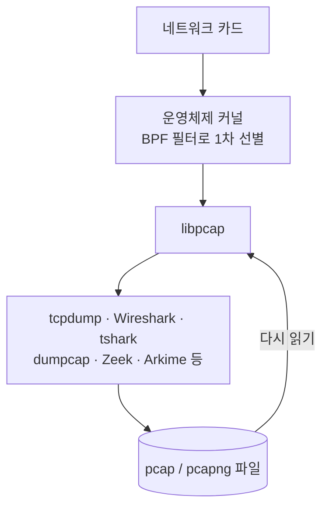

# 1.6강 — 패킷을 담는 그릇: libpcap, tcpdump, 그리고 pcap·pcapng 파일 구조 { #pcap-and-tcpdump }

!!! abstract "이번 회차의 범위"
    [1.5강](proxy-cache.md) 끝에서 "상용 캐시를 꺼낼 수 없으면 선을 지나간 데이터, 즉 패킷으로 간다"고 했습니다. 이번 회차는 그 패킷을 담는 **그릇**을 다룹니다.

    - libpcap이 무엇이고, tcpdump·Wireshark·tshark가 왜 모두 그 위에서 돌아가는가
    - pcap 파일 머리말(24바이트)과 패킷마다 붙는 기록 머리말(16바이트)을 바이트 단위로 읽기
    - 스냅샷 길이(snaplen)와 잘린 패킷
    - pcapng가 더한 것, 표준화 현황, pcap으로 바꿀 때 잃는 것
    - tcpdump로 수집하는 기본 명령과, 끝날 때 나오는 통계의 뜻

    BPF 필터의 문법은 1.7강, tcpdump의 실전 옵션과 Wireshark 화면은 1.8강에서 다룹니다.

!!! note "실습 환경과 표기"
    이번 회차의 **(직접 실행 결과)**는 이 작업 환경에 설치한 Ubuntu 패키지 **tcpdump 4.99.4(libpcap 1.10.4)**와 **tshark 4.2.2**로, 같은 PC 안의 루프백 인터페이스(`lo`)에서 시험용 웹 서버(`127.0.0.1:8082`)와 주고받은 트래픽을 실제로 수집해 얻은 출력입니다. 2026-11-05 기준 각 프로젝트의 최신 태그는 tcpdump 4.99.7, libpcap 1.11.0, Wireshark 안정판 4.6.16입니다(저장소 태그로 확인). 버전은 계속 올라가니 "최신"은 이 날짜 기준입니다.

## 1. 누가 건넨 pcap 파일 하나 { #a-pcap-file }

**(가상 사례)** 1.4강 사건의 다음 날, 네트워크 팀이 "사건 시간대에 연구 구간 탭에서 떠 둔 패킷"이라며 `research-1014.pcap` 파일을 건넵니다. 바로 Wireshark로 열고 싶겠지만, 그 전에 물어야 할 게 있습니다.

- 이 파일에 찍힌 시각은 어느 시간대인가?
- 패킷이 통째로 들어 있나, 아니면 앞부분만 잘려 들어 있나?
- 어떤 종류의 회선(이더넷, 무선 등)에서 떴나?
- 몇 개의 인터페이스에서 떴고, 떠는 동안 놓친 패킷은 없나?

이 질문의 답 중 일부는 **파일 자체**에 적혀 있습니다. 그릇의 구조를 알면 파일을 열기도 전에 "이 증거로 무엇을 할 수 있고 무엇을 할 수 없는지" 판단할 수 있어요.

## 2. 비유: 녹화 테이프와 라벨 { #analogy }

패킷 캡처 파일을 녹화 테이프라고 생각해 보세요. 테이프 맨 앞에는 **라벨**이 붙어 있습니다. "이 테이프는 어떤 방식으로 녹화됐고, 화질은 어떻고, 어떤 카메라로 찍었다." 그리고 테이프 안의 장면마다 **찍힌 시각과 길이**가 적혀 있어요.

pcap 파일도 똑같습니다. 맨 앞의 **파일 머리말**이 라벨이고(형식, 한 패킷에서 최대 몇 바이트까지 저장했는지, 어떤 종류의 회선인지), 패킷마다 붙는 **기록 머리말**이 장면별 시각과 길이입니다.

비유와 다른 점도 있습니다. 옛 pcap 형식의 라벨에는 **"어느 카메라(인터페이스)에서 찍었는지"가 없습니다.** 여러 카메라의 영상을 한 테이프에 담을 수도 없고요. 이 한계를 메우려고 나온 것이 pcapng입니다(6절). 또 하나, 테이프의 시각은 녹화한 기계의 시계를 따릅니다. 그 기계의 시계가 틀렸다면 모든 장면의 시각이 함께 틀립니다.

## 3. libpcap: 거의 모든 패킷 도구의 바닥 { #libpcap }

네트워크 포렌식에서 가장 기본이 되는 도구는 **tcpdump**입니다. 네트워크에서 패킷을 잡아서, 각 패킷의 정보를 원하는 만큼 화면에 보여 주거나 패킷 전체(또는 일부)를 디스크에 씁니다. 명령줄 도구라서 내 PC에서도, 원격 서버에서도, 사람이 직접 쳐도, 스크립트로 자동화해도 쓸 수 있어요. 원래 유닉스 계열에서 시작했지만 다른 운영체제로도 옮겨져서, 윈도우와 유닉스 계열 관리자·조사자 모두에게 기본 도구입니다.

tcpdump의 핵심 기능은 사실 그 밑에 있는 **libpcap** 라이브러리에서 나옵니다. 중요한 기능은 네 가지입니다.

1. **BPF(Berkeley Packet Filter) 언어.** "이런 패킷만 잡아라"를 정하는 단순한 필터 언어입니다. 정해진 기본 단위(프리미티브)를 논리로 조합해 정교한 필터를 만듭니다(1.7강).
2. **화면에 보여 주거나 pcap 파일로 저장하기.** pcap은 패킷을 디스크에 저장하는 표준화된 형식입니다. 이 강의에서 볼 데이터 대부분이 pcap 파일이에요.
3. **실제 네트워크에서 읽거나, 저장된 pcap 파일에서 읽기.** 저장과 반대로, libpcap은 저장된 파일을 마치 지금 네트워크에서 들어오는 것처럼 읽게 해 줍니다. 포렌식 관점에서 이게 아주 중요합니다. **한 번 수집해 두면, 몇 년 뒤에도 여러 도구로 원본의 완벽한 사본을 분석할 수 있다**는 뜻이니까요.
4. **얼마나 담을지 정하기(snaplen).** 모든 바이트를 담는 것이 이상적이지만, 법적·현실적 이유로 그럴 수 없을 때가 있습니다. 그때 패킷마다 앞의 몇 바이트만 담도록 정할 수 있어요. 예를 들어 헤더만 담을 수 있습니다(5절).

이 기능들이 tcpdump가 아니라 **라이브러리**에 있기 때문에, 다른 도구들도 같은 기능을 그대로 씁니다. 실제로 네트워크 분석 도구의 압도적 다수가 libpcap(윈도우에서는 그 호환 구현인 Npcap) 위에서 돌아갑니다.



**그림 읽는 법:** 위에서 아래로 패킷이 흘러갑니다. 커널에서 BPF 필터가 먼저 걸러 주고, libpcap이 그 결과를 여러 도구에 넘깁니다. 도구가 쓴 파일은 옆으로 돌아 올라가는 화살표처럼 libpcap을 통해 다시 읽혀서, 어떤 도구로든 다시 분석할 수 있습니다.

### 3.1 Wireshark와 tshark { #wireshark-tshark }

tcpdump는 수집에는 훌륭하지만 패킷 내용을 깊이 해석하는 기능은 많지 않습니다. 그 일은 **Wireshark**가 맡습니다. Wireshark는 네트워크 트래픽의 내용을 눈으로 살펴보고 높은 수준의 분석을 할 수 있는 그래픽 프로그램이에요. 가장 큰 장점은 **수백 가지 프로토콜 해석기**(dissector, 디코더)입니다. 각 패킷의 필드가 무슨 뜻인지 풀어서 보여 주기 때문에, 프로토콜 표준 문서(RFC)를 처음부터 읽지 않아도 훨씬 빨리 일을 할 수 있어요. 표준 문서가 없는 독자 프로토콜도 커뮤니티가 해석기를 기여하는 경우가 많고, 직접 만들어 쓸 수도 있습니다.

Wireshark에는 같은 기능을 명령줄로 쓰는 **tshark**가 함께 들어 있습니다. 화면에서 분석 방법을 만들어 본 뒤, 그 방법을 tshark로 옮겨 수많은 파일에 한꺼번에 적용할 수 있어요. 이게 이 시리즈에서 자주 쓸 흐름입니다.

Wireshark로도 패킷을 수집할 수 있지만, 화면과 해석기가 뒤에서 하는 일이 많아 대량 수집에는 맞지 않습니다. 실험실 정도면 괜찮지만, 트래픽이 많아지면 tcpdump 같은 전용 수집 도구를 써야 합니다. 요즘 Wireshark는 수집 자체를 **dumpcap**이라는 별도 프로그램에 맡기고, dumpcap은 화면 없이 단독으로도 쓸 수 있습니다(1.9강).

## 4. pcap 파일 해부 { #pcap-format }

이제 그릇을 열어 보겠습니다. 루프백에서 시험용 웹 서버와 주고받은 트래픽을 tcpdump로 떠서 `full.pcap`을 만들었습니다(직접 실행 결과).

```console
$ file full.pcap
full.pcap: pcap capture file, microsecond ts (little-endian) - version 2.4 (Ethernet, capture length 262144)
$ hexdump -C full.pcap | head -3
00000000  d4 c3 b2 a1 02 00 04 00  00 00 00 00 00 00 00 00  |................|
00000010  00 00 04 00 01 00 00 00  6f ec eb 6a d4 fe 04 00  |........o..j....|
00000020  4a 00 00 00 4a 00 00 00  00 00 00 00 00 00 00 00  |J...J...........|
```

### 4.1 파일 머리말: 처음 24바이트 { #file-header }

처음 24바이트(`0x00`~`0x17`)가 파일 머리말입니다. 4바이트씩 끊어 읽습니다.

| 위치 | 바이트 | 값 | 뜻 |
| --- | --- | --- | --- |
| `0x00` | `d4 c3 b2 a1` | 0xa1b2c3d4 | **매직 넘버**. "이건 pcap 파일, 시각은 마이크로초 단위"라는 표시 |
| `0x04` | `02 00` · `04 00` | 2 · 4 | 형식 버전 2.4 |
| `0x08` | `00 00 00 00` | 0 | 예전 문서에서 "시간대 오프셋"이라 부르던 칸 |
| `0x0C` | `00 00 00 00` | 0 | 예전 문서에서 "시각 정확도"라 부르던 칸 |
| `0x10` | `00 00 04 00` | 262,144 | **스냅샷 길이**(패킷당 최대 저장 바이트) |
| `0x14` | `01 00 00 00` | 1 | **링크 계층 형식**. 1 = 이더넷 |

**매직 넘버와 바이트 순서.** 표의 "바이트" 칸과 "값" 칸이 거꾸로인 게 보이시죠? 컴퓨터마다 여러 바이트로 된 숫자를 **작은 자리부터** 저장하는 방식(리틀 엔디언)과 **큰 자리부터** 저장하는 방식(빅 엔디언)이 있습니다. 오늘날 인텔·AMD의 x86·x86-64는 리틀 엔디언이라, 0xa1b2c3d4라는 값이 파일에는 `d4 c3 b2 a1`로 적혀요. 그래서 가장 흔한 pcap 파일의 첫 네 바이트가 `d4 c3 b2 a1`입니다. 아주 오래된 빅 엔디언 기계에서 만든 파일이라면 `a1 b2 c3 d4`로 보입니다. 이 네 바이트로 프로그램이 "이 파일의 숫자들을 어느 순서로 읽어야 하는지"까지 알게 되는 셈이에요. `file` 명령이 `(little-endian)`이라고 알려 준 것도 이 때문입니다.

또 하나, 매직 넘버가 **0xa1b23c4d**(파일에는 `4d 3c b2 a1`)라면, 형식은 같지만 패킷 시각의 소수 부분이 마이크로초가 아니라 **나노초**라는 뜻입니다. 같은 pcap이라도 매직 넘버를 보고 시각을 해석해야 해요.

**[변경됨] 시간대·정확도 칸.** 교재는 이 두 칸을 "시간대는 늘 UTC라 0, 정확도도 0"이라고 설명합니다. 지금 libpcap의 파일 형식 문서는 두 칸을 아예 **"쓰지 않음"**으로 정의합니다. 쓰는 쪽은 0으로 채워야 하고, 읽는 쪽은 **무시해야** 하며, 예전 일부 프로그램은 0이 아닌 값을 넣기도 했다고 적혀 있어요(2026-11-05, libpcap 1.10 브랜치의 `pcap-savefile` 문서로 확인). 실질적인 결론은 같습니다. pcap의 패킷 시각은 **1970년 1월 1일 UTC부터 센 시간**이라 시간대가 없고, 이 칸에 무슨 값이 있든 시각을 고치는 데 쓰면 안 됩니다.

**스냅샷 길이.** 패킷당 최대 몇 바이트를 저장했는지입니다. 262,144는 tcpdump 4.99의 기본값이에요(tcpdump 문서로 확인). 교재가 드는 예가 좋습니다. 어떤 IPv4 pcap 파일의 모든 패킷이 40바이트 이하라면, 네트워크 오류로 잘린 걸까요, 아니면 누가 40바이트만 담도록 떴을까요? **이 칸이 그 답을 줍니다.** 기본값은 도구 버전과 운영체제마다 크게 달랐기 때문에(예전 tcpdump는 68이나 96바이트였던 적도 있습니다), 도구를 쓰기 전에 직접 시험하고 확인해야 합니다.

**링크 계층 형식.** 어떤 종류의 매체에서 떴는지입니다. 1은 이더넷이고, 그 밖에 무선(802.11), 리눅스의 "any" 의사 인터페이스(LINUX_SLL), 원시 IP 등 수많은 값이 있습니다. 전체 목록은 `pcap-linktype` 문서에 있어요. 이 값이 틀리면 프로그램이 패킷의 첫 바이트를 엉뚱하게 해석합니다. 이번 실습은 루프백인데도 1(이더넷)로 나왔는데, 리눅스가 루프백을 이더넷 모양으로 보여 주기 때문입니다.

### 4.2 기록 머리말: 패킷마다 16바이트 { #record-header }

파일 머리말 뒤에는 패킷이 0개 이상 이어지고, 패킷마다 앞에 16바이트짜리 **기록 머리말**이 붙습니다. 위 hexdump의 `0x18`부터가 첫 패킷의 기록 머리말이에요.

| 위치 | 바이트 | 값 | 뜻 |
| --- | --- | --- | --- |
| `0x18` | `6f ec eb 6a` | 0x6aebec6f = 1,793,846,383 | 수집 시각, **초**(유닉스 시간) |
| `0x1C` | `d4 fe 04 00` | 0x0004fed4 = 327,380 | 그 초 뒤의 **마이크로초** |
| `0x20` | `4a 00 00 00` | 74 | 파일에 **저장한** 바이트 수(caplen) |
| `0x24` | `4a 00 00 00` | 74 | 원래 회선에 있던 바이트 수(len) |

계산해 보면 이렇습니다(직접 실행 결과).

```console
$ date -u -d @$((0x6aebec6f))
Thu Nov  5 02:39:43 UTC 2026
$ echo $((0x0004fed4))
327380
```

`$((0x6aebec6f))`는 셸에게 16진수를 10진수로 바꿔 달라는 표현입니다. 첫 패킷은 UTC 2026-11-05 02:39:43.327380에 잡혔다는 뜻이에요. 같은 파일을 `capinfos`로 보면 그대로 확인됩니다(직접 실행 결과, 일부).

```console
$ capinfos -M full.pcap
File name:           full.pcap
File type:           pcap
File encapsulation:  ether
File timestamp precision:  microseconds (6)
Packet size limit:   file hdr: 262144 bytes
Number of packets:   36
...
First packet time:   2026-11-05 02:39:43.327380
...
SHA256:              f734f65f4e69efec6bc4daa9b3bba40c9d379d61835aab27f45e09eded9f8957
Strict time order:   True
```

`capinfos`는 Wireshark에 들어 있는 명령으로, 캡처 파일의 요약 정보를 보여 줍니다(`-M`은 큰 숫자를 1k, 1M처럼 줄이지 말고 그대로 보여 달라는 옵션). 파일을 건네받으면 **가장 먼저** 돌려 볼 명령이에요. 파일 종류, 스냅샷 길이, 패킷 수, 첫·마지막 패킷 시각, 그리고 해시까지 한 번에 나옵니다. `Strict time order: True`는 패킷이 시각 순서대로 들어 있다는 뜻이고, 여러 파일을 합친 결과에서는 이게 `False`일 수 있습니다.

**[주의] 패킷 시각은 "수집한 기계의 시계"입니다.** 기록 머리말의 시각은 패킷이 실제로 회선을 지난 객관적 시각이 아니라, **그 패킷을 잡은 기계가 자기 시계로 찍은** 시각입니다. 수집 장비의 시계가 5분 빨랐다면 모든 패킷이 5분 빠르게 찍혀요. 그래서 수집 장비가 NTP(네트워크 시간 동기화)로 맞춰져 있었는지 확인하고, 다른 증거(1.3강의 프록시 로그 등)와 같은 사건으로 몇 군데 시각을 맞춰 차이를 기록해 둡니다.

## 5. 잘린 패킷: 스냅샷 길이를 줄이면 { #snaplen }

같은 트래픽을 `-s 96`(패킷당 96바이트만)으로도 함께 떠서 비교해 봤습니다(직접 실행 결과).

```console
$ capinfos -M snap96.pcap | grep "Packet size"
Packet size limit:   file hdr: 96 bytes
Packet size limit:   inferred: 96 bytes
$ tshark -r snap96.pcap -T fields -e frame.number -e frame.cap_len -e frame.len | awk '$2!=$3' | head -4
4	96	143
6	96	252
8	96	98
16	96	153
```

두 번째 명령은 각 패킷의 번호, 저장한 길이(`frame.cap_len`, 기록 머리말의 caplen), 원래 길이(`frame.len`, len)를 뽑은 뒤, awk로 **둘이 다른 패킷만** 남긴 것입니다. 4번 패킷은 원래 143바이트였는데 96바이트만 저장됐어요. 이 패킷의 내용을 보면 어디서 잘렸는지 보입니다(직접 실행 결과, 일부).

```console
$ tcpdump -n -r snap96.pcap -A -c 4
...
.V7....(GET / HTTP/1.1
Host: 127.0.0.
```

`-A`는 패킷 내용을 글자로 보여 달라는 옵션입니다. HTTP 요청이 `Host: 127.0.0.`에서 끊겼죠. IP와 TCP 헤더(누가 누구와, 어느 포트로, 언제)는 온전하지만 **그 뒤의 내용은 96바이트까지만** 남았습니다.

이것이 스냅샷 길이의 양면입니다.

- **줄이는 이유:** 저장 용량을 크게 아끼고, 법이나 개인정보 정책상 내용을 저장할 수 없을 때 헤더만 남길 수 있습니다. 처리 부하도 줄어듭니다.
- **잃는 것:** 내용이 잘리니 파일 카빙(1.5강)이나 페이로드 분석은 불가능합니다. "무엇을 주고받았나"에는 답할 수 없고, "누가 누구와 언제 얼마나"까지만 답할 수 있어요. 1.1강의 스펙트럼으로 보면, 전체 패킷과 플로우 사이 어딘가에 놓이는 증거가 됩니다.

그러니 패킷이 잘려 있을 때는 파일 머리말의 스냅샷 길이를 먼저 보세요. 96이라면 일부러 그렇게 뜬 것이고, 262144인데도 잘려 있다면 다른 원인(수집 장비의 문제 등)을 찾아봐야 합니다.

## 6. pcapng: 다음 세대 형식 { #pcapng }

옛 pcap 형식에는 한계가 있습니다. 한 파일에 인터페이스 하나, 링크 형식 하나만 담을 수 있고, 시각 정밀도를 고를 수 없고, 메모나 수집 정보를 남길 자리가 없어요. 이걸 고치려고 나온 것이 **pcapng**(pcap next generation)입니다. 구조가 옛 형식과 완전히 다르고, **블록**이라는 단위를 이어 붙이는 확장 가능한 구조예요. 흔히 꼽는 장점은 이렇습니다.

- 여러 인터페이스(종류가 다른 인터페이스도)에서 뜬 패킷을 한 파일에 담기
- 더 나은 시각 정밀도 선택
- 메모(코멘트), 수집 통계, 이름 해석(DNS) 기록 같은 풍부한 메타데이터

실제로 tshark로 같은 트래픽을 떠서 만든 pcapng 파일을 보면 그 차이가 드러납니다(직접 실행 결과, 일부).

```console
$ file capture.pcapng
capture.pcapng: pcapng capture file - version 1.0
$ capinfos -M capture.pcapng
...
Capture hardware:    Intel(R) Xeon(R) Processor @ 2.10GHz (with SSE4.2)
Capture oper-sys:    Linux 6.18.44-fc-v236
Capture application: Dumpcap (Wireshark) 4.2.2 (Git v4.2.2 packaged as 4.2.2-1.1build3)
Number of interfaces in file: 1
Interface #0 info:
                     Name = lo
                     Encapsulation = Ethernet (1 - ether)
                     Capture length = 262144
                     Time precision = nanoseconds (9)
                     Filter string = tcp port 8082
```

pcap에는 없던 정보가 보입니다. **어느 인터페이스**(`lo`)에서, **어떤 필터**(`tcp port 8082`)로, **어떤 프로그램과 운영체제, 하드웨어**에서 떴는지, 그리고 시각이 **나노초** 정밀도라는 것까지요. 조사자에게는 "이 증거가 어떻게 만들어졌나"를 보여 주는 귀중한 기록입니다. 특히 수집 필터가 남아 있으면 "이 파일에 무엇이 처음부터 빠져 있는지"를 알 수 있어요. `tcp port 8082`로 떴으니 DNS 같은 다른 트래픽은 애초에 없는 게 정상이라는 식으로요.

### 6.1 [변경됨] 표준화와 호환성 { #pcapng-status }

교재는 pcapng를 "IETF에서 2004년에 제안됐지만 아직 초안 상태이고, 중요한 도구들이 완전히 지원하지 않으니 가능하면 옛 pcap으로 바꿔 쓰라"고 설명합니다. 2026-11-05 기준으로 확인한 현황은 이렇습니다.

- **표준화:** pcapng는 여전히 IETF **초안**(Internet-Draft)입니다. 가장 최근 판은 2026년 3월의 `draft-ietf-opsawg-pcapng-05`예요. 옛 pcap 형식을 설명하는 별도 초안(`draft-ietf-opsawg-pcap-08`, 2026년 5월)은 목표 상태를 "Historic"(역사적 문서)으로 두고, pcapng가 그 형식을 대체한다고 적고 있습니다.
- **지원:** Wireshark·tshark·dumpcap은 pcapng를 **기본 저장 형식**으로 씁니다. libpcap도 pcapng 파일을 읽을 수 있지만, 문서에 "모든 pcapng 파일을 읽을 수 있지는 않다"고 적혀 있습니다. 예를 들어 링크 형식이 서로 다른 여러 인터페이스가 섞인 파일은 libpcap 기반 도구가 제대로 못 읽을 수 있어요. 이번 실습의 단순한 파일은 tcpdump 4.99.4가 문제없이 읽었습니다(직접 실행 결과).

    ```console
    $ tcpdump -n -r capture.pcapng | head -2
    reading from file capture.pcapng, link-type EN10MB (Ethernet), snapshot length 262144
    02:39:43.327380 IP 127.0.0.1.36314 > 127.0.0.1.8082: Flags [S], seq 833062265, ...
    ```

### 6.2 pcap으로 바꾸기, 그리고 잃는 것 { #convert }

시험해 보지 않은 도구에 pcapng를 넣어야 할 때는 Wireshark의 명령줄 도구 `editcap`으로 옛 pcap으로 바꿀 수 있습니다(직접 실행 결과).

```console
$ editcap -F pcap capture.pcapng converted.pcap
$ file converted.pcap
converted.pcap: pcap capture file, microsecond ts (little-endian) - version 2.4 (Ethernet, capture length 262144)
$ capinfos -M converted.pcap | grep -i precision
File timestamp precision:  microseconds (6)
```

`-F pcap`은 "출력 형식을 pcap으로"라는 뜻입니다. 변환은 잘 됐지만, 바꾼 파일에는 6절에서 본 인터페이스 이름, 수집 필터, 수집 프로그램·운영체제·하드웨어 정보가 **없고**, 시각 정밀도도 나노초에서 **마이크로초로 줄었습니다.** pcap 형식에 그 정보를 담을 자리가 없기 때문이에요.

그래서 교재의 "가능하면 pcap으로 바꿔라"는 조언을 조금 고쳐 적용하는 게 좋습니다.

1. **원본 pcapng는 그대로 증거로 보존**하고 해시를 기록합니다.
2. 변환은 **필요한 도구에 넣을 작업 사본**에만 하고, 언제 어떤 명령으로 바꿨는지 기록합니다.
3. 변환본에서 나온 결과는 원본의 메타데이터(인터페이스, 필터, 정밀도)와 함께 해석합니다.

## 7. tcpdump로 수집하기 { #capturing }

이제 수집 명령을 보겠습니다. 기본 형태는 이렇습니다.

```bash
sudo tcpdump -n -s 0 -i ens33 -w out.pcap 'host 203.0.113.5 and port 80'
```

| 부분 | 뜻 | 왜 쓰나 |
| --- | --- | --- |
| `sudo` | 관리자 권한으로 실행 | 인터페이스에서 패킷을 직접 잡으려면 보통 관리자 권한이 필요 |
| `-n` | 주소를 이름으로, 포트를 서비스 이름으로 바꾸지 않음 | 이름 조회 트래픽을 만들지 않고(OPSEC), 빠름 |
| `-s 0` | 스냅샷 길이 0 = 기본 최대값(262,144바이트) | 패킷 전체를 담기. 기본값이 버전마다 달랐으니 명시하는 습관 |
| `-i ens33` | `ens33` 인터페이스에서 수집 | `tcpdump -D`로 쓸 수 있는 인터페이스 목록을 봄 |
| `-w out.pcap` | 화면 대신 파일로 저장 | 나중에 어떤 도구로든 다시 분석 |
| `'host 203.0.113.5 and port 80'` | BPF 필터 | 그 주소와 80번 포트가 들어간 패킷만(1.7강) |

**`-n`은 거의 언제나 붙이세요.** 이 옵션이 없으면 tcpdump는 보이는 IP마다 DNS 조회를 합니다. 느려질 뿐 아니라, 공격자가 자기 DNS 서버를 지켜보고 있다면 "누가 내 주소를 조회했다"는 걸 알게 됩니다. 1.2강부터 말해 온 OPSEC 문제예요.

**BPF 필터는 따옴표로 감싸세요.** 필터의 공백, 괄호 같은 글자를 셸이 먼저 해석해 버리면 의도와 다른 필터가 됩니다. 작은따옴표나 큰따옴표로 감싸는 것이 가장 좋은 습관입니다.

`tcpdump -D`로 인터페이스 목록을 보면 이렇습니다(직접 실행 결과, 일부).

```console
$ tcpdump -D
1.eth0 [Up, Running, Connected]
2.any (Pseudo-device that captures on all interfaces) [Up, Running]
3.lo [Up, Running, Loopback]
...
```

**무차별 모드(promiscuous mode).** 네트워크 카드는 원래 자기 주소로 온 패킷만 받아들입니다. 수집할 때는 카드를 **무차별 모드**로 바꿔 자기 주소가 아닌 패킷도 받게 하는데, 여기에 관리자 권한이 필요해요. tcpdump는 기본으로 무차별 모드를 켭니다. 다만 스위치 환경에서는 무차별 모드만으로 남의 트래픽이 보이지 않습니다. 스위치가 애초에 그 포트로 남의 패킷을 보내 주지 않으니까요. 그래서 탭이나 스위치 미러링이 필요하고, 이건 1.11강에서 다룹니다. 참고로 리눅스의 `any` 인터페이스로 뜰 때는 무차별 모드가 적용되지 않습니다.

**[보충] 파일을 쓰는 사용자.** 많은 리눅스 배포판의 tcpdump는 보안을 위해 수집을 시작한 뒤 관리자 권한을 버리고 `tcpdump` 같은 일반 사용자로 바꿔서 파일을 씁니다. 그래서 그 사용자가 쓸 수 없는 폴더에 `-w`로 저장하려 하면 권한 오류가 날 수 있어요. 이번 실습에서는 `-Z root`로 사용자를 바꾸지 않게 했습니다. 실무에서는 수집 전용 폴더의 권한을 맞춰 두는 편이 낫습니다.

### 7.1 끝날 때 나오는 숫자 세 개 { #capture-stats }

수집을 멈추면 tcpdump가 통계를 보여 줍니다(직접 실행 결과).

```console
tcpdump: listening on lo, link-type EN10MB (Ethernet), snapshot length 262144 bytes
36 packets captured
72 packets received by filter
0 packets dropped by kernel
```

| 줄 | 뜻(tcpdump 문서 기준) |
| --- | --- |
| `packets captured` | tcpdump가 실제로 받아서 처리한 패킷 수 |
| `packets received by filter` | **운영체제마다 뜻이 다름.** 필터와 상관없이 센 수일 수도, 필터에 맞았지만 아직 처리 안 한 것까지 센 수일 수도 있음 |
| `packets dropped by kernel` | 버퍼가 모자라서 운영체제의 수집 장치가 **버린** 패킷 수. 운영체제가 알려 주지 않으면 0 |

이번 실습에서 "받음"이 72인데 "수집"이 36인 건 이상해 보이지만, 문서대로 이 숫자의 뜻은 운영체제와 설정에 따라 다릅니다. 이번 환경에서 정확히 두 배가 된 원인은 루프백 인터페이스의 특성으로, 1.10강 5.1절에서 libpcap 소스로 확인했습니다. 중요한 건 이 숫자만 보고 "36개를 놓쳤다"고 해석하면 안 된다는 점입니다. **놓친 패킷을 보려면 마지막 줄 `dropped by kernel`을 봐야 합니다.**

그런데 `0 dropped`라고 해서 **아무것도 놓치지 않았다는 보장은 아닙니다.** 이 숫자는 수집하는 기계 **안에서** 버린 것만 셉니다. 그 전에, 예를 들어 스위치의 미러링 포트가 넘쳐서 버린 패킷은 이 기계가 알 수 없어요. 그리고 `-s 0`으로 패킷 전체를 담겠다고 해도, 수집 기계의 **CPU**가 못 따라가면 패킷을 버리고, **저장 장치**가 회선 속도만큼 빨리 쓰지 못해도 놓칩니다. 그래서 수집 장비는 실제 운영에 쓰기 전에 **실제 속도와 규모로 시험**해 봐야 합니다.

### 7.2 수집한 파일 읽기 { #reading }

저장한 파일은 `-r`로 다시 읽습니다(직접 실행 결과, 일부).

```console
$ tcpdump -n -r full.pcap -A 'tcp[((tcp[12]&0xf0)>>2):4] = 0x47455420' | head -4
02:39:43.327455 IP 127.0.0.1.36314 > 127.0.0.1.8082: Flags [P.], seq 833062266:833062343, ack 1449026129, win 64, options [nop,nop,TS val 3495311331 ecr 3503756584], length 77
E...H.@.@...............1..zV^bQ...@.u.....
.V7....(GET / HTTP/1.1
Host: 127.0.0.1:8082
```

뒤의 필터는 "TCP 데이터의 처음 네 바이트가 `GET `인 패킷"이라는 뜻의 BPF입니다. 지금은 어려워 보여도 1.7강에서 한 부분씩 풀어 봅니다. 같은 요청이 `full.pcap`에서는 `Host: 127.0.0.1:8082`까지 온전히 보입니다. 5절의 잘린 파일과 비교해 보세요.

## 8. 실제 조사에서는 이렇게 해석합니다 { #interpretation }

1절의 `research-1014.pcap`을 받았다면, 열기 전에 이렇게 합니다.

1. **사본을 만들고 해시를 기록합니다.** 원본은 건드리지 않고 사본으로 분석합니다(`sha256sum`, 또는 `capinfos`의 SHA256).
2. **`capinfos`로 그릇을 확인합니다.** 형식(pcap/pcapng), 스냅샷 길이(내용이 온전한가), 링크 형식, 첫·마지막 패킷 시각(사건 시간대를 덮는가), 패킷 수, 시각 순서.
3. **pcapng라면 메타데이터를 기록합니다.** 인터페이스 이름, 수집 필터(무엇이 처음부터 빠졌나), 수집 프로그램, 코멘트.
4. **수집 조건을 물어봅니다.** 어느 탭·미러링 지점에서(1.1강 10절의 탭 위치), 어느 방향을, 어떤 장비로 떴나. 수집 중 버린 패킷 통계가 남아 있나. 수집 장비의 시계는 맞았나.
5. **그 결과로 "이 파일로 할 수 있는 것"을 적습니다.** 예: "스냅샷 길이 96이라 파일 카빙 불가, 연결 기록과 헤더 분석만 가능", "수집 필터가 `tcp`라 DNS(주로 UDP)는 없음".

이 다섯 줄이 보고서의 "증거 설명" 부분이 됩니다. 나중에 누가 "이 파일에 X가 없으니 X는 없었다"고 말할 때, 그게 증거의 한계 때문인지 실제로 없었던 건지를 가를 근거가 되기도 해요.

## 9. 정리 { #summary }

- tcpdump, Wireshark, tshark, Zeek 같은 도구 대부분은 **libpcap** 위에서 돌아갑니다. BPF 필터, pcap 저장·읽기, 스냅샷 길이가 모두 libpcap의 기능이라 도구가 달라도 같은 원리가 통합니다.
- 한 번 pcap으로 떠 두면 몇 년 뒤에도 여러 도구로 원본의 완벽한 사본을 다시 분석할 수 있습니다.
- pcap 파일은 24바이트 파일 머리말(매직 넘버, 버전, 쓰지 않는 두 칸, 스냅샷 길이, 링크 형식)과 패킷마다 16바이트 기록 머리말(초, 마이크로초 또는 나노초, 저장 길이, 원래 길이)로 되어 있습니다.
- 매직 넘버 `d4 c3 b2 a1`은 리틀 엔디언 마이크로초, `4d 3c b2 a1`은 나노초입니다. 패킷 시각은 UTC 유닉스 시간이고, 수집한 기계의 시계를 따릅니다.
- 저장 길이가 원래 길이보다 짧으면 잘린 패킷입니다. 파일 머리말의 스냅샷 길이로 의도된 것인지 확인합니다.
- pcapng는 여러 인터페이스, 나노초 정밀도, 인터페이스 이름·수집 필터·수집 환경 같은 메타데이터를 담습니다. 2026년 현재도 IETF 초안이지만 Wireshark 계열의 기본 형식입니다. pcap으로 바꾸면 이 정보를 잃으니 원본은 그대로 보존합니다.
- 수집할 때는 `-n`을 붙이고, 필터는 따옴표로 감싸고, 끝날 때 `dropped by kernel`을 확인합니다. 0이어도 수집 기계 밖에서 놓친 것은 알 수 없습니다.

다음 회차(1.7강)에서는 이번에 잠깐 본 BPF 필터를 프리미티브부터 바이트 단위 조건까지 차근차근 풀어 봅니다.

## 복습 문제 { #review }

**문제 1.** 어떤 캡처 파일의 첫 4바이트가 `4d 3c b2 a1`입니다. 무엇을 알 수 있나요? 이 파일의 패킷 시각을 마이크로초로 해석하면 어떻게 될까요?

??? success "정답과 해설"
    값으로는 0xa1b23c4d이고, 리틀 엔디언으로 저장된 **나노초 정밀도 pcap** 파일입니다. 기록 머리말의 둘째 칸이 마이크로초가 아니라 **나노초**예요. 이걸 마이크로초로 잘못 읽으면, 예를 들어 0.327380123초(327,380,123나노초)를 327,380,123마이크로초, 즉 327초 남짓으로 읽게 됩니다. 그러면 다음 초를 훌쩍 넘는 말이 안 되는 시각이 나와요. 대부분의 도구는 매직 넘버를 보고 알아서 처리하지만, 직접 바이트를 읽는 스크립트를 쓸 때는 매직 넘버부터 확인해야 합니다.

**문제 2. (계산)** pcap 기록 머리말의 처음 8바이트가 `00 e1 f5 05 40 42 0f 00`입니다(리틀 엔디언, 마이크로초 형식). 이 패킷의 수집 시각은 언제인가요? 둘째 값에 이상한 점은 없나요?

??? success "정답과 해설"
    첫 4바이트 `00 e1 f5 05`는 거꾸로 읽어 0x05f5e100 = **100,000,000**초입니다. `date -u -d @100000000`으로 바꾸면 **1973-03-03 09:46:40 UTC**예요. 둘째 4바이트 `40 42 0f 00`은 0x000f4240 = **1,000,000**인데, 마이크로초 칸은 0~999,999여야 합니다. 1,000,000은 "다음 초"가 돼야 할 값이라 **형식상 맞지 않습니다.** 이런 값은 파일이 손상됐거나, 실제로는 나노초 형식인데 매직 넘버를 잘못 봤거나, 파일을 만든 도구에 문제가 있다는 신호입니다. 1973년이라는 시각 자체도 수집 장비의 시계가 초기화된 상태였을 가능성을 의심하게 하고요. 이런 이상값은 무시하지 말고 증거 설명에 기록합니다.

**문제 3. (해석)** 동료가 건넨 pcap의 모든 패킷이 68바이트 이하입니다. 동료는 "네트워크에 작은 패킷만 있었다"고 말합니다. 어떻게 확인하나요?

??? success "정답과 해설"
    파일 머리말의 **스냅샷 길이**를 봅니다(`capinfos`의 "Packet size limit"). 68이라면 패킷이 작았던 게 아니라 **68바이트까지만 저장하도록** 뜬 것입니다. 예전 일부 tcpdump의 기본값이 68이었던 적이 있어서, 오래된 장비나 스크립트로 뜬 파일에서 흔해요. 더 확실하게는 패킷마다 저장 길이(caplen)와 원래 길이(len)를 비교합니다(`tshark -T fields -e frame.cap_len -e frame.len`). 원래 길이가 68보다 큰 패킷이 많다면, 실제로는 큰 패킷이 있었지만 잘린 것입니다. 그러면 이 파일로는 내용 분석이나 파일 카빙을 할 수 없다는 한계를 기록해야 합니다.

**문제 4. (흔한 오해)** 수집을 끝냈더니 `1520 packets captured`, `3040 packets received by filter`, `0 packets dropped by kernel`이 나왔습니다. 동료가 "1,520개를 놓쳤다"고 보고하려 합니다. 맞나요?

??? success "정답과 해설"
    틀립니다. tcpdump 문서에 따르면 `received by filter`의 뜻은 **운영체제마다 다르고**, 필터와 상관없이 센 값일 수도 있습니다. 수집 기계가 버린 패킷은 `dropped by kernel`인데 0입니다. 그러니 "수집 기계 안에서 버린 패킷은 없다"가 맞는 해석이에요. 다만 그것도 "전혀 놓치지 않았다"는 뜻은 아닙니다. 미러링 포트나 탭처럼 수집 기계 **앞**에서 버린 패킷은 이 숫자에 나오지 않으니, 그 장비들의 통계도 확인해야 합니다.

**문제 5. (변환)** 사건 증거로 받은 `evidence.pcapng`를 오래된 분석 도구에 넣으려고 `editcap -F pcap`으로 바꿨습니다. 보고서에 무엇을 적어야 하고, 원본 대신 변환본만 보관하면 무엇이 문제인가요?

??? success "정답과 해설"
    보고서에는 원본 파일과 그 해시, 변환한 날짜·명령(`editcap -F pcap evidence.pcapng work.pcap`)·도구 버전, 변환본의 해시를 적고, 분석에 변환본을 썼다는 사실을 밝힙니다. 변환본만 보관하면 pcapng에만 있던 정보를 **영영 잃습니다.** 6.2절에서 본 것처럼 인터페이스 이름, 수집 필터, 수집 프로그램·운영체제·하드웨어, 코멘트, 나노초 정밀도가 사라져요. 여러 인터페이스가 섞인 파일이었다면 인터페이스 구분도 잃을 수 있습니다. 그러면 나중에 "이 패킷은 어느 탭에서 왔나", "수집 필터 때문에 빠진 게 있나" 같은 질문에 답할 수 없게 됩니다. 원본 pcapng는 그대로 보존해야 합니다.

**문제 6. (명령 해석)** 다음 명령에서 잘못된 점이나 위험한 점을 찾고 고쳐 보세요.

```bash
sudo tcpdump -i eth0 -w case.pcap host 198.51.100.20 and (port 80 or port 443)
```

??? success "정답과 해설"
    1. **`-n`이 없습니다.** 파일로 쓸 때는 화면에 이름을 보여 주지 않으니 영향이 작을 수 있지만, 습관적으로 붙여야 합니다. 같은 명령에서 `-w`를 빼고 화면으로 보면 tcpdump가 IP마다 DNS 조회를 해서 OPSEC 문제가 됩니다.
    2. **BPF가 따옴표로 감싸져 있지 않습니다.** 셸은 `(`와 `)`를 특수 문자로 해석하므로, 이 명령은 아예 문법 오류로 실행되지 않거나 의도와 다르게 동작합니다.
    3. **`-s 0`이 없습니다.** tcpdump 4.99는 기본이 262,144바이트라 문제가 없지만, 오래된 버전이나 다른 도구에서는 기본값이 작았으니 명시하는 습관이 좋습니다.

    고친 명령: `sudo tcpdump -n -s 0 -i eth0 -w case.pcap 'host 198.51.100.20 and (port 80 or port 443)'`

**문제 7. (pcapng 메타데이터)** pcapng 파일의 `capinfos` 결과에 `Filter string = not port 22`가 있습니다. 이 사실은 조사에서 어떤 의미가 있나요?

??? success "정답과 해설"
    이 파일은 **처음부터 22번 포트(주로 SSH) 트래픽을 빼고** 떴다는 뜻입니다. 그러니 이 파일에서 SSH 통신이 보이지 않는 건 "SSH 통신이 없었다"가 아니라 **수집 범위 밖이었다**는 뜻이에요. 공격자가 SSH로 들어왔거나 SSH로 터널을 만들었다면 이 파일로는 알 수 없고, 플로우 기록이나 서버의 인증 로그 같은 다른 증거를 봐야 합니다. 수집 관리자가 SSH를 뺀 이유(관리 트래픽을 줄이려고 등)도 기록해 둡니다. 옛 pcap 형식이었다면 이 정보가 파일에 남지 않아서, 수집한 사람에게 물어보지 않는 한 알 수 없었을 겁니다.

**문제 8. (시각)** 수집 장비로 뜬 pcap의 첫 패킷 시각이 `2026-10-14 15:02:10`이고, 같은 순간을 기록한 프록시 로그(1.4강)는 `15:07:10`입니다. 두 기록 모두 UTC입니다. 무엇을 의심하고, 어떻게 처리해야 하나요?

??? success "정답과 해설"
    pcap의 시각은 **수집 장비의 시계**, 프록시 로그의 시각은 **프록시 서버의 시계**입니다. 같은 사건인데 5분 차이가 나면 둘 중 하나(또는 둘 다)의 시계가 틀렸을 가능성이 큽니다. 1.3강에서 본 것처럼 Squid는 요청이 끝난 시각을 기록하지만, 짧은 요청에서 5분 차이는 그것으로 설명되지 않아요. 확인할 것: 두 장비의 NTP 설정과 동기화 기록, 같은 사건이 남긴 제3의 기록(방화벽, DNS 서버)의 시각. 처리 방법: 원본 시각은 고치지 말고, 어느 장비가 얼마나 어긋났는지 **근거와 함께 기록**한 뒤, 타임라인을 만들 때 그 보정값을 명시해서 적용합니다. 근거 없이 한쪽을 "맞다"고 가정하면 안 됩니다.

## 참고 자료 { #references }

- The Tcpdump Group, libpcap 1.10 브랜치 [`pcap-savefile` 문서 원본](https://github.com/the-tcpdump-group/libpcap/blob/libpcap-1.10/pcap-savefile.manfile.in) (2026-11-05 확인). 매직 넘버 0xa1b2c3d4·0xa1b23c4d, 두 칸이 "쓰지 않음(쓰는 쪽은 0, 읽는 쪽은 무시)"이라는 정의, 스냅샷 길이와 링크 형식 칸, 기록 머리말 구조.
- The Tcpdump Group, libpcap 1.10 [`pcap_open_offline` 문서 원본](https://github.com/the-tcpdump-group/libpcap/blob/libpcap-1.10/pcap_open_offline.3pcap.in) (2026-11-05 확인). pcapng를 읽을 수 있으나 모든 pcapng 파일을 읽을 수는 없다는 설명.
- The Tcpdump Group, tcpdump 4.99 브랜치 [`tcpdump.1` 문서 원본](https://github.com/the-tcpdump-group/tcpdump/blob/tcpdump-4.99/tcpdump.1.in) (2026-11-05 확인). 기본 스냅샷 길이 262,144바이트, `-r`이 pcapng 파일도 읽는다는 점, 무차별 모드와 `any` 인터페이스, 수집 종료 통계의 뜻.
- IETF, [draft-ietf-opsawg-pcapng](https://datatracker.ietf.org/doc/draft-ietf-opsawg-pcapng/) (2026년 3월 판 -05, 2026-11-05 검색으로 확인)와 [draft-ietf-opsawg-pcap](https://datatracker.ietf.org/doc/draft-ietf-opsawg-pcap/) (2026년 5월 판 -08, 목표 상태 Historic).
- tcpdump·libpcap·Wireshark 저장소 태그(2026-11-05, `git ls-remote --tags`로 확인): tcpdump-4.99.7, libpcap-1.11.0, Wireshark v4.6.16.

!!! note "이 페이지에 대하여"
    여러 학습 자료를 바탕으로 직접 다시 쓴 개인 학습 노트입니다. 실습 트래픽과 파일은 이 작업 환경에서 직접 만든 것이고, 사례는 가상입니다.
