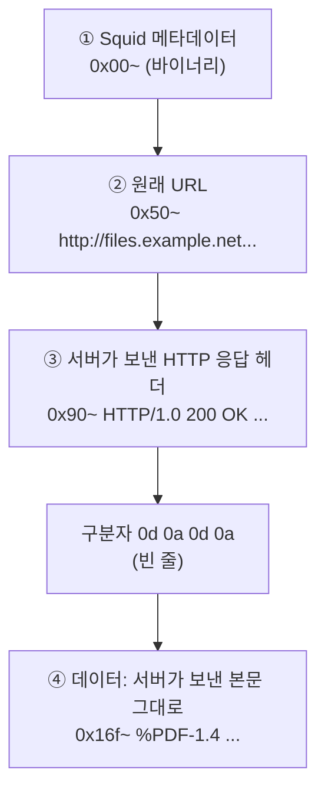

# 1.5강 — 상용 프록시 로그, 그리고 프록시 캐시에서 응답 꺼내기 { #proxy-cache }

!!! abstract "이번 회차의 범위"
    웹 프록시 단원의 마지막 회차입니다.

    - 상용 프록시 로그를 읽는 법: 필드 정의를 먼저 찾고, 더 자세한 로그가 이미 있는지 확인하기
    - 프록시 캐시가 무엇을 보관하고 무엇을 보관하지 않는가(`refresh_pattern`과 응답 헤더)
    - Squid 캐시의 폴더 구조와 캐시 파일 한 개의 내부 구조
    - 캐시에서 관심 있는 객체 찾기(`grep`, `strings`)와 원래 파일로 꺼내기(카빙)
    - 꺼낸 파일 확인하기: 종류 확인, 해시 비교, 압축 풀기, 안전하게 열기
    - 상용 프록시의 캐시는 왜 어렵고, 그때는 무엇으로 넘어가는가

!!! note "실습 환경과 표기"
    이번 회차의 **(직접 실행 결과)**는 이 작업 환경에 Ubuntu 패키지 **Squid 6.14**를 설치하고, 직접 만든 시험용 웹 서버(`127.0.0.1:8081`, 예시 도메인을 이 주소로 연결)를 둔 뒤, 프록시를 거쳐 파일을 받아 생긴 진짜 캐시 파일로 얻은 출력입니다. 시각은 실습한 날(2026-11-05 UTC)로 찍혀 있습니다. Squid 6은 개발 프로젝트의 지원이 끝난 버전이지만 배포판 패키지로는 아직 흔히 쓰이고, 캐시 파일 구조는 이 회차에서 다루는 범위에서 Squid 7 문서의 설명과 같습니다. 상용 로그 예시는 직접 만든 표본입니다.

## 1. 상용 프록시 로그: "규칙부터 찾아라" { #commercial-logs }

1.4강의 조사는 평문 Squid 로그라서 셸 명령으로 바로 할 수 있었습니다. 기업에서 흔한 상용 프록시는 어떨까요? 1.2강에서 말했듯 데이터가 없는 건 아니지만, **꺼내고 읽는 데 수고가 더** 듭니다.

예를 들어 Broadcom의 Edge SWG(ProxySG) 같은 장비는 로그를 장비 안에 쌓아 두었다가 FTP 등으로 한꺼번에 내보내거나, SIEM 연동 커넥터로 보냅니다. 받은 로그는 대개 **W3C 확장 로그 형식**(ELFF, Extended Log File Format)입니다. 이 형식의 특징은 파일 맨 위에 `#`으로 시작하는 머리말이 있고, 그중 `#Fields:` 줄이 **각 칸의 이름을 순서대로** 알려 준다는 점이에요. 아래는 직접 만든 표본입니다.

```text
#Software: ExampleProxy 1.0
#Version: 1.0
#Date: 2026-10-14 15:00:00
#Fields: date time time-taken c-ip sc-status s-action sc-bytes cs-bytes cs-method cs-uri-scheme cs-host cs-uri-port cs-uri-path cs-uri-query cs-username cs-auth-group s-hierarchy s-supplier-name rs(Content-Type) cs(Referer) cs(User-Agent) sc-filter-result cs-categories x-virus-id s-ip
2026-10-14 15:48:26 212 10.10.6.14 302 TCP_NC_MISS 727 664912 POST https paste.example 443 /post - jdoe LAB\research DIRECT 198.51.100.40 text/html "https://paste.example/" "Mozilla/5.0 (...) Firefox/144.0" OBSERVED "Pastebins" - 10.10.4.3
```

칸 이름에는 규칙이 있습니다. 앞의 글자가 **방향**을 알려 줘요. `c`는 클라이언트, `s`는 프록시 자신(서버), `r`은 원 서버(remote)를 뜻하고, `cs-`는 "클라이언트가 프록시로 보낸", `sc-`는 "프록시가 클라이언트로 보낸", `rs()`는 "원 서버가 보낸 헤더"입니다. 그래서 `cs-bytes`는 **클라이언트가 올린 양**, `sc-bytes`는 **클라이언트가 받은 양**이에요.

여기서 1.4강과 연결되는 중요한 발견이 있습니다. 1.4강에서는 Squid 기본 로그에 올린 양이 없어서, 붙여넣기 사이트로 얼마나 나갔는지 알 수 없었죠. 이 표본 줄에는 `cs-bytes`가 **664,912바이트**로 찍혀 있습니다. 교재가 보여 준 상용 장비의 예시 형식에도 `cs-bytes`가 들어 있어요. 장비와 설정에 따라 다르니 늘 확인해야 하지만, 상용 로그가 평문 Squid 로그보다 **더 많은 것을 담고 있을 수도** 있다는 뜻입니다. `cs-categories`(URL 분류)나 `sc-filter-result`(정책 판정) 같은 칸도 Squid 기본 로그에는 없는 정보예요.

### 1.1 이름으로 칸을 찾는 셸 명령 { #elff-awk }

ELFF는 칸 순서가 장비 설정마다 다르니, 칸 **번호**를 외워서 쓰면 다른 장비에서 틀립니다. 대신 `#Fields:` 줄을 읽어 "이름 → 번호" 표를 만들고, 이름으로 칸을 꺼내면 어느 설정에서도 같은 명령을 쓸 수 있어요. 따옴표 안에 공백이 있는 칸(User-Agent 등)이 섞여 있어서, 따옴표를 하나의 칸으로 묶는 처리도 넣었습니다.

```awk
# #Fields 머리말로 "칸 이름 → 번호" 표를 만든 뒤, 이름으로 칸을 꺼낸다.
/^#Fields:/ { for (i = 2; i <= NF; i++) col[$i] = i - 1; next }
/^#/ { next }
{
  n = 0; line = $0
  while (length(line) > 0) {
    sub(/^ +/, "", line)
    if (substr(line, 1, 1) == "\"") { m = index(substr(line, 2), "\""); f[++n] = substr(line, 2, m - 1); line = substr(line, m + 2) }
    else { m = index(line, " "); if (m == 0) { f[++n] = line; line = "" } else { f[++n] = substr(line, 1, m - 1); line = substr(line, m + 1) } }
  }
  print f[col["date"]], f[col["time"]], f[col["c-ip"]], f[col["cs-username"]], f[col["cs-method"]], f[col["cs-host"]] f[col["cs-uri-path"]], f[col["sc-status"]], "out=" f[col["cs-bytes"]], "cat=" f[col["cs-categories"]]
}
```

첫 줄의 `col[$i] = i - 1`에서 1을 빼는 이유는, `#Fields:` 자체가 첫 칸이라 실제 이름은 둘째 칸부터 시작하기 때문입니다. 세 줄짜리 표본에 돌린 결과는 이렇습니다(직접 실행 결과).

```console
$ awk -f elff.awk elff.log
2026-10-14 15:48:26 10.10.6.14 jdoe POST paste.example/post 302 out=664912 cat=Pastebins
2026-10-14 15:55:48 10.10.6.14 jdoe GET customs.example/files/form-cm105.pdf 200 out=512 cat=Government
2026-10-14 15:56:02 10.10.7.15 - GET c2.example.net/gate 403 out=389 cat=Malicious Sources
```

### 1.2 상용 로그를 해석하기 전에 확인할 것 { #commercial-checklist }

- **규칙(필드 정의)부터 찾으세요.** 같은 이름의 칸도 제조사·버전마다 뜻이 조금씩 다를 수 있습니다. 제조사의 필드 설명 문서(예: Broadcom의 Edge SWG access log fields 문서)와 그 장비의 실제 로그 형식 설정을 확인한 뒤에 해석합니다. 특히 `s-action`의 값(`TCP_HIT`, `TCP_NC_MISS`, `TCP_DENIED` 등)은 Squid의 캐시 상태와 이름이 비슷해도 정의가 같다고 가정하면 안 됩니다.
- **시간대를 확인하세요.** ELFF의 `date`·`time`은 보통 UTC지만, 장비 설정으로 현지 시간을 쓰기도 합니다. `#Date:` 머리말과 장비 설정을 함께 봅니다.
- **더 자세한 로그가 이미 있는지 확인하세요.** 상용 장비는 접근 로그 말고도 정책 판정 로그, 악성코드 검사 로그, 인증 로그 등 여러 로그를 따로 둘 수 있습니다. 운영팀이 평소에 SIEM으로 보내는 로그가 일부 칸만 추린 것일 수도 있어요. 장비에 남은 원본이 더 풍부할 수 있으니, 무엇이 어디까지 있는지 먼저 물어봅니다.

## 2. 프록시 캐시: 무엇이 남고 무엇이 안 남나 { #what-gets-cached }

이제 캐시로 넘어갑니다. 1.2강의 비유로 돌아가면, 캐시는 구매 대행 창구의 **창고**입니다. 원래 목적은 느린 회선을 아끼려고 자주 찾는 내용을 사본으로 두는 것이었죠. 조사자에게는 이 사본이 **피해자에게 전달된 악성코드, 외부로 나간 자료** 같은 중요한 단서가 될 수 있습니다. 그러려면 두 가지를 알아야 합니다. 프록시가 **어떤 응답을 보관하기로 정하는지**, 그리고 보관할 때 **어떤 모양으로 저장하는지**입니다.

### 2.1 보관할지 말지는 누가 정하나 { #freshness }

응답을 받은 프록시는 세 가지를 따져 봅니다.

1. **서버가 보관해도 된다고 했나?** 응답 헤더의 `Cache-Control`과 `Expires`가 지시합니다. `Cache-Control: max-age=1209600`이면 "1,209,600초(14일) 동안 신선하다, 그동안은 다시 묻지 말고 써도 된다"는 뜻이고, `no-store`는 "아예 저장하지 마라", `private`는 "개인용이니 여럿이 쓰는 캐시(프록시)에는 저장하지 마라"는 뜻입니다.
2. **서버가 아무 말도 안 했다면?** 그때는 프록시 설정의 `refresh_pattern` 규칙으로 "얼마나 신선하다고 볼지"를 어림합니다.
3. **그 밖의 조건.** 크기 제한, ACL로 정한 캐시 금지 대상, 쿠키가 붙은 응답 등 여러 조건이 더 있습니다.

`refresh_pattern`은 이렇게 생겼습니다. 1.2강의 예시와 대부분 설정에 들어 있는 마지막 줄입니다.

```squid
refresh_pattern .               0       20%     4320
```

| 자리 | 값 | 뜻(Squid 7 문서 기준) |
| --- | --- | --- |
| 정규 표현식 | `.` | URL에 적용할 패턴. `.`은 "아무 글자"라 모든 URL에 맞음 |
| min | `0` | 서버가 만료 시간을 주지 않은 객체를 **최소 몇 분** 신선하다고 볼지. 0이면 "무조건 신선하다고는 보지 않음" |
| percent | `20%` | `Last-Modified` 헤더는 있고 `max-age`·`Expires`는 없을 때, (응답 시각 − 마지막 수정 시각)의 몇 %를 신선 기간으로 볼지 |
| max | `4320` | 서버가 만료 시간을 주지 않은 객체를 **최대 몇 분**까지 신선하다고 볼지(4,320분 = 3일) |

계산 예를 보겠습니다. 어떤 이미지 응답에 `max-age`도 `Expires`도 없고, `Last-Modified`가 응답 시각보다 10일 전이라면, 신선 기간은 10일 × 20% = **2일**입니다. 이 값이 min(0분)과 max(3일) 사이에 있으니 2일 동안은 서버에 다시 묻지 않고 캐시본을 줍니다. 만약 `Last-Modified`가 100일 전이었다면 20%는 20일이지만, max가 3일이라 **3일**로 잘립니다. 그리고 `Last-Modified`조차 없다면 percent를 쓸 근거가 없으니 min인 **0분**, 즉 받자마자 "신선하지 않은" 상태가 됩니다.

교재의 설명은 여기서 "min이 0이니 서버가 지시하지 않으면 아무것도 캐시하지 않는다, 그래서 붙여넣기 글은 캐시에 없었다"로 이어집니다. 그런데 직접 시험해 보니 조금 달랐습니다.

### 2.2 [정정] 직접 시험해 본 결과: "신선하지 않다"와 "저장하지 않는다"는 다르다 { #cache-test }

시험용 웹 서버에서 헤더만 다르게 한 응답 네 가지를 준비하고, Squid 6.14를 거쳐 한 번씩 받은 뒤 캐시 폴더를 확인했습니다(직접 실행 결과).

| 시험 응답 | 캐시 관련 헤더 | 캐시 파일로 저장됐나 |
| --- | --- | --- |
| PDF 양식 | `Cache-Control: max-age=1209600`, `Last-Modified` 있음 | **저장됨**. 다시 요청하자 `TCP_MEM_HIT` |
| 스크립트(gzip 압축) | `Cache-Control: public, max-age=7200` | **저장됨** |
| 붙여넣기 글 ① | 캐시 관련 헤더 **없음** | **저장됨**. 다시 요청하자 `TCP_REFRESH_MODIFIED`(서버에서 새로 받음)로 기록되고, 캐시 파일은 새 번호로 바뀜 |
| 붙여넣기 글 ② | `Cache-Control: no-store` | **저장 안 됨** |
| 붙여넣기 글 ③ | `Cache-Control: private` + `Set-Cookie` | **저장 안 됨** |

세 번째 줄이 핵심입니다. 지시가 없는 응답은 **"신선하지 않다"**고 판단돼 다음 요청 때 그대로 쓰이지는 않았지만, 디스크에 **저장은 됐습니다**. 그리고 다음 요청 때 새 응답으로 바뀌기 전까지는 그 사본이 캐시 폴더에 남아 있었어요.

그러니 조사자에게 맞는 정리는 이렇습니다.

- **서버가 `no-store`나 `private`를 붙였다면** 캐시에서 찾을 가능성은 거의 없습니다. 로그인 후 화면이나 사람마다 다른 내용을 주는 웹 앱은 이런 헤더를 많이 씁니다.
- **아무 지시가 없었다면** 저장됐을 수도 있습니다. 다만 같은 URL을 다시 요청하면 새 사본으로 바뀌고, 캐시 공간이 차면 오래된 것부터 지워집니다.
- **그러니 캐시 검색이 0건이어도 "이 사이트는 캐시되지 않는다"고 단정하지 마세요.** 거꾸로 무언가 나왔다면 운이 좋은 것이고, 그 사본이 **언제** 저장된 것인지(아래 4절의 `Date` 헤더)를 꼭 확인해야 합니다.

교재 사례의 붙여넣기 글이 캐시에 없었던 이유는, 실제 사이트가 보낸 헤더(쿠키, `private` 등)를 확인해야 알 수 있습니다. 이번 시험도 Squid 6.14 한 버전, 단순한 시험 서버에서 한 결과라, 다른 버전이나 다른 설정(`refresh_pattern`의 `store-stale`, `ignore-private` 같은 옵션)에서는 달라질 수 있다는 점을 함께 적어 둡니다. 관리자가 `ignore-private`, `ignore-no-store` 같은 옵션으로 표준보다 더 많이 캐시하도록 바꿔 두었다면 증거는 늘어나지만, 그만큼 개인정보 문제도 커집니다. 이것도 1.2강처럼 설정에서 먼저 확인할 일입니다.

## 3. Squid 캐시의 폴더 구조 { #cache-layout }

캐시를 확보하려면 먼저 **어디에** 있는지 알아야 합니다. 출발점은 늘 설정 파일입니다.

```squid
cache_dir ufs /var/spool/squid 100 16 256
```

1.2강에서 읽어 본 줄입니다. 저장 방식(`ufs`), 위치, 최대 크기(MB), 1단계 폴더 수(16), 2단계 폴더 수(256)를 알려 줍니다. 교재는 기본 크기를 100MB라고 설명하는데, 이건 배포판이 기본 설정 파일에 넣어 두는 예시 값에 가깝고, 실제로는 대부분의 관리자가 훨씬 크게 늘립니다. 그리고 1.2강에서 본 것처럼 Squid 7 문서 기준으로 `cache_dir` 줄 자체가 없으면 디스크 캐시는 없습니다.

확보할 때 주의할 점이 두 가지 있습니다.

- **`cache_dir`가 여러 줄일 수 있습니다.** 그러면 Squid는 캐시 객체를 여러 폴더에 **나눠서** 저장합니다. 한 폴더만 복사하면 일부를 놓치니, 설정에 적힌 모든 경로를 확보해야 합니다.
- **저장 방식이 다를 수 있습니다.** `ufs` 말고도 `aufs`, `diskd`는 폴더 구조가 같은 계열이지만, `rock`은 큰 파일 하나에 객체를 몰아 담는 전혀 다른 구조입니다. 기본값이 아닌 방식을 보면, 그 방식의 구조를 먼저 알아봐야 합니다.

`ufs`의 캐시 파일은 이런 경로에 생깁니다(직접 실행 결과).

```console
$ find /var/tmp/squid-lab/spool -type f -name '0*' | sort
/var/tmp/squid-lab/spool/00/00/00000000
/var/tmp/squid-lab/spool/00/00/00000001
/var/tmp/squid-lab/spool/00/00/00000002
```

`00/00/00000000`처럼 **16진수 두 자리 / 16진수 두 자리 / 16진수 여덟 자리**입니다. 아쉽게도 이 이름은 원래 URL, 파일 종류, 크기, 시각에 대해 **아무것도 알려 주지 않습니다.** 그냥 저장 순서대로 매긴 번호예요. 그래서 내용을 열어 봐야 합니다.

## 4. 캐시 파일 한 개의 내부 { #cache-file-structure }

캐시 파일은 `file` 명령으로 보면 대개 그냥 "데이터"(바이너리)로 나옵니다. 하지만 사람이 읽을 수 있는 글자가 많이 섞여 있어서, 몇 개 정도는 눈으로 직접 뜯어볼 만합니다. `hexdump -C`로 PDF가 담긴 캐시 파일의 앞부분을 보겠습니다(직접 실행 결과, 일부).

```console
$ hexdump -C 00/00/00000000 | head -26
00000000  03 90 00 00 00 03 10 00  00 00 60 e8 f8 2b d1 ab  |..........`..+..|
...
00000050  68 74 74 70 3a 2f 2f 66  69 6c 65 73 2e 65 78 61  |http://files.exa|
00000060  6d 70 6c 65 2e 6e 65 74  3a 38 30 38 31 2f 66 69  |mple.net:8081/fi|
00000070  6c 65 73 2f 66 6f 72 6d  2d 63 6d 31 30 35 2e 70  |les/form-cm105.p|
00000080  64 66 00 0a 08 00 00 00  71 02 00 00 00 00 00 00  |df......q.......|
00000090  48 54 54 50 2f 31 2e 30  20 32 30 30 20 4f 4b 0d  |HTTP/1.0 200 OK.|
000000a0  0a 53 65 72 76 65 72 3a  20 42 61 73 65 48 54 54  |.Server: BaseHTT|
...
00000120  61 63 68 65 2d 43 6f 6e  74 72 6f 6c 3a 20 6d 61  |ache-Control: ma|
00000130  78 2d 61 67 65 3d 31 32  30 39 36 30 30 0d 0a 4c  |x-age=1209600..L|
...
00000160  33 3a 30 30 3a 30 30 20  47 4d 54 0d 0a 0d 0a 25  |3:00:00 GMT....%|
00000170  50 44 46 2d 31 2e 34 0a  31 20 30 20 6f 62 6a 3c  |PDF-1.4.1 0 obj<|
```

`hexdump -C`의 한 줄은 세 부분입니다. 왼쪽은 파일 안에서의 위치(16진수 바이트 오프셋), 가운데는 그 위치부터 16바이트의 값(16진수), 오른쪽 `| |` 안은 같은 바이트를 글자로 보여 준 것이고, 글자로 못 보이는 값은 `.`으로 찍힙니다.

이 파일은 네 부분으로 되어 있습니다.



**그림 읽는 법:** 위에서 아래로 파일의 앞에서 뒤로 가는 순서입니다. 각 칸의 `0x..`는 위 hexdump에서 그 부분이 시작하는 위치예요.

1. **Squid 메타데이터.** 맨 앞의 바이너리 값들은 Squid가 관리용으로 붙인 정보(객체 식별 키, 시각 정보 등)입니다. 사람이 읽기는 어렵습니다.
2. **원래 URL.** 프로토콜 표시(`http://`)로 시작해서 가장 먼저 눈에 띄는 글자입니다.
3. **HTTP 응답 헤더.** 서버가 원래 보낸 헤더가 그대로 저장돼 있습니다. `Date`(서버가 응답한 시각), `Content-Type`, `Content-Length`, `Cache-Control`, `Last-Modified` 등이 보여요.
4. **데이터.** 헤더가 끝나는 빈 줄 다음부터가 본문입니다. 헤더의 시작부터 파일 끝까지는 **서버가 원래 요청에 대해 보낸 응답과 정확히 같습니다.**

헤더와 본문 사이의 구분자 `0d 0a 0d 0a`는 HTTP 표준이 정한 것입니다. `0d`는 줄 맨 앞으로(CR), `0a`는 다음 줄로(LF)를 뜻하는 제어 문자라서, `0d 0a 0d 0a`는 "줄을 바꾸고, 아무것도 없이 한 번 더 바꾼다", 즉 **빈 줄**이에요. HTTP는 헤더 줄들 뒤에 빈 줄을 하나 두고 본문을 시작하기로 정해 두었습니다. 위 hexdump에서 `0x16b`~`0x16e`의 `0d 0a 0d 0a` 바로 다음 `0x16f`의 `25`가 `%`, 즉 `%PDF`의 첫 글자입니다.

**[보충] `Date` 헤더로 "언제의 사본인가"를 확인하세요.** 캐시 파일 이름에는 시각이 없지만, 저장된 응답 헤더의 `Date`는 서버가 그 응답을 만든 시각입니다. 이번 실습 파일에는 `Date: Thu, 05 Nov 2026 02:30:45 GMT`가 들어 있었어요. 캐시에서 찾은 파일이 사건 당시 받은 그 파일인지, 나중에 누가 같은 URL을 다시 받아서 바뀐 사본인지를 가리는 첫 단서입니다. 이 시각을 프록시 로그의 해당 요청 시각과 맞춰 보세요.

## 5. 관심 있는 캐시 객체 찾기 { #finding-objects }

### 5.1 넓게 던지기: `grep -rail` { #railgrep }

캐시 파일에는 URL과 헤더가 글자로 들어 있으니, `grep`으로 폴더 전체를 훑어 관심 있는 이름이 든 파일을 찾을 수 있습니다(직접 실행 결과).

```console
$ cd /var/tmp/squid-lab/spool
$ grep -rail form-cm105 .
./00/00/00000000
```

옵션을 하나씩 보면 이렇습니다.

| 옵션 | 뜻 | 왜 쓰나 |
| --- | --- | --- |
| `-r` | 폴더 아래를 모두 훑음(재귀) | 캐시는 여러 단계 폴더에 흩어져 있음 |
| `-a` | 바이너리 파일도 글자 파일처럼 취급 | 캐시 파일은 바이너리로 인식돼 그냥 두면 내용을 안 보여 줌 |
| `-i` | 대소문자 무시 | URL이나 헤더의 대소문자가 섞여 있을 수 있음 |
| `-l` | 맞는 줄 대신 **파일 이름만** 출력 | 바이너리 내용이 화면을 어지럽히지 않게 |
| `-F` | 정규 표현식이 아닌 글자 그대로 검색 | 점(`.`) 같은 기호를 글자로 찾고, 훨씬 빠름 |

앞 네 글자를 붙여 `grep -rail`이라 부르곤 합니다. 큰 캐시에서는 `-F`까지 붙여 `grep -railF 'files.example.net' .`처럼 쓰는 게 좋아요. 단, 본문이 gzip 등으로 **압축돼 저장된** 객체는 본문 속 글자가 압축돼 있어서 본문 내용으로는 찾을 수 없습니다. URL과 헤더는 압축되지 않으니 URL이나 파일 이름으로 찾는 게 확실합니다.

### 5.2 무엇인지 빠르게 보기: `strings` { #strings }

찾은 파일이 무엇인지는 `strings`로 빠르게 볼 수 있습니다. `strings`는 파일에서 **글자가 연속으로 이어진 부분만** 뽑아 주는 명령이고, `-n 10`은 "10글자 이상 이어진 것만"이라는 뜻이라 바이너리 속 우연한 짧은 글자 조각을 걸러 줍니다(직접 실행 결과).

```console
$ strings -n 10 00/00/00000000 | head -8
http://files.example.net:8081/files/form-cm105.pdf
HTTP/1.0 200 OK
Server: BaseHTTP/0.6 Python/3.13.18
Date: Thu, 05 Nov 2026 02:30:45 GMT
Content-Type: application/pdf
Content-Length: 402
Cache-Control: max-age=1209600
Last-Modified: Wed, 01 Oct 2025 03:00:00 GMT
```

URL, 결과 코드, 콘텐츠 종류, 크기, 그리고 왜 캐시됐는지(`max-age`)까지 한눈에 보입니다. 이 객체가 무엇이고 왜 캐시에 남았는지를 헤더가 직접 설명해 주는 거예요.

### 5.3 캐시에 무엇이 있나: URL 목록 뽑기 { #url-list }

여러 파일을 한꺼번에 보고 싶다면, 각 파일에서 `http`로 시작하는 첫 줄(= 원래 URL)만 뽑으면 됩니다(직접 실행 결과).

```console
$ for file in $(grep -rail 'example' .); do strings -n 10 "$file" | grep '^http' | head -n 1; done
http://cdn.example.net:8081/js/app.js
http://files.example.net:8081/files/form-cm105.pdf
http://paste.example:8081/k7Qm2x
```

`for file in $( ... ); do ... done`는 괄호 안 명령이 내놓은 파일 이름마다 한 번씩 안쪽 명령을 실행하라는 셸 문법입니다. 안쪽에서는 `strings`로 글자 부분을 뽑고, `grep '^http'`로 `http`로 **시작하는** 줄만 남기고(`^`가 "줄의 시작"), `head -n 1`로 첫 줄만 가져와요. 결과는 "캐시에 들어 있는 URL 목록"입니다. 여기서 1.4강과 같은 이름의 붙여넣기 글 `k7Qm2x`가 보이는 건 2.2절의 시험 때문입니다.

## 6. 캐시에서 원래 파일 꺼내기(카빙) { #carving }

이제 PDF를 원래 파일로 되살려 보겠습니다. 이렇게 큰 데이터 덩어리에서 원하는 파일만 잘라 내는 일을 **카빙**(carving)이라고 합니다. 원리는 간단합니다. **구분자 `0d 0a 0d 0a`와 그 앞의 모든 바이트를 지우면** 남는 것이 서버가 보낸 본문, 즉 원래 파일이에요.

### 6.1 손으로: 16진수 편집기 { #carve-hex-editor }

파일이 몇 개뿐이라면 16진수 편집기(리눅스의 `ghex`, `bless`, 윈도우의 HxD 등)로 캐시 파일의 **사본**을 열고, `0d 0a 0d 0a`를 찾아 그것과 그 앞을 모두 지운 뒤 새 이름으로 저장하면 됩니다. 원본 캐시 파일은 건드리지 않습니다.

### 6.2 명령으로: 같은 일을 반복 가능하게 { #carve-script }

손으로 하는 방법은 실수하기 쉽고 여러 파일에 쓰기 어렵습니다. 같은 일을 하는 작은 파이썬 스크립트를 만들어 두면, 같은 결과를 언제든 다시 만들 수 있어 증거 처리에도 더 좋습니다.

```python
import sys, hashlib
src, dst = sys.argv[1], sys.argv[2]
data = open(src, "rb").read()
start = data.index(b"HTTP/")              # 저장된 응답 헤더의 시작
sep = data.index(b"\r\n\r\n", start)       # 헤더의 끝(빈 줄)
body = data[sep + 4:]
open(dst, "wb").write(body)
print(f"headers at 0x{start:x}, separator at 0x{sep:x}, body {len(body)} bytes")
print("sha256", hashlib.sha256(body).hexdigest())
```

구분자를 파일 맨 앞부터 찾지 않고 **`HTTP/`가 나온 다음부터** 찾는 데 이유가 있습니다. 앞쪽의 바이너리 메타데이터 안에 우연히 `0d 0a 0d 0a`와 같은 바이트가 끼어 있을 수도 있거든요. 헤더가 시작한 뒤의 첫 빈 줄이어야 진짜 구분자입니다. `\r\n`은 파이썬에서 `0d 0a`를 쓰는 방법이에요. 결과는 이렇습니다(직접 실행 결과).

```console
$ python3 carve.py 00/00/00000000 out/carved.pdf
headers at 0x90, separator at 0x16b, body 402 bytes
sha256 120db0f4998cb4d20d6238a3a92d254a61b32e5f46175a91837c7f2ce9f0bbfb
```

스크립트가 찾은 위치(헤더 `0x90`, 구분자 `0x16b`)가 4절의 hexdump에서 눈으로 본 위치와 같고, 본문 크기 402바이트는 헤더의 `Content-Length: 402`와 같습니다.

## 7. 꺼낸 파일 확인하기 { #verify }

### 7.1 종류 확인: `file` { #file-command }

`file` 명령은 파일 앞부분의 바이트를 알려진 파일 형식들과 비교해 종류를 알려 줍니다(직접 실행 결과).

```console
$ file out/carved.pdf
out/carved.pdf: PDF document, version 1.4, 1 page(s)
```

헤더의 `Content-Type: application/pdf`와 실제 내용이 일치합니다. 1.3강에서 MIME 형식은 서버의 **주장**일 뿐이라고 했죠. `file`은 그 주장을 실제 내용과 맞춰 보는 빠르고 쓸 만한 교차 확인입니다. 서버는 PDF라고 했는데 `file`이 실행 파일이라고 한다면, 그 자체가 중요한 발견이에요.

### 7.2 해시 비교 { #hash }

이 실습에서는 원래 파일이 시험 서버에 있으니 해시를 직접 비교할 수 있었습니다(직접 실행 결과).

```console
$ sha256sum www/form-cm105.pdf
120db0f4998cb4d20d6238a3a92d254a61b32e5f46175a91837c7f2ce9f0bbfb  www/form-cm105.pdf
```

카빙한 파일의 해시와 **완전히 같습니다.** 캐시 사본이 서버의 원본과 바이트 단위로 같다는 뜻이에요. 실제 사건에서는 원본을 가질 수 없는 경우가 대부분이지만, 카빙한 파일의 해시를 기록해 두면 ① 나중에 같은 결과를 다시 만들 수 있고, ② 위협 인텔리전스 서비스에서 같은 해시의 알려진 악성 파일이 있는지 **조회**할 수 있습니다(파일 자체를 공개 서비스에 올리는 것과는 다릅니다. 1.2강의 OPSEC를 기억하세요).

### 7.3 압축돼 있다면: 풀어서 다시 확인 { #decompress }

모든 객체가 이렇게 바로 열리지는 않습니다. 스크립트 파일을 같은 방법으로 꺼내 보면 이렇습니다(직접 실행 결과).

```console
$ python3 carve.py 00/00/00000001 out/carved-js
headers at 0x83, separator at 0x14c, body 84 bytes
$ file out/carved-js
out/carved-js: gzip compressed data, last modified: Thu Nov  5 02:30:45 2026, max compression, original size modulo 2^32 1264
$ strings -n 10 00/00/00000001 | grep -i content-encoding
Content-Encoding: gzip
$ gunzip -c < out/carved-js > out/app.js
$ file out/app.js
out/app.js: ASCII text
```

서버가 `Content-Encoding: gzip`으로 **압축해서** 보냈고, 캐시에는 그 압축된 그대로 저장돼 있었습니다. 그래서 카빙한 결과는 gzip 파일이고, `gunzip`으로 풀어야 원래 스크립트가 나와요. 압축 방식은 gzip 말고도 `br`(Brotli), `deflate` 등이 있고, 압축을 풀었더니 또 다른 인코딩(예: Base64)이 나오는 경우도 있습니다. 헤더를 보고 필요한 만큼 **여러 번 풀어 가며** 원래 모양에 닿을 때까지 확인합니다. 이것도 `file`이 매 단계 길잡이가 됩니다.

**[주의] 그 밖에 결과가 원본과 다를 수 있는 경우.** 응답이 `206`(일부)이었다면 캐시에도 일부만 있을 수 있고, 헤더에 `Transfer-Encoding: chunked`가 보인다면 본문에 덩어리 길이 표시가 섞여 있어 그것을 걷어 내야 할 수 있습니다. 카빙한 크기가 `Content-Length`와 다르다면 그냥 넘어가지 말고 이유를 확인하세요.

### 7.4 안전하게 열기 { #safe-viewing }

내용을 보려면 결국 파일을 열어야 합니다. 이번 PDF는 시험용으로 직접 만든 것이라 안전하지만, 실제 사건에서 캐시에서 꺼낸 파일은 **신뢰할 수 없는 파일**입니다. 악성 PDF나 문서는 여는 순간 분석 PC를 공격할 수 있어요. 그래서 이런 파일은 언제 망가져도 괜찮은 **일회용 분석 환경**(망에서 분리된 가상 머신 등)에서 엽니다. 포렌식 분석에 쓰는 본 장비에서 바로 열면, 분석 장비 자체가 오염돼 그 뒤의 모든 분석 결과를 의심받게 됩니다.

## 8. 사례로 돌아가기, 그리고 남은 질문 { #back-to-case }

1.4강의 사례에 적용하면 이렇습니다.

- **현금 신고 양식 PDF:** 로그에 `TCP_MEM_HIT`가 있었으니 캐시에 들어갔을 가능성이 높았습니다. 이번 회차의 방법으로 URL로 찾고, 헤더의 `Cache-Control`과 `Date`를 확인하고, 카빙하고, `file`과 해시로 확인한 뒤, 일회용 환경에서 열어 "현금 신고 양식"이 맞는지 확인합니다. 이것으로 1.4강 7절의 "양식으로 보이는 PDF"를 "양식"으로 확정할 수 있습니다.
- **붙여넣기 글 세 개:** 글 ID로 `grep -railF k7Qm2x`를 해 봅니다. 나오면 큰 수확이고, 나오지 않으면 2.2절의 이유(헤더, 재요청으로 교체, 공간 부족으로 삭제) 중 무엇인지 따져 봅니다. 교재 사례에서는 나오지 않았습니다. 그 경우에도 "붙여넣기 내용은 프록시 증거만으로는 확인되지 않았다"는 결론은 그대로 남아요.

조사를 마무리하기 전에, 아직 다 보지 못한 증거에 대해 이런 질문을 던져 보세요.

- 다른 유출 시도는 없었나? (다른 업로드 사이트, 클라우드 저장소, 큰 `POST`)
- 이번에 본 사건으로 이어지는 **그 전의** 수상한 활동은 없었나?
- 다른 "통신의 흔적"(1.1강의 목표 2)은 없나? (DNS 질의, 방화벽 기록, 메일 서버 기록)
- 무슨 일이 있었는지 더 잘 설명하려면 어떤 증거가 더 필요한가?

동시에 1.4강 마지막에 말한 "토끼굴"을 경계해야 합니다. 이 질문들은 주어진 질문과 시간 안에서 우선순위를 정하는 데 쓰는 것이지, 끝없이 파고들라는 뜻이 아닙니다.

## 9. 상용 프록시의 캐시: "복잡합니다" { #commercial-cache }

Squid 캐시에서 내용을 꺼내는 건 이렇게 꽤 쉽고, 자동화도 할 수 있습니다. 상용 제품은 다릅니다. 로그 분석이 복잡한 정도라면, 캐시 추출은 **사실상 불가능**한 경우가 많습니다. 캐시 형식이 공개돼 있지 않아 제조사만 아는 지식이 필요하거나, 역공학으로 구조를 알아내야 하거나, 둘 다 필요해요. 장비가 캐시를 암호화해 두기도 합니다.

그럴 때는 다른 증거원으로 **근원의 진실**에 다가가는 편이 쉬울 수 있습니다. 가장 확실한 근원은 **실제로 선을 지나간 데이터**, 즉 패킷입니다. 복잡하고 문서화되지 않은 캐시 형식을 건너뛰고, 네트워크를 지나간 데이터 자체를 보는 것이죠. 물론 그렇다고 상용 장비의 데이터를 포기하라는 뜻은 아닙니다. 1절에서 본 것처럼 쓸 수 있는 형식이 있다면 무엇이든 활용해야 합니다. 다만 패킷을 다루려면 네트워크 데이터가 어떻게 **저장되고, 분석되고, 다시 재생되는지** 알아야 합니다. 그게 다음 회차부터의 주제예요.

## 10. 정리 { #summary }

- 상용 프록시 로그는 ELFF처럼 `#Fields:` 머리말이 칸을 정의합니다. **규칙(필드 정의)부터 찾고**, 이름으로 칸을 꺼내고, 더 자세한 로그가 이미 있는지 확인합니다. `cs-bytes`처럼 Squid 기본 로그에 없는 정보가 있을 수 있습니다.
- 캐시에 보관할지는 서버의 `Cache-Control`·`Expires`와 프록시의 `refresh_pattern`(min, percent, max)이 정합니다.
- **[정정]** 직접 시험한 Squid 6.14에서는 캐시 지시가 없는 응답도 디스크에 저장됐습니다(신선하지 않다고 판단될 뿐). `no-store`·`private`는 저장되지 않았습니다. 캐시 검색 0건으로 "캐시 불가"라고 단정하지 않습니다.
- `ufs` 캐시는 `16진수2/16진수2/16진수8` 이름의 파일이고, 이름은 아무것도 알려 주지 않습니다. `cache_dir`가 여러 줄이면 모두 확보합니다.
- 캐시 파일은 메타데이터 → URL → 응답 헤더 → `0d 0a 0d 0a` → 본문 순서이고, 헤더부터 끝까지는 서버의 응답 그대로입니다. 헤더의 `Date`로 사본의 시점을 확인합니다.
- `grep -railF`로 찾고, `strings -n 10`으로 보고, 구분자와 그 앞을 지워 카빙합니다. 반복 가능한 스크립트가 손 작업보다 낫습니다.
- `file`로 종류를, 해시로 동일성을 확인하고, 압축돼 있으면 필요한 만큼 풉니다. 신뢰할 수 없는 파일은 일회용 환경에서 엽니다.
- 상용 캐시는 꺼내기 매우 어렵고, 그때는 선을 지나간 데이터(패킷)로 갑니다.

다음 회차(1.6강)에서는 그 패킷을 다루는 기본 도구인 libpcap과 tcpdump, 그리고 pcap·pcapng 파일의 구조를 다룹니다.

## 복습 문제 { #review }

**문제 1.** ELFF 로그의 `#Fields:` 줄에 `cs-bytes`와 `sc-bytes`가 있습니다. 1.4강의 붙여넣기 사이트 사례에서 유출량을 판단하려면 어느 칸을 봐야 하고, 그 이유는 무엇인가요?

??? success "정답과 해설"
    **`cs-bytes`**입니다. ELFF 칸 이름의 앞 글자는 방향을 뜻해서, `cs-`는 클라이언트 → 프록시, `sc-`는 프록시 → 클라이언트입니다. 붙여넣기 글을 **올린** 양은 클라이언트가 보낸 쪽이니 `cs-bytes`예요. `sc-bytes`는 사이트가 돌려준 응답(이 사례에서는 짧은 302 리디렉션) 크기라 유출량과 관계없습니다. 다만 칸의 정확한 정의(헤더 포함 여부 등)는 그 장비의 필드 설명 문서로 확인해야 합니다.

**문제 2. (계산)** `refresh_pattern . 0 20% 4320` 설정에서, 다음 세 응답은 각각 얼마 동안 신선하다고 판단될까요? 세 응답 모두 `Cache-Control: max-age`와 `Expires`는 없습니다. (가) `Last-Modified`가 응답 시각보다 5일 전 (나) 40일 전 (다) `Last-Modified`가 없음

??? success "정답과 해설"
    서버가 만료 시간을 주지 않았으니 `refresh_pattern`이 적용됩니다.

    - (가) 5일 × 20% = **1일**. min(0분)과 max(4,320분 = 3일) 사이라 그대로 1일입니다.
    - (나) 40일 × 20% = 8일이지만, max가 3일이라 **3일**로 잘립니다.
    - (다) `Last-Modified`가 없으니 percent를 계산할 근거가 없고, min인 **0분**이 적용돼 받자마자 신선하지 않습니다.

    (다)가 붙여넣기 글 같은 동적 페이지에서 흔한 경우입니다. 그리고 2.2절에서 본 것처럼, 신선하지 않다는 것과 저장되지 않는다는 것은 다릅니다.

**문제 3. (흔한 오해)** 동료가 "`refresh_pattern`의 min이 0이니 이 프록시는 서버가 지시하지 않은 응답은 아예 저장하지 않는다. 그러니 캐시를 뒤질 필요도 없다"고 말합니다. 어떻게 답하시겠어요?

??? success "정답과 해설"
    min 0은 "**신선하다고 보는** 최소 기간이 0"이라는 뜻이지, "저장하지 않는다"는 뜻이 아닙니다. 이번 회차의 Squid 6.14 시험에서 캐시 지시가 없는 응답도 디스크에 저장됐고, 다음 요청 때에야 새 사본으로 바뀌었습니다. 그러니 캐시를 뒤져 볼 가치는 있습니다. 단, `no-store`나 `private`가 붙은 응답은 저장되지 않았고, 같은 URL을 다시 요청하거나 공간이 차면 사본이 사라지며, 버전과 설정에 따라 동작이 다를 수 있다는 점도 함께 말해 줘야 합니다. 찾아보고, 결과가 없으면 그 이유를 따지는 것이 맞는 순서입니다.

**문제 4.** 캐시 폴더에서 `grep -raiF 'invoice-2026' .`로 찾았는데 결과가 0건입니다. 그런데 프록시 로그에는 `http://files.example.net/docs/invoice-2026.zip`을 `TCP_MISS/200`으로 받은 기록이 있습니다. 가능한 이유를 세 가지 이상 들어 보세요.

??? success "정답과 해설"
    1. **서버가 저장하지 말라고 했다:** 응답에 `no-store`나 `private`가 있었다면 저장되지 않습니다.
    2. **저장됐다가 사라졌다:** 같은 URL을 나중에 다시 받아 새 사본으로 바뀌었거나(파일 번호가 바뀜), 캐시 공간이 차서 오래된 것부터 지워졌을 수 있습니다.
    3. **다른 `cache_dir`에 있다:** 설정에 `cache_dir`가 여러 줄이면 다른 경로에 저장됐을 수 있습니다.
    4. **디스크 캐시가 없다:** `cache_dir`가 없으면 메모리에만 있었고, 재시작으로 사라졌을 수 있습니다.
    5. **크기 제한이나 ACL로 캐시 대상에서 빠졌다:** 객체 최대 크기 설정이나 캐시 금지 규칙에 걸렸을 수 있습니다.
    6. **검색 방법 문제:** `-l` 없이 썼거나 경로를 잘못 지정했는지 확인합니다. URL은 압축되지 않으니 URL 글자로 찾는 것 자체는 맞는 방법입니다.

    설정 파일과 `cache.log`로 이 중 무엇인지 좁혀 나갑니다.

**문제 5. (구조 읽기)** 다음은 어떤 캐시 파일의 hexdump 일부입니다. 본문(데이터)은 어느 위치에서 시작하고, 첫 바이트 `4d 5a`는 무엇을 뜻할 가능성이 높나요?

```text
000001a0  36 0d 0a 43 6f 6e 6e 65  63 74 69 6f 6e 3a 20 63  |6..Connection: c|
000001b0  6c 6f 73 65 0d 0a 0d 0a  4d 5a 90 00 03 00 00 00  |lose....MZ......|
```

??? success "정답과 해설"
    둘째 줄의 `0d 0a 0d 0a`가 `0x1b4`~`0x1b7`(줄의 시작 `0x1b0`에서 다섯째~여덟째 바이트)에 있으니, 본문은 바로 다음인 **`0x1b8`**에서 시작합니다. `4d 5a`는 글자로 `MZ`이고, 윈도우 실행 파일(EXE, DLL)이 시작하는 고유한 두 바이트(매직 바이트)입니다. 그러니 이 캐시 객체는 **윈도우 실행 파일**일 가능성이 높아요. 헤더의 `Content-Type`이 `image/png` 같은 다른 형식이라고 주장한다면, 서버가 내용을 속인 것이니 중요한 발견입니다. 카빙한 뒤 `file`로 확인하고, 해시를 기록하고, 일회용 환경에서만 다룹니다.

**문제 6. (조건 바꾸기)** 카빙한 파일을 `file`로 보니 `gzip compressed data`라고 나왔습니다. 헤더에는 `Content-Type: text/html`과 `Content-Encoding: gzip`이 있습니다. 다음에 무엇을 하고, 그 결과를 어떻게 해석하나요?

??? success "정답과 해설"
    서버가 HTML을 gzip으로 **압축해서** 보냈고, 캐시에는 압축된 그대로 저장된 것입니다. `gunzip -c`로 풀고 다시 `file`로 확인합니다. 풀린 결과가 HTML 텍스트라면 헤더의 주장과 일치하는 정상입니다. 풀었는데 또 다른 형식(예: Base64 덩어리, 또 다른 압축)이 나오면 필요한 만큼 단계를 반복합니다. 그리고 압축된 상태에서는 본문 안의 글자로 `grep` 검색이 되지 않았다는 점도 기억해 둡니다. 이런 객체는 URL로 찾아야 합니다.

**문제 7. (해시 해석)** 카빙한 파일의 SHA-256을 위협 인텔리전스 서비스에서 **조회**했더니 일치하는 기록이 없습니다. "이 파일은 악성이 아니다"라고 결론 내려도 될까요?

??? success "정답과 해설"
    안 됩니다. "조회 결과 없음"은 **그 서비스가 이 해시를 모른다**는 뜻일 뿐입니다. 공격자가 표적마다 조금씩 바꾼 파일은 해시가 매번 달라서 어디에도 기록이 없는 게 보통이에요. 결과 없음은 1.1강의 "결과 없음 ≠ 없음"과 같은 문제입니다. 파일의 종류(`file`), 내용, 일회용 환경에서의 동작 분석, 그 파일을 받은 뒤 그 PC에서 일어난 통신(프록시·플로우 기록) 등을 함께 봐야 판단할 수 있습니다. 그리고 확인하겠다고 파일 자체를 공개 분석 서비스에 **올리는** 것은 공격자에게 알려질 수 있으니(OPSEC) 조직의 정책을 따라야 합니다.

**문제 8. (판단)** 조직이 쓰는 상용 프록시의 캐시에서 특정 악성 파일을 꺼내야 하는데, 제조사가 캐시 형식을 공개하지 않습니다. 어떤 대안들이 있는지 말해 보세요.

??? success "정답과 해설"
    - **패킷 캡처:** 그 시각에 해당 구간의 전체 패킷이 있다면, 패킷에서 HTTP 응답을 재조립해 파일을 꺼낼 수 있습니다(다음 회차부터 배우는 내용). TLS 가로채기를 하는 프록시라면 프록시와 PC 사이 구간은 사내 CA로 암호화돼 있으니, 어느 구간의 패킷인지가 중요합니다.
    - **단말 증거:** 받은 PC의 브라우저 캐시, 다운로드 폴더, 백신 격리 폴더에 파일이 남아 있을 수 있습니다.
    - **장비 자체의 기능:** 일부 상용 장비는 악성코드 검사용으로 파일을 따로 보관하거나 샌드박스로 넘긴 기록이 있습니다. 운영팀이나 제조사 지원에 문의합니다.
    - **다른 피해자나 인텔리전스:** 같은 URL·해시가 다른 곳에서 확보됐을 수 있습니다(조회는 OPSEC를 지키며).

    핵심은 "캐시를 못 꺼내니 끝"이 아니라, 같은 사실에 닿는 다른 증거원을 찾는 것입니다. 1.1강의 "여러 목격자" 원칙이에요.

## 참고 자료 { #references }

- Squid 프로젝트, Squid 7 브랜치 [`src/cf.data.pre`](https://github.com/squid-cache/squid/blob/v7/src/cf.data.pre) (2026-11-05 확인). `refresh_pattern`의 min·percent·max 정의와 `ignore-private`·`ignore-no-store`·`store-stale` 같은 옵션, `cache_dir`의 형식과 저장 방식.
- RFC 9111, [HTTP Caching](https://www.rfc-editor.org/rfc/rfc9111). `Cache-Control`의 `max-age`·`no-store`·`private`, 휴리스틱 신선도.
- RFC 9112, [HTTP/1.1](https://www.rfc-editor.org/rfc/rfc9112) 2.1절 메시지 형식(헤더 뒤의 빈 줄)과 7.1절 chunked 전송 인코딩.
- W3C, [Extended Log File Format](https://www.w3.org/TR/WD-logfile.html) (Working Draft). `#Fields` 머리말과 `c`·`s`·`r`·`cs`·`sc` 접두사의 뜻.
- Broadcom, [Edge SWG (ProxySG) access log fields, 문서 240610](https://knowledge.broadcom.com/external/article/240610/edge-swg-proxysg-access-log-fields.html) (2026-11-05 검색으로 제목 확인). 상용 장비의 필드 정의를 확인할 1차 자료의 예.

!!! note "이 페이지에 대하여"
    여러 학습 자료를 바탕으로 직접 다시 쓴 개인 학습 노트입니다. 실습 서버, 캐시 파일, 로그는 설명을 위해 만든 것입니다.
