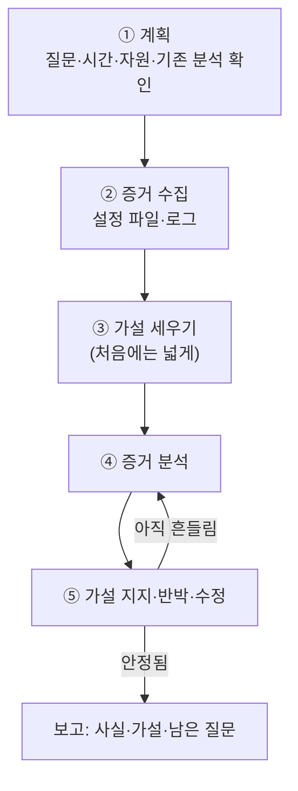

# 1.4강 — 프록시 로그만으로 사건 재구성하기: 조사 실습 { #proxy-log-walkthrough }

!!! abstract "이번 회차의 범위"
    [1.2강](web-proxies.md)과 [1.3강](proxy-logs.md)에서 배운 것을 한 사건에 모두 써 봅니다.

    - 조사의 순서: 계획 → 증거 수집 → 가설 → 분석 → 가설 지지·반박·수정 → 안정될 때까지 반복
    - 자동 도구가 통하지 않을 때 셸 명령으로 전체 그림 잡기
    - 검색어 자동완성 요청으로 사용자가 친 글자를 따라가기
    - 웹메일 사용 흔적 읽기와 "시험해 보고 비교하기" 방법
    - 같은 초에 여러 번 찍힌 요청, 리디렉션과 404 해석하기
    - 붙여넣기(paste) 사이트를 통한 유출 의심 흔적과 그 한계
    - 흩어진 발견을 하나의 타임라인으로 엮고, 사실·가설·남은 질문을 나눠 보고하기

!!! note "실습 자료에 대하여"
    이 회차의 사례, 사람, 조직, 도메인은 모두 **가상**입니다. 실습용 표본 로그(`combined` 형식, 144줄)는 이 사례에 맞춰 직접 만들었고, 본문의 명령 결과 중 **(직접 실행 결과)**라고 적은 것은 그 표본 로그에 실제로 명령을 돌린 출력입니다. 출력이 길면 일부만 보여 주고 `...`로 줄였습니다. 모든 시각은 UTC입니다.

## 1. 사건: 연구원이 사라졌다 { #case }

**(가상 사례)** 1.1강의 연구 기관에서, 연구 구간의 PC `10.10.6.14`를 쓰는 직원 한 명이 어느 날 오후 갑자기 자리를 비웠고 다음 날 출근하지 않았습니다. 이 직원은 이전부터 연구 성과를 경쟁사에 넘기고 있다는 의심을 받고 있었어요. 다음 날, 이 직원이 해외로 가는 비행기를 타려다 신고하지 않은 거액의 현금을 소지한 채 공항에서 붙잡혔다는 연락이 옵니다. 직원은 회사 자료도, USB 메모리나 노트북 같은 전자 기기도 갖고 있지 않았습니다.

경영진은 "이 직원이 회사 자료를 유출했는지 판단해 달라"고 요청합니다. 그 직원의 PC는 이미 1차 분석(트리아지)을 했는데, 업무 범위를 벗어난 자료 접근이나 뚜렷한 부정행위 흔적은 나오지 않았습니다. PC 정밀 분석은 진행 중이고, 우리는 그와 **병행해서** 네트워크 증거를 봅니다.

이 조직의 환경은 이렇습니다.

- 모든 사내 웹 트래픽은 Squid 프록시를 지나가고, 방화벽이 우회를 막습니다.
- 프록시는 TLS 가로채기를 쓰고(인증서 즉석 생성), 쿼리 문자열과 User-Agent, Referer를 기록합니다.
- 직원들은 입사할 때 "회사 망의 사용 기록이 남고 점검될 수 있다"는 이용 정책에 서명했습니다. 이 고지와 승인이 있어서 이런 조사가 가능합니다.

## 2. 조사의 순서 { #process }

바로 로그부터 열고 싶겠지만, 먼저 순서를 잡습니다.



**그림 읽는 법:** 위에서 아래로 진행하지만, ④와 ⑤ 사이는 가설이 더 이상 흔들리지 않을 때까지 돕니다. 새 발견이 나올 때마다 "이것이 내 가설을 지지하나, 반박하나, 고쳐야 하나"를 묻는 것이 핵심이에요.

**① 계획.** 질문을 분명히 합니다. 지금 필요한 건 "궁극의 진실"이 아니라 **"이 직원이 자료를 유출했는지에 대해 근거 있는 의견을 낼 만큼"**입니다. 시간이 짧으니 범위를 그만큼으로 정합니다. 이미 된 분석(PC 트리아지 결과)도 확인합니다. 그 결과가 "흔적 없음"이었다는 것 자체가 하나의 정보예요.

**② 증거 수집.** 이번에 확보한 것은 다음과 같습니다.

- 프록시 설정 파일 `/etc/squid/squid.conf`: 로그 위치와 형식, 동작 방식을 알려 줌
- 프록시 로그: `access.log`, 그리고 오류 기록인 `cache.log`

로그는 **이 직원의 PC 주소 줄만** 남기고 줄여서 받았습니다. 이것은 개인정보를 최소한으로 다루기 위한 좋은 습관이기도 합니다. 조사와 관계없는 다른 직원들의 기록까지 들여다볼 이유가 없으니까요. 대신 이렇게 줄이면 "다른 PC에서 같은 일을 했을 가능성"은 이 자료로는 볼 수 없다는 한계도 기록해 둡니다.

설정 파일에서 확인한 핵심은 1.2강의 방법대로 읽은 다음 내용입니다. 기본 설정에서 크게 바뀐 것은 디스크 캐시 활성화, TLS 가로채기, 쿼리 문자열 기록(`strip_query_terms off`), 그리고 User-Agent와 Referer가 들어가는 `combined` 형식입니다. 덕분에 HTTPS 요청도 전체 URL로 남아 있을 것으로 기대할 수 있습니다.

**[보충]** 오래된 Squid 설치에서는 Referer와 User-Agent를 `access.log`가 아니라 `referer.log`, `useragent.log`처럼 **따로 떨어진 파일**에 쓰기도 했습니다. Squid 7에도 `referrer`, `useragent`라는 내장 형식이 남아 있어서 같은 구성이 가능해요. 설정에 그런 `access_log` 줄이 있다면 그 파일들도 함께 확보해야 합니다.

**③ 가설 세우기.** 처음 가설은 넓게 잡습니다. 예를 들면 이런 것들입니다.

- 가설 A: 이 직원은 웹을 통해 회사 자료를 밖으로 보냈다.
- 가설 B: 이 직원은 출국과 현금 운반을 미리 계획했다.
- 가설 C: 이 직원의 웹 활동은 평소 업무와 다르지 않았다(유출 의심을 뒷받침할 근거가 없다).

C처럼 "아무 일도 없었다"는 가설도 일부러 넣어 둡니다. 1.1강에서 배운 것처럼, 반대 증거를 찾아볼 대상이 있어야 한쪽으로 쏠리지 않습니다.

## 3. 첫 번째 시도: 자동 도구 { #automated-tool }

먼저 자동 요약 도구를 돌려 봅니다. 하지만 1.3강에서 말한 일이 실제로 벌어집니다. 많은 Squid 요약 도구는 **기본 로그 형식만** 읽을 줄 알아서, 이 프록시처럼 `combined` 형식으로 바꾼 로그를 넣으면 "이 입력 형식을 모르겠다"며 멈춥니다. 오픈소스라면 코드를 고쳐서 새 형식을 읽게 할 수도 있지만, 지금은 시간이 없습니다. 쉬운 길을 버리고 셸로 갑니다.

## 4. 전체 그림 잡기: 어떤 사이트에 갔나 { #overview }

`combined` 형식에서는 공백으로 나눴을 때 일곱째 칸이 URL입니다(`IP - - [날짜 +0000] "메서드 URL HTTP/1.1" ...`). 그래서 1.3강의 명령을 칸 번호만 바꿔 씁니다(직접 실행 결과).

```console
$ grep -v '"CONNECT ' access.log | awk '{print $7}' | awk -F/ '{print $3}' | sort | uniq -c | sort -nr
     82 search.example
     14 news.example
     10 intranet.lab.example
     10 cdn.news.example
      8 paste.example
      6 weather.example
      5 customs.example
      3 mx3.webmail.example
      2 webmail.example
      2 login.webmail.example
      1 travel-rules.example
```

`grep -v '"CONNECT '`는 `CONNECT` 줄을 **빼라**는 뜻입니다(`-v`는 "맞지 않는 줄만"). TLS 가로채기가 켜진 프록시에서는 HTTPS 접속마다 `CONNECT` 줄이 하나 먼저 생기고, 그 안의 실제 요청이 `https://` URL로 따로 찍힙니다. `CONNECT` 줄은 URL 칸이 `호스트:443` 모양이라 호스트 이름을 뽑는 다음 단계와 맞지 않으니 뺀 거예요.

이 목록이 가설을 세울 첫 재료입니다. 검색 사이트 요청이 압도적으로 많고, 사내 인트라넷과 뉴스·날씨는 평범한 업무·일상으로 보입니다. 눈에 띄는 건 세 가지예요. 붙여넣기 사이트(`paste.example`), 웹메일(`webmail.example` 계열), 그리고 세관 관련으로 보이는 `customs.example`입니다. 하나씩 따라가 보겠습니다.

## 5. 검색 자동완성: 사용자가 친 글자 그대로 { #autocomplete }

검색 사이트 요청이 82건이나 됩니다. 사람이 하루에 검색을 82번 했을까요? 열어 보면 대부분이 `/complete`라는 주소입니다(직접 실행 결과).

```console
$ grep -c 'search.example' access.log
83
$ grep 'search.example' access.log | grep -c '/complete'
81
```

`grep -c`는 맞는 줄의 **개수**만 셉니다. 83줄 중 81줄이 `/complete`예요. 이게 무엇일까요?

검색창에 글자를 칠 때마다 아래에 추천 검색어가 뜨는 기능, 즉 **자동완성**입니다. 브라우저는 키를 하나 누를 때마다 지금까지 친 글자를 서버에 보내 추천어를 받아 옵니다. 페이지를 새로 고치지 않고 뒤에서 몰래 주고받는 이런 요청을 흔히 AJAX(비동기 요청)라고 불러요. 그 결과 프록시 로그에는 **한 글자씩 늘어나는 요청**이 남습니다. 거의 키 입력 기록 장치에 가까운 기록이죠. 시각과 `q=` 뒤의 값만 뽑아 보겠습니다(직접 실행 결과, 일부).

```console
$ grep -F 'search.example/complete' access.log | awk '{split($7,a,"q="); print substr($4,14), a[2]}'
15:02:10 o
15:02:11 or
15:02:12 orc
15:02:13 orch
...
15:02:26 orchid%20alloy%20test
...
```

명령을 쪼개 보면, `split($7,a,"q=")`는 URL(일곱째 칸)을 `q=`를 기준으로 둘로 나눠 배열 `a`에 넣고, `a[2]`는 그 뒷부분, 즉 친 글자입니다. `substr($4,14)`는 넷째 칸 `[14/Oct/2026:15:02:10`에서 14번째 글자부터, 즉 시각 부분만 잘라 냅니다. `%20`은 URL 안에서 공백을 나타내는 표기(퍼센트 인코딩)예요.

글자가 하나씩 늘어나는 줄을 모두 읽을 필요는 없습니다. **입력이 끝난 지점**, 즉 다음 줄이 이전 줄의 이어 치기가 아닌 지점만 뽑으면 됩니다(직접 실행 결과).

```console
$ grep -F 'search.example/complete' access.log | awk '{split($7,a,"q="); t=substr($4,14); q=a[2]; if (prev!="" && index(q,prev)!=1) print pt, prev; prev=q; pt=t} END{print pt, prev}'
15:02:26 orchid%20alloy%20test
15:06:52 orchid%20patent
15:10:21 flight%20711%20status
15:10:53 connecting%20482
15:53:03 currency%20declaration
```

`index(q,prev)!=1`은 "이번 값이 이전 값으로 **시작하지 않으면**"이라는 조건입니다. 그때가 이전 입력이 끝난 순간이니 이전 값(`prev`)과 그 시각(`pt`)을 출력합니다. 마지막 입력은 다음 줄이 없으니 `END`에서 따로 출력해요.

이제 이 직원이 친 것을 읽을 수 있습니다. `orchid`는 이 기관의 민감한 연구 과제 이름이라고 해 봅시다. 이 직원은 그 과제의 **시험 결과**와 **특허**를 찾았고, 그 뒤 **항공편 상태**와 **환승편**을, 한참 뒤에는 **현금 신고**를 찾았습니다.

### 5.1 [주의] 자동완성 기록을 읽을 때 { #autocomplete-caveats }

이 기록은 강력하지만 해석에 조심할 점이 있습니다.

- **"쳤다"와 "검색했다"는 다릅니다.** 자동완성 요청은 사용자가 검색창에 **글자를 쳤다**는 기록입니다. 실제로 검색 버튼을 눌러 결과를 봤는지는 별도의 검색 요청(`/search?q=`)이 있어야 알 수 있어요. 표본 로그에는 `orchid patent`에 대해서만 실제 검색 요청이 있습니다(직접 실행 결과).

    ```console
    $ grep -F 'search.example/search' access.log | awk '{print substr($4,14), $7}'
    15:07:02 https://search.example/search?q=orchid%20patent
    ```

    나머지는 친 뒤에 추천어를 눌렀거나, 결과 페이지가 다른 경로로 열렸거나, 그냥 지웠을 수 있습니다. 보고서에는 "검색창에 ○○를 입력했다"와 "○○를 검색했다"를 구별해서 적어야 합니다.
- **누가 쳤는지는 별개입니다.** 이 기록은 "이 PC에서"의 일입니다. 그 시각에 그 PC를 누가 쓰고 있었는지는 로그온 기록 같은 다른 증거로 확인합니다.
- **검색 사이트마다 방식이 다릅니다.** 주소 표시줄에 친 글자로도 추천어 요청을 보내는 브라우저가 많고, 요청 형식(경로, 파라미터 이름, GET/POST)은 사이트와 브라우저마다 다르며 자주 바뀝니다. 실제 사건에서는 그 시점의 동작을 시험해 보고 해석해야 합니다(6.1절).
- **TLS 가로채기가 없으면 이 기록은 없습니다.** 가로채지 않는 프록시라면 `CONNECT search.example:443` 한 줄뿐입니다. 이 사례에서 자동완성이 보이는 건 순전히 설정 덕분이에요.

### 5.2 그런데 왜 PC 분석에서는 안 나왔을까 { #why-triage-missed }

이 직원이 브라우저로 이렇게 검색했다면, PC 1차 분석에서 왜 검색·방문 기록이 안 나왔을까요? 가능한 설명은 **사생활 보호 모드**(시크릿 창)로 브라우징했거나, 끝난 뒤 **브라우저 기록과 캐시를 지웠다**는 것입니다. 그 흔적은 PC 정밀 분석에서 일부 되살아날 수도 있고 아닐 수도 있어요. 하지만 프록시에서는 그 기록이 고스란히 보입니다. 오히려 한 글자씩 쌓아 가는 과정까지 보이니, PC를 완벽히 분석했을 때보다 더 자세한 셈입니다. 1.1강에서 말한 "증거가 공격 대상(여기서는 직원의 PC)과 떨어진 곳에 쌓인다"는 장점이 이렇게 드러납니다.

## 6. 웹메일 { #webmail }

호스트 목록에 웹메일 서비스가 있었습니다. 수많은 무료 웹메일 중 하나로, 이 직원이 메시지를 보냈을 수 있다는 신호예요(직접 실행 결과).

```console
$ grep -F 'webmail.example' access.log | awk '{print substr($4,14), $6, $7, $9, $10}'
15:18:30 "GET https://webmail.example/ 200 16120
15:19:27 "POST https://login.webmail.example/login 302 507
15:46:12 "POST https://login.webmail.example/login 302 507
15:46:28 "POST https://mx3.webmail.example/mail/compose;sid=9f2c?action=autosave 200 967
15:46:58 "POST https://mx3.webmail.example/mail/compose;sid=9f2c?action=autosave 200 967
15:50:14 "GET https://mx3.webmail.example/mail/sentconfirm;sid=9f2c?view=SHOW_CONFIRM 200 7161
15:50:23 "GET https://webmail.example/logout 200 15169
```

한 줄씩 해석하면 이렇습니다.

- **15:18:30** 웹메일 첫 화면에 들어옴.
- **15:19:27, 15:46:12** 로그인 페이지로 `POST`를 보내고 `302`(다른 곳으로 이동)를 받음. 로그인 폼을 제출하고 성공하면 받은편지함으로 돌려보내는 흔한 모양입니다. 두 번의 로그인 사이가 약 27분이에요.
- **15:46:28, 15:46:58** 두 번째 로그인 직후 `compose`(작성) 주소로 `action=autosave`가 붙은 `POST`가 30초 간격으로 두 번. 편지를 쓰는 동안 웹 앱이 뒤에서 **자동 저장**하는 요청으로 보입니다.
- **15:50:14** `sentconfirm`, `SHOW_CONFIRM`이 들어간 주소. 이름만 보면 "보냄 확인" 화면이에요.
- **15:50:23** 로그아웃.

여기서 아주 중요한 한계가 있습니다. **편지의 내용, 받는 사람, 첨부 파일은 로그에 없습니다.** 그것들은 `POST` 요청의 **본문**에 실려 갔는데, 프록시 로그는 URL과 헤더 일부만 기록하고 본문은 기록하지 않아요. 캐시에도 없습니다. 캐시는 서버가 돌려준 응답 중 다시 쓸 수 있는 것만 보관하는데, 밖으로 나간 요청 본문은 캐시할 이유가 없으니까요.

### 6.1 "보냄 확인"은 정말 보냈다는 뜻일까: 시험해 보고 비교하기 { #test-case }

`sentconfirm`이라는 이름을 보고 "편지를 보냈다"고 짐작하는 건 합리적인 가설입니다. 하지만 **짐작**이지 확인이 아니에요. 이걸 확인하는 좋은 방법은 **같은 일을 직접 해 보고, 프록시에 어떤 기록이 남는지 비교하는 것**입니다.

1. 조사용으로 만든 별도 계정으로 같은 웹메일 서비스에 접속합니다. 피조사자의 계정을 쓰면 안 됩니다.
2. 같은 조건(같은 프록시, 같은 종류의 브라우저)에서 로그인, 편지 작성, 보내기, 로그아웃을 하나씩 하며 **각 동작의 시각을 적어 둡니다.**
3. 프록시 로그에서 내 시험 기록을 뽑아, 동작마다 어떤 URL이 찍혔는지 맞춰 봅니다.
4. 피조사자의 기록과 비교합니다. "보내기를 누르면 `sentconfirm`이 찍히고, 저장만 하면 안 찍힌다"가 확인되면, 15:50:14의 기록은 **보냈다**를 강하게 지지합니다.

로그아웃도 같은 방식으로 확인할 수 있습니다. 다만 웹 서비스는 수시로 바뀌니, 시험은 사건 시점에 최대한 가깝게 하고 시험한 날짜와 환경을 보고서에 적어야 합니다. 시험 결과로 "오늘은 이렇게 동작한다"는 걸 알 수 있을 뿐, 사건 당시에도 똑같았다는 보장은 없다는 점도 함께 적습니다.

## 7. 주변 활동: 같은 초에 세 번 받은 PDF { #related-activity }

자동완성의 마지막 입력은 `currency declaration`(현금 신고)이었습니다. 그 전후에 무엇을 봤는지 확인합니다. 검색 결과에서 넘어간 블로그 글이 하나 있고(`travel-rules.example/blog/carrying-cash`, Referer가 검색 사이트), 그 직후 세관 사이트 기록이 있습니다(직접 실행 결과).

```console
$ grep -F 'customs.example' access.log | awk '{print substr($4,14), $7, $9, $10, $NF}'
15:54:17 http://customs.example/forms/declare-currency.pdf 301 444 TCP_MISS:HIER_DIRECT
15:54:19 https://customs.example/forms/declare-currency.pdf 404 16211 TCP_MISS:HIER_DIRECT
15:55:48 https://customs.example/files/form-cm105.pdf 200 237248 TCP_MISS:HIER_DIRECT
15:55:48 https://customs.example/files/form-cm105.pdf 200 237247 TCP_MISS:HIER_NONE
15:55:48 https://customs.example/files/form-cm105.pdf 206 40701 TCP_MEM_HIT:HIER_NONE
```

`$NF`는 awk에서 "그 줄의 마지막 칸"이라는 뜻이고, 여기서는 캐시·계층 상태입니다.

- **15:54:17** `http://`로 PDF를 요청했고 `301`(영구 이동). 서버가 "`https://`로 다시 와라"라고 돌려보낸 흔한 모양입니다.
- **15:54:19** `https://`로 다시 요청했지만 `404`(없음). 그 주소에는 이제 파일이 없었던 거예요. 오래된 링크를 따라갔을 수 있습니다.
- **15:55:48** 다른 경로의 PDF를 **같은 1초 안에 세 번** 받았습니다. 두 번은 `200`(크기 237,248과 237,247, **1바이트 차이**), 한 번은 `206`(일부만, 40,701바이트, 메모리 캐시에서).

같은 초에 세 줄이 찍히는 건 이상해 보이지만, PDF에서는 흔한 일입니다. 브라우저의 PDF 보기 기능은 파일을 한 번에 받지 않고, 필요한 **일부 구간만 요청**(HTTP Range 요청)하거나, 미리 보기와 본 다운로드를 따로 요청하기도 합니다. `206`이 그 흔적이에요. 1바이트 차이의 정확한 원인은 이 로그만으로 알 수 없습니다. 크기 칸에는 헤더가 포함되니 헤더 한 글자 차이일 수도 있어요. 이런 건 단정하지 말고 "원인 미확인"으로 남겨 둡니다. 중요한 관측 사실은 "이 직원이 현금 신고 양식으로 보이는 PDF를 받았다"는 것입니다.

**[주의] 그 PDF를 지금 다시 받아 보면 되지 않을까?** 내용을 확인하려고 그 URL에 지금 접속하는 건 신중해야 합니다. 세 가지 이유가 있어요. 첫째, **OPSEC**: 조사 대상이 공격자의 서버라면, 조직의 주소로 접속하는 순간 조사 사실을 알리는 셈입니다(이 사례의 정부 사이트라면 위험은 작지만, 습관이 중요합니다). 둘째, **이미 바뀌었을 수 있습니다**: 파일이 지워졌거나 내용이 바뀌었을 수 있어요. 셋째, **요청자마다 다른 내용을 줄 수 있습니다**: 서버가 요청한 IP나 쿠키, 설정에 따라 다른 내용을 돌려주는 경우도 있습니다. 그래서 가능하면 **사건 당시의 사본**, 즉 프록시 캐시(1.5강)나 패킷에서 꺼낸 것을 우선합니다. 이 PDF는 캐시에 들어갔다는 흔적(`TCP_MEM_HIT`)까지 있으니 꺼낼 수 있을 가능성이 높습니다.

## 8. 붙여넣기 사이트: 문으로 걸어 나간 자료? { #paste-site }

호스트 목록의 `paste.example`은 누구나 글을 붙여 넣고 링크로 공유할 수 있는 **붙여넣기 사이트**입니다. 텍스트를 잠깐 올려 두기 좋아서, 자료 유출에 자주 등장해요(직접 실행 결과).

```console
$ grep -F 'paste.example' access.log | awk '{print substr($4,14), $6, $7, $9, $10}'
15:35:01 "GET http://paste.example/ 301 585
15:35:05 "CONNECT paste.example:443 200 0
15:35:05 "GET https://paste.example/ 200 8925
15:48:26 "POST https://paste.example/post 302 727
15:48:30 "GET https://paste.example/k7Qm2x 200 664841
15:49:12 "POST https://paste.example/post 302 727
15:49:14 "GET https://paste.example/Zp81Lr 200 635510
15:49:46 "POST https://paste.example/post 302 727
15:49:48 "GET https://paste.example/R4tw9B 200 281017
```

처음 세 줄은 이 사이트에 처음 들어간 과정입니다. `http://`로 갔다가 `301`로 `https://`로 넘어가고, 1.2강에서 본 `CONNECT` 줄이 생긴 뒤, 가로채기 덕분에 `https://` URL이 찍혔어요.

핵심은 그다음 세 쌍입니다. `/post`로 `POST`를 보내고 `302`를 받은 뒤, 몇 초 안에 `/k7Qm2x` 같은 **처음 보는 짧은 주소**를 `GET`으로 받았습니다. 이런 사이트는 새 글을 올리면 그 글의 **짧은 고유 주소로 돌려보내는(리디렉션)** 경우가 많습니다. 그러니 이 모양은 "글을 올렸고, 사이트가 새 글 주소로 보내 줬다"는 해석과 잘 맞아요. 6.1절처럼 시험해 보면 확인할 수 있습니다. 세 개의 글 ID(`k7Qm2x`, `Zp81Lr`, `R4tw9B`)와 각 응답 크기(약 650KB, 620KB, 270KB)가 남았습니다. 텍스트로 이 정도면 꽤 많은 양입니다.

그럼 무엇을 올렸을까요? 여기서 다시 벽에 부딪힙니다.

- **올린 내용(`POST` 본문)은 로그에 없습니다.** 6절의 웹메일과 같은 이유예요.
- **글 주소로 다시 받아 본 응답도 캐시에 없을 가능성이 큽니다.** 이런 사이트는 응답에 "캐시해도 된다"는 지시를 넣지 않는 경우가 많고, 그러면 Squid 기본 설정은 보관하지 않습니다(1.5강에서 이유를 봅니다).
- **사이트에서 지금 열어 봐도 없을 수 있습니다.** 이런 사이트는 글에 만료 시간을 걸 수 있어서, 확인해 보니 이미 사라졌다고 해 봅시다.

남은 희망은 사이트 운영자의 협조입니다. 글 ID가 정확히 남아 있으니, 운영자가 만료된 글을 보관하고 있다면 찾을 수 있을지도 모릅니다. 하지만 대개 수사기관을 통한 법적 요청이 있어야 가능하고, 성공한다는 보장도 없습니다.

**[보충] 올린 양만이라도 남기려면.** 1.3강의 기본 로그 크기 칸(`%<st`)은 클라이언트에게 **보낸** 응답 크기라, 직원이 **올린** 양은 알려 주지 않습니다. 위 세 쌍의 `POST`가 모두 727바이트로 찍힌 것도 서버가 돌려준 짧은 리디렉션 응답의 크기예요. 유출 조사를 대비한다면 `logformat`에 클라이언트에게서 **받은** 요청 크기인 `%>st`를 넣어 두는 것이 좋습니다. 그러면 내용은 몰라도 "이 `POST`로 약 650KB가 나갔다"는 건 알 수 있어요. 대신 그 칸을 넣는 순간부터만 기록되니, 사고가 나기 **전에** 설정해 둬야 합니다.

## 9. 타임라인으로 엮기 { #timeline }

지금까지의 발견은 사이트별로 흩어져 있었습니다. 시간순으로 다시 놓으면 이렇습니다(2026-10-14, UTC).

| 시각 | 사건 | 근거 |
| --- | --- | --- |
| 15:02:26 | 검색창에 `orchid alloy test` 입력 | 자동완성 요청 |
| 15:06:52 · 15:07:02 | `orchid patent` 입력, 실제 검색 실행 | 자동완성 + `/search` 요청 |
| 15:10:21 | `flight 711 status` 입력 | 자동완성 요청 |
| 15:10:53 | `connecting 482` 입력 | 자동완성 요청 |
| 15:18:30 | 웹메일 첫 접속 | GET |
| 15:19:27 | 웹메일 첫 로그인 | POST → 302 |
| 15:35:05 | 붙여넣기 사이트 첫 접속 | 301 → CONNECT → GET |
| 15:46:12 | 웹메일 두 번째 로그인 | POST → 302 |
| 15:46:28 | 편지 작성 시작(자동 저장) | compose POST |
| 15:48:30 | 붙여넣기 글 ① `k7Qm2x` 생성 | POST → 302 → 새 ID |
| 15:49:14 | 붙여넣기 글 ② `Zp81Lr` 생성 | 같은 모양 |
| 15:49:48 | 붙여넣기 글 ③ `R4tw9B` 생성 | 같은 모양 |
| 15:50:14 | 편지 보냄(으로 보임) | `sentconfirm` |
| 15:50:23 | 웹메일 로그아웃 | logout |
| 15:53:03 | 검색창에 `currency declaration` 입력 | 자동완성 요청 |
| 15:53:55 | 현금 휴대 관련 블로그 글 열람 | GET, Referer = 검색 사이트 |
| 15:55:48 | 현금 신고 양식 PDF 받음 | 200 · 200 · 206 |

이렇게 놓으니 사이트별로 볼 때는 안 보이던 **흐름**이 드러납니다. 민감 과제를 찾아보고, 항공편을 확인하고, 웹메일에 로그인했다가, 붙여넣기 사이트를 열어 두고, 다시 로그인해서 편지를 쓰기 시작하고, 그 사이에 글 세 개를 올리고, 편지를 보내고 바로 로그아웃한 뒤, 현금 운반 규정을 찾아봤습니다.

## 10. 결론 정리: 사실, 가설, 남은 질문 { #findings }

이제 1.1강의 방법대로 나눠 적습니다.

**관측한 사실(로그에 직접 있음).**

- 이 PC에서 민감 과제 이름과 관련 단어가 검색창에 입력됐고, 그중 하나는 실제로 검색됐다.
- 같은 날 항공편 관련 단어와, 나중에 현금 신고 관련 단어가 입력됐고, 현금 신고 양식으로 보이는 PDF를 받았다.
- 웹메일에 두 번 로그인했고, 편지 작성 화면의 자동 저장 요청과 "보냄 확인"으로 보이는 화면, 로그아웃이 있었다.
- 붙여넣기 사이트에 `POST` 세 번과 각각 새 글 주소로 보이는 요청이 있었고, 글 ID 세 개가 남았다.

**그 사실들이 지지하는 가설.**

- 가설 B(출국과 현금 운반을 미리 계획했다)는 강하게 지지됩니다. 실제로 붙잡힌 상황과도 들어맞아요.
- 가설 A(웹으로 자료를 유출했다)는 **지지되지만 확정되지 않았습니다.** 붙여넣기 글 세 개와 보낸 편지의 내용을 모르기 때문입니다.
- 가설 C(평소와 다르지 않았다)는 이 기록과 잘 맞지 않습니다.

**추가 증거가 필요한 것.**

- 붙여넣기 글과 편지의 **내용**: 사이트·메일 서비스 운영자에 대한 법적 요청(수사기관 협조), 프록시 캐시(1.5강), 패킷 캡처가 있다면 패킷.
- 그 시각에 그 PC를 **누가** 썼는지: 로그온 기록, 출입 기록.
- PC에서 사생활 보호 모드 사용이나 기록 삭제 흔적, 클립보드·임시 파일에 남은 붙여넣기 내용: PC 정밀 분석.
- 민감 과제 자료에 실제로 접근했는지: 파일 서버 접근 로그(3부의 SMB).

경영진에게 하는 권고는 이렇게 쓸 수 있습니다. "프록시 기록은 출국 준비가 미리 계획됐음을 강하게 보여 주며, 웹메일과 붙여넣기 사이트를 통해 상당한 양의 데이터가 외부로 나갔을 가능성을 뒷받침합니다. 다만 나간 내용은 아직 확인되지 않았고, 이를 확인하려면 다음 조치가 필요합니다." 이것이 1.1강에서 말한 **반박을 견디는** 보고입니다. 없는 내용을 있다고 하지 않으면서도, 지금 증거가 무엇을 가리키는지는 분명히 말합니다.

조사가 여기서 끝난 건 아닙니다. 짧은 시간 안에 판단을 내리려고 질문에 꼭 필요한 줄들을 골라 봤을 뿐, 로그와 캐시 전체를 다 본 건 아니에요. 전체를 훑으면 더 많은 그림이 나올 수 있습니다. 다만 목적 없이 끝없이 들여다보는 "토끼굴"에 빠지지 않도록, 조사자는 늘 주어진 질문과 시간을 기준으로 우선순위를 정해야 합니다.

## 11. 정리 { #summary }

- 조사는 계획 → 수집 → 가설 → 분석 → 지지·반박·수정의 순환입니다. "아무 일도 없었다"는 가설도 함께 세워 둡니다.
- 맞춤 형식 로그는 자동 도구가 못 읽을 때가 많습니다. 칸 번호만 맞추면 셸 명령으로 바로 전체 그림을 잡을 수 있습니다.
- TLS 가로채기와 쿼리 문자열 기록이 켜진 프록시에서는 검색 자동완성이 한 글자씩 남습니다. 단, "입력했다"와 "검색했다"는 다릅니다.
- `POST` 본문은 로그에도 캐시에도 없습니다. 웹메일과 붙여넣기 사이트에서 무엇을 보냈는지는 프록시만으로 알 수 없고, 올린 양이라도 남기려면 `%>st`를 미리 기록해야 합니다.
- URL 이름만으로 동작을 짐작하지 말고, 별도 계정으로 시험해 보고 비교합니다.
- 같은 초의 여러 줄(`200`·`206`)은 PDF 보기 같은 정상 동작일 수 있습니다. 원인을 모르는 건 "미확인"으로 남깁니다.
- 지금 그 URL에 다시 가 보는 것은 OPSEC 위험과 내용 변경 문제가 있으니, 사건 당시의 사본을 우선합니다.
- 흩어진 발견을 타임라인으로 엮고, 사실·가설·남은 질문을 나눠 보고합니다.

다음 회차(1.5강)에서는 상용 프록시의 로그를 읽는 법과, 이번에 "캐시에 있을 수도 있다"고 했던 응답을 실제로 프록시 캐시에서 꺼내는 법을 다룹니다.

## 복습 문제 { #review }

**문제 1.** 4절의 호스트 목록에서 `search.example`이 82건으로 압도적입니다. 이 숫자만 보고 "이 직원은 하루에 검색을 82번 했다"고 보고하면 무엇이 틀렸나요?

??? success "정답과 해설"
    82건 중 81건은 **자동완성 요청**(`/complete`)입니다. 브라우저는 키를 하나 누를 때마다 요청을 보내니, 82건은 검색 횟수가 아니라 대략 **친 글자 수**에 가깝습니다. 실제로 입력이 끝난 검색어는 다섯 개였고, 그중 검색 결과 페이지(`/search`)까지 간 것은 하나뿐이었어요. 숫자를 보고하기 전에 그 숫자를 이루는 요청이 어떤 종류인지부터 열어 봐야 합니다.

**문제 2. (흔한 오해)** 동료가 보고서 초안에 "직원은 `flight 711 status`를 검색했다"고 썼습니다. 무엇을 고쳐야 하고, 어떻게 확인할 수 있나요?

??? success "정답과 해설"
    로그에 있는 것은 그 글자를 **검색창에 입력했다**는 자동완성 요청뿐이고, 실제 검색 결과 요청(`/search?q=flight%20711%20status`)은 없습니다. 그러니 "검색창에 `flight 711 status`를 입력했다"로 고쳐야 정확합니다. 실제로 결과를 봤는지는 같은 시각 근처의 `/search` 요청, 추천어를 눌렀을 때 생기는 요청 모양(시험해서 확인), 이어서 항공사 사이트에 접속한 기록 등으로 확인합니다. 둘을 구별하지 않으면 상대측이 "입력하다 지웠을 수도 있다"고 반박할 때 답할 수 없습니다.

**문제 3. (조건 바꾸기)** 이 프록시가 TLS 가로채기를 쓰지 않았다면, 5절부터 8절의 분석 중 무엇이 가능하고 무엇이 불가능해지나요?

??? success "정답과 해설"
    HTTPS 접속은 모두 `CONNECT 호스트:443` 한 줄씩만 남습니다.

    - **가능:** 어느 사이트에 언제 접속했는지(`search.example`, `webmail.example`, `paste.example`, `customs.example`의 `CONNECT` 시각). 붙여넣기 사이트의 첫 `http://` 접속처럼 평문 HTTP로 간 요청은 그대로 보입니다.
    - **불가능:** 자동완성으로 친 글자, 웹메일의 로그인·작성·보냄 확인 경로, 붙여넣기 글 ID, PDF 경로와 `206` 구분. 터널이 오래 열려 있으면 그 안에서 여러 요청이 오가도 한 줄이라, 시각도 덩어리로만 알 수 있습니다.

    결국 "이 시간대에 이 사이트들에 갔다"까지는 말할 수 있지만, 이번 사례 결론의 대부분은 근거를 잃습니다. 같은 사건이라도 수집 설정에 따라 결론의 강도가 크게 달라진다는 걸 보여 주는 예입니다.

**문제 4. (명령 해석)** 5절의 "입력이 끝난 지점만 뽑는" awk 명령에서 `index(q,prev)!=1`을 `q!=prev`로 바꾸면 결과가 어떻게 되나요?

??? success "정답과 해설"
    `q!=prev`는 "이번 값이 이전 값과 다르면"이라는 뜻인데, 한 글자씩 늘어나는 자동완성에서는 **거의 매 줄이 이전 줄과 다릅니다**(`o`와 `or`도 다름). 그래서 입력 도중의 모든 중간 단계가 출력돼, 81줄을 거의 그대로 보는 것과 같아집니다. `index(q,prev)!=1`은 "이번 값이 이전 값으로 **시작하지 않는**" 경우, 즉 앞의 입력을 이어 치지 않고 새로 친 순간만 잡아서 각 입력의 마지막 모양을 뽑아 줍니다. 다만 사용자가 백스페이스로 몇 글자 지우고 다시 쳤을 때(`orchid pat` → `orchid pa` → `orchid patent`)도 "새 입력"으로 잡힐 수 있으니, 뽑힌 결과 주변은 원래 줄로 한 번 더 확인하는 게 좋습니다.

**문제 5. (결과 해석)** 9절의 타임라인에서 붙여넣기 글 세 개는 편지 작성 시작(15:46:28)과 보냄 확인(15:50:14) **사이**에 만들어졌습니다. 이 순서가 지지하는 가설 하나를 말하고, 그것을 확인하려면 무엇이 필요한지 설명하세요.

??? success "정답과 해설"
    가설: **붙여넣기 글을 올린 뒤 그 링크를 편지에 넣어 보냈다.** 편지를 쓰다가 글을 올리고, 올리자마자 편지를 보낸 순서와 잘 맞습니다. 하지만 이 순서는 다른 설명과도 들어맞습니다. 편지와 글이 서로 관계없을 수도 있고, 글 링크를 다른 경로(메신저 등)로 전했을 수도 있어요. 확인하려면 **편지의 내용**이 필요합니다. 메일 서비스 운영자에 대한 법적 요청으로 보낸 편지를 확보하거나, PC 정밀 분석에서 클립보드·브라우저 흔적을 찾아야 합니다. 프록시 로그는 `POST` 본문을 남기지 않으니 이 가설을 확정할 수 없습니다.

**문제 6. (판단)** 7절의 PDF 세 줄 중 두 `200`의 크기가 1바이트 다릅니다. 동료가 "누군가 파일을 바꿔치기한 흔적이다"라고 말합니다. 어떻게 답하시겠어요?

??? success "정답과 해설"
    그 결론은 근거가 부족합니다. 관측 사실은 "같은 1초 안에 같은 URL이 두 번 `200`으로, 크기가 1바이트 다르게 기록됐다"는 것뿐이에요. 크기 칸에는 응답 헤더가 포함되니, 헤더의 한 글자(예: 날짜나 길이 값의 자릿수) 차이로도 1바이트가 달라질 수 있습니다. 하나는 서버에서(`HIER_DIRECT`), 하나는 서버에 가지 않고(`HIER_NONE`) 처리됐다는 차이도 있어서 헤더 구성이 달랐을 가능성이 있어요. 확인하려면 캐시에서 실제 응답을 꺼내 비교하거나(1.5강), 같은 조건에서 시험해 봐야 합니다. 그 전까지는 "원인 미확인"이 정확한 표현입니다.

**문제 7. (OPSEC)** 붙여넣기 글이 정말 만료됐는지 확인하려고, 동료가 사무실 PC의 브라우저로 `https://paste.example/k7Qm2x`를 열어 보려 합니다. 무엇이 문제이고, 어떻게 하는 게 나을까요?

??? success "정답과 해설"
    문제는 세 가지입니다. ① 사무실 PC는 **조직의 주소와 프록시**를 통해 나가므로, 사이트 운영자나 그 글을 지켜보는 사람(공범 등)에게 "이 조직이 이 글을 찾고 있다"는 신호를 줄 수 있습니다. ② 그 접속 자체가 **증거 로그에 섞여서**, 나중에 "이 요청은 피조사자의 것인가 조사자의 것인가"를 헷갈리게 합니다. ③ 글이 아직 있다면 사이트의 조회수나 접근 기록을 바꿀 수 있습니다. 확인이 꼭 필요하면 조사용으로 분리된 환경(조직과 연결되지 않은 망, 조사용 장비)에서 하고, 시각과 방법을 기록합니다. 그리고 가능하면 사이트에 직접 가기보다 법적 절차로 운영자에게 보존·제공을 요청하는 편이 증거로서도 안전합니다. 이 OPSEC 습관은 5부에서 자세히 다룹니다.

**문제 8. (설계)** 이 사건을 겪은 뒤 보안팀이 "다음에는 무엇이 올라갔는지 더 잘 알고 싶다"며 프록시 설정을 바꾸려 합니다. 이번 회차의 내용으로 제안할 수 있는 것 하나와, 그 제안의 한계를 말해 보세요.

??? success "정답과 해설"
    **제안:** `logformat`에 클라이언트에게서 받은 요청 크기인 `%>st`를 추가합니다. 그러면 `POST`마다 얼마나 많은 데이터가 나갔는지 남아서, 이번 사례처럼 붙여넣기 사이트나 웹메일로 큰 데이터가 나간 순간을 크기로 찾을 수 있습니다. 붙여넣기·파일 공유 사이트를 따로 조건으로 걸어 더 자세한 로그를 남기는 방법(1.3강의 로그 나누기)도 함께 쓸 수 있어요.

    **한계:** 크기만 알 뿐 **내용**은 여전히 모릅니다. 그리고 설정을 바꾼 시점부터만 기록됩니다. 내용까지 남기려면 데이터 유출 방지(DLP) 장비나 패킷 캡처 같은 다른 수단이 필요하고, 직원의 업로드 내용을 저장하는 것이라 개인정보·법적 검토와 직원 고지가 반드시 따라야 합니다.

## 참고 자료 { #references }

- Squid 프로젝트, Squid 7 브랜치 [`src/cf.data.pre`](https://github.com/squid-cache/squid/blob/v7/src/cf.data.pre) (2026-11-05 확인). `%>st`(클라이언트에게서 받은 요청 전체 크기)와 `%<st`(클라이언트에게 보낸 응답 크기) 형식 코드, 내장 `referrer`·`useragent` 형식.
- RFC 9110, [HTTP Semantics](https://www.rfc-editor.org/rfc/rfc9110) 14절 Range 요청과 15.3.7절 `206 Partial Content`, 15.4.2절 `301`, 15.4.3절 `302`.

!!! note "이 페이지에 대하여"
    여러 학습 자료를 바탕으로 직접 다시 쓴 개인 학습 노트입니다. 사례의 조직, 인물, 도메인, 로그는 모두 설명을 위해 만든 것입니다.
