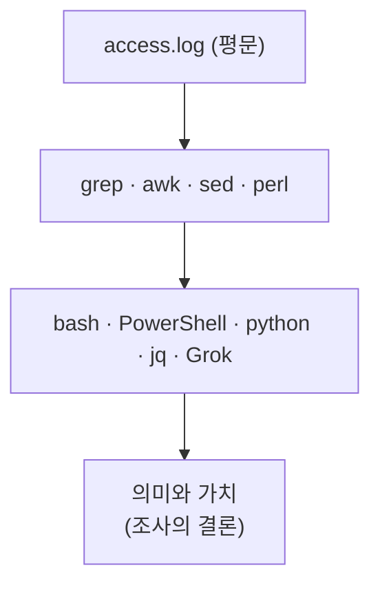

# 1.3강 — 프록시 로그 읽기: 기본 형식의 열 개 필드, 맞춤 형식, 유닉스 시간 { #proxy-logs }

!!! abstract "이번 회차의 범위"
    [1.2강](web-proxies.md)에서 설정 파일로 "로그가 어디에, 어떤 형식으로 남는지"를 확인했습니다. 이번에는 그 로그를 직접 읽습니다.

    - Squid 기본 로그 형식의 열 개 필드가 각각 무엇을 뜻하고, 조사에서 무엇을 알려 주는가
    - 캐시 상태 코드와 HTTP 상태 코드로 "무슨 일이 있었나"를 읽는 법
    - 기본 형식에 빠진 것(User-Agent, Referer, 읽기 쉬운 시간)과 `logformat`으로 맞춤 형식 만들기
    - 자동 분석 도구와 셸 명령으로 직접 분석하기
    - 유닉스 시간을 사람이 읽는 시간으로 한 줄씩, 또는 한꺼번에 바꾸기

!!! note "표기"
    이번 회차의 명령 결과 중 **(직접 실행 결과)**라고 적은 것은 직접 만든 표본 로그 12줄에 실제로 명령을 돌려 얻은 출력입니다. 표본 로그의 주소와 도메인은 모두 가상이며, 날짜는 2025-10-12(UTC)입니다. 이 작업 환경의 시스템 시간대는 UTC입니다.

## 1. 숫자 덩어리 한 줄 { #one-line }

**(가상 사례)** 동료가 프록시 서버에서 이런 줄을 복사해 보내며 묻습니다. "이 PC, 뭔가 받은 것 같은데 이게 무슨 뜻이야?"

```text
1760231140.004    388 10.10.7.15 TCP_MISS/200 1843200 GET http://files.example.net/update.bin - HIER_DIRECT/203.0.113.50 application/octet-stream
```

처음 보면 숫자와 기호가 뒤섞인 덩어리입니다. 하지만 이 줄은 정해진 칸에 정해진 정보를 채운 **양식**이에요. 칸의 뜻을 알면 이 한 줄에서 "언제, 어느 PC가, 어떤 결과로, 얼마나 큰, 무엇을, 어디서 받았는지"가 다 나옵니다. 이번 회차가 끝나면 이 줄을 막힘없이 읽을 수 있게 됩니다.

## 2. 비유: 택배 송장 { #analogy }

택배 송장을 떠올려 보세요. 보내는 사람, 받는 사람, 무게, 접수 시각 같은 칸이 정해져 있어서, 처음 보는 송장도 칸만 알면 읽을 수 있습니다. 프록시 로그 한 줄도 송장 한 장과 같습니다. 요청 하나가 끝날 때마다 한 장씩 쌓여요.

그런데 택배 회사마다 송장 양식이 다르듯, **프록시 로그도 설정에 따라 칸의 종류와 순서가 달라집니다.** 그래서 1.2강에서 설정 파일의 `access_log`와 `logformat` 줄부터 확인한 거예요. 이 비유가 실제와 다른 점도 하나 있습니다. 송장은 물건을 **보내기 전에** 쓰지만, Squid는 요청이 **끝난 뒤에** 로그를 씁니다. 이 차이가 시간 해석에 영향을 주는데, 3.2절에서 자세히 봅니다.

## 3. 기본 형식의 열 개 필드 { #default-format }

Squid의 기본 로그 형식 이름은 `squid`이고, Squid 7 문서에 정의된 모양은 이렇습니다.

```squid
logformat squid      %ts.%03tu %6tr %>a %Ss/%03>Hs %<st %rm %ru %[un %Sh/%<a %mt
```

`%`로 시작하는 것이 하나하나의 **형식 코드**이고, 각 코드가 한 칸의 값으로 바뀝니다. `%03tu`의 `03`은 "세 자리로, 빈자리는 0으로 채워라", `%6tr`의 `6`은 "최소 여섯 칸 폭으로 맞춰라"는 뜻이에요. 그래서 로그에서 두 번째 칸 앞에 공백이 여러 개 들어가 있었던 겁니다. 이제 1절의 줄을 이 정의에 맞춰 칸별로 나눠 보겠습니다.

| 순서 | 형식 코드 | 1절의 값 | 뜻 | 조사에서 주의할 점 |
| --- | --- | --- | --- | --- |
| 1 | `%ts.%03tu` | `1760231140.004` | 유닉스 시간(초.밀리초) | UTC 기준. 요청이 **끝난** 시각(3.2절) |
| 2 | `%6tr` | `388` | 응답 시간(밀리초) | 시작 시각 계산에 쓰임 |
| 3 | `%>a` | `10.10.7.15` | 요청한 클라이언트 IP | 다른 프록시를 거쳐 왔다면 그 프록시 주소일 수 있음 |
| 4 | `%Ss/%03>Hs` | `TCP_MISS/200` | 캐시 상태 / 클라이언트에게 보낸 HTTP 상태 코드 | "무슨 일이 있었나"의 핵심(3.3절) |
| 5 | `%<st` | `1843200` | 클라이언트에게 보낸 응답 크기(바이트) | 헤더 포함. 파일 크기와 정확히 같지 않을 수 있음 |
| 6 | `%rm` | `GET` | 요청 메서드 | `POST`는 데이터를 **올린** 요청 |
| 7 | `%ru` | `http://files.example.net/update.bin` | 요청 URL | 기본값에서는 **쿼리 문자열이 지워짐** |
| 8 | `%[un` | `-` | 사용자 이름 | 프록시 인증을 쓸 때만 값이 있음. 없으면 `-` |
| 9 | `%Sh/%<a` | `HIER_DIRECT/203.0.113.50` | 어떻게 가져왔나 / 실제로 접속한 서버 IP | 그 시점의 DNS 결과가 기록됨 |
| 10 | `%mt` | `application/octet-stream` | 서버가 밝힌 콘텐츠 종류(MIME 형식) | 서버가 **주장한** 값일 뿐, 실제 내용과 다를 수 있음 |

이제 1절의 줄을 문장으로 옮길 수 있습니다. "UTC 2025-10-12 01:05:40쯤, PC `10.10.7.15`가 `http://files.example.net/update.bin`을 GET으로 요청했다. 캐시에 없어서(MISS) 프록시가 `203.0.113.50`에 직접 가서 받아 왔고, 결과는 200(성공), 크기는 1,843,200바이트, 서버는 일반 바이너리(`application/octet-stream`)라고 밝혔다. 처리에 0.388초 걸렸다. 프록시 인증은 쓰지 않았다."

### 3.1 칸마다 더 알아 둘 것 { #field-notes }

**요청한 IP(3번 칸).** 보통은 프록시에 접속해 온 장치의 주소, 즉 네트워크 계층(3계층)의 출발지 주소입니다. 그런데 클라이언트와 이 프록시 사이에 다른 프록시나 부하 분산 장비가 있으면, 여기에는 그 중간 장비의 주소가 찍힙니다. 이때 진짜 클라이언트 주소는 중간 장비가 붙여 주는 `X-Forwarded-For` 같은 헤더에 들어 있을 수 있어요. Squid는 `follow_x_forwarded_for` 설정을 켜면 그 헤더의 주소를 기록에 반영합니다. 단, 이 헤더는 클라이언트가 마음대로 지어낼 수도 있어서, 믿을 수 있는 중간 장비가 붙인 값인지 설정으로 확인해야 합니다.

**응답 크기(5번 칸).** `%<st`는 프록시가 클라이언트에게 보낸 전체 크기라서 HTTP 응답 헤더까지 포함됩니다. 그래서 1,843,200바이트짜리 파일이라도 로그에는 그보다 수백 바이트 큰 값이 찍히는 게 보통이에요. 크기로 파일을 짝지을 때는 이 차이를 감안해야 합니다. `CONNECT` 줄에서는 터널로 오간 바이트 수가 들어갑니다.

**URL(7번 칸).** 1.2강에서 본 것처럼 `strip_query_terms`가 기본값 `on`이면 `?` 뒤가 지워진 채로 기록됩니다. 쿼리 문자열이 보이지 않는다면 지운 설정 때문인지 원래 없었던 것인지를 설정으로 확인하세요.

**계층 상태와 서버 IP(9번 칸).** `HIER_DIRECT`는 프록시가 원 서버에 직접 갔다는 뜻이고, `HIER_NONE`은 서버에 가지 않았다는 뜻입니다(캐시에서 줬거나 거부한 경우). 상위 프록시를 거쳤다면 `PARENT_HIT` 같은 값이 들어갑니다. 뒤의 IP는 **그 순간** 프록시가 실제로 접속한 주소예요. 도메인의 IP는 시간에 따라 바뀌기 때문에, 지금 DNS로 조회한 값보다 이 기록이 그 시점의 사실에 더 가깝습니다.

**MIME 형식(10번 칸).** 서버가 응답 헤더에서 "이건 이미지야"라고 밝힌 값입니다. 악성 서버는 실행 파일을 `image/png`라고 속여 보내기도 하니, 이 칸은 서버의 주장으로만 읽고, 실제 내용은 캐시나 패킷에서 꺼낸 파일로 확인해야 합니다(1.5강).

### 3.2 그 시각은 시작일까, 끝일까 { #timestamp-meaning }

그런데 첫 번째 칸의 시각은 요청이 **시작된** 때일까요, **끝난** 때일까요? Squid 7의 소스 코드를 보면, 이 값은 로그 줄을 쓰는 순간의 현재 시각에서 가져옵니다. Squid는 요청 처리가 끝났을 때 로그를 쓰니, 이 시각은 **끝난 시각**이에요. 그래서 시작 시각은 "타임스탬프 − 응답 시간"으로 어림할 수 있습니다.

대부분의 요청은 응답 시간이 1초도 안 되니 별 차이가 없습니다. 하지만 오래 열려 있던 연결은 다릅니다. 표본 로그의 `CONNECT` 줄로 계산해 보면 이렇습니다(직접 실행 결과).

```text
01:03:32  start~01:02:32  mail.example:443
```

기록된 시각은 01:03:32이지만 응답 시간이 60,412밀리초(약 60초)라서, 터널은 실제로 01:02:32쯤 열렸습니다. 몇 시간씩 열려 있는 터널이라면 차이가 몇 시간이 됩니다. 다른 증거(방화벽 로그의 연결 시작 시각, 패킷의 첫 SYN)와 시간을 맞출 때 이 차이를 모르면 "프록시 기록이 1분 늦다"는 잘못된 결론을 낼 수 있어요.

### 3.3 무슨 일이 있었나: 캐시 상태와 HTTP 상태 코드 { #status-codes }

네 번째 칸은 두 부분으로 되어 있습니다. 앞쪽은 Squid가 이 요청을 **어떻게 처리했는지**(캐시 상태), 뒤쪽은 클라이언트에게 **어떤 결과를 돌려줬는지**(HTTP 상태 코드)입니다. 조사자는 특히 뒤쪽의 HTTP 상태 코드를 "무슨 일이 있었나"를 알려 주는 칸으로 보면 됩니다.

자주 보는 캐시 상태는 이렇습니다. Squid 7 소스의 상태 이름 목록으로 확인했습니다.

| 캐시 상태 | 뜻 | 조사에서의 의미 |
| --- | --- | --- |
| `TCP_MISS` | 캐시에 없어서 서버에서 받아 옴 | 그 순간 실제로 외부 서버와 통신이 있었음 |
| `TCP_HIT` / `TCP_MEM_HIT` | 디스크/메모리 캐시에서 바로 줌 | 외부 통신 없음. 같은 것을 이전에 누가 받았다는 뜻이기도 함 |
| `TCP_REFRESH_UNMODIFIED` | 캐시본이 아직 유효한지 서버에 물었고, 바뀌지 않았다는 답을 받음 | 서버와 짧게 통신함. 내용은 캐시본 |
| `TCP_REFRESH_MODIFIED` | 물어보니 바뀌어서 새로 받아 옴 | 서버와 통신, 새 내용 |
| `TCP_DENIED` | 접근 제어(`http_access`)로 거부 | 차단 정책이나 인증 실패. 시도 자체는 있었음 |
| `TCP_TUNNEL` | `CONNECT` 터널을 열어 그대로 중계 | 가로채지 않은 HTTPS 등. 내용은 모름 |
| `NONE` 계열 | 처리 전에 오류 등으로 끝남 | 잘못된 요청, 연결 실패 등 |

상태 이름 뒤에 `_ABORTED`(도중에 끊김)나 `_TIMEDOUT`(시간 초과)이 붙기도 합니다. 예를 들어 `TCP_MISS_ABORTED/200`은 "서버에서 받아 오다가 도중에 끊겼다"는 뜻이라, 응답 크기가 파일 전체가 아닐 수 있어요.

**[변경됨]** 교재의 예시 로그에는 `TCP_REFRESH_HIT/304`가 나옵니다. Squid 7의 상태 이름 목록에는 이 이름이 없고, 같은 경우가 `TCP_REFRESH_UNMODIFIED`로 기록됩니다(2026-11-05, Squid 7 소스 `src/LogTags.cc`로 확인). 오래된 서버의 로그를 볼 때는 옛 이름도, 지금 이름도 알아볼 수 있어야 합니다. 또 Squid 버전에 따라 `CONNECT` 줄이 `TCP_MISS/200`으로 찍히기도 하고 `TCP_TUNNEL/200`으로 찍히기도 하니, `CONNECT`를 찾을 때는 상태 이름보다 **메서드 칸(6번)**으로 거르는 편이 안전합니다.

HTTP 상태 코드는 자주 보는 것만 정리합니다. 전체 목록은 [HTTP 상태 코드 레퍼런스](../../../basics/http-status-codes.md)를 보세요.

| 코드 | 뜻 | 조사에서의 의미 |
| --- | --- | --- |
| 200 | 성공 | 요청한 것을 받았음(받았다고 실행했다는 뜻은 아님) |
| 206 | 일부만 보냄(Partial Content) | 큰 파일을 나눠 받거나 이어 받는 중. 같은 URL의 여러 줄을 합쳐 봐야 함 |
| 301 / 302 | 다른 주소로 이동시킴 | 리디렉션. 다음 줄에서 실제 목적지를 찾아야 함 |
| 304 | 바뀌지 않았음 | 이미 가진 사본을 쓰라는 뜻. 내용 전송 없음 |
| 403 | 거부 | 프록시나 서버가 막음 |
| 407 | 프록시 인증 필요 | 인증 정보 없이 요청함. 인증을 모르는 악성코드가 반복해서 남기기도 함 |
| 404 | 없음 | 서버에 그 경로가 없음. 스캐너나 오래된 C2 주소일 수 있음 |
| 5xx | 서버 쪽 오류 | 서버나 상위 경로의 문제 |

### 3.4 작은 예제: 같은 사이트, 세 줄 { #small-example }

표본 로그의 처음 세 줄을 보세요(표본 로그 원문).

```text
1760230869.433    531 10.10.7.11 TCP_MISS/200 17746 GET http://news.example/ - HIER_DIRECT/203.0.113.20 text/html
1760230895.705    246 10.10.7.11 TCP_REFRESH_UNMODIFIED/304 303 GET http://news.example/ - HIER_DIRECT/203.0.113.20 -
1760230901.112     12 10.10.7.11 TCP_MEM_HIT/200 5120 GET http://news.example/static/logo.png - HIER_NONE/- image/png
```

첫 줄은 PC가 뉴스 첫 페이지를 처음 요청해서 프록시가 서버에서 받아 온 것입니다(MISS, 200, 약 17KB). 26초쯤 뒤의 둘째 줄은 같은 페이지를 다시 요청한 것입니다. 이번에는 브라우저가 "내가 가진 사본이 아직 유효하냐"고 물었고, 프록시는 서버에 확인해 보니 바뀌지 않았다(`TCP_REFRESH_UNMODIFIED`)는 걸 알고 "그대로 써라"(304)는 303바이트짜리 짧은 응답만 돌려줬습니다. 셋째 줄의 로고 이미지는 메모리 캐시에서 바로 줬기 때문에 서버 IP가 `-`이고 응답 시간이 12밀리초밖에 안 됩니다.

여기서 조사에 쓸 만한 해석이 나옵니다. 둘째 줄의 303바이트는 "이 PC가 받은 페이지 크기"가 아닙니다. 실제로 PC가 화면에 띄운 페이지는 브라우저 캐시에 있던 사본, 즉 첫 줄에서 받은 약 17KB짜리예요. 크기 칸만 보고 "작은 응답을 받았다"고 판단하면 틀립니다.

### 3.5 조건을 바꾼 예제: 거부, 인증, 그리고 반복 { #conditions }

표본 로그의 다른 줄들입니다.

```text
1760231141.920      0 10.10.7.15 TCP_DENIED/403 3870 GET http://c2.example.net/gate - HIER_NONE/- text/html
1760231260.002      1 10.10.5.25 TCP_DENIED/407 3995 GET http://news.example/ - HIER_NONE/- text/html
1760231300.551    174 10.10.7.11 TCP_MISS/200 2211 POST http://api-telemetry-sync.example/gate - HIER_DIRECT/203.0.113.77 text/html
1760231600.549    169 10.10.7.11 TCP_MISS/200 2211 POST http://api-telemetry-sync.example/gate - HIER_DIRECT/203.0.113.77 text/html
1760231900.553    171 10.10.7.11 TCP_MISS/200 2211 POST http://api-telemetry-sync.example/gate - HIER_DIRECT/203.0.113.77 text/html
```

- **403 줄:** `10.10.7.15`가 `c2.example.net`에 요청했지만 프록시가 막았습니다. 응답 3,870바이트는 프록시가 보낸 "차단됨" 안내 페이지 크기이고, 서버 IP가 `-`이니 외부와는 통신하지 않았습니다. **관측 사실:** 그 PC가 차단된 도메인으로 요청을 보냈다. **가설:** 그 PC에서 무언가가 C2에 접속하려 한다. 이 PC는 2초 전에 `update.bin`을 받은 바로 그 PC예요(1절). 두 줄을 이어 보면 가설이 강해지지만, 결론을 내리려면 단말에서 어떤 프로세스가 요청했는지 확인해야 합니다.
- **407 줄:** 보안 담당 PC가 인증 없이 요청해서 "프록시 인증이 필요하다"는 답을 받았습니다. 사람이 쓰는 브라우저는 보통 이 답을 받고 바로 인증 정보를 붙여 다시 요청합니다. 그래서 407이 한두 번 있는 건 정상이에요. 하지만 같은 PC에서 407만 수백 번 반복된다면, 프록시 인증을 모르는 프로그램(악성코드일 수도 있음)이 계속 나가려 한다는 신호일 수 있습니다.
- **POST 세 줄:** 같은 PC가 같은 주소에 **5분(300초) 간격**으로 **같은 크기(2,211바이트)**의 POST를 보냈습니다. 사람이 손으로 하기는 어려운 규칙성이라, 1.1강에서 말한 "주기적으로 외부와 통신하는 프로그램"의 전형적인 모양입니다. 정상적인 원격 측정(telemetry) 프로그램도 이렇게 생겼으니, 도메인 평판과 단말의 프로세스를 함께 봐야 합니다.

## 4. 기본 형식에 없는 것 { #what-is-missing }

기본 형식은 쓸 만하지만 조사자에게 아쉬운 점이 세 가지 있습니다.

**User-Agent가 없습니다.** User-Agent는 요청한 프로그램이 스스로 밝히는 이름표 같은 문자열입니다. 사람이 쓰는 브라우저라면 `Mozilla/5.0 (Windows NT 10.0; Win64; x64) ...` 같은 값이고, 명령줄 도구는 `curl/8.5.0`, 악성코드는 아예 비어 있거나 브라우저 흉내를 어설프게 낸 값을 보내기도 합니다. 3.5절의 POST가 브라우저에서 나왔는지 다른 프로그램에서 나왔는지 가늠하는 단서가 돼요. 다만 이 값도 프로그램이 마음대로 정할 수 있는 **주장**입니다. User-Agent 분석은 [Blue Team Essentials의 User-Agent와 쿠키 회차](../../blue-team-essentials/http-analysis/user-agents-cookies.md)에서 자세히 다룹니다.

**Referer가 없습니다.** Referer 헤더(철자가 원래 이렇게 틀린 채로 표준이 됐습니다)는 "어느 페이지에서 이 페이지로 왔는지"를 알려 줍니다. 검색 결과에서 링크를 누르면, 새 페이지 요청에 검색 결과 페이지의 주소가 Referer로 붙어요. 메일 프로그램의 링크를 누르거나 주소창에 직접 쳤거나 즐겨찾기로 열었다면 대개 비어 있습니다. 이 값으로 사용자가 웹을 돌아다닌 **경로**를 다시 이어 붙일 수 있습니다. 악성코드 감염은 여러 번의 리디렉션과 경유지를 거치는 경우가 많은데, Referer 없이는 그 순서를 맞추기가 어렵습니다. 사용자 본인도 시간이 지나면 어디를 거쳐 갔는지 기억하지 못하고요.

**[보충]** 요즘 브라우저는 개인정보 보호를 위해 다른 사이트로 넘어갈 때 Referer에 전체 URL 대신 **도메인까지만** 보내는 것이 기본입니다(`strict-origin-when-cross-origin` 정책. 웹 표준이 2020년 11월에 기본값을 이것으로 바꿨습니다). 그래서 지금의 로그에서는 Referer가 `https://search.example/`처럼 경로 없이 찍히는 경우가 많습니다. 예전 자료의 예시처럼 Referer에서 검색어까지 읽을 수 있다고 기대하면 안 됩니다.

**사람이 읽는 시간이 아닙니다.** 첫 칸은 유닉스 시간이라 바로 읽기 어렵습니다. 6절에서 바꾸는 방법을 봅니다.

## 5. `logformat`으로 맞춤 형식 만들기 { #logformat }

이 아쉬움을 채우려고 Squid는 관리자가 로그 형식을 직접 정의하게 해 줍니다. 그게 `logformat` 지시어예요. Squid 7에는 자주 쓰는 형식이 이미 몇 개 정의돼 있어서, 그중 `combined`를 쓰면 User-Agent와 Referer, 읽기 쉬운 시간이 한꺼번에 들어갑니다.

```squid
logformat combined   %>a - %[un [%tl] "%rm %ru HTTP/%rv" %>Hs %<st "%{Referer}>h" "%{User-Agent}>h" %Ss:%Sh
access_log daemon:/var/log/squid/access.log logformat=combined
```

첫 줄은 Squid 7에 **이미 들어 있는** 정의라서 직접 쓸 필요가 없고, 둘째 줄처럼 이름만 지정하면 됩니다. 새로 나온 형식 코드의 뜻은 이렇습니다.

| 코드 | 뜻 |
| --- | --- |
| `%tl` | 사람이 읽는 **서버의 현지 시간**(기본 모양 `12/Oct/2025:01:05:40 +0000`) |
| `%tg` | 사람이 읽는 **GMT(UTC) 시간** |
| `%rv` | 요청의 HTTP 버전 |
| `%{Referer}>h` | 클라이언트가 보낸 Referer 헤더 |
| `%{User-Agent}>h` | 클라이언트가 보낸 User-Agent 헤더 |
| `%Ss:%Sh` | 캐시 상태와 계층 상태 |

이 형식으로 쓰인 줄은 이렇게 생깁니다(예시 출력).

```text
10.10.6.11 - - [12/Oct/2025:01:06:43 +0000] "GET http://parcel-redelivery.example/dl/label.zip HTTP/1.1" 200 98211 "http://parcel-redelivery.example/track" "Mozilla/5.0 (Windows NT 10.0; Win64; x64; rv:144.0) Gecko/20100101 Firefox/144.0" TCP_MISS:HIER_DIRECT
```

이제 "이 ZIP 파일은 사용자가 Firefox로 `track` 페이지를 거쳐 받았다"까지 읽을 수 있습니다. 기본 형식에서는 알 수 없던 정보예요.

**[주의] `%tl`은 서버의 현지 시간입니다.** 교재의 예시는 `+0000`이 찍혀 있어서 "사람이 읽는 UTC 시간"처럼 보이지만, 그건 그 서버의 시간대가 UTC였기 때문입니다. 서버가 시드니 시간대라면 같은 순간이 `[12/Oct/2025:12:06:43 +1100]`으로 찍힙니다. 끝의 `+1100`(UTC보다 11시간 빠름)을 꼭 읽고 UTC로 바꿔야 다른 증거와 시간을 맞출 수 있어요. 처음부터 UTC로 남기고 싶다면 `%tg`를 쓰는 편이 안전합니다.

**[변경됨] 교재의 맞춤 형식은 Squid 7에서 시작조차 되지 않습니다.** 교재는 `combined`를 직접 정의하면서 두 번째 칸에 `%[ui`(ident 프로토콜로 얻은 사용자 이름)를 넣었습니다. Squid 7은 ident 프로토콜 지원을 **완전히 없앴고**, `%ui` 형식 코드가 들어간 설정은 거부되어 Squid가 시작되지 않습니다. 대신 내장 `common`·`combined` 형식은 그 자리에 늘 `-`를 넣습니다(2026-11-05, Squid 7 릴리스 노트로 확인). 조사자에게 주는 의미는 두 가지입니다. 첫째, Squid 7 로그의 그 칸이 늘 `-`인 건 정상입니다. 둘째, 오래된 서버의 로그에서 그 칸에 값이 있다면, 그건 ident라는 **믿을 수 없는** 방식으로 얻은 이름입니다. ident는 클라이언트 쪽이 알려 주는 값을 그대로 받는 방식이라, 그 이름을 사용자 신원의 증거로 쓰면 안 됩니다.

### 5.1 로그를 여러 개로 나누기 { #multiple-logs }

Squid는 `access_log` 줄을 여러 개 두고, 줄마다 다른 형식과 조건(ACL)을 붙일 수 있습니다. 네트워크 포렌식에서는 이게 아주 쓸모 있어요. 사고 대응 중에 프록시 관리자와 협의해서, **알려진 악성 패턴에 맞는 요청만 따로** 더 자세한 형식으로 남기게 할 수 있거든요(예시 설정).

```squid
acl suspect_dst dstdomain .c2.example.net .api-telemetry-sync.example
access_log daemon:/var/log/squid/access.log logformat=squid
access_log daemon:/var/log/squid/suspect.log logformat=combined suspect_dst
```

`dstdomain`은 목적지 도메인으로 조건을 거는 ACL이고, 앞의 점(`.`)은 하위 도메인까지 포함하라는 뜻입니다. 셋째 줄 끝에 ACL 이름을 붙였으니, 그 조건에 맞는 요청만 `suspect.log`에 `combined` 형식으로 추가 기록됩니다. 둘째 줄의 원래 로그는 그대로 모든 요청을 남기고요. 거꾸로 생각하면, **조사 대상 서버에 이런 줄이 이미 있다면** 다른 사람이 만든 로그 파일이 하나 더 있다는 뜻입니다. 1.2강의 "설정을 먼저 읽어야 놓친 증거를 찾는다"가 바로 이런 경우예요.

## 6. 유닉스 시간 읽기 { #unix-time }

### 6.1 유닉스 시간이란 { #what-is-epoch }

**유닉스 시간**(Unix time, epoch time)은 1970년 1월 1일 0시 0분 0초 UTC부터 몇 초가 지났는지를 센 숫자입니다. 시간대도 일광 절약 시간도 없이 그냥 초를 세기 때문에, 컴퓨터가 저장하고 계산하기에 아주 편합니다. 두 시각의 차이를 구할 때 뺄셈 한 번이면 되니까요. 3.5절의 POST 간격도 1760231600.549 − 1760231300.551 ≈ 300초로 바로 나왔습니다. 대신 사람이 읽으려면 변환이 필요합니다.

### 6.2 한 줄씩 바꾸기: `date` { #date-command }

리눅스의 `date` 명령으로 바로 바꿀 수 있습니다(직접 실행 결과).

```console
$ date -d @1760230869.433
Sun Oct 12 01:01:09 UTC 2025
$ date -u -d @1760230869.433
Sun Oct 12 01:01:09 UTC 2025
$ TZ=Australia/Sydney date -d @1760230869.433
Sun Oct 12 12:01:09 AEDT 2025
```

`-d`는 "이 시각을 보여 줘"라는 옵션이고, 숫자 앞의 `@`는 "이건 유닉스 시간"이라는 표시입니다. `-u`를 붙이면 UTC로 보여 줍니다. 위 결과에서 첫 두 줄이 같은 건 이 작업 환경의 시간대가 원래 UTC라서예요. 분석 PC의 시간대가 다르면 `-u` 없는 결과는 그 PC의 현지 시간으로 나옵니다. 셋째 줄은 `TZ=` 환경 변수로 시간대를 잠깐 바꾼 예인데, 같은 순간이 시드니에서는 낮 12시 01분(AEDT, 일광 절약 시간 적용)이라는 걸 보여 줍니다. **분석할 때는 늘 `-u`를 붙여 UTC로 통일하는 습관**을 들이세요. 그래야 다른 증거와 바로 맞출 수 있습니다.

`date -d @`는 리눅스에서 쓰는 GNU 버전의 기능입니다. 맥OS의 `date`는 문법이 다르고 소수점을 받지 않아서, 정수 부분만 넣어야 합니다.

```console
$ date -j -u -r 1760230869
```

다른 도구로도 같은 일을 할 수 있습니다. 파이썬에서는 `datetime.fromtimestamp(1760230869.433, tz=timezone.utc)`로 `2025-10-12T01:01:09.433000+00:00`을 얻었고(직접 실행 결과), 파워셸에서는 `[DateTimeOffset]::FromUnixTimeMilliseconds(1760230869433).UtcDateTime`처럼 밀리초 단위로 바꿀 수 있습니다.

### 6.3 한꺼번에 바꾸기: `awk` { #awk-convert }

한 줄씩 바꾸는 건 재미있지만, 수만 줄의 로그에는 쓸 수 없습니다. `awk`로 첫 칸만 바꾸고 나머지는 그대로 두면 됩니다(직접 실행 결과).

```console
$ awk '{$1=strftime("%F %T", $1, 1); print $0}' access.log | head -3
2025-10-12 01:01:09 531 10.10.7.11 TCP_MISS/200 17746 GET http://news.example/ - HIER_DIRECT/203.0.113.20 text/html
2025-10-12 01:01:35 246 10.10.7.11 TCP_REFRESH_UNMODIFIED/304 303 GET http://news.example/ - HIER_DIRECT/203.0.113.20 -
2025-10-12 01:01:41 12 10.10.7.11 TCP_MEM_HIT/200 5120 GET http://news.example/static/logo.png - HIER_NONE/- image/png
```

명령을 쪼개 보겠습니다.

- `awk '{ ... }' access.log`: 로그를 한 줄씩 읽으면서 중괄호 안의 일을 합니다. awk는 줄을 공백 기준으로 칸을 나누고, 첫 칸을 `$1`, 둘째 칸을 `$2`, 줄 전체를 `$0`이라고 부릅니다.
- `strftime("%F %T", $1, 1)`: 첫 칸의 유닉스 시간을 `%F %T` 모양(`2025-10-12 01:01:09`)의 글자로 바꿉니다. 세 번째 인자 `1`은 "UTC로 바꿔라"는 뜻이에요. 이걸 빼면 분석 PC의 현지 시간이 나옵니다.
- `$1=...; print $0`: 바꾼 값을 첫 칸에 다시 넣고 줄 전체를 출력합니다.
- `| head -3`: 앞의 세 줄만 보여 줍니다.

`%F %T` 모양(연-월-일 시:분:초)을 쓰는 이유는, 큰 단위부터 적었기 때문에 **글자 순서대로 정렬해도 시간 순서가 된다**는 점입니다. `sort`로 여러 파일을 합쳐 정렬해도 시간 순서가 깨지지 않아요.

이 방식에는 알아 둘 점이 세 가지 있습니다.

1. **밀리초가 사라집니다.** `strftime`은 초 단위까지만 만들어요. 이벤트 순서를 밀리초까지 따져야 한다면 이렇게 소수점 부분을 붙여 줍니다(직접 실행 결과).

    ```console
    $ awk '{ms=substr($1, index($1,".")); $1=strftime("%F %T", int($1), 1) ms; print}' access.log | head -2
    2025-10-12 01:01:09.433 531 10.10.7.11 TCP_MISS/200 17746 GET http://news.example/ - HIER_DIRECT/203.0.113.20 text/html
    2025-10-12 01:01:35.705 246 10.10.7.11 TCP_REFRESH_UNMODIFIED/304 303 GET http://news.example/ - HIER_DIRECT/203.0.113.20 -
    ```

    `index($1,".")`로 점의 위치를 찾고, `substr`로 점부터 끝까지(`.433`)를 떼어 낸 뒤, 바꾼 시각 뒤에 다시 붙인 것입니다.

2. **칸 사이 공백이 하나로 줄어듭니다.** awk는 칸을 바꾸면 줄을 다시 만들면서 칸 사이를 공백 하나로 합칩니다. 원래 로그의 정렬용 공백이 사라지는 건 문제가 없지만, 원본은 그대로 두고 **변환한 결과는 새 파일로** 저장하세요. 증거 원본을 고치면 안 됩니다.
3. **`strftime`이 없는 awk도 있습니다.** `strftime`은 원래 GNU awk(gawk)의 확장 기능입니다. 이 작업 환경의 기본 awk인 mawk 1.3.4에서는 위 명령이 동작했지만, 더 오래된 mawk 1.3.3 같은 버전에는 없습니다. "function strftime never defined" 같은 오류가 나면 `gawk`로 바꿔 실행하세요.

이 명령은 `grep` 같은 다른 명령과 이어 쓸 수도 있습니다. 예를 들어 `grep -F 'c2.example.net' access.log | awk '{$1=strftime("%F %T", $1, 1); print}'`처럼, 먼저 거르고 나서 바꾸면 됩니다. 자주 쓴다면 셸 별칭으로 만들어 두면 편합니다.

```bash
alias squidtime='awk '\''{$1=strftime("%F %T", $1, 1); print}'\'''
```

작은따옴표 안에 작은따옴표를 넣으려고 `'\''`(따옴표를 닫고, 이스케이프한 따옴표 하나, 다시 열기)를 썼습니다. 이렇게 해 두면 `grep -F 'c2.example.net' access.log | squidtime`처럼 쓸 수 있어요(이 작업 환경에서 동작 확인).

## 7. 분석 도구와 직접 분석 { #analysis }

### 7.1 자동 분석 도구 { #tools }

Squid가 워낙 널리 쓰이다 보니 로그를 요약하고 그래프로 보여 주는 도구가 수없이 많습니다. 교재는 `calamaris`와 `squidview`를 예로 들고, Squid 프로젝트도 로그 분석 도구 목록을 관리합니다. 다만 이런 도구는 대부분 **프록시 관리자**를 위해 만들어졌습니다. "어느 사이트가 대역폭을 많이 쓰나", "캐시 적중률이 얼마인가" 같은 질문에는 좋지만, 조사자의 질문과는 다를 수 있어요. 또 기본 형식만 읽을 줄 알아서 맞춤 형식 로그는 못 읽는 경우가 많습니다. 1.4강의 조사 실습에서 실제로 이 문제를 만나게 됩니다. 오픈소스 도구라면 코드를 고쳐 새 형식을 읽게 만들 수도 있으니, 각 도구가 줄 수 있는 가치를 따져 보고 상황에 맞게 골라 쓰거나 고쳐 쓰면 됩니다.

### 7.2 평문 로그면 셸 하나로 충분하다 { #raw-analysis }

Squid 로그의 가장 큰 장점은 **평문**이라는 점입니다. 독자적인 바이너리 형식이나 데이터베이스 형식이면 먼저 변환부터 해야 하지만, 평문은 익숙한 도구로 바로 자르고 세고 정렬할 수 있어요.



**그림 읽는 법:** 아래에서 위로 쌓아 올리는 그림입니다. 맨 아래 평문 로그 위에 줄 단위 도구(grep, awk 등)가 있고, 그 위에 그것들을 엮는 스크립트 언어와 구조화 도구가 있습니다. 맨 위의 "의미"는 도구가 아니라 **사람이 해석해서** 얻는 것이에요. Grok은 로그 한 줄을 이름 붙은 칸으로 쪼개는 패턴 언어로, 2부의 로그 집계에서 다시 나옵니다.

자동 도구와 셸 명령은 방대한 데이터를 줄여서 **튀는 값**(outlier)을 쉽게 찾게 해 줍니다. 기계가 "여기를 보라"고 가리키면, 사람은 그곳을 들여다보며 질문에 답할 데이터를 찾습니다. 몇 가지 예를 표본 로그에 직접 돌려 봤습니다(직접 실행 결과).

**어느 사이트에 요청이 많았나.**

```console
$ awk '$6!="CONNECT"{print $7}' access.log | awk -F/ '{print $3}' | sort | uniq -c | sort -rn
      4 news.example
      3 api-telemetry-sync.example
      2 parcel-redelivery.example
      1 files.example.net
      1 c2.example.net
```

- `awk '$6!="CONNECT"{print $7}'`: 여섯째 칸(메서드)이 `CONNECT`가 아닌 줄만 골라 일곱째 칸(URL)을 출력합니다. `CONNECT` 줄은 URL 칸이 `호스트:443` 모양이라 다음 단계와 맞지 않아서 뺐습니다.
- `awk -F/ '{print $3}'`: 이번에는 `/`를 칸 구분자로 써서 URL을 쪼갭니다. `http://news.example/a`는 `http:`, 빈칸, `news.example`, `a`로 나뉘니 셋째 칸이 호스트 이름이에요.
- `sort | uniq -c`: 같은 값끼리 모은 뒤(`sort`) 몇 번 나왔는지 셉니다(`uniq -c`). `uniq`는 **바로 붙어 있는** 같은 줄만 합치기 때문에 앞에 `sort`가 꼭 필요합니다.
- `sort -rn`: 센 숫자 기준으로(`-n`) 큰 것부터(`-r`) 정렬합니다.

**결과는 어땠나.**

```console
$ awk '{print $4}' access.log | sort | uniq -c | sort -rn
      6 TCP_MISS/200
      1 TCP_TUNNEL/200
      1 TCP_REFRESH_UNMODIFIED/304
      1 TCP_MISS/302
      1 TCP_MEM_HIT/200
      1 TCP_DENIED/407
      1 TCP_DENIED/403
```

**어느 PC가 가장 많이 받았나.**

```console
$ awk '{b[$3]+=$5} END{for(c in b) print b[c], c}' access.log | sort -rn
1847070 10.10.7.15
98823 10.10.6.11
48213 10.10.6.14
29802 10.10.7.11
3995 10.10.5.25
```

`b[$3]+=$5`는 "클라이언트 주소(3번 칸)별로 응답 크기(5번 칸)를 더해 둬라"는 뜻이고, `END{...}`는 파일을 다 읽은 뒤에 모아 둔 합계를 출력하라는 뜻입니다.

이 세 결과를 함께 보면 해석이 생깁니다. `10.10.7.15`가 받은 양이 압도적인 건 `update.bin` 한 파일 때문이고, 같은 PC가 차단된 C2 도메인에도 요청했습니다. `10.10.7.11`은 받은 양은 적지만 규칙적인 POST가 있습니다. **받은 양이 적다고 안전한 게 아니라는 점**이 중요해요. 비콘은 원래 작습니다. 그래서 "많이 받은 PC"와 "규칙적으로 보내는 PC"는 서로 다른 질문이고, 둘 다 물어봐야 합니다. 다만 이 정도 숫자는 출발점일 뿐이고, 결론은 1.1강의 순서대로 단말·DNS·방화벽 기록과 대조한 뒤에 냅니다.

## 8. 실제 조사에서는 이렇게 해석합니다 { #interpretation }

프록시 로그를 읽을 때 자주 틀리는 지점을 모아 두겠습니다.

- **"200이니까 감염됐다"가 아닙니다.** 200은 받았다는 뜻일 뿐, 실행했다는 뜻이 아닙니다. 실행은 단말 기록으로 확인합니다.
- **크기는 받은 파일의 크기와 정확히 같지 않습니다.** 헤더가 포함되고, `206`이면 일부만, `_ABORTED`면 도중에 끊긴 양입니다. `304`는 내용 없이 "그대로"라는 답이에요.
- **시각은 끝난 시각이고, 시간대를 확인해야 합니다.** 기본 형식의 유닉스 시간은 UTC지만, `%tl`을 쓴 맞춤 형식은 서버의 현지 시간입니다. 서버 시계 자체가 틀렸을 수도 있으니, 가능하면 같은 사건이 남긴 다른 기록(방화벽, 패킷)과 몇 군데 시각을 맞춰 보고 차이를 기록해 두세요.
- **요청한 IP가 진짜 클라이언트가 아닐 수 있습니다.** 중간에 다른 프록시나 부하 분산 장비가 있으면 그 주소가 찍힙니다.
- **로그에 없는 것도 있습니다.** 프록시를 거치지 않은 통신, 지운 쿼리 문자열, 가로채지 않은 HTTPS의 경로, POST 요청의 본문(무엇을 올렸는지)은 로그에 없습니다. 특히 POST 본문이 없다는 점은 유출 조사에서 중요해서, 1.4강에서 직접 부딪힙니다.

## 9. 정리 { #summary }

- 프록시 로그 한 줄은 정해진 칸에 정보를 채운 양식이고, 칸의 종류와 순서는 설정의 `logformat`이 정합니다.
- Squid 기본 형식의 열 칸은 시각, 응답 시간, 클라이언트 IP, 캐시 상태/HTTP 코드, 크기, 메서드, URL, 사용자 이름, 계층 상태/서버 IP, MIME 형식입니다.
- 시각은 요청이 **끝난** 때의 UTC 유닉스 시간이고, 시작 시각은 "시각 − 응답 시간"으로 어림합니다.
- HTTP 상태 코드가 "무슨 일이 있었나"를 알려 주고, 캐시 상태는 외부와 실제로 통신했는지를 알려 줍니다. Squid 7에서는 `TCP_REFRESH_HIT` 대신 `TCP_REFRESH_UNMODIFIED`, `CONNECT`는 `TCP_TUNNEL`로 기록됩니다.
- 기본 형식에는 User-Agent, Referer, 읽기 쉬운 시간이 없습니다. 내장 `combined` 형식으로 채울 수 있지만 `%tl`은 서버 현지 시간입니다. Squid 7은 ident(`%ui`)를 없앴습니다.
- 유닉스 시간은 `date -u -d @숫자`로 한 줄씩, `awk`의 `strftime`으로 한꺼번에 바꿉니다. 원본은 그대로 두고 결과는 새 파일로 저장합니다.
- 자동 도구와 셸 명령은 튀는 값을 가리켜 줄 뿐이고, 의미는 사람이 다른 증거와 맞춰 보며 찾습니다.

다음 회차(1.4강)에서는 이 기술을 모두 써서, 프록시 로그만으로 한 직원의 하루를 재구성하는 조사 실습을 합니다.

## 복습 문제 { #review }

**문제 1.** 다음 기본 형식 로그 한 줄을 문장으로 옮겨 보세요. 시각은 UTC로 적습니다.

```text
1760231203.910    455 10.10.6.11 TCP_MISS/200 98211 GET http://parcel-redelivery.example/dl/label.zip - HIER_DIRECT/198.51.100.77 application/zip
```

??? success "정답과 해설"
    UTC 2025-10-12 01:06:43쯤(`date -u -d @1760231203.910`), PC `10.10.6.11`이 `http://parcel-redelivery.example/dl/label.zip`을 GET으로 요청했습니다. 캐시에 없어서(`TCP_MISS`) 프록시가 서버 `198.51.100.77`에 직접(`HIER_DIRECT`) 가서 받아 왔고, 결과는 200(성공), 클라이언트에게 보낸 크기는 헤더 포함 98,211바이트, 서버는 ZIP 파일(`application/zip`)이라고 밝혔습니다. 처리에 0.455초 걸렸고 사용자 이름은 없습니다(`-`). 다만 "ZIP 파일이다"는 서버의 주장이고, "사용자가 열었다"는 이 줄로 알 수 없습니다.

**문제 2.** 기록된 시각이 `1760231012.880`이고 응답 시간이 `60412`인 `CONNECT` 줄이 있습니다. 같은 연결이 방화벽 로그에는 UTC 01:02:32에 시작됐다고 찍혀 있습니다. 두 기록의 시각이 1분 차이 나는 것을 어떻게 설명하나요?

??? success "정답과 해설"
    Squid의 타임스탬프는 요청이 **끝난** 시각입니다. 1760231012.880은 UTC 01:03:32이고, 응답 시간이 60,412밀리초(약 60초)이니 터널이 열린 시각은 약 01:03:32 − 60초 = **01:02:32**입니다. 방화벽 로그의 연결 시작 시각과 정확히 맞아요. 그러니 시계가 틀린 게 아니라 두 장비가 서로 다른 순간(시작과 끝)을 기록한 것입니다. 이걸 모르고 "프록시 시계가 1분 빠르다"고 보정하면 다른 모든 시각을 잘못 고치게 됩니다.

**문제 3. (흔한 오해)** 어떤 PC의 로그에 `TCP_REFRESH_UNMODIFIED/304 303`이 있습니다. 동료가 "이 PC는 303바이트만 받았으니 그 페이지를 거의 못 봤다"고 합니다. 맞나요?

??? success "정답과 해설"
    틀립니다. 클라이언트에게 간 `304`는 "브라우저가 이미 가진 사본이 그대로 유효하니 그걸 쓰라"는 답입니다. 303바이트는 그 짧은 답의 크기일 뿐이고, 사용자는 브라우저 캐시의 사본으로 화면에서 페이지 전체를 봤을 가능성이 큽니다. 앞쪽의 `TCP_REFRESH_UNMODIFIED`는 프록시도 서버에 확인해 자기 캐시본이 그대로임을 알았다는 뜻입니다. 실제 내용 크기는 같은 URL의 이전 `TCP_MISS/200` 줄(3.4절에서는 17,746바이트)에서 찾아야 합니다.

**문제 4. (조건 바꾸기)** 프록시 서버의 시간대가 `Australia/Sydney`이고 로그 형식이 `combined`입니다. 로그에 `[12/Oct/2025:12:06:43 +1100]`이 찍혀 있습니다. 이 시각을 UTC로 바꾸면 언제이고, 같은 서버가 기본 형식(`squid`)으로도 기록했다면 첫 칸에는 어떤 값이 있을까요?

??? success "정답과 해설"
    `+1100`은 UTC보다 11시간 빠르다는 뜻이니, UTC로는 12:06:43 − 11시간 = **2025-10-12 01:06:43**입니다. 기본 형식의 첫 칸은 시간대와 상관없는 유닉스 시간이라 문제 1과 같은 **1760231203.xxx**가 됩니다(밀리초는 combined 형식에 없으니 알 수 없음). 서버 시간대가 바뀌어도 유닉스 시간은 그대로라는 점이 기본 형식의 장점이고, `%tl`을 쓴 형식은 끝의 시간대 표시를 꼭 읽어야 합니다. 처음부터 `%tg`(GMT)로 기록하면 이런 변환이 필요 없습니다.

**문제 5. (명령 해석)** 다음 명령이 하는 일을 단계별로 설명하고, 첫 번째 `sort`를 빼면 결과가 어떻게 달라지는지 말해 보세요.

```bash
awk '{print $3}' access.log | sort | uniq -c | sort -rn | head -5
```

??? success "정답과 해설"
    1. `awk '{print $3}'`: 각 줄의 셋째 칸, 즉 클라이언트 IP를 뽑습니다.
    2. `sort`: 같은 IP끼리 붙도록 정렬합니다.
    3. `uniq -c`: 붙어 있는 같은 줄을 합치며 개수를 셉니다.
    4. `sort -rn`: 개수가 큰 순서로 정렬합니다.
    5. `head -5`: 상위 다섯 개만 보여 줍니다.

    결과는 "요청을 가장 많이 보낸 클라이언트 다섯 곳"입니다. 첫 `sort`를 빼면 `uniq -c`는 **연달아 나온** 같은 IP만 합치기 때문에, 같은 IP가 로그 여기저기 흩어져 있으면 여러 줄로 따로 세어집니다. 그러면 실제로 가장 많이 요청한 PC가 순위에서 밀리는 잘못된 결과가 나옵니다.

**문제 6. (최신 환경)** 오래된 Squid 서버를 Squid 7로 올리려는데, 설정에 교재와 같은 `logformat combined %>a %[ui %[un [%tl] ...` 줄이 있습니다. 무슨 일이 생기고, 조사 관점에서 이 서버의 예전 로그 둘째 칸은 어떻게 다뤄야 하나요?

??? success "정답과 해설"
    Squid 7은 ident 지원을 없앴고 `%ui` 형식 코드가 들어간 설정을 거부하므로, **Squid가 시작되지 않습니다.** 업그레이드하려면 그 줄을 지우고 내장 `combined`를 쓰거나 `%ui`를 뺀 형식으로 바꿔야 합니다. 업그레이드 뒤 그 칸은 늘 `-`입니다. 예전 로그의 둘째 칸에 값이 있다면 그건 ident로 얻은 이름입니다. ident는 클라이언트 쪽이 알려 주는 값을 그대로 받는 오래되고 안전하지 않은 방식이라, 그 값을 "이 사람이 했다"는 증거로 쓰면 안 됩니다. 사용자 신원은 프록시 인증(`%ul`)이나 도메인 로그온 기록 같은 믿을 만한 출처로 확인해야 합니다.

**문제 7. (결과 해석)** 7.2절의 결과를 보고 동료가 "`10.10.7.11`은 받은 양이 가장 적은 편이니 우선순위에서 빼자"고 합니다. 어떻게 답하시겠어요?

??? success "정답과 해설"
    빼면 안 됩니다. `10.10.7.11`은 같은 주소에 **정확히 5분 간격으로 같은 크기(2,211바이트)의 POST**를 보낸 PC입니다. 비콘이나 C2 통신은 원래 작고 규칙적이라, 받은 양 합계로는 드러나지 않습니다. "얼마나 많이 받았나"와 "얼마나 규칙적으로 보냈나"는 서로 다른 질문이고, 둘 다 물어봐야 합니다. 그리고 POST는 데이터를 **올린** 요청인데 기본 로그에는 무엇을 올렸는지(본문)가 남지 않습니다. 그래서 이 PC는 오히려 단말 기록, DNS, 도메인 평판을 함께 확인해야 하는 우선 대상입니다.

**문제 8. (설정 해석)** 조사 대상 프록시의 설정에서 5.1절과 같은 `access_log ... suspect.log logformat=combined suspect_dst` 줄을 발견했습니다. 그런데 관리자는 "우리 프록시 로그는 `access.log` 하나뿐"이라고 말합니다. 무엇을 확인하고, 어떤 가능성을 생각해야 하나요?

??? success "정답과 해설"
    설정에 따르면 `suspect_dst` 조건에 맞는 요청은 `suspect.log`에 **추가로** 기록되니, 그 파일이 있는지, 언제부터 기록됐는지(파일 생성·수정 시각, 설정 변경 이력)를 확인합니다. 가능성은 여러 가지입니다. 이전 사고 때 다른 담당자가 만들어 두고 잊었을 수도 있고, 관리자가 모를 뿐일 수도 있습니다. 그 파일에는 `combined` 형식이라 기본 로그에 없는 User-Agent와 Referer가 들어 있으니, 해당 도메인에 관해서는 더 풍부한 증거가 됩니다. 반대로 누가 왜 이 설정을 넣었는지 모른다면, 설정 변경 자체가 조사할 대상일 수도 있습니다. 어느 쪽이든 관리자의 말보다 **설정 파일이 실제로 무엇을 지시하는지**가 우선입니다.

## 참고 자료 { #references }

- Squid 프로젝트, Squid 7 브랜치 [`src/cf.data.pre`](https://github.com/squid-cache/squid/blob/v7/src/cf.data.pre) (2026-11-05 확인). 내장 `squid`·`common`·`combined`·`referrer`·`useragent` 로그 형식 정의, 형식 코드의 뜻, `access_log`의 권장 문법(`logformat=` 옵션과 ACL).
- Squid 프로젝트, Squid 7 [`src/LogTags.cc`](https://github.com/squid-cache/squid/blob/v7/src/LogTags.cc)와 [`src/format/Format.cc`](https://github.com/squid-cache/squid/blob/v7/src/format/Format.cc) (2026-11-05 확인). 캐시 상태 이름 목록, `%ts`가 로그를 쓰는 순간의 현재 시각에서 오고 `%tr`이 요청 처리 시간이라는 점.
- Squid 프로젝트, [Squid 7 릴리스 노트 원본](https://github.com/squid-cache/squid/blob/v7/doc/release-notes/release-7.sgml.in) (2026-11-05 확인). ident 지원 제거, `%ui`가 있는 설정은 시작 실패, `common`·`combined`의 해당 칸은 늘 `-`.
- MDN Web Docs, [Referrer-Policy](https://developer.mozilla.org/en-US/docs/Web/HTTP/Reference/Headers/Referrer-Policy) (원본 저장소에서 2026-11-05 확인). 정책을 지정하지 않으면 `strict-origin-when-cross-origin`이 기본이고, 2020년 11월 Fetch 표준 개정([whatwg/fetch#1066](https://github.com/whatwg/fetch/pull/1066)) 전에는 `no-referrer-when-downgrade`였다는 설명.

!!! note "이 페이지에 대하여"
    여러 학습 자료를 바탕으로 직접 다시 쓴 개인 학습 노트입니다. 표본 로그와 설정은 설명을 위해 만든 것입니다.
