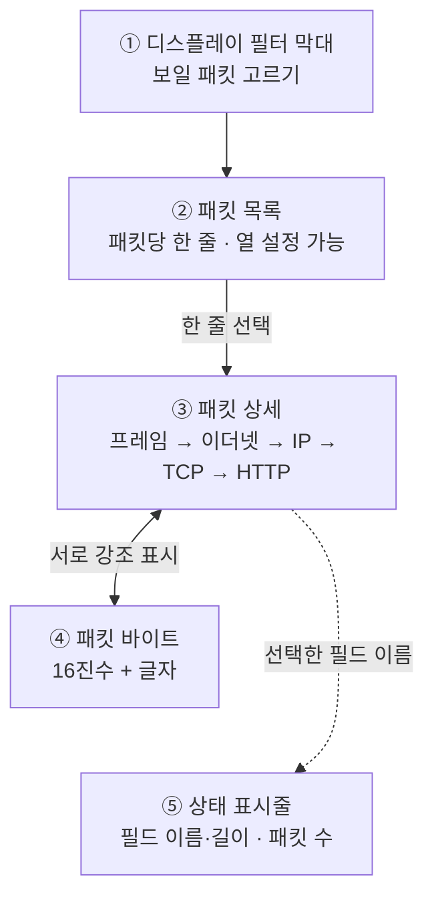

# 1.8강 — tcpdump 실전 옵션과 Wireshark 화면 읽기 { #tcpdump-options-wireshark-ui }

!!! abstract "이번 회차의 범위"
    - 오래 수집할 때 쓰는 tcpdump 옵션: 크기·시간으로 파일 나누기(`-C`, `-G`), 개수 제한(`-W`), 필터 파일(`-F`), 나눈 뒤 처리(`-z`)
    - 자주 쓰는 수집·변환 명령 네 가지를 한 부분씩 읽기
    - Wireshark 화면의 다섯 부분(필터 막대, 패킷 목록, 패킷 상세, 패킷 바이트, 상태 표시줄)과 서로의 관계
    - **이름 해석 설정과 OPSEC**: 무엇을 켜도 되고 무엇을 끄고 써야 하는가
    - 열 추가와 시각 표시 형식

    디스플레이 필터의 문법과 스트림 따라가기는 다음 회차(1.9강)에서 다룹니다.

!!! note "실습 환경과 표기"
    **(직접 실행 결과)**는 이 작업 환경의 tcpdump 4.99.4와 tshark 4.2.2로 얻었습니다. 이 환경에는 화면(GUI)이 없어서 Wireshark 창을 직접 띄울 수는 없었습니다. 그래서 화면 설명은 메뉴 이름과 구조로 하고, 같은 엔진을 쓰는 **tshark**로 같은 기능(상세 보기, 바이트 보기, 이름 해석, 시각 형식, 사용자 열)을 실제로 실행해 보였습니다. Wireshark의 메뉴 이름은 버전에 따라 조금씩 다를 수 있습니다.

## 1. 2주 동안 DNS만 떠 두기 { #scenario }

**(가상 사례)** 1.4강 사건 뒤, 보안팀은 "앞으로 2주 동안 조직의 DNS 트래픽을 모두 떠 두자"고 결정합니다. 1.7강에서 배운 대로 수집 필터는 `port 53`이면 되지만, 문제가 남습니다.

- 2주치를 **파일 하나**에 쓰면 너무 커서 열 수 없고, 중간에 파일이 깨지면 전부 잃습니다.
- 디스크가 차면 수집이 멈추거나 시스템이 멈출 수 있습니다.
- 나중에 "10월 20일 오후"만 보고 싶을 때 바로 그 부분을 찾을 수 있어야 합니다.

그래서 tcpdump에는 **파일을 나누고, 이름을 붙이고, 개수를 제한하는** 옵션이 있습니다. 그리고 떠 둔 파일은 결국 Wireshark로 열게 되는데, 여기에도 그냥 열면 안 되는 설정이 하나 있어요. 이번 회차는 이 두 가지를 다룹니다.

## 2. 오래 수집할 때 쓰는 tcpdump 옵션 { #tcpdump-options }

1.6강의 기본 옵션(`-r`, `-w`, `-i`, `-n`, `-s`)에 더해, 실무에서 자주 쓰는 옵션은 이렇습니다.

| 옵션 | 뜻 | 기억할 점 |
| --- | --- | --- |
| `-r 파일` | 네트워크 대신 pcap 파일에서 읽기 | |
| `-w 파일` | 화면 대신 pcap 파일로 쓰기 | |
| `-i 인터페이스` | 수집할 인터페이스 | 리눅스 등에서는 `any`로 모든 인터페이스를 한꺼번에 |
| `-n` | 이름 조회 안 함 | **거의 늘 붙임.** 느려지는 것과 OPSEC 문제를 막음 |
| `-C 크기` | 파일이 그 크기를 넘으면 새 파일로 | 단위는 **1,000,000바이트**(MB가 아니라 백만 바이트) |
| `-G 초` | 그 초마다 새 파일로 | 파일 이름에 **시각 형식**을 넣어야 함 |
| `-W 개수` | `-C`와 함께면 그 개수로 **돌려 쓰기**, `-G`와 함께면 그 개수를 만들고 **끝내기** | |
| `-F 파일` | 필터를 명령줄 대신 파일에서 읽기 | 팀이 같은 필터를 쓰게 할 때(1.7강) |
| `-z 명령` | 파일을 하나 닫을 때마다 그 파일에 명령 실행 | 예: `-z gzip`으로 압축 |
| `-c 개수` | 그 개수만큼 잡고 끝내기 | |
| `-A` | 내용을 글자로 보여 주기 | 1.6강 |

이제 옵션마다 직접 시험해 본 결과를 보겠습니다. 시험은 루프백 인터페이스에서 시험용 웹 서버로 계속 요청을 보내면서 했습니다.

### 2.1 `-G`: 시간으로 나누기 { #rotate-time }

```console
$ tcpdump -n -i lo -G 2 -W 3 -w 'dns-%F_%H%M%S.pcap' 'tcp port 8082'
$ echo $?
0
$ ls -1 dns-*
dns-2026-11-05_025710.pcap
dns-2026-11-05_025712.pcap
dns-2026-11-05_025714.pcap
```

(직접 실행 결과. 실제로는 `-Z root`도 붙였습니다. 1.6강 7절 참고.) `-G 2`는 2초마다 새 파일, `-W 3`은 세 개를 만들고 끝내라는 뜻이고, 실제로 파일 세 개를 만든 뒤 정상 종료(`0`)했습니다. 파일 이름의 `%F`(연-월-일), `%H%M%S`(시분초)는 `strftime`이라는 표준 시각 형식 문법이에요. 1.3강의 awk에서 본 그 문법입니다. 그래서 파일 이름만 보고도 어느 파일이 언제 것인지 알 수 있습니다.

여기서 시험하다 알게 된 점이 세 가지 있습니다.

**① 이름에 시각 형식이 없으면 계속 덮어씁니다.** `-G 1 -w same.pcap`으로 5초 동안 떴더니 파일은 `same.pcap` 하나만 남았습니다(직접 실행 결과). tcpdump 문서도 "시각 형식이 없으면 새 파일이 이전 파일을 덮어쓴다"고 경고합니다. 1초마다 새로 만든 파일이 같은 이름이니 마지막 1초치만 남는 거예요. 같은 이유로, 시각 형식이 나누는 간격보다 **거칠면**(예: 1초마다 나누는데 이름에 분까지만 있으면) 역시 덮어씁니다.

**② 파일 이름의 시각은 수집 기계의 현지 시간대입니다.** 시간대를 시드니로 바꿔서 뜨니 UTC 02:58에 만든 파일의 이름이 `tz-2026-11-05_135818.pcap`, 즉 **13:58**로 찍혔습니다(직접 실행 결과). 패킷 안의 시각은 UTC인데(1.6강) 파일 이름은 현지 시간인 셈이라, 나중에 "UTC 03시대 파일"을 찾다가 엉뚱한 파일을 열 수 있어요. 수집 스크립트를 `TZ=UTC tcpdump ...`처럼 UTC로 돌리면 이 혼란이 사라집니다.

**③ 새 파일은 패킷이 와야 만들어집니다.** 처음 시험할 때는 트래픽이 중간에 끊겨서, 20초를 기다려도 파일이 두 개뿐이고 tcpdump가 끝나지 않았습니다(직접 실행 결과). tcpdump는 패킷을 받을 때 "나눌 시간이 됐나"를 확인하기 때문에, **조용한 회선에서는 정해진 시간이 지나도 파일이 바뀌지 않을** 수 있습니다. 그러니 "2시간마다 나눴으니 각 파일은 정확히 2시간치"라고 가정하지 말고, 파일마다 `capinfos`로 첫·마지막 패킷 시각을 확인하세요.

### 2.2 `-C`와 `-W`: 크기로 나누고 돌려 쓰기 { #rotate-size }

```console
$ tcpdump -n -i lo -C 1 -W 3 -w ring.pcap 'tcp port 8082'
$ ls -l ring.pcap*
1000021 ring.pcap0
1000021 ring.pcap1
589919 ring.pcap2
```

(직접 실행 결과, 크기와 이름만 보임.) `-C 1`은 1,000,000바이트마다 새 파일, `-W 3`은 세 개를 **돌려 쓰기**(링 버퍼)라는 뜻입니다. 파일 이름 끝에 `0`, `1`, `2`가 붙었죠. 문서에 따르면 `-W`와 함께 쓰면 파일 개수에 맞춰 앞에 0을 채워(예: 개수가 100이면 `00`부터) 이름이 순서대로 정렬되게 하고, 정한 개수를 다 쓰면 **처음 파일부터 덮어씁니다.** 이번 시험은 세 번째 파일까지만 채워져서 덮어쓰기 자체는 직접 확인하지 못했어요.

파일 크기가 정확히 1,000,000이 아니라 1,000,021바이트인 데도 이유가 있습니다. tcpdump는 패킷을 쓰기 **전에** "지금 파일이 이 크기보다 큰가"를 확인하기 때문에, 마지막 패킷만큼 조금 넘칩니다. 그리고 단위가 1,048,576바이트(MiB)가 아니라 1,000,000바이트라는 점도 문서에 명시돼 있습니다.

**[변경됨] 단위 접미사는 버전에 따라 됩니다.** 최신 tcpdump 문서에는 `-C 20k`, `-C 500m`처럼 `k`·`m`·`g` 접미사를 붙여 단위를 바꿀 수 있다고 적혀 있습니다. 그런데 이 작업 환경의 4.99.4에서 `-C 20k`를 쓰니 `tcpdump: invalid file size 20k`라는 오류가 났어요(직접 실행 결과). 저장소의 문서와 변경 기록을 보면 이 기능은 **4.99.6부터** 들어갔습니다(2026-11-05 확인). 배포판 패키지는 최신보다 늦는 경우가 많으니, 수집 장비의 tcpdump 버전에서 먼저 시험해 보세요.

`-C`와 `-W`로 링 버퍼를 만들면 **디스크가 넘치지 않는 대신, 오래된 데이터가 조용히 사라집니다.** 1.1강 8.1절의 "보관 기간" 계산이 그대로 적용돼요. 링 버퍼 하나에 몇 시간치가 들어가는지 미리 계산해 두고, 사고가 나면 **덮어쓰기 전에** 필요한 파일을 복사해야 합니다.

### 2.3 `-z`: 파일을 닫을 때마다 처리하기 { #postrotate }

`-z gzip`처럼 쓰면 파일 하나를 닫을 때마다 그 파일에 `gzip`을 실행해 압축합니다. 압축 대신 해시를 기록하는 작은 스크립트를 넣어 두면, 파일이 만들어지는 순간의 해시를 남겨 증거 관리에 도움이 됩니다. 이번 실습 환경에서는 시험 시간 안에 나누기가 일어나지 않아 `-z` 결과까지는 직접 확인하지 못했습니다.

**[보충] dumpcap의 링 버퍼.** Wireshark에 들어 있는 `dumpcap`도 같은 일을 합니다. `-b duration:초`, `-b filesize:킬로바이트`, `-b files:개수`로 나누고 돌려 쓰며, 기본 저장 형식이 pcapng라서 1.6강에서 본 인터페이스·필터 정보가 파일마다 남습니다. 둘 중 무엇을 쓰든, 수집 장비에서 실제 부하로 시험하는 것이 먼저입니다.

### 2.4 자주 쓰는 명령 네 가지 { #examples }

교재가 드는 예를 이 시리즈의 가상 조직에 맞게 바꿔 한 부분씩 읽어 보겠습니다.

**① 화면으로 잠깐 보기**

```bash
sudo tcpdump -n -s 100 -A -i ens33 -c 1000
```

`ens33` 인터페이스에서 처음 1,000개 패킷(`-c 1000`)을 잡아, 각 패킷의 앞 100바이트(`-s 100`)를 내용까지 글자로(`-A`) 보여 주고 끝냅니다. 회선에 무엇이 흐르는지 감을 잡을 때 좋아요. `-n`이 없으면 IP마다 이름 조회를 해서 훨씬 느려집니다.

**② 큰 파일에서 한 호스트만 뽑기**

```bash
tcpdump -n -r input.pcap -w output.pcap 'host 10.10.6.14'
```

`input.pcap`을 읽어 `10.10.6.14`가 관련된 패킷만 `output.pcap`으로 씁니다. 1.7강의 "데이터 줄이기"예요. 파일에서 읽을 뿐이니 관리자 권한이 필요 없습니다.

**③ 14일 동안 DNS를 하루 한 파일씩**

```bash
sudo TZ=UTC tcpdump -n -i ens33 -w 'dns-%F_%H%M%S.pcap' -G 86400 -W 14 'port 53'
```

86,400초(24시간 × 60분 × 60초)마다 새 파일을 만들고, 14개를 만들면 끝냅니다. 교재는 필터를 `'(tcp or udp) and port 53'`으로 썼는데, 1.7강에서 봤듯 `port`는 원래 TCP·UDP를 다 잡으니 `'port 53'`과 사실상 같습니다(SCTP 같은 다른 전송 프로토콜까지 정확히 빼려면 원래 모양이 낫습니다). 앞에 `TZ=UTC`를 붙여 파일 이름도 UTC로 남게 했어요(2.1절 ②). 단, 2.1절 ③처럼 패킷이 와야 파일이 바뀌므로, 각 파일이 정확히 자정에 끊긴다고 가정하지는 마세요.

**④ 의심 호스트를 100MB씩 계속**

```bash
sudo tcpdump -n -i ens33 -w suspect.pcap -C 100 'host 203.0.113.77'
```

`203.0.113.77`과의 트래픽을 1억 바이트(100 × 1,000,000)마다 새 파일(`suspect.pcap`, `suspect.pcap1`, `suspect.pcap2` …)로 **끝없이** 씁니다. `-W`가 없으니 돌려 쓰지 않고 계속 늘어나요. 그만큼 디스크를 지켜봐야 합니다. 의심 호스트가 하나뿐이라 양이 적을 거라고 예상할 때 쓰는 모양입니다.

## 3. Wireshark 화면 읽기 { #wireshark-window }

이제 떠 둔 파일을 Wireshark로 엽니다. 이 시리즈에서 가장 오래 들여다볼 화면이에요. 창은 위에서 아래로 다섯 부분입니다.



**그림 읽는 법:** 위에서 아래가 실제 창의 배치 순서입니다. 패킷 목록에서 한 줄을 고르면 그 패킷이 상세와 바이트 창에 나오고, 상세 창의 필드와 바이트 창의 바이트는 서로를 강조 표시합니다(양쪽 화살표). 상세 창에서 필드를 고르면 그 필드의 이름이 상태 표시줄에 나옵니다(점선).

**② 패킷 목록.** 패킷마다 한 줄이고, 어떤 열을 보일지 설정할 수 있습니다. 기본 "Time" 열은 **수집 시작부터 몇 초 지났는지**라서 패킷 사이 간격을 볼 때 편하지만, 실제 시각은 아닙니다. 1.6강에서 본 것처럼 pcap에는 패킷마다 UTC 시각이 있으니, 사람이 읽는 시각으로 바꿔 볼 수 있어요(5절). "Info" 열은 해석기가 그 패킷을 한 줄로 요약한 것이라, 많은 패킷을 훑어보며 흥미로운 것을 찾기 좋습니다.

**③ 패킷 상세.** 해석기의 진가가 드러나는 곳입니다. IP·TCP·UDP 헤더부터 맨 위의 응용 계층 데이터까지, 패킷의 모든 필드를 계층별로 펼쳐 보여 줘요. 처음 보는 프로토콜도 사람이 읽을 수 있는 필드 이름과 값으로 보여 주니, 낯선 프로토콜을 탐색할 때 여기서 시작하면 됩니다. tshark의 `-V`가 같은 내용을 글자로 보여 줍니다(직접 실행 결과, 일부).

```console
$ tshark -r nameres.pcap -n -Y 'frame.number==6' -V
Frame 6: 201 bytes on wire (1608 bits), 201 bytes captured (1608 bits)
    Arrival Time: Oct 14, 2026 17:46:40.600000000 UTC
    ...
Ethernet II, Src: 00:50:56:0a:06:14, Dst: 00:50:56:0a:00:01
    ...
Internet Protocol Version 4, Src: 10.10.6.14, Dst: 203.0.113.50
    ...
    Time to Live: 64
    Protocol: TCP (6)
    ...
Transmission Control Protocol, Src Port: 50010, Dst Port: 80, Seq: 1, Ack: 1, Len: 147
```

맨 위의 "Frame"은 실제 회선의 데이터가 아니라 Wireshark가 붙인 **메타데이터**(수집 시각, 저장 길이 등, 1.6강의 기록 머리말)입니다. 그 아래가 이더넷, IP, TCP 순서로 쌓인 실제 헤더예요.

**④ 패킷 바이트.** 그 패킷이 pcap 파일에 저장된(= 회선을 지나간) 모든 바이트를 16진수 덤프로 보여 줍니다. tshark의 `-x`가 같은 모양이에요(직접 실행 결과, 일부).

```console
$ tshark -r nameres.pcap -n -Y 'frame.number==6' -x
0000  00 50 56 0a 00 01 00 50 56 0a 06 14 08 00 45 00   .PV....PV.....E.
0010  00 bb 12 34 40 00 40 06 db be 0a 0a 06 0e cb 00   ...4@.@.........
0020  71 32 c3 5a 00 50 00 00 03 e9 00 00 1b 59 50 18   q2.Z.P.......YP.
0030  fa f0 00 00 00 00 47 45 54 20 2f 75 70 64 61 74   ......GET /updat
```

처음엔 상세 창이 있는데 왜 이게 필요한가 싶지만, 원본 바이트를 보면 상세 창이 놓친 흥미로운 부분을 찾을 때가 많습니다. 그래서 Wireshark는 **두 창을 서로 연결**해 둡니다. 바이트 창에서 한 바이트를 누르면 상세 창에서 그 바이트를 해석한 필드가 강조되고, 반대로 상세 창에서 필드를 누르면 그 필드에 해당하는 바이트가 강조돼요. 예를 들어 위 덤프에서 `0x17` 자리의 `06`을 누르면 상세 창의 "Protocol: TCP (6)"이 강조됩니다. 1.6강·1.7강에서 손으로 했던 바이트 위치 계산을 화면이 대신해 주는 셈이고, 이 연결을 이해하는 것이 분석가에게 아주 중요합니다.

**① 디스플레이 필터 막대.** 창 맨 위에 있고, 보일 패킷을 고르는 곳입니다. 1.9강에서 자세히 다룹니다.

**⑤ 상태 표시줄.** 창 맨 아래에서 빠르게 기준을 잡아 줍니다. 왼쪽에는 상세 창에서 고른 필드의 **해석기 필드 이름**과 바이트 길이가 나오는데(예: `ip.proto`), 이게 디스플레이 필터를 만들 때 꼭 필요한 정보입니다. 가운데에는 전체 패킷 수와 지금 필터에 맞아 보이는 패킷 수가 나와요. Wireshark로 직접 수집 중이라면 자원이 모자라 libpcap이 버린 패킷 수 같은 값도 나옵니다.

**화면 배치 바꾸기.** 편집(Edit) → 설정(Preferences) → 모양(Appearance) → 배치(Layout)에서 여섯 가지 창 배치 중 하나를 고르고, 각 칸에 무엇을 보일지 정할 수 있습니다. 화면 비율이 특이하거나 큰 화면에 띄워 함께 볼 때, 단순한 겉모습 조정이지만 쓰기 편함이 크게 달라집니다.

## 4. 이름 해석과 OPSEC { #name-resolution }

Wireshark에는 주소와 번호를 사람이 읽는 이름으로 바꿔 보여 주는 **이름 해석** 설정이 여러 개 있습니다(편집 → 설정 → 이름 해석). 어떤 것은 켜도 안전하고, 어떤 것은 **조사를 망칠** 수 있어요.

| 설정 | 무엇을 바꾸나 | 어디서 찾나 | OPSEC |
| --- | --- | --- | --- |
| MAC 주소 해석 | MAC 앞 3바이트 → 제조사 이름 | Wireshark 안의 제조사 표 | 안전(밖으로 나가는 통신 없음) |
| 전송 계층 이름 해석 | 포트 번호 → 서비스 이름(80 → http) | Wireshark 안의 서비스 표 | 안전 |
| 네트워크 주소 해석 | IP 주소 → 호스트 이름 | 아래 두 방식 | **방식에 따라 다름** |
| ├ 캡처한 DNS 패킷 사용 | 파일 안의 DNS 응답으로 이름 붙이기 | 지금 연 pcap | 안전. 그리고 **그 시점의** 이름 |
| └ 외부 이름 해석기 사용 | 분석 PC가 DNS 서버에 실제로 물어보기 | 지금의 DNS | **위험** |

### 4.1 직접 시험해 보기 { #nameres-test }

DNS 질의·응답과 그 주소로의 HTTP 요청이 든 시험용 pcap을 만들어 tshark로 돌려 봤습니다(직접 실행 결과, 일부).

```console
$ tshark -r nameres.pcap -n
    2   0.120000   10.10.4.53 → 10.10.6.14   DNS 93 Standard query response 0xabcd A files.example.net A 203.0.113.50
    3   0.240000   10.10.6.14 → 203.0.113.50 TCP 54 50010 → 80 [SYN] Seq=0 Win=64240 Len=0
$ tshark -r nameres.pcap -N dn
    3   0.240000   10.10.6.14 → files.example.net TCP 54 50010 → 80 [SYN] Seq=0 Win=64240 Len=0
$ tshark -r nameres.pcap -N mt -T fields -e eth.src_resolved -e _ws.col.Info
VMware_0a:06:14	50010 → 80 [SYN] Seq=0 Win=64240 Len=0
VMware_0a:00:01	http(80) → 50010 [SYN, ACK] Seq=0 Ack=1 Win=64240 Len=0
```

`-n`은 모든 이름 해석을 끕니다. `-N` 뒤의 글자는 켤 해석의 종류로, tshark 문서에 따르면 `d`는 캡처한 DNS 패킷 사용, `n`은 네트워크 주소 해석, `N`은 외부 해석기 사용, `m`은 MAC, `t`는 전송 계층(포트)입니다. `-N dn`을 주니 파일 안의 DNS 응답을 근거로 `203.0.113.50`이 `files.example.net`으로 바뀌었고, `-N mt`를 주니 MAC 앞부분 `00:50:56`이 `VMware`로, 포트 80이 `http(80)`으로 보였어요.

그럼 이때 분석 PC가 밖으로 무언가를 보냈을까요? `strace`라는 도구로 tshark가 운영체제에 요청한 네트워크 동작을 지켜보며 다시 돌렸습니다(직접 실행 결과).

| tshark 옵션 | 분석 PC가 DNS 서버(포트 53)로 연결을 시도한 횟수 |
| --- | --- |
| `-N dn`(캡처한 DNS + 네트워크 주소 해석) | **0** |
| `-N dnN`(위에 외부 해석기 추가) | **2**(시스템 DNS 서버 `8.8.8.8`로) |
| `-o nameres.network_name:TRUE`(GUI에서 "네트워크 주소 해석" 체크와 같은 설정만 켬) | **2** |

세 번째 줄이 핵심입니다. 이 버전(4.2.2)의 기본 설정을 보면 외부 해석기 사용이 **처음부터 켜져 있고**, 네트워크 주소 해석만 꺼져 있습니다(`tshark -G defaultprefs`로 확인). 그래서 화면에서 "네트워크 주소 해석"만 체크하는 순간, 분석 PC가 pcap 안의 IP마다 **실제 DNS 서버에 질의를 보내기** 시작해요. 최신 문서(4.6 기준)도 아무 설정이 없을 때의 기본값을 `-N dmN`, 즉 외부 해석기가 켜진 상태로 적고 있습니다.

### 4.2 외부 해석이 왜 위험한가 { #why-external-is-bad }

교재가 드는 이유는 세 가지입니다.

1. **OPSEC.** 자기 DNS 서버를 직접 운영하는 공격자는 자기 IP와 도메인에 대한 질의를 지켜보곤 합니다. 낯선 곳에서 질의가 오면 "누군가 내 인프라를 찾아냈다"고 알아챌 수 있어요. 지나친 걱정 같지만 실제로 있었던 일이고, 공격자는 빠르게 대응합니다. 그리고 그 질의가 조직의 DNS 서버를 거쳐 나가면, 1.3강에서 본 DNS 로그에 **조사자의 질의가 섞여** 나중에 혼란을 줍니다.
2. **시간이 다릅니다.** DNS 기록은 자주 바뀝니다. 지금 물어본 답은 몇 주 전 증거가 수집될 때의 답과 다를 수 있어요. 공격자가 도메인의 주소를 바꿨다면, 엉뚱한 이름이 붙은 화면을 보게 됩니다.
3. **장소가 다릅니다.** DNS 응답은 질의한 곳의 네트워크 위치에 따라 다르게 올 수 있습니다(지역별 응답, 사내 전용 이름 등). 분석 PC에서 받은 답이 피해 PC가 받은 답과 다를 수 있어요.

그래서 이 설정은 **거의 절대 켜지 않는 것이** 원칙입니다. 대신 Wireshark 팀이 넣어 둔 **캡처한 DNS 패킷 사용** 기능이 좋은 대안이에요. 패킷 안에 있던 DNS 응답으로만 이름을 붙이니 밖으로 나가는 통신이 없고, 무엇보다 **증거가 수집된 그 시점의** 이름을 보여 줍니다. 일종의 패시브 DNS입니다. 다만 파일 안에 DNS 응답이 없는 주소는 이름이 붙지 않는다는 점(예: DNS를 뺀 수집 필터, 1.7강), 그리고 그 DNS 응답 자체가 조작됐을 수도 있다는 점은 기억해 두세요.

MAC 주소와 전송 계층 이름 해석은 개인 취향의 문제이고, 밖으로 통신을 만들지 않으니 OPSEC 걱정이 없습니다. 다만 전송 계층 이름은 **포트 번호만 보고** 붙이는 편의 기능이라, `http(80)`이라고 보여도 실제로 그 연결이 HTTP라는 뜻은 아닙니다. 공격자가 80번으로 다른 프로토콜을 쓰는 경우를 놓치지 마세요.

**[변경됨] 제조사 표와 서비스 표의 위치.** 교재는 이 표들이 `/usr/share/wireshark/manuf`와 `services` 파일에 있다고 설명합니다. **Wireshark 4.2.0부터** 이 파일들(`manuf`, `services`, `enterprises`)은 시작 속도를 높이려고 프로그램 안에 넣어졌고 별도 파일로는 제공되지 않습니다. 내장된 내용은 `tshark -G manuf`처럼 꺼내 볼 수 있고, 개인 설정 폴더에 `manuf` 파일을 두면 그것도 읽습니다(2026-11-05, Wireshark 4.2.0 릴리스 노트로 확인). 실제로 이 환경의 4.2.2에는 `/usr/share/wireshark/manuf`가 없었고, `tshark -G manuf`에서 `00:50:56 VMware`를 찾을 수 있었습니다(직접 실행 결과). 또 최신 문서에는 TLS 핸드셰이크의 서버 이름(SNI)으로 주소에 이름을 붙이는 `s` 옵션도 생겼습니다. 이것도 파일 안의 정보만 쓰는 방식입니다.

## 5. 열 추가와 시각 표시 { #columns-and-time }

### 5.1 원하는 필드를 열로 { #custom-columns }

패킷 목록의 기본 열로도 대개 충분하지만, 열을 더하고 빼고 순서를 바꿀 수 있습니다. 표준 열 말고도 **Wireshark가 해석하는 모든 필드**를 열로 만들 수 있어요. 예를 들어 상세 창에서 User-Agent 필드를 오른쪽 클릭해 "열로 적용"을 고르면 `http.user_agent` 열이 생깁니다. 그 필드가 없는 패킷은 빈칸으로 보입니다. tshark에서는 `-T fields -e 필드`가 같은 역할이에요(직접 실행 결과).

```console
$ tshark -r nameres.pcap -n -Y http.request -T fields -e frame.time_epoch -e ip.src -e http.host -e http.user_agent
1792000000.600000000	10.10.6.14	files.example.net	Mozilla/5.0 (Windows NT 10.0; Win64; x64; rv:144.0) Gecko/20100101 Firefox/144.0
```

1.3강에서 프록시 로그의 칸을 셸로 다뤘던 것처럼, 이렇게 뽑은 탭 구분 결과도 `sort`, `uniq`로 바로 셀 수 있습니다. 화면에서 열을 만들어 분석 방법을 정한 뒤 tshark로 수많은 파일에 적용하는 흐름이 여기서 시작돼요.

### 5.2 시각 표시 형식 { #time-format }

보기(View) → 시각 표시 형식(Time Display Format)에서 Time 열의 모양과 정밀도를 바꿀 수 있습니다. tshark의 `-t`로 같은 형식들을 시험해 봤습니다(직접 실행 결과, 2번 패킷의 시각 부분).

| `-t` | 뜻 | 결과 |
| --- | --- | --- |
| `r` | 첫 패킷부터 흐른 시간(기본값) | `0.120000` |
| `d` | 바로 앞 패킷부터 흐른 시간 | `0.120000` |
| `e` | 유닉스 시간 | `1792000000.120000` |
| `ad` | 날짜와 시각, **분석 PC의 현지 시간** | `2026-10-14 17:46:40.120000` |
| `ud` | 날짜와 시각, **UTC** | `2026-10-14 17:46:40.120000` |

`ad`와 `ud`가 같은 건 이 작업 환경의 시간대가 UTC라서입니다. 시간대를 시드니로 바꿔서 다시 돌리면 `ad`는 `2026-10-15 04:46:40.120000`으로, **날짜까지 바뀌어** 나오고 `ud`는 그대로였습니다(직접 실행 결과). 분석 PC의 시간대에 따라 같은 패킷이 다른 날짜로 보일 수 있다는 뜻이에요. 그래서 조사할 때는 **UTC 날짜·시각 형식**(GUI의 "UTC Date and Time of Day")을 기본으로 쓰는 것이 좋습니다. 보고서와 다른 증거(1.3강의 프록시 로그 등)의 시각과 바로 맞출 수 있으니까요.

**[주의] 패킷 시각과 패킷 안의 시각은 다릅니다.** pcap의 패킷 시각은 UTC입니다(1.6강). 하지만 패킷 **안**에 들어 있는 시각, 예를 들어 HTTP 응답의 `Date` 헤더, 메일의 날짜, 응용 프로그램이 보낸 로그 문자열의 시각은 그 프로그램이 정한 형식과 시간대를 따릅니다. 그 둘을 같은 것으로 다루면 안 되고, 시간대 표시가 없는 시각은 특히 조심해야 합니다. 이 이야기는 뒤의 회차에서 다시 나옵니다.

## 6. 실제 조사에서는 이렇게 씁니다 { #in-practice }

수집 쪽:

- 오래 뜰 때는 `-G`(시간)나 `-C`(크기)로 나누고, 이름에 `%F_%H%M%S` 같은 시각 형식을 넣고, `TZ=UTC`로 돌립니다.
- 링 버퍼(`-C` + `-W`)를 쓰면 한 바퀴가 몇 시간인지 계산해 두고, 사고가 나면 덮어쓰기 전에 복사합니다.
- 나눈 파일의 실제 범위는 이름이 아니라 `capinfos`의 첫·마지막 패킷 시각으로 확인합니다.
- 장비의 tcpdump 버전에서 옵션을 먼저 시험합니다(예: `-C`의 단위 접미사).

분석 쪽, Wireshark로 pcap을 열기 전에:

1. **네트워크 주소 해석이 꺼져 있거나, 외부 해석기가 꺼져 있는지** 확인합니다. 이름이 필요하면 "캡처한 DNS 패킷 사용"만 켭니다.
2. 시각 표시를 **UTC 날짜·시각**으로 바꿉니다.
3. 조사에 필요한 필드(User-Agent, Host 등)를 열로 추가합니다.
4. 파일이 크면 1.7강처럼 먼저 줄인 사본을 엽니다.

이 설정들은 Wireshark의 **프로필**로 저장해 두면 매번 다시 할 필요가 없습니다. 조사용 프로필을 하나 만들어 팀이 함께 쓰는 것도 좋은 방법이에요.

## 7. 정리 { #summary }

- `-G 초`는 시간으로, `-C 백만바이트`는 크기로 파일을 나누고, `-W`는 `-C`와 함께면 링 버퍼, `-G`와 함께면 그 개수를 만들고 끝냅니다. `-F`는 필터 파일, `-z`는 파일을 닫을 때마다 명령을 실행합니다.
- `-G`의 파일 이름에는 시각 형식이 꼭 있어야 하고(없으면 덮어씀), 그 시각은 수집 기계의 **현지 시간대**입니다. 새 파일은 **패킷이 와야** 만들어집니다.
- `-C`의 단위는 1,000,000바이트이고, `k`·`m`·`g` 접미사는 tcpdump 4.99.6부터입니다.
- Wireshark 화면은 디스플레이 필터 막대, 패킷 목록, 패킷 상세, 패킷 바이트, 상태 표시줄로 되어 있고, 상세와 바이트 창은 서로 강조 표시로 연결됩니다. 상태 표시줄의 필드 이름이 디스플레이 필터의 재료입니다.
- MAC·전송 계층 이름 해석은 안전하지만, **네트워크 주소 해석에 외부 해석기를 쓰면** 분석 PC가 실제 DNS 질의를 보냅니다. 기본값에서 외부 해석기가 켜져 있으니, 이름이 필요하면 "캡처한 DNS 패킷 사용"만 씁니다.
- Wireshark 4.2.0부터 `manuf`·`services` 표는 프로그램에 내장됐습니다.
- 어떤 필드든 열로 만들 수 있고, 시각은 UTC 날짜·시각으로 보는 것이 기본입니다. 패킷 안의 시각은 패킷 시각과 다릅니다.

다음 회차(1.9강)에서는 Wireshark의 디스플레이 필터 문법, 문법 검사기의 세 가지 색, `!=`의 함정, 그리고 TCP 스트림 따라가기를 다룹니다.

## 복습 문제 { #review }

**문제 1.** 다음 명령으로 일주일 동안 수집했더니 파일이 하나밖에 없고, 그 안에는 마지막 한 시간치만 들어 있습니다. 무엇이 잘못됐고 어떻게 고쳐야 하나요?

```bash
sudo tcpdump -n -i ens33 -G 3600 -w capture.pcap 'host 10.10.6.14'
```

??? success "정답과 해설"
    `-G 3600`으로 한 시간마다 새 파일을 만들었지만, 파일 이름 `capture.pcap`에 **시각 형식이 없어서** 매번 같은 이름으로 새로 만들며 이전 파일을 덮어썼습니다. 그래서 마지막 한 시간치만 남았어요. tcpdump 문서도 이 경우를 경고합니다. 고친 명령은 `sudo TZ=UTC tcpdump -n -i ens33 -G 3600 -w 'capture-%F_%H%M%S.pcap' 'host 10.10.6.14'`입니다. 시각 형식은 나누는 간격(1시간)보다 세밀해야 하니 시·분·초까지 넣었고, 이름을 UTC로 남기려고 `TZ=UTC`를 붙였습니다.

**문제 2. (계산)** 하루 평균 40GB가 쌓이는 구간에서 `-C 1000 -W 48`로 링 버퍼를 만들었습니다. 이 링 버퍼는 대략 몇 시간치를 보관하나요? 사고를 발견하는 데 평균 하루가 걸린다면 무엇이 문제인가요?

??? success "정답과 해설"
    `-C 1000`은 파일 하나가 1,000 × 1,000,000 = 약 1GB(10억 바이트), `-W 48`은 48개를 돌려 쓰니 전체 약 48GB입니다. 하루 40GB면 한 시간에 약 1.67GB이므로 48 ÷ 1.67 ≈ **약 29시간**치를 보관합니다. 사고 발견에 평균 하루(24시간)가 걸린다면 겨우 몇 시간 여유가 있는 셈이고, 트래픽이 평소보다 많은 날이나 발견이 늦은 사건에서는 **사고 시점의 패킷이 이미 덮어써졌을** 가능성이 큽니다. 1.1강 8.1절의 계산과 같은 문제입니다. 디스크를 늘리거나, 수집 필터를 조정하거나, 사고 의심 즉시 링 버퍼 파일을 복사하는 절차를 미리 정해 둬야 합니다.

**문제 3. (흔한 오해)** `-G 7200`(2시간마다 나누기)으로 뜬 파일 `dns-2026-10-20_020000.pcap`을 보고 동료가 "이 파일은 02:00부터 04:00까지 정확히 2시간치"라고 보고서에 썼습니다. 무엇을 확인해야 하나요?

??? success "정답과 해설"
    세 가지를 확인합니다. ① **시간대:** 파일 이름의 시각은 수집 기계의 현지 시간대라, 수집을 `TZ=UTC`로 돌리지 않았다면 02:00이 UTC가 아닐 수 있습니다. ② **실제 범위:** tcpdump는 패킷이 와야 파일을 바꾸므로, 조용한 시간대라면 파일이 2시간보다 길게 이어지거나 경계가 정각과 어긋날 수 있습니다. ③ **빈틈:** 수집이 중간에 멈췄을 수도 있습니다. 그러니 `capinfos`로 **첫·마지막 패킷 시각**을 확인하고, 그 값을 보고서에 적어야 합니다. 파일 이름은 편의를 위한 이름표일 뿐 증거의 범위를 보증하지 않습니다.

**문제 4. (OPSEC)** 동료가 Wireshark에서 IP 주소 대신 이름을 보고 싶어서 설정의 "네트워크 주소 해석(Resolve network addresses)"을 체크했습니다. 다른 설정은 기본값 그대로입니다. 무슨 일이 일어날 수 있고, 어떻게 설정하는 게 맞나요?

??? success "정답과 해설"
    이 버전의 기본 설정에서는 "외부 이름 해석기 사용"이 이미 켜져 있어서, 네트워크 주소 해석을 체크하는 순간 분석 PC가 pcap 안의 IP 주소마다 **실제 DNS 서버에 질의를 보냅니다.** 이번 회차의 시험에서 이 설정만 켰을 때 시스템 DNS 서버로 연결을 시도한 것을 직접 확인했어요. 결과적으로 ① 공격자의 DNS 서버가 조사 사실을 알아챌 수 있고, ② 지금의 DNS 답이라 증거 시점과 다른 이름이 붙을 수 있으며, ③ 분석 PC 위치에서의 답이라 피해 PC가 받은 답과 다를 수 있고, ④ 조직의 DNS 로그에 조사자의 질의가 섞입니다. 맞는 설정은 "외부 이름 해석기 사용"을 **끄고** "캡처한 DNS 패킷 데이터 사용"만 켜는 것입니다. tshark라면 `-N dn`처럼 `N`을 빼고 씁니다.

**문제 5.** 패킷 목록의 Protocol 열에 `HTTP`가 아니라 `TCP`라고 나오는데, Info 열의 포트는 `http(80)`으로 보입니다. 이 연결은 HTTP인가요?

??? success "정답과 해설"
    알 수 없습니다. `http(80)`은 **전송 계층 이름 해석**이 포트 번호 80만 보고 서비스 이름표를 붙인 것이고, 실제로 그 연결이 HTTP라는 뜻이 아닙니다. Protocol 열이 `TCP`라면 Wireshark 해석기가 아직 HTTP로 인식할 데이터를 보지 못했다는 뜻이에요. 연결을 맺는 SYN·ACK 패킷이거나, 80번 포트로 HTTP가 아닌 다른 프로토콜이 오가는 경우일 수 있습니다. 데이터가 있는 패킷의 바이트를 직접 보거나, 1.9강의 스트림 따라가기로 실제 내용을 확인해야 합니다. 공격자가 80번처럼 허용되기 쉬운 포트로 다른 프로토콜을 쓰는 경우는 흔합니다.

**문제 6. (시각)** 시드니에 있는 분석가와 런던에 있는 분석가가 같은 pcap을 Wireshark로 열고, 둘 다 시각 표시를 "날짜와 시각(Date and Time of Day)"으로 했습니다. 한 패킷의 시각을 서로 다르게 말합니다. 왜 그렇고, 어떻게 맞추나요?

??? success "정답과 해설"
    "날짜와 시각"은 **분석 PC의 현지 시간대**로 바꿔 보여 줍니다(tshark의 `-t ad`). 이번 회차의 시험에서도 시간대를 바꾸자 같은 패킷이 다른 날짜로 보였습니다. pcap 안의 값은 같은 UTC 시각이지만, 시드니와 런던의 시간대가 다르니 화면의 시각이 다른 거예요. 둘 다 **UTC 날짜·시각**("UTC Date and Time of Day", tshark의 `-t ud`)으로 바꾸면 같은 값이 나옵니다. 팀이 함께 쓰는 조사용 프로필에 이 설정을 넣어 두면 이런 혼란을 막을 수 있습니다.

**문제 7. (변경 사항)** 교재대로 `/usr/share/wireshark/manuf` 파일을 고쳐서 사내 장비의 MAC 앞부분에 이름을 붙이려 했는데, Wireshark 4.6이 설치된 PC에 그 파일이 없습니다. 어떻게 하면 되나요?

??? success "정답과 해설"
    Wireshark 4.2.0부터 `manuf`, `services`, `enterprises` 표는 프로그램 안에 내장돼서 별도 파일로 설치되지 않습니다. 내장된 내용은 `tshark -G manuf`로 볼 수 있어요. 릴리스 노트에 따르면 `manuf` 파일은 **개인 설정 폴더**(프로필 기준)에서도 읽으니, 그 폴더에 사내 장비용 항목을 담은 `manuf` 파일을 두면 됩니다. 이런 이름 붙이기는 분석 PC 안의 파일만 쓰므로 OPSEC 문제는 없습니다. 다만 MAC 앞부분의 제조사 이름은 장비를 추정하는 단서일 뿐이고, MAC 주소는 바꿀 수 있다는 점도 기억해 둡니다.

**문제 8. (명령 읽기)** 다음 명령이 하는 일을 한 문장으로 설명하고, 이 명령이 만들어 낼 수 있는 문제 하나를 말해 보세요.

```bash
sudo tcpdump -n -i any -w all.pcap -C 500
```

??? success "정답과 해설"
    모든 인터페이스(`-i any`)의 트래픽을 필터 없이, 이름 조회 없이(`-n`) 5억 바이트(500 × 1,000,000)마다 새 파일(`all.pcap`, `all.pcap1`, …)로 **끝없이** 저장합니다. 문제는 `-W`가 없어서 파일이 계속 늘어나 **디스크가 가득 찰** 수 있다는 점입니다. 디스크가 차면 수집이 멈출 뿐 아니라 시스템의 다른 기능까지 멈출 수 있어요. 그 밖에, 리눅스의 `any` 인터페이스는 1.6강에서 본 것처럼 무차별 모드를 쓰지 않고 링크 형식도 이더넷이 아닌 리눅스 전용 형식이라, MAC 주소 같은 2계층 정보가 일반 이더넷 수집과 다르게 남습니다. 오래 돌릴 수집이라면 `-W`로 개수를 제한하거나 디스크를 감시하는 장치를 함께 둬야 합니다.

## 참고 자료 { #references }

- The Tcpdump Group, tcpdump 4.99 브랜치 [`tcpdump.1` 문서 원본](https://github.com/the-tcpdump-group/tcpdump/blob/tcpdump-4.99/tcpdump.1.in)과 [변경 기록 `CHANGES`](https://github.com/the-tcpdump-group/tcpdump/blob/tcpdump-4.99/CHANGES) (2026-11-05 확인). `-C`의 단위(1,000,000바이트)와 쓰기 전 크기 확인, `-G`의 시각 형식과 덮어쓰기 경고, `-W`의 링 버퍼·종료 동작, `-z`. `-C`의 단위 접미사가 4.99.6의 변경 사항이라는 점(태그별 문서 비교로 확인).
- Wireshark, [tshark 문서 원본(release-4.6)](https://gitlab.com/wireshark/wireshark/-/blob/release-4.6/doc/man_pages/dissection-options.adoc) (2026-11-05 확인). `-N`의 `d`·`m`·`n`·`N`·`s`·`t`·`v` 글자의 뜻과 기본값 `-N dmN`.
- Wireshark, [4.2.0 릴리스 노트 원본](https://gitlab.com/wireshark/wireshark/-/blob/v4.2.0/doc/release-notes.adoc) (2026-11-05 확인). `manuf`·`services`·`enterprises`가 프로그램에 내장되고, `tshark -G manuf|enterprises|services`로 볼 수 있으며, `manuf`는 개인 설정 폴더에서도 읽는다는 내용.

!!! note "이 페이지에 대하여"
    여러 학습 자료를 바탕으로 직접 다시 쓴 개인 학습 노트입니다. 실습 트래픽과 파일은 이 작업 환경에서 직접 만든 것이고, 사례는 가상입니다.
