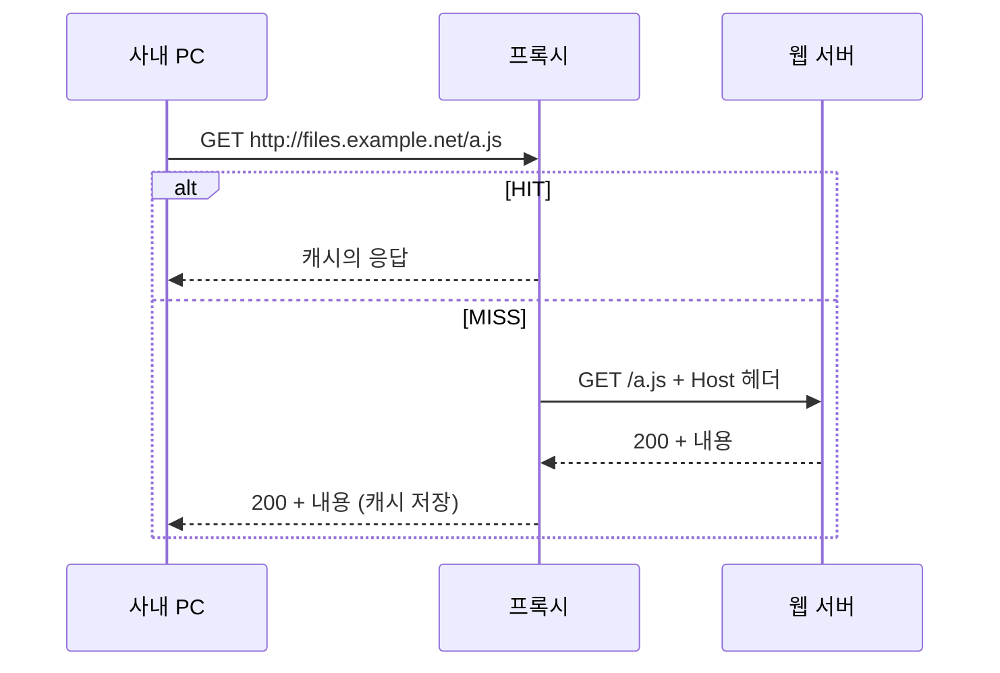
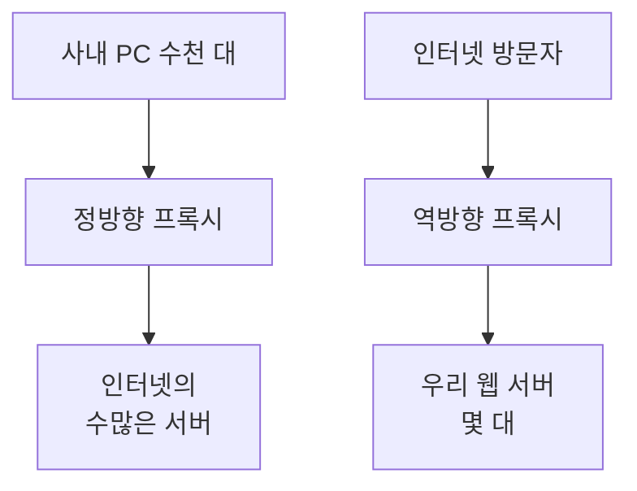
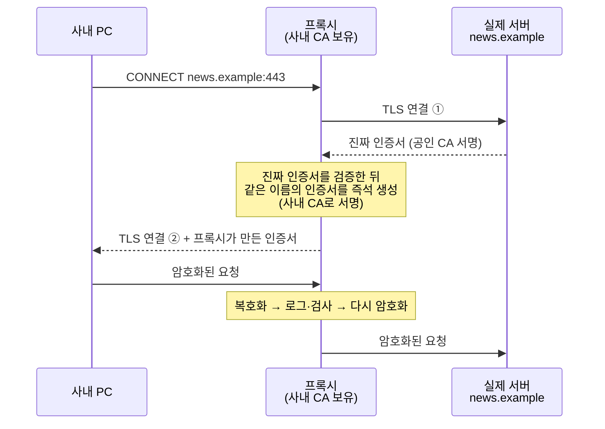

# 1.2강 — 웹 프록시: 동작 원리, 종류, 그리고 설정 파일이 증거인 이유 { #web-proxies }

!!! abstract "이번 회차의 범위"
    웹 프록시 단원의 앞부분입니다.

    - 프록시가 무엇이고 왜 생겼는가(정방향·역방향 프록시)
    - 성능 장비였던 프록시가 어떻게 보안·조사 장비가 됐는가(차단, 로그, 캐시)
    - TLS 암호화가 프록시의 시야를 어떻게 가리고, TLS 가로채기는 어떻게 그것을 되찾는가
    - 어떤 제품이 쓰이는가, 상용과 오픈소스는 조사자에게 무엇이 다른가
    - Squid 프록시에서 조사자가 확보할 세 가지(설정·로그·캐시)와 **설정 파일을 먼저 읽는 법**

    로그의 각 필드를 읽는 법은 다음 회차(1.3강), 캐시에서 파일을 꺼내는 법은 1.5강에서 다룹니다.

!!! note "표기"
    [1.1강](why-network-forensics.md)과 같습니다. **(가상 사례)**, **(예시 출력)**, **[변경됨]**, **[보충]**, **[주의]**를 씁니다. 설정 파일 예시는 실제 서버에서 가져온 것이 아니라 설명을 위해 직접 만든 것입니다.

## 1. 3만 대 중 C2에 접속한 PC 찾기 { #why-proxy }

1.1강의 가상 조직으로 돌아가 보겠습니다. **(가상 사례)** 외부 기관이 "`c2.example.net`이라는 도메인이 공격 서버다"라고 알려 왔습니다. 경영진의 첫 질문은 "우리 PC 중 몇 대가 거기 접속했나?"입니다.

PC를 한 대씩 디스크 분석해서는 몇 주가 걸립니다. 그런데 이 조직은 모든 웹 트래픽이 **웹 프록시**를 지나가도록 설정돼 있습니다. 그렇다면 프록시 로그에서 그 도메인을 검색하는 명령 한 줄로 몇 분 만에 1차 답을 얻을 수 있어요.

```bash
grep -F 'c2.example.net' /var/log/squid/access.log
```

`grep`은 파일에서 특정 문자열이 들어간 줄을 찾아 주는 리눅스 명령이고, `-F`는 검색어를 정규 표현식이 아닌 **글자 그대로** 찾으라는 옵션입니다. 도메인의 점(`.`)은 정규 표현식에서 "아무 글자 하나"라는 뜻이라, `-F` 없이 쓰면 `c2xexamplexnet` 같은 엉뚱한 줄까지 걸릴 수 있어서 붙였습니다. 결과에 나온 줄마다 요청한 내부 PC 주소가 적혀 있으니, 그 주소들을 모으면 "접속한 PC 목록"이 됩니다.

물론 1.1강에서 배운 대로 "0건이면 아무도 접속 안 했다"는 아닙니다. 그래도 이 한 줄이 조사 범위를 3만 대에서 몇 대로 줄여 줄 수 있다는 점이, 이 강의가 시작하자마자 프록시를 다루는 이유입니다. 그럼 프록시가 대체 무엇이길래 이런 기록을 갖고 있을까요?

## 2. 비유로 감 잡기: 회사의 구매 대행 창구 { #analogy }

직원들이 필요한 물건을 각자 바깥 가게에 가서 사 오지 않고, 회사의 **구매 대행 창구**에 부탁하는 회사를 떠올려 보세요.

- 직원은 창구에 "이 가게에서 이 물건을 사다 주세요"라고 부탁합니다.
- 창구 담당자가 대신 가게에 가서 물건을 사 오고, 직원에게 건넵니다. 가게 입장에서는 늘 **창구 담당자**가 사러 오는 것이지 직원 개개인을 보지 못합니다.
- 담당자는 장부에 "몇 시, 누가, 어느 가게의 무엇을 부탁했고, 결과는 어땠다"를 적습니다.
- 자주 찾는 물건은 창고에 하나 더 사 둡니다. 다음 직원이 같은 걸 찾으면 가게에 가지 않고 창고에서 바로 줍니다.
- 회사가 "이 가게는 거래 금지"라고 정하면, 담당자는 그 가게 심부름을 거절합니다.

웹 프록시가 정확히 이 창구입니다. 직원은 사내 PC, 가게는 인터넷의 웹 서버, 장부는 **프록시 로그**, 창고는 **프록시 캐시**, 거래 금지 목록은 **차단 정책**입니다. 1.1강에서 방화벽에 PC 주소가 아니라 프록시 주소만 찍혔던 이유도 이 비유로 설명됩니다. 가게(외부 서버)는 창구 담당자(프록시)만 보니까요.

하지만 비유와 실제가 다른 점도 있습니다. 세 가지는 꼭 기억해 두세요.

1. **창고에 모든 물건이 있지는 않습니다.** 실제 프록시는 "다시 써도 되는 응답"만 캐시에 보관하고, 로그인 후 화면처럼 사람마다 다른 응답은 대개 보관하지 않습니다. 그래서 캐시는 "있으면 대박"인 증거이지 "늘 있는" 증거가 아닙니다(1.5강).
2. **봉인된 소포는 열 수 없습니다.** HTTPS는 내용이 암호화된 봉인 소포라서, 설정을 따로 하지 않으면 창구 담당자는 "어느 가게에 다녀왔다"만 알고 무엇을 사 왔는지는 모릅니다(5절).
3. **창구를 거치지 않는 직원이 있을 수 있습니다.** 회사 규칙이 있어도 뒷문(프록시를 우회하는 경로)이 열려 있으면 장부에 남지 않습니다. 장부가 완전한지는 방화벽 규칙과 함께 봐야 알 수 있어요.

## 3. 원리: 프록시는 요청을 어떻게 대신 전달하나 { #how-it-works }

### 3.1 정방향 프록시 { #forward-proxy }

**프록시 서버**(proxy server)는 클라이언트와 서버 사이에서 트래픽을 중개하도록 설정된 서버입니다. 거의 모든 프로토콜에 쓸 수 있지만, 오늘날 "프록시"라고 하면 대부분 HTTP와 HTTPS를 중개하는 **웹 프록시**를 말합니다. 사내 PC들이 바깥으로 나갈 때 거치는 프록시를 **정방향 프록시**(forward proxy)라고 부릅니다.



**그림 읽는 법:** 세로줄 세 개가 세 장치(사내 PC `10.10.7.11`, 프록시 `10.10.4.3:3128`, 웹 서버 `203.0.113.75:80`)이고, 위에서 아래로 시간이 흐릅니다. 실선 화살표는 요청, 점선 화살표는 응답입니다. "alt" 상자는 두 경우 중 하나만 일어난다는 뜻이에요. 캐시에 있으면 위쪽(HIT), 없으면 아래쪽(MISS) 흐름이 됩니다.

여기서 조사자에게 아주 쓸모 있는 차이가 하나 있습니다. 그림의 첫 번째 화살표와 세 번째 화살표의 요청 줄을 비교해 보세요.

| 구간 | 요청 줄 | 왜 다른가 |
| --- | --- | --- |
| PC → 프록시 | `GET http://files.example.net/a.js HTTP/1.1` | 프록시가 어느 서버로 갈지 알아야 하므로 **전체 URL**을 적습니다 |
| 프록시 → 서버 | `GET /a.js HTTP/1.1` + `Host: files.example.net` | 서버는 자기 자신이니 **경로만** 받고, 호스트는 Host 헤더로 받습니다 |

HTTP 표준은 앞의 형태를 **절대 형식**(absolute-form), 뒤의 형태를 **원 서버 형식**(origin-form)이라고 부릅니다. 그래서 패킷 캡처에서 요청 줄이 `GET http://...`로 시작하면 "이 패킷은 프록시로 가는 구간에서 잡혔다"는 걸 알 수 있습니다. 반대로 프록시를 쓰게 돼 있는 PC가 `GET /경로` 형태로 외부 서버에 직접 요청하고 있다면, **프록시를 우회했다**는 뜻이 됩니다. 이게 정책 위반이나 악성코드의 흔적일 수 있어요.

### 3.2 HTTPS는 어떻게 지나가나: CONNECT { #connect }

그런데 HTTPS는 어떻게 될까요? 내용이 암호화돼 있으니 프록시가 전체 URL을 읽을 수 없습니다. 그래서 브라우저는 프록시에게 먼저 이렇게 부탁합니다.

```http
CONNECT news.example:443 HTTP/1.1
Host: news.example:443
```

"news.example의 443번 포트까지 **터널을 뚫어 달라**"는 뜻입니다. 프록시가 `200 Connection established`로 답하면, 그 뒤로 오가는 바이트는 프록시가 들여다보지 않고 양쪽으로 그대로 옮겨 주기만 합니다. 그래서 TLS 가로채기를 하지 않는 프록시의 로그에는 HTTPS 접속마다 `CONNECT news.example:443` 같은 한 줄만 남고, 그 안에서 어떤 페이지를 몇 번 열었는지는 남지 않습니다. 이 한계를 어떻게 넘는지는 5절에서 봅니다.

**[보충] 명시적 프록시와 투명 프록시.** 지금까지 설명한 것은 PC의 브라우저나 운영체제에 "프록시 주소는 10.10.4.3:3128"이라고 설정해 두는 **명시적 프록시**(explicit proxy)입니다. 반대로 PC에는 아무 설정 없이, 네트워크 장비가 80·443번 트래픽을 몰래 프록시로 돌려보내는 방식을 **투명 프록시**(transparent 또는 intercepting proxy)라고 합니다. 투명 프록시에서는 PC가 프록시의 존재를 모르니 요청 줄도 원 서버 형식(`GET /경로`)이고 `CONNECT`도 없습니다. 같은 "프록시 로그"라도 어느 방식이냐에 따라 기록되는 모양이 다르니, 설정 파일에서 방식을 먼저 확인해야 합니다(7절).

### 3.3 역방향 프록시 { #reverse-proxy }

프록시는 반대 방향으로도 놓입니다. 인터넷의 수많은 방문자가 우리 조직의 소수 웹 서버에 접속할 때, 서버 앞에 서서 요청을 받아 주는 프록시를 **역방향 프록시**(reverse proxy)라고 합니다. 여러 서버에 요청을 나눠 주는 부하 분산, 응답 압축 같은 성능 기능을 주로 맡습니다.



**그림 읽는 법:** 왼쪽 줄이 정방향, 오른쪽 줄이 역방향 프록시이고, 화살표는 둘 다 요청 방향입니다. 정방향은 "우리 쪽 사람들"을, 역방향은 "우리 쪽 서버들"을 대표해서 앞에 섭니다.

| 구분 | 정방향 프록시 | 역방향 프록시 |
| --- | --- | --- |
| 누구를 대신하나 | 사내 클라이언트 | 조직의 웹 서버 |
| 로그가 답하는 질문 | 어느 내부 PC가 어떤 외부 URL을 요청했나 | 어떤 외부 방문자가 우리 서버의 무엇을 요청했나 |
| 조사에서 쓰이는 사건 | 피싱 클릭, 악성코드 다운로드, C2, 유출 | 웹 서버 공격, 취약점 스캔, 웹셸 접속 |
| 주의할 점 | 프록시 우회 경로 | 서버 로그에는 방문자 대신 프록시 주소가 찍힘 → `X-Forwarded-For` 같은 헤더 확인 |

1.1강의 가상 조직은 DMZ의 웹 서버가 이상하다는 게 첫 단서였죠. 그런 사건에서는 웹 서버 앞의 역방향 프록시(있다면) 로그가 공격자의 요청을 담고 있을 가능성이 큽니다. 이 강의는 주로 정방향 프록시를 다루지만, 읽는 방법은 거의 같습니다.

### 3.4 원래는 성능 때문에 생겼다 { #history }

프록시는 원래 보안 장비가 아니었습니다. 느린 인터넷 회선을 아끼려고 생겼어요. 예전에는 수백 명이 1.544Mbps짜리 T-1 회선 하나를 나눠 썼습니다. 200명이 동시에 쓰면 한 사람 몫은 1,544,000 ÷ 200 ≈ 7,700bps, 즉 초당 1KB도 안 됩니다. 이런 상황에서 같은 뉴스 페이지를 200명이 각자 받아 오는 건 엄청난 낭비죠. 그래서 프록시가 한 번 받아 온 페이지를 보관해 두고(캐시), 다음 사람에게는 회선을 쓰지 않고 바로 건네줬습니다. 회선이 빨라진 지금도 이 구조는 남아 있고, 보안 쪽 사람들이 그 구조에서 새로운 가치를 발견했습니다.

## 4. 성능 장비가 보안 장비가 되다 { #security-value }

프록시는 "모든 웹 요청이 지나가는 관문"이라는 위치 덕분에 보안에서 두 가지 쓸모가 생겼습니다. 사고를 **막는**(사전) 쓸모와 사고를 **조사하는**(사후) 쓸모입니다.

### 4.1 사전: 알려진 나쁜 것 막기 { #prevent }

관리자는 프록시에서 금지된 사이트나 알려진 악성 도메인으로 가는 요청을 막을 수 있습니다. 사고 대응 중에도 이 기능이 아주 유용합니다. 공격자의 C2 도메인을 프록시 한 곳에서 막으면, PC 수만 대에 일일이 손대지 않고도 **조직 전체에서 거의 즉시** 그 통신을 끊을 수 있어요.

**[주의]** 다만 언제 막을지는 신중히 정해야 합니다. 1.1강에서 본 것처럼, 조사가 끝나기 전에 C2를 막으면 공격자가 "들켰다"는 걸 알아채고 다른 경로로 숨거나 흔적을 지울 수 있습니다. 반대로 데이터가 지금 빠져나가고 있다면 바로 막아야 하고요. 그래서 차단 시점은 대응 책임자가 피해 확산 위험과 조사 필요성을 함께 따져 정합니다. 그리고 차단한 뒤에도 **차단된 요청이 로그에 남는다**는 점을 기억하세요. 차단 이후에도 그 도메인을 계속 찾는 PC가 있다면, 그 PC는 아직 감염돼 있을 가능성이 큽니다.

### 4.2 사후: 로그와 캐시 { #post-incident }

**로그**는 프록시가 처리한 모든 HTTP(S) 요청의 출입 명부입니다. 보통 시간, 요청한 PC의 IP 주소, URL, 결과 상태가 남고, 프록시 인증을 쓰는 곳이라면 사용자 이름까지 남습니다. 그래서 "알려진 악성 사이트나 파일에 접근하려 한 내부 시스템이 어디인가?"를 **빠르게** 답할 수 있습니다. 피싱 사건이든 HTTP로 C2를 하는 봇넷이든, 시스템을 한 대씩 분석하는 것보다 훨씬 빨리 범위를 정할 수 있어요.

**캐시**는 프록시가 받아 온 응답의 사본입니다. 감염된 PC에서 악성 파일이 이미 지워졌더라도, 그 파일이 처음 내려올 때 프록시 캐시에 저장됐다면 **감염된 PC에 손대지 않고** 파일을 꺼내 분석할 수 있습니다. 감염 PC를 분석해 봤는데 정작 악성 파일이 없어서 막막했던 경험이 있다면 이게 얼마나 반가운지 아실 거예요.

작은 예로 보겠습니다. 다음은 같은 날 프록시 로그의 일부입니다(예시 출력, 필드는 단순화).

```text
2026-10-12 09:01:14 10.10.7.11  GET  http://parcel-redelivery.example/track?id=8812  200
2026-10-12 09:01:20 10.10.7.11  GET  http://parcel-redelivery.example/dl/label.zip   200
2026-10-12 09:03:51 10.10.6.14  GET  http://parcel-redelivery.example/track?id=1203  200
2026-10-12 09:40:02 10.10.7.15  GET  http://parcel-redelivery.example/track?id=5521  403
```

이 네 줄에서 직접 보이는 사실은 이렇습니다. 세 대의 PC(`.7.11`, `.6.14`, `.7.15`)가 같은 도메인에 접속했고, `.7.11`만 ZIP 파일까지 받았으며, `.7.15`의 요청은 `403`(거부)으로 끝났습니다. 아마 그 사이에 차단 정책이 들어갔겠죠. 여기서 세울 수 있는 가설은 "같은 피싱 메일이 여러 명에게 갔다"입니다. 결론을 내리려면 메일 서버 기록(누가 그 링크가 든 메일을 받았나)과 각 PC의 실행 기록을 확인해야 합니다. 그리고 `.7.11`이 받은 ZIP은 캐시에 남아 있는지 확인해 볼 만합니다.

**[보충] 프록시 로그에서 먼저 볼 만한 조건.** 프록시 로그에서 의심할 만한 조건을 정리한 공개 치트시트들이 있습니다. 교재는 보안 연구자 Florian Roth가 정리한 웹 프록시 이벤트 분석 치트시트를 소개하는데, 그 문서의 현재 배포 위치는 이번에 확인하지 못했습니다. 대표적인 조건을 직접 정리하면 이렇습니다. 어느 것도 그 자체로 악성의 증거는 아니고, "먼저 들여다볼 후보"를 고르는 기준입니다.

- 도메인 대신 **IP 주소로 직접** 요청한 URL
- 처음 보는 도메인에서 내려받은 **실행 파일·스크립트·압축 파일**
- 평소 거의 안 쓰이는 최상위 도메인이나 무료 동적 DNS 도메인
- 아주 길거나 Base64처럼 보이는 URL, 같은 크기로 일정 간격 반복되는 요청
- 이상하거나 비어 있는 User-Agent(브라우저 식별 문자열), 인증 실패(`407`)나 차단(`403`)이 한 PC에서 몰리는 경우

이런 조건들은 [Blue Team Essentials의 HTTP(S) 분석 회차](../../blue-team-essentials/http-analysis/index.md)에서 더 자세히 다룹니다.

## 5. TLS가 시야를 가리고, 가로채기가 되찾는다 { #tls }

### 5.1 문제: 봉인된 소포 { #tls-problem }

3.2절에서 본 것처럼, TLS로 암호화된 HTTPS는 프록시 로그에 `CONNECT 호스트:443` 한 줄만 남깁니다. 지금은 웹 트래픽 대부분이 HTTPS라서, 아무 설정이 없는 프록시는 "어느 사이트에 갔다"는 것 말고는 거의 알려 주지 못합니다. C2 서버가 정상 클라우드 서비스의 도메인을 쓰기라도 하면, 그 한 줄로는 정상과 악성을 가를 수 없어요.

### 5.2 해법: TLS 가로채기 { #tls-interception }

그래서 많은 조직이 프록시의 **TLS 가로채기**(TLS interception, TLS inspection, 제품에 따라 "SSL 검사"라고도 함) 기능을 켭니다. 원리는 프록시가 가운데서 두 개의 TLS 연결을 따로 맺는 것입니다.



**그림 읽는 법:** PC와 프록시 사이(②), 프록시와 서버 사이(①)에 TLS 연결이 하나씩, 모두 두 개 있습니다. 프록시는 가운데서 내용을 풀어 보고 다시 암호화해서 넘깁니다. PC는 프록시가 만든 인증서를 받는데, 그 인증서는 **사내 인증 기관**(CA, 인증서에 서명해 "이 인증서는 진짜"라고 보증하는 주체)이 서명한 것입니다.

이게 동작하려면 조건이 있습니다.

- **모든 PC가 사내 CA를 믿도록 미리 설정돼 있어야 합니다.** 그렇지 않으면 HTTPS 접속마다 브라우저가 인증서 경고를 띄웁니다. 그래서 TLS 가로채기는 조직이 관리하는 단말에서만 쓸 수 있습니다.
- **인증서 고정(certificate pinning)을 쓰는 프로그램은 깨집니다.** 일부 앱은 "이 서버의 인증서는 이것뿐"이라고 프로그램 안에 박아 둡니다. 프록시가 만든 인증서는 그것과 다르니 연결을 거부해요. 그래서 실무에서는 이런 앱이나 은행·의료 사이트처럼 개인정보 민감도가 높은 곳은 가로채지 않고 통과시키는 예외 목록을 둡니다.
- **법적·개인정보 검토가 필요합니다.** 직원의 암호화된 통신을 풀어 보는 일이라, 기술팀·법무팀·경영진이 함께 검토하고 직원에게 고지한 뒤 켜는 것이 일반적입니다.

조사자 입장에서 가장 중요한 결과는 이것입니다. 가로채기가 켜진 프록시의 로그에는 HTTPS 요청도 `GET https://news.example/article/77`처럼 **전체 URL**로 남습니다. 1.4강의 조사 실습에서 바로 이 차이를 보게 됩니다. 그리고 예외 목록으로 통과시킨 사이트는 여전히 `CONNECT` 한 줄만 남는다는 점도 기억해 두세요. "그 사이트의 URL이 로그에 없다"는 게 접속하지 않았다는 뜻이 아니라 예외 목록에 있었다는 뜻일 수 있습니다.

### 5.3 [보충] 지금의 TLS 환경에서 달라진 점 { #tls-today }

교재가 쓰인 뒤로 TLS 쪽에는 조사자에게 영향을 주는 변화가 몇 가지 있었습니다. 자세한 내용은 5부에서 다루고, 여기서는 프록시와 관련된 것만 짚습니다.

- **TLS 1.3에서는 서버 인증서가 암호화돼 오갑니다.** 예전에는 패킷만 봐도 서버 인증서가 보였지만, TLS 1.3에서는 가운데서 엿보는 장비(패킷 센서)가 인증서를 볼 수 없습니다. 프록시처럼 연결의 한쪽 끝이 되는 장비만 볼 수 있어요. 그만큼 프록시 기록의 가치가 커졌습니다.
- **ECH(Encrypted Client Hello)는 서버 이름(SNI)까지 숨깁니다.** 가운데서 엿보는 장비는 접속한 사이트 이름조차 못 보게 됩니다. 다만 명시적 프록시에서는 브라우저가 `CONNECT 호스트:443`에 목적지를 직접 적어 보내니, 프록시 로그에는 여전히 호스트 이름이 남습니다.
- **HTTP/3는 TCP가 아니라 UDP 위의 QUIC를 씁니다.** 프록시를 거치지 않는 경로로 UDP 443번이 열려 있으면, 브라우저가 QUIC로 직접 나가 버려 프록시 로그에 남지 않을 수 있습니다. 그래서 프록시로 웹 트래픽을 모으려는 조직은 UDP 443을 막아 브라우저가 TCP로 돌아오게 하거나, 브라우저 정책으로 QUIC을 끕니다. 예를 들어 Chrome에는 `QuicAllowed` 정책이 있고, 이것을 끄면 QUIC을 쓰지 않습니다(2026-11-05, Chromium 소스의 정책 정의 파일로 확인). 조사할 때는 방화벽 로그에서 프록시를 거치지 않은 **UDP 443** 통신이 있었는지 확인해야 프록시 로그가 완전한지 판단할 수 있습니다.
- **가로채기 장비 자체가 위험이 될 수 있습니다.** 미국 NSA는 2019년에 TLS 가로채기의 위험을 다룬 권고를 냈고 CISA도 이를 알렸습니다. 이 권고는 가로채기는 조직 안에서 한 번만 하고, 사내 CA 키를 철저히 보호하고, 가로채기 장비 로그를 잘 관리하라고 합니다(2026-11-05 [CISA 알림](https://www.cisa.gov/news-events/alerts/2019/11/19/nsa-releases-cyber-advisory-managing-risk-transport-layer-security)과 보조 요약으로 확인. 원문 PDF는 이번에 직접 읽지 못했습니다). 프록시가 모든 평문을 보는 자리에 있다는 건, 공격자가 프록시를 장악하면 그 평문도 다 본다는 뜻이기도 합니다. 그래서 조사할 때 프록시 자체의 무결성도 의심해 볼 대상입니다.

## 6. 어떤 제품들이 쓰이나 { #products }

프록시는 오픈소스(FOSS)와 상용 제품이 모두 많습니다. 조사하다 보면 다음 이름들을 자주 만납니다.

| 제품 | 형태 | 조사자가 알아 둘 점 |
| --- | --- | --- |
| Squid | 오픈소스, 소프트웨어 | 가장 널리 알려진 오픈소스 프록시. 로그가 평문이고 설정 문서가 아주 자세함. 이 강의의 기준 |
| NGINX | 오픈소스(상용판 있음), 웹 서버 겸 프록시 | 대개 **역방향** 프록시로 쓰임. 웹 서버 공격 조사에서 자주 만남 |
| Apache Traffic Server | 오픈소스 | 2009년 Yahoo!가 Apache 재단에 기증. 대규모 캐싱 프록시 |
| Broadcom(옛 Symantec·Blue Coat) ProxySG / Edge SWG | 상용, 장비·가상 장비 | 기업에서 널리 쓰임. TLS 가로채기 내장. 로그는 W3C 확장 형식으로 필드를 설정 |
| Forcepoint Web Security(옛 Websense) | 상용 | 대규모 환경에서 쓰임 |
| Zscaler | 상용, **클라우드** 서비스 | 프록시를 클라우드로 옮긴 형태. 로그가 제조사 클라우드에 있음 |

**[변경됨]** 교재는 Broadcom의 제품을 "Symantec WebFilter(옛 Blue Coat)"라고 불렀습니다. 2026-11-05 현재 Broadcom의 지원 문서는 이 프록시 제품군을 "Edge SWG(ProxySG)"라는 이름으로 다룹니다([Broadcom 지식 문서 240610: Edge SWG(ProxySG) access log fields](https://knowledge.broadcom.com/external/article/240610/edge-swg-proxysg-access-log-fields.html)). WebFilter는 이 프록시가 쓰는 URL 분류 데이터베이스의 이름에 가깝습니다. 제품 이름은 인수·합병으로 자주 바뀌니, 조사 보고서에는 "어떤 이름으로 불리든 실제로 어떤 장비·버전이었는지"를 설정과 로그 헤더로 확인해 적는 것이 좋습니다.

**[보충] 클라우드 프록시의 조사상 차이.** Zscaler 같은 클라우드 프록시는 재택 근무자의 트래픽까지 모아 준다는 장점이 있습니다. 대신 로그와 설정이 **제조사의 클라우드**에 있어서, 서버 디스크를 복사해 오는 방식으로는 증거를 얻을 수 없습니다. 관리 콘솔이나 API, 로그 전송(SIEM 연동)으로 받아야 하고, 보관 기간은 계약 조건에 따라 정해집니다. 사고 대응 계획을 세울 때 "로그를 누가, 얼마나 빨리, 어떤 형식으로 받을 수 있나"를 미리 확인해 두어야 합니다.

### 6.1 상용과 오픈소스, 조사자에게는 무엇이 다른가 { #commercial-vs-foss }

"상용이 낫나, 오픈소스가 낫나"에는 정답이 없습니다. 각자 장단점이 있어요. 다만 조사자 입장에서는 차이가 분명히 있습니다.

- **오픈소스는 데이터에 접근하기 쉽습니다.** 로그가 평문인 경우가 많고, 어떤 필드가 정확히 무슨 뜻인지 헷갈리면 소스 코드와 문서를 보고 확인할 수 있습니다.
- **상용 제품은 접근을 어렵게 하기도 합니다.** 저장 형식이 독자적이라 분석 전에 변환 작업이 필요한 경우가 많고, 관리 화면은 정해진 몇 가지 기능은 잘하지만 그 밖의 질문을 하기는 어렵습니다. 그렇다고 데이터를 못 쓰는 건 아니고, 꺼내는 데 수고가 더 든다는 뜻입니다(1.5강에서 상용 로그 예를 봅니다).

이 강의가 Squid를 기준으로 삼는 이유도 여기 있습니다. 오픈소스라 속을 들여다보며 원리를 이해하기 좋고, 널리 쓰이기 때문이에요. 하지만 목표는 Squid 사용법이 아니라 **어느 프록시에나 통하는 조사 방법**입니다. 주요 상용 프록시도 같거나 비슷한 기능과 기록을 갖고 있으니, 여기서 배운 질문을 그대로 던지면 됩니다.

## 7. Squid에서 확보할 세 가지 증거 { #squid-evidence }

Squid는 무료이고 대부분의 리눅스 배포판에 기본 패키지로 들어 있어서 설치가 쉽습니다. 하지만 그 단순함 뒤에 강력한 기능이 숨어 있습니다. 숙련된 관리자는 여러 대의 Squid를 묶어 함께 돌리거나, 파일 종류별로 캐시 보관 정책을 달리하는 등(예: `.exe`는 `.html`보다 오래 보관) 수백 가지 방식으로 설정합니다. 그래서 조사자가 가장 먼저 확보할 것은 **설정 파일**입니다.

| 증거 | 흔한 위치(배포판 패키지 기준) | 무엇을 알려 주나 |
| --- | --- | --- |
| 설정 파일 | `/etc/squid/squid.conf` | 나머지 증거가 어디에, 어떤 형식으로, 어떤 조건에서 남는지 |
| 로그 파일 | `/var/log/squid/` 아래(`access.log`, `cache.log` 등) | 클라이언트 요청의 출입 명부 |
| 캐시 데이터 | `/var/spool/squid/` 아래 | 서버가 돌려준 응답의 사본 |

**[주의] 위치는 설치마다 다릅니다.** 위 표는 흔한 배포판 패키지 기준입니다. 소스에서 직접 빌드하면 기본 위치가 `/usr/local/squid/` 아래로 바뀌고, 관리자가 설정에서 얼마든지 바꿀 수 있습니다. 그래서 위치를 짐작하지 말고 **설정 파일에 적힌 경로를 따라가야** 합니다. 이게 설정 파일을 먼저 확보하는 첫 번째 이유입니다.

### 7.1 왜 설정 파일이 먼저인가 { #config-first }

이 시리즈 내내 반복될 원칙입니다. **장비가 조사와 관련 있다고 판단되면, 그 장비의 설정 파일부터 빨리 확보하세요.** 이유는 세 가지입니다.

1. **나머지 증거의 위치와 의미를 알려 줍니다.** 로그가 어디에 있는지, 어떤 필드가 어떤 순서로 찍히는지, 쿼리 문자열을 지우고 기록하는지, 캐시를 디스크에 두는지가 모두 설정에 있습니다.
2. **설정은 바뀝니다.** 사고 대응 중에 관리자가 차단 규칙을 넣거나 로그 형식을 바꾸면, 사고 당시의 설정은 사라집니다. 사고 당시 설정을 모르면 그때의 로그를 잘못 읽을 수 있어요. 증거가 이렇게 바뀌거나 훼손되는 것을 **증거 훼손**(spoliation)이라고 합니다.
3. **놓친 증거를 알려 줍니다.** 예를 들어 설정에 로그를 두 군데로 나눠 쓰는 줄이 있다면, 두 번째 로그 파일의 존재를 설정을 보고서야 알게 됩니다.

설정 파일을 확보할 때는 1.1강의 원칙대로 사본을 만들고, 해시(파일 내용으로 계산한 고유한 지문 값)를 기록해 둡니다(예시 명령).

```bash
sudo tar -czpf proxy-config-$(date -u +%Y%m%dT%H%M%SZ).tgz /etc/squid/
sha256sum proxy-config-*.tgz | tee proxy-config.sha256
```

첫 줄의 `tar -czpf`는 `/etc/squid/` 폴더 전체를 압축 파일 하나로 묶습니다(`c` 묶기, `z` 압축, `p` 권한 정보 유지, `f` 파일 이름 지정). 파일 이름에 `date -u +%Y%m%dT%H%M%SZ`로 UTC 기준 확보 시각을 넣어서, 나중에 "언제 떠 온 설정인가"가 헷갈리지 않게 했습니다. 둘째 줄은 그 압축 파일의 SHA-256 해시를 계산해서 화면에 보여 주는 동시에(`tee`) 파일로도 저장합니다. 나중에 해시를 다시 계산해 같으면, 확보한 뒤 바뀌지 않았다는 근거가 됩니다. 메인 설정 파일만이 아니라 폴더 전체를 묶는 이유는, 설정이 `include` 지시어로 다른 파일을 불러오거나 TLS 가로채기용 인증서가 같은 폴더에 있을 수 있기 때문입니다.

Squid는 설정 항목 하나하나를 아주 자세히 설명한 기본 설정 파일도 함께 설치합니다. 배포판에 따라 `/etc/squid/squid.conf.default`나 `squid.conf.documented` 같은 이름으로 들어 있어요. 설정 줄의 뜻이 헷갈리면 이 파일이 1차 참고 자료입니다. 다만 **조사 대상 서버의 Squid 버전에 맞는** 문서를 봐야 합니다. 버전마다 설정 문법이 바뀌기 때문입니다(8.2절).

## 8. 설정 파일 읽기 실습 { #reading-config }

이제 실제로 읽어 보겠습니다. 아래는 1.1강의 가상 조직 프록시라고 가정하고 **직접 만든** 설정의 핵심 부분입니다. Squid 7 문서의 문법을 따랐습니다.

```squid
# --- 네트워크 존재감 ---
http_port 3128 ssl-bump tls-cert=/etc/squid/ca/proxy-ca.pem generate-host-certificates=on dynamic_cert_mem_cache_size=4MB

# --- 접근 제어 ---
acl localnet src 10.10.0.0/16
acl research src 10.10.6.0/24
acl SSL_ports port 443
acl CONNECT method CONNECT
http_access deny CONNECT !SSL_ports
http_access allow localnet
http_access deny all

# --- TLS 가로채기 규칙 ---
acl step1 at_step SslBump1
acl no_bump ssl::server_name .bank.example .health.example
ssl_bump peek step1
ssl_bump splice no_bump
ssl_bump bump all

# --- 로그와 캐시 ---
access_log daemon:/var/log/squid/access.log squid
strip_query_terms off
cache_dir ufs /var/spool/squid 51200 16 256
```

`#`으로 시작하는 줄은 설명(주석)이라 Squid가 무시합니다. 한 묶음씩 읽어 보겠습니다.

### 8.1 한 줄씩 읽기 { #line-by-line }

**네트워크 존재감: `http_port 3128 ...`** Squid가 **TCP 3128번 포트**에서 요청을 기다린다는 뜻입니다. 3128은 Squid의 관례적인 기본 포트지만, 관리자가 8080 같은 다른 값으로 바꾸는 경우도 많습니다. 이 값을 알면 다른 증거를 읽을 수 있게 됩니다. 방화벽 로그에서 "PC → 10.10.4.3:3128"은 정상적인 프록시 이용이고, "PC → 인터넷:443"은 프록시를 우회한 직접 연결이라는 식으로요. 같은 줄의 `ssl-bump`는 이 포트에서 TLS 가로채기를 쓰겠다는 표시이고, `tls-cert=`는 가로채기에 쓸 사내 CA 인증서 파일, `generate-host-certificates=on`은 접속하는 사이트마다 인증서를 즉석에서 만들라는 뜻입니다. `dynamic_cert_mem_cache_size=4MB`는 만든 인증서를 메모리에 4MB까지 보관해 재사용하라는 설정이에요.

**접근 제어: `acl`과 `http_access`.** `acl`(Access Control List)은 "이런 조건을 이 이름으로 부르겠다"는 정의입니다. `acl localnet src 10.10.0.0/16`은 "출발지 주소가 10.10.0.0~10.10.255.255인 요청을 `localnet`이라 부른다"는 뜻이에요. `/16`은 CIDR 표기로, 앞의 16비트(10.10)가 같은 주소 범위라는 뜻입니다. `http_access`는 정의한 조건으로 허용·거부를 정하는데, **위에서부터 처음 맞는 줄이 적용**됩니다. 그래서 순서가 중요합니다. 위 설정은 ① 443이 아닌 포트로의 `CONNECT`는 거부(아무 포트로나 터널을 뚫는 걸 막음), ② 사내 주소는 허용, ③ 나머지는 전부 거부입니다. 조건으로는 주소 말고도 사용자 인증, User-Agent, 요일과 시간, URL 정규 표현식 등을 쓸 수 있습니다.

조사자에게 이 부분이 중요한 이유는, **어떤 요청이 거부됐는지**와 **거부된 요청이 로그에 어떻게 찍히는지**를 이해하게 해 주기 때문입니다. 예를 들어 `research`처럼 따로 정의된 그룹이 있다면, 그 그룹에만 다른 규칙이나 별도 로그가 걸려 있을 수 있다는 신호입니다.

**TLS 가로채기 규칙: `ssl_bump`.** Squid는 TLS 연결을 몇 단계(step)로 나눠 처리하면서, 단계마다 "들여다볼지(peek), 그냥 통과시킬지(splice), 가로챌지(bump)"를 정합니다. 위 설정은 ① 첫 단계에서 클라이언트가 보낸 인사(Client Hello)를 엿봐서 접속하려는 서버 이름을 알아내고(`peek step1`), ② 그 이름이 은행·의료 예시 도메인이면 가로채지 않고 통과시키고(`splice no_bump`), ③ 나머지는 모두 가로챕니다(`bump all`). 규칙이 하나도 맞지 않으면 기본 동작은 `splice`(통과)입니다.

조사자에게는 ②가 핵심입니다. `.bank.example`과 `.health.example`에 대한 기록은 로그에 `CONNECT` 한 줄로만 남습니다. 5.2절에서 말한 "URL이 없는 건 예외 목록 때문일 수 있다"를 설정에서 직접 확인하는 셈이에요.

**로그와 캐시.** `access_log daemon:/var/log/squid/access.log squid`는 접근 로그를 `/var/log/squid/access.log`에 Squid 기본 형식(`squid`)으로 쓰라는 뜻입니다. 앞의 `daemon:`은 별도 도우미 프로세스가 파일에 쓰게 하는 방식이에요. 형식 이름이 `squid`가 아니라 직접 정의한 이름이라면, 같은 설정 파일 어딘가에 `logformat` 줄이 있을 테니 찾아서 필드 순서를 확인해야 합니다(1.3강). `strip_query_terms off`는 URL의 `?` 뒤 쿼리 문자열까지 기록하라는 뜻입니다. Squid의 기본값은 `on`이라 **쿼리 문자열을 지우고** 기록합니다. 개인정보 보호를 위한 기본값이라, `off`로 바꿀 때는 권한 있는 사람들과의 협의가 필요해요. `cache_dir ufs /var/spool/squid 51200 16 256`은 `ufs` 방식 디스크 캐시를 `/var/spool/squid`에 최대 51,200MB(50GB)까지 두고, 그 아래를 1단계 폴더 16개, 각각 2단계 폴더 256개로 나눠 저장하라는 뜻입니다. 캐시 파일이 `/var/spool/squid/00/05/000005F4`처럼 숫자 폴더 두 단계 아래에 생기는 이유가 이것입니다(1.5강).

### 8.2 [변경됨] 교재의 설정과 지금의 문법 { #syntax-changes }

교재의 예시 설정은 몇 년 전 Squid 문법이라, 지금 버전(2026-11-05 기준 최신 안정판은 Squid 7.6, Squid 6은 지원 종료)과 다른 곳이 있습니다. Squid 7 브랜치의 설정 문서 원본(`src/cf.data.pre`)과 설정 해석 코드로 확인한 내용입니다.

| 교재의 줄 | 지금의 상태 | 조사자가 알아 둘 점 |
| --- | --- | --- |
| `http_port ... cert=... key=...` | 문서상 이름은 `tls-cert=`, `tls-key=`. `cert=`, `key=`는 설정 해석 코드가 여전히 받아들임 | 오래된 서버에서는 옛 이름이 그대로 쓰였을 수 있으니 둘 다 알아볼 수 있어야 함 |
| `ssl_bump server-first all` | `server-first`, `client-first`는 "하위 호환용 동작"으로만 남음. 지금은 `peek`·`stare`·`splice`·`bump`를 단계별로 조합 | 옛 방식은 TLS 인사 정보를 보고 판단할 수 없음. 예외 목록을 정교하게 두기 어려움 |
| `sslproxy_flags DONT_VERIFY_PEER` | 이 지시어는 **폐지**. 같은 기능은 `tls_outgoing_options flags=DONT_VERIFY_PEER` | **[주의]** 프록시가 서버 인증서가 엉터리여도 받아들이고, 사용자는 경고를 못 봄. 가짜 서버로 가는 연결을 숨길 수 있어 위험한 설정이니, 발견하면 보고서에 위험으로 적을 것 |
| `sslcrtd_program /usr/lib64/squid/ssl_crtd ...` | 인증서 생성 도우미의 이름이 `security_file_certgen`으로 바뀜 | 실행 파일 이름으로 찾을 때 둘 다 확인 |
| `cache_dir ufs /var/spool/squid ...` | 문법은 같음. 다만 **`cache_dir`이 없으면 디스크 캐시가 없고 메모리에만 캐시함**(Squid 7 문서의 기본값 설명) | **[주의]** 디스크 캐시가 없으면 캐시는 Squid를 재시작하는 순간 사라짐. 확보 전에 재시작하지 말 것 |
| `store.log` 파일 | `cache_store_log`의 기본값은 `none`(기록 안 함) | `store.log`가 없는 게 이상한 일이 아님. 설정에 켜져 있을 때만 존재 |

이 표에서 가장 실무적인 교훈은 마지막 두 줄입니다. 설정을 읽어 보면 **"이 서버에서 어떤 증거는 처음부터 없었다"**는 것도 알 수 있습니다. 그걸 모르고 "캐시가 지워졌다", "store.log를 누가 삭제했다"고 보고하면 틀린 결론이 됩니다.

### 8.3 조건을 바꿔 보기 { #config-variations }

같은 조직이라도 설정이 조금만 달라지면 로그에 남는 것이 크게 달라집니다. 몇 가지 경우를 비교해 보겠습니다.

| 설정의 차이 | 로그·캐시에 생기는 결과 | 조사에 미치는 영향 |
| --- | --- | --- |
| `ssl-bump`가 없음 | HTTPS는 전부 `CONNECT 호스트:443`만 남음 | HTTPS의 경로·파일 이름을 프록시로 알 수 없음. 패킷·단말 증거 필요 |
| `strip_query_terms`가 기본값(`on`) | `?id=8812` 같은 쿼리 문자열이 지워짐 | 검색어, 피싱 링크의 식별자, C2의 명령 파라미터가 로그에 없음 |
| `cache_dir` 없음 | 캐시는 메모리에만 | 재시작하면 캐시 증거 소멸. 살아 있는 동안 확보해야 함 |
| `access_log`가 두 줄 | 조건에 따라 두 파일에 나눠 기록 | 한 파일만 보면 일부를 놓침 |
| `http_port`가 투명 모드(`intercept`) | 요청 줄이 원 서버 형식, `CONNECT` 없음 | 3.2절의 "CONNECT 줄로 HTTPS 찾기"가 통하지 않음 |

### 8.4 실제 조사에서는 이렇게 해석합니다 { #interpretation }

설정 파일을 읽고 나면 보고서나 조사 노트에 다음을 적어 둘 수 있습니다. 위의 예시 설정을 기준으로 하면 이렇습니다.

- **관측한 사실(설정에서 직접 읽은 것):** 프록시는 3128번 포트를 쓰고, TLS 가로채기가 켜져 있으며, 은행·의료 예시 도메인은 예외다. 쿼리 문자열을 기록한다. 디스크 캐시는 최대 50GB다.
- **그 사실이 뒷받침하는 판단:** 이 프록시를 거친 HTTPS 요청은 예외 도메인을 빼고 전체 URL로 로그에 있을 것이다. 캐시에 응답 사본이 있을 수 있다.
- **추가로 확인해야 하는 것:** 이 설정이 **사고 당시에도** 같았는가(설정 변경 이력, 백업, 파일 수정 시각, 관리자 면담). 모든 PC가 실제로 이 프록시를 썼는가(방화벽에서 3128이 아닌 직접 80·443·UDP 443 연결이 있었나). 지금 디스크에 있는 캐시가 사고 시점을 덮는가(캐시는 공간이 차면 오래된 것부터 지워짐).

마지막 줄이 특히 중요합니다. 설정 파일은 **지금** 상태를 보여 줍니다. 사고 당시의 상태와 같다는 건 따로 확인해야 하는 가설이에요.

## 9. 정리 { #summary }

- 웹 프록시는 클라이언트와 서버 사이에서 HTTP(S)를 중개하는 서버입니다. 정방향은 사내 PC를, 역방향은 조직의 서버를 대신해 앞에 섭니다.
- 원래는 느린 회선을 아끼는 성능 장비였지만, 모든 웹 요청이 지나가는 위치 덕분에 차단(사전)과 로그·캐시(사후)라는 보안 가치가 생겼습니다.
- 프록시로 가는 요청은 전체 URL(절대 형식)로, HTTPS는 `CONNECT 호스트:443`으로 시작합니다. 이 모양으로 프록시 이용과 우회를 구별할 수 있습니다.
- TLS는 프록시의 시야를 가리고, TLS 가로채기는 사내 CA로 그것을 되찾습니다. 단말 통제, 인증서 고정 예외, 법적 검토가 필요하고, 예외 목록의 사이트는 여전히 `CONNECT`만 남습니다.
- TLS 1.3과 ECH로 패킷만으로 보이는 것이 줄면서 프록시 기록의 가치가 커졌습니다. 반면 QUIC(UDP 443)은 프록시를 비껴갈 수 있으니 방화벽 기록으로 빈틈을 확인해야 합니다.
- 상용이든 오픈소스든 목표는 도구가 아니라 방법입니다. 상용·클라우드 프록시는 데이터를 꺼내는 데 수고가 더 듭니다.
- Squid의 증거는 설정·로그·캐시 세 가지이고, **설정 파일을 가장 먼저** 확보합니다. 설정은 나머지 증거의 위치와 의미를 알려 주고, "처음부터 없던 증거"도 알려 줍니다.

다음 회차(1.3강)에서는 이 설정이 만들어 내는 `access.log`의 각 필드를 하나씩 읽고, 맞춤 로그 형식과 유닉스 시간 변환을 다룹니다.

## 복습 문제 { #review }

**문제 1.** 패킷 캡처에서 사내 PC `10.10.7.11`이 보낸 요청 줄이 `GET http://files.example.net/a.js HTTP/1.1`입니다. 다른 PC `10.10.7.15`가 보낸 요청 줄은 `GET /a.js HTTP/1.1`이고 목적지는 `203.0.113.75:80`입니다. 조직은 명시적 프록시를 쓰도록 정해져 있습니다. 두 요청에서 무엇을 알 수 있나요?

??? success "정답과 해설"
    첫 번째는 **절대 형식**(전체 URL)이니 프록시로 가는 요청입니다. 정상적인 프록시 이용이에요. 두 번째는 **원 서버 형식**(경로만)인데 목적지가 외부 서버이니, `10.10.7.15`가 **프록시를 거치지 않고 외부 서버에 직접** 요청한 것입니다. 명시적 프록시를 쓰도록 정해진 조직에서는 이것이 관측된 이상 징후입니다. 다만 이것만으로 악성이라고 단정할 수는 없습니다. 프록시 설정이 빠진 PC나 프록시를 쓰지 않는 업데이트 프로그램일 수도 있어요. 그 PC에서 어떤 프로세스가 이 연결을 만들었는지(단말 기록), 방화벽이 왜 이 직접 연결을 허용했는지를 확인해야 합니다. 그리고 이 요청은 프록시 로그에 **없다**는 점도 중요합니다. 프록시 로그만 봤다면 놓쳤을 통신입니다.

**문제 2.** 프록시 로그에 `CONNECT mail.example:443`만 있고 그 사이트의 `https://` URL은 하나도 없습니다. 이 프록시는 TLS 가로채기를 쓴다고 들었습니다. 가능한 설명을 두 가지 이상 들고, 각각 무엇으로 확인할지 말해 보세요.

??? success "정답과 해설"
    1. **예외 목록에 있었다:** `ssl_bump splice` 규칙에 그 도메인이나 그 분류가 들어 있으면 가로채지 않고 통과시키니 `CONNECT`만 남습니다. 설정 파일의 `ssl_bump`와 관련 `acl` 줄로 확인합니다.
    2. **그 시점에는 가로채기가 꺼져 있었다:** 가로채기가 나중에 켜졌거나 잠시 꺼졌을 수 있습니다. 설정 변경 이력, 백업, 관리자 면담으로 사고 당시 설정을 확인합니다.
    3. **TLS 연결이 중간에 실패했다:** 인증서 고정을 쓰는 프로그램이면 프록시가 만든 인증서를 거부해 연결이 끊기고, 그 뒤 요청이 없었을 수 있습니다. `cache.log`의 오류 기록이나 단말 쪽 오류 기록으로 확인합니다.

    어느 경우든 "가로채기를 쓰니까 URL이 없으면 접속 안 한 것"이라는 결론은 틀립니다. `CONNECT` 줄이 있다는 것 자체가 그 호스트로 터널을 열었다는 관측 사실이에요.

**문제 3. (조건 바꾸기)** 8절의 예시 설정에서 `strip_query_terms off` 줄을 지우면 4.2절의 예시 로그 네 줄은 어떻게 바뀌나요? 그 결과 어떤 판단이 어려워지나요?

??? success "정답과 해설"
    기본값 `on`이 적용되어 `?id=8812`, `?id=1203`, `?id=5521` 같은 **쿼리 문자열이 지워진 채** 기록됩니다. 세 줄 모두 `http://parcel-redelivery.example/track`으로 똑같아 보이게 돼요. 피싱 링크의 `id` 값은 보통 "누구에게 보낸 메일인지"를 구별하는 식별자라, 그 값이 있으면 메일 서버 기록과 맞춰 각 수신자를 정확히 짝지을 수 있습니다. 쿼리 문자열이 지워지면 이 대조가 어려워지고, 검색어나 C2 명령 파라미터 같은 정보도 잃습니다. 그래서 설정을 먼저 읽어서 "이 로그에는 원래 쿼리 문자열이 없다"는 걸 알아야, 없는 정보를 찾느라 시간을 쓰지 않습니다.

**문제 4. (흔한 오해)** 동료가 "프록시 서버의 `/var/spool/squid/`가 비어 있으니, 공격자가 캐시를 지운 것 같다"고 말합니다. 어떻게 확인하시겠어요?

??? success "정답과 해설"
    먼저 설정 파일에 `cache_dir`이 있는지 봅니다. Squid 7 문서 기준으로 `cache_dir`이 없으면 **디스크 캐시 자체가 없고 메모리에만** 캐시합니다. 그렇다면 폴더가 비어 있는 게 정상이에요. `cache_dir`이 다른 경로를 가리키거나 여러 줄로 여러 경로에 나눠 두었을 수도 있으니, 적힌 경로를 모두 확인합니다. `cache_dir`이 그 경로로 설정돼 있는데도 비어 있다면 그때 가능성을 따집니다. 최근 재설치나 캐시 초기화 같은 관리 작업이 있었는지(관리자 면담, 시스템 로그), 디스크가 바뀌었는지, 정말 삭제 흔적이 있는지(파일 시스템 포렌식)를 봅니다. "공격자가 지웠다"는 맨 마지막에, 근거가 있을 때만 쓸 수 있는 결론입니다.

**문제 5. (설정 읽기)** 다음 설정에서 사용자 PC `10.10.7.11`이 `CONNECT example.org:8443` 요청을 보내면 결과는 어떻게 되나요? 이유를 설명하세요.

```squid
acl localnet src 10.10.0.0/16
acl SSL_ports port 443
acl CONNECT method CONNECT
http_access allow localnet
http_access deny CONNECT !SSL_ports
http_access deny all
```

??? success "정답과 해설"
    **허용됩니다.** `http_access`는 위에서부터 처음 맞는 줄이 적용되는데, 첫 줄 `allow localnet`에서 출발지 `10.10.7.11`이 `localnet`(10.10.0.0/16)에 맞으니 바로 허용되고 그 아래 줄은 보지 않습니다. 그래서 "443이 아닌 포트로의 CONNECT는 거부"하려던 둘째 줄이 사내 PC에는 전혀 적용되지 않습니다. 8절 예시처럼 `deny CONNECT !SSL_ports`를 `allow localnet`보다 **위에** 둬야 의도대로 동작해요. 조사 관점에서 보면, 이 설정의 프록시 로그에 사내 PC의 비표준 포트 `CONNECT`가 허용돼 있다면 설정 실수 덕분에 열려 있던 통로일 수 있습니다. 공격자가 C2용으로 쓰기 좋은 통로이기도 하고요.

**문제 6. (계산)** 8절 예시의 `cache_dir ufs /var/spool/squid 51200 16 256`에서 (가) 캐시 최대 용량은 몇 GB이고, (나) 캐시 파일이 들어갈 수 있는 2단계 폴더는 모두 몇 개인가요?

??? success "정답과 해설"
    (가) 세 번째 값 51200의 단위는 MB이니 51,200 ÷ 1,024 = **50GB**입니다. (나) 1단계 폴더 16개 각각에 2단계 폴더가 256개씩이니 16 × 256 = **4,096개**입니다. 이걸 알면 캐시를 확보할 때 `/var/spool/squid/00/00`부터 `0F/FF`까지 숫자 폴더가 있다는 걸 예상할 수 있습니다(1단계 16개는 16진수 00~0F, 2단계 256개는 00~FF). 일부 폴더만 복사하면 캐시의 일부를 놓치니, 설정에 적힌 `cache_dir` 경로를 **통째로** 확보해야 합니다. 그리고 50GB가 다 차면 오래된 것부터 지워지니, 바쁜 프록시에서는 캐시가 덮는 기간이 생각보다 짧을 수 있습니다.

**문제 7. (최신 환경)** 프록시 로그를 보면 어떤 PC가 `www.video.example`에 한 번도 접속하지 않았습니다. 그런데 사용자는 그 사이트에서 몇 시간 동안 영상을 봤다고 말합니다. 어떻게 설명할 수 있고, 무엇을 확인해야 하나요?

??? success "정답과 해설"
    가장 유력한 설명은 **HTTP/3(QUIC)** 입니다. 영상 서비스는 QUIC을 많이 쓰는데, QUIC은 TCP가 아니라 UDP 443번을 씁니다. 프록시를 거치지 않는 경로로 UDP 443이 방화벽에서 허용돼 있었다면, 브라우저가 프록시를 비껴가 직접 접속했을 수 있어요. 방화벽 로그에서 그 PC의 **UDP 443** 연결을 확인하고, 브라우저 정책(예: Chrome의 `QuicAllowed`)이 꺼져 있지 않았는지 봅니다. 그 밖에 그 PC에 프록시 설정이 빠졌거나 VPN 같은 다른 경로로 나갔을 가능성도 함께 확인합니다. 이 사례의 교훈은 "프록시 로그에 없다 = 접속 안 했다"가 아니라는 것, 그리고 프록시 로그가 완전한지는 **방화벽 기록과 대조해야** 알 수 있다는 것입니다.

**문제 8. (판단)** 사고 대응 첫날, C2 도메인을 찾자마자 동료가 "프록시에서 바로 차단하자"고 합니다. 찬성과 반대 논거를 하나씩 들고, 차단한다면 그 뒤 프록시 로그를 어떻게 활용할 수 있는지 말해 보세요.

??? success "정답과 해설"
    - **찬성:** 프록시 한 곳에서 막으면 조직 전체에서 거의 즉시 C2 통신이 끊깁니다. 데이터가 지금 빠져나가고 있다면 피해를 줄이는 가장 빠른 방법입니다.
    - **반대:** 공격자가 C2 통신이 끊긴 걸 보고 조사 사실을 눈치챌 수 있습니다. 그러면 다른 C2로 옮기거나 흔적을 지워서, 감염 범위를 다 찾기 전에 공격자를 놓칠 수 있어요(1.1강의 OPSEC과 "한꺼번에 복구").

    결정은 대응 책임자가 피해 확산 위험과 조사 필요성을 따져서 내립니다. 차단했다면, **차단된 요청도 로그에 남는다**는 점을 활용합니다. 차단 이후에도 그 도메인으로 계속 요청을 보내는 PC(결과가 403 등으로 찍힘)는 아직 감염돼 있을 가능성이 크니, 그 목록이 정밀 분석 대상이 됩니다. 반대로 공격자가 새 C2로 옮겼다면, 차단 직후 같은 PC들에서 처음 보는 도메인으로 가는 요청이 생겼는지를 찾아보면 됩니다.

## 참고 자료 { #references }

- Squid 프로젝트, Squid 7 브랜치 설정 문서 원본 [`src/cf.data.pre`](https://github.com/squid-cache/squid/blob/v7/src/cf.data.pre)와 설정 해석 코드 [`src/cache_cf.cc`](https://github.com/squid-cache/squid/blob/v7/src/cache_cf.cc) (2026-11-05 확인). `http_port`의 `tls-cert=`·`generate-host-certificates`, `ssl_bump` 동작, `sslproxy_flags` 폐지, `cache_dir`·`cache_store_log`·`strip_query_terms` 기본값. 공식 사이트(squid-cache.org)는 이 작업 환경에서 접속이 막혀 있어 소스 저장소로 확인했습니다.
- endoflife.date, [Squid](https://endoflife.date/squid) (2026-11-05 확인). 최신 안정판 7.6(2026-06-07), Squid 6 지원 종료.
- Broadcom, [Edge SWG (ProxySG) access log fields, 문서 240610](https://knowledge.broadcom.com/external/article/240610/edge-swg-proxysg-access-log-fields.html) (2026-11-05 검색으로 제목 확인).
- CISA, [NSA Releases Cyber Advisory: Managing Risk from Transport Layer Security Inspection](https://www.cisa.gov/news-events/alerts/2019/11/19/nsa-releases-cyber-advisory-managing-risk-transport-layer-security) (2019-11-19 게시, 2026-11-05 검색으로 확인).
- Chromium, [`QuicAllowed` 정책 정의](https://github.com/chromium/chromium/blob/main/components/policy/resources/templates/policy_definitions/Miscellaneous/QuicAllowed.yaml) (2026-11-05 확인). 정책을 끄면 QUIC 사용 금지, Chrome 43부터 지원.
- RFC 9112, [HTTP/1.1](https://www.rfc-editor.org/rfc/rfc9112#section-3.2), 3.2절 요청 대상의 네 가지 형식(origin-form, absolute-form, authority-form, asterisk-form).

!!! note "이 페이지에 대하여"
    여러 학습 자료를 바탕으로 직접 다시 쓴 개인 학습 노트입니다. 설정 파일과 로그 예시는 설명을 위해 만든 것입니다.
