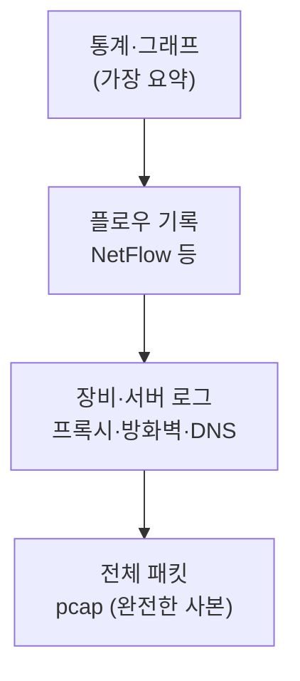
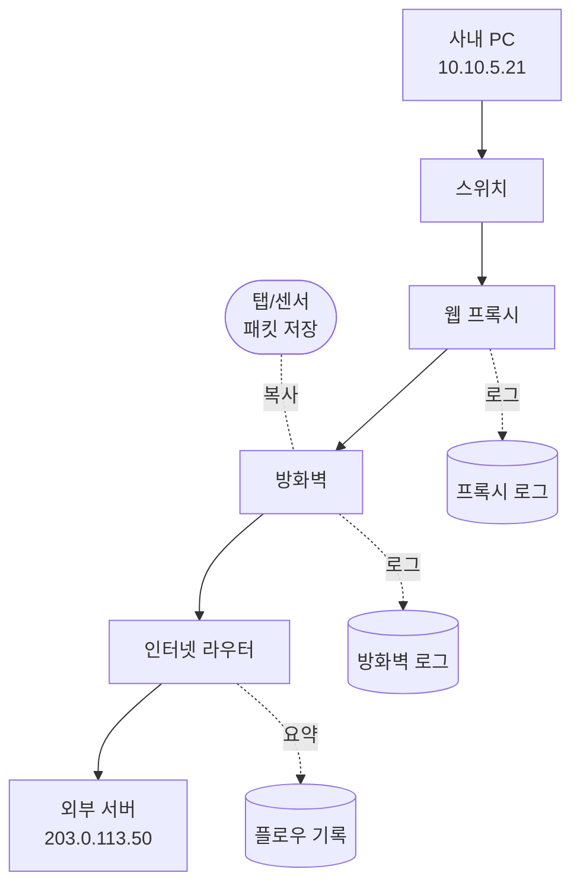
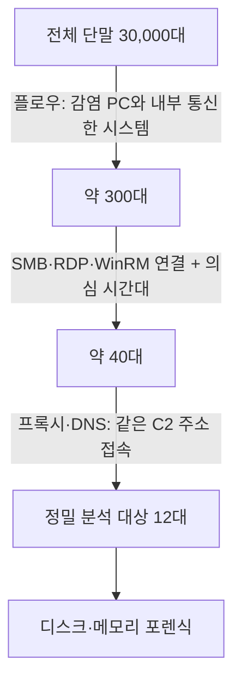
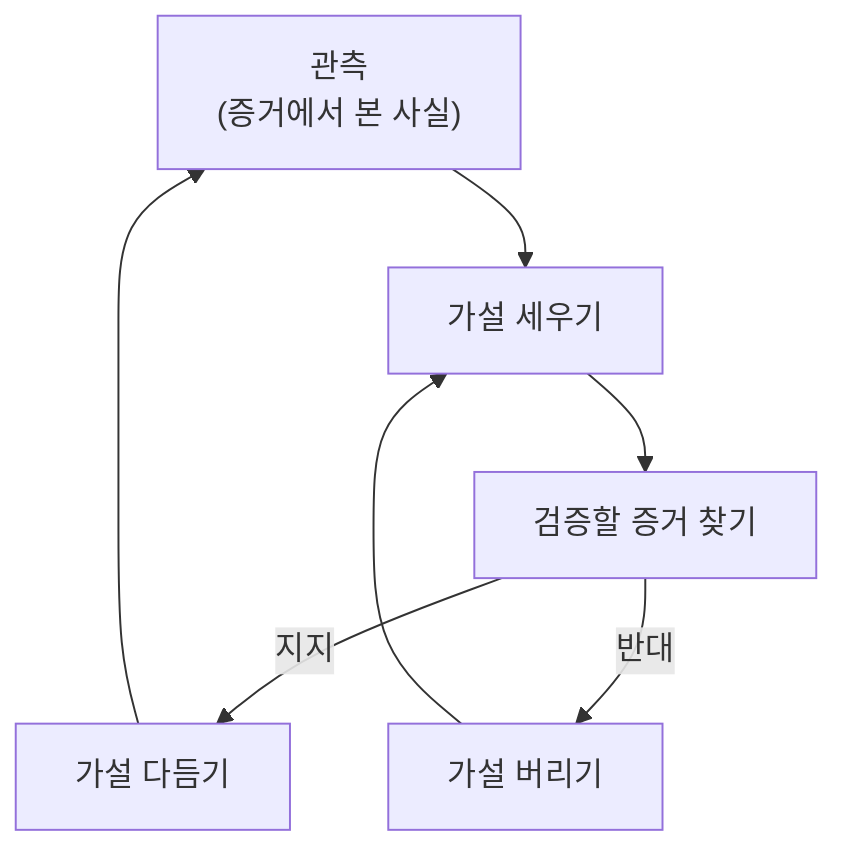
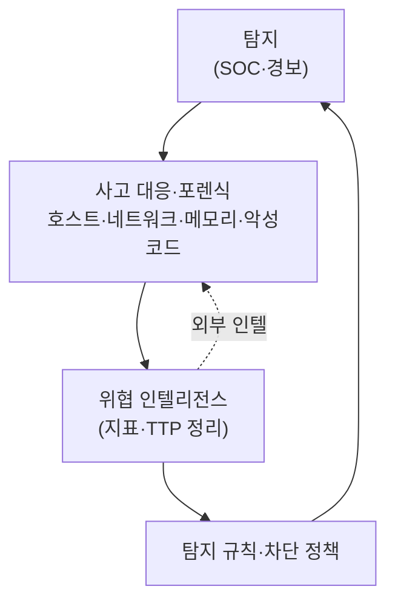
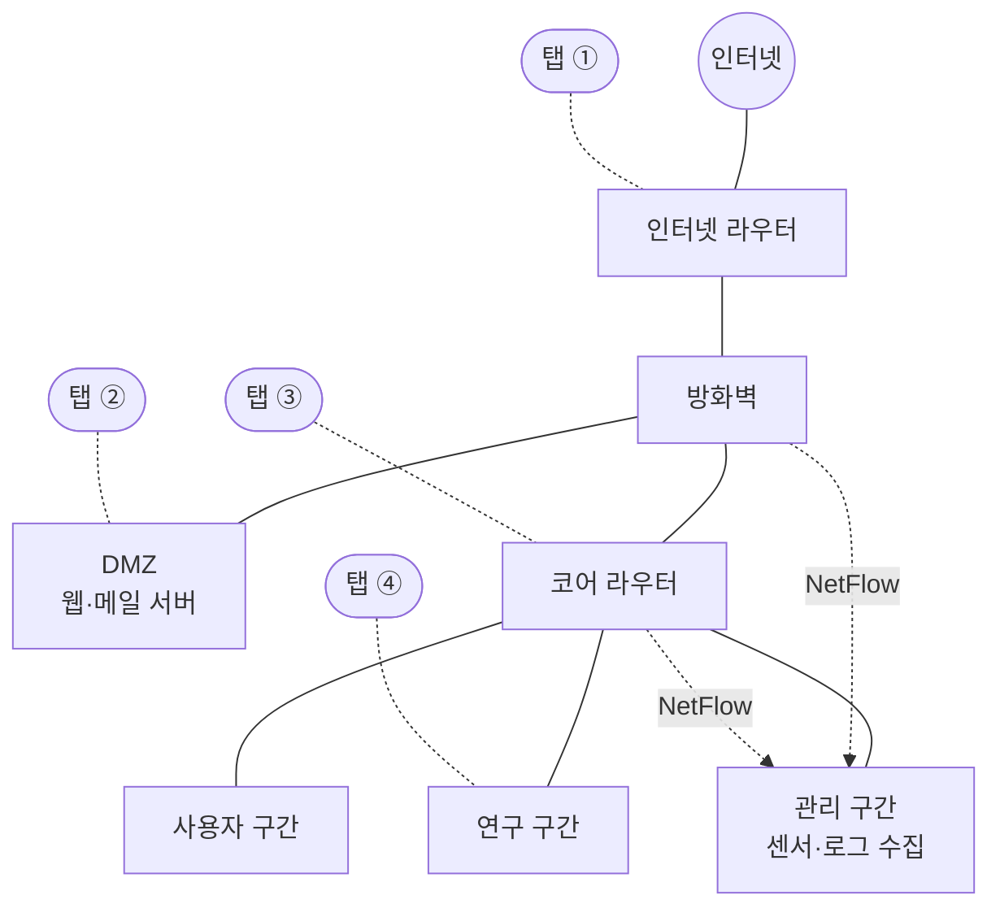

# 1.1강 — 디스크 밖에 남는 증거: 네트워크 포렌식이 필요한 이유와 조사자의 자세 { #why-network-forensics }

!!! abstract "이번 회차의 범위"
    1부의 첫 회차입니다. 다음 질문에 답합니다.

    - 디스크 포렌식이 막히는 상황은 언제인가?
    - 그때 네트워크에는 어떤 증거가 남는가?
    - 증거마다 무엇을 알려 주고 무엇을 알려 주지 못하는가?
    - 조사자는 어떤 태도로 증거를 다뤄야 하는가?

    대응팀이 받는 시간·범위·규모의 압박과, 이 시리즈 내내 쓸 **가상 조직 네트워크**도 소개합니다. 명령어와 도구는 아직 거의 나오지 않습니다. 이번 회차는 다음 회차부터 다룰 프록시 로그, pcap, 플로우를 **왜 배우는지**를 먼저 잡는 시간입니다.

!!! note "표기"
    **(가상 사례)** = 이해를 돕기 위해 만든 이야기, **(예시 출력)** = 실제로 실행한 결과가 아니라 형태만 보여 주는 출력, **[변경됨]** = 예전 자료에서 바뀐 점, **[보충]** = 실무에 필요한 추가 설명입니다. 외부 주소는 문서용 대역(192.0.2.0/24, 198.51.100.0/24, 203.0.113.0/24)과 `example` 도메인을 씁니다. 내부 주소는 어떤 실제 망과도 겹치지 않도록 사설 대역(10.0.0.0/8)으로 적었습니다.

## 1. 금요일 오후의 전화 한 통 { #a-phone-call }

**(가상 사례)** 금요일 오후 네 시, 보안팀에 외부 기관의 전화가 옵니다. "귀사 대역의 한 주소가 저희가 추적 중인 공격 서버 `203.0.113.50`과 지난 몇 주 동안 통신했습니다." 알려 준 것은 그 외부 주소 하나와 "몇 주 전부터"라는 대략적인 시점뿐입니다.

여러분이 대응 담당자라면 무엇부터 하시겠어요? 가장 먼저 떠오르는 방법은 아마 **"그 PC를 찾아서 디스크를 떠 보자"**일 거예요. 디스크 포렌식은 강력합니다. 삭제한 파일도 흔적이 남고, 지우려고 하면 그 지우는 행위가 또 흔적을 남기거든요. 그런데 이 방법이 막히는 경우가 생각보다 많습니다.

- **어느 PC인지 모릅니다.** 외부 기관이 알려 준 건 우리 쪽 공인 IP 하나인데, 그 뒤에는 NAT(주소 변환)로 수천 대가 숨어 있습니다.
- **PC가 이미 없을 수 있습니다.** 재설치됐거나, 노트북을 분실했거나, 클라우드 인스턴스라 이미 삭제됐을 수 있어요.
- **건드리면 들킬 수 있습니다.** 공격자가 아직 안에 있다면, 갑자기 PC를 회수하거나 보안 도구를 돌리는 순간 "조사가 시작됐다"는 신호가 됩니다. 공격자는 흔적을 지우거나 다른 경로로 숨어 버릴 수 있어요. 조사 사실이 상대에게 새지 않도록 행동하는 것을 **OPSEC**(Operational Security, 작전 보안)이라고 부릅니다. 이 시리즈 내내 나오는 개념입니다.
- **한 대가 아닐 수 있습니다.** 공격자는 처음 들어온 PC에서 멈추지 않고 내부의 다른 시스템으로 옮겨 다닙니다. 이것을 **내부 이동**(lateral movement)이라고 해요. 직원이 수만 명인 조직에서 "어디까지 퍼졌나?"를 PC 한 대씩 디스크를 떠서 확인하는 건 현실적으로 불가능합니다.

그렇다면 디스크를 못 볼 때는 무엇을 볼까요? 답은 **그 통신이 지나간 길**입니다. PC와 외부 서버가 대화하려면 데이터가 스위치, 프록시, 방화벽, 라우터를 거쳐야 합니다. 그 장비들 중 일부는 지나가는 대화를 각자의 방식으로 기록합니다. 네트워크 포렌식은 이 기록들을 모으고, 읽고, 서로 맞춰 보는 일입니다.

## 2. 비유로 감 잡기: 한 사건, 여러 목격자 { #witnesses }

건물에서 물건이 사라진 사건을 떠올려 보세요. 범인의 집(= 디스크)을 수색할 수 없다면 무엇을 확인할까요?

- **복도 CCTV 영상**: 누가 언제 무엇을 들고 지나갔는지 전부 보입니다. 다만 저장 공간을 많이 먹어서 오래 보관하지 못합니다.
- **출입 카드 기록**: "몇 시 몇 분에 어느 카드가 어느 문을 통과했다"만 남습니다. 무엇을 들고 갔는지는 모르지만, 몇 달치를 보관해도 부담이 작습니다.
- **경비원 근무 일지**: "3층 창고 문 열림 경보 14:02"처럼 경비원이 중요하다고 판단한 일만 적혀 있습니다.

네트워크에도 똑같은 구조가 있습니다. CCTV는 **전체 패킷 캡처**(full packet capture, 오간 데이터를 바이트 단위로 통째로 저장한 것)입니다. 출입 카드 기록은 **플로우 기록**(누가 누구와 언제, 얼마나 주고받았는지만 요약한 기록. NetFlow가 대표적)입니다. 경비원 일지는 프록시, 방화벽, DNS 서버, 침입 탐지 시스템이 남기는 **장비 로그**입니다. 하나의 통신을 여러 목격자가 각자 다른 각도에서 봤기 때문에, 서로 맞춰 보면 한 목격자만으로는 알 수 없는 그림이 나옵니다.

그런데 이 비유가 실제와 다른 점이 하나 있고, 이게 아주 중요합니다. 사람 목격자는 기록 장치가 없어도 **기억**은 합니다. 하지만 네트워크 케이블은 아무것도 기억하지 않습니다. 패킷은 지나가면 사라지고, 누군가 미리 녹화 장치를 달아 두지 않았다면 그 순간은 영영 다시 볼 수 없습니다. 디스크는 우리가 도착하기 전의 일을 간직하고 있지만, 네트워크는 **미리 수집을 시작한 시점부터의 일**만 보여 줍니다. 그래서 네트워크 포렌식의 가장 큰 숙제 중 하나는 "필요해지기 전에 수집 장치를 설치하고 운영하는 것"입니다.

다행히 아무 준비가 없던 조직도 완전히 빈손은 아닙니다. 방화벽이나 프록시는 원래 운영 목적으로 로그를 남기고, DNS 서버나 VPN 장비, 클라우드 서비스도 각자 기록을 갖고 있는 경우가 많습니다. 실력 있는 조사자는 "패킷이 없으니 끝"이라고 말하지 않고, 남아 있는 목격자를 전부 찾아서 가설의 빈칸을 최대한 채웁니다.

## 3. 증거의 스펙트럼: 요약에서 완전한 사본까지 { #evidence-spectrum }

네트워크 증거는 "얼마나 요약됐는가"를 기준으로 한 줄로 세워 볼 수 있습니다. 한쪽 끝에는 통계, 그래프, 플로우 기록, 호스트 로그처럼 **많이 요약된 것**이 있습니다. 반대쪽 끝에는 선을 지나간 모든 비트를 그대로 복사한 **전체 패킷 캡처**가 있습니다. 그 사이에 수십 가지 증거원이 있어요.



**그림 읽는 법:** 위에서 아래로 갈수록 세부 정보가 많아집니다. 대신 저장 용량이 커지고, 보관 기간이 짧아지고, 분석에 시간이 더 듭니다. 위로 갈수록 오래, 넓게 볼 수 있지만 "무엇을 주고받았나"는 사라집니다.

"그럼 전체 패킷만 있으면 되는 거 아닌가요?"라는 질문이 자연스럽게 나옵니다. 이론상으로는 맞지만, 현실에서는 두 가지가 발목을 잡습니다. 첫째, 용량입니다. 1Gbps 회선을 평균 30%만 써도 하루에 약 3.2TB가 쌓입니다(계산: 1,000,000,000 bit/s × 0.3 ÷ 8 = 37.5MB/s, × 86,400초 ≈ 3.24TB). 둘째, 암호화입니다. 요즘 트래픽 대부분은 TLS로 암호화돼 있어서 패킷을 통째로 가지고 있어도 내용은 못 읽는 경우가 많습니다. 그래서 실무에서는 "몇 달치 플로우 + 며칠치 패킷 + 각종 로그"처럼 여러 층을 섞어 운영합니다.

각 증거가 어떤 질문에 답하는지 나란히 놓고 보면 이렇습니다. 보관 기간은 조직마다 크게 다르니 감을 잡는 정도로만 보세요.

| 증거원 | 잘 답하는 질문 | 답하지 못하는 질문 | 크기·보관 경향 |
| --- | --- | --- | --- |
| 전체 패킷(pcap) | 정확히 무엇을 주고받았나, 어떤 파일이 넘어갔나 | 암호화된 내용, 수집 범위 밖의 통신 | 매우 큼, 보통 며칠~몇 주 |
| 플로우(NetFlow 등) | 누가 누구와, 언제, 얼마나 오래, 얼마나 많이 | 내용, URL, 파일 이름 | 작음, 몇 달~1년 이상 가능 |
| 웹 프록시 로그 | 어느 단말이 어떤 URL을 요청했나, 결과 코드, 때로는 사용자 이름 | 프록시를 거치지 않은 통신, 요청 본문 | 중간, 몇 주~몇 달 |
| 방화벽 로그 | 어떤 연결이 허용·차단됐나 | 연결 안의 내용 | 설정에 따라 큼 |
| DNS 로그 | 어떤 이름을 언제 누가 물어봤나 | 그 이름으로 실제 무엇을 했나 | 중간 |
| 호스트 로그 | 그 시스템에서 어떤 프로세스·계정이 통신했나 | 다른 시스템의 일, 지워진 기록 | 시스템마다 다름 |

### 3.1 작은 예제: 웹 요청 하나가 남기는 흔적 { #one-request }

**(가상 사례)** 사내 PC `10.10.5.21`이 브라우저로 `http://files.example.net/update.bin`을 내려받았습니다. 이 요청은 다음 길을 지나갑니다.



**그림 읽는 법:** 실선 화살표는 요청이 실제로 가는 방향(사내 → 인터넷)입니다. 점선은 각 장비가 그 요청을 **자기 방식으로 기록하는** 경로예요. 응답은 같은 길을 거꾸로 돌아옵니다.

같은 순간을 각 목격자는 이렇게 기록합니다(예시 출력, 형식은 단순화했습니다).

```text
[프록시 로그]  2026-10-12 01:14:09 10.10.5.21 GET http://files.example.net/update.bin 200 1843200
[방화벽 로그]  2026-10-12 01:14:09 allow tcp 10.0.0.3:50122 -> 203.0.113.50:80
[플로우 기록]  2026-10-12 01:14:09 tcp 203.0.113.50:80 -> 10.0.0.3:50122 packets 1290 bytes 1901544
[패킷 캡처]    GET /update.bin HTTP/1.1 / Host: files.example.net ... (파일 내용 전체)
```

여기서 눈여겨볼 점이 있습니다. 방화벽과 플로우 기록에는 출발지가 PC 주소 `10.10.5.21`이 아니라 `10.0.0.3`으로 찍혀 있어요. 왜일까요? PC는 프록시에게 요청하고, **바깥으로 나가는 연결은 프록시가 대신 맺기** 때문입니다. 그래서 방화벽이나 라우터 바깥쪽에서 보면 모든 웹 요청이 프록시 한 대에서 나온 것처럼 보입니다. "어느 PC였나?"라는 질문은 프록시 로그를 봐야 답할 수 있습니다. 바이트 수가 서로 조금씩 다른 것도 정상입니다. 프록시 로그는 HTTP 응답 크기를 세고, 플로우는 IP·TCP 헤더까지 포함한 바이트를 셉니다. 목격자마다 세는 기준이 다르다는 걸 기억해 두세요.

### 3.2 조건을 바꿔 보기 { #change-conditions }

**조건 1: HTTPS였다면?** 같은 다운로드가 `https://`였다고 해 봅시다. 프록시가 TLS 검사(복호화) 기능을 쓰지 않는다면, 프록시 로그에는 `CONNECT files.example.net:443` 한 줄만 남고 어떤 파일을 받았는지는 남지 않습니다. 패킷 캡처에는 TLS 핸드셰이크 안의 서버 이름(SNI)과 주고받은 크기·시간은 보이지만, 파일 내용은 암호문입니다. 플로우는 HTTP일 때와 똑같이 크기와 시간만 알려 줍니다. 결국 "1.8MB쯤 되는 무언가를 받았다"는 말은 할 수 있지만, "update.bin이라는 악성 파일을 받았다"고 말하려면 단말의 기록이나 다른 증거가 필요합니다. TLS를 어떻게 다루는지는 5부에서 자세히 봅니다.

**조건 2: 공격자가 PC의 로그를 지웠다면?** PC의 브라우저 기록과 이벤트 로그가 지워졌어도 프록시, 방화벽, 플로우 기록은 **다른 장비**에 있으니 그대로 남습니다. 공격자가 그 장비들까지 장악하지 않았다면요. 이것이 네트워크 증거의 큰 장점입니다. 증거가 공격 대상과 물리적으로 떨어진 곳에 쌓입니다.

**조건 3: 수집 장치가 아예 없었다면?** 탭도 센서도 없었다면 패킷은 영영 없습니다. 이때는 장비가 원래 남기던 로그가 무엇인지, 얼마나 보관하는지를 먼저 확인해야 합니다. 방화벽이 공간이 차면 오래된 로그부터 덮어쓰는 설정이라면, 조사가 하루 늦어질 때마다 증거가 하루치씩 사라집니다. 그래서 대응 초기에 **보관 중인 로그부터 확보하는 일**이 분석보다 먼저일 때가 많아요.

### 3.3 실제 조사에서는 이렇게 해석합니다 { #interpretation-1 }

위 예제에서 프록시 로그 한 줄이 직접 보여 주는 사실은 "`10.10.5.21`이 그 URL을 요청했고 서버가 200(성공)으로 1,843,200바이트를 돌려줬다"까지입니다. "그 PC가 감염됐다"는 결론은 아직 이릅니다. 파일을 받기만 하고 실행하지 않았을 수도 있고, 백신이 막았을 수도 있으니까요. 감염 여부를 판단하려면 그 뒤에 그 PC에서 새로운 외부 통신이 생겼는지(플로우·프록시), 파일이 실행됐는지(단말 기록)를 이어서 확인해야 합니다. 이 "사실 → 가설 → 추가 확인" 흐름은 아래 6절에서 정리합니다.

## 4. 수만 대 중 열 대를 찾는 일: 범위 좁히기 { #scoping }

이번에는 더 어려운 상황입니다. **(가상 사례)** 조사 중에 공격자가 도메인 관리자 계정의 자격 증명을 손에 넣고, 그 계정으로 다른 시스템에 접속하려 한 흔적을 찾았습니다. 조직의 단말은 3만 대이고, 대부분은 로그를 충분히 남기도록 설정돼 있지 않습니다. 이력서를 다시 써야 할까요?

그럴 필요는 없습니다. 내부 이동도 결국 **네트워크 통신**이기 때문이에요. 윈도우 환경에서 원격 접속, 파일 공유, 원격 명령 실행은 SMB(445번 포트), RDP(3389번), WinRM(5985·5986번) 같은 프로토콜을 씁니다. 첫 번째 감염 PC에서 내부의 어느 시스템으로 이런 연결이 나갔는지는 내부 구간의 플로우 기록만 있어도 상당 부분 보입니다. 이렇게 3만 대를 수십 대로 줄이고, 그중 정말 의심스러운 열 대 남짓만 디스크와 메모리를 정밀 분석하는 겁니다.



**그림 읽는 법:** 위에서 아래로 갈수록 조사 대상이 줄어듭니다. 화살표 옆 글씨는 각 단계에서 쓰는 네트워크 증거입니다. 숫자는 설명을 위한 가상의 값이에요.

여기서 네트워크 포렌식의 중요한 역할 하나가 드러납니다. 네트워크 증거는 그 자체로 결론을 내리기도 하지만, 그보다 더 자주 **"어느 시스템을 정밀하게 봐야 하는지" 알려 주는 단서 제공자** 역할을 합니다. 디스크 포렌식과 경쟁하는 게 아니라, 디스크 포렌식이 어디를 파야 할지 알려 주는 지도인 셈입니다.

**흔한 오해 하나.** "포트 445로 연결이 있었으니 내부 이동이다"라고 바로 말하면 안 됩니다. 파일 서버나 도메인 컨트롤러로 가는 445번 연결은 매일 수없이 많은 정상 업무예요. 의미가 생기는 건 **평소와 다른 조합**일 때입니다. 예를 들어 사용자 PC에서 다른 사용자 PC로 가는 445번 연결, 업무 시간이 아닌 새벽의 연결, 감염 의심 시점 직후의 연결 같은 것들이죠. 그래서 "평소에는 어떤가"(기준선, baseline)를 아는 것이 분석의 출발점이 됩니다.

## 5. 네트워크 증거의 힘과 한계 { #strengths-limits }

네트워크 증거만으로 법정에서 형사 책임까지 입증하기는 대개 어렵습니다. 이유는 간단해요. IP 주소는 사람이 아니기 때문입니다. 한 주소를 여러 사람이 공유할 수 있고(NAT, 공용 PC), 단말이 원격으로 조종당했을 수도 있습니다. "이 주소에서 이 요청이 나갔다"를 "이 사람이 했다"로 옮기려면 계정 로그, 출입 기록, 단말 포렌식 같은 다른 증거가 함께 필요합니다.

그렇다고 가치가 작은 건 아닙니다. 조직 내부에서 감염 PC를 격리하거나, 계정을 정지하거나, 예산과 인력을 어느 쪽에 쓸지 정하는 근거로는 매우 설득력이 있습니다. 그리고 앞에서 본 것처럼 다른 포렌식 증거를 찾아가는 **단서**로서의 가치는 대단히 큽니다. 공격이 **실패했을 때**도 마찬가지예요. 공격자가 어떤 도구와 기법을 썼는지, 무엇을 노렸는지가 네트워크에 남습니다. 이런 공격자의 전술·기법·절차를 **TTP**(Tactics, Techniques, and Procedures)라고 부릅니다. 실패한 공격의 TTP는 공격자의 동기와 능력, 다음 행동을 예측하는 정보(인텔리전스)가 됩니다.

## 6. 조사자의 자세: 사실, 가설, 결론을 구분하기 { #mindset }

네트워크 증거는 양이 많고 해석의 여지가 큽니다. 그래서 조사자가 어떤 태도로 증거를 대하는지가 결과를 크게 좌우합니다.

### 6.1 깔끔한 이야기를 경계하기 { #beware-tidy-stories }

"가장 단순한 설명이 대개 옳다"는 오컴의 면도날은 일상에서는 좋은 원칙입니다. 하지만 사고 조사에서는 늘 통하지 않습니다. 이유는 두 가지예요.

첫째, **숙련된 공격자는 일부러 우리를 속입니다.** 다른 공격 그룹이 쓰는 도구 문자열을 심어 두거나, 일부러 눈에 띄는 가짜 통신을 만들어 시선을 돌리거나, 정상 서비스처럼 보이는 은밀한 통신 채널을 씁니다. 가장 먼저 눈에 띈 단순한 설명이 공격자가 의도한 설명일 수 있어요.

둘째, **미숙한 사용자도 예상 밖의 흔적을 남깁니다.** 잘 모르고 이상한 프로그램을 깔거나, 설정을 잘못 건드려서 공격처럼 보이는 트래픽을 만들기도 합니다. 모든 증거가 하나의 깔끔한 이야기에 딱 들어맞을 거라고 기대하면, 들어맞지 않는 증거를 무시하게 됩니다.

### 6.2 과학자처럼 조사하기 { #scientific-attitude }

그래서 조사자에게 필요한 건 과학자의 태도입니다. 증거를 모을 때는 어느 한쪽 결론에 이해관계를 두지 않고 공정하고 객관적이어야 합니다. 관측 결과가 내 가설과 반대로 나오면 그 가설을 버려야 합니다. 어떤 생각을 독단적으로 믿거나 배제해서도, 과장된 말로 밀어붙이거나 깎아내려서도 안 됩니다.

이 태도를 실제로 지키는 가장 좋은 방법은 **관측한 사실, 그 사실이 지지하는 가설, 추가 증거가 있어야 하는 결론**을 처음부터 나눠 적는 것입니다. 앞의 다운로드 예제에 적용해 보겠습니다.

| 구분 | 내용 | 근거·필요한 것 |
| --- | --- | --- |
| 관측한 사실 | `10.10.5.21`이 `update.bin`을 요청했고 200 응답으로 약 1.8MB를 받았다 | 프록시 로그 한 줄 |
| 관측한 사실 | 같은 날 01:20부터 그 PC에서 `203.0.113.77`로 5분마다 작은 연결이 생겼다 | 플로우 기록 |
| 가설 | 받은 파일이 실행돼 주기적으로 외부와 통신하는 악성코드가 설치됐다 | 두 사실과 들어맞지만, 정상 업데이트 프로그램도 같은 모양일 수 있음 |
| 추가 증거가 필요한 결론 | 그 PC는 감염됐고 공격자가 원격 조종하고 있다 | 단말의 실행 기록, 파일 분석, 주기 통신의 내용·목적지 평판 |

이 표에서 아래로 내려갈수록 주장이 강해지고, 그만큼 더 많은 근거가 필요합니다. 보고서에 "감염됐다"고 쓰고 싶다면 맨 아래 칸의 오른쪽을 채워야 합니다. 채우지 못했다면 "감염이 의심된다"고 쓰고 무엇을 더 확인해야 하는지 함께 적는 것이 정확한 보고입니다.



**그림 읽는 법:** 조사는 한 방향으로 끝나는 작업이 아니라 순환입니다. 새 증거가 가설을 지지하면 가설을 더 구체적으로 다듬고 다시 관측으로 돌아갑니다. 반대하면 가설을 버리고 새 가설을 세웁니다. "반대 증거가 나오면 버린다"는 화살표가 있다는 게 핵심이에요.

### 6.3 결과가 없을 때도 조심하기 { #absence }

"프록시 로그에서 그 C2 주소를 검색했는데 아무것도 안 나왔다"는 "그 주소로 통신하지 않았다"와 같은 말이 아닙니다. 먼저 다음을 확인해야 합니다.

- **수집 범위:** 그 PC의 트래픽이 정말 그 프록시를 지나가게 돼 있었나? 프록시를 우회하는 경로가 있지는 않았나?
- **보관 기간:** 의심 시점의 로그가 아직 남아 있나?
- **암호화와 기록 방식:** HTTPS라서 URL 대신 `CONNECT` 한 줄만 남지 않았나? 프록시가 쿼리 문자열을 지우고 기록하지 않았나?
- **도구 설정:** 검색어 대소문자, 로그 형식을 잘못 짚지 않았나?

이것들을 확인하고 나서야 "확인한 범위 안에서는 통신 흔적이 없다"고 말할 수 있습니다. 그때도 "확인한 범위 안에서는"이라는 조건을 붙여 말해야 합니다.

## 7. DFIR는 섬이 아니다 { #dfir-cycle }

**DFIR**(Digital Forensics and Incident Response, 디지털 포렌식과 사고 대응)는 혼자 돌아가는 일이 아닙니다. 보안 조직 전체의 순환 속에 들어 있어요.



**그림 읽는 법:** 화살표를 따라 한 바퀴 도는 순환입니다(맨 아래 탐지 규칙에서 다시 맨 위 탐지로 돌아갑니다). 정해진 시작점은 없어요. 사건은 SOC(보안관제센터)의 탐지 경보에서 시작될 수도 있고, 내부나 외부에서 들어온 위협 인텔리전스(1절의 전화처럼)에서 시작될 수도 있습니다.

네트워크 포렌식에서 찾은 결과는 이 순환을 따라 흘러갑니다. 예를 들어 분석 중에 찾은 C2 주소와 통신 패턴은 위협 인텔리전스로 정리되고, 그것이 다시 SIEM(여러 로그를 모아 검색·경보하는 시스템)의 탐지 규칙이나 방화벽 차단 정책이 됩니다. 그러면 다음에 같은 공격자가 오면 더 빨리 탐지되죠.

DFIR 안에도 호스트, 네트워크, 메모리, 악성코드 분석, 모바일 등 여러 전문 분야가 있습니다. 한 사람이 전부 깊이 알 수는 없지만, 분야끼리는 서로 많이 겹칩니다. 이 시리즈에서 배우는 네트워크 지식은 윈도우·리눅스·맥OS나 모바일 기기에 남은 네트워크 관련 흔적을 볼 때도, SIEM 경보에 맥락을 붙일 때도 쓰입니다. 거꾸로 윈도우 파일 시스템 흔적을 아는 사람은 3부에서 다룰 SMB(윈도우 파일 공유 프로토콜) 트래픽을 훨씬 빨리 이해합니다. 혼자든 팀이든 여러 분야의 지식을 고루 쌓아 두면 도움이 됩니다.

## 8. 탐지는 얼마나 늦을까: 숫자로 보는 현실 { #dwell-time }

공격자가 들어온 뒤 들킬 때까지 머무는 기간을 **체류 시간**(dwell time)이라고 합니다. 이 숫자는 "우리는 증거를 얼마나 오래 보관해야 하나?"라는 질문과 바로 이어집니다.

**[변경됨]** 이 주제를 다룬 예전 자료는 2022년판 M-Trends 보고서를 근거로 설명했습니다. 전 세계 체류 시간 중앙값이 21일, 피해 조직이 스스로 발견한 경우는 14일, 외부 통보로 처음 알게 된 비율이 47%라는 수치였어요. 2026년 3월 23일에 나온 M-Trends 2026(2025년 조사 대상)의 수치는 다음과 같습니다(2026-11-05 확인, [Google Cloud 블로그 요약](https://cloud.google.com/blog/topics/threat-intelligence/m-trends-2026)).

| 항목 | 예전 자료(2022년판 보고서) | M-Trends 2026 |
| --- | --- | --- |
| 전 세계 체류 시간 중앙값 | 21일 | 14일(직전 보고서 11일에서 다시 늘어남) |
| 조직이 스스로 처음 발견한 비율 | 53%(외부 통보 47%) | 52%(직전 43%에서 증가) |
| 눈에 띄는 세부 수치 | 1년 넘게 발견되지 않은 사례 8% | 사이버 첩보 활동과 북한 IT 위장 취업 사건의 중앙값 122일 |

이 표를 읽을 때 주의할 점이 몇 가지 있습니다.

먼저 **중앙값**은 "사례를 줄 세웠을 때 한가운데 값"입니다. 중앙값이 14일이라는 건 절반은 14일보다 빨리, **절반은 14일보다 늦게** 발견됐다는 뜻이에요. 평균이 아니기 때문에, 몇 달·몇 년씩 숨어 있던 사례(긴 꼬리)가 있어도 중앙값에는 잘 드러나지 않습니다. 첩보 사건의 122일이 그 긴 꼬리가 얼마나 긴지 보여 줍니다.

다음으로, 해마다 숫자가 오르내리는 건 조사 대상 사건의 구성이 바뀌기 때문이기도 합니다. 랜섬웨어처럼 스스로 정체를 드러내는 사건이 많으면 체류 시간이 짧아지고, 첩보 사건이 많으면 길어집니다. "올해 14일"을 "공격자가 2주면 반드시 들킨다"로 읽으면 안 됩니다.

마지막으로, 외부 통보로 알게 된 사건은 대개 1절의 전화처럼 **정보가 적게** 옵니다. 주소 하나, 대략적인 시점 하나 정도죠. 그래서 내부에 쌓아 둔 네트워크 증거가 더 중요해집니다.

### 8.1 계산해 보기: 보관 기간이 체류 시간보다 짧으면 { #retention-math }

**(가상 사례)** 어떤 조직이 전체 패킷은 7일, 프록시 로그는 30일, 플로우는 180일 보관한다고 해 봅시다. 공격이 시작되고 14일 뒤에 발견됐다면 어떻게 될까요?

- 전체 패킷: 7일 < 14일이라 **침입 초기 7일치가 이미 없습니다.** 처음 들어온 순간의 패킷은 볼 수 없어요.
- 프록시 로그: 30일 > 14일이라 초기 접속 기록이 남아 있습니다.
- 플로우: 180일이라 초기뿐 아니라 그 이전의 "평소 모습"(기준선)까지 비교할 수 있습니다.

체류 시간이 122일인 첩보형 사건이라면 프록시 로그(30일)도 초기 기록을 잃고, 플로우(180일)만 시작점을 덮습니다. 그래서 요약된 증거일수록 오래 보관할 가치가 크고, 층을 나눠 보관하는 설계가 의미를 가집니다. 다만 보관 기간은 비용뿐 아니라 개인정보 보호법·내부 규정과도 맞물리므로 법무·개인정보 담당자와 함께 정해야 합니다.

## 9. 대응팀을 짓누르는 세 가지: 시간, 범위, 규모 { #time-scope-scale }

대응팀이 출동 준비를 마쳤다고 바로 잘 풀리는 건 아닙니다. "서버 몇 대가 이상하게 끊긴다"는 막연한 계기만으로는 무엇부터 따라가야 할지 알 수 없습니다. 많은 조직에서 대응팀이 꼽는 가장 큰 어려움은 세 가지입니다.

**시간.** 대응은 거의 언제나 마감에 쫓깁니다. 그런데 DFIR는 추측이나 근거 없는 주장이 허용되지 않는 일이라, 빨리 하면서도 **지나칠 만큼 정확해야** 합니다. 마감과 정확성 사이에서 균형을 잡는 데는 훈련과 규율이 필요합니다.

**범위.** 실제로 공격에 관련된 시스템이 10~15대라고 해도, 그 열 몇 대를 수십만 대 중에서 골라내는 일은 매우 어렵습니다. 환경을 완벽하게 알고 좋은 도구를 갖춰도 며칠에서 몇 주가 걸릴 수 있습니다.

**규모.** 많은 도구가 그 정도 규모에서는 제대로 돌아가지 않습니다. 그래서 대응팀은 환경을 작은 덩어리로 나눠 작업하게 되고, 덩어리가 늘어나는 만큼 작업의 복잡도도 늘어납니다.

네트워크 데이터는 이 세 가지 압박을 동시에 덜어 줍니다. 전체 패킷, 플로우, 프록시 같은 장비의 로그, 단말이 남긴 로그는 한곳에서 여러 시스템을 한꺼번에 보여 주기 때문입니다. 4절의 범위 좁히기가 바로 그 예예요. 다만 그 효과는 이 데이터를 조사 절차 안에 얼마나 잘 녹여 넣느냐에 달려 있습니다.

**[보충] 대응 첫날 확인할 것.** 이 시리즈의 다음 회차들에서 하나씩 자세히 다룰 내용이지만, 대응을 시작하자마자 확인하면 좋은 것들을 미리 적어 둡니다.

1. 지금 **어떤 증거원이 있는지** 목록을 만듭니다(프록시, 방화벽, DNS, VPN, 플로우, 패킷 센서, 클라우드 로그).
2. 각 증거원의 **보관 기간**과 덮어쓰기 설정을 확인하고, 사라지기 전에 필요한 구간을 복사해 둡니다.
3. 장비의 **설정 파일**을 확보합니다. 로그가 어디에 어떤 형식으로 남는지는 설정 파일이 알려 줍니다(다음 회차의 프록시에서 직접 봅니다).
4. 각 장비의 **시간대와 시계 정확도**를 기록합니다. 장비마다 시간이 몇 분씩 어긋나 있으면 타임라인이 엉킵니다.
5. 수집과 분석이 **허가된 범위**인지 확인합니다. 네트워크 데이터에는 직원 개인의 활동이 그대로 담겨 있어서, 권한 없이 보는 것은 그 자체로 문제가 됩니다.

## 10. 이 시리즈에서 쓸 가상 조직 { #lab-environment }

앞으로 여러 회차에서 같은 가상 조직을 무대로 삼겠습니다. **(가상 사례)** 특수 소재를 연구하는 중견 연구 기관입니다. 최근 업계 정보 공유 단체(ISAC, 같은 업종 조직들이 위협 정보를 나누는 모임)에서 "이 업종을 노리는 국가 배후 공격 그룹의 활동이 늘었다"는 경고가 돌았습니다. 그러던 중 메일 서버가 간헐적으로 끊기고, 그 전에는 인터넷에 공개된 웹 서버도 비슷하게 이상했습니다. IT팀이 원인을 찾다가 악성 활동을 의심했고, 본격적인 사고 대응이 시작됐습니다. 호스트 쪽 조사는 다른 팀이 하고, 우리는 수집된 **네트워크 데이터만으로** 조사합니다.



**그림 읽는 법:** 실선은 실제 연결입니다. 점선 동그라미는 트래픽을 복사하는 **탭**(tap, 회선 중간에 끼워 오가는 데이터를 그대로 복사해 주는 장치)의 위치예요. 탭이 복사한 패킷은 관리 구간의 센서에 저장됩니다. 방화벽과 코어 라우터는 자기 모든 인터페이스를 지나는 통신을 NetFlow로 요약해 관리 구간으로 보내고, 서버와 장비들의 로그도 한곳으로 모입니다.

이 그림을 보고 바로 던질 만한 질문이 있습니다. **"사용자 구간 안에서 PC 두 대끼리 주고받은 통신은 어느 탭에 잡힐까요?"** 답은 "아마 어디에도 안 잡힙니다"입니다. 같은 구간 안의 통신은 그 구간의 스위치에서 바로 오가고 코어 라우터까지 올라오지 않기 때문이에요. 이렇게 조직 안쪽에서 옆으로 오가는 트래픽을 **동서(east-west) 트래픽**, 안과 밖을 오가는 트래픽을 **남북(north-south) 트래픽**이라고 부릅니다. 수집 장치가 남북 방향에만 몰려 있으면 4절에서 본 내부 이동이 잘 안 보입니다. 이 사각지대를 어떻게 메우는지(스위치 미러링, 단말 로그 등)는 1부 뒤쪽의 증거 수집 회차에서 다룹니다.

이 조직의 주요 사용자와 단말은 이렇습니다. 이후 회차에서 이 주소들이 다시 나옵니다.

| 역할 | 호스트 이름 | 주소 | 비고 |
| --- | --- | --- | --- |
| 최고경영자 | hq-wkstn-01 | 10.10.7.11 | 사용자 구간 |
| 선임 연구원 | hq-rd-01 | 10.10.6.11 | 연구 구간, 민감 자료 접근 |
| 프로그램 관리자 | hq-rd-04 | 10.10.6.14 | 연구 구간 |
| IT 관리자(일반 계정·도메인 관리자 계정 별도) | hq-admin | 10.10.5.26 | 관리 구간 |
| 보안 담당자 | hq-hunt | 10.10.5.25 | 관리 구간 |

## 11. 정리 { #summary }

- 디스크 포렌식은 시스템이 없거나, 건드리면 들키거나, 너무 많을 때 막힙니다. 그럴 때도 통신이 지나간 길에는 기록이 남습니다.
- 네트워크 증거는 요약된 것(통계·플로우·로그)부터 완전한 사본(전체 패킷)까지 스펙트럼을 이룹니다. 증거원마다 답할 수 있는 질문이 다르니 여러 목격자를 맞춰 봐야 합니다.
- 케이블은 아무것도 기억하지 않습니다. 수집은 필요해지기 전에 시작해야 하고, 준비가 없었다면 장비가 원래 남기던 로그부터 서둘러 확보해야 합니다.
- 네트워크 증거는 혼자서 결론을 내기도 하지만, 그보다 자주 정밀 분석할 시스템을 골라 주는 단서 역할을 합니다.
- 관측한 사실, 가설, 추가 증거가 필요한 결론을 나눠 적고, 반대 증거가 나오면 가설을 버립니다. 결과가 없을 때는 수집 범위·보관 기간·암호화·도구 설정부터 의심합니다.
- 체류 시간 중앙값은 2026년 보고서 기준 14일이지만, 첩보형 사건은 그보다 훨씬 깁니다. 보관 기간은 이 숫자와 비교해 설계해야 합니다.

다음 회차(1.2강)에서는 이번에 "어느 PC였나?"에 답해 준 목격자, **웹 프록시**가 무엇이고 왜 조사자에게 그렇게 중요한지부터 시작합니다.

## 복습 문제 { #review }

**문제 1.** 1절의 전화에서 외부 기관이 알려 준 우리 쪽 주소로 PC를 바로 찾을 수 없었던 이유는 무엇인가요? 그 PC를 찾으려면 어떤 증거가 필요할까요?

??? success "정답과 해설"
    외부 기관이 본 것은 우리 조직의 **바깥쪽 주소**입니다. 사내 PC들은 NAT나 프록시를 거쳐 나가기 때문에, 바깥에서는 수많은 PC가 같은 주소 하나로 보여요. 그 주소 뒤의 실제 PC를 찾으려면 주소를 바꿔 준 장비의 기록이 필요합니다. 웹 통신이라면 **프록시 로그**(어느 내부 PC가 그 목적지로 요청했나), 그 밖의 통신이라면 **방화벽·NAT 변환 로그**나 내부 구간의 **플로우 기록**이 답을 줍니다. 3.1절에서 방화벽에는 프록시 주소만 찍혔던 것과 같은 원리입니다.

**문제 2.** "패킷 캡처가 있으면 플로우 기록은 필요 없다"는 주장을 평가해 보세요.

??? success "정답과 해설"
    틀린 주장입니다. 패킷은 세부 정보가 가장 많지만 용량이 커서 보통 며칠~몇 주밖에 보관하지 못합니다. 8.1절의 계산처럼 체류 시간이 보관 기간보다 길면, 침입 초기의 패킷은 이미 사라진 뒤예요. 플로우는 내용이 없는 대신 작아서 몇 달 이상 보관할 수 있으니, 초기 시점과 평소의 기준선을 보여 줍니다. 또 탭이 없는 구간(10절의 동서 트래픽)에서는 패킷이 아예 없을 수 있는데, 라우터나 방화벽이 만든 플로우는 남아 있을 수 있습니다. 두 증거는 서로를 대신하지 않고 보완합니다.

**문제 3. (조건 바꾸기)** 3.1절의 다운로드가 HTTPS였고 프록시는 TLS 검사를 하지 않습니다. 각 목격자에게서 무엇을 알 수 있고 무엇을 알 수 없나요?

??? success "정답과 해설"
    - **프록시 로그:** `CONNECT files.example.net:443` 같은 줄로 어느 PC가 어느 호스트에 언제 연결했는지는 알 수 있습니다. 어떤 경로의 파일(`/update.bin`)을 받았는지는 알 수 없습니다.
    - **패킷 캡처:** TLS 핸드셰이크 안의 서버 이름, 인증서 정보(TLS 버전에 따라 다름), 주고받은 크기와 시간은 보입니다. 파일 내용은 암호문이라 읽을 수 없습니다.
    - **플로우:** HTTP일 때와 똑같이 주소, 포트, 시간, 바이트 수만 알려 줍니다.

    결론적으로 "약 1.8MB를 받았다"까지는 말할 수 있지만 "그 파일이 악성이다"라고 말하려면 단말에 남은 파일이나 실행 기록 같은 다른 증거가 필요합니다.

**문제 4. (결과 해석)** 동료가 "프록시 로그를 C2 도메인으로 검색했는데 결과가 0건이니, 우리 조직에는 그 C2와 통신한 PC가 없다"고 보고서에 쓰려 합니다. 어떻게 조언하시겠어요?

??? success "정답과 해설"
    "0건"은 **확인한 범위 안에서** 흔적이 없다는 뜻일 뿐입니다. 보고서에 쓰기 전에 다음을 확인하라고 조언합니다.

    1. 모든 PC의 웹 트래픽이 정말 그 프록시를 지나가는지(우회 경로, 재택 PC, 서버 구간).
    2. 의심 기간의 로그가 보관 기간 안에 있는지.
    3. 악성코드가 HTTP·HTTPS가 아닌 다른 프로토콜이나 포트를 쓰지는 않는지. 그런 통신은 프록시를 지나지 않으니 방화벽·플로우·DNS 로그를 함께 봐야 합니다.
    4. 도메인 대신 IP 주소로 직접 접속하지는 않았는지.
    5. 검색 조건(대소문자, 하위 도메인, 로그 형식)이 맞는지.

    이것들을 확인한 뒤에도 "확인한 증거원과 기간 안에서는 통신 흔적을 찾지 못했다"처럼 범위를 밝혀서 써야 합니다.

**문제 5. (흔한 오해)** 플로우 기록에서 사용자 PC `10.10.7.11`이 파일 서버로 445번 포트 연결을 수백 번 맺은 것을 발견했습니다. 이것을 내부 이동의 증거로 볼 수 있나요?

??? success "정답과 해설"
    이것만으로는 볼 수 없습니다. 사용자 PC가 파일 서버의 445번(SMB)에 연결하는 것은 공유 폴더를 쓰는 매일의 정상 업무예요. 관측 사실은 "445번 연결이 수백 번 있었다"이고, 이것은 정상 업무와 내부 이동 둘 다와 들어맞습니다. 의미를 가지려면 **평소와 다른 점**이 있어야 합니다. 예를 들어 목적지가 파일 서버가 아니라 다른 사용자 PC인지, 평소에 연결하지 않던 시스템인지, 새벽 같은 이상한 시간대인지, 감염 의심 시점 직후에 갑자기 시작됐는지 등입니다. 이를 판단하려면 평소의 기준선(같은 PC의 지난 몇 주 플로우)과 비교하고, 해당 시스템의 로그온 기록 같은 호스트 증거와 대조해야 합니다.

**문제 6. (계산)** 어떤 조직이 패킷 10일, 프록시 로그 45일, 플로우 90일을 보관합니다. 체류 시간이 (가) 14일인 사건과 (나) 122일인 사건에서 침입 **첫날**의 기록을 볼 수 있는 증거원은 각각 무엇인가요? 발견 즉시 보존 조치를 했다고 가정합니다.

??? success "정답과 해설"
    발견 시점에서 침입 첫날까지 거슬러 올라가야 하는 기간이 체류 시간입니다. 보관 기간이 그보다 길어야 첫날 기록이 남습니다.

    - (가) 14일: 패킷 10일 < 14일이라 **없음**. 프록시 45일 ≥ 14일이라 **있음**. 플로우 90일 ≥ 14일이라 **있음**.
    - (나) 122일: 패킷 **없음**, 프록시 45일 < 122일이라 **없음**, 플로우 90일 < 122일이라 **없음**. 세 증거원 모두 첫날을 덮지 못합니다.

    (나)에서는 네트워크 증거만으로 침입 경로를 밝히기 어렵고, 단말의 흔적이나 외부 기관의 정보에 더 기대야 합니다. 첩보형 공격의 긴 체류 시간을 생각하면, 요약 증거(플로우, DNS 로그)를 더 오래 보관하는 설계를 검토할 이유가 됩니다.

**문제 7. (적용)** 10절의 가상 조직에서 연구 구간의 PC `10.10.6.14`가 같은 연구 구간의 PC `10.10.6.11`에 RDP로 접속했습니다. 이 통신은 그림의 어느 탭에 잡힐 가능성이 있나요? 탭에 잡히지 않는다면 어떤 증거를 찾아야 할까요?

??? success "정답과 해설"
    연구 구간에는 **탭 ④**가 붙어 있으니, 그 탭이 구간 내부 트래픽까지 보는 위치(예: 연구 구간 스위치와 PC들 사이, 또는 구간 전체를 미러링하는 지점)에 있다면 잡힐 수 있습니다. 하지만 탭 ④가 연구 구간과 코어 라우터 사이의 연결에 붙어 있다면, 같은 구간 안의 PC끼리 주고받은 통신은 그 연결을 지나지 않으니 **잡히지 않습니다.** 코어 라우터의 NetFlow에도 남지 않아요. 그래서 탭이 "어디에, 어느 방향으로" 붙어 있는지 확인하는 것이 먼저입니다. 탭에 없다면 연구 구간 스위치의 로그나 미러링 설정, 두 PC의 윈도우 이벤트 로그(RDP 로그온 기록)처럼 단말 쪽 증거를 찾아야 합니다. 이처럼 동서 트래픽은 남북 방향 수집 장치의 사각지대가 되기 쉽습니다.

**문제 8. (자세)** 분석 중에 특정 국가 공격 그룹이 쓴다고 알려진 도구의 문자열이 패킷에서 발견됐습니다. "그 그룹의 공격이다"라고 결론 내려도 될까요?

??? success "정답과 해설"
    아직 안 됩니다. 관측 사실은 "그 문자열이 패킷에 있었다"이고, "그 그룹의 공격"은 가설입니다. 6.1절에서 본 것처럼 숙련된 공격자는 다른 그룹의 흔적을 일부러 심어 수사를 엉뚱한 쪽으로 돌리기도 합니다. 도구 자체가 공개되거나 유출돼서 여러 그룹이 쓰는 경우도 많아요. 공격 주체를 판단하려면 인프라(주소·도메인 등록 정보), 공격 시간대, 노린 정보, 여러 단계에 걸친 TTP가 함께 들어맞는지 보고, 위협 인텔리전스 팀과 대조해야 합니다. 보고서에는 "○○ 그룹과 연관된 것으로 알려진 도구 문자열이 관측됨"처럼 관측한 사실 그대로 적는 것이 정확합니다.

## 참고 자료 { #references }

- Google Cloud Threat Intelligence, [M-Trends 2026: Data, Insights, and Strategies From the Frontlines](https://cloud.google.com/blog/topics/threat-intelligence/m-trends-2026) (2026-03-23 게시, 2026-11-05 확인). 체류 시간 중앙값 14일(직전 11일), 내부 발견 52%(직전 43%), 첩보·북한 IT 위장 취업 사건 중앙값 122일.
- MITRE ATT&CK, [Lateral Movement (TA0008)](https://attack.mitre.org/tactics/TA0008/) (2026-11-05 확인). 내부 이동 전술과 하위 기법 목록.

!!! note "이 페이지에 대하여"
    여러 학습 자료를 바탕으로 직접 다시 쓴 개인 학습 노트입니다. 가상 사례의 조직, 인물, 주소는 모두 만든 것입니다.
