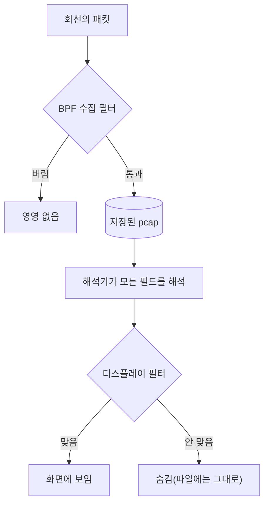

# 1.9강 — Wireshark 디스플레이 필터와 스트림 따라가기 { #wireshark-display-filters }

!!! abstract "이번 회차의 범위"
    - 디스플레이 필터가 BPF와 무엇이 다른가(어디서, 얼마나 빠르게, 무엇을 알고 거르나)
    - 비교·집합·부분 문자열·정규 표현식·함수, 그리고 **BPF와 반대인 연산 우선순위**
    - 필드 이름을 찾는 법과 "필터로 적용"·"필터로 준비"
    - 문법 검사기의 초록·빨강·노랑, 그리고 문법 검사기가 알려 주지 않는 것
    - **여러 값을 가진 필드와 `!=`**: 교재의 설명과 지금(3.6 이후)의 동작 차이
    - TCP 스트림 따라가기, "다른 프로토콜로 해석(Decode As)", Wireshark로 직접 수집하기

!!! note "실습 환경과 표기"
    **(직접 실행 결과)**는 이 작업 환경의 tshark 4.2.2로 얻었습니다. tshark의 `-Y`는 Wireshark 화면의 디스플레이 필터 막대와 같은 필터 엔진을 씁니다. 필터 연습용 pcap은 파이썬으로 직접 조립했고(사설·문서용 주소만 사용), 스트림 따라가기는 1.6강에서 루프백으로 실제 수집한 파일로 했습니다. GUI가 없는 환경이라 문법 검사기의 **색**은 직접 보지 못했고, 같은 필터를 tshark에 넣었을 때 나오는 오류 메시지로 확인했습니다.

## 1. 저장한 패킷에서 "그 프로토콜의 그 값"을 찾고 싶다 { #why-display-filters }

**(가상 사례)** 1.7강에서 `host 10.10.6.14`로 넉넉하게 떠 둔 파일이 있습니다. 이제 질문이 구체적입니다. "이 PC가 받은 DNS 응답 중 답이 5개 넘게 온 것은?", "쿠키에 사용자 이름이 들어간 HTTP 요청은?", "80·8080이 아닌 포트로 오간 HTTP 중 `stolen`이라는 글자가 든 것은?"

1.7강의 BPF로 이걸 하려면 DNS 응답의 답 개수가 몇 번째 바이트에 있는지, HTTP 헤더가 어디서 시작하는지를 모두 바이트 위치로 계산해야 합니다. 세상에 프로토콜이 수백 수천 가지인데, 아무리 뛰어난 조사자라도 이걸 위치와 비트 마스크로 다 할 수는 없어요. 그래서 Wireshark 개발자들은 해석기(1.8강의 패킷 상세 창을 채우는 그것)를 **그대로 필터로 쓸 수 있게** 만들었습니다. 이게 **디스플레이 필터**입니다. Wireshark가 해석하는 필드라면 무엇이든 필터에 쓸 수 있어요.

```text
'dns.flags.response == 1 and dns.count.answers > 5 and dns.qry.name contains "example.net"'
```

"DNS 응답이고, 답이 5개보다 많고, 질의한 이름에 `example.net`이 들어간 것." 바이트 위치는 하나도 없습니다.

## 2. 비유: 입구의 X선과 서고의 사서 { #analogy }

1.7강에서 BPF를 공항 검색대의 1차 X선에 비유했습니다. 디스플레이 필터는 **서고에서 책을 찾아 주는 사서**에 가깝습니다. 사서는 책을 펼쳐 목차와 본문을 읽고 "이 책에 그 내용이 있다"고 판단해요. 그만큼 X선보다 느리지만, 훨씬 복잡한 질문에 답합니다.

이 비유에서 중요한 차이가 두 가지 있습니다.

- **시점이 다릅니다.** X선(BPF 수집 필터)을 통과하지 못한 가방은 비행기에 실리지 않습니다. 영영 없어요. 사서(디스플레이 필터)는 이미 서고에 있는 책 중 **보여 줄 것만** 고릅니다. 다른 질문을 하면 다른 책을 꺼내 주고, 필터를 지우면 모든 책이 다시 보입니다. 원본은 그대로예요.
- **읽는 대상이 다릅니다.** 사서는 책의 **내용**을 읽습니다. 디스플레이 필터도 패킷의 바이트를 직접 보는 게 아니라, 해석기가 **먼저 해석한 논리적인 내용**에 필터를 적용합니다. 예를 들어 DNS는 같은 이름이 여러 번 나올 때 바이트를 아끼려고 "앞에 나온 그 이름"이라는 짧은 표시로 바꿔 쓰는 압축 방식을 씁니다. 그래서 DNS 패킷의 바이트를 직접 읽기는 꽤 괴롭지만, Wireshark는 먼저 해석하고 나중에 거르기 때문에 `dns.qry.name`으로 온전한 이름을 바로 비교할 수 있어요.

| | BPF(수집 필터) | 디스플레이 필터 |
| --- | --- | --- |
| 적용 시점 | 수집할 때(파일 읽을 때도 가능) | 수집·저장한 뒤 화면에 보일 때 |
| 빠르기 | 매우 빠름(커널 가까이) | 느림(전부 해석한 뒤 판단) |
| 되돌리기 | 수집 필터로 빠진 것은 영영 없음 | 지우면 다시 다 보임 |
| 아는 것 | 헤더의 고정 위치와 몇 가지 프로토콜 | Wireshark가 해석하는 모든 필드 |
| 문법 | `host 10.10.6.14 and tcp port 80` | `ip.addr == 10.10.6.14 and tcp.port == 80` |

두 필터가 처리 과정의 어디에 있는지 그림으로 보면 이렇습니다.



**그림 읽는 법:** 위에서 아래로 패킷이 지나가는 순서입니다. BPF는 저장 **앞**에 있어서 버린 것은 다시 볼 수 없고, 디스플레이 필터는 저장과 해석 **뒤**에 있어서 숨긴 것도 파일에는 그대로 남습니다.

IP, TCP, UDP는 Wireshark도 해석하니, BPF와 같은 일을 하는 디스플레이 필터도 있습니다. `tcp.port == 80`이나 `ip.src == 203.0.113.50`처럼요. 하지만 같은 조건이라면 BPF가 **훨씬** 빠르니, 가능한 곳에서는 BPF로 먼저 줄이는 게 원칙입니다(1.7강 8절). Wireshark는 대개 이미 저장된 트래픽을 분석할 때 쓰니, 그때는 속도를 조금 내주고 표현력을 얻는 게 남는 장사입니다.

## 3. 문법 { #syntax }

### 3.1 비교와 논리 { #comparison }

| 종류 | 연산자 | 예 |
| --- | --- | --- |
| 같음·다름 | `==`, `!=` | `http.request.method == "POST"` |
| 크기 비교 | `<`, `>`, `<=`, `>=` | `dns.count.answers > 5` |
| 집합에 속함 | `in { }` | `http.response.code in {200, 301, 302, 404}` |
| 논리 | `and`(`&&`), `or`(`||`), `not`(`!`), 괄호 | `http and not tcp.port == 80` |
| 부분 문자열 | `contains` | `http.host contains "example"` |
| 정규 표현식 | `matches`(`~`) | `http.user_agent matches "curl|wget"` |

**[주의] 우선순위가 BPF와 반대입니다.** 1.7강에서 BPF는 `and`와 `or`의 우선순위가 같아서 왼쪽부터 묶는다고 했죠. 디스플레이 필터는 **대부분의 프로그래밍 언어처럼 `and`가 `or`보다 먼저** 묶입니다. Wireshark 4.0.0 릴리스 노트가 이 변경을 알렸고, 지금 문서의 순서는 `not` > `and` > `xor` > `or`입니다(2026-11-05 확인). 연습용 파일로 확인해 보면 이렇습니다(직접 실행 결과).

| 필터 | 맞은 패킷 |
| --- | --- |
| `http.response.code == 404 or http.response.code == 301 and ip.src == 10.10.6.14` | 6번(404 응답) 1개 |
| `(http.response.code == 404 or http.response.code == 301) and ip.src == 10.10.6.14` | 0개 |

첫 줄은 `404 or (301 and 출발지가 그 PC)`로 읽혀서, 서버가 보낸 404 응답(6번)이 맞았습니다. 같은 모양의 BPF였다면 정반대로 읽혔을 거예요. 두 언어를 오가며 쓰다 보면 이 차이를 잊기 쉬우니, **어느 쪽이든 섞어 쓸 때는 괄호**를 치는 습관이 가장 안전합니다.

### 3.2 [변경됨] 집합은 쉼표로 { #sets }

여러 값 중 하나인지 볼 때 `or`를 길게 이어 붙이는 대신 집합을 씁니다. 교재는 `http.response.code in { 200 301 302 404 }`처럼 **공백으로** 구분했는데, Wireshark 3.6부터 집합 원소는 **쉼표로** 구분해야 하고 공백 구분은 "앞으로 없어질" 문법이 됐습니다. 4.2.2에서 시험해 보니 실제로 오류가 났어요(직접 실행 결과).

| 필터 | 결과 |
| --- | --- |
| `http.response.code in {200, 301, 302, 404}` | 3개(5, 6, 7번) |
| `http.response.code in {200 301 302 404}` | 오류: `"301" was unexpected in this context.` |

오래된 자료나 스크립트에 있는 필터를 지금 버전에 그대로 붙여 넣으면 이렇게 실패할 수 있습니다. 실패하면 그나마 다행이고, 4절에서 볼 `!=`처럼 **조용히 뜻이 바뀌는** 경우가 더 위험합니다.

### 3.3 대소문자: `contains`, `matches`, `lower()` { #case }

연습용 HTTP 요청의 쿠키는 `Cookie: theme=dark; UserName=jdoe`입니다(대문자 U, N). 결과는 이렇습니다(직접 실행 결과).

| 필터 | 맞은 수 | 해석 |
| --- | --- | --- |
| `http.cookie contains "username"` | 0 | `contains`는 **대소문자를 구분** |
| `http.cookie matches "(?i)username"` | 1 | 교재의 방법. `(?i)`는 "대소문자 무시" |
| `http.cookie matches "username"` | 1 | 지금 `matches`는 **기본이 대소문자 무시** |
| `http.cookie matches "(?-i)username"` | 0 | `(?-i)`로 대소문자를 구분하게 할 수 있음 |
| `lower(http.cookie) contains "username"` | 1 | 필드를 소문자로 바꾼 뒤 비교 |

교재는 `matches`에서 대소문자를 무시하려면 `(?i)`를 붙이라고 설명하는데, 지금 Wireshark 문서는 `matches`가 **기본적으로 대소문자를 무시**하는 PCRE2 정규 표현식이라고 적고 있고, 4.2.2에서도 그렇게 동작했습니다. `(?i)`는 붙여도 해롭지 않지만 필요는 없고, 오히려 대소문자를 **구분**하고 싶을 때 `(?-i)`를 붙여야 합니다. 반면 `contains`는 지금도 대소문자를 구분하니, 대소문자를 모를 때는 `lower()`로 감싸거나 `matches`를 씁니다. 지금 문서에는 `lower()` 말고도 `upper()`, `len()`, `count()` 같은 함수가 더 있습니다.

### 3.4 해석기가 알아야 걸린다 { #dissector-dependence }

교재의 예를 하나 시험해 보겠습니다. "80·8080이 아닌 포트로 오간 HTTP 중 `stolen`이 든 것"입니다. 연습용 파일의 8번은 4444번 포트로 `stolen=orchid-007`을 POST하는 패킷이에요(직접 실행 결과).

| 필터 | 맞은 수 |
| --- | --- |
| `(not tcp.port == 80 and not tcp.port == 8080) and http contains "stolen"` | 1 |
| `not tcp.port in {80, 8080} and http contains "stolen"` | 1 |
| `tcp.payload contains "stolen"` | 1 |
| `frame contains "stolen"` | 1 |

여기서 `http contains`가 맞으려면 Wireshark가 그 패킷을 **HTTP로 해석**해야 합니다. 4444번은 HTTP의 정해진 포트가 아니지만, 이 버전은 내용을 보고 HTTP라고 짐작하는 기능(휴리스틱)으로 알아봤어요. 만약 해석기가 알아보지 못했다면 `http contains`는 0건이 됩니다. 그래서 "어떤 프로토콜이든 이 글자가 든 패킷"을 찾고 싶다면 `frame contains`나 `tcp.payload contains`처럼 **해석에 기대지 않는** 필터가 더 확실합니다. 대신 이건 패킷 하나의 바이트만 보므로, 글자가 두 패킷에 걸쳐 쪼개져 있으면 놓칠 수 있다는 한계도 기억하세요(이럴 때는 6절의 스트림 따라가기).

### 3.5 BPF 문법은 통하지 않는다 { #no-bpf }

`host 203.0.113.80`처럼 BPF 문법을 디스플레이 필터 자리에 쓰면 오류입니다(직접 실행 결과: `"203.0.113.80" was unexpected in this context.`). 디스플레이 필터로는 `ip.addr == 203.0.113.80`이라고 써야 해요. 거꾸로 Wireshark의 **수집** 필터 칸(수집 시작 화면)에는 BPF를 씁니다. 같은 프로그램 안에 두 언어가 있다는 점을 늘 기억하세요.

## 4. 필드 이름 찾기 { #field-names }

그런데 프로토콜이 이렇게 많은데, 필터에 쓸 필드 이름은 어떻게 알까요? 화면으로 돌아가면 됩니다.

1.8강에서 본 **상태 표시줄**이 답입니다. 패킷 상세 창에서 DNS 질의의 이름(Name) 줄을 고르면, 상태 표시줄 왼쪽에 이렇게 나옵니다.

```text
Query Name (dns.qry.name), 19 bytes
```

괄호 안의 `dns.qry.name`이 필드 이름이고, 19바이트가 그 필드의 길이예요. 연습용 파일의 2번 패킷은 `files.example.net`을 물었는데, 글자는 17개(5 + 1 + 7 + 1 + 3)지만 19바이트인 이유가 재밌습니다. DNS는 이름을 점으로 나눈 조각(레이블)마다 **길이를 한 바이트로 앞에 붙이고**, 끝에 0 한 바이트를 붙여 저장해요. `files`(5) `example`(7) `net`(3)이니 길이 바이트 3개 + 글자 15개 + 끝 1개 = 19바이트입니다. 점은 저장되지 않고 길이 바이트가 그 역할을 해요. 디스플레이 필터는 이런 저장 방식을 몰라도 `dns.qry.name == "files.example.net"`처럼 **사람이 읽는 모양**으로 쓰면 됩니다. 2절에서 말한 "먼저 해석하고 나중에 거른다"의 예입니다.

필드 이름을 알았으면 손으로 쓸 수도 있지만, 화면에서 **만들어** 쓰는 편이 빠르고 오타가 없습니다. 상세 창에서 필드를 오른쪽 클릭하면 두 가지 메뉴가 있어요.

- **필터로 적용(Apply as Filter):** 새 필터를 만들어 **바로 적용**합니다.
- **필터로 준비(Prepare as Filter):** 필터 막대에 **넣기만** 하고 적용은 하지 않습니다.

둘 다 하위 메뉴로 "선택한 것(Selected)", "선택하지 않은 것(Not Selected)", "…그리고 선택한 것(and Selected)", "…또는 선택한 것(or Selected)" 같은 선택지가 있어서, 지금 필터에 조건을 덧붙일 수도 있습니다. 차이는 미묘해 보이지만, 큰 파일에 필터를 적용하는 데 **아주 오래** 걸릴 수 있다는 걸 겪어 보면 "준비"의 가치를 알게 됩니다. 조건 여러 개를 다듬은 뒤 한 번에 적용하면 진행 막대를 쳐다보는 시간을 크게 아낄 수 있어요.

**[보충] 명령줄에서 필드 이름 찾기.** `tshark -G fields`는 Wireshark가 아는 모든 필드의 목록을 출력합니다. 예를 들어 `tshark -G fields | awk -F'\t' '$3=="dns.qry.name"'`처럼 거르면 그 필드의 설명과 형식이 나와요(이번 환경에서는 `Name | dns.qry.name | FT_STRING`, 직접 실행 결과). 스크립트를 짤 때 유용합니다.

## 5. 문법 검사기와 그 한계 { #syntax-checker }

디스플레이 필터는 복잡해질 수 있어서, Wireshark는 필터를 치는 동안 필터 막대의 배경색으로 문법을 검사해 줍니다. 신호등처럼 세 가지 색이에요.

- **초록:** 문법이 맞음.
- **빨강:** 모르는 필드 이름이거나 문법 오류. 상태 표시줄에 이유가 나옵니다.
- **노랑:** 문법은 맞지만 결과가 예상과 다를 수 있다는 경고.

빨강이 되는 대표적인 경우를 tshark에 넣어 보면 같은 이유가 오류 메시지로 나옵니다(직접 실행 결과).

| 필터 | tshark 4.2.2의 오류 메시지 | 이유 |
| --- | --- | --- |
| `some.made.up.field == "x"` | `Constant expression is invalid.` | 없는 필드 이름 |
| `http.host == "intranet.lab.example` | `The final quote was missing from a quoted string.` | 따옴표를 닫지 않음 |
| `host 203.0.113.80` | `"203.0.113.80" was unexpected in this context.` | BPF 문법을 씀 |
| `http.response.code in {200 301 302 404}` | `"301" was unexpected in this context.` | 집합에 쉼표 없음(3.2절) |

교재는 노랑의 대표 예로 `!=`를 듭니다. 예전 버전에서는 `!=`를 쓰면 "예상과 다른 결과가 나올 수 있다"는 노란 경고가 떴어요. 그 이유와, 지금은 어떻게 바뀌었는지가 다음 절의 주제입니다. 이번 환경은 GUI가 없어서 지금 버전에서 `!=`에 노란색이 뜨는지는 직접 확인하지 못했습니다.

그리고 가장 중요한 한계가 있습니다. **문법 검사기는 문법만 검사하지, 논리를 검사하지 않습니다.** 초록색이라고 해서 내가 원하는 패킷을 고른다는 뜻이 아니에요. 3.1절의 우선순위 예에서 괄호 없는 필터도 문법은 완벽하게 맞았습니다. 그래서 필터는 결과가 맞는지 **알려진 패킷으로 시험**해 봐야 합니다.

## 6. [변경됨] 여러 값을 가진 필드와 `!=` { #multi-value }

어떤 필드는 한 패킷에 **여러 번** 나옵니다. DNS 응답의 주소(`dns.a`)는 답이 여러 개면 여러 번 나오고, `ip.addr`은 출발지와 도착지 두 번, `tcp.port`도 두 번 나와요. 이런 필드에 "같지 않다"를 묻는 건 생각보다 까다롭습니다. "모든 값이 같지 않다"는 뜻일까요, "같지 않은 값이 하나라도 있다"는 뜻일까요?

### 6.1 교재의 설명(예전 동작) { #old-behavior }

교재는 이렇게 설명합니다. `dns.a != X`로 필터했더니, 응답 안에 분명히 X가 있는 패킷이 맞았다. 그 응답에 X가 **아닌** `dns.a`가 하나 더 있었기 때문이다. 즉 예전의 `!=`는 "**같지 않은 값이 하나라도 있으면**" 참이었어요. 그래서 "X가 들어 있지 않은 응답"을 찾으려면 `dns.a && !(dns.a == X)`처럼 써야 한다고 했습니다. `dns.a`가 있는 패킷 중, X와 같은 값이 **하나라도 있는** 패킷을 빼라는 뜻이에요.

### 6.2 지금의 동작 { #new-behavior }

**Wireshark 3.6부터 `a != b`는 늘 `!(a == b)`와 같은 뜻입니다.** 릴리스 노트는 이 변경으로 `ip.addr != 1.1.1.1`이 "기대한 대로", 즉 `ip.src != 1.1.1.1 and ip.dst != 1.1.1.1`과 같은 결과를 내며, `a == b`와 `a != b`가 동시에 참이 되는 모순을 없앴다고 설명합니다(2026-11-05 확인). 예전 뜻이 필요하면 따로 쓰는 연산자가 생겼는데, 3.6에서는 `~=`였다가 4.0.0에서 `~=`가 폐지 예정이 되고 `!==`로 바뀌었습니다. 지금 문서의 정리는 이렇습니다.

| 연산자 | 다른 이름 | 뜻 |
| --- | --- | --- |
| `==` | `any_eq`, `eq` | 값 중 **하나라도** 같으면 |
| `!=` | `all_ne`, `ne` | **모든** 값이 같지 않으면(= 같은 값이 하나도 없으면) |
| `===` | `all_eq` | **모든** 값이 같으면 |
| `!==` | `any_ne` | 값 중 **하나라도** 같지 않으면(예전 `!=`의 뜻) |

여기에 `any`·`all`을 붙여 `any dns.a != X`처럼 쓸 수도 있습니다.

### 6.3 직접 확인하기 { #multi-value-test }

연습용 파일에는 DNS 응답 세 개가 있습니다. 1번은 답이 **두 개**(`203.0.113.70`, `198.51.100.71`), 2번은 `198.51.100.71` 하나, 3번은 `203.0.113.70` 하나예요(직접 실행 결과).

| 필터 | 맞은 패킷 | 해석 |
| --- | --- | --- |
| `dns.a == 203.0.113.70` | 1, 3 | 그 주소가 하나라도 있는 응답 |
| `dns.a != 203.0.113.70` | **2** | 그 주소가 **하나도 없는** 응답 |
| `dns.a && !(dns.a == 203.0.113.70)` | 2 | 교재의 해결책. 지금은 바로 위와 같음 |
| `dns.a !== 203.0.113.70` | 1, 2 | 다른 주소가 하나라도 있는 응답(예전 `!=`) |
| `any dns.a != 203.0.113.70` | 1, 2 | 위와 같음 |
| `dns.a === 203.0.113.70` | 3 | 모든 답이 그 주소인 응답 |
| `all dns.a == 203.0.113.70` | 3 | 위와 같음 |
| `dns.a ~= 203.0.113.70` | 오류 | `~=`는 4.2.2에서 더는 받아들이지 않음 |
| `ip.addr != 10.10.6.14` | 0개 | 모든 패킷에 그 PC가 출발지나 도착지로 들어 있음 |

교재 시절의 `!=`라면 1번도 맞았을 겁니다. 지금은 2번만 맞아요. 마지막 줄도 흥미롭습니다. 예전 동작이었다면 `ip.addr != 10.10.6.14`는 거의 모든 패킷에 맞았을 텐데(출발지나 도착지 중 하나는 늘 다른 주소이니까), 지금은 "그 PC가 관련되지 않은 패킷"이라는 직관적인 뜻이 되어 0개가 맞았습니다.

**이게 조사에서 왜 중요할까요?** 같은 필터 문자열이 **Wireshark 버전에 따라 다른 패킷을 고른다**는 뜻이기 때문입니다. 3.5 이전 버전으로 쓴 보고서나 스크립트의 `!=` 필터를 지금 버전으로 다시 돌리면, 오류 없이 **조용히 다른 결과**가 나옵니다. 그래서 보고서에는 쓴 필터와 함께 **도구의 버전**을 적어야 하고, 남이 만든 필터를 가져다 쓸 때는 그 필터가 어느 버전의 뜻으로 쓰였는지 확인해야 합니다. 그리고 여러 값을 가진 필드에 "아니다"를 물을 때는, `!=`(하나도 없음)와 `!==`(하나라도 다름) 중 **내가 원하는 뜻을 명시적으로** 고르세요. 이런 미묘함을 이해하지 않고 큰 데이터에 필터를 돌리면 크게 틀린 결과가 나옵니다.

## 7. TCP 스트림 따라가기 { #follow-stream }

패킷 하나하나를 보는 것만으로는 대화의 흐름이 잘 보이지 않습니다. HTTP 요청과 응답이 여러 패킷에 나뉘어 있으니까요. **TCP 스트림 따라가기**(Follow TCP Stream)는 한 TCP 연결의 데이터 부분만 순서대로 이어 붙여, 대화 전체를 한 화면에 보여 줍니다. 이 시리즈와 실제 사건에서 가장 많이 쓸 기능 중 하나예요.

패킷을 고르고 오른쪽 클릭(또는 분석(Analyze) 메뉴)에서 따라가기(Follow) → TCP 스트림을 고르면 창이 뜹니다. 클라이언트 → 서버 방향은 **빨간 글씨**, 서버 → 클라이언트 방향은 **파란 글씨**로 색칠돼요. HTTP처럼 글자로 된 프로토콜이라면 주고받은 전체를 한눈에 볼 수 있습니다. tshark의 `-z follow`가 같은 일을 합니다(1.6강의 실제 수집 파일, 직접 실행 결과).

```console
$ tshark -r full.pcap -n -q -z follow,tcp,ascii,0
===================================================================
Follow: tcp,ascii
Filter: tcp.stream eq 0
Node 0: 127.0.0.1:36314
Node 1: 127.0.0.1:8082
77
GET / HTTP/1.1
Host: 127.0.0.1:8082
User-Agent: curl/8.5.0
Accept: */*


	186
HTTP/1.0 200 OK
Server: SimpleHTTP/0.6 Python/3.13.18
Date: Thu, 05 Nov 2026 02:39:43 GMT
Content-type: text/html
Content-Length: 32
Last-Modified: Thu, 05 Nov 2026 02:39:39 GMT


	32
<html><body>hello</body></html>

===================================================================
```

명령의 `follow,tcp,ascii,0`은 "TCP 스트림을, 글자(ascii)로, 0번 스트림을"이라는 뜻입니다. Wireshark는 연결마다 0부터 번호(`tcp.stream`)를 붙이고, 스트림 따라가기를 하면 필터 막대에 `tcp.stream eq 0` 같은 필터가 자동으로 들어갑니다. 위 출력의 숫자(`77`, `186`, `32`)는 각 덩어리의 바이트 수이고, 앞에 탭이 있는 덩어리가 서버 → 클라이언트 방향입니다(GUI에서는 파란색). 몇 번 스트림이 있는지는 `-z conv,tcp`로 연결 목록을 보면 알 수 있어요.

스트림 창에서 알아 둘 기능이 두 가지 있습니다.

- **방향 고르기:** 창 아래의 "전체 대화(Entire conversation)" 목록에서 한쪽 방향만 고를 수 있습니다. 요청과 응답이 HTTP처럼 깔끔하게 덩어리로 나뉘지 않는 프로토콜을 볼 때 특히 유용해요.
- **다른 이름으로 저장(Save as):** 창에서 고른 방향의 **데이터 부분만** 원본 그대로 디스크에 저장합니다. 1.5강의 캐시 카빙처럼, 응답 방향을 저장하면 서버가 보낸 파일을 되살릴 출발점이 됩니다(헤더를 걷어 내야 하는 건 같아요). 이건 1부 마지막 실습에서 직접 해 봅니다.

같은 기능이 UDP, TLS, HTTP 스트림에도 있습니다. 최신 버전에는 HTTP/2, QUIC 같은 스트림도 생겼어요.

**[주의] 스트림 따라가기가 보여 주지 못하는 것.** 이 기능은 **수집된 패킷만으로** 이어 붙입니다. 수집하다 놓친 패킷이 있으면 그 자리가 비고(Wireshark가 빠진 바이트 수를 표시하기도 합니다), 1.6강처럼 스냅샷 길이로 잘렸다면 잘린 만큼만 보입니다. TLS로 암호화된 연결은 키가 없으면 암호문만 보여요(5부). 그리고 보이는 건 **데이터**뿐이라 헤더의 시각·크기 정보는 패킷 목록에서 따로 봐야 합니다.

## 8. 그 밖의 기능 { #other-features }

### 8.1 다른 프로토콜로 해석(Decode As) { #decode-as }

Wireshark는 보통 포트 번호와 내용 짐작(휴리스틱)으로 프로토콜을 정합니다. 그런데 공격자는 탐지를 피하려고 한 프로토콜을 **엉뚱한 포트**로 보내곤 합니다. 그러면 Wireshark가 알아보지 못하거나 엉뚱한 프로토콜로 해석할 수 있어요. 이럴 때 패킷을 오른쪽 클릭해 "다른 프로토콜로 해석(Decode As)"을 고르고 원하는 해석기를 지정하면, 그 연결을 강제로 그 프로토콜로 해석합니다. tshark에서는 `-d tcp.port==443,http`처럼 씁니다.

이번에 세 가지로 시험해 봤습니다. 4444번 포트의 HTTP, UDP 5300번의 DNS, 그리고 **443번 포트의 암호화되지 않은 HTTP**(직접 실행 결과). 결과는 셋 다 4.2.2가 **지정 없이도 알아봤습니다.** 443번 HTTP도 `tls`가 아니라 `http.request`로 잡혔고, `-d tcp.port==443,http`를 줬을 때와 결과가 같았어요. 최신 Wireshark의 휴리스틱이 그만큼 좋아졌다는 뜻입니다. 그래도 이 기능이 필요 없어진 건 아닙니다. 공격자가 만든 독자 프로토콜이나, 휴리스틱이 **잘못** 짐작하는 경우(예: 데이터가 우연히 다른 프로토콜처럼 보일 때)에는 직접 지정해야 하고, 반대로 Wireshark가 붙인 이름표가 맞는지 의심될 때 다른 해석기로 바꿔 보며 확인할 수도 있습니다. 1.8강에서 말했듯 `http(80)` 같은 이름표를 그대로 믿지 말라는 것과 같은 원칙이에요.

### 8.2 Wireshark로 직접 수집하기 { #capture-in-wireshark }

수집과 분석을 한 번에 하는 게 편할 때가 있어서 Wireshark도 수집 기능이 있습니다. 화면에서 tcpdump와 같은 기능을 모두 쓸 수 있어요. 하지만 화면과 해석기가 처리하는 부담이 크다는 점을 잊으면 안 됩니다. **중요한 데이터를 Wireshark 화면으로 수집해서는 안 됩니다.** 버리는 패킷이 금방 쌓이기 때문이에요. 실험실처럼 알맞은 환경에서라면 수집 단계를 따로 두지 않아 시간을 아낄 수 있습니다. 최신 Wireshark는 실제 수집을 별도 프로그램인 `dumpcap`에 맡기고, `dumpcap`은 화면 없이 단독으로 쓸 수 있어서 경우에 따라 좋은 선택지가 됩니다(1.8강 2.3절). 무엇을 쓰든 운영에 쓰기 전에 시험하세요.

## 9. 실제 조사에서는 이렇게 씁니다 { #in-practice }

1. **BPF로 먼저 줄이고, 디스플레이 필터로 세밀하게** 봅니다. 큰 파일에 디스플레이 필터를 바로 거는 것은 느립니다.
2. 필터는 상세 창의 필드에서 **"필터로 준비"로 만들고**, 다듬은 뒤 적용합니다.
3. 우선순위가 BPF와 반대이니 **괄호를 칩니다.**
4. 여러 값을 가진 필드(`ip.addr`, `tcp.port`, `dns.a` 등)에 "아니다"를 물을 때는 `!=`(하나도 없음)와 `!==`(하나라도 다름) 중 원하는 뜻을 고릅니다.
5. 대소문자를 모를 때는 `contains` 대신 `matches`나 `lower()`를 씁니다.
6. 해석기에 기대지 않고 찾아야 할 때는 `frame contains`를 씁니다.
7. 만든 필터는 **알려진 패킷으로 시험**하고, 보고서에 필터 문자열과 **도구 버전**을 함께 적습니다.
8. 화면에서 정한 필터는 `tshark -Y`로 수많은 파일에 그대로 적용합니다(1.3강의 셸 분석과 연결).

## 10. 정리 { #summary }

- 디스플레이 필터는 Wireshark가 해석한 **모든 필드**로 거르는 언어입니다. BPF보다 느리지만, 저장한 뒤에 쓰고 언제든 되돌릴 수 있으며, 바이트가 아닌 논리적인 내용에 적용됩니다.
- 비교(`==`, `!=`, `<` 등), 집합(`in {a, b}`, **쉼표 필수**), `contains`(대소문자 구분), `matches`(PCRE2, **기본 대소문자 무시**), `lower()` 같은 함수를 씁니다. BPF 문법은 오류입니다.
- 우선순위는 `not` > `and` > `xor` > `or`로 **BPF와 다릅니다.** 섞을 때는 괄호를 칩니다.
- 필드 이름은 상태 표시줄에서 찾고, "필터로 적용"은 바로 적용, "필터로 준비"는 막대에 넣기만 합니다. `tshark -G fields`로도 찾을 수 있습니다.
- 문법 검사기는 초록·빨강·노랑으로 **문법만** 검사합니다. 논리는 직접 시험해야 합니다.
- **3.6부터 `!=`는 "같은 값이 하나도 없음"**이고, 예전 뜻("하나라도 다름")은 `!==`(`any_ne`)입니다. 같은 필터가 버전에 따라 다른 결과를 내니, 필터와 함께 도구 버전을 기록합니다.
- TCP 스트림 따라가기는 한 연결의 데이터를 이어 붙여 대화 전체를 보여 주고(클라이언트 → 서버 빨강, 서버 → 클라이언트 파랑), 한쪽 방향만 골라 원본 그대로 저장할 수 있습니다. 수집되지 않은 부분과 암호화된 내용은 보이지 않습니다.
- "다른 프로토콜로 해석"은 엉뚱한 포트의 프로토콜을 강제로 해석하게 합니다. Wireshark 화면으로 중요한 수집을 하지는 않습니다.

다음 회차(1.10강)에서는 지금까지 배운 tcpdump와 Wireshark를 직접 손에 익히는 실습 가이드를 다룹니다.

## 복습 문제 { #review }

**문제 1.** 다음 두 필터를 각각 BPF(tcpdump)와 디스플레이 필터(Wireshark)로 쓰면 어떻게 읽히는지 설명하세요. 왜 같은 모양인데 뜻이 달라지나요?

```text
A or B and C
```

??? success "정답과 해설"
    BPF는 `and`와 `or`의 우선순위가 **같고 왼쪽부터** 묶으므로 `(A or B) and C`로 읽힙니다(1.7강). 디스플레이 필터는 4.0.0부터 `and`가 `or`보다 **먼저** 묶이므로 `A or (B and C)`로 읽혀요(3.1절에서 직접 확인). 두 언어가 서로 다른 규칙을 쓰기 때문에, 같은 모양이 정반대로 읽힐 수 있습니다. 두 언어를 오가며 쓰는 분석가에게는 흔한 실수라서, 어느 쪽이든 `and`와 `or`를 섞을 때는 괄호를 치는 것이 가장 안전합니다.

**문제 2. (변경 사항)** 2021년에 쓴 내부 조사 절차서에 "사내 DNS 서버 `198.51.100.53`이 아닌 곳에서 온 DNS 응답을 찾으려면 `ip.src != 198.51.100.53 and dns.flags.response == 1`을 쓴다"고 적혀 있습니다. 지금 Wireshark 4.x에서 이 필터는 예전과 같은 결과를 내나요?

??? success "정답과 해설"
    `ip.src`는 한 패킷에 **한 번만** 나오는 필드라서, `!=`의 뜻이 바뀐 영향을 받지 않습니다. "모든 값이 다르다"와 "하나라도 다르다"가 값이 하나일 때는 같으니까요. 그래서 이 필터는 3.6 전후로 같은 결과를 냅니다. 뜻이 바뀌는 건 `ip.addr`, `tcp.port`, `dns.a`처럼 **여러 번 나오는** 필드에 `!=`를 쓸 때입니다. 다만 이 경우에도 절차서에 쓴 필터와 함께 "어느 Wireshark 버전 기준인지"를 적어 두는 게 좋고, 터널(IP 안의 IP)처럼 `ip.src`가 두 번 나오는 패킷이라면 결과가 달라질 수 있다는 점도 기억해 둡니다.

**문제 3. (계산)** 6.3절의 연습용 DNS 응답 세 개(1번: `.70`과 `.71`, 2번: `.71`, 3번: `.70`)에 대해, 다음 필터가 맞는 패킷 번호를 쓰세요. (가) `dns.a == 198.51.100.71` (나) `dns.a != 198.51.100.71` (다) `dns.a !== 198.51.100.71` (라) `dns.a === 198.51.100.71`

??? success "정답과 해설"
    `.71`은 `198.51.100.71`, `.70`은 `203.0.113.70`입니다.

    - (가) `.71`이 하나라도 있는 응답: **1, 2**
    - (나) `.71`이 하나도 없는 응답: **3**
    - (다) `.71`이 아닌 값이 하나라도 있는 응답: 1번은 `.70`이 있으니 맞고, 2번은 `.71`뿐이라 아니고, 3번은 `.70`뿐이라 맞으니 **1, 3**
    - (라) 모든 답이 `.71`인 응답: **2**

    네 결과 모두 연습용 파일에 tshark 4.2.2로 직접 돌려 확인했습니다. (나)와 (다)의 차이가 3.6 전후 `!=`의 뜻 차이입니다. 예전 `!=`는 지금의 `!==`처럼 동작해서 (다)의 결과를 냈을 거예요.

**문제 4. (대소문자)** User-Agent에 `curl`이 들어간 요청을 찾으려고 `http.user_agent contains "curl"`을 썼더니, `CURL/8.5.0`이나 `Curl/7.88`을 보낸 요청이 빠졌습니다. 이유를 설명하고 두 가지 방법으로 고쳐 보세요.

??? success "정답과 해설"
    `contains`는 **대소문자를 구분**하기 때문에 `curl`과 `CURL`, `Curl`을 다른 글자로 봅니다. 고치는 방법은 ① `lower(http.user_agent) contains "curl"`처럼 필드를 소문자로 바꾼 뒤 비교하거나, ② `http.user_agent matches "curl"`처럼 기본적으로 대소문자를 무시하는 `matches`를 쓰는 것입니다. 교재처럼 `matches "(?i)curl"`이라고 써도 되지만 지금 버전에서는 `(?i)` 없이도 대소문자를 무시합니다. 그리고 User-Agent는 프로그램이 마음대로 정하는 값이라(1.3강), `curl`이 없다고 명령줄 도구가 아니라는 뜻은 아니라는 점도 함께 기억합니다.

**문제 5. (해석기 의존)** 동료가 `http contains "password"`로 전체 pcap을 검색했더니 0건이 나와서 "평문으로 비밀번호가 오간 적이 없다"고 결론 내렸습니다. 어떤 경우에 이 결론이 틀릴 수 있나요? 더 넓게 찾는 필터도 제안해 보세요.

??? success "정답과 해설"
    ① Wireshark가 그 트래픽을 **HTTP로 해석하지 못한** 경우(독자 포트, 휴리스틱 실패)에는 `http contains`에 걸리지 않습니다. ② HTTP가 아닌 다른 평문 프로토콜(FTP, POP3, Telnet 등)로 오갔다면 당연히 빠집니다. ③ 글자가 **두 패킷에 걸쳐** 쪼개져 있으면 패킷 단위 검색에서 놓칠 수 있습니다. ④ 대소문자가 다르면(`Password`, `PASSWORD`) `contains`는 놓칩니다. ⑤ 압축(gzip)이나 인코딩(Base64)된 본문이라면 그 글자가 그대로 보이지 않습니다. ⑥ TLS로 암호화됐다면 애초에 보이지 않습니다. 더 넓게는 `frame matches "pass(word)?"`처럼 해석기에 기대지 않고 대소문자를 무시하는 필터를 쓰고, 쪼개짐과 압축은 스트림 따라가기나 HTTP 객체 내보내기로 따로 확인합니다. 그리고 결론은 "확인한 범위 안에서는"이라는 조건을 붙여 써야 합니다.

**문제 6.** 문법 검사기가 초록색인데도 원하는 패킷이 안 나오는 예를 하나 만들고, 그걸 어떻게 발견할 수 있는지 설명하세요.

??? success "정답과 해설"
    예: `tcp.port == 80 or tcp.port == 443 and ip.src == 10.10.6.14`. 문법은 완벽해서 초록색이지만, `and`가 먼저 묶여 `tcp.port == 80 or (443 and 그 PC)`가 되므로 **다른 PC의 80번 트래픽까지** 모두 보입니다. 작성자는 "그 PC의 80·443"을 원했을 거예요. 또 다른 예로, 여러 값 필드에 `!=`를 쓰면서 예전 뜻을 기대한 경우도 초록색이지만 결과가 다릅니다. 발견하는 방법은 **알려진 답이 있는 패킷으로 시험**하는 것입니다. 예를 들어 다른 PC의 80번 패킷을 하나 찾아 두고, 필터를 적용했을 때 그 패킷이 사라지는지 봅니다. 상태 표시줄의 "보이는 패킷 수"가 예상보다 크거나 작으면 의심해 볼 신호예요. 문법 검사기는 문법만, 논리는 사람이 검사합니다.

**문제 7. (스트림)** 스트림 따라가기로 어떤 HTTP 다운로드를 보니 응답 본문 중간에 "[345 bytes missing in capture file]" 같은 표시가 있습니다. 이 스트림에서 "다른 이름으로 저장"한 파일로 무엇을 할 수 있고, 무엇을 주의해야 하나요?

??? success "정답과 해설"
    그 표시는 수집할 때 **놓친 패킷**이 있어 그만큼의 바이트가 비어 있다는 뜻입니다. 저장한 파일은 원래 파일과 **바이트가 다르니**, 해시가 원본(예: 위협 인텔리전스의 알려진 해시)과 맞지 않고, 파일 형식에 따라 열리지 않거나 내용 일부가 깨집니다. 그래도 파일 종류(`file`), 앞부분의 내용, 문자열 같은 정보는 얻을 수 있어요. 주의할 점은 ① 그 파일이 **불완전하다는 사실을 기록**하고, ② "해시가 알려진 악성 파일과 다르니 악성이 아니다" 같은 결론을 내리지 않으며, ③ 같은 파일을 다른 증거원(프록시 캐시 1.5강, 단말)에서 온전하게 구할 수 있는지 찾는 것입니다. 그리고 놓친 패킷이 생긴 이유(수집 장비의 부하 등, 1.6강 7.1절)도 증거 설명에 적어 둡니다.

**문제 8. (적용)** 2절의 표를 참고해, 다음 각 질문에 BPF와 디스플레이 필터 중 무엇이 더 맞는지 고르고 이유를 말해 보세요. (가) 한 달 치 50TB pcap에서 한 IP의 트래픽만 따로 뽑기 (나) 뽑은 파일에서 "DNS 응답 중 TTL이 60초 미만이고 답이 3개 이상인 것" 찾기 (다) 앞으로 일주일 동안 특정 서브넷의 트래픽만 수집하기

??? success "정답과 해설"
    - (가) **BPF.** `tcpdump -r ... -w ... 'host 주소'`처럼 BPF는 아주 빨라서 큰 파일을 줄이는 데 맞습니다. 디스플레이 필터로 50TB를 거르면 모든 패킷을 해석해야 해서 엄청나게 느립니다.
    - (나) **디스플레이 필터.** `dns.flags.response == 1 and dns.resp.ttl < 60 and dns.count.answers >= 3`처럼 DNS 내부 필드를 이름으로 쓸 수 있습니다. BPF로는 DNS 응답 안의 TTL과 답 개수 위치를 바이트로 계산해야 해서 사실상 불가능해요. 이미 (가)로 줄인 파일이니 속도도 문제가 안 됩니다. 다만 `dns.resp.ttl`은 답마다 나오는 **여러 값 필드**라는 점을 기억하세요. `<`는 "하나라도"의 뜻이라, "모든 답이 60초 미만"을 원한다면 `all dns.resp.ttl < 60`처럼 명시해야 합니다. 이 필드 이름과 `all` 문법은 tshark 4.2.2에서 동작을 확인했습니다.
    - (다) **BPF.** 수집 단계의 필터는 BPF만 쓸 수 있습니다. 1.7강의 원칙대로 넉넉하게(`net 10.10.6.0/24`) 잡고, 세밀한 선별은 저장한 뒤 디스플레이 필터로 합니다.

## 참고 자료 { #references }

- Wireshark, [wireshark-filter 문서 원본(release-4.6)](https://gitlab.com/wireshark/wireshark/-/blob/release-4.6/doc/man_pages/wireshark-filter.adoc) (2026-11-05 확인). `==`·`!=`·`===`·`!==`와 `any_eq`·`all_ne`·`all_eq`·`any_ne`의 뜻, `any`·`all` 한정어, `contains`, 기본 대소문자 무시인 PCRE2 `matches`와 `(?-i)`, `lower()` 등 함수, 논리 연산자 우선순위(`not` > `and` > `xor` > `or`).
- Wireshark, [3.6.0 릴리스 노트 원본](https://gitlab.com/wireshark/wireshark/-/blob/v3.6.0/docbook/release-notes.adoc) (2026-11-05 확인). `a != b`가 늘 `!(a == b)`와 같아졌다는 변경, 예전 동작을 위한 `~=`/`any_ne`, 집합 원소의 쉼표 구분.
- Wireshark, [4.0.0 릴리스 노트 원본](https://gitlab.com/wireshark/wireshark/-/blob/v4.0.0/docbook/release-notes.adoc) (2026-11-05 확인). 논리 AND가 OR보다 높은 우선순위를 갖게 된 변경, `~=`의 폐지 예정과 `!==`.
- RFC 1035, [Domain Names - Implementation and Specification](https://www.rfc-editor.org/rfc/rfc1035) 3.1절(이름의 레이블 길이 표현)과 4.1.4절(메시지 압축).

!!! note "이 페이지에 대하여"
    여러 학습 자료를 바탕으로 직접 다시 쓴 개인 학습 노트입니다. 연습용 패킷은 설명을 위해 직접 조립했고, 사례는 가상입니다.
