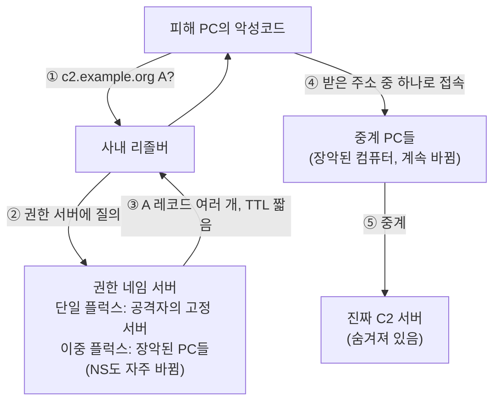

# 2.7강 — DNS 조사: 로그, 빠른 플럭스, DGA, 암호화 DNS, 퓨니코드 { #dns-investigation }

!!! abstract "이번 회차의 범위"
    - 조사에 유리한 DNS 구조, 그리고 DNS 기록의 세 종류: 질의 로그, 패킷과 패시브 DNS, Windows의 분석 로그
    - 질의 로그만으로는 놓치는 것: 공격자가 C2 이름을 `127.0.0.1`에 "재워 두는" 수법
    - 빠른 플럭스(단일·이중)와 Wireshark 필터, 그리고 정상 트래픽의 오탐
    - DGA: 날짜로 이름을 만들어 내는 방식, NXDOMAIN의 폭증, 휴리스틱의 한계, [변경됨] 브라우저의 가로채기 탐지 질의
    - 패시브 DNS로 할 수 있는 다른 일들: DNS 리바인딩, 승인되지 않은 DNS 서버
    - 암호화 DNS(DoT, DoH): 키 없이 보이는 것과 키가 있을 때 보이는 것, 대응 방법
    - 퓨니코드와 닮은꼴 글자

!!! note "실습 환경과 표기"
    **(직접 실행 결과)**는 2.6강에서 만든 **연습용 DNS 계층**(Unbound 1.19.2, 루프백 주소)에 공격자 역할의 영역 `example.org`를 더해 얻었습니다. 공격자 쪽 동작(이름을 `127.0.0.1`에 두었다가 바꾸기, 주소를 계속 갈아 끼우는 빠른 플럭스, 날짜로 이름 만들기)은 모두 **연습용으로 직접 흉내 낸 것**이고, 실제 악성코드는 쓰지 않았습니다. 시간은 압축했어요. 실제로는 몇 시간, 며칠에 걸칠 일을 몇십 초 안에 일으켰습니다. 패시브 DNS 기록은 Zeek 9.0.1(공식 Docker 이미지)과 TShark 4.2.2로 만들었습니다. 교재가 소개하는 passivedns 도구는 이 환경에서 소스를 빌드해 실행할 수 없어서 **돌려 보지 못했고**, 그 출력 형식은 설명으로만 다룹니다. 암호화 DNS는 Unbound의 DoT(853)·DoH(443) 기능을 `127.0.0.20`에 켜고 curl 8.5.0과 dig 9.18.39로 확인했습니다. 주소는 문서용 주소, 도메인은 예시용입니다.

## 1. 조사에 유리한 DNS 구조 { #architecture }

2.6강에서 봤듯이 DNS 분석은 네트워크에서 쓰이는 거의 모든 프로토콜의 맥박을 짚게 해 주고, 여러 악성 활동을 구체적으로 보여 줍니다. 그래서 위협 헌팅과 실시간 경보의 좋은 기반이에요.

그러려면 구조가 받쳐 줘야 합니다. 가장 중요한 기능은 바깥(예: 공용 DNS `8.8.8.8`)에 통째로 맡기지 말라는 게 교재의 권고입니다.

1. **사내 리졸버를 소수 둔다.** 몇 대가 필요한지는 클라이언트 수와 지리적 분포에 따라 다릅니다.
2. **경계 방화벽은 그 리졸버만 바깥 DNS로 나가게 한다.** 사내 리졸버가 바깥에 대신 물어 줍니다.
3. **모든 클라이언트는 사내 리졸버를 쓴다.** DHCP로 설정을 나눠 주면 됩니다.
4. **클라이언트가 바깥 DNS에 직접 가는 것은 방화벽에서 막는다.**

그리고 DNS 기록을 **남겨 두는 것**이 조사에 큰 도움이 됩니다. 남기는 방법은 세 가지 정도이고, 교재는 이렇게 순위를 매깁니다.

| 방법 | 평가 | 이유 |
| --- | --- | --- |
| DNS 서버의 질의 로그 | 좋음 | 대부분의 DNS 서버가 지원. 하지만 **응답이 없다** |
| DNS 패킷 캡처(pcap) | 더 좋음 | 응답까지 있다. 하지만 쓰기 전에 가공이 필요 |
| 패시브 DNS 기록 | 가장 좋음 | 패킷에서 질의와 응답을 뽑아 다루기 쉬운 한 줄로 |

## 2. 질의 로그만으로는 부족한 이유 { #query-logs }

### 2.1 공격자가 이름을 "재워 두는" 수법 { #phasing }

공격자는 자기 자원(C2 서버, 자료 유출 지점)의 DNS 레코드를 바꿔 가며 씁니다. 어떤 공격 그룹의 특징은 **쓰지 않을 때는 C2 이름을 `127.0.0.1`에 두었다가**, 이식해 둔 악성코드와 통신할 때만 진짜 주소로 바꾸는 것입니다. 쉬는 동안 발각과 노출을 피하려는 거예요. 루프백 대신 클라우드 서비스 같은 흔하고 무관한 주소를 가리켜 두기도 합니다.

이 수법을 연습용으로 흉내 냈습니다. `beacon.example.org`를 처음엔 `127.0.0.1`로, 나중엔 `203.0.113.66`으로 바꾸고, 사내 PC 역할(`127.0.0.101`)이 두 번 물었어요.

**리졸버의 질의·응답 로그 (직접 실행 결과, Unbound의 `log-queries`와 `log-replies`)**

```text
[1793863448] unbound[5388:0] info: 127.0.0.101 beacon.example.org. A IN
[1793863448] unbound[5388:0] info: 127.0.0.101 beacon.example.org. A IN NOERROR 0.001476 0 63
...
[1793863545] unbound[5388:0] info: 127.0.0.101 beacon.example.org. A IN
[1793863545] unbound[5388:0] info: 127.0.0.101 beacon.example.org. A IN NOERROR 0.000531 0 63
```

읽는 법: `[1793863448]`은 유닉스 시각, 다음은 클라이언트 주소, 이름, 타입, 클래스입니다. 응답 줄에는 응답 코드(`NOERROR`), 걸린 시간(초), 캐시에서 답했는지(`0` = 아니요), 응답 크기(바이트)가 붙어요.

두 응답의 줄이 **크기(63바이트)까지 똑같습니다**. 하나는 `127.0.0.1`, 하나는 진짜 C2 주소였는데도요. 응답 로그를 켜도 **답의 내용(주소)은 남지 않는** 거예요. 응답 로그조차 없는 전통적인 질의 로그라면 더 말할 것도 없습니다. 이런 로그로는 "언제 C2가 깨어났는지"를 추적할 수 없어요.

**같은 시간의 패킷에서 뽑은 패시브 DNS 기록 (직접 실행 결과)**

```text
1793863448.082569000|127.0.0.101|127.0.0.10|beacon.example.org|1|127.0.0.1|60
1793863545.359876000|127.0.0.101|127.0.0.10|beacon.example.org|1|203.0.113.66|60
```

리졸버가 클라이언트에게 보낸 응답 패킷에서 시각, 클라이언트, 서버, 이름, 타입 번호(1 = A), 답, TTL을 TShark로 뽑은 것입니다. 이 기록이 있으면 "**1793863545(2026-11-05 07:25:45 UTC)에 C2가 깨어나 `203.0.113.66`을 가리켰다**"는 게 바로 보이고, 그 시각 이후 `203.0.113.66`으로 간 연결(방화벽, NetFlow, 프록시 로그)을 찾는 실마리가 됩니다.

### 2.2 패시브 DNS 도구들 { #passive-dns }

**패시브 DNS**는 네트워크 인터페이스나 pcap 파일에서 DNS 트래픽을 지켜보며 질의와 응답을 기록하는 방식입니다. 서버를 건드리지 않고 **옆에서 듣기만** 하니 "패시브"예요.

- **passivedns**(무료 도구): 인터페이스나 pcap을 읽어 한 줄짜리 기록을 파일이나 syslog로 남깁니다. 데몬으로 띄워 성공한 응답과 NXDOMAIN을 모두 syslog로 보내면, 실시간으로 로그 집계 장비나 SIEM에 넣을 수 있어요(2.10강, 2.12강). pcap을 입력으로 주면 성공한 질의와 NXDOMAIN 질의를 **별도의 파일 두 개**로 나눠 쓸 수도 있습니다. 큰 pcap 증거에서 DNS만 빠르게 찾아보는 데 좋아요. 기록은 `시각||클라이언트||서버||클래스||이름||타입||답||TTL||개수`처럼 `||`로 구분됩니다. 앞의 TShark 출력이 같은 정보를 비슷한 모양으로 뽑아 본 것입니다. **[주의]** 이 도구는 이 작업 환경에서 실행해 보지 못했습니다. 옵션은 그 도구의 `--help`로 확인하세요.
- **Zeek의 `dns.log`**: 2.8강에서 자세히 다루는 Zeek가 같은 종류의 기록을 만듭니다. 같은 pcap을 돌려 봤어요.

**(직접 실행 결과, Zeek 9.0.1의 `dns.log`에서 필드 일부만)**

```text
ts                 id.orig_h    id.resp_h   query              qtype rcode   answers       TTLs
1793863448.080943  127.0.0.101  127.0.0.10  beacon.example.org A     NOERROR 127.0.0.1     60.000000
1793863545.359143  127.0.0.101  127.0.0.10  beacon.example.org A     NOERROR 203.0.113.66  60.000000
```

Zeek는 질의와 응답을 **한 줄에 합쳐** 남깁니다(질의한 쪽 `id.orig_h`, 응답한 쪽 `id.resp_h`, 답과 TTL을 함께). 2.8강에서 이 로그를 `jq`로 다뤄 봅니다.

### 2.3 Windows DNS 서버의 분석 로그(ETW) { #windows-etw }

Windows 쪽에서는 오랫동안 "DNS 로그를 켜면 운영 서버의 성능이 너무 떨어진다"는 생각이 있었습니다. Windows Server 2012 R2부터는 **ETW(Event Tracing for Windows)** 기반의 DNS 분석 로그가 생겨, 질의와 응답을 모두 자세히 남길 수 있어요. 처음부터 성능 영향을 줄이도록 설계됐습니다.

!!! info "[보충] 현재 문서의 내용(2025-02-27 판, 2026-11-05 확인)"
    Microsoft 문서 "Enable DNS Logging and Diagnostics in Windows Server"에 따르면:

    - **감사(audit) 로그**는 기본으로 켜져 있고, 서버·영역·레코드 설정 변경, 동적 업데이트, 영역 전송, DNSSEC 서명 같은 **변경**을 남깁니다.
    - **분석(analytic) 로그**는 기본으로 **꺼져 있습니다**. 이벤트 뷰어에서 "Applications and Services > Logs > Microsoft > Windows > DNS-Server"의 "Show Analytic and Debug Logs"로 보이게 하고 켭니다. 파일은 `%SystemRoot%\System32\Winevt\Logs\Microsoft-Windows-DNSServer%4Analytical.etl`에 쓰여요.
    - 성능: 초당 10만 질의에서 약 5% 저하, 초당 5만 질의 이하에서는 눈에 띄는 영향이 없다고 합니다.
    - 주요 이벤트: 256 `QUERY_RECEIVED`, 257 `RESPONSE_SUCCESS`, 258 `RESPONSE_FAILURE`, 259 `IGNORED_QUERY` 등. 257에는 `Destination`(질의한 클라이언트), `QNAME`, `QTYPE`, `XID`(트랜잭션 ID), `RCODE`, 그리고 **`PacketData`**(DNS 메시지 전체를 16진수로)가 들어갑니다.

    이 문서는 learn.microsoft.com에서 직접 열 수 없어 MicrosoftDocs의 GitHub 원본으로 확인했습니다.

**[주의] 답(주소)은 `PacketData` 안에 있습니다.** `RESPONSE_SUCCESS`의 텍스트 필드에는 주소가 따로 없어서, 2.1절의 문제(`127.0.0.1`인지 진짜 주소인지)를 풀려면 `PacketData`를 해석해야 해요. 이 환경에 Windows는 없으니, 연습용 서버가 실제로 보낸 응답 바이트를 같은 16진수 모양으로 놓고 dnspython으로 풀어 봤습니다.

**(직접 실행 결과, `PacketData`와 같은 모양의 16진수를 해석)**

```text
PacketData=0x00008180000100010000000003777777076578616D706C6503636F6D0000010001C00C00010001000000240004C000020A
→ id=0, NOERROR, www.example.com. 36 IN A 192.0.2.10
```

끝의 `C0 00 02 0A`가 `192.0.2.10`이고, 그 앞의 `C0 0C`는 2.6강에서 배운 **압축 포인터**(질문의 이름을 다시 가리킴)입니다. 대규모로 ETW 로그를 다루기는 까다로워서, 이를 사람이 읽기 좋은 형식으로 바꾸고 위협 정보와 대조해 주는 공개 도구도 나와 있습니다.

!!! info "[보충] 클라이언트 쪽 기록: Sysmon 이벤트 22"
    DNS 서버가 아니라 **각 PC에서** 어느 프로세스가 어떤 이름을 물었는지 남기고 싶다면, Sysmon 10.0(2019년 6월)부터 생긴 **이벤트 ID 22(DNSEvent)**가 있습니다. 네트워크 기록에 없는 "누가(어느 프로그램이)"를 채워 주는 기록이에요. 다만 운영체제의 DNS 클라이언트를 거치는 질의만 남기 때문에, 프로그램이 직접 DoH로 묻는 것(7절)은 남지 않습니다. 설정 없이 켜면 양이 많아 필터가 필요합니다.

## 3. 빠른 플럭스 { #fast-flux }

### 3.1 단일 플럭스 { #single-flux }

**빠른 플럭스(fast-flux) DNS**는 공격자가 진짜 중요한 서버(C2)를 숨기는 방법입니다.

- C2 이름의 A 레코드에 **장악한 컴퓨터 여러 대의 주소**를 넣습니다.
- 그 컴퓨터들에서 도는 악성코드가 **프록시** 노릇을 해서, 피해자와 진짜 C2 서버 사이의 통신을 중계합니다.
- A 레코드의 **TTL은 아주 짧게**(흔히 5분 미만) 두고, 장악한 컴퓨터의 코드가 A 레코드를 **자동으로 빠르게 갈아 끼웁니다**.

비유하면 **매일 바뀌는 접선 장소**입니다. 피해자(악성코드)는 "오늘 접선 장소가 어디냐"를 DNS로 묻고, 답으로 받은 장소(중계 PC)에 가면 그 사람이 진짜 두목에게 말을 전해 줘요. 접선 장소를 하나 막아도 내일은 다른 곳입니다. 비유가 깨지는 곳: 접선 장소는 보통 한 곳이지만, 빠른 플럭스는 **한 번에 여러 곳**을 알려 주고, 장소가 바뀌는 속도는 공격자가 새 PC를 장악하는 속도만큼 빠를 수 있습니다.

이 구조 때문에 피해 조직이 C2로 가는 트래픽을 주소로 막기가 매우 어렵습니다. 초기에 보안 커뮤니티가 찾은 효과적인 대응은 **C2 도메인의 권한 네임 서버 주소**를 막는 것이었어요. 빠른 플럭스에 쓰이는 DNS 서버는 대개 악성 목적으로만 쓰였기 때문입니다.

연습용으로 `c2.example.org`에 A 레코드 13개(TTL 10초)를 넣고, 12초마다 13개를 모두 새 주소로 갈아 끼우며 세 번 물었습니다.

**(직접 실행 결과, 클라이언트가 받은 답. 주소는 문서용 대역에서 무작위로 고른 것)**

```text
0.08 s   13개  203.0.113.195 198.51.100.116 198.51.100.121 198.51.100.167 192.0.2.35 …
12.15 s  13개  198.51.100.189 198.51.100.208 192.0.2.172 192.0.2.245 192.0.2.221 …
24.21 s  13개  198.51.100.161 198.51.100.149 198.51.100.17 192.0.2.156 192.0.2.4 …
```

세 번 모두 **13개 전부가 다른 주소**였습니다. 주소 목록으로 막으려면 매번 새로 13개를 더해야 하는 거예요.

### 3.2 이중 플럭스 { #double-flux }

**이중 플럭스(double-flux)**는 같은 생각을 한 겹 더 씌웁니다. A 레코드뿐 아니라 **NS 레코드**(이 도메인의 권한 서버)에도 장악한 컴퓨터를 씁니다. 첫 번째 층의 장악된 컴퓨터들이 **DNS 프록시** 노릇을 해서 공격자의 진짜 DNS 서버를 숨기고, 그 DNS 프록시들이 돌려주는 답에는 또 다른 장악된 컴퓨터들(C2 트래픽을 중계하는)의 짧은 TTL A 레코드들이 들어 있어요.

**그림 3-1. 단일 플럭스와 이중 플럭스의 층** (위에서 아래로: 피해자가 묻고 연결하는 순서)



**읽는 법:** ①~③이 DNS, ④~⑤가 실제 통신입니다. 단일 플럭스에서는 ③의 A 레코드만 계속 바뀌고, ②의 권한 서버는 고정이라 그걸 막으면 됩니다. 이중 플럭스에서는 ②의 권한 서버도 장악된 PC들이고 계속 바뀝니다.

대응은 좀 더 복잡하지만, 제대로 된 DNS 환경이라면 다룰 수 있습니다. DNS 관리자가 알려진 악성 도메인의 권한을 **사내 리졸버에서 가로채**(sinkhole, 예: RPZ 같은 기능) 아예 조회되지 않게 할 수 있어요. 더 중요한 건, 1절의 구조가 갖춰져 있다면 조사자가 DNS 기록으로 **감염 범위를 정하고 새로 감염된 PC를 빠르게 찾을 수 있다**는 점입니다. 그러자 공격자들은 다시 한 단계 올려 DGA(4절)를 쓰기 시작했습니다.

### 3.3 Wireshark 필터로 찾기, 그리고 오탐 { #flux-filters }

사람 눈에는 빠른 플럭스가 꽤 뚜렷하지만, 기계가 미리 규칙으로 잡아내기는 어렵습니다. 교재가 제시하는 표시 필터는 두 가지예요. 이것들은 **차단용이 아니라 탐지 보조용**입니다. 오탐이 반드시 많이 나오기 때문이에요.

- `dns.resp.ttl < 300`: TTL이 5분보다 짧은 응답. 빠른 플럭스는 캐시를 최소화해야 하므로 TTL이 짧습니다. 하지만 정상 레코드에도 흔해요.
- `dns.count.answers > 12`: 답이 12개를 넘는 응답. 빠른 플럭스는 많은 중계 PC를 쓰니 답이 많을 수 있지만, 고가용성·지역 기반 부하 분산 때문에 정상적인 큰 답도 늘고 있고, 빠른 플럭스는 답이 몇 개뿐이어도 충분히 효과적입니다.

연습용 캡처에 두 필터를 걸어 봤습니다. 정상 역할의 이름도 섞어 두었어요(`www`는 TTL 60, `cdn` 체인의 끝은 TTL 30, `pool`은 A 16개에 TTL 3600).

**(직접 실행 결과, 리졸버가 클라이언트에게 준 응답 기준)**

```text
$ tshark -r pdns.pcap -Y 'ip.src==127.0.0.10 && dns.resp.ttl < 300' -T fields -e dns.qry.name | sort | uniq -c
      2 beacon.example.org
      3 c2.example.org
      1 cdn.example.com
      1 www.example.com
$ tshark -r pdns.pcap -Y 'ip.src==127.0.0.10 && dns.count.answers > 12' -T fields -e dns.qry.name -e dns.count.answers | sort | uniq -c
      3 c2.example.org	13
      1 pool.example.com	16
```

`ip.src==127.0.0.10`은 "리졸버가 보낸 응답만"이라는 조건입니다. 바깥 권한 서버에서 온 응답까지 세면 같은 답이 두 번 세져요.

해석: TTL 필터는 공격자 이름 둘과 함께 **정상 이름 둘**(`cdn`, `www`)을 잡았고, 답 개수 필터는 `c2`와 함께 **정상적인 큰 답**(`pool`)을 잡았습니다. 어느 필터도 혼자서는 판정을 못 해요. 둘을 함께 만족하는 건 `c2`뿐이었고, 무엇보다 `c2`는 **물을 때마다 주소가 전부 바뀌었다**는 점이 결정적입니다. 이건 필터 한 번이 아니라 **시간에 걸친 기록**(패시브 DNS)이 있어야 보여요. 교재의 결론도 같습니다. 가장 효과적인 방법은 그 환경의 **평소 DNS 활동을 기준선**으로 삼고, 거기서 벗어나는 것을 더 조사하는 것입니다.

!!! tip "기록으로 \"주소가 계속 바뀌는 이름\" 찾기"
    Zeek의 `dns.log`처럼 답이 한 줄에 모여 있으면, 이름별로 **서로 다른 답 주소의 수**를 세는 것이 TTL보다 강한 신호입니다. 이 실습의 Zeek 9.0.1 `dns.log`(탭 구분)에서는 10번째 칸이 `query`, 22번째 칸이 `answers`였어요.

    ```text
    $ awk -F'\t' '!/^#/ && $22!="-" {n=split($22,a,","); for(i=1;i<=n;i++) print $10"\t"a[i]}' dns.log \
        | sort -u | cut -f1 | uniq -c | sort -rn | head -3
         39 c2.example.org
         16 pool.example.com
          2 cdn.example.com
    ```

    (직접 실행 결과) 답 칸을 쉼표로 쪼개 "이름, 주소" 쌍을 만들고, `sort -u`로 중복을 없앤 뒤 이름별로 셉니다. `c2.example.org`는 3번 물어 **39개**, `pool.example.com`은 1번 물어 16개입니다. 칸 번호는 Zeek 버전과 설정에 따라 다르니 `#fields` 줄로 먼저 확인하세요. 같은 CDN 이름도 지역과 시간에 따라 주소가 바뀌므로, 이 역시 기준선과 비교해야 합니다. 2.8강에서 `jq`로 같은 일을 해 봅니다.

## 4. DGA: 이름을 만들어 내는 악성코드 { #dga }

### 4.1 원리 { #dga-concept }

**DGA(Domain Generation Algorithm)**는 아주 새롭지는 않지만 여전히 효과적인 기법입니다. 악성코드가 C2 접속에 쓸 수 있는 도메인 이름 후보를 **수백, 수천 개** 만들어 냅니다. 알고리즘에는 보통 **날짜** 같은 씨앗(seed)을 넣어요. 같은 날이면 모든 감염 PC가 **같은 목록**을 만들고, 공격자는 그 목록의 이름 중 **하나만** 그날 등록하면 C2 접속이 성립합니다. 악성코드 무리 전체가 유지되는 거죠.

DGA를 막기 어려운 이유는 **규모**입니다. 2008년의 Conficker.A는 하루 250개의 이름을 만들었습니다. 대응 쪽 연합(Conficker Working Group)이 알고리즘을 역분석해 목록을 미리 계산하고, 등록 기관과 협력해 공격자가 그 이름들을 등록하지 못하게 막았어요. 그러자 후속 변종은 하루 후보를 **5만 개**로 늘려, 다시 대응하는 쪽이 불리해졌습니다. CryptoLocker 랜섬웨어 계열도 연·월·일을 씨앗으로 매일 많은 후보 도메인을 만들었고, 변종에 따라 알고리즘과 키가 달랐습니다.

이 원리를 보려고 **연습용 생성기**(`dga_lab.py`)를 직접 만들었습니다. 날짜와 순번을 SHA-256으로 섞어 10~16글자의 소문자 이름 20개를 만듭니다. **실제 어떤 악성코드의 알고리즘도 아닙니다.**

**(직접 실행 결과)**

```text
$ echo 2026-11-05 | python3 dga_lab.py | head -3
aghaceejpr.com
jqrsivavmai.com
khhjyrjmmfjg.com
$ echo 2026-11-06 | python3 dga_lab.py | head -3
qesxmlbzkh.com
teeaxbchtnff.com
ccxcburfal.com
```

같은 날짜를 넣으면 언제 어디서 돌려도 같은 목록이 나오고, 날짜가 바뀌면 목록이 통째로 바뀝니다. 연습용 계층에서 그날 목록의 **14번째 이름**(`thvcdbgrthihvvg.com`)만 "등록"해 두고, 감염 PC 역할(`127.0.0.103`)이 목록을 차례대로 물었습니다.

**(직접 실행 결과)**

```text
$ tshark -r dga.pcap -Y 'ip.src==127.0.0.10 && dns.flags.response==1' -T fields -e ip.dst -e dns.flags.rcode | sort | uniq -c
      1 127.0.0.103	0
     19 127.0.0.103	3
      3 127.0.0.104	3
$ tshark -r dga.pcap -Y 'ip.dst==127.0.0.103 && dns.flags.rcode==0' -T fields -e dns.qry.name -e dns.a
thvcdbgrthihvvg.com	203.0.113.99
```

`dns.flags.rcode`의 0은 NOERROR, 3은 NXDOMAIN입니다. 한 PC가 짧은 시간에 **NXDOMAIN 19개**를 받고, 그 사이 **딱 하나**가 성공했어요. 그 하나(`203.0.113.99`)가 그날의 C2이고, 조사자는 이 주소로 간 연결을 찾아야 합니다. 2.6강 3절에서 말한 "NXDOMAIN의 대량 발생"이 바로 이런 모양입니다.

### 4.2 휴리스틱과 그 한계 { #dga-heuristics }

DGA로 만든 이름을 알아보는 방법은 대개 "**사람이 지은 이름이 아닐 확률**"을 따지는 휴리스틱입니다. 그 밖에 우리 환경에서 **처음 보는 도메인**, **최근 등록된 도메인**, 바깥의 위협 정보를 표시하는 방법도 있어요.

가장 흔한 휴리스틱인 **글자 엔트로피**(글자가 얼마나 고르게 섞였나, 단위 비트)와 **모음 비율**을 직접 계산해 봤습니다.

**(직접 실행 결과, 첫 칸 = 엔트로피, 둘째 칸 = 모음 비율, 셋째 칸 = 길이)**

```text
 3.00  0.38   8  timecard.example.com
 2.64  0.56   9  wikipedia.example
 3.19  0.40  15  weatherforecast.example
 2.85  0.40  10  kubernetes.example
---
 2.92  0.40  10  aghaceejpr.com         (연습용 DGA)
 2.86  0.00  12  khhjyrjmmfjg.com       (연습용 DGA)
 3.37  0.07  15  kgtvdzrngljvjaz.com    (연습용 DGA)
---
DGA 20개 평균: 엔트로피 3.21, 모음 비율 0.20
```

해석: 평균은 갈리지만, **이름 하나하나는 겹칩니다**. 정상적인 `weatherforecast`(3.19)가 DGA인 `aghaceejpr`(2.92)보다 엔트로피가 높고, `aghaceejpr`은 모음 비율도 정상 이름과 같아요. 짧은 이름은 엔트로피의 최댓값 자체가 작아서(10글자면 log₂10 ≈ 3.32) 더 구분이 안 됩니다. 그래서 교재도 DGA를 기계로 미리 잡는 일은 "오탐이 많은 넓은 그물 없이는 거의 불가능"하다고 말합니다. 예전 사례처럼 DGA가 특정 도메인 아래(예전의 `co.cc` 같은)에만 이름을 만든다면 그 도메인 전체를 막을 수 있지만, 충분히 무작위적이고 특징 없는 이름을 만든다면 악성코드의 접속을 **예방하지는 못한다**는 걸 받아들여야 해요. 휴리스틱은 **탐지 보조**로, NXDOMAIN 폭증과 "처음 보는 이름", 그 뒤의 실제 연결과 함께 씁니다.

### 4.3 [변경됨] 오탐의 대표 주자: 브라우저의 가로채기 탐지 질의 { #chrome-probes }

일부 ISP와 서비스 업체는 존재하지 않는 도메인에도 **NXDOMAIN을 주지 않고**, 사용자를 광고가 붙은 "검색 페이지"로 보내는 주소를 돌려줍니다. Chromium 계열 브라우저는 이런 **DNS 가로채기를 탐지**하려고, 존재할 리 없는 이상한 이름(7~15글자의 무작위 한 단어 이름 세 개)을 묻고, NXDOMAIN이 아닌 답이 오면 가로채기를 의심했습니다. 문제는 이 질의가 **DGA와 아주 비슷해 보인다**는 거예요.

연습용으로 비슷한 모양의 이름 세 개를 다른 PC(`127.0.0.104`)에서 물었습니다(4.1절 결과의 `127.0.0.104 3`이 그것). 엔트로피는 3.32, 3.32, 3.58로 연습용 DGA 평균보다도 높았습니다. 그리고 점이 없는 이름이라 리졸버가 **루트 서버까지** 물어 NXDOMAIN을 받아 왔어요(바깥 캡처에 `qxkzvbtrwe` 등이 루트로 간 기록이 있음).

!!! warning "[변경됨] Chromium은 M97부터 이 탐지를 기본으로 끈다"
    2020년, Verisign의 분석(APNIC 블로그)은 이 탐지 질의가 **루트 서버 트래픽의 약 절반**(하루 약 600억 건)을 차지한다고 추정했습니다. 이후 Chromium은 동작을 바꿨어요. 현재 Chromium 소스(`components/omnibox/browser/intranet_redirector_state.h`, GitHub 미러로 2026-11-05 확인)의 설명은 이렇습니다.

    - `DISABLE_FEATURE = 1`: 가로채기 확인과 "이것을 찾으셨나요" 안내를 모두 끔. **"M97 이상의 기본값"**
    - `ENABLE_INTERCEPTION_CHECKS_AND_INFOBARS = 3`: 둘 다 켬. **"M97 이전의 기본값"**
    - 그리고 "기업에서는 정책으로 정하고, 기업이 아닌 경우에는 꺼져 있다".

    정책 이름은 `IntranetRedirectBehavior`(Chrome 88부터)입니다. **조사에서의 의미:** 2022년 무렵 이후의 일반 사용자 트래픽에서는 이 무작위 질의를 덜 보게 됐지만, ① 오래된 브라우저, ② 기업 정책으로 켠 환경, ③ 비슷한 방식을 쓰는 다른 소프트웨어에서는 여전히 나옵니다. "무작위 한 단어 이름 세 개가 브라우저 시작 무렵 한꺼번에"라는 모양을 알아 두면 DGA와 구분하는 데 도움이 됩니다.

이런 소프트웨어가 Chrome만은 아닙니다. 교재는 Viscosity라는 OpenVPN 클라이언트를 예로 듭니다. 이 클라이언트의 확인 질의는 늘 `.viscosity`라는 (있을 수 없는) 최상위 도메인으로 끝나고, 이름 안에 지금 쓰는 **터널 인터페이스 이름**(`utun10` 같은)이 들어 있어요. 오탐이기는 하지만, 그 PC의 설정을 엿볼 수 있는 단서이기도 합니다.

## 5. 패시브 DNS로 할 수 있는 다른 일들 { #more-uses }

자기 조직의 패시브 DNS 증거를 모아 두면 조사에 쓸 곳이 많습니다.

- **단계적 C2 추적**: 2.1절처럼 C2 이름이 `127.0.0.1`이나 흔한 클라우드 주소를 가리키다 진짜 주소로 바뀌는 순간(또는 빠른 플럭스 주소 묶음으로 바뀌는 순간)을 잡습니다.
- **승인되지 않은 DNS 서버 찾기**: "응답한 주소" 칸을 검색해, 사내 리졸버가 아닌 곳에서 온 응답을 찾습니다.
- **다른 기록과 함께 쓰기**: 방화벽, IDS, 웹 서버 로그, NetFlow처럼 "보이는 것이 제한된 통신 흔적"을, 이름이라는 맥락으로 더 잘 해석하게 해 줍니다.
- **DNS 리바인딩 같은 수상한 모양**: 공격자가 자기 서버의 주소를 **아주 짧은 TTL**(캐시되지 않게)로 주어 사용자가 JavaScript 같은 코드를 내려받게 합니다. 곧 그 코드가 **같은 이름**을 다시 물으면(브라우저의 동일 출처 정책을 지키며), 이번에는 공격 대상의 주소, 흔히 **사내 주소**가 돌아옵니다. 그러면 공격자가 사내 자원으로 발을 넓힐 수 있어요. 패시브 DNS에서는 "**같은 이름이 짧은 TTL로 바깥 주소에서 사설 주소로 바뀌는**" 모양으로 보입니다.
- **암호화된 통신이나 정체 모를 독자 프로토콜에 이름 붙이기**: 내용은 못 봐도, 그 연결 직전에 무슨 이름을 찾았는지 압니다.
- **DGA 휴리스틱**(4.2절).
- **가장 많이 조회되는 도메인 목록**을 계속 유지해 이상한 추세를 찾기.

## 6. 암호화 DNS: DoT와 DoH { #encrypted-dns }

### 6.1 두 가지 방식 { #dot-doh }

인터넷이 바뀌면 핵심 프로토콜도 바뀌어야 하고, DNS도 예외가 아닙니다. DNS의 암호화는 논란이 많았지만, 주요 브라우저들이 이를 직접 구현하고 Google, Cloudflare, Quad9 같은 큰 DNS 업체들이 서비스를 내놓으면서 이제는 확산 여부를 따질 단계가 지났어요.

| 방식 | 표준 | 전송 | 조사자에게 보이는 것 |
| --- | --- | --- | --- |
| DoT (DNS over TLS) | RFC 7858(2016) | TLS, 보통 **TCP 853** | 853번 포트라 **DNS라는 것은 쉽게 알고** 막기도 쉽다. 내용은 안 보임 |
| DoH (DNS over HTTPS) | RFC 8484(2018) | HTTPS(HTTP/2 등), **TCP 443** | 평범한 HTTPS와 **구분이 거의 안 된다** |

어느 쪽이든 내용이 가려지므로, 지금까지 배운 DNS 감시와 프로파일링은 거의 쓸 수 없게 됩니다. 더 큰 문제는 이걸 **운영체제가 아니라 프로그램 안에** 넣을 수 있다는 점이에요. 어떤 악성코드든 네트워크와 단말의 통제를 무시하고 이 길을 쓸 수 있습니다. 2019년에 보고된 Godlua가 DoH로 자신을 숨긴 첫 악성코드 사례로 알려져 있습니다.

### 6.2 키 없이 보이는 것, 키가 있을 때 보이는 것 { #doh-lab }

연습용 DoH·DoT 서버(`127.0.0.20`, 인증서 이름 `doh.example.net`)에 같은 질문(`www.example.com A`)을 세 가지 방법으로 보냈습니다. curl로 DoH GET과 POST(TLS 세션 키를 `SSLKEYLOGFILE`로 저장), 그리고 dig로 DoT(`+tls`)를 썼어요.

**먼저 DoH 요청에 담을 DNS 메시지 (직접 실행 결과)**

```text
33바이트: 00 00 01 00 00 01 00 00 00 00 00 00 03 77 77 77 07 65 78 61 6d 70 6c 65 03 63 6f 6d 00 00 01 00 01
base64url: AAABAAABAAAAAAAAA3d3dwdleGFtcGxlA2NvbQAAAQAB
```

평범한 UDP 53 질의와 **똑같은** DNS 메시지입니다(헤더 12 + 이름 17 + 타입·클래스 4 = 33바이트). 다른 점은 맨 앞의 트랜잭션 ID가 **`00 00`**이라는 것 하나예요. DoH 표준(RFC 8484)은 ID를 0으로 쓰라고 권합니다. 같은 질문이면 HTTP 요청이 똑같아져서 **HTTP 캐시**가 응답을 재사용할 수 있게 하려는 거예요. 캐시는 GET에서만 가능합니다.

- **GET**: 이 33바이트를 **base64url**(URL에 써도 되는 base64, 끝의 `=` 생략)로 바꿔 `?dns=` 쿼리 문자열에 넣습니다.
- **POST**: 33바이트를 그대로 요청 본문에 넣고, `Content-Type: application/dns-message`를 붙입니다.

**키 없이 본 캡처 (직접 실행 결과)**

```text
$ tshark -r doh.pcap -Y dns | wc -l
0
$ tshark -r doh.pcap -Y 'tls.handshake.type==1' -T fields -e tcp.dstport -e tls.handshake.extensions_server_name -e tls.handshake.extensions_alpn_str
443	doh.example.net	h2,http/1.1
443	doh.example.net	h2,http/1.1
853		dot
```

`dns` 필터로는 **한 줄도** 안 나옵니다. 보이는 건 TLS 협상의 ClientHello(`tls.handshake.type==1`)에 담긴 정보뿐이에요.

- DoH 두 건: 443번, 서버 이름(SNI) `doh.example.net`, ALPN `h2,http/1.1`. **평범한 웹 브라우징과 모양이 같습니다.** 그나마 단서는 SNI의 이름입니다. 알려진 DoH 서비스의 이름 목록과 비교하는 방법이 그래서 쓰여요.
- DoT 한 건: 853번, ALPN **`dot`**. 포트와 ALPN만으로 DNS라는 게 드러납니다(dig는 주소로 접속해서 SNI를 보내지 않았습니다).

**세션 키를 주고 본 캡처 (직접 실행 결과)**

```text
$ tshark -r doh.pcap -o tls.keylog_file:keys.log -Y 'http2.header.name==":path" || dns' \
    -T fields -e http2.headers.method -e http2.headers.path -e http2.headers.content_type -e dns.id -e dns.qry.name -e dns.a
GET	/dns-query?dns=AAABAAABAAAAAAAAA3d3dwdleGFtcGxlA2NvbQAAAQAB
			0x0000	www.example.com	192.0.2.10
POST	/dns-query	application/dns-message	0x0000	www.example.com
			0x0000	www.example.com	192.0.2.10
```

키가 있으면 HTTP/2 안이 열립니다(2.3강과 같은 방식). GET의 경로에 base64url로 실린 질문, POST의 본문, 그리고 응답까지, Wireshark가 **DNS로 해석**해 보여 줘요. 트랜잭션 ID는 질의와 응답 모두 `0x0000`이었습니다. 응답 본문을 받아 해석해 봐도 `id=0`, `www.example.com A 192.0.2.10`이었고요.

DoT는 같은 키 기록 방식이 dig에 없어 내용을 열어 보지 못했습니다. DoT의 안쪽은 TCP 53의 DNS와 같은 형식(길이 2바이트 + DNS 메시지)이라, 키가 있으면 열리는 원리는 같습니다.

### 6.3 대응 방법 { #encrypted-dns-mitigation }

암호화 DNS의 확산을 누그러뜨리는 것은 가능하지만 꽤 복잡합니다.

- **둘 다**: **TLS 가로채기**(중간에서 복호화하는 프록시)가 가장 효과적으로 보고, 필요하면 막는 방법입니다. 하지만 **법적 위험**이 따르는 경우가 많아요. 기술은 비교적 간단해도, 관리와 규제의 장벽이 이 처방을 어렵게 만듭니다. 그다음으로 **TLS 협상 단계를 살피는 것**(6.2절의 SNI, ALPN, 인증서)이 어느 정도의 가시성을 줍니다. 관리 통제가 강한 환경이라면 **운영체제와 프로그램 설정**을 통제하는 것도 방법이지만, 기업이 쓰는 소프트웨어가 워낙 다양해 이것만 믿기는 어렵고, 악성코드는 당연히 기업 정책을 따르지 않습니다.
- **DoT**: 53번이 아닌 별도 포트(853)를 쓰니 **방화벽**으로 효과적으로 통제할 수 있습니다. 물론 공격자가 다른 흔한 포트로 DoT를 쓰는 것까지 막을 수는 없지만, 통제할 여지는 훨씬 큽니다.
- **DoH**: 결국 특정한 내용을 담은 HTTPS일 뿐이라, 2.4강의 **HTTPS 프로파일링** 방법이 그대로 쓰입니다(어느 이름으로, 얼마나 자주, 얼마나 작은 요청을 보내나).

!!! info "[보충] 교재 이후의 변화(2026-11-05 기준)"
    - **새 방식**: DNS over QUIC(DoQ, RFC 9250, 2022년, UDP 853)이 표준이 됐습니다. 그리고 HTTP/3 위의 DoH도 가능해져, 2.3강에서 본 것처럼 **UDP 443**의 QUIC 안에 DNS가 들어갈 수 있어요.
    - **운영체제 수준의 지원**: Windows 11, macOS, iOS, Android 등이 운영체제 차원에서 암호화 DNS를 지원합니다. 이 경우 Sysmon 이벤트 22처럼 운영체제 DNS 클라이언트를 지켜보는 기록에는 남지만, 네트워크의 53번 기록에는 남지 않습니다.
    - **네트워크가 "우리 리졸버를 써라"라고 알리는 방법**: Firefox는 사내 DNS가 `use-application-dns.net`이라는 **카나리 도메인**에 부정적인 답(NXDOMAIN 등)을 주면 자동 DoH를 켜지 않습니다(Mozilla 지원 문서). 다만 사용자가 직접 켠 경우와 기업 정책은 이 신호로 바뀌지 않으므로, 관리되는 PC는 **기업 정책**으로 통제하는 것이 확실합니다. 또 DDR(RFC 9462, 2023년)은 클라이언트가 지금 쓰는 리졸버에게 "너의 암호화 버전 주소는?"을 물어 같은 리졸버의 DoT·DoH로 옮겨 가게 하는 표준입니다. 이렇게 되면 **사내 리졸버의 기록은 그대로 남으면서** 회선 위의 내용만 암호화됩니다. 조사자 입장에서는 "패킷이 아니라 리졸버의 기록을 확보하라"는 1절의 권고가 더 중요해진 셈이에요.

## 7. 퓨니코드와 닮은꼴 글자 { #punycode }

DNS가 만들어졌을 때는 ASCII로 충분했습니다(유니코드는 아직 없었어요). 하지만 모든 프로토콜에서 ASCII 아닌 글자를 써야 할 일이 늘면서, DNS에서도 **국제화 도메인 이름(IDN)**을 ASCII만으로 나타낼 방법이 필요했습니다. 그렇게 만든 것이 **퓨니코드(punycode, RFC 3492)**입니다.

퓨니코드로 바꾼 조각은 `xn--`로 시작하고, 그 뒤에 원래 조각의 **ASCII 글자들**, 그다음 `-`, 마지막으로 ASCII 아닌 글자의 **위치와 종류를 인코딩한 부분**이 옵니다. 알고리즘 자체는 꽤 복잡해서 여기서 다루지 않지만, **알아보는 것**과 **풀어 보는 것**은 조사자에게 중요한 기술이에요. 도구(라이브러리, 변환기)로 할 수 있습니다.

**(직접 실행 결과, Python 3.13의 `idna` 코덱)**

```text
'bücher.example'           -> xn--bcher-kva.example
'한글.example'              -> xn--bj0bj06e.example
'wıki.example'             -> xn--wki-jua.example        (ı = U+0131, 점 없는 i)
'еxample.com'              -> xn--xample-2of.com         (е = U+0435, 키릴 문자)
'pаy.example'              -> xn--py-7kc.example         (а = U+0430, 키릴 문자)
'makesyour😀.example'       -> xn--makesyour-ob26h.example
```

`bücher`는 ASCII 글자 `bcher`가 그대로 남고, `-` 뒤의 `kva`가 "어디에 `ü`가 들어가는지"를 나타냅니다. 한글처럼 ASCII 글자가 하나도 없으면 `xn--` 바로 뒤에 인코딩 부분만 와요.

조사자가 조심할 점이 두 가지입니다.

1. **처음 보면 수상해 보인다.** ASCII로 찍힌 로그에서 `xn--bj0bj06e.example`은 무작위 이름처럼 보이지만, 풀어 보면 평범한 `한글.example`입니다. 모든 IDN을 의심할 필요는 없고, **풀어 본 뒤에** 판단해야 해요. DGA 휴리스틱(4.2절)이 퓨니코드를 오탐하기 쉬운 이유이기도 합니다.
2. **닮은꼴 글자(homoglyph).** `wıki`의 `ı`(점 없는 i)는 화면에서 `i`와 거의 같고, `еxample`의 키릴 `е`는 라틴 `e`와 똑같이 보입니다. 공격자는 이렇게 **정상 사이트를 흉내 낸 IDN**으로 피싱을 합니다. 반대로 로그에서 `xn--` 이름을 보고 풀었더니 우리 회사나 거래처 이름과 닮았다면, 그건 강한 신호예요.

!!! info "[보충] 규칙은 그사이 엄격해졌다"
    위의 이모지 이름은 Python의 기본 `idna` 코덱(예전 규칙인 IDNA2003)에서는 바뀌지만, 현재 규칙(IDNA2008, RFC 5891 등)을 따르는 `idna` 패키지 3.19로 바꾸면 **"U+1F600은 허용되지 않음"** 오류가 났습니다(직접 실행 결과). 이모지 도메인은 일부 최상위 도메인에서만 등록되는 예외적인 경우예요. 또 주요 브라우저는 여러 문자 체계를 섞은 이름이나 닮은꼴이 의심되는 이름을 주소창에 **`xn--` 형태 그대로** 보여 주는 정책을 갖고 있습니다. 다만 한 문자 체계만으로 만든 닮은꼴(예: 모두 키릴 문자)은 통과될 수 있어, 로그 쪽에서 풀어 보고 비교하는 일은 여전히 필요합니다.

## 8. 실제 조사에서는 이렇게 씁니다 { #in-practice }

1. **답이 있는 기록을 확보한다.** 질의 로그(응답 로그 포함)에는 답의 주소가 없습니다(2.1절). 패시브 DNS, Zeek `dns.log`, pcap, Windows 분석 로그의 `PacketData`를 찾습니다.
2. **이름의 이력을 본다.** 같은 이름이 `127.0.0.1` → 진짜 주소, 바깥 주소 → 사설 주소, 물을 때마다 다른 주소 묶음으로 바뀌는지 시간순으로 봅니다.
3. **필터는 출발점일 뿐이다.** `dns.resp.ttl < 300`, `dns.count.answers > 12`는 정상 이름도 잡습니다. 기준선과 이름별 고유 주소 수로 좁힙니다.
4. **NXDOMAIN 폭증 뒤의 "단 하나의 성공"을 찾는다.** 그 주소가 그날의 C2일 수 있습니다.
5. **DGA처럼 보이는 것의 정체를 확인한다.** 브라우저 시작 무렵의 무작위 한 단어 이름 세 개, `.viscosity`, 퓨니코드는 오탐 후보입니다.
6. **DNS가 조용하면 의심한다.** 한 PC의 53번 질의가 거의 없는데 웹 연결은 많다면 DoH를 의심하고, TLS 협상(SNI, ALPN)과 HTTPS 프로파일링으로 넘어갑니다.
7. **`xn--`는 풀어서 판단한다.** 우리 조직이나 거래처 이름과 닮았는지 비교합니다.

## 9. 정리 { #summary }

- 조사에 유리한 구조: 사내 리졸버 소수, 그 리졸버만 바깥으로, 클라이언트의 바깥 DNS 직접 접속 차단. 기록은 질의 로그(좋음) < pcap(더 좋음) < 패시브 DNS(가장 좋음).
- 직접 확인: Unbound의 질의·응답 로그에는 **답의 주소가 없어**, C2 이름이 `127.0.0.1`일 때와 진짜 주소일 때의 줄이 크기까지 똑같았습니다. 패킷에서 뽑은 패시브 DNS와 Zeek `dns.log`에는 두 답이 그대로 남았습니다.
- Windows DNS 서버의 분석 로그(ETW)는 기본으로 꺼져 있고, 답은 `PacketData`의 16진수 안에 있습니다. 클라이언트 쪽에서는 Sysmon 이벤트 22가 프로세스까지 남깁니다.
- 빠른 플럭스: 짧은 TTL과 많은 A 레코드를 계속 갈아 끼움(직접 흉내 낸 결과: 세 번 물어 13개씩 전부 다른 주소). 이중 플럭스는 NS까지 갈아 끼움. TTL·답 개수 필터는 정상 이름도 잡았고, 결정적인 건 시간에 걸친 기록이었습니다.
- DGA: 날짜를 씨앗으로 같은 목록을 만들고 하나만 등록(Conficker 250개/일 → 5만 개/일). 직접 흉내 낸 결과: NXDOMAIN 19개 사이에 성공 하나. 엔트로피 휴리스틱은 평균은 갈리지만 이름 하나하나는 겹쳤습니다.
- **[변경됨]** Chromium의 가로채기 탐지 질의는 M97부터 기본으로 꺼졌고(기업 정책으로는 켤 수 있음), 예전에는 루트 트래픽의 절반 가까이를 차지했습니다.
- 암호화 DNS: DoT는 853번과 ALPN `dot`으로 드러나고, DoH는 443번의 평범한 HTTPS처럼 보였습니다(키 없이 `dns` 필터 0줄). 키가 있으면 GET의 base64url 질문과 POST 본문이 DNS로 해석됐고, ID는 0이었습니다. **[보충]** DoQ, HTTP/3 위의 DoH, 운영체제 지원, 카나리 도메인, DDR.
- 퓨니코드: `xn--` + ASCII 글자 + `-` + 인코딩. 풀어 보고 판단하고, 닮은꼴 글자(점 없는 i, 키릴 문자)를 조심합니다.

## 복습 문제 { #review }

**문제 1. (기본)** 사내 DNS 서버의 질의 로그만 1년치가 남아 있습니다. 이 로그로 할 수 있는 조사와 할 수 없는 조사를 하나씩 들어 보세요.

??? success "정답과 해설"
    **할 수 있는 것:** 어느 클라이언트가 언제 어떤 이름을 물었는지. 예를 들어 알려진 악성 도메인을 조회한 PC 목록과 시각, DGA처럼 보이는 이름의 대량 질의(응답 로그가 있다면 NXDOMAIN 수까지). **할 수 없는 것:** 그 질의에 **어떤 주소가 돌아왔는지**. 2.1절에서 직접 봤듯이 C2 이름이 `127.0.0.1`일 때와 진짜 주소일 때의 로그 줄은 같았습니다. 그래서 "C2가 언제 깨어났나", "어느 주소로 연결했을 것인가"는 이 로그만으로 알 수 없고, 패시브 DNS나 pcap, 또는 그 시각의 연결 기록(NetFlow, 방화벽)을 함께 봐야 합니다.

**문제 2. (해석)** Zeek `dns.log`에서 다음 세 줄을 찾았습니다(필드 일부, 시각은 UTC). 무엇을 알 수 있고, 다음에 무엇을 하겠습니까?

```text
2026-10-02 03:10  10.20.1.15  update.example.org  A  NOERROR  127.0.0.1     3600
2026-10-19 22:41  10.20.1.15  update.example.org  A  NOERROR  127.0.0.1     3600
2026-10-21 01:05  10.20.1.15  update.example.org  A  NOERROR  198.51.100.7  300
```

??? success "정답과 해설"
    같은 PC가 같은 이름을 몇 주에 걸쳐 주기적으로 물었고, 처음 두 번은 `127.0.0.1`(긴 TTL), 10월 21일 01:05에는 바깥 주소 `198.51.100.7`(짧은 TTL)을 받았습니다. 2.1절의 **"재워 두었다 깨우는" C2** 모양과 맞아요. 다만 정상 소프트웨어가 업데이트 서버를 임시로 막아 두는 경우도 있으니 **가설**로 둡니다. 다음 단계: ① 10월 21일 01:05 이후 `10.20.1.15` → `198.51.100.7` 연결을 conn.log, NetFlow, 방화벽, 프록시에서 찾기(양과 지속 시간), ② 같은 이름을 물은 **다른 PC**들(감염 범위), ③ 이 이름이 주소를 바꾼 다른 시점, ④ 그 PC에서 이 이름을 묻는 프로세스(Sysmon 22 등).

**문제 3. (변경된 조건)** 3.3절의 두 필터를 모두 걸었더니 `c2.example.org`와 함께, 사내 사용자가 많이 쓰는 대형 서비스 이름 하나가 함께 걸렸습니다. 둘을 어떻게 구분하겠습니까?

??? success "정답과 해설"
    필터 결과 한 번이 아니라 **시간에 걸친 기록**으로 구분합니다. ① 이름별 **고유 답 주소의 수와 바뀌는 속도**: 빠른 플럭스는 물을 때마다 묶음 전체가 바뀌었고(연습: 3번 물어 39개), 대형 서비스는 대개 일정한 주소 범위 안에서 돕니다. ② 답 주소의 **성격**: 그 주소들이 한 클라우드·CDN 사업자의 대역인지, 여러 나라의 가정용 회선에 흩어져 있는지. ③ **권한 네임 서버**: 대형 서비스의 NS는 오래 고정돼 있고 평판이 있는 사업자이며, 이중 플럭스는 NS마저 바뀝니다. ④ **기준선**: 그 대형 서비스 이름은 평소에도 많은 PC가 묻고, 빠른 플럭스 이름은 소수의 PC가 주기적으로 묻습니다. ⑤ 도메인의 등록 시점(최근 등록인가). 이렇게 여러 근거를 모아 판단합니다.

**문제 4. (흔한 오해)** "글자 엔트로피가 3.0을 넘는 이름은 DGA로 보고 차단하면 된다." 이 규칙의 문제를 이 강의의 실험 결과로 설명하세요.

??? success "정답과 해설"
    4.2절에서 직접 계산한 결과, 정상 이름 `timecard`(3.00), `weatherforecast`(3.19)가 3.0 이상이었고, 연습용 DGA 이름 `aghaceejpr`(2.92), `khhjyrjmmfjg`(2.86)는 3.0 미만이었습니다. 이 규칙은 정상 이름을 막고 DGA는 통과시켜요. 짧은 이름은 엔트로피의 최댓값 자체가 작아(10글자면 약 3.32) 더 구분이 어렵고, 퓨니코드(`xn--bj0bj06e`)나 CDN의 무작위 같은 이름도 걸립니다. 엔트로피는 **차단 규칙이 아니라 탐지 보조**로, NXDOMAIN 폭증, 처음 보는 이름, 최근 등록 여부, 이후의 실제 연결과 함께 씁니다.

**문제 5. (해석)** 한 PC에서 아침 9시 정각 무렵 1초 안에 `rtyhcvbnkla`, `poiuqwemn`, `zxcvbnmasdfgh` 세 이름(점 없음)을 물어 모두 NXDOMAIN을 받았고, 그 뒤로는 비슷한 질의가 없었습니다. DGA일까요?

??? success "정답과 해설"
    모양만 보면 무작위 이름이라 DGA처럼 보이지만, **점이 없는 한 단어 이름 세 개가 한꺼번에**, 그리고 그 뒤로 반복이 없다는 점은 4.3절의 **브라우저 가로채기 탐지 질의**의 모양(7~15글자 무작위 이름 세 개)과 맞습니다. 출근해서 브라우저를 켠 시각이라는 점도 어울려요. 확인할 것: ① 그 PC의 브라우저 종류와 버전(Chromium M97 이상이면 기본으로 꺼져 있으므로 기업 정책 `IntranetRedirectBehavior`나 `DNSInterceptionChecksEnabled` 설정을 확인), ② 같은 모양이 다른 PC들에서도 브라우저 시작 무렵에 보이는지, ③ 엔드포인트 기록(Sysmon 22)에서 질의한 프로세스. DGA라면 보통 이름 수가 훨씬 많고, 최상위 도메인이 붙어 있고, 성공한 이름 뒤로 실제 연결이 이어집니다.

**문제 6. (변경된 조건)** 사내 리졸버와 방화벽 정책은 1절대로 갖췄는데, 한 PC의 53번 DNS 질의가 하루 종일 거의 없습니다. 그런데 그 PC는 웹 연결이 많아요. 무엇을 의심하고, 무엇으로 확인하겠습니까?

??? success "정답과 해설"
    프로그램이나 운영체제가 **DoH**(443)나 DoQ·HTTP/3 위의 DoH(UDP 443)를 쓰고 있을 가능성을 의심합니다(6절). DoT라면 853번이 방화벽에 막혔거나 기록에 보일 거예요. 확인: ① 그 PC의 TLS ClientHello에서 **SNI**(알려진 DoH 서비스의 이름인지)와 연결 패턴(작은 요청이 잦은지, 2.4강의 HTTPS 프로파일링), ② 브라우저·운영체제의 보안 DNS 설정, 기업 정책 적용 여부, ③ 그 PC의 프로세스별 네트워크 기록(어느 프로그램이 그 연결을 만들었나). 정상 브라우저 설정이라면 정책으로 바로잡고, 알 수 없는 프로세스라면 Godlua 같은 **악성코드의 DoH**를 의심합니다. 카나리 도메인은 Firefox의 자동 DoH에만 통하는 신호라 이 경우의 대책으로는 부족합니다.

**문제 7. (흔한 오해)** "DoH는 암호화돼 있어서, 세션 키를 구해도 HTTP 요청만 보일 뿐 DNS 내용은 따로 풀어야 한다." 이 강의의 실험으로 반박해 보세요.

??? success "정답과 해설"
    6.2절에서 세션 키(`SSLKEYLOGFILE`)를 주자 Wireshark가 HTTP/2 안의 DoH를 **바로 DNS로 해석**했습니다. GET은 경로의 `?dns=` 뒤에 base64url로 실린 질문이 `www.example.com`으로, POST는 `application/dns-message` 본문이 DNS 질의로, 응답도 `192.0.2.10`으로 보였어요. DoH 안의 DNS 메시지는 UDP 53의 것과 **같은 형식**(ID만 0)이기 때문입니다. 따로 풀 필요는 없고, 어려운 건 **키를 구하는 일**(TLS 가로채기의 법적·관리적 부담, 또는 단말에서의 키 기록)입니다.

**문제 8. (적용)** 로그에서 `xn--mcrosoft-g7a.example` 같은 이름(가상 사례)을 봤습니다. 어떤 순서로 판단하겠습니까?

??? success "정답과 해설"
    ① **풀어 본다**: 퓨니코드를 풀어 실제 글자를 확인합니다(라이브러리나 변환기). ② **닮은꼴인지 본다**: 풀린 이름이 우리 조직, 거래처, 많이 쓰는 서비스의 이름과 닮았는지, 어떤 글자가 다른 문자 체계(키릴 `а`, `е`, 점 없는 `ı` 등)인지 확인합니다. 이 예처럼 유명한 이름과 한 글자만 다르다면 피싱 가능성이 높아요. ③ **맥락을 본다**: 그 이름을 물은 PC, 시각(메일 수신 직후인가), 이어진 HTTP·HTTPS 연결, 프록시 로그의 요청(로그인 페이지인가). ④ **범위를 정한다**: 같은 이름을 물은 다른 PC들. 반대로 풀어 보니 평범한 국제화 도메인(외국 거래처의 현지어 이름 등)이라면 오탐으로 정리합니다. 모든 `xn--`를 막는 것은 정답이 아니에요.

**문제 9. (해석)** 패시브 DNS에서 `app.example.net`이 오후 2:00:00에 TTL 1로 `203.0.113.50`을, 2:00:07에 같은 PC가 다시 물어 TTL 1로 `10.20.5.30`(사내 주소)을 받았습니다. 무엇을 의심하고, 무엇을 더 보겠습니까?

??? success "정답과 해설"
    **DNS 리바인딩**(5절)을 의심합니다. 바깥 주소에서 페이지와 스크립트를 내려받게 한 뒤, 캐시되지 않을 아주 짧은 TTL로 같은 이름을 **사내 주소**로 바꿔, 브라우저의 동일 출처 정책 안에서 스크립트가 사내 장비(`10.20.5.30`)에 요청을 보내게 하는 수법이에요. 더 볼 것: ① 2:00:00 직후 그 PC → `203.0.113.50`의 HTTP 요청(프록시·웹 로그, 무엇을 받았나), ② 2:00:07 이후 그 PC → `10.20.5.30`의 연결(어느 포트, 어떤 요청, `Host` 헤더가 `app.example.net`인지, 2.1강), ③ `10.20.5.30`이 어떤 장비인지(관리 화면이 있는 공유기, 프린터, 내부 API). 사내 리졸버가 **바깥 이름에 대한 사설 주소 응답을 걸러 내는** 기능을 쓰고 있었는지도 확인할 거리입니다.

## 참고 자료 { #references }

- 작업 환경에서 쓴 도구: Unbound 1.19.2(연습용 계층, `log-queries`·`log-replies`, DoT·DoH 기능), Zeek 9.0.1(공식 Docker 이미지), TShark 4.2.2, tcpdump, dig 9.18.39, curl 8.5.0, OpenSSL(연습용 자체 서명 인증서), dnspython 2.9.2, Python `idna` 3.19, Python 3.13. 실행 결과는 2026-11-05에 얻었습니다.
- Microsoft, "Enable DNS Logging and Diagnostics in Windows Server" ([MicrosoftDocs GitHub 원본](https://github.com/MicrosoftDocs/windowsserverdocs/blob/main/WindowsServerDocs/networking/dns/dns-logging-and-diagnostics.md), ms.date 2025-02-27, 2026-11-05 확인): 감사·분석 로그, 이벤트 256~259, 성능 수치.
- Zeek, [dns.log 문서](https://docs.zeek.org/en/master/logs/dns.html).
- passivedns: [소스 저장소](https://github.com/gamelinux/passivedns) (이 환경에서 실행하지 못함).
- Sysmon 이벤트 22(DNSEvent): Sysmon 10.0(2019년 6월)에서 추가(2026-11-05 검색 결과로 확인).
- Chromium, `components/omnibox/browser/intranet_redirector_state.h` ([GitHub 미러](https://github.com/chromium/chromium/blob/main/components/omnibox/browser/intranet_redirector_state.h), 2026-11-05 확인): M97부터 기본 비활성. 루트 트래픽 분석은 Verisign의 APNIC 블로그 글(2020년 8월)과 그 보도(2026-11-05 검색 결과로 확인).
- IETF, [RFC 7858](https://www.rfc-editor.org/rfc/rfc7858) (DoT), [RFC 8484](https://www.rfc-editor.org/rfc/rfc8484) (DoH, ID 0 권고, GET·POST), [RFC 9250](https://www.rfc-editor.org/rfc/rfc9250) (DoQ), [RFC 9462](https://www.rfc-editor.org/rfc/rfc9462) (DDR).
- Mozilla, [Configure networks to disable DNS over HTTPS](https://support.mozilla.org/kb/configuring-networks-disable-dns-over-https) (카나리 도메인 `use-application-dns.net`, 2026-11-05 검색 결과로 확인).
- IETF, [RFC 3492](https://www.rfc-editor.org/rfc/rfc3492) (Punycode), [RFC 5891](https://www.rfc-editor.org/rfc/rfc5891) (IDNA2008).
- Conficker의 도메인 수(하루 250개 → 5만 개), Godlua(2019년)의 DoH 사용은 공개된 분석 보고서 내용을 요약했습니다.

!!! note "이 페이지에 대하여"
    여러 학습 자료를 바탕으로 직접 다시 쓴 개인 학습 노트입니다. 연습용 DNS 계층, 공격자 역할의 동작, 도메인 생성기는 직접 만들었고, 사례는 가상입니다.
