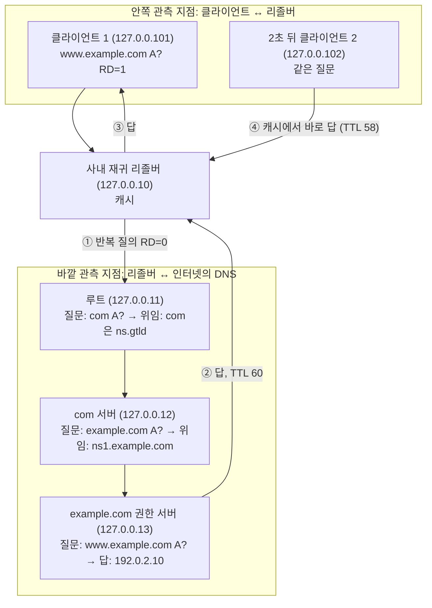

# 2.6강 — DNS의 구조: 레코드, 메시지, 압축, 계층, 관측 지점 { #dns-structure }

!!! abstract "이번 회차의 범위"
    - DNS가 조사에서 중요한 이유: 거의 모든 통신이 DNS에서 시작한다
    - 레코드 타입: A, AAAA, NS, CNAME, MX, PTR, SRV, TXT, NULL, SSHFP, 그리고 [보충] 요즘 많이 보이는 HTTPS(SVCB)
    - 타입 비율로 "평소"를 만드는 방법
    - 메시지 구조: 트랜잭션 ID, 플래그, 응답 코드(NXDOMAIN)
    - UDP와 TCP, EDNS: 512바이트 한계와 [변경됨] 2020년 이후의 1232바이트
    - 이름 압축: 포인터 `0xC0..`을 바이트 단위로 읽기
    - 계층과 재귀, 캐시, 그리고 **어디서 보느냐에 따라 보이는 것이 달라진다**는 점([변경됨] QNAME 최소화)
    - CNAME: 요청과 응답을 이어 붙여 읽기, TTL이 따로 노는 이유

!!! note "실습 환경과 표기"
    **(직접 실행 결과)**는 이 작업 환경 안에 만든 **작은 연습용 DNS 계층**에서 얻었습니다. Unbound 1.19.2(Ubuntu 패키지)를 다섯 개 띄워 루트(`127.0.0.11`), 최상위 도메인 `com`·`net`·`org`·`arpa`(`127.0.0.12`), `example.com`·`example.net`의 권한 서버(`127.0.0.13`), `example.org`의 권한 서버(`127.0.0.14`), 그리고 사내 재귀 리졸버 역할(`127.0.0.10`)을 맡겼습니다. 진짜 인터넷의 루트가 아니라, 같은 구조를 루프백 주소에 흉내 낸 것입니다. 클라이언트는 dig 9.18.39로 `127.0.0.101`, `127.0.0.102`에서 질의했고, 캡처는 tcpdump, 해석은 TShark 4.2.2와 dnspython 2.9.2로 했습니다. 레코드의 주소는 모두 문서용 주소(`192.0.2.0/24`, `198.51.100.0/24`, `203.0.113.0/24`, `2001:db8::/32`)이고, 도메인은 예시용(`example.com/net/org`)입니다.

## 1. DNS는 사람과 네트워크 사이의 접착제 { #why-dns }

출근해서 근태 시스템에 들어갈 때 `192.168.24.102`를, 웹 메일에 들어갈 때 `172.30.41.216`을 외워서 치는 사람은 없죠. `timecard.example.com`, `webmail.example.com` 같은 이름을 칩니다. 이름을 주소로 바꿔 주는 것이 DNS(Domain Name System)예요. 우리는 하루에도 수없이 DNS를 쓰지만, 대개 쓰는 줄도 모릅니다.

전화번호부에 비유할 수 있습니다. 이름을 찾으면 번호가 나와요. 하지만 비유가 깨지는 곳이 셋 있습니다. ① 전화번호부는 한 권이지만 DNS는 **수많은 서버에 나뉘어** 있고, 각 부분을 맡은 서버가 따로 있습니다(7절). ② 전화번호부의 번호는 오래 그대로지만, DNS의 답에는 **유효 기간(TTL)**이 붙어 있고 언제든 바뀔 수 있습니다. 공격자가 바로 이 점을 이용합니다(2.7강). ③ DNS는 이름→주소만이 아니라, 메일 서버, 서비스 위치, 임의의 글자까지 **여러 종류의 답**을 돌려줍니다(2절).

조사자에게 DNS가 중요한 이유는 간단합니다. 웹, 메일, 원격 접속, 악성코드의 명령 서버 접속까지, 거의 모든 통신이 **DNS 질의로 시작**하기 때문이에요. DNS 기록을 잘 보면 네트워크 전체에서 무슨 일이 일어나는지 맥박을 짚을 수 있습니다. 그래서 위협 헌팅과 실시간 경보의 기반으로도 쓰입니다.

## 2. 레코드 타입 { #record-types }

용어 먼저 정리합니다.

- **레코드(RR, resource record)**: DNS가 저장하고 돌려주는 정보 한 줄. "이름, TTL, 클래스(거의 늘 `IN`), 타입, 값"으로 이루어집니다.
- **정방향 조회**: 이름으로 주소를 묻는 것. 사람이 쓰는 구간에서 가장 흔합니다.
- **역방향 조회**: 주소로 이름을 묻는 것(PTR).

| 타입 | 번호 | 이름 | 하는 일 |
| --- | --- | --- | --- |
| A | 1 | Address | 이름 → IPv4 주소 |
| AAAA | 28 | IPv6 Address | 이름 → IPv6 주소(128비트) |
| NS | 2 | Name server | 도메인(또는 하위 도메인)을 맡은 권한 서버 |
| CNAME | 5 | Canonical name | 별칭. "이 이름 대신 저 이름을 찾아라"(8절) |
| MX | 15 | Mail exchange | 도메인의 메일을 받는 서버(우선순위와 함께) |
| PTR | 12 | Pointer | 역방향 조회. `192.0.2.25`는 `25.2.0.192.in-addr.arpa`로 묻는다 |
| SRV | 33 | Service locator | 임의 서비스의 위치(우선순위, 가중치, 포트, 호스트). MX의 일반형 |
| TXT | 16 | Text | 임의의 글자. 요즘은 SPF, DKIM처럼 기계가 읽는 데이터 |
| NULL | 10 | Null | 임의의 내용(최대 65,535바이트). 실험용이라 **실제 운영에서는 거의 볼 일이 없어야** 한다 |
| SSHFP | 44 | SSH fingerprint | SSH 서버의 호스트 키 지문. 접속할 서버가 맞는지 확인을 돕는다 |
| HTTPS | 65 | HTTPS binding | [보충] 아래 참고 |

이것도 전체 목록의 일부일 뿐입니다. 전체는 IANA의 레지스트리에 있어요(참고 자료).

연습용 권한 서버에 몇 가지를 직접 물어봤습니다. `+norec`는 "재귀 검색을 부탁하지 않는다"(7절), `+noall +answer`는 "답 부분만 보여 달라"는 dig 옵션입니다.

**(직접 실행 결과)**

```text
$ dig @127.0.0.13 _sip._tcp.example.com SRV +norec +noall +answer
_sip._tcp.example.com.	300	IN	SRV	10 60 5060 sip.example.com.

$ dig @127.0.0.13 -x 192.0.2.25 +norec +noall +answer
25.2.0.192.in-addr.arpa. 3600	IN	PTR	mail.example.com.

$ dig @127.0.0.13 ssh.example.com SSHFP +norec +noall +answer
ssh.example.com.	300	IN	SSHFP	4 2 0123456789ABCDEF0123456789ABCDEF0123456789ABCDEF01234567 89ABCDEF

$ dig @127.0.0.13 www.example.com HTTPS +norec +noall +answer
www.example.com.	300	IN	HTTPS	1 . alpn="h2,h3"
```

읽는 법:

- SRV `10 60 5060 sip.example.com.`: 우선순위 10, 가중치 60, 포트 5060, 호스트 `sip.example.com`. 이름 앞의 `_sip._tcp`가 "TCP 위의 SIP 서비스"라는 뜻입니다.
- `dig -x 192.0.2.25`는 dig가 주소를 **거꾸로 뒤집어** `25.2.0.192.in-addr.arpa`라는 이름으로 PTR을 묻게 해 줍니다. 주소의 앞자리가 더 큰 단위라서, 이름의 오른쪽(더 큰 단위)에 오도록 뒤집는 거예요.
- SSHFP `4 2 …`: 키 알고리즘 4(Ed25519), 지문 방식 2(SHA-256), 그리고 지문. 이 값은 연습용으로 만든 가짜 지문입니다. dig가 긴 값을 공백으로 끊어 보여 줄 뿐, 값 자체에 공백이 있는 건 아니에요.
- HTTPS `1 . alpn="h2,h3"`: 우선순위 1, 대상 `.`(이 이름 그대로), 그리고 "HTTP/2와 HTTP/3를 지원한다"는 힌트입니다.

!!! info "[보충] HTTPS·SVCB 레코드(2023년 표준)"
    교재의 목록에는 없지만, 요즘 사용자 구간을 캡처하면 **타입 65(HTTPS)** 질의가 A, AAAA와 나란히 쏟아집니다. RFC 9460(2023년 11월)이 정한 SVCB와 그 HTTPS 전용판으로, 브라우저가 접속하기 **전에** "이 사이트는 HTTP/3를 쓴다"(2.3강의 `Alt-Svc`가 하던 일), 다른 포트, 암호화된 Client Hello(ECH) 설정 같은 정보를 DNS로 받아 갑니다. 조사에서는 ① 사용자 구간 타입 비율에 HTTPS가 큰 몫을 차지하는 게 **정상**이고, ② A 질의 없이 HTTPS 질의만 보이거나 응답이 NODATA인 일도 흔하다는 것을 알아 두면 됩니다. 이 실습의 `alpn="h2,h3"`는 직접 넣은 연습용 값입니다.

!!! warning "[정정] TXT는 \"레코드당 255자\"가 아니다"
    교재는 TXT를 "레코드당 255자로 제한"이라고 설명합니다. 정확히는 TXT 레코드의 값이 **문자열(character-string) 여러 개**로 이루어지고, **문자열 하나**가 최대 255바이트입니다(길이를 1바이트로 적기 때문). 레코드 하나에 문자열을 여러 개 넣을 수 있어서 전체 값은 255바이트를 훨씬 넘을 수 있어요(값 전체의 한계는 65,535바이트). 긴 SPF나 DKIM 키가 이렇게 여러 문자열로 나뉘어 들어갑니다.

    **(직접 실행 결과)** 문자열 두 개짜리 TXT 레코드를 dnspython으로 받아 세어 봤습니다.

    ```text
    strings: 2 [243, 244]
    ```

    레코드 하나에 243바이트와 244바이트짜리 문자열이 들어 있어, 합치면 487바이트입니다. 연습용 `big.example.com`에는 문자열 7개, 약 1.4KB짜리 TXT도 넣었는데, 이건 5절에서 씁니다. 조사에서는 **긴 TXT 응답**이 DNS 터널링이나 자료 반입의 흔적일 수 있다는 점(2.7강)과 연결됩니다.

## 3. 타입 비율로 "평소"를 만든다 { #baseline }

조직에서 추적하면 좋은 지표 하나가 **관측 지점별 레코드 타입 비율**입니다. 평소의 비율(기준선)을 알아 두면, 그 비율이 일정 수준 넘게 흔들릴 때 의심스러운 일을 찾는 출발점이 됩니다. 중요한 점은 기준선을 **지점마다 따로** 만들어야 한다는 거예요. 무엇이 "정상"인지가 구간마다 크게 다르기 때문입니다.

- **메일 서버(SMTP) 구간**: 새 TCP 연결마다 역방향 조회를 하므로 **PTR 질의가 압도적으로** 많습니다.
- **사람이 쓰는 구간**: 웹 브라우징이 대부분이라 **A, AAAA**(그리고 요즘은 HTTPS)가 큰 몫을 차지합니다.

명령을 확인하려고 두 "구간"의 질의를 일부러 만들어 세어 봤습니다. `127.0.0.101`은 웹을 쓰는 사용자처럼, `127.0.0.102`는 메일 서버처럼 질의하게 했어요.

**(직접 실행 결과, 질의 구성은 연습용으로 만든 것)**

```text
$ tshark -r mix.pcap -Y 'dns.flags.response == 0' -T fields -e ip.src -e dns.qry.type \
    | sort | uniq -c | sort -k2,2 -k1,1nr
     18 127.0.0.101	1
     18 127.0.0.101	28
      6 127.0.0.101	65
     12 127.0.0.102	12
      3 127.0.0.102	15
      3 127.0.0.102	16
```

명령을 한 조각씩 보면:

- `-Y 'dns.flags.response == 0'`: 질의만(응답 제외). 응답까지 세면 같은 질문이 두 번 세집니다.
- `-T fields -e ip.src -e dns.qry.type`: 출발지 주소와 질의 타입 **번호**만 탭으로 구분해 출력.
- `sort | uniq -c`: 같은 줄끼리 모아 개수를 붙임.
- `sort -k2,2 -k1,1nr`: 둘째 칸(주소)으로 묶고, 그 안에서 개수 내림차순.

타입 번호는 2절 표로 읽습니다. 1=A, 28=AAAA, 65=HTTPS, 12=PTR, 15=MX, 16=TXT. 사용자 구간은 A·AAAA·HTTPS뿐이고, 메일 서버 구간은 PTR이 절반을 넘습니다. 실제 네트워크라면 이 숫자를 날마다, 시간대별로 쌓아 기준선을 만들고, 예를 들어 **사용자 PC에서 TXT나 NULL이 갑자기 늘거나**, 메일 서버가 아닌 곳에서 MX 질의가 쏟아지면(스팸 봇) 들여다봅니다.

**응답 코드도 함께 셉니다.** 응답마다 상태 코드가 붙는데, 대부분은 성공(NOERROR)입니다. **NXDOMAIN**은 "그런 이름은 없다"는 뜻이에요. 이게 대량으로 보이면 특정 악성 활동의 신호일 수 있습니다(DGA, 2.7강).

**(직접 실행 결과)**

```text
$ dig @127.0.0.13 nosuch.example.com A +norec
;; ->>HEADER<<- opcode: QUERY, status: NXDOMAIN, id: 30504
;; flags: qr aa; QUERY: 1, ANSWER: 0, AUTHORITY: 1, ADDITIONAL: 1
```

답(ANSWER)은 0개이고, 권한(AUTHORITY) 부분에 이 영역의 SOA 레코드가 하나 들어 있습니다. "없다"는 답도 얼마 동안 기억해 둘지(부정 캐시) 알려 주기 위해서예요.

## 4. 메시지 구조: 질의와 응답 { #message }

DNS는 근본적으로 단순한 프로토콜입니다. 클라이언트가 서버에 **질의**를 보내고, 서버가 **응답**을 돌려줍니다. 응답에는 질문이 그대로 다시 들어 있고, 그 뒤에 답이 붙어요.

보통 **UDP 53번 포트**를 씁니다. UDP는 연결 상태가 없으니, 클라이언트가 동시에 수십 개의 질의를 기다릴 때 어떤 응답이 어떤 질의의 것인지 구분할 방법이 필요합니다. 그게 **트랜잭션 ID**(2바이트)예요. DNS 소프트웨어는 이 값을 **무작위로** 정해야 합니다.

연습용 리졸버에 보낸 첫 질의의 앞부분을 바이트로 봤습니다(`tshark -x`는 패킷을 16진수로 출력).

**(직접 실행 결과, 일부)**

```text
0020  00 0a d4 c8 00 35 00 40 fe c0 bd 70 01 20 00 01   .....5.@...p. ..
0030  00 00 00 00 00 01 03 77 77 77 07 65 78 61 6d 70   .......www.examp
0040  6c 65 03 63 6f 6d 00 00 01 00 01 00 00 29 04 d0   le.com.......)..
```

UDP 헤더(`d4 c8` = 출발지 포트 54472, `00 35` = 목적지 53) 뒤의 12바이트가 DNS 헤더입니다.

| 바이트 | 값 | 뜻 |
| --- | --- | --- |
| 1–2 | `bd 70` | 트랜잭션 ID 0xbd70 |
| 3–4 | `01 20` | 플래그. `0x0100`=RD(재귀 요청), `0x0020`=AD(검증 결과를 알려 달라). dig는 AD를 기본으로 켜서 보냅니다 |
| 5–6 | `00 01` | 질문 1개 |
| 7–8 | `00 00` | 답 0개 |
| 9–10 | `00 00` | 권한 레코드 0개 |
| 11–12 | `00 01` | 추가 레코드 1개(EDNS의 OPT, 5절) |

그 뒤가 질문입니다. `03 77 77 77`(길이 3, `www`), `07 …`(길이 7, `example`), `03 63 6f 6d`(길이 3, `com`), `00`(끝). 이어서 타입 `00 01`(A), 클래스 `00 01`(IN). 마지막의 `00 00 29 04 d0`이 EDNS 부분으로, `0x29`=41(OPT 타입), `0x04d0`=1232(받을 수 있는 크기)입니다.

응답의 플래그는 `0x8180`이었습니다. QR(응답), RD(요청에 있던 재귀 요청을 되돌려줌), RA(재귀 가능). 그리고 **트랜잭션 ID가 같은 0xbd70**이고, 목적지 포트가 질의의 출발지 포트(54472)였어요. 클라이언트는 이 두 가지로 응답을 짝짓습니다.

!!! info "[보충] 2바이트 ID만으로는 부족했다: 출발지 포트 무작위화"
    ID는 65,536가지뿐이라, 위조 응답을 많이 보내면 맞힐 수 있습니다. 2008년에 이를 이용한 캐시 오염 공격이 널리 알려진 뒤, 리졸버는 **출발지 포트도 무작위로** 바꾸게 됐어요(RFC 5452). 이 실습의 리졸버가 권한 서버들에게 보낸 11개 질의도 출발지 포트가 **모두 달랐습니다**(직접 실행 결과). 조사에서는 반대로, 한 클라이언트가 **같은 포트와 차례대로 늘어나는 ID**로 질의를 쏟아 낸다면 평범한 운영체제 리졸버가 아닌 **직접 만든 도구**일 가능성을 생각해 볼 수 있습니다(가설이며, 다른 근거와 함께 봐야 합니다).

## 5. UDP, TCP, 그리고 EDNS { #udp-tcp-edns }

DNS는 보통 UDP를 쓰지만, 특정한 경우에는 **TCP로 넘어갑니다**.

- **원래의 한계: 512바이트.** 1987년의 DNS 표준(RFC 1035)은 UDP 메시지를 512바이트로 제한했습니다. 답이 넘치면 서버는 들어가는 만큼만 보내고 **TC(잘림) 플래그**를 켜고, 클라이언트는 같은 질문을 **TCP로 다시** 보냅니다.
- **영역 전송(zone transfer).** DNS 서버끼리 영역 전체를 복제할 때(AXFR)는 처음부터 TCP를 씁니다.
- **EDNS(Extension Mechanisms for DNS).** IPv6와 DNSSEC이 퍼지자 512바이트를 넘는 답이 흔해졌는데, 매번 TCP 연결을 맺는 건 부담이었죠. 그래서 EDNS를 만들었습니다. 질의에 OPT 레코드를 붙여 "나는 이만큼까지 UDP로 받을 수 있다"고 알리는 방식이에요. EDNS를 모르는 옛 클라이언트와도 호환됩니다(현재 표준은 RFC 6891).

연습용 권한 서버에 약 1.4KB짜리 TXT(`big.example.com`)를 조건을 바꿔 가며 물었습니다.

**(직접 실행 결과)**

```text
--- A: EDNS 없이 (+noedns)
;; Truncated, retrying in TCP mode.
;; SERVER: 127.0.0.13#53(127.0.0.13) (TCP)
;; MSG SIZE  rcvd: 1480
--- B: EDNS, 1232바이트까지 받겠다 (+bufsize=1232)
;; Truncated, retrying in TCP mode.
; EDNS: version: 0, flags:; udp: 1232
;; SERVER: 127.0.0.13#53(127.0.0.13) (TCP)
;; MSG SIZE  rcvd: 1491
--- C: EDNS, 4096바이트까지 받겠다 (+bufsize=4096)
;; Truncated, retrying in TCP mode.
; EDNS: version: 0, flags:; udp: 1232
;; SERVER: 127.0.0.13#53(127.0.0.13) (TCP)
;; MSG SIZE  rcvd: 1491
--- D: 잘린 응답을 그대로 받아 보기 (+noedns +ignore)
;; flags: qr aa tc; QUERY: 1, ANSWER: 0, AUTHORITY: 0, ADDITIONAL: 0
;; SERVER: 127.0.0.13#53(127.0.0.13) (UDP)
;; MSG SIZE  rcvd: 33
```

해석:

- **A**: 512바이트를 넘으니 잘림 → TCP로 다시 물어 1,480바이트를 받았습니다.
- **D**: `+ignore`로 TCP 재시도를 막고 잘린 UDP 응답을 그대로 보니, 플래그에 `tc`가 있고 답은 **0개**, 크기는 33바이트였습니다. 이 서버는 넘치는 답을 반쯤 자르지 않고 **질문만 돌려주며 "TCP로 다시 와라"**고 한 거예요.
- **C**가 흥미롭습니다. 클라이언트는 4,096바이트까지 받겠다고 했는데, 서버는 `udp: 1232`라고 답하고 잘라 버렸습니다. 이 서버(Unbound 1.19.2)가 **자기 쪽 UDP 응답 상한을 1232바이트로** 두고 있기 때문이에요. 다음 상자의 이야기입니다.

같은 과정을 패킷으로 보면, A의 경우 UDP 질의 → UDP 응답(TC=1, 답 0) → TCP 3방향 핸드셰이크 → TCP 위의 질의 → TCP 위의 응답(답 1) → 연결 종료 순서였습니다(`tc.pcap`의 1~12번 패킷).

!!! warning "[변경됨] 2020년 이후: UDP는 1232바이트 근처까지, TCP는 \"꼭 있어야 하는 것\""
    교재 시점의 설명("EDNS로 큰 UDP 응답을 주고받는다")은 지금도 맞지만, 실제 운영값이 바뀌었습니다.

    - **DNS Flag Day 2020**(2020-10-01 시행)에서 주요 DNS 소프트웨어와 운영자들이 EDNS 버퍼 크기 기본값을 **1232바이트**로 낮추기로 했습니다. 큰 UDP 응답이 IP 단편화를 일으켜 잃어버리거나 위조 공격에 쓰이는 문제를 피하려는 것입니다. 1232는 IPv6 최소 MTU 1280에서 IPv6·UDP 헤더 48바이트를 뺀 값이에요. BIND, Unbound 등이 기본값을 바꿨고, 위 C의 결과가 그 모습입니다.
    - **TCP는 선택이 아니라 필수**입니다. RFC 7766(2016)은 DNS 구현이 TCP를 지원해야 한다고 정했고, RFC 9210(2022)은 운영 측면에서도 TCP 53을 막지 말라고 권합니다.

    **조사에서의 의미:** ① 큰 답(DNSSEC, 긴 TXT, 많은 주소)은 이제 **TCP 53에서 더 자주** 보입니다. "DNS는 UDP만 보면 된다"고 캡처 필터를 `udp port 53`으로 걸면 이런 답을 통째로 놓쳐요. `port 53`으로 거세요. ② 반대로 TCP 53이 **사용자 PC에서 바깥으로 대량으로** 나간다면 영역 전송 시도나 DNS 터널링(2.7강)을 의심해 볼 만합니다.

## 6. 이름 압축: 같은 꼬리는 한 번만 { #compression }

512바이트 안에 많은 이름을 넣으려고 DNS의 설계자들은 독창적인 **압축** 방식을 만들었습니다. DNS 데이터는 같은 꼬리(예: `example.com`)가 반복되는 경우가 많다는 점을 이용해요.

**기본 인코딩:** 이름은 점으로 나뉜 조각(label)마다 **길이 1바이트 + 글자**로 적고, 마지막에 길이 0(`00`)으로 끝냅니다. 4절의 `03 www 07 example 03 com 00`이 그 모양이에요.

**압축 포인터:** 길이 바이트의 **맨 위 2비트가 `11`**이면, 그건 길이가 아니라 **포인터**입니다. 그 2바이트에서 위 2비트를 뺀 나머지 14비트가 "DNS 메시지 맨 앞에서부터 센(0부터 시작하는) 위치"이고, 이름의 나머지는 그 위치에 이미 적혀 있는 것을 끝(`00`)까지 따라가 읽으라는 뜻입니다. 맨 위 2비트가 `00`이면 보통의 길이 바이트예요. 그래서 조각 하나의 길이는 최대 63(`0x3F`)입니다.

교재의 예처럼 이름 다섯 개를 dnspython으로 실제 인코딩해, 압축하지 않은 것과 압축한 것을 비교했습니다. 위치가 실제 메시지와 같도록 앞에 12바이트 헤더 자리를 두었어요.

**(직접 실행 결과)**

```text
uncompressed total name bytes: 99
  off 0x0C www.example.com.               17B  03 77 77 77 07 65 78 61 6D 70 6C 65 03 63 6F 6D 00
  off 0x1D mail.example.com.              18B  04 6D 61 69 6C 07 65 78 61 6D 70 6C 65 03 63 6F 6D 00
  off 0x2F mail2.example.com.             19B  05 6D 61 69 6C 32 07 65 78 61 6D 70 6C 65 03 63 6F 6D 00
  off 0x42 superlong.mail2.example.com.   29B  09 73 75 70 65 72 6C 6F 6E 67 05 6D 61 69 6C 32 07 65 78 61 6D 70 6C 65 03 63 6F 6D 00
  off 0x5F mx.example.net.                16B  02 6D 78 07 65 78 61 6D 70 6C 65 03 6E 65 74 00
compressed total name bytes: 60
  off 0x0C www.example.com.               17B  03 77 77 77 07 65 78 61 6D 70 6C 65 03 63 6F 6D 00
  off 0x1D mail.example.com.               7B  04 6D 61 69 6C C0 10
  off 0x24 mail2.example.com.              8B  05 6D 61 69 6C 32 C0 10
  off 0x2C superlong.mail2.example.com.   12B  09 73 75 70 65 72 6C 6F 6E 67 C0 24
  off 0x38 mx.example.net.                16B  02 6D 78 07 65 78 61 6D 70 6C 65 03 6E 65 74 00
```

**포인터 `C0 10` 풀어 읽기**

```text
  C0 10  =  1100 0000  0001 0000
            ^^                     맨 위 2비트 11 → 포인터
              00 0000  0001 0000   나머지 14비트 = 0x010 = 16
```

16번 위치(0x10)에는 무엇이 있을까요? 첫 이름이 0x0C에서 시작하고, `03 77 77 77`(4바이트) 다음인 0x10이 바로 `07 example 03 com 00`입니다. 그래서 `04 mail C0 10`은 "`mail` + (16번 위치부터 읽은) `example.com`" = `mail.example.com`이에요.

`superlong.mail2.example.com`은 `09 superlong C0 24`입니다. 0x24는 두 번째 이름 `mail2.example.com`이 시작한 위치이고, 거기를 따라가면 `05 mail2` 다음에 또 포인터 `C0 10`을 만나 `example.com`까지 이어집니다. **포인터가 포인터로 이어질 수 있는** 거예요.

`mx.example.net`은 압축되지 **않았습니다**. `example`이라는 조각은 앞에 있었지만, 압축은 **오른쪽 끝부터 같은 꼬리**만 가리킬 수 있어요. `example.net`이라는 꼬리는 앞에 없었으니 처음부터 다 적어야 합니다.

결과: 이름 바이트가 99에서 60으로, 약 39% 줄었습니다(교재의 예는 82→57, 약 30%. 이름이 달라 숫자가 다릅니다).

!!! tip "조사에서 압축을 알아야 하는 때"
    - **바이트를 직접 볼 때**: 문자열 검색(`grep`, Wireshark의 "문자열 찾기")으로 `mail.example.com`을 찾으면 응답 안에서 못 찾을 수 있습니다. 패킷에는 `mail`과 포인터만 있으니까요. Wireshark의 `dns.qry.name`, `dns.resp.name`처럼 **해석된 필드**로 찾으세요.
    - **잘못된 포인터**: 자기 자신을 가리키는 포인터(무한 반복)나 메시지 밖을 가리키는 포인터는 파서를 망가뜨리는 공격에 쓰여 왔습니다. 실제로 DNS 압축 처리의 버그가 여러 DNS 소프트웨어와 임베디드 TCP/IP 스택에서 원격 코드 실행 취약점으로 이어진 적이 있어요. 이상한 압축이 든 패킷은 그 자체로 증거입니다.

## 7. 계층, 재귀, 캐시, 그리고 관측 지점 { #hierarchy }

### 7.1 용어 { #terms }

- **권한(authoritative) 서버**: 어떤 영역(zone)의 레코드를 **직접 가진** 서버. `example.com`의 답은 `example.com`의 권한 서버만 확정할 수 있습니다.
- **재귀 리졸버(recursive resolver)**: 클라이언트 대신 답을 끝까지 찾아다 주는 서버. 사내 DNS, ISP의 DNS, 공용 DNS가 여기에 해당합니다.
- **재귀 질의**: "답을 끝까지 찾아다 줘"(RD=1). 클라이언트 → 리졸버.
- **반복(iterative) 질의**: "아는 만큼만 알려 줘"(RD=0). 리졸버 → 권한 서버들. 모르면 "저 서버에 물어봐"라는 **위임(referral)** 응답이 돌아옵니다.
- **캐시와 TTL**: 리졸버는 받은 답을 TTL(초) 동안 기억하고, 그 사이 같은 질문에는 **바깥에 묻지 않고** 기억한 답을 줍니다.

비유하면, 재귀 리졸버는 **민원 대행인**입니다. 나는 대행인에게 "이 서류 떼어다 주세요" 한 번만 부탁하고(재귀), 대행인은 시청 안내 데스크(루트) → 구청(최상위 도메인) → 담당 부서(권한 서버)로 차례대로 찾아갑니다(반복). 그리고 같은 서류를 부탁받으면 복사해 둔 것을 줍니다(캐시). 비유가 깨지는 곳: 민원 대행인은 내 이름을 서류에 남기지만, **DNS 리졸버는 바깥에 물을 때 내 주소를 남기지 않습니다**. 이게 이 절의 핵심입니다.

### 7.2 한 번의 질의, 여러 번의 왕복 { #one-query }

연습용 계층에서 캐시가 빈 리졸버에 두 클라이언트가 2초 간격으로 같은 이름(`www.example.com`)을 물었습니다.

**그림 7-1. 한 번의 질의가 일으키는 왕복과 두 관측 지점** (위에서 아래로 시간 순서. 점선 상자는 각 관측 지점이 보는 범위)



**읽는 법:** 위의 "안쪽" 상자는 사용자와 리졸버 사이에 센서가 있을 때 보이는 것, 아래 "바깥" 상자는 경계(인터넷 출구)에 센서가 있을 때 보이는 것입니다. ①~③은 첫 클라이언트, ④는 두 번째 클라이언트의 경우예요.

실제 캡처를 지점별로 나눠 보면 이렇습니다.

**(직접 실행 결과, `vantage.pcap` 요약)**

```text
안쪽(클라이언트 ↔ 리졸버) — 4개 패킷
  0.000 s  127.0.0.101 → 127.0.0.10  질의 www.example.com A   RD=1
  0.004 s  127.0.0.10 → 127.0.0.101  응답 www.example.com A 192.0.2.10 (TTL 60)
  2.029 s  127.0.0.102 → 127.0.0.10  질의 www.example.com A   RD=1
  2.030 s  127.0.0.10 → 127.0.0.102  응답 www.example.com A 192.0.2.10 (TTL 58)

바깥(리졸버 ↔ 권한 서버들) — 22개 패킷(질의 11개), 모두 0.000~0.005 s 사이
  127.0.0.1 → 루트      . NS        (루트 서버 목록 확인, "priming")
  127.0.0.1 → 루트      com A        ← www.example.com이 아니다
  127.0.0.1 → com 서버  example.com A
  127.0.0.1 → 권한 서버 www.example.com A   ← 전체 이름은 여기서만
  (그 밖에 네임 서버 이름 자체의 A·AAAA를 찾는 질의 7개)
  2초 뒤 클라이언트 2의 질의 때는: 0개
```

여기서 조사자가 알아야 할 것이 셋입니다.

1. **바깥 관측 지점에는 클라이언트 주소가 없다.** 바깥으로 나간 질의의 출발지는 모두 리졸버(이 실습에서는 `127.0.0.1`로 나감)였습니다. 어느 PC가 물었는지 알려 주는 흔적은 **패킷 어디에도 없어요**. 경계 센서만 있다면 "누가"를 알 수 없습니다.
2. **바깥 관측 지점에는 첫 번째 질의만 보인다.** 두 번째 클라이언트는 캐시에서 답을 받았으므로 바깥 질의가 **0개**였습니다. 경계에서 세면 "이 이름을 한 번 찾았다"지만, 실제로는 두 PC가 찾았어요. TTL이 긴 이름일수록 이 차이가 커집니다. 두 번째 답의 TTL이 60이 아니라 **58**인 것이 캐시에서 나온 답이라는 표시입니다(2초가 지나 줄어든 값).
3. **바깥에서는 전체 이름도 일부만 보일 수 있다.** 다음 상자를 보세요.

!!! warning "[변경됨] QNAME 최소화: 루트와 최상위 도메인 서버는 전체 이름을 받지 않는다"
    교재의 그림은 리졸버가 루트와 최상위 도메인 서버에도 **전체 이름**(`www.example.com`)을 묻는 전통적인 방식입니다. 지금의 리졸버는 대개 **QNAME 최소화**(RFC 9156, 2021년. 처음 제안은 RFC 7816, 2016년)를 씁니다. 각 단계의 서버에는 **그 서버가 답할 수 있는 만큼만** 묻는 거예요. 위 결과에서 루트에는 `com`만, `com` 서버에는 `example.com`만 물었고, 전체 이름은 마지막 권한 서버에만 갔습니다. Unbound는 설명서에서 이 기능의 기본값을 켜짐(`yes`)으로 밝히고 있고(이 실습에서는 설정 파일에 `qname-minimisation: yes`를 명시해 동작을 확인했습니다), 다른 주요 리졸버들도 지원합니다. 또 최소화된 질의의 타입이 원래 타입(AAAA, MX 등)이 아니라 **A로 바뀌어** 나가기도 합니다.

    **조사에서의 의미:** 경계에서 캡처하면 같은 사건이라도 리졸버 설정에 따라 **이름 조각이 단계별로 나뉘어** 보이고, 질의 타입도 클라이언트가 실제로 물은 것과 다를 수 있습니다. "바깥 DNS 로그에 전체 이름이 없으니 조회하지 않았다"고 결론 내리면 안 됩니다. 경계 기록으로는 마지막 권한 서버로 간 질의를 찾아야 하고, 무엇보다 **안쪽(리졸버 앞) 기록**을 확보하는 게 정답입니다.

!!! info "[보충] 바깥에서 클라이언트를 짐작할 단서가 아주 없지는 않다: EDNS Client Subnet"
    교재는 "경계에서는 원래 질의한 클라이언트 주소를 알 방법이 없다"고 합니다. 기본적으로는 맞아요. 다만 **EDNS Client Subnet(ECS, RFC 7871)**을 켠 리졸버는 CDN 같은 권한 서버에 클라이언트 주소의 **앞부분(예: /24)**을 실어 보냅니다. 가장 가까운 서버를 고르게 하려는 기능이에요. 이게 보이면 "어느 대역의 누군가"까지는 좁힐 수 있습니다. 다만 개별 주소는 아니고, 이 실습의 리졸버처럼 기본으로는 꺼져 있는 경우가 많습니다. 또 사용자가 사내 리졸버를 건너뛰고 HTTPS 위의 DNS(DoH)를 쓰면 안쪽 DNS 기록에도 안 남습니다. 이는 2.7강에서 다룹니다.

### 7.3 루트 서버 "13개" { #root-servers }

리졸버는 시작할 때 **루트 서버 목록**(root hints)을 가지고 있습니다. 교재는 이를 "13개의 루트 DNS 서버"라고 하는데, 정확히는 이렇습니다.

!!! info "[보충] 13개는 \"이름(주소)\"의 수이고, 실제 서버는 약 2,000개"
    루트 서버는 `a.root-servers.net`부터 `m.root-servers.net`까지 **13개의 이름과 주소**로 정해져 있고, 12개 기관이 운영합니다. 그런데 각 주소는 **애니캐스트**(같은 주소를 세계 여러 곳에서 동시에 광고하는 방식)로 운영돼, 실제 서버 인스턴스는 약 2,000개입니다(2025년 10월 RIPE DNS 워킹 그룹 메일링 리스트에 2,000개 돌파 소식이 올라왔습니다). root-servers.org는 이 작업 환경에서 접속할 수 없어, 숫자는 검색 결과로 확인했습니다(2026-11-05). 조사에서는 "루트 서버 13개의 주소"가 바뀌지 않는다는 점이 쓸모 있습니다. 사내 PC가 리졸버를 거치지 않고 이 주소들에 직접 질의한다면 이상한 일이에요.

이 실습의 결과처럼, 캐시가 빈 리졸버는 루트에 먼저 `. NS`를 물어 목록을 확인하고(priming), 네임 서버 이름 자체(`ns.gtld.test`, `ns1.example.com`)의 주소를 찾느라 **추가 질의**도 합니다. 클라이언트의 질문 하나에 바깥 질의 11개가 생긴 이유예요. 실제 인터넷의 리졸버는 이런 정보를 대부분 캐시에 갖고 있어서 훨씬 적게 묻습니다.

## 8. CNAME: 응답을 이어 붙여 읽기 { #cname }

CNAME 응답은 일종의 **떠넘기기**입니다. 주소 대신 "**이 이름을 대신 찾아라**"라는 다른 이름을 돌려줘요. CNAME의 값은 반드시 이름이어야 합니다. 응답은 두 모양 중 하나입니다.

- **응답한 서버가 넘겨준 이름도 직접 답할 수 있으면**: CNAME과 그 이름의 답(A 등)을 **함께** 돌려줍니다.
- **그렇지 않으면**: CNAME만 돌려주고, 클라이언트(보통은 리졸버)가 새 이름으로 **완전히 별개의 질의**를 다시 보냅니다.

권한 서버에 직접 물어 두 경우를 확인했습니다. `127.0.0.13`은 `example.com`과 `example.net`을 함께 맡고 있지만 `example.org`는 맡지 않습니다.

**(직접 실행 결과)**

```text
$ dig @127.0.0.13 alias.example.com +norec +noall +answer
alias.example.com.	300	IN	CNAME	www.example.com.
www.example.com.	60	IN	A	192.0.2.10

$ dig @127.0.0.13 ext.example.com +norec +noall +answer
ext.example.com.	300	IN	CNAME	host.example.org.
```

첫 번째는 같은 서버가 `www.example.com`도 맡고 있어 답이 함께 왔고, 두 번째는 `example.org`를 맡지 않아 CNAME만 왔습니다. 리졸버를 거쳐 `ext.example.com`을 물었을 때의 바깥 기록을 보면, 리졸버가 `127.0.0.13`에 `ext.example.com`을 묻고(CNAME만 받음), 이어서 `org` 서버를 거쳐 `127.0.0.14`에 **`host.example.org`라는 새 질의**를 보냈습니다. 클라이언트는 리졸버에게서 두 레코드를 합친 답 하나를 받았고요.

그래서 분석자가 **요청과 응답 쌍을 직접 이어 붙여야** 전체 결과를 알 수 있을 때가 있습니다. 특히 바깥 관측 지점이나 권한 서버 쪽 기록에서는 `ext.example.com`과 `host.example.org`가 **서로 다른 질의**로 따로 남아요.

### 8.1 [주의] CNAME과 A는 TTL도, 캐시 상태도 따로 논다 { #cname-ttl }

CNAME 레코드와 그 대상의 A 레코드는 서로 **완전히 독립적인** 레코드입니다. TTL도 다르고 캐시에 남는 시간도 달라요. `cdn.example.com`(CNAME, TTL 300) → `edge.example.net`(A, TTL 30)으로 확인했습니다. 캐시를 비운 리졸버에 한 번 묻고, 33초 뒤에 다른 클라이언트가 다시 물었어요.

**(직접 실행 결과)**

```text
첫 질의(0 s)
cdn.example.com.	300	IN	CNAME	edge.example.net.
edge.example.net.	30	IN	A	198.51.100.80

33초 뒤 다른 클라이언트
cdn.example.com.	267	IN	CNAME	edge.example.net.
edge.example.net.	30	IN	A	198.51.100.80

그 33초 뒤에 리졸버가 바깥으로 보낸 질의: edge.example.net A 하나뿐
```

해석: CNAME은 아직 캐시에 있어(300 − 33 = 267) 바깥에 묻지 않았고, A는 30초가 지나 **만료**돼서 리졸버가 `edge.example.net`만 새로 물었습니다(새로 받은 답이라 TTL이 다시 30). 바깥 관측 지점에서 보면 33초 시점에는 **`cdn.example.com`이라는 이름이 전혀 보이지 않고** `edge.example.net` 질의만 있어요. 사용자가 실제로 접속하려던 이름은 `cdn.example.com`인데도요.

**조사에서의 의미:** CDN과 클라우드 서비스는 CNAME을 여러 단계로 겹쳐 쓰고, 끝의 A 레코드 TTL을 아주 짧게 둡니다. 그래서 바깥 기록이나 짧은 기간의 기록만 보면 "이 PC는 `edge…`라는 낯선 이름만 찾았다"처럼 보일 수 있어요. CNAME 체인을 거꾸로 따라가 **원래의 이름**을 찾는 것이 분석자의 몫입니다. 공격자도 같은 이유로 CNAME을 씁니다. 평범한 이름의 CNAME을 자주 바꾸는 쪽으로 대상만 갈아 끼우는 거예요.

## 9. 실제 조사에서는 이렇게 씁니다 { #in-practice }

1. **관측 지점부터 적는다.** 이 DNS 기록이 클라이언트와 리졸버 사이(누가 물었는지 보임)인지, 리졸버 바깥(누가 물었는지 안 보임, 캐시 때문에 일부만 보임)인지 확인하고 보고서에 적습니다.
2. **캡처 필터는 `port 53`.** `udp port 53`은 TCP로 넘어간 큰 답을 놓칩니다(5절).
3. **타입과 응답 코드의 기준선을 지점별로.** 사용자 구간과 서버 구간을 섞지 않습니다. NXDOMAIN과 TXT·NULL의 증가는 눈여겨봅니다.
4. **해석된 필드로 찾는다.** 압축 때문에 바이트 문자열 검색은 이름을 놓칩니다(6절).
5. **CNAME 체인을 이어 붙인다.** 바깥 기록에서는 별개의 질의로 보이고, TTL이 따로 놉니다(8절).
6. **TTL로 캐시를 읽는다.** 리졸버가 준 답의 TTL이 원래 값보다 작으면 캐시에서 나온 답입니다. 첫 조회 시각을 거꾸로 짐작하는 단서가 돼요(원래 TTL − 남은 TTL = 첫 조회 후 지난 시간, 다만 리졸버마다 TTL을 깎거나 늘리는 정책이 있어 **추정**입니다).
7. **리졸버 설정을 확보한다.** QNAME 최소화, ECS, 전달(forwarding) 설정에 따라 바깥에서 보이는 모양이 달라집니다.

## 10. 정리 { #summary }

- DNS는 이름을 주소 등으로 바꿔 주는 분산 시스템이고, 거의 모든 통신이 DNS 질의로 시작하므로 조사의 좋은 출발점입니다.
- 주요 레코드: A, AAAA, NS, CNAME, MX, PTR(`in-addr.arpa`로 뒤집기), SRV, TXT, NULL, SSHFP, 그리고 [보충] 요즘 사용자 구간에서 흔한 **HTTPS(타입 65)**. **[정정]** TXT의 255바이트 한계는 레코드가 아니라 문자열 하나의 한계입니다.
- 타입 비율 기준선은 관측 지점마다 따로: 메일 서버는 PTR, 사용자는 A·AAAA·HTTPS. NXDOMAIN의 대량 발생은 신호입니다.
- 헤더: 무작위 트랜잭션 ID(2바이트), 플래그(QR, RD, RA, TC, AA…), 섹션별 개수. 리졸버는 출발지 포트도 무작위로 씁니다.
- UDP가 기본이지만 잘리면(TC) TCP로 다시 묻습니다. **[변경됨]** 2020년 이후 UDP 응답은 1232바이트 근처로 제한되는 경우가 많아, TCP 53이 더 자주 보입니다.
- 이름 압축: 맨 위 2비트 `11`이 포인터, 나머지 14비트가 위치. 직접 인코딩해 99바이트가 60바이트로 줄었고, 꼬리가 다른 이름(`example.net`)은 압축되지 않았습니다.
- 재귀(RD=1) 대 반복(RD=0), 캐시와 TTL. 직접 확인한 결과: 바깥 관측 지점에는 **클라이언트 주소가 없고**, **두 번째 질의는 보이지 않으며**, **[변경됨]** QNAME 최소화 때문에 루트와 최상위 도메인 서버에는 **이름의 일부만** 갔습니다.
- CNAME은 같은 서버가 대상도 맡으면 함께, 아니면 따로 답하고, CNAME과 A는 TTL과 캐시가 따로 놉니다(267초 남은 CNAME과 새로 받은 30초짜리 A).

## 복습 문제 { #review }

**문제 1. (기본)** 다음 dig 출력의 두 줄을 각각 설명하고, 이 응답을 준 서버에 대해 짐작할 수 있는 것을 말해 보세요.

```text
shop.example.com.	300	IN	CNAME	shop.cdn.example.net.
shop.cdn.example.net.	20	IN	A	198.51.100.31
```

??? success "정답과 해설"
    첫 줄: `shop.example.com`은 별칭이고 진짜 이름은 `shop.cdn.example.net`이며, 이 사실을 300초 동안 캐시해도 된다. 둘째 줄: `shop.cdn.example.net`의 IPv4 주소는 `198.51.100.31`이고 20초 동안만 유효하다. 짐작할 수 있는 것: 이 응답이 **권한 서버에서 바로** 온 것이라면 그 서버가 두 영역을 모두 맡고 있다는 뜻이고, **재귀 리졸버**에서 온 것이라면 리졸버가 두 질의를 각각 해서 합쳐 준 것일 수 있습니다(8절). dig 출력의 `flags:`에 `aa`가 있는지(권한 있는 답), `ra`가 있는지(재귀 가능)를 보면 구분하는 데 도움이 됩니다. A의 TTL이 아주 짧은 것은 CDN에서 흔한 모양이에요.

**문제 2. (관측 지점)** 경계 방화벽 바로 바깥의 센서로 한 달치 DNS를 캡처했습니다. 사고 담당자가 "악성 도메인 `bad.example.org`를 조회한 사내 PC 목록을 뽑아 달라"고 합니다. 이 데이터로 무엇을 할 수 있고, 무엇을 할 수 없나요?

??? success "정답과 해설"
    **할 수 없는 것:** PC 목록. 바깥으로 나간 질의의 출발지는 모두 사내 리졸버이고, 어느 PC가 물었는지 알려 주는 흔적은 패킷에 없습니다(7.2절). 또 캐시 때문에 TTL 안의 두 번째 이후 조회는 아예 바깥으로 나가지 않아 **횟수도** 알 수 없어요. **할 수 있는 것:** 리졸버가 그 이름을 바깥에 처음 물은 시각들(캐시가 만료될 때마다 한 번씩), 그 응답으로 받은 주소(이후 그 주소로 가는 연결을 찾는 단서), CNAME 체인. **다음 단계:** 사내 리졸버의 질의 기록(또는 리졸버 앞의 캡처, 2.7강의 로그)을 확보하는 것, 그리고 얻은 주소로 방화벽·프록시·NetFlow 기록에서 실제 연결한 PC를 찾는 것. 리졸버가 QNAME 최소화를 쓴다면 경계 기록에서는 `bad.example.org`라는 전체 이름이 `org` 서버로는 가지 않았을 수 있다는 점도 기억합니다.

**문제 3. (변경된 조건)** 문제 2의 상황에서, 사내 리졸버가 **EDNS Client Subnet을 켜고** 있었다면 무엇이 달라지나요? 그래도 남는 한계는요?

??? success "정답과 해설"
    리졸버가 권한 서버로 보내는 질의에 클라이언트 주소의 앞부분(예: `/24`)이 실릴 수 있으므로, 경계 캡처에서 그 옵션을 읽으면 "어느 대역의 클라이언트가 물었는지"까지 좁힐 수 있습니다(7.2절의 [보충]). **남는 한계:** ① 개별 PC가 아니라 대역입니다. ② ECS는 보통 특정 권한 서버(CDN 등)에만 보내도록 설정하므로, 공격자 도메인 쪽으로는 안 갔을 수 있어요. ③ 캐시에서 답한 질의는 여전히 바깥에 보이지 않습니다. ④ 사설 대역 주소는 대개 ECS로 보내지 않습니다. 결국 안쪽 기록을 대신하지는 못합니다.

**문제 4. (흔한 오해)** "DNS는 UDP 53번만 쓰니까, 저장 공간을 아끼려고 DNS 캡처 필터를 `udp port 53`으로 걸었다." 무엇을 놓칠 수 있나요?

??? success "정답과 해설"
    잘린 응답(TC) 뒤에 TCP로 다시 받는 **큰 답 전체**를 놓칩니다(5절의 실험: UDP로는 질문만 돌아오고 답 0개, 실제 답 1,480바이트는 TCP로 왔음). 2020년 이후 UDP 응답이 1232바이트 근처로 제한되는 경우가 많아, DNSSEC 서명이 붙은 답, 긴 TXT, 주소가 많은 답은 TCP로 오는 일이 늘었어요. 또 영역 전송(AXFR) 시도와 TCP를 쓰는 DNS 터널링도 놓칩니다. 필터는 `port 53`으로 겁니다. 그리고 853번(DNS over TLS)이나 443번의 DoH는 이 필터로도 잡히지 않는다는 점은 2.7강에서 다룹니다.

**문제 5. (압축 읽기)** 응답 패킷의 바이트 일부가 다음과 같습니다. 0x0C 위치부터 첫 이름이 시작합니다. 0x1D 위치의 이름을 읽어 보세요.

```text
0x0C: 03 61 70 69 07 65 78 61 6D 70 6C 65 03 63 6F 6D 00
...
0x1D: 03 64 65 76 C0 0C
```

??? success "정답과 해설"
    0x0C의 이름은 `03 api 07 example 03 com 00` = `api.example.com`입니다. 0x1D는 `03 64 65 76` = 길이 3의 `dev`, 그다음 `C0 0C`는 맨 위 2비트가 `11`이라 포인터이고 나머지 14비트가 `0x00C` = 12입니다. 12번(0x0C) 위치부터 읽으면 `api.example.com`이므로, 전체 이름은 **`dev.api.example.com`**입니다. 포인터가 이름의 **처음**(0x0C)을 가리키면 그 이름 전체가 꼬리로 붙고, 6절의 `C0 10`처럼 중간을 가리키면 그 뒤 부분만 붙어요.

**문제 6. (해석)** 사내 리졸버 앞에서 캡처한 기록에, 한 PC가 3초 간격으로 `www.example.com`을 물었고 리졸버의 답 TTL이 각각 3600, 3597, 3594였습니다. 다른 PC 하나는 같은 날 같은 이름을 물어 TTL 1205를 받았어요. 무엇을 짐작할 수 있나요?

??? success "정답과 해설"
    첫 PC의 첫 답(3600)은 리졸버가 바깥에서 **새로 받아 온** 답(원래 TTL이 3600으로 보임)이고, 이후 3597, 3594는 **캐시에서** 준 답입니다(3초씩 줄어듦). 두 번째 PC의 1205는 캐시에 들어온 지 약 3600 − 1205 = 2395초(약 40분) 지난 답이에요. 그러니 두 번째 PC가 묻기 약 40분 전에 **누군가가**(첫 PC일 수도, 기록에 없는 다른 PC일 수도) 같은 이름을 처음 물었다고 **짐작**할 수 있습니다. 단, 리졸버가 TTL에 상한·하한을 두거나 미리 갱신(prefetch)하면 계산이 어긋나므로 추정으로 적고, 리졸버의 기록이나 바깥 캡처로 확인합니다.

**문제 7. (흔한 오해)** "TXT 레코드는 255자까지라서, 그보다 큰 데이터를 DNS로 빼돌릴 수는 없다." 두 가지 이유로 반박해 보세요.

??? success "정답과 해설"
    ① **[정정]** 255바이트는 TXT 안의 **문자열 하나**의 한계이고, 레코드 하나에 문자열을 여러 개 넣을 수 있습니다(2절의 실험: 243+244바이트, 연습용 `big`은 문자열 7개로 약 1.4KB). 응답 하나에 TXT 레코드를 여러 개 넣을 수도 있어요. ② 더 근본적으로, 데이터를 **잘게 나눠 여러 번** 주고받으면 크기 한계는 문제가 안 됩니다. 실제 DNS 터널링은 빼돌릴 데이터를 질의 이름(서브도메인)에 인코딩해 수천 번 묻고, 명령은 TXT·NULL·CNAME 같은 응답으로 받습니다(2.7강). 그래서 기준선(3절)에서 TXT·NULL 비율과 한 도메인 아래의 고유 서브도메인 수를 지켜봅니다.

**문제 8. (해석)** 경계 캡처에서 사내 리졸버가 루트 서버 주소로 `com` A를 묻고, `com` 서버로 `example.com` A를 묻는 질의가 보였습니다. 동료가 "누군가 `example.com`이라는 이름에만 관심이 있었다"고 결론 냈어요. 무엇을 놓쳤을까요?

??? success "정답과 해설"
    **QNAME 최소화**(7.2절의 [변경됨])입니다. 리졸버는 각 단계의 서버에 그 서버가 답할 수 있는 만큼만 묻기 때문에, 루트에는 `com`, `com` 서버에는 `example.com`만 보냅니다. 실제 클라이언트가 물은 이름은 `www.example.com`일 수도, `x7f3.data.example.com`일 수도 있고, 질의 타입도 원래는 AAAA나 TXT였을 수 있어요(최소화된 질의는 A로 나가기도 함). 실제 이름은 그다음 단계, 즉 `example.com`의 권한 서버로 간 질의에서 찾아야 하고, 가장 확실한 것은 리졸버 앞의 기록입니다. 그 단계의 질의가 없다면 리졸버 캐시에 이미 `example.com`의 위임 정보가 있었는지도 생각해야 합니다.

**문제 9. (적용)** 조직의 DNS 구조를 조사에 유리하게 바꾸라는 요청을 받았습니다. 이 강의 내용으로 어떤 원칙을 제안하겠습니까?

??? success "정답과 해설"
    예를 들어 ① **사내 리졸버를 소수 두고**, 모든 클라이언트가 그것을 쓰게 한다(DHCP로 배포). ② 경계 방화벽은 **그 리졸버만** 바깥 DNS(53번, 그리고 853번)에 나갈 수 있게 하고, 클라이언트가 바깥 DNS에 직접 가는 것은 막는다. 그러면 "누가 물었나"가 리졸버 한 곳에 모입니다. ③ 리졸버에서 **질의와 응답을 모두** 기록하거나, 리졸버 앞(클라이언트 쪽)에 센서를 둔다(7.2절: 바깥에서는 클라이언트와 캐시된 질의가 안 보임). ④ 캡처 필터는 `port 53`(5절). ⑤ 지점별 타입·응답 코드 기준선을 만든다(3절). ⑥ 리졸버 설정(QNAME 최소화, ECS, 전달)을 문서로 남긴다. 교재도 가장 중요한 기능을 바깥에 맡기지 말고 사내 리졸버를 두라고 권합니다. 남는 구멍인 DoH(443번으로 나가는 DNS)는 2.7강에서 다룹니다.

## 참고 자료 { #references }

- 작업 환경에서 쓴 도구: Unbound 1.19.2(권한 서버 4개와 재귀 리졸버 1개로 연습용 계층 구성), dig 9.18.39(BIND), tcpdump, TShark 4.2.2, dnspython 2.9.2, Python 3.13. 실행 결과는 2026-11-05에 얻었습니다.
- IETF, [RFC 1034](https://www.rfc-editor.org/rfc/rfc1034)·[RFC 1035](https://www.rfc-editor.org/rfc/rfc1035) (1987: 레코드 형식, 헤더, 512바이트 UDP 한계, 이름 압축, TXT의 character-string).
- IETF, [RFC 6891](https://www.rfc-editor.org/rfc/rfc6891) (EDNS(0)), [RFC 7766](https://www.rfc-editor.org/rfc/rfc7766) (TCP 지원 필수), [RFC 9210](https://www.rfc-editor.org/rfc/rfc9210) (TCP의 운영 요구 사항, 2022).
- [DNS Flag Day 2020](https://www.dnsflagday.net/2020/) (EDNS 버퍼 기본값 1232바이트 권고, 2026-11-05 검색 결과로 확인).
- IETF, [RFC 9156](https://www.rfc-editor.org/rfc/rfc9156) (QNAME 최소화, 2021), [RFC 7871](https://www.rfc-editor.org/rfc/rfc7871) (EDNS Client Subnet), [RFC 5452](https://www.rfc-editor.org/rfc/rfc5452) (위조 응답에 대한 내성: 출발지 포트 무작위화).
- IETF, [RFC 9460](https://www.rfc-editor.org/rfc/rfc9460) (SVCB·HTTPS 레코드, 2023), [RFC 4255](https://www.rfc-editor.org/rfc/rfc4255) (SSHFP), [RFC 2782](https://www.rfc-editor.org/rfc/rfc2782) (SRV).
- IANA, [DNS Parameters](https://www.iana.org/assignments/dns-parameters/dns-parameters.xhtml) (레코드 타입 번호 전체 목록).
- 루트 서버 인스턴스 수: [root-servers.org](https://root-servers.org/) (이 환경에서 접속 불가), RIPE DNS 워킹 그룹 메일링 리스트의 2025년 10월 30일 글(2,000개 돌파). 2026-11-05 검색 결과로 확인.
- rfc-editor.org는 이 작업 환경에서 직접 열리지 않아, RFC 내용은 검색 결과와 알려진 표준 본문으로 확인했습니다.

!!! note "이 페이지에 대하여"
    여러 학습 자료를 바탕으로 직접 다시 쓴 개인 학습 노트입니다. 연습용 DNS 계층과 레코드, 질의는 직접 만들었고, 사례는 가상입니다.
