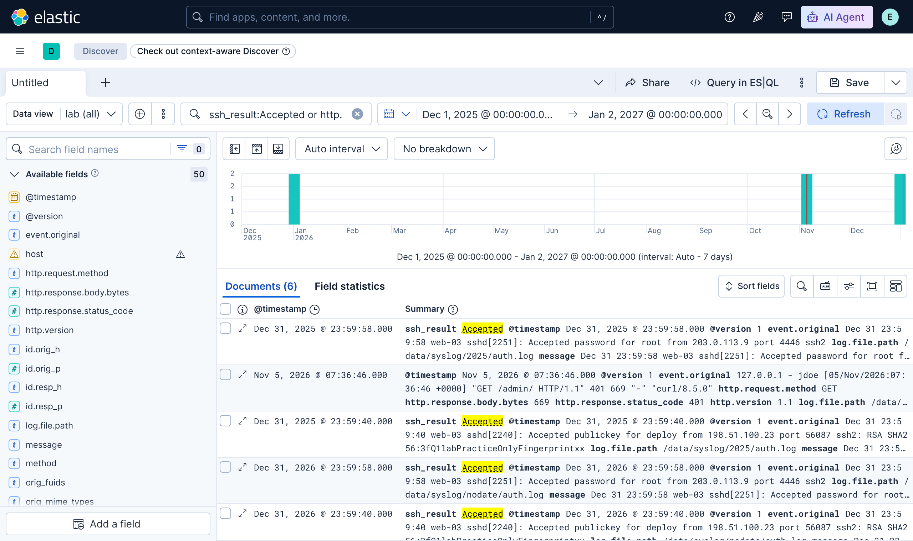
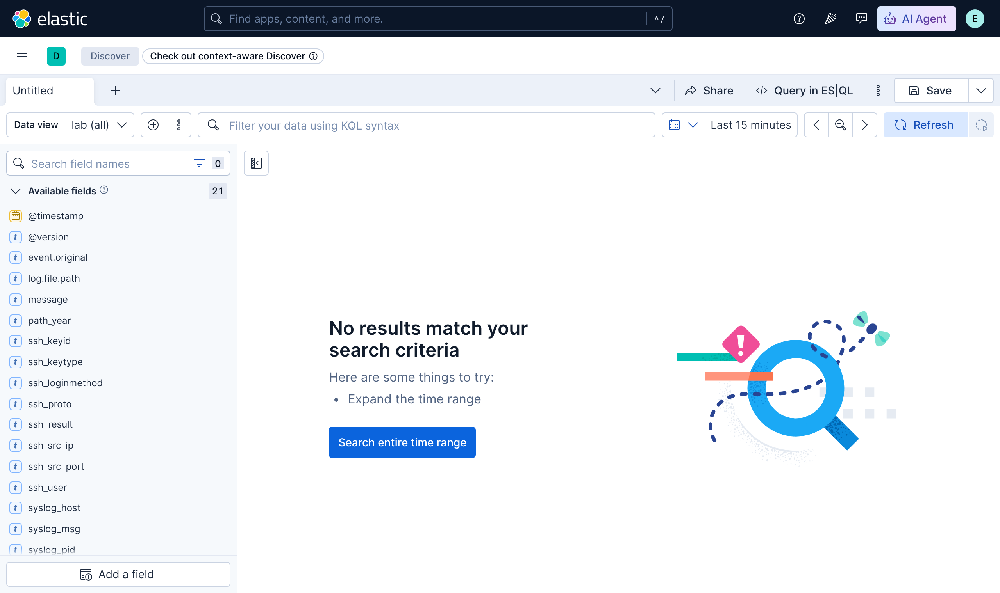

# 2.13강 — Elastic Stack과 SOF-ELK { #elastic-stack-sof-elk }

!!! abstract "이번 회차의 범위"
    - Elastic Stack의 세 부품: Elasticsearch(저장·검색), Logstash(입력·해석·보강·출력), Kibana(화면). 그리고 Beats
    - 강점과 약점: 아주 크게 늘릴 수 있지만, 설치만 해서는 거의 아무것도 하지 않는다
    - Logstash: 입력, 필터(grok, date, GeoIP), 출력. 직접 돌려 본 grok와 [주의] 두 가지 함정(조용한 잘못 해석, 연도 없는 syslog)
    - Kibana: KQL, 시간 범위, 그리고 [정정] "점(.)에서 토큰을 나눈다"는 설명의 실제
    - SOF-ELK: 조사용으로 꾸린 Elastic Stack. 입력 디렉터리와 [변경됨] 현재 배포판(2026년 7월판)

!!! note "실습 환경과 표기"
    **(직접 실행 결과)**는 이 작업 환경에서 공식 Docker 이미지로 띄운 **Elasticsearch, Logstash, Kibana 9.4.3**(단일 노드)으로 얻었습니다. 현재 SOF-ELK 배포판과 같은 버전입니다. 넣은 데이터는 직접 만든 작은 연습용 syslog(문서용 주소), 2.5강의 Apache 연습 서버 로그, 2.8강의 Zeek `http.log`입니다. 이 환경의 디스크 사용률이 Elasticsearch의 기본 한도(90%)를 넘어서, **실습용으로만** 디스크 한도 검사를 껐습니다. **SOF-ELK 가상 머신 자체는 이 환경에서 돌려 보지 못했습니다**. SOF-ELK에 대한 내용은 공식 위키(2026-11-05 확인)를 바탕으로 합니다.

## 1. Elastic Stack: 세 부품과 Beats { #components }

Elastic Stack은 널리 쓰이는 "빅데이터" 플랫폼이고, 점점 SIEM 시장을 겨냥하고 있습니다. 흔히 부르는 "ELK"는 세 부품의 머리글자예요.

| 부품 | 하는 일 | 비유 |
| --- | --- | --- |
| **Elasticsearch** | 문서 중심의 저장·검색·분석 엔진. 큰 저장소에서도 빠르게 찾는다 | 도서관의 서고와 색인 카드 |
| **Logstash** | 입력을 읽어 바꾸고 보강한 뒤 하나 이상의 목적지로 보낸다 | 들어온 책을 분류하고 라벨을 붙이는 사서 |
| **Kibana** | 웹 화면. 대시보드와 시각화로 데이터를 탐색한다 | 열람실의 검색대 |

여기에 가벼운 배송 도구 **Beats**(2.12강)가 더해져, 원시 로그 파일부터 프로세스 통계까지 이 처리 흐름으로 보냅니다.

비유가 깨지는 곳: 사서는 책의 내용을 보고 알아서 분류하지만, Logstash는 **알려 준 규칙대로만** 나눕니다. 규칙(해석 설정)이 없으면 로그 한 줄은 그냥 긴 글자 하나로 서고에 들어가요. 그리고 색인 카드(Elasticsearch의 필드)를 어떻게 만들었는지에 따라 같은 질문의 답이 달라집니다(4절).

**강점**

- **아주 크게 늘릴 수 있다.** 초당 수십만 이벤트, 전체 수백억 건의 클러스터도 드물지 않습니다. 가상 머신 한 대로는 그 수치에 못 미치지만, 처음부터 클러스터로 늘리도록 설계됐어요. 그래도 분석가 한 명이 가상 머신 하나로 얻을 수 있는 가치도 큽니다.
- **누구나 쓸 수 있다.** 시간을 들일 의지만 있다면 플랫폼 전체를 쓸 수 있고, 잘 문서화된 플러그인 구조로 기능을 더할 수 있습니다(라이선스는 아래 [변경됨]).
- **Logstash의 유연한 해석·보강.** 각 이벤트를 내부적으로 JSON으로 바꿔 다양한 목적지로 보내며, 사용자가 조사 목표에 가장 맞는 데이터 지점을 뽑도록 꾸밀 수 있습니다.

**약점**

- **설치만 해서는 거의 아무것도 하지 않는다.** 하드웨어를 갖추고 소프트웨어를 설정하는 데 상당한 노력과 비용이 들고, 입력 데이터를 해석하고 화면에 보여 주는 설정을 만들고 시험하는 데도 큰 노력이 필요합니다. 데이터 과학 플랫폼의 성공은 사용 사례, 조직의 요구, 입력 증거의 형식에 전적으로 달려 있기 때문이에요.
- **문서가 고르지 않을 때가 있다.** 모듈에 따라 자세하기도, 빈약하기도 합니다.

!!! warning "[변경됨] 라이선스와 보안 기본값(2026-11-05 기준)"
    - **라이선스**: 2.12강 5절처럼 Elastic은 2021년에 Elastic License·SSPL로 바꿨다가 2024년에 AGPL을 선택지로 더했습니다. "무료로 쓸 수 있다"는 맞지만, 일부 기능은 여전히 유료 구독이 필요합니다.
    - **보안이 기본으로 켜져 있다**: 교재는 Kibana에 인증과 접근 통제 같은 기본 보안 기능이 없으니 운영 환경에서는 역방향 프록시 뒤에 두라고 합니다. 직접 띄운 9.4.3에서는 Elasticsearch가 **HTTPS만** 받았고(평문 HTTP 연결은 실패), 자격 증명 없이 물으면 **401**을 돌려줬으며, Kibana는 화면에 들어가기 전에 **로그인 페이지**로 보냈습니다(직접 실행 결과). Elastic 8.0(2022년)부터 단일 노드 설치에서도 보안이 기본으로 켜집니다. 그래도 인터넷에 직접 열어 두지 말고 접근을 제한해야 한다는 원칙은 그대로예요.

## 2. Logstash: 입력, 필터, 출력 { #logstash }

Logstash의 설정은 세 부분입니다.

| 단계 | 예 |
| --- | --- |
| **입력(input)** | 로컬 파일(포렌식과 헌팅에 딱 맞음), syslog, RELP, Beats, NetFlow(v5·v9), SNMP 트랩, HTTP POST |
| **필터(filter)** | grok 해석, GeoIP, JSON·CSV·XML 처리, 문자열 바꾸기, 해시 계산 |
| **출력(output)** | Elasticsearch, WebSocket, HTTP POST, 각종 API(SMS·메일 알림), 메시지 큐 |

세 단계 모두 플러그인 구조라, 새 출처나 목적지를 더하기가 비교적 쉽습니다.

### 2.1 grok: 사람이 읽는 로그를 필드로 { #grok }

필터 단계에서 가장 중요한 것은 **grok** 패턴 문법입니다. 비공식 표어처럼 "울고불고하지 않아도 되는 정규 표현식"이에요. `%{패턴이름:필드이름}` 꼴로 미리 정의된 패턴(`WORD`, `IPORHOST`, `POSINT`, `USERNAME` 등)을 엮어, 사람이 읽으라고 만든 로그(syslog, 웹 서버 로그)에서 필요한 값을 꺼냅니다. Kibana에도 grok을 시험해 보는 디버거(Dev Tools)가 들어 있습니다.

교재의 SSH 로그 예를 연습용 데이터(문서용 주소)로 돌려 봤습니다. 먼저 syslog의 앞부분을 떼고, 그 메시지에 교재의 SSH 패턴을 맞췄어요.

```text
grok { match => { "message" => "^%{SYSLOGTIMESTAMP:syslog_ts} %{SYSLOGHOST:syslog_host} %{PROG:syslog_prog}(?:\[%{POSINT:syslog_pid}\])?: %{GREEDYDATA:syslog_msg}$" } }
grok { match => { "syslog_msg" => "^%{WORD:ssh_result} %{WORD:ssh_loginmethod} for %{USERNAME:ssh_user} from %{IPORHOST:ssh_src_ip} port %{POSINT:ssh_src_port} %{WORD:ssh_proto}(?:: %{WORD:ssh_keytype} %{DATA:ssh_keyid})?$" } }
```

입력 줄 하나:

```text
Dec 31 23:59:40 web-03 sshd[2240]: Accepted publickey for deploy from 198.51.100.23 port 56087 ssh2: RSA SHA256:3fQ1labPracticeOnlyFingerprintxx
```

**(직접 실행 결과, 색인된 문서의 필드)**

```text
ssh_result=Accepted  ssh_loginmethod=publickey  ssh_user=deploy  ssh_src_ip=198.51.100.23  ssh_src_port=56087  ssh_proto=ssh2  ssh_keytype=RSA
```

패턴 끝의 `(?:: %{WORD:ssh_keytype} %{DATA:ssh_keyid})?`는 "뒤에 `: 키종류 키지문`이 있으면 함께 뽑고, 없어도 된다"는 뜻이라, 비밀번호 로그인 줄(`... ssh2`로 끝남)에도 맞았습니다.

### 2.2 [주의] grok은 조용히 틀릴 수 있다 { #grok-pitfall }

2.5강의 Apache 로그(Ubuntu의 `combined` 형식)를 Logstash에 기본으로 들어 있는 `%{COMBINEDAPACHELOG}` 패턴으로 넣었습니다. 해석 실패 표시(`_grokparsefailure`)가 붙은 문서는 **0건**이었어요. 그런데 결과를 보니 두 가지가 이상했습니다.

**(직접 실행 결과)**

```text
원래 줄:  127.0.0.1 - - [05/Nov/2026:07:04:23 +0000] "GET /index.html HTTP/1.1" 200 256 "-" "tab\there \"quoted\" \xed\x95\x9c\xea\xb8\x80"
user_agent.original = 'tab\\there \\'
```

1. **User-Agent가 중간에서 잘렸습니다.** 2.5강 3.3절에서 본 대로 Apache는 따옴표를 `\"`로 이스케이프해 남기는데, 이 패턴은 `\"`를 만나자 값이 끝났다고 보고 나머지(`quoted"`와 한글 바이트)를 버렸어요. 실패 표시가 없으니 **조용한 잘못 해석**입니다. 공격자가 User-Agent에 따옴표를 넣으면 검색과 집계에서 그 내용이 빠질 수 있다는 뜻이에요.
2. **필드 이름이 뜻과 다릅니다.** 크기 칸이 `http.response.body.bytes`(본문 바이트)라는 이름으로 들어갔는데, 2.5강 3.2절에서 확인했듯 Ubuntu의 `combined`는 그 칸에 **헤더까지 포함한** `%O`를 씁니다. 이름만 믿으면 크기를 잘못 해석해요.

**조사에서의 의미:** 해석된 필드는 **원본 줄(`event.original`, `message`)과 맞대어** 확인하세요. 특히 이상한 글자(따옴표, 탭, 바이트 이스케이프)가 든 줄, 그리고 공격 흔적일 가능성이 큰 줄은 원본으로 봅니다. 해석 규칙(어떤 패턴, 어떤 형식 정의)도 증거와 함께 기록합니다.

!!! info "[변경됨] 필드 이름이 ECS로 바뀌었다"
    위 결과처럼 Logstash 9.4.3의 `COMBINEDAPACHELOG`은 `source.address`, `http.request.method`, `url.original`, `http.response.status_code`, `user_agent.original` 같은 **ECS(Elastic Common Schema)** 이름을 썼습니다(직접 실행 결과). 예전 버전은 `clientip`, `verb`, `request`, `response`, `agent` 같은 이름을 썼어요. Logstash 8부터 ECS 호환이 기본이 됐기 때문입니다. 오래된 강의 자료나 질의, 대시보드를 그대로 쓰면 필드를 못 찾을 수 있으니, 데이터의 실제 필드 이름부터 확인하세요.

### 2.3 [주의] 연도 없는 syslog와 Logstash { #syslog-year }

2.10강 3.3절의 문제(syslog 전통 형식에 연도가 없음)는 Logstash에서도 그대로입니다. 같은 `Dec 31 …` 네 줄을 두 곳에 두었어요. 하나는 `/data/syslog/2025/auth.log`, 하나는 `/data/syslog/nodate/auth.log`. SOF-ELK가 하는 것처럼, 경로에 네 자리 연도가 있으면 그것을 시각에 붙이도록 했습니다.

```text
grok { match => { "[log][file][path]" => "/data/syslog/(?<path_year>\d{4})/" } tag_on_failure => [] }
if [path_year] { mutate { add_field => { "ts_full" => "%{path_year} %{syslog_ts}" } }
                 date { match => ["ts_full", "yyyy MMM dd HH:mm:ss", "yyyy MMM  d HH:mm:ss"] timezone => "UTC" } }
else           { date { match => ["syslog_ts", "MMM dd HH:mm:ss", "MMM  d HH:mm:ss"] timezone => "UTC" } }
```

**(직접 실행 결과, `@timestamp`와 파일 경로)**

```text
2025-12-31T23:58:02.000Z /data/syslog/2025/auth.log
2025-12-31T23:59:58.000Z /data/syslog/2025/auth.log
2026-12-31T23:58:02.000Z /data/syslog/nodate/auth.log
2026-12-31T23:59:58.000Z /data/syslog/nodate/auth.log
```

경로에 연도가 없는 쪽은 **2026-12-31**, 지금(2026-11-05)보다 두 달 가까이 **미래**로 들어갔습니다. Logstash가 연도 없는 시각에 현재 연도를 붙였기 때문이에요. `timezone => "UTC"`도 일부러 넣은 것입니다. 이걸 빼면 Logstash가 돌고 있는 시스템의 시간대로 해석해요. 원래 장비가 어떤 시간대였는지는 장비 설정으로 확인해야 하는 정보이고, 해석 단계에서 **가정**하는 값이라는 점을 기록하세요.

아래 그림은 이 데이터를 Kibana에서 본 것입니다. 같은 사건이 **2025년 12월 말과 2026년 12월 말 두 곳**에 막대로 나뉘어 있어요.

{ loading=lazy }

**그림 2-1. Kibana 9.4.3의 Discover(직접 실행 결과).** 위쪽의 검색창이 KQL, 오른쪽이 시간 범위, 가운데가 시간별 문서 수 히스토그램, 아래가 문서 목록입니다. 왼쪽 필드 목록의 `host` 옆 경고 표시는, 여러 색인을 함께 볼 때 같은 이름의 필드가 색인마다 다른 형식(Zeek의 글자 필드 대 Logstash의 `host.name` 객체)이라 생긴 **형식 충돌**입니다. 그림은 누르면 커집니다.

## 3. Kibana와 KQL { #kibana-kql }

Kibana로 Elasticsearch에 저장된 데이터를 검색하고, 거르고, 탐색합니다. 검색과 거르기에는 **KQL(Kibana Query Language)**을 씁니다. 사람이 직관적으로 쓸 수 있으면서도 정밀한 검색도 가능하게 만든 언어예요.

교재의 예와 같은 모양의 질의를 이 실습 데이터에 맞춰 돌렸습니다. Kibana 화면에서도 썼고(그림 2-1), 같은 KQL을 Elasticsearch의 ES|QL 안에서 `KQL()` 함수로도 실행할 수 있었어요.

```text
FROM lab-httpd
| WHERE KQL("url.original:*zip* or (http.response.status_code >= 400 and http.response.status_code < 500)")
| KEEP @timestamp, url.original, http.response.status_code | SORT @timestamp
```

**(직접 실행 결과)**

```text
       @timestamp       | url.original  |http.response.status_code
2026-11-05T07:04:23.000Z|/a\x01b        |400
2026-11-05T07:36:46.000Z|/report.zip    |200
2026-11-05T07:36:46.000Z|/admin/        |401
```

KQL 읽는 법:

- `필드:값` 은 그 필드가 그 값과 맞는 기록. `*`는 와일드카드(`*zip*` = zip이 들어 있는).
- `and`, `or`, `not`, 괄호로 엮습니다.
- `>=`, `<` 같은 범위 비교는 숫자·날짜 필드에서.
- 따옴표로 감싸면 구절 그대로(`host:"www.lab.example"`).
- 이 검색은 **필드 이름과 형식이 알맞게 들어 있을 때만** 의미가 있습니다. 2.2절처럼 해석이 틀리거나 필드 이름이 다르면, 질의가 맞아도 결과가 틀려요.

!!! info "[보충] ES|QL"
    교재 이후 Elastic에는 파이프(`|`)로 단계를 잇는 질의 언어 **ES|QL**이 생겼습니다(위 예). `STATS … BY`로 바로 집계할 수 있어 조사에 편해요. 예: `FROM lab-syslog | WHERE KQL("ssh_result:Accepted") | STATS n = COUNT(*) BY ssh_user, ssh_src_ip`의 결과는 `deploy 198.51.100.23 2`, `root 203.0.113.9 2`였습니다(직접 실행 결과. 같은 네 줄이 두 연도로 두 번 들어갔으므로 2씩).

### 3.1 [정정] 토큰 나누기: "점(.)에서 나눈다"의 실제 { #tokenization }

교재는 글자 필드가 기본으로 **토큰으로 나뉘고**(Elasticsearch는 이를 "analyzed"라고 함), `.`, `/`, `-`, 공백 등에서 나뉘므로 `somefield:사이트이름` 검색이 `사이트이름.com`이나 `/cases/사이트이름/lab-2.3/` 같은 값과 맞는다고 설명합니다. 그리고 나뉘지 않은 원래 문자열을 담는 `.keyword` 필드가 따로 있을 수 있다고 해요.

기본 분석기(standard)가 실제로 어떻게 나누는지 Elasticsearch의 `_analyze` API로 확인했습니다.

**(직접 실행 결과)**

```text
www.lab.example              -> ['www.lab.example']
site2026.com                 -> ['site2026', 'com']
site.com                     -> ['site.com']
/cases/lab-2.3/report.zip    -> ['cases', 'lab', '2.3', 'report.zip']
cloudsync-tw.example.com     -> ['cloudsync', 'tw.example.com']
198.51.100.23                -> ['198.51.100.23']
python-requests/2.31.0       -> ['python', 'requests', '2.31.0']
```

`/`, `-`, 공백에서는 나뉘었지만, **`.`은 경우에 따라 달랐습니다.** `site2026.com`은 나뉘었는데(숫자 뒤의 점), 같은 모양의 `site.com`은 나뉘지 않았고, `www.lab.example`이나 `tw.example.com`, `report.zip`처럼 **글자 사이의 점은 나뉘지 않았어요**. 표준 분석기가 유니코드 단어 경계 규칙(UAX #29)을 따르기 때문입니다. 그래서 실제 검색 결과도 이랬습니다.

**(직접 실행 결과, Zeek `http.log`의 `host` 필드. 동적으로 만들어진 `text` + `.keyword` 형식)**

```text
host:lab                 hits=0
host:www.lab.example     hits=5
host.keyword:lab         hits=0
host:*lab*               hits=6
user_agent:curl          hits=4
user_agent:python        hits=1
```

`host:lab`은 **0건**입니다. `www.lab.example`이 한 토큰이라 `lab`이라는 토큰이 없으니까요. 와일드카드(`host:*lab*`)를 쓰자 `www.lab.example` 5건과 `portal.lab.example` 1건이 모두 나왔습니다. 반면 `user_agent:python`은 `python-requests/2.31.0`의 `-`에서 나뉜 토큰 덕분에 맞았어요.

**조사에서의 의미:** "도메인의 일부로 검색하면 다 나온다"고 믿으면 **빠뜨립니다**. 필드가 어떻게 매핑됐고(어떤 분석기를 쓰는지) 어떻게 나뉘는지 `_analyze`로 확인하고, 필요하면 와일드카드나 `.keyword`, 또는 그 데이터에 맞게 따로 만든 필드(SOF-ELK처럼 도메인을 조각낸 필드를 미리 만들어 두는 설정)를 씁니다. SOF-ELK는 자체 매핑을 쓰므로 결과가 이 실험과 다를 수 있고, 이 환경에서는 확인하지 못했습니다. 토큰으로 나뉜 필드는 넓게 찾을 수 있는 대신 성능 부담이 있고, `.keyword`는 정확히 일치할 때만 맞는다는 점도 기억하세요.

### 3.2 시간 범위: 기본은 "지난 15분" { #time-range }

{ loading=lazy }

**그림 3-1. 시간 범위를 바꾸지 않은 Discover(직접 실행 결과).** 오른쪽 위의 시간 범위가 **Last 15 minutes**이고, 결과가 없다는 안내와 "Search entire time range" 버튼이 보입니다.

Kibana는 기본으로 **현재 시각 직전 15분**의 기록만 보여 줍니다. 실시간 감시에는 맞지만, 며칠·몇 년 전의 증거를 넣은 포렌식에서는 데이터를 넣고도 "아무것도 없다"고 보이는 가장 흔한 이유예요. 달력 아이콘으로 흔한 범위나 최근에 쓴 범위를 고르거나, 날짜를 직접 지정합니다. 자동 새로 고침도 정할 수 있고, 히스토그램에서 끌어 범위를 좁힐 수도 있어요. 이 실습 데이터도 시간 범위를 2025-12-01~2027-01-02로 넓혀야 보였습니다(그림 2-1). 앞 절의 연도 문제처럼 **엉뚱한 연도로 들어간 기록**은 범위 밖에 있어 놓칠 수 있으니, 처음에는 넓게 보고 좁혀 가세요.

### 3.3 대시보드, 거르기, 문서 펼치기 { #dashboards-filters }

Kibana의 핵심은 대시보드가 **상호작용한다**는 것입니다. 정해진 그림 하나를 읽기만 하는 화면이 아니라, 가설을 세우고 고쳐 가며 원본 데이터를 탐색하는 도구예요.

- **히스토그램**을 끌면 시간 범위가 바뀌고, **원 그래프의 조각**을 누르면 그 값으로 거르는 필터가 생깁니다.
- 대시보드 아래에는 지금의 검색과 필터에 맞는 **문서 목록**(한 줄에 한 기록, 스프레드시트처럼)이 있고, 보여 줄 열을 바꿀 수 있습니다.
- 각 줄을 **펼치면** 모든 필드와 값이 보이고, 필드마다 아이콘으로 "이 값만"(+), "이 값 빼고"(−), "열로 추가", "이 필드가 있는 기록만" 필터를 만들 수 있습니다.
- 필터는 **고정**(다른 대시보드로 가도 유지), 편집, **부정**(뒤집기), **잠시 끄기**, 삭제가 가능합니다. 켜진 필터들은 모두 **AND**로 묶여요.

!!! tip "필터를 \"고정\"하는 습관"
    피벗할 지점(의심 주소, 계정)을 찾으면 그 필터를 고정해 두고 Syslog, HTTPD, NetFlow 대시보드를 차례로 오가세요. 같은 주소의 흔적을 여러 종류의 로그에서 한 번에 엮을 수 있습니다(2.12강 2절의 "한곳에서 사건 전체를 따라가기").

## 4. SOF-ELK: 조사용으로 꾸린 Elastic Stack { #sof-elk }

Elastic Stack의 약점(설치만 해서는 아무것도 하지 않음, 해석과 대시보드를 직접 만들어야 함)을 덜면서 강점을 살리려고 만든 것이 **SOF-ELK**(Security Operations and Forensics ELK)입니다. Elastic Stack을 미리 설치하고, 여러 로그와 NetFlow의 **해석 설정과 대시보드**를 갖춘 가상 머신 어플라이언스예요. 수업 밖에서도 쓸 수 있는 무료 공개 소스 자원으로 배포되고, 설정 파일과 대시보드는 공개 GitHub 저장소에서 관리됩니다.

!!! warning "[변경됨] 현재 배포판(공식 위키, 2026-11-05 확인)"
    - 최신 배포판: **2026-07-06판**. Ubuntu 26.04 기반, **Elastic Stack 9.4.3**, 설정 파일은 저장소의 `public/v20260706` 가지(branch). **x86용과 ARM용(Apple M 시리즈 등)**이 따로 있습니다. 내려받은 파일은 위키에 적힌 SHA-256과 맞춰 확인하세요.
    - 구성: Elasticsearch, Logstash, Kibana, 그리고 Filebeat(파일 입력을 맡음).
    - 업데이트: 설정 파일은 GitHub에서 갱신하는 스크립트로 올리고, 운영체제나 Elastic Stack의 큰 변경이 있을 때만 가상 머신을 새로 받습니다.
    - GeoIP: MaxMind의 라이선스가 바뀌어 최신 GeoIP 데이터베이스는 함께 배포하지 않습니다. 무료 MaxMind 계정과 라이선스 키를 만든 뒤 `geoip_bootstrap.sh`로 넣고, 원하면 정기 갱신도 켭니다(교재와 같음).

### 4.1 증거 넣기: 디렉터리에 놓으면 된다 { #ingest }

SOF-ELK는 **`/logstash/` 아래의 하위 디렉터리**에 파일을 넣으면 그 종류에 맞게 해석해 넣습니다. 교재 시점보다 종류가 늘었어요(공식 위키 기준).

| 디렉터리 | 넣는 것 |
| --- | --- |
| `syslog/` | syslog 형식. **경로에 연도를 넣는다**(`/logstash/syslog/2025/…`): 2.3절의 연도 문제 때문. ISO 8601처럼 연도가 있는 시각이면 그 값을 씀 |
| `httpd/` | Apache의 common, combined, vhost-combined |
| `passivedns/` | passivedns 도구의 로그(2.7강) |
| `nfarch/` | 보관된 NetFlow. `nfdump2sof-elk.sh`로 변환해 넣음. AWS·Azure 흐름 로그용 변환 스크립트도 있음 |
| `zeek/` | Zeek의 **JSON** 로그(압축 풀어서). `conn.log`는 NetFlow처럼, `http.log`는 HTTPD 로그처럼, `dns.log`는 다른 DNS 로그처럼 들어가 같은 대시보드에서 함께 보임 |
| `kape/` | KAPE의 JSON 출력(지원 파일과 이름 규칙 확인) |
| `plaso/` | Plaso의 CSV |
| `microsoft365/`, `azure/`, `aws/`, `gcp/`, `gws/` | 클라우드 로그 |
| `hayabusa/`, `volatility/`, `kubernetes/` | [보충] 교재 이후 더해진 것들: Windows 이벤트 로그 분석 도구 Hayabusa의 출력, Volatility 3의 JSON, Kubernetes 로그 |

!!! warning "[변경됨] Filebeat 9의 \"새 파일\" 판단: 1,024바이트 규칙"
    공식 위키에 따르면 Filebeat 9부터 파일을 알아보는 기본 방식이 **지문(fingerprint)** 방식으로 바뀌어, SOF-ELK의 파일 입력에 두 가지 영향이 있습니다.

    - **1,024바이트보다 작은 파일은 읽지 않습니다.** 작은 로그 파일 여러 개는 같은 종류끼리 이어 붙여 1,024바이트를 넘긴 뒤 넣으라고 안내합니다.
    - **첫 1,024바이트가 같은 파일은 같은 파일로 보고 건너뜁니다.** 예를 들어 머리말이 똑같은 로그 파일 여러 개를 넣으면 하나만 들어갈 수 있어요(위키는 한 줄에 한 기록인 파일이라면 `shuf`로 줄 순서를 섞어 "다른" 파일을 만드는 방법을 소개하며, 여러 줄짜리 JSON에는 쓰지 말라고 경고합니다).

    **조사에서의 의미:** 증거를 넣은 뒤에는 반드시 **원본의 줄 수와 색인된 문서 수를 맞대어** 보세요. 작은 파일이나 머리말이 같은 파일이 조용히 빠졌을 수 있습니다(이 규칙은 위키로 확인했고, 이 환경에서 SOF-ELK로 시험하지는 않았습니다).

### 4.2 실시간 입력 { #live }

교재는 SOF-ELK를 실시간 수집기로도 쓸 수 있다고 하며 syslog(TCP·UDP 5514), HTTPD 로그(5515), RELP·Filebeat(TCP 5516), NetFlow v5(UDP 9995) 같은 포트를 소개합니다. 방화벽 포트를 열고 가상 머신의 네트워크를 NAT에서 브리지로 바꿔야 하는 경우가 많아요.

!!! info "[변경됨] 현재 위키에 적힌 네트워크 입력"
    2026-11-05에 확인한 공식 위키의 입력 문서에는 네트워크 입력으로 **NetFlow v5·v9·IPFIX(UDP 9995)**만 적혀 있고, 먼저 방화벽 포트를 열어야 한다고 합니다. 교재의 syslog·HTTPD·RELP 포트가 현재 배포판에서 어떻게 되는지는 이 문서로 확인되지 않았으니, 쓰려는 배포판의 소개 대시보드와 문서로 확인하세요.

### 4.3 기본 대시보드 { #sof-elk-dashboards }

SOF-ELK는 넣는 데이터와 해석 설정이 정해져 있으니, 기본 대시보드도 함께 제공합니다.

- **소개 대시보드**: 선택한 기간에 어떤 증거가 들어왔는지(기록 종류별, 출처별)와 증거를 넣는 방법을 보여 줍니다. 먼저 여기서 "넣은 것이 다 들어왔나"를 확인하세요.
- **Syslog 대시보드**: 위쪽에 시간당 이벤트 수, 원 그래프로 출처 시스템과 출처 프로그램별 분포, 아래에 문서 목록.
- **HTTPD 로그 대시보드**: 웹 서버 접근 로그와 프록시 로그를 함께 보여 줍니다. 요청 메서드별·응답 코드별 시간 그래프, 요청이 많은 ASN, 요청된 가상 호스트 이름, 출처 위치의 지도, 많이 보인 User-Agent. 알려진 IP 필드는 GeoIP 데이터베이스가 있으면 ASN과 위치로 보강됩니다.
- 그 밖에 NetFlow, Eventlog, LNK 파일 대시보드 등이 데이터 종류에 맞게 있습니다(위키의 색인·대시보드 표).

## 5. 실제 조사에서는 이렇게 씁니다 { #in-practice }

1. **넣은 만큼 들어왔는지 센다.** 원본의 줄 수와 색인된 문서 수, 해석 실패 표시(`_grokparsefailure` 등), SOF-ELK라면 1,024바이트 규칙.
2. **시간을 점검한다.** 연도(경로에 연도를 넣었나), 시간대(해석 단계의 가정), 그리고 Kibana의 시간 범위(기본 15분).
3. **해석된 필드를 원본과 맞댄다.** 조용한 잘못 해석(2.2절), 이름과 뜻이 다른 필드(본문 바이트 대 전체 바이트).
4. **필드 이름과 매핑을 확인한다.** ECS 이름인지, 글자 필드가 어떻게 토큰으로 나뉘는지(`_analyze`), `.keyword`가 있는지, 여러 색인 사이에 형식 충돌이 있는지.
5. **넓게 찾고 좁힌다.** 와일드카드와 정확한 값 검색을 둘 다 해 보고, 0건이라는 결과를 그대로 믿지 않습니다.
6. **고정 필터로 피벗한다.** 같은 주소·계정을 여러 대시보드에서 엮습니다.
7. **플랫폼 자체를 기록한다.** 버전, 해석 설정, 매핑. 같은 질의라도 설정이 다르면 결과가 다릅니다.

## 6. 정리 { #summary }

- Elastic Stack = Elasticsearch(저장·검색) + Logstash(입력·필터·출력) + Kibana(화면), 그리고 Beats. 아주 크게 늘릴 수 있지만 설치만으로는 거의 아무것도 하지 않습니다. **[변경됨]** 라이선스가 바뀌었고, 9.4.3에서는 HTTPS와 인증, Kibana 로그인이 기본으로 켜져 있었습니다.
- grok은 사람이 읽는 로그를 필드로 나눕니다. 교재의 SSH 패턴이 그대로 동작했습니다. **[주의]** `COMBINEDAPACHELOG`은 이스케이프된 따옴표가 든 User-Agent를 실패 표시 없이 잘랐고, Ubuntu의 `%O`를 "본문 바이트"라는 이름에 넣었습니다. **[변경됨]** 필드 이름은 ECS입니다.
- 연도 없는 syslog는 Logstash에서도 현재 연도가 붙어 미래로 들어갔고, SOF-ELK처럼 경로의 연도를 쓰면 바로잡혔습니다.
- KQL로 거르고, ES|QL의 `KQL()`과 `STATS`로 집계도 했습니다. **[정정]** 기본 분석기는 `/`, `-`, 공백에서 나누지만 `.`은 글자 사이에서 나누지 않아 `host:lab`이 0건이었습니다. Kibana의 기본 시간 범위는 지난 15분입니다.
- SOF-ELK는 해석 설정과 대시보드를 갖춘 조사용 Elastic Stack입니다. **[변경됨]** 2026-07-06판(Ubuntu 26.04, Elastic 9.4.3, x86·ARM), 입력 종류 확대, Filebeat 9의 1,024바이트 규칙, 위키에 적힌 네트워크 입력은 NetFlow(UDP 9995).

## 복습 문제 { #review }

**문제 1. (기본)** Elastic Stack의 세 부품이 각각 무엇을 하는지, 그리고 조사자가 "검색 결과가 이상하다"고 느낄 때 각 부품에서 의심할 수 있는 것을 하나씩 말해 보세요.

??? success "정답과 해설"
    **Logstash**(입력·해석·보강·출력): 해석이 틀렸을 수 있음(2.2절의 조용한 잘림), 연도·시간대를 잘못 붙였을 수 있음(2.3절), 넣은 파일이 다 읽히지 않았을 수 있음(SOF-ELK의 1,024바이트 규칙). **Elasticsearch**(저장·검색): 필드 매핑과 토큰 나누기 때문에 기대한 값과 맞지 않을 수 있음(3.1절의 `host:lab` 0건), 여러 색인 사이의 형식 충돌. **Kibana**(화면): 시간 범위가 기본 15분이라 데이터가 범위 밖에 있을 수 있음(3.2절), 켜 둔 필터(고정 필터 포함)가 AND로 걸려 있을 수 있음.

**문제 2. (해석)** 동료가 Kibana에서 `domain:evil` 을 검색했더니 0건이라 "그 도메인과의 통신은 없었다"고 합니다. 실제 로그에는 `cdn.evil.example` 같은 값이 있을 수 있어요. 무엇을 확인하겠습니까?

??? success "정답과 해설"
    기본 분석기는 글자 사이의 `.`에서 나누지 않아 `cdn.evil.example`이 **한 토큰**이 될 수 있습니다(3.1절: `www.lab.example`이 한 토큰이라 `host:lab`이 0건). 확인: ① `_analyze`나 매핑으로 그 필드가 어떻게 나뉘는지, ② 와일드카드(`domain:*evil*`)나 정확한 값(`domain:"cdn.evil.example"`), `.keyword` 필드로 다시 검색, ③ 그 데이터에 도메인을 조각낸 별도 필드가 있는지(SOF-ELK 같은 배포판의 설정), ④ 시간 범위가 충분한지, ⑤ 다른 필드(DNS의 `query`, HTTP의 `host`, 프록시의 URL)에도 찾아봤는지. "0건"은 질의와 매핑을 확인하기 전에는 결론이 아닙니다.

**문제 3. (변경된 조건)** 2024년 연말에 일어난 사건의 리눅스 서버 `auth.log`(전통 syslog 형식) 사본을 2026년에 받았습니다. SOF-ELK에 넣으려면 어디에 두어야 하고, 그렇게 하지 않으면 무엇이 일어날까요?

??? success "정답과 해설"
    `/logstash/syslog/2024/` 처럼 **경로에 연도를 넣은 디렉터리**에 둡니다(4.1절). 연도 없는 시각에 경로의 연도가 붙어 2024년으로 들어가요. 그렇게 하지 않으면 2.3절의 실험처럼 **넣는 시점의 연도(2026)**가 붙어, 사건이 2026년 12월처럼 엉뚱한 때(때로는 미래)로 들어갑니다. 파일에 1월 기록이 섞여 있다면(연말연시에 걸친 로그) 그 부분은 2025년이어야 하므로, 파일을 날짜 경계에서 나눠 각각의 연도 디렉터리에 두는 것도 생각해야 해요. 그리고 원래 서버의 시간대도 확인합니다.

**문제 4. (흔한 오해)** "grok이 실패하면 `_grokparsefailure`가 붙으니, 그 표시가 없는 문서는 제대로 해석된 것이다." 2.2절의 결과로 반박해 보세요.

??? success "정답과 해설"
    2.2절에서 `COMBINEDAPACHELOG`은 `\"`가 든 User-Agent를 **중간에서 잘랐지만** 실패 표시는 0건이었습니다. 패턴 자체는 "맞았다"고 판단했기 때문이에요(뒷부분은 다른 필드나 버려짐). 또 크기 필드는 해석은 됐지만 **이름(`http.response.body.bytes`)과 실제 뜻(Ubuntu의 `%O`, 헤더 포함)**이 달랐습니다. 실패 표시가 없다는 건 "패턴이 맞았다"일 뿐 "값이 맞다"는 뜻이 아니에요. 이상한 글자가 든 줄, 중요한 줄은 원본(`event.original`)과 맞대어 확인합니다.

**문제 5. (적용)** pcap에서 만든 Zeek 로그(JSON)를 SOF-ELK에 넣으려고 합니다. 넣기 전과 후에 확인할 것을 순서대로 말해 보세요.

??? success "정답과 해설"
    **넣기 전:** ① JSON 형식인지(2.8강의 `LogAscii::use_json=T`), 압축을 풀었는지(4.1절: 압축 해제 상태여야 함), ② 파일 이름이 지원되는 모양인지(`conn.*`, `http.*`, `dns.*` 등), ③ 원본의 줄 수와 해시를 기록, ④ 파일이 1,024바이트보다 작거나 머리말이 같은 파일이 여러 개인지(Filebeat 9 규칙). **넣은 후:** ⑤ 소개 대시보드와 색인별 문서 수를 원본 줄 수와 비교, ⑥ 시간 범위를 증거 기간으로 넓혀 확인(기본 15분), ⑦ `conn.log`는 NetFlow 대시보드, `http.log`는 HTTPD 대시보드에서 보인다는 점을 알고 확인, ⑧ 몇 건을 골라 원본 줄과 해석된 필드를 맞대어 봄.

**문제 6. (변경된 조건)** 오래된 내부 문서의 Kibana 질의 `response:404 and clientip:10.10.1.19`가 새 Elastic Stack(9.x)에서는 아무것도 찾지 못합니다. 데이터는 분명히 들어 있어요. 무엇이 원인일 가능성이 크고, 어떻게 고치겠습니까?

??? success "정답과 해설"
    필드 이름이 **ECS로 바뀌었을** 가능성이 큽니다(2.2절의 [변경됨]). 예전 `COMBINEDAPACHELOG`은 `response`, `clientip`을 만들었지만, Logstash 8 이후의 기본(ECS 호환)에서는 `http.response.status_code`, `source.address`가 됩니다. Discover의 필드 목록이나 문서를 펼쳐 실제 이름을 확인하고 `http.response.status_code:404 and source.address:"10.10.1.19"`처럼 고칩니다. 오래된 대시보드와 저장된 검색, 경보 규칙도 함께 점검해야 합니다.

**문제 7. (해석)** 그림 2-1의 왼쪽 필드 목록에서 `host` 옆에 경고 표시가 있습니다. 이것이 무엇을 뜻하고, 조사에 어떤 영향을 줄 수 있나요?

??? success "정답과 해설"
    여러 색인(`lab-*`)을 한 데이터 뷰로 함께 볼 때, 같은 이름의 필드가 색인마다 **다른 형식**이라 생긴 형식 충돌입니다. 이 실습에서는 Zeek `http.log`의 `host`가 글자(요청한 Host 헤더)였고, Logstash가 파일 입력에 붙인 `host`는 `host.name`을 가진 객체(Logstash가 돌던 컨테이너 이름)였어요. 같은 이름이지만 **뜻도 다릅니다**. 영향: 그 필드로 거르거나 집계하면 일부 색인에서만 동작하거나 오류가 날 수 있고, "host"라는 이름만 보고 같은 의미라고 생각하면 잘못 해석해요. 색인별로 따로 보거나, 해석 단계에서 이름을 바꿔(예: Zeek의 것을 `url.domain`으로) 충돌을 없앱니다.

## 참고 자료 { #references }

- 작업 환경에서 쓴 도구: Elasticsearch·Logstash·Kibana 9.4.3(공식 Docker 이미지, 단일 노드, 보안 기본값), Playwright(화면 캡처), curl. 실행 결과는 2026-11-05에 얻었습니다.
- Elastic, [Logstash 설명서](https://www.elastic.co/docs/reference/logstash) (입력·필터·출력, grok, date, ECS 호환), [Kibana Query Language](https://www.elastic.co/docs/explore-analyze/query-filter/languages/kql), [ES|QL](https://www.elastic.co/docs/explore-analyze/query-filter/languages/esql), [Elastic Common Schema](https://www.elastic.co/docs/reference/ecs), [standard 분석기와 `_analyze` API](https://www.elastic.co/docs/reference/text-analysis/analysis-standard-analyzer), [Filebeat filestream 입력(fingerprint)](https://www.elastic.co/docs/reference/beats/filebeat/filebeat-input-filestream).
- Unicode, [UAX #29: Unicode Text Segmentation](https://www.unicode.org/reports/tr29/) (단어 경계 규칙).
- SOF-ELK 공식 저장소의 위키 문서 "Virtual Machine README"와 "Inputs and Preprocessing"(2026-11-05 확인: 2026-07-06판, Ubuntu 26.04, Elastic 9.4.3, 입력 디렉터리, Filebeat 9 주의 사항, NetFlow 입력).
- MaxMind, [GeoLite2](https://dev.maxmind.com/geoip/geolite2-free-geolocation-data).

!!! note "이 페이지에 대하여"
    여러 학습 자료를 바탕으로 직접 다시 쓴 개인 학습 노트입니다. 실습 데이터와 설정은 직접 만들었고, 사례는 가상입니다.
