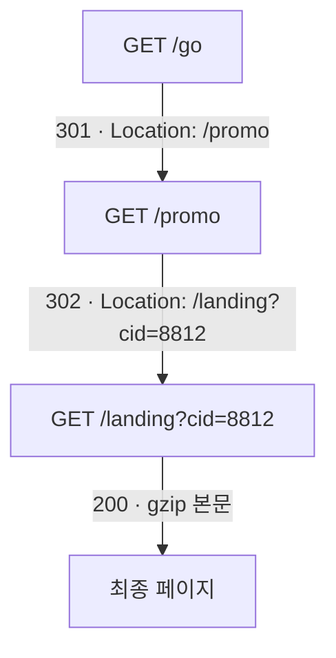

# 2.2강 — HTTP 응답 읽기: 상태 코드, 응답 헤더, 조사에서 쓰는 법 { #http-responses }

!!! abstract "이번 회차의 범위"
    - 상태 줄의 세 부분: 버전, 상태 코드, 이유 문구. 이유 문구 **한 바이트**가 서버의 지문이 된다(직접 시험)
    - 상태 코드의 다섯 묶음과 조사에서 자주 보는 코드. [정정] 400의 이름, 302와 307·308
    - 상태 코드의 흐름으로 공격자의 의도 읽기: 404의 폭우, 500 뒤의 200
    - 응답 헤더: `Connection`([정정] HTTP/1.1은 기본이 연결 유지), `Server`, 내용 정보와 압축, `Date`(시계 어긋남 측정), 캐시 지시, `Location`
    - 조사에서 HTTP를 쓰는 대표적인 경우: 붙여넣기 사이트, User-Agent 프로필, Basic 인증, URI 기록

!!! note "실습 환경과 표기"
    **(직접 실행 결과)**는 이 작업 환경에서 얻었습니다. 응답은 루프백에 띄운 연습용 서버(파이썬으로 직접 작성)가 보낸 것으로, 이 서버는 일부러 **시계를 437초 늦게** 두고, 리디렉션 두 번, gzip으로 압축한 본문, 이유 문구 끝에 공백이 하나 더 붙은 응답을 돌려주도록 만들었습니다. 요청은 `curl` 8.5.0으로 보냈고, tcpdump 4.99.4로 수집해 tshark 4.2.2로 읽었습니다. 주소와 사례는 가상입니다.

## 1. 응답은 "서버 쪽에서 무슨 일이 있었나"를 말한다 { #why-responses }

2.1강의 요청은 클라이언트가 **무엇을 원했는지**를 말해 줍니다. 그 요청이 **실제로 어떻게 처리됐는지**는 응답이 말해 줘요. 요청 로그만 보고 "관리자 페이지에 접근했다"고 쓰면 반쪽짜리입니다. 그 요청이 200(성공)을 받았는지, 403(거부)을 받았는지, 302로 로그인 화면에 돌려보내졌는지에 따라 이야기가 완전히 달라지니까요.

비유하자면 요청은 민원 창구에 낸 **신청서**, 응답은 창구가 돌려준 **처리 결과 통지서**입니다. 통지서에는 결과 번호(상태 코드), 짧은 설명(이유 문구), 그리고 처리에 관한 메모(응답 헤더)가 적혀 있고, 서류가 붙어 있을 수도(본문) 있죠. 비유와 다른 점은, 이 통지서의 설명 문구와 메모 대부분을 **서버가 마음대로** 적을 수 있다는 것입니다. 2.1강의 요청 헤더와 마찬가지로요.

## 2. 상태 줄: 버전, 코드, 이유 문구 { #status-line }

응답의 첫 줄을 **상태 줄**이라고 합니다.

```http
HTTP/1.1 301 Moved Permanently
```

- **버전(`HTTP/1.1`):** 보통 요청의 버전과 맞춥니다.
- **상태 코드(`301`):** 세 자리 숫자. 프로그램은 이 숫자만 보고 동작을 정합니다.
- **이유 문구(`Moved Permanently`):** 사람을 위한 짧은 설명. 표준은 권장 문구를 정해 두지만, 클라이언트는 이 문구를 **무시해야** 하고 서버는 **아무 글이나** 적을 수 있습니다.

### 2.1 이유 문구 한 바이트가 지문이 된다 { #phrase-fingerprint }

교재는 한 연구자가 유명한 공격·침투 시험 도구의 서버를 **이유 문구 뒤의 공백 하나**로 찾아냈다는 사례를 소개합니다. 그 도구의 서버는 `HTTP/1.1 200 OK ` 처럼 `OK` 뒤에 공백을 하나 더 붙였고, 인터넷을 훑어 이 특징을 가진 서버 수천 대를 찾아냈다는 이야기예요(지금은 고쳐졌습니다). 클라이언트는 이유 문구를 무시하니 동작에는 아무 문제가 없지만, **표준에서 살짝 벗어난 구현**은 그 자체로 그 프로그램의 지문이 됩니다.

이 원리를 직접 시험했습니다. 연습용 서버는 `/beacon` 요청에만 `OK ` (공백 포함)를 돌려주도록 만들었습니다.

```bash
tshark -n -r resp.pcap -Y 'http.response.phrase == "OK "' -T fields -e tcp.stream
```

**(직접 실행 결과)** `9`. 응답 열두 개 중 공백이 붙은 단 하나(스트림 9)만 걸렸습니다. 아래 표는 모든 응답을 뽑은 결과인데, 눈으로는 `OK`와 `OK `의 차이가 거의 보이지 않아요.

**(직접 실행 결과, 일부 열 생략)**

```text
tcp.stream  code  phrase             location            content_encoding  content_length
0           301   Moved Permanently  /promo                                0
0           302   Found              /landing?cid=8812                     0
0           200   OK                                     gzip              78
1           404   Not Found                                                12
...         ...   ...
8           404   Not Found                                                12
9           200   OK                                                       48
```

**조사에서의 의미:** 위협 정보에서 "이 C2 서버는 이런 특이한 응답을 보낸다"는 특징이 나오면, 디스플레이 필터 하나로 과거 pcap 전체에서 같은 서버를 찾을 수 있습니다. 반대로, 이런 지문은 **공격자가 고치면 바로 사라진다**는 점도 기억하세요. 한 가지 특징만으로 단정하지 말고, 목적지, 시간 패턴, 내용 같은 다른 증거와 함께 씁니다.

!!! info "[변경됨] HTTP/2와 HTTP/3에는 이유 문구가 없다"
    HTTP/2(RFC 9113)와 HTTP/3(RFC 9114)는 상태 코드만 `:status`라는 의사 헤더로 보내고, 버전과 이유 문구는 아예 전하지 않습니다. 그러니 이유 문구 지문은 HTTP/1.x 응답에서만 쓸 수 있어요. 로그 도구가 HTTP/2 응답에 이유 문구를 적어 두었다면 그건 도구가 코드에 맞춰 **채워 넣은** 표준 문구입니다.

## 3. 상태 코드 { #status-codes }

### 3.1 다섯 묶음 { #families }

| 묶음 | 뜻 | 한 줄 요약 |
| --- | --- | --- |
| 1xx | 정보 | 아직 처리 중이니 계속하라 |
| 2xx | 성공 | 요청을 받아 처리했다 |
| 3xx | 리디렉션 | 다른 곳으로 가라, 또는 가진 것을 그대로 써라 |
| 4xx | 클라이언트 오류 | 요청에 문제가 있다 |
| 5xx | 서버 오류 | 요청은 괜찮은데 서버가 처리하지 못했다 |

처음 보는 코드라도 첫 자리만 보면 큰 뜻은 알 수 있습니다. 표준은 "모르는 코드는 그 묶음의 x00으로 취급하라"고 정하고 있어요.

### 3.2 조사에서 자주 보는 코드 { #common-codes }

| 코드 | 표준 이름 | 조사에서 읽는 법 |
| --- | --- | --- |
| 100 | Continue | 본문을 보내기 전 확인(`Expect: 100-continue`). 큰 업로드의 전조 |
| 200 | OK | 처리 성공. 본문 크기와 함께 본다 |
| 204 | No Content | 성공, 본문 없음. 비컨의 "할 일 없음" 응답으로 흔함 |
| 206 | Partial Content | 일부만 보냄(`Range` 요청). 1.4강의 같은 초에 세 번 받은 PDF |
| 301 | Moved Permanently | 영구 이동. `Location` 헤더를 따라간다 |
| 302 | Found | 임시 이동. 로그인 뒤 돌려보내기, 업로드 뒤 새 글 주소(1.4강, 1.13강) |
| 304 | Not Modified | 가진 사본을 그대로 써라. **본문 없음**, 그 시점에 내용은 오가지 않았다 |
| 307 · 308 | Temporary · Permanent Redirect | 302·301과 같지만 메서드와 본문을 **바꾸지 않고** 다시 보내라 |
| 400 | Bad Request | 형식이 틀린 요청. 퍼징, 엉성한 도구 |
| 401 | Unauthorized | 인증이 필요함. 이어지는 `Authorization` 시도를 본다 |
| 403 | Forbidden | 인증과 상관없이 거부 |
| 404 | Not Found | 없는 자원. 많이 몰리면 정찰(3.3절) |
| 405 | Method Not Allowed | 그 메서드는 안 됨. 메서드를 바꿔 가며 시험하는 흔적 |
| 407 | Proxy Authentication Required | 프록시 인증 필요(401의 프록시판) |
| 429 | Too Many Requests | 너무 자주 요청. 무차별 대입이나 긁어 가기가 제한에 걸림 |
| 500 | Internal Server Error | 서버 내부 오류. 웹 앱이 이상한 입력에 넘어지는 흔적 |
| 502 · 504 | Bad Gateway · Gateway Timeout | 앞단 장비가 뒷단 서버에서 답을 못 받음 |
| 503 | Service Unavailable | 과부하나 점검 중 |
| 511 | Network Authentication Required | 사설 와이파이 같은 곳의 인증 화면(캡티브 포털) |

!!! warning "[정정] 400의 이름과 302의 뜻"
    - 교재는 400을 "Bad Syntax"라고 적었지만, 표준 이름은 **Bad Request**입니다(RFC 9110 15.5.1절).
    - 교재는 302를 "실제로는 임시 이동이지만 표준을 엄격히 따르지는 않는다"고 설명합니다. 이 말의 배경은 이렇습니다. 원래 302는 "같은 메서드로 다시 요청하라"는 뜻이었는데, 브라우저들이 `POST`에 대한 302를 받으면 `GET`으로 바꿔 다시 요청해 왔어요. 지금 표준(RFC 9110 15.4.3절)은 이 현실을 받아들여 302 뒤에 메서드가 `GET`으로 바뀔 수 있다고 인정하고, 메서드를 **반드시 그대로** 유지해야 할 때를 위해 **307**(임시)과 **308**(영구)을 따로 둡니다. 그래서 로그에서 `POST` → 302 → `GET`은 정상적인 모양이고, `POST` → 307 → `POST`는 같은 본문이 **다시 한 번** 보내졌다는 뜻입니다. 업로드 양을 셀 때 차이가 나요.

!!! info "[보충] 304는 \"내용이 오가지 않았다\"는 뜻"
    304 응답에는 본문이 없습니다. 클라이언트가 이미 가진 사본(브라우저 캐시, 1.5강)을 쓰라는 뜻이에요. 그러니 304 기록만 보고 "그 파일을 그 시각에 받았다"고 쓰면 틀립니다. 그 파일은 **그 전 언젠가** 받은 것이고, 그 시각에는 "아직 유효한가?"라는 확인만 오갔습니다. 처음 받은 시각을 찾으려면 같은 주소의 200 응답을 거슬러 찾습니다.

### 3.3 코드의 흐름으로 의도를 읽는다 { #code-patterns }

상태 코드는 하나만 볼 때보다 **흐름**으로 볼 때 더 많은 걸 말해 줍니다. 연습용 서버에 정찰 도구처럼 흔한 관리 페이지와 설정 파일 이름을 차례로 요청해 봤습니다.

**(직접 실행 결과, 요청과 응답 코드를 이어 붙임)**

```text
/phpmyadmin/      404   Mozilla/5.0 zgrab/0.x
/pma/             404   Mozilla/5.0 zgrab/0.x
/admin/setup.php  404   Mozilla/5.0 zgrab/0.x
/wp-login.php     404   Mozilla/5.0 zgrab/0.x
/.env             404   Mozilla/5.0 zgrab/0.x
/.git/config      404   Mozilla/5.0 zgrab/0.x
/backup.zip       404   Mozilla/5.0 zgrab/0.x
/server-status    404   Mozilla/5.0 zgrab/0.x
```

여덟 요청이 0.06초 안에 모두 404를 받았습니다. 사람이 브라우저로 이렇게 할 수는 없죠. 이것이 교재가 말하는 **"한 주소에서 쏟아지는 400번대"**, 즉 정찰의 전형적인 모양입니다. 요청한 이름들을 보면 **무엇을 찾고 있었는지**(데이터베이스 관리 도구, 워드프레스 로그인, 비밀번호가 든 설정 파일, 소스 저장소, 백업)도 보여요. 2.5강에서 실제 웹 서버 로그 형식으로 같은 모양을 다시 봅니다.

교재가 드는 또 하나의 흐름은 **검색 폼에 500번대가 이어지다가 200이 나오고, 그 뒤 POST가 많아지는** 모양입니다. SQL 문법이 틀린 입력은 웹 앱과 데이터베이스 사이에서 오류를 내므로 보통 500으로 돌아옵니다. 공격자가 입력을 고쳐 가며 500을 받다가 마침내 200을 받았다면, **주입이 성공한 순간**일 수 있어요. 그 뒤의 POST들은 장악 이후의 작업일 수 있고요. 이때 서버의 **오류 로그**에 데이터베이스 오류 메시지가 남아 있는 경우가 많으니 함께 확보합니다.

!!! warning "[주의] 404만 쌓였다고 \"실패했으니 괜찮다\"가 아니다"
    정찰이 모두 404로 끝났다면, 그 목록에서는 아무것도 못 찾았다는 뜻일 뿐입니다. 같은 주소의 요청 중 **단 하나라도** 200이 있었는지, 그리고 그 주소가 며칠 뒤 다른 방식으로 돌아왔는지를 확인하세요. 또 1.10강 6.3절에서 봤듯, 내보낸 파일 이름이 `backup.zip`이어도 내용은 404 안내 페이지일 수 있습니다. 이번 실습에서도 `backup.zip`이라는 이름으로 내보낸 파일은 12바이트짜리 `<h1>404</h1>`였습니다**(직접 실행 결과)**.

## 4. 응답 헤더 { #response-headers }

### 4.1 `Connection`: [정정] HTTP/1.1은 기본이 연결 유지 { #connection }

교재는 HTTP/1.1에서 한 TCP 연결로 여러 요청·응답을 주고받을 수 있게 됐고, 클라이언트가 `Connection: Keep-Alive`로 이를 지원한다고 알리면 서버가 같은 헤더로 답한다고 설명합니다. 정확히는 **HTTP/1.1은 연결 유지가 기본값**입니다(RFC 9112 9.3절). 따로 알리지 않아도 연결은 유지되고, 끊고 싶은 쪽이 `Connection: close`를 보냅니다. `Keep-Alive`를 명시하는 건 HTTP/1.0 시절의 확장 방식이에요.

**조사에서의 의미:** 한 TCP 연결(1.9강의 스트림 하나) 안에 요청이 **여러 개** 들어 있을 수 있습니다. 이번 실습에서 `curl -L`이 리디렉션을 따라간 세 요청(`/go`, `/promo`, `/landing`)은 모두 **스트림 0** 하나로 오갔어요**(직접 실행 결과)**. 그러니 "스트림 하나 = 요청 하나"로 세면 안 되고, 반대로 플로우 기록(1.11강)의 연결 하나에 여러 요청이 들어 있을 수 있다는 점도 기억하세요. 2.8강에서 볼 Zeek는 이것을 `trans_depth`로 구별합니다.

### 4.2 `Server`: 서버가 스스로 밝힌 이름 { #server }

2.1강의 `User-Agent`에 대응하는 서버 쪽 헤더입니다. `Apache/2.4.29 (Ubuntu)`, `nginx`, `Microsoft-IIS/10.0` 같은 값이 흔하고, 서버 종류와 버전을 짐작하는 데 좋습니다. 하지만 **역시 마음대로 적을 수 있습니다.** 이번 실습의 서버는 파이썬으로 만든 것이었는데도 `Server: Apache/2.4.29 (Ubuntu)`라고 밝혔어요**(직접 실행 결과)**. 일부러 그렇게 만들었으니까요. 보안을 위해 버전을 지우거나 엉뚱한 이름을 쓰는 운영자도 많고, 앞단의 CDN이나 프록시가 자기 이름으로 바꿔 쓰기도 합니다. `Via`, `X-Cache`, `X-Served-By` 같은 헤더가 보이면 중간에 캐시나 CDN이 있다는 단서예요.

### 4.3 내용 정보: 길이, 형식, 압축 { #content-headers }

- **`Content-Length`:** 본문의 바이트 수. 이 값은 **회선 위의** 크기입니다.
- **`Content-Type`:** 본문의 형식(MIME 유형)과 문자 집합. 서버가 주장하는 값일 뿐, 실제 내용은 매직 넘버로 확인합니다(1.13강).
- **`Content-Encoding`:** 본문에 적용한 압축. `gzip`, `br`(Brotli), 그리고 2.1강에서 본 `zstd` 등이 있습니다.

압축이 있으면 "크기"가 두 가지가 됩니다. 이번 실습의 `/landing` 응답은 `Content-Length: 78`이었는데, tshark로 내보낸 파일은 **1,106바이트**의 HTML이었습니다**(직접 실행 결과)**. Wireshark가 gzip을 풀어서 내보냈기 때문이에요. 같은 응답이 프록시 로그에는 회선 위의 크기(78바이트 근처)로, Zeek의 `http.log`에는 풀린 크기로(2.8강의 `response_body_len`) 남을 수 있습니다. 크기를 서로 맞춰 볼 때는 **어느 쪽 크기인지**부터 확인하세요. 그리고 패킷에서 직접 카빙할 때는(1.13강) 압축을 푸는 단계가 한 겹 더 생깁니다.

### 4.4 `Date`: 또 하나의 시계 { #date }

서버가 응답을 만든 시각입니다. 캐시가 신선도를 계산할 때 쓰지만(1.5강), 조사자에게는 **독립된 또 하나의 시계**예요. 수집 장비의 시각(패킷의 시각)과 서버가 적은 `Date`를 비교하면, 어느 한쪽의 시계가 어긋났는지 알 수 있습니다.

**(직접 실행 결과)**

```text
frame.time_epoch: 1793861118.334450000   → Thu Nov  5 06:45:18 UTC 2026
http.date:        Thu, 05 Nov 2026 06:38:01 GMT
```

```bash
date -u -d @1793861118
```

수집 장비의 시각과 서버의 `Date`가 **437초(7분 17초)** 차이 났습니다. 연습용 서버의 시계를 일부러 그만큼 늦춰 두었으니 정확히 맞는 결과예요. 실제 사건에서 이런 차이가 나오면, ① 수집 장비의 NTP 상태(1.11강), ② 그 서버의 시계 상태를 확인하고, 그 서버가 남긴 **로그 전체의 시각을 같은 만큼 보정**해서 다른 증거와 맞춥니다. 반대로 사용자 PC에서 뜬 pcap이라면, 여러 서버의 `Date`가 한결같이 같은 방향으로 어긋나 있을 때 **PC의 시계**가 틀렸다고 볼 수 있어요. 교재는 어떤 악성코드가 평범한 웹 요청의 `Date` 값을 도메인 생성 알고리즘의 씨앗(2.7강)으로 썼다는 사례도 소개합니다. 시계 하나가 악성코드에게도 쓸모가 있다는 뜻이죠.

### 4.5 캐시 지시: `Cache-Control`, `Expires`, `ETag`, `Vary` { #cache-headers }

1.5강에서 프록시 캐시를 다룰 때 본 헤더들입니다. 짧게 다시 정리하면,

- `Cache-Control: max-age=1800`은 30분 동안 신선, `no-store`는 저장하지 말 것, `private`은 공유 캐시에 저장하지 말 것.
- `Expires`는 신선도가 끝나는 절대 시각(예전 방식).
- `ETag`는 그 내용의 **식별 값**. 다음 요청에서 클라이언트가 `If-None-Match`로 이 값을 보내면, 서버는 바뀌지 않았을 때 304로 답합니다.
- `Vary: Accept-Encoding`은 "압축 방식에 따라 다른 사본으로 저장하라"는 뜻.

조사에서 `ETag`는 의외로 쓸모가 있습니다. 같은 `ETag`는 **같은 내용**이라는 서버의 표시라, 서로 다른 시각, 다른 PC의 요청이 같은 파일을 받았는지 비교하는 데 쓸 수 있어요. 다만 `ETag`를 만드는 방식은 서버마다 다르고(파일 크기와 수정 시각으로 만드는 서버도 있습니다), 꾸밀 수도 있으니 해시를 대신하지는 못합니다.

### 4.6 `Location`: 리디렉션의 사슬 { #location }

3xx 응답에는 다음에 갈 주소를 알려 주는 `Location` 헤더가 붙습니다. 이번 실습의 요청 하나(`/go`)는 이렇게 이어졌어요.



**그림 읽는 법:** 위에서 아래로, 브라우저(여기서는 `curl -L`)가 자동으로 따라간 순서입니다. 화살표에 적힌 것이 각 단계의 응답 코드와 `Location` 값이에요.

사용자는 링크를 **한 번** 눌렀을 뿐인데 요청은 세 번 갔습니다. 단축 주소 서비스, 광고 추적, 로그인 흐름에서 이런 사슬은 아주 흔하고 대부분 정상입니다. 하지만 악성 배포망도 사슬을 즐겨 씁니다. 여러 단계를 거치게 하면 최종 서버를 숨기고 차단을 피하기 쉬우니까요. 조사에서는 사슬의 **처음**(사용자가 실제로 누른 링크, 어디서 왔는가)과 **끝**(실제로 받은 내용)을 모두 찾고, 중간 단계의 주소는 차단 목록과 위협 정보에 넣습니다. `Location`에 담긴 쿼리(`cid=8812`)는 캠페인 식별자처럼 **누가 보낸 링크인지**를 알려 주기도 해요.

## 5. 조사에서 HTTP를 쓰는 대표적인 경우 { #investigative-uses }

교재는 다음 네 가지를 듭니다. 앞 회차들과 이어서 정리하면 이렇습니다.

- **붙여넣기·파일 공유 사이트로의 유출.** 공격자는 원격 접속한 PC에서 브라우저를 열어 붙여넣기 사이트에 자료를 올리거나, 사이트가 공개한 API를 악성코드에 넣어 자동으로 올립니다. 1.4강(로그로 본 모양)과 1.13강(패킷에서 꺼낸 내용)이 이 경우였어요. `POST` 뒤의 302와 짧은 `Location`이 대표적인 흔적입니다.
- **User-Agent로 만드는 프로필.** 관리가 잘 된 조직이라면 허용된 User-Agent 목록을 알고 있으니, 낯선 값은 **허가되지 않은 소프트웨어**의 신호입니다. 일부 악성코드는 자기 버전을 User-Agent에 넣기도 해서, 경계에서 User-Agent를 모아 보면 **감염 범위와 버전 분포**를 빠르게 그릴 수 있습니다. 2.1강에서 본 것처럼 꾸며질 수 있다는 점은 함께 기억하고요.
- **Basic 인증.** 요청마다 Base64로 된 계정이 실리니(2.1강 6.5절), 평문 HTTP라면 대상자가 그 사이트를 쓰는 동안 어느 시점에서든 계정을 얻을 수 있습니다. 신원 확인의 강한 단서이자 민감 정보입니다.
- **URI 기록.** 검색어, 클릭 결과, 폼 제출, API 호출이 URI에 드러납니다. 악성코드라면 네트워크 분석가와 악성코드 분석가가 함께 보면 **어떤 명령이 오갔는지**까지 알 수 있어요.

그리고 이 모든 것이 비공개 모드, 휴대용 앱, 디스크 암호화로 단말에서 지워진 뒤에도 **회선과 로그에는 남는다**는 것이 2.1강의 출발점이었습니다. `Date` 헤더는 그 사건의 순서를 다듬는 독립된 시계가 되고요.

## 6. 실제 조사에서는 이렇게 씁니다 { #in-practice }

1. **요청마다 응답을 짝지어 본다.** "접근했다"가 아니라 "접근해서 200을 받았다(또는 403을 받았다)"로 씁니다.
2. **상태 코드는 흐름으로 본다.** 한 주소의 404 폭우, 500 뒤의 200, 401 뒤의 성공을 찾습니다.
3. **304와 206을 조심해서 읽는다.** 304는 그 시각에 내용이 오가지 않았다는 뜻이고, 206은 일부만 오갔다는 뜻입니다.
4. **크기는 어느 겹의 크기인지 적는다.** 압축된 회선 크기인지, 풀린 크기인지.
5. **`Date`로 시계를 맞춘다.** 수집 장비, 서버, 단말의 시계 차이를 재고, 보정한 값과 보정 방법을 보고서에 적습니다.
6. **리디렉션 사슬의 처음과 끝을 찾는다.** 중간 주소는 차단과 위협 정보의 재료입니다.
7. **특이한 응답은 지문으로 저장한다.** 이유 문구, 헤더 순서, 낯선 `X-` 헤더. 단, 지문 하나만으로 단정하지 않습니다.

## 7. 정리 { #summary }

- 응답은 요청이 **실제로 어떻게 처리됐는지**를 말합니다. 상태 줄은 버전, 코드, 이유 문구입니다.
- 이유 문구는 서버 마음대로라, 한 바이트(`OK` 뒤의 공백)도 지문이 됩니다(직접 시험: 디스플레이 필터로 하나만 걸림). **[변경됨]** HTTP/2·3에는 이유 문구가 없습니다.
- 상태 코드는 다섯 묶음입니다. **[정정]** 400은 Bad Request, 302 뒤에는 메서드가 GET으로 바뀔 수 있고 그대로 유지하려면 307·308을 씁니다. 304는 그 시각에 내용이 오가지 않았다는 뜻입니다.
- 한 주소의 404 폭우는 정찰, 500 뒤의 200은 주입 성공의 신호일 수 있습니다(직접 만든 정찰 흐름: 0.06초에 404 여덟 번).
- **[정정]** HTTP/1.1은 기본이 연결 유지라, 한 스트림에 요청이 여러 개 들어 있을 수 있습니다(직접 확인: 리디렉션 세 요청이 스트림 하나).
- `Server`도 스스로 밝힌 이름입니다. `Content-Length`는 회선 위의 크기라 압축이 있으면 풀린 크기와 다릅니다(78바이트 대 1,106바이트).
- `Date`는 독립된 시계입니다. 패킷 시각과 비교해 437초 어긋남을 쟀습니다.
- `Location`의 사슬은 처음과 끝을 모두 찾습니다.

## 복습 문제 { #review }

**문제 1. (상태 줄)** 응답 첫 줄이 `HTTP/1.1 200 Everything is fine, nothing to see here`입니다. 브라우저는 이 응답을 어떻게 처리하고, 조사자는 무엇을 생각해 볼 수 있나요?

??? success "정답과 해설"
    브라우저는 이유 문구를 **무시**하고 상태 코드 200만 보고 정상 응답으로 처리합니다. 표준은 클라이언트가 이유 문구를 무시해야 한다고 정하고, 서버는 아무 글이나 적을 수 있으니 형식상 문제는 없어요. 조사자에게는 **흔하지 않은 이유 문구**라는 점이 단서입니다. 일반적인 웹 서버 소프트웨어는 표준 문구(`OK`)를 쓰므로, 이런 문구는 직접 만든 서버나 특정 도구의 흔적일 수 있습니다. 같은 문구를 돌려주는 다른 서버를 디스플레이 필터(`http.response.phrase contains "nothing to see"`)로 과거 pcap에서 찾아보고, 그 서버들의 공통점(주소 대역, 인증서, 시간 패턴)을 봅니다.

**문제 2. (흔한 오해)** 프록시 로그에 `GET /reports/q3-financials.xlsx 304`가 2026-11-03 14:10에 있습니다. "이 직원은 14:10에 이 파일을 내려받았다"고 써도 될까요?

??? success "정답과 해설"
    안 됩니다. 304(Not Modified)에는 본문이 없습니다. 14:10에는 "가지고 있는 사본이 아직 유효한가?"라는 확인만 오갔고, 서버는 "바뀌지 않았으니 가진 걸 써라"라고 답했어요. 즉 이 직원의 브라우저는 그 파일을 **14:10 이전 언젠가** 이미 받아 캐시에 갖고 있었다는 뜻입니다. 처음 받은 시각을 찾으려면 같은 주소의 200 응답을 거슬러 올라가 찾고, 단말의 브라우저 캐시도 확인합니다. 14:10은 "그 시각에 그 파일을 (캐시에서) 다시 열었을 가능성"의 근거로만 씁니다.

**문제 3. (정정된 내용)** 웹 앱 로그에 `POST /upload 307` 뒤에 `POST /storage/upload 201`이 있습니다. 클라이언트가 올린 파일은 회선 위로 몇 번 갔을 가능성이 크고, 302였다면 어떻게 달랐을까요?

??? success "정답과 해설"
    307은 "**메서드와 본문을 그대로** 유지해서 다른 주소로 다시 보내라"는 뜻이라, 클라이언트는 같은 파일을 담은 `POST`를 `/storage/upload`로 **한 번 더** 보냈을 가능성이 큽니다. 즉 같은 본문이 회선 위로 두 번 갔어요. 업로드 양을 셀 때 두 배로 세지 않도록 조심해야 합니다(실제 데이터는 한 벌). 302였다면, 현실의 브라우저 대부분은 메서드를 `GET`으로 바꿔 본문 없이 다시 요청하므로, 두 번째 요청에는 파일이 실리지 않았을 거예요. 다만 클라이언트마다 다를 수 있으니, 두 번째 요청의 메서드와 크기로 확인합니다.

**문제 4. (해석)** 한 외부 주소에서 같은 웹 서버에 3분 동안 `GET` 1,200건이 왔고, 1,196건이 404, 3건이 403, 1건이 200이었습니다. 무엇을 먼저 확인하겠습니까?

??? success "정답과 해설"
    1,196건의 404는 이름을 바꿔 가며 찍어 보는 **정찰**의 전형적인 모양입니다(3.3절). 하지만 가장 중요한 건 **200 한 건**과 **403 세 건**이에요. ① 200을 받은 요청의 URI와 응답 크기: 공격자가 찾던 것을 실제로 찾았는지(설정 파일, 백업, 관리 화면). ② 403의 URI: 존재는 하지만 막힌 자원, 즉 공격자에게 "여기 뭔가 있다"는 정보를 준 곳. ③ 그 주소가 이후에 돌아와 200을 받은 자원을 다시 요청했는지, 다른 주소에서 같은 자원을 요청했는지. 404 목록 자체는 공격자가 **무엇을 노렸는지**(어떤 소프트웨어, 어떤 파일)를 알려 주는 자료로 씁니다.

**문제 5. (계산)** 사용자 PC에서 뜬 pcap에서, 서로 다른 세 웹 서버의 `Date` 헤더가 패킷 시각보다 각각 정확히 3분 2초, 3분 1초, 3분 3초 **앞서** 있습니다. 어느 시계가 틀렸을 가능성이 크고, 이 PC에서 나온 다른 증거는 어떻게 다뤄야 하나요?

??? success "정답과 해설"
    서로 관계없는 세 서버가 한결같이 약 3분 앞서 있다면, 틀린 쪽은 세 서버가 아니라 **패킷 시각을 찍은 PC의 시계**일 가능성이 큽니다. PC의 시계가 약 3분 2초 **늦은** 거예요(서버들은 보통 NTP로 맞춰져 있습니다). 그러니 이 PC가 남긴 증거(이 pcap의 시각, 이 PC의 이벤트 로그, 파일 시각)를 다른 증거와 맞출 때는 약 **+182초**를 보정해야 합니다. 보고서에는 원래 시각, 보정 값, 그 근거(세 서버의 `Date` 비교)를 함께 적어요. 1초 안팎의 차이는 서버가 응답을 만든 시점과 패킷이 찍힌 시점 사이의 간격, `Date`가 초 단위라는 점 때문에 자연스럽습니다.

**문제 6. (적용)** 프록시 로그에는 어떤 응답이 2,048바이트로, Zeek의 `http.log`에는 같은 응답의 본문이 15,320바이트로 남아 있습니다. 둘 중 하나가 틀린 걸까요?

??? success "정답과 해설"
    꼭 그렇지는 않습니다. 응답이 압축(`Content-Encoding: gzip` 등)돼 있었다면, 프록시 로그는 클라이언트에게 보낸 **회선 위의 크기**(헤더 포함일 수도 있음, 1.3강)를, Zeek의 `response_body_len`은 **압축을 푼 본문 크기**를 적습니다(2.8강). 이번 실습에서도 `Content-Length: 78`인 응답이 풀면 1,106바이트였어요. 텍스트는 압축이 잘 되니 7배 차이도 이상하지 않습니다. 그러니 두 기록이 같은 응답인지 시각과 URI로 먼저 맞추고, 응답 헤더의 `Content-Encoding`을 확인한 뒤, 보고서에는 어느 겹의 크기인지 밝혀 씁니다.

**문제 7. (해석)** 직원 PC가 낯선 단축 주소를 열자 `301 → 302 → 302 → 200` 사슬 끝에 실행 파일이 내려왔습니다. 차단 목록에 무엇을 넣고, 무엇을 더 조사하겠습니까?

??? success "정답과 해설"
    사슬의 **모든 단계**의 호스트를 기록하고, 중간 단계와 최종 배포 서버를 차단 목록과 위협 정보에 넣습니다. 처음의 단축 주소 서비스 자체는 정상 서비스일 수 있으니, 서비스 전체가 아니라 **그 단축 주소**를 막는 것이 맞아요. 더 조사할 것은 ① 사슬의 **처음**: 직원이 그 단축 주소를 어디서 받았나(메일, 메신저, 다른 페이지의 `Referer`), ② 중간 단계의 쿼리 값(캠페인 식별자처럼 누가 보낸 링크인지 알려 줄 수 있음), ③ 최종 파일의 해시와 내용(1.13강의 방법), ④ 같은 사슬의 주소를 연 **다른 PC**(범위 산정, 1.11강)입니다.

**문제 8. (흔한 오해)** "응답에 `Server: Microsoft-IIS/10.0`이라고 적혀 있으니, 이 C2 서버는 Windows 서버다." 이 판단의 문제를 설명하세요.

??? success "정답과 해설"
    `Server` 헤더는 서버가 **스스로 밝힌** 값이라 무엇이든 적을 수 있습니다. 이번 실습의 서버도 파이썬으로 만들었는데 `Apache/2.4.29 (Ubuntu)`라고 밝혔어요. 공격자가 정상 서버처럼 보이려고 흔한 값을 흉내 냈을 수도 있고, 앞단의 CDN이나 프록시가 바꿨을 수도 있습니다. 실제 서버를 추정하려면 ① 그 서버의 응답 헤더 순서와 기본 헤더의 조합, ② 오류 페이지의 모양, ③ TLS 인증서와 TLS 핸드셰이크 지문(5부), ④ 같은 주소의 다른 서비스 같은 여러 특징을 함께 봅니다. 그래도 결론은 "IIS를 **흉내 내는** 서버일 수 있다"까지 열어 둡니다.

**문제 9. (변경된 조건)** 2.1절의 "이유 문구 지문" 탐지 규칙을 조직의 패킷 센서에 넣었는데, 최근 1년 동안 한 번도 걸리지 않았습니다. 공격자가 사라졌다고 볼 수 있을까요? 가능한 이유를 들어 보세요.

??? success "정답과 해설"
    그렇게 볼 수 없습니다. ① 공격 도구가 그 특징을 **고쳤을** 수 있습니다(교재의 사례도 고쳐졌어요). ② 통신이 **HTTPS**라면 센서는 상태 줄을 볼 수 없습니다. ③ **HTTP/2나 HTTP/3**라면 이유 문구 자체가 없습니다(2.1절의 [변경됨]). ④ 센서가 그 트래픽이 지나는 위치에 없을 수 있습니다(1.11강). 지문 기반 탐지는 "걸리면 강한 단서, 안 걸리면 아무 말도 하지 않는" 방법이라, 걸리지 않았다는 사실로 부재를 결론 내리면 안 됩니다. 탐지 규칙에는 만든 날짜와 근거, 적용 가능한 조건(평문 HTTP/1.x)을 함께 적어 두세요.

## 참고 자료 { #references }

- 작업 환경에서 쓴 도구: 파이썬 3로 만든 연습용 서버, curl 8.5.0, tcpdump 4.99.4, tshark 4.2.2. 실행 결과는 2026-11-05에 얻었습니다.
- IETF, [RFC 9110: HTTP Semantics](https://www.rfc-editor.org/rfc/rfc9110). 15절(상태 코드, 15.4.3절 302와 메서드 변경, 15.4.8~9절 307·308, 15.5.1절 400 Bad Request), 6.6.1절(Date), 8.8.3절(ETag), 10.2.2절(Location), 10.2.4절(Server).
- IETF, [RFC 9112: HTTP/1.1](https://www.rfc-editor.org/rfc/rfc9112) 4절(상태 줄과 이유 문구), 9.3절(연결 유지가 기본).
- IETF, [RFC 9113: HTTP/2](https://www.rfc-editor.org/rfc/rfc9113) 8.3.2절(응답 의사 헤더 `:status`, 이유 문구 없음).
- IETF, [RFC 6585: 추가 상태 코드](https://www.rfc-editor.org/rfc/rfc6585)(429, 511 등), [RFC 9111: HTTP Caching](https://www.rfc-editor.org/rfc/rfc9111).

!!! note "이 페이지에 대하여"
    여러 학습 자료를 바탕으로 직접 다시 쓴 개인 학습 노트입니다. 연습용 서버와 요청은 직접 만들었고, 사례는 가상입니다.
