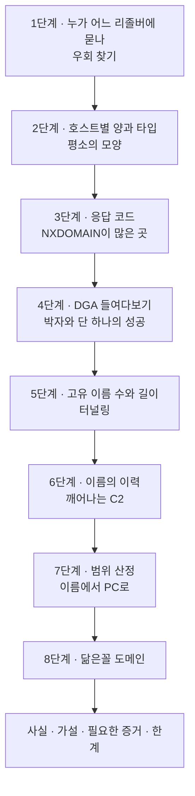
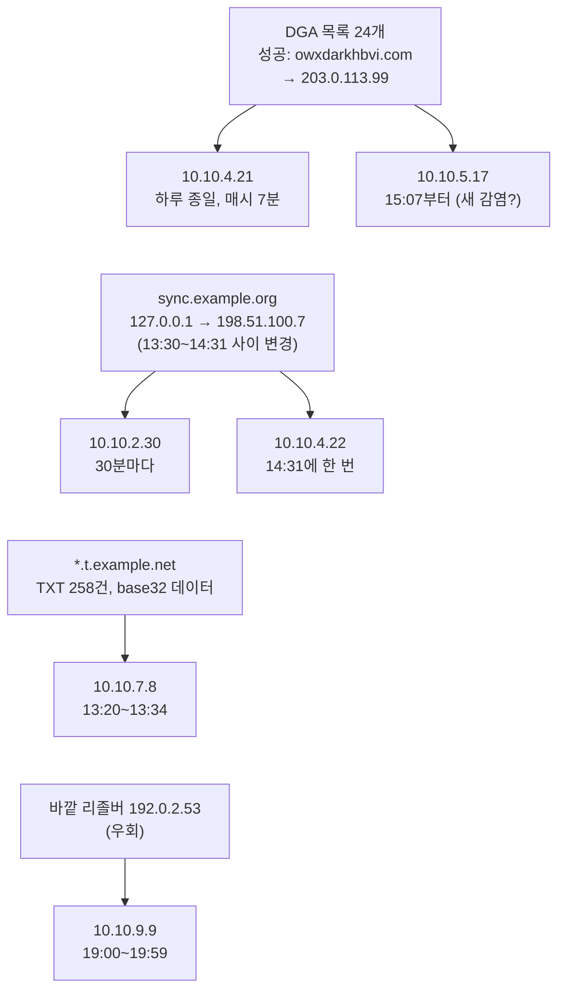

# 2.9강 — 실습 가이드: DNS 프로파일링, 이상 징후, 범위 산정 { #lab-dns-profiling }

!!! abstract "이번 회차의 범위"
    - 하루 치 Zeek `dns.log`로 구간의 "평소"를 그리기: 누가, 어느 리졸버에, 얼마나, 어떤 타입으로 묻나
    - 이상 징후 찾기: 리졸버 우회, NXDOMAIN 폭증과 DGA, TXT 터널링, `127.0.0.1`에서 깨어나는 C2, 닮은꼴 도메인
    - **평소의 잡음**과 구분하기: 메일 서버의 PTR, 오타, 브라우저의 가로채기 탐지 질의
    - **범위 산정**: 찾은 이름에서 출발해 다른 감염 PC와 감염 시각 찾기
    - 결과를 사실, 가설, 필요한 증거, 관찰의 한계로 나눠 쓰기

!!! note "실습 환경과 표기"
    **(직접 실행 결과)**는 이 작업 환경의 Zeek 9.0.1(공식 Docker 이미지)과 jq 1.7, GNU coreutils로 얻었습니다. 실습 pcap `office-dns.pcap`은 한 사무실 구간의 **하루(2026-11-03, UTC)** DNS를 흉내 내도록 dnspython으로 **직접 조립**했습니다(패킷 94,324개). 수집 지점은 **클라이언트와 사내 리졸버(`10.10.0.53`) 사이**, 즉 2.6강의 "안쪽 관측 지점"이고, 리졸버의 캐시 동작(TTL이 줄어드는 모습)도 흉내 냈습니다. 주소는 사설 주소와 문서용 주소, 도메인은 예시용이며, 이상 행동은 모두 **연습용으로 지어낸 것**입니다. 조립한 데이터라 실제보다 단순하고 깔끔하다는 점을 기억하세요.

## 1. 상황 { #scenario }

**(가상 사례)** 보안 장비가 "사무실 구간의 PC 한 대가 알려지지 않은 외부 주소와 통신한다"는 모호한 경보를 냈는데, 어느 PC인지, 어느 주소인지는 경보에 없습니다. 사내 리졸버 앞의 센서에 하루 치 pcap이 남아 있어요. DNS는 거의 모든 통신의 시작이니(2.6강), 이 하루를 **DNS로 프로파일링**해서 "이 구간에서 평소와 다른 것"을 찾고, 찾은 것에서 출발해 **범위**(어느 PC들이, 언제부터)를 정하는 것이 목표입니다.

2.4강의 HTTP 프로파일링과 같은 생각입니다. 동네 우체국 직원을 떠올려 보세요. 누가 어디로 편지를 자주 보내는지 알고 있으면, 갑자기 하루에 수백 통씩 **없는 주소**로 보내는 사람(DGA), 엽서 뒷면에 **암호 같은 글**을 빽빽이 적어 보내는 사람(터널링), 우체국을 거치지 않고 **다른 동네 우체통**에 넣는 사람(리졸버 우회)을 알아볼 수 있어요. 비유가 깨지는 곳: DNS에서는 "편지 내용"(질의 이름) 자체가 정보를 실어 나를 수 있고, 같은 사람이 보낸 편지라도 우체국이 **기억해 둔 답**(캐시)으로 바로 돌려보내면 바깥에는 아무 흔적이 없습니다.

## 2. 실습 안내 { #how-to-use }

**목표**

1. 하루 치 DNS에서 호스트별 "평소"를 요약한다(리졸버, 양, 타입, 응답 코드).
2. 평소에서 벗어나는 것을 찾고, 평소의 잡음과 구분한다.
3. 찾은 이름과 주소로 범위를 정한다(다른 PC, 시작 시각).
4. 사실, 가설, 필요한 증거, 한계로 나눠 보고한다.

**준비**

- Zeek(또는 이미 만들어진 `dns.log`), jq, `sort`, `uniq`
- 실습 pcap `office-dns.pcap`. 출발점이 되는 단서는 "어느 PC가 이상하다"는 모호한 경보뿐입니다.

받자마자 해시를 남기고, Zeek로 JSON 로그를 만듭니다. 조립한 pcap이라 체크섬은 올바르게 채워 두었습니다(2.8강의 `-C`가 필요 없음).

```bash
sha256sum office-dns.pcap
zeek -r office-dns.pcap LogAscii::use_json=T
jq -s 'map(.ts) | [min, max] | map(todate)' dns.log
jq -s 'length' dns.log
```

**(직접 실행 결과)**

```text
9519a551b4fb32efb03b45894076df3b8ee97a28fce1cf943cda0821d047f2d0  office-dns.pcap
[
  "2026-11-03T00:00:01Z",
  "2026-11-04T00:00:25Z"
]
47162
```

하루 꼬박, 질의·응답 47,162건입니다. `-s`(slurp)는 모든 줄을 **하나의 배열로** 읽어 들이는 옵션이라, 전체에 대한 최솟값·최댓값·개수를 구할 때 씁니다. 대신 파일 전체를 메모리에 올리니 큰 로그에서는 조심하세요. `dns.log`의 해시는 적지 않았습니다. 2.8강에서 봤듯이 `uid`가 처리할 때마다 바뀌어 같은 pcap이라도 로그 파일의 해시가 달라지기 때문이에요. 증거로서는 pcap의 해시와 처리 조건(Zeek 9.0.1, 기본 스크립트, JSON)을 함께 적습니다.

**그림 2-1. 이번 실습의 순서** (위에서 아래로. 각 단계는 앞 단계에서 걸러지지 않은 것을 다른 각도로 다시 본다)



## 3. 1단계: 누가 어느 리졸버에 묻나 { #resolvers }

2.7강 1절의 구조라면 모든 PC가 사내 리졸버 `10.10.0.53`에만 물어야 합니다. 응답한 쪽(`id.resp_h`)을 셉니다.

```bash
jq -r '."id.resp_h"' dns.log | sort | uniq -c | sort -rn
jq -r 'select(."id.resp_h"!="10.10.0.53") | ."id.orig_h"' dns.log | sort | uniq -c
jq -r 'select(."id.resp_h"=="192.0.2.53") | .ts|todate' dns.log | sed -n '1p;$p'
```

**(직접 실행 결과)**

```text
  47122 10.10.0.53
     40 192.0.2.53
     40 10.10.9.9
2026-11-03T19:00:02Z
2026-11-03T19:58:53Z
```

`10.10.9.9` 한 대가 **19:00~19:59에 바깥 리졸버 `192.0.2.53`에 직접** 40번 물었습니다. 방화벽 정책이 이를 막지 못했다는 뜻이기도 해요. 이 PC의 질의는 사내 리졸버의 기록에 **남지 않으므로**, 사내 리졸버 로그만 봤다면 놓쳤을 것입니다. 이 센서가 리졸버 앞에 있었기 때문에 보인 거예요.

해석은 아직 열어 둡니다. 개인 VPN, 직접 설정한 DNS, 또는 사내 통제를 피하려는 악성코드일 수 있어요. 무엇을 물었는지도 봅니다(`select(."id.resp_h"=="192.0.2.53") | .query`). 이 데이터에서는 평범한 업무 사이트 이름들이었습니다. 사내 리졸버를 우회했다는 사실 자체는 기록해 두고, 7단계 범위 산정 때 다시 확인합니다.

## 4. 2단계: 호스트별 양과 타입 구성 { #per-host }

호스트별로 몇 번 물었는지, 그리고 타입이 어떻게 섞였는지 봅니다. jq의 `group_by`로 호스트별 표를 한 번에 만들 수 있어요.

```bash
jq -s -r 'group_by(."id.orig_h")
  | map({h: .[0]."id.orig_h", n: length,
         t: (group_by(.qtype_name) | map({(.[0].qtype_name): length}) | add)})
  | sort_by(-.n) | .[:6][] | "\(.h)\t\(.n)\t\(.t)"' dns.log
```

한 조각씩:

- `-s`로 전체를 배열로 읽고, `group_by(."id.orig_h")`로 **출발 주소별 묶음**(배열의 배열)을 만듭니다.
- 묶음마다 `{h: 주소, n: 개수, t: 타입별 개수}` 객체를 만듭니다. `t`는 그 묶음을 다시 `qtype_name`으로 묶어 `{"A": 개수}` 조각들을 만든 뒤 `add`로 합친 것이에요.
- `sort_by(-.n)`으로 개수 내림차순, `.[:6][]`로 앞의 6개를 하나씩 꺼내 문자열로 출력합니다.

**(직접 실행 결과)**

```text
10.10.0.25	3436	{"MX":644,"PTR":2148,"TXT":644}
10.10.4.21	2381	{"A":1466,"AAAA":470,"HTTPS":445}
10.10.7.8	2001	{"A":779,"AAAA":473,"HTTPS":491,"TXT":258}
10.10.2.30	1970	{"A":967,"AAAA":506,"HTTPS":497}
10.10.1.26	1885	{"A":828,"AAAA":523,"HTTPS":534}
10.10.1.18	1856	{"A":823,"AAAA":501,"HTTPS":532}
```

읽는 법:

- **`10.10.0.25`**: PTR이 대부분이고 MX·TXT가 섞였습니다. 2.6강 3절의 **메일 서버 모양**이에요. 새 연결마다 역방향 조회를 하고, 보낼 메일의 MX와 SPF(TXT)를 확인합니다. 이 구간에서 이 모양은 **정상**입니다(메일 서버가 맞는지는 자산 목록으로 확인).
- **사용자 PC들**(`10.10.1.x` 등): A, AAAA, HTTPS가 비슷한 비율. 2.6강의 **사용자 구간 모양**입니다.
- **`10.10.4.21`**: 다른 PC보다 A가 **유난히 많습니다**(1,466 대 800대). AAAA·HTTPS는 비슷하니, "A만 따로 많이 묻는 무언가"가 있다는 뜻이에요. 3단계에서 봅니다.
- **`10.10.7.8`**: 사용자 PC인데 **TXT가 258건** 있습니다. 같은 구간의 다른 사용자 PC에는 TXT가 없어요.

TXT를 묻는 호스트만 따로 세 보면 더 뚜렷합니다.

```bash
jq -r 'select(.qtype_name=="TXT") | ."id.orig_h"' dns.log | sort | uniq -c | sort -rn
```

**(직접 실행 결과)**

```text
    644 10.10.0.25
    258 10.10.7.8
```

메일 서버(SPF 확인)와 `10.10.7.8`뿐입니다. 사용자 PC가 TXT를 묻는 것 자체가 이 구간의 평소에서 벗어나요. 5단계에서 봅니다.

## 5. 3단계: 응답 코드, NXDOMAIN이 많은 곳 { #rcodes }

```bash
jq -r 'select(.rcode_name=="NXDOMAIN") | ."id.orig_h"' dns.log | sort | uniq -c | sort -rn | head -8
```

**(직접 실행 결과)**

```text
    581 10.10.4.21
    429 10.10.0.25
    225 10.10.5.17
     17 10.10.1.12
     12 10.10.2.30
     12 10.10.1.15
     12 10.10.1.11
     11 10.10.1.29
```

세 호스트가 눈에 띄고, 나머지는 10~20건 안팎입니다. 먼저 **평소의 NXDOMAIN**이 무엇인지 가려 둡니다.

- **메일 서버의 PTR 실패**: `10.10.0.25`의 PTR 2,148건 중 NOERROR 1,719, NXDOMAIN 429였습니다(`select(."id.orig_h"=="10.10.0.25" and .qtype_name=="PTR") | .rcode_name`으로 셈). 역방향 레코드가 없는 주소는 흔하니, **메일 서버의 NXDOMAIN은 대개 정상**입니다.
- **오타**: `docs.exmaple.com` 66, `exmaple.com` 47, `wwww.example.com` 45건이 여러 사용자 PC에서 나왔습니다. 사람의 손가락이 만든 잡음이에요.
- **점 없는 한 단어 이름 세 개**: 13대의 PC가 각각 **정확히 세 개씩**, 출근 무렵에 물었습니다.

```bash
jq -r 'select((.query|contains("."))|not) | [(.ts|strftime("%H:%M:%S")), ."id.orig_h", .query, .rcode_name] | @tsv' dns.log | head -6
```

**(직접 실행 결과)**

```text
08:35:04	10.10.1.25	olwjlphi	NXDOMAIN
08:35:04	10.10.1.25	gcanpgsm	NXDOMAIN
08:35:04	10.10.1.25	imtqpbfbv	NXDOMAIN
08:35:46	10.10.1.11	bbbdldnwessgw	NXDOMAIN
08:35:46	10.10.1.11	pxfcnlkjycme	NXDOMAIN
08:35:46	10.10.1.11	poigwxrdl	NXDOMAIN
```

같은 1초 안에 7~15글자 무작위 이름 세 개, 그 PC의 첫 활동 직전. 2.7강 4.3절의 **브라우저 가로채기 탐지 질의** 모양입니다(기업 정책으로 켜 둔 PC들이라고 가정). 무작위로 보이지만 DGA로 분류하지 않습니다.

`@tsv`는 배열을 탭으로 구분한 한 줄로 바꾸고, `strftime("%H:%M:%S")`는 유닉스 시각을 UTC 기준 시:분:초 문자열로 바꿉니다.

이 셋을 빼면 `10.10.4.21`(581)과 `10.10.5.17`(225)이 남습니다.

## 6. 4단계: DGA 들여다보기 { #dga }

`10.10.4.21`의 NXDOMAIN 이름과 시각을 봅니다.

```bash
jq -r 'select(."id.orig_h"=="10.10.4.21" and .rcode_name=="NXDOMAIN") | .query' dns.log | sort | uniq -c | sort -rn | head -5
jq -r 'select(."id.orig_h"=="10.10.4.21" and .rcode_name=="NXDOMAIN") | .ts | strftime("%M")' dns.log | sort | uniq -c | sort -rn | head -3
```

**(직접 실행 결과)**

```text
     24 zlonpnqfgvxwg.com
     24 zgijpsilzextwebb.com
     24 zehzobjyazd.com
     24 upgshfkgdnqje.com
     24 ugcuulcwzj.com
    576 07
      3 18
      1 49
```

이름 하나하나가 **하루에 정확히 24번**, 그리고 NXDOMAIN 581건 중 576건이 **매시 7분**에 몰려 있습니다. 매시 7분에 같은 이름 목록을 차례로 묻는 프로그램이 있다는 뜻이에요. 이름의 모양(10~16글자의 무작위 소문자 + `.com`)과 함께 2.7강 4절의 **DGA** 가설에 잘 맞습니다. 사람은 매시 7분에 없는 도메인 24개를 묻지 않으니까요.

DGA라면 "**그 목록 중 하나는 성공**"해야 합니다. 같은 시각(매시 7분)에 같은 PC가 받은 NOERROR를 봅니다.

```bash
jq -r 'select(."id.orig_h"=="10.10.4.21" and .rcode_name=="NOERROR" and (.ts|strftime("%M"))=="07") | .query' dns.log | sort | uniq -c | sort -rn | head -5
```

**(직접 실행 결과)**

```text
     24 owxdarkhbvi.com
      9 news.example.net
      6 update.example.com
      6 telemetry.example.net
      5 time.example.org
```

`owxdarkhbvi.com`만 **24번**, 매시 7분마다 성공했습니다. 나머지는 마침 그 분에 사람이 연 사이트들이에요. 9시 7분의 묶음을 보면 순서가 드러납니다.

```bash
jq -r 'select(."id.orig_h"=="10.10.4.21" and (.ts|strftime("%H:%M"))=="09:07") | [(.ts|strftime("%H:%M:%S")), .query, .rcode_name] | @tsv' dns.log | sed -n '15,20p'
```

**(직접 실행 결과)**

```text
09:07:13	brugcsbfehzqw.com	NXDOMAIN
09:07:13	sdpdxazvjckhiq.com	NXDOMAIN
09:07:14	zgijpsilzextwebb.com	NXDOMAIN
09:07:15	owxdarkhbvi.com	NOERROR
09:07:15	fljysaaludeuen.com	NXDOMAIN
09:07:16	szuvrwofhhw.com	NXDOMAIN
```

NXDOMAIN 사이에 성공 하나가 끼어 있습니다. 성공한 이름의 답을 봅니다(`select(.query=="owxdarkhbvi.com") | .answers`). 답은 `203.0.113.99`였어요. 이 주소가 경보가 말한 "알려지지 않은 외부 주소"일 가능성이 큽니다. 다음 단계의 증거(방화벽, NetFlow에서 `10.10.4.21` → `203.0.113.99`)로 이어집니다.

!!! tip "성공한 뒤에도 계속 묻는 이유"
    이 데이터의 프로그램은 성공한 뒤에도 매시 목록 전체를 묻습니다. 실제 DGA 악성코드는 성공하면 멈추거나, 목록의 순서를 섞거나, 하루 수천 개 중 일부만 묻는 등 모양이 다양해요. "NXDOMAIN이 몇 개 넘으면 DGA"처럼 숫자 하나로 정하지 말고, **같은 이름의 반복, 정해진 박자, 그 사이의 성공**을 함께 보세요.

## 7. 5단계: 고유 이름 수와 길이, 터널링 { #tunnel }

2단계에서 본 `10.10.7.8`의 TXT를 봅니다. DNS 터널링(2.7강)은 데이터를 질의 이름에 실어 보내므로, ① 한 도메인 아래 **서로 다른 이름의 수**가 크게 늘고, ② 이름이 **길어집니다**.

**도메인별 고유 이름 수** (이름의 마지막 두 조각을 "도메인"으로 봄)

```bash
jq -r '.query | split(".") | "\(.[-2:]|join("."))\t\(join("."))"' dns.log | sort -u | cut -f1 | uniq -c | sort -rn | head -6
```

`split(".")`로 이름을 조각내고, `.[-2:]`로 마지막 두 조각을 다시 이어 "도메인"을 만든 뒤, "도메인 탭 전체 이름" 쌍을 `sort -u`로 중복 없이 남겨 도메인별로 셉니다.

**(직접 실행 결과)**

```text
    503 in-addr.arpa
    262 example.net
     11 example.com
      3 example.org
      2 exmaple.com
      2 corp.example
```

`in-addr.arpa`는 메일 서버의 역방향 조회라 많은 게 정상입니다. `example.net`의 262는 평소의 몇 개(`news`, `cdn`, `telemetry` 등)로는 설명이 안 돼요.

**[주의] "마지막 두 조각"은 근사치입니다.** `co.kr`, `co.uk`처럼 두 조각이 한 단위인 최상위 도메인에서는 `example.co.kr`이 아니라 `co.kr`로 묶여 버립니다. 실제 조사에서는 공개 접미사 목록(Public Suffix List)을 쓰는 도구로 "등록 가능한 도메인"을 구하세요.

**호스트별 이름 길이**

```bash
jq -s -r 'group_by(."id.orig_h") | map({h: .[0]."id.orig_h", avg: ((map(.query|length)|add)/length), max: (map(.query|length)|max)}) | sort_by(-.max) | .[:4][] | "\(.h)\tavg=\(.avg|floor)\tmax=\(.max)"' dns.log
jq -r 'select(."id.orig_h"=="10.10.7.8" and .qtype_name=="TXT") | [(.ts|strftime("%H:%M:%S")), .query, (.answers|tostring)] | @tsv' dns.log | head -3
```

**(직접 실행 결과)**

```text
10.10.7.8	avg=23	max=66
10.10.0.25	avg=20	max=27
10.10.1.11	avg=17	max=21
10.10.1.12	avg=17	max=21
13:20:00	jbhvgvb5izeu4lkqimwtaob3kvjukur5njvws3j3kezsaytv.0.t.example.net	["TXT 8 rlrpw7ml"]
13:20:03	mrtwk5bamrzgcztuebzg653tebitgidcovsgozluebsheylg.1.t.example.net	["TXT 8 7ak7gela"]
13:20:07	oqqhe33xomqfcmzamj2wiz3foqqgi4tbmz2ca4tpo5zsaujt.2.t.example.net	["TXT 8 cayvlwnv"]
```

`10.10.7.8`의 이름이 최대 66글자로 가장 깁니다. 이름의 모양은 `[48글자].[순번].t.example.net`이고, 첫 조각은 a–z와 2–7만 쓰는 **base32**처럼 보여요. 순번이 0, 1, 2…로 늘어나는 것은 **조각낸 데이터를 차례로 보내는** 모양입니다. 응답(TXT)은 짧은 무작위 문자열로, 받았다는 확인(ack)처럼 보여요. 시각은 13:20:00부터 13:33:59까지 258건이었습니다.

순번대로 첫 조각을 이어 base32로 풀어 봤습니다.

```bash
jq -r 'select(."id.orig_h"=="10.10.7.8" and .qtype_name=="TXT") | .query | split(".") | "\(.[1])\t\(.[0])"' dns.log \
  | sort -n -u | head -43 | cut -f2 | tr -d '\n' > chunks.txt
python3 -c "import base64; s=open('chunks.txt').read().upper(); print(b''.join(base64.b32decode(c+'='*(-len(c)%8)) for c in [s[i:i+48] for i in range(0,len(s),48)])[:90])"
```

**(직접 실행 결과)**

```text
b'HOST=FIN-PC-08;USER=jkim;Q3 budget draft rows Q3 budget draft rows Q3 budget draft rows Q3'
```

PC 이름, 사용자 이름, 그리고 "3분기 예산 초안"처럼 보이는 내용이 나왔습니다(지어낸 내용). 순번은 0부터 257까지 하나씩 늘었는데, 43번째마다(0, 43, 86…) 똑같은 조각이 다시 나왔습니다. 같은 데이터를 **여섯 번 되풀이해 보낸** 것으로 보여요(위 명령은 `head -43`으로 첫 회차만 이었습니다). 풀어 낸 첫 회차는 1,285바이트였습니다. 풀어 볼 수 있다면 "무엇이 나갔나"를 직접 보일 수 있지만, 실제 터널링 도구는 암호화나 압축을 더하는 경우가 많아 늘 풀리지는 않습니다. 그때는 **양**(고유 이름 수 × 이름 길이)으로 나간 데이터의 크기를 추정합니다.

## 8. 6단계: 이름의 이력, 깨어나는 C2 { #name-history }

2.7강 2.1절의 "재워 두기" 수법을 찾으려면, 이름별로 **답이 바뀐 적이 있는지** 봅니다. 하루 동안 답이 두 가지 이상인 이름 중, 하나가 `127.0.0.1`인 것을 찾으면 빠릅니다.

```bash
jq -r 'select(.answers != null and (.answers | index("127.0.0.1"))) | .query' dns.log | sort | uniq -c
jq -r 'select(.query=="sync.example.org") | .answers[]' dns.log | sort | uniq -c
```

**(직접 실행 결과)**

```text
     30 sync.example.org
     19 198.51.100.7
     30 127.0.0.1
```

`sync.example.org`가 하루 중 `127.0.0.1`과 `198.51.100.7` 두 가지 답을 가졌습니다. 시간 순서로 봅니다.

```bash
jq -r 'select(.query=="sync.example.org") | [(.ts|strftime("%H:%M:%S")), ."id.orig_h", (.answers|join(",")), (.TTLs|map(tostring)|join(","))] | @tsv' dns.log | sed -n '25,34p'
```

**(직접 실행 결과)**

```text
12:00:11	10.10.2.30	127.0.0.1	1799.0
12:30:11	10.10.2.30	127.0.0.1	3600.0
13:00:12	10.10.2.30	127.0.0.1	1798.0
13:30:13	10.10.2.30	127.0.0.1	3600.0
14:00:12	10.10.2.30	127.0.0.1	1800.0
14:30:12	10.10.2.30	127.0.0.1	0.0
14:31:09	10.10.4.22	198.51.100.7	300.0
15:00:12	10.10.2.30	198.51.100.7	300.0
15:30:13	10.10.2.30	198.51.100.7	300.0
16:00:13	10.10.2.30	198.51.100.7	300.0
```

`10.10.2.30`이 **30분마다** 이 이름을 묻고 있었고(하루 48번), 14:31부터 답이 `198.51.100.7`(TTL 300)로 바뀌었습니다. "재워 둔 C2가 깨어난" 모양이에요.

**TTL로 바뀐 시각의 범위 좁히기.** TTL 3600은 리졸버가 **새로 받아 온** 답이고, 1799·1800·0은 **캐시에서** 준 답입니다(2.6강 9절). 그러니:

- 13:30:13에 리졸버가 새로 받아 온 답은 아직 `127.0.0.1`이었습니다.
- 14:30:12의 답은 캐시에 1초 남은 **옛 답**이라, 그 시각에 이미 바뀌었는지는 알 수 없어요.
- 14:31:09에 다른 PC(`10.10.4.22`)가 물어 새로 받아 온 답이 `198.51.100.7`이었습니다.

따라서 권한 서버 쪽에서 레코드가 바뀐 시각은 **13:30:13 이후, 14:31:09 이전**이라고만 말할 수 있습니다. 이 안쪽 관측 지점의 기록만으로는 더 좁힐 수 없고, 리졸버 바깥의 캡처나 리졸버 자체의 기록, 또는 외부의 패시브 DNS 서비스가 필요해요. 캐시 때문에, `10.10.2.30`은 실제 변경보다 **최대 한 시간 가까이 늦게** 새 주소를 받았을 수 있다는 점도 기억하세요.

## 9. 7단계: 범위 산정, 이름에서 PC로 { #scoping }

지금까지 찾은 "나쁜 이름"들을 출발점으로, **같은 이름을 물은 다른 PC**를 찾습니다. 이게 2.7강 3.2절에서 말한 "DNS 기록으로 감염 범위를 정하고 새로 감염된 PC를 찾는" 일이에요.

```bash
for n in owxdarkhbvi.com sync.example.org; do echo "$n:"; jq -r --arg n $n 'select(.query==$n) | ."id.orig_h"' dns.log | sort | uniq -c; done
jq -r 'select(.query|endswith(".t.example.net")) | ."id.orig_h"' dns.log | sort | uniq -c
```

**(직접 실행 결과)**

```text
owxdarkhbvi.com:
     24 10.10.4.21
      9 10.10.5.17
sync.example.org:
     48 10.10.2.30
      1 10.10.4.22
    258 10.10.7.8
```

- DGA의 성공 이름을 `10.10.5.17`도 **9번** 물었습니다. 3단계에서 NXDOMAIN 225건으로 눈에 띈 그 PC예요.
- 깨어난 C2 `sync.example.org`를 `10.10.4.22`가 **한 번**, 바뀐 직후(14:31)에 물었습니다.
- 터널링 도메인은 `10.10.7.8`뿐이었습니다.

**성공한 이름만이 아니라 목록 전체로** 찾아야 합니다. DGA의 성공 이름은 날마다 바뀌니, `10.10.4.21`이 매시 7분에 물은 이름 목록 전체를 파일로 만들고, 그 목록의 이름을 하나라도 물은 PC를 찾습니다.

```bash
jq -r 'select(."id.orig_h"=="10.10.4.21" and .rcode_name=="NXDOMAIN" and (.ts|strftime("%M"))=="07") | .query' dns.log | sort -u > dga24.txt
jq -r --rawfile d dga24.txt '($d | split("\n") | map(select(length>0))) as $names
  | select(.query as $q | $names | index($q)) | ."id.orig_h"' dns.log | sort | uniq -c
jq -r --rawfile d dga24.txt '($d | split("\n") | map(select(length>0))) as $names
  | select(."id.orig_h"=="10.10.5.17" and (.query as $q | $names | index($q))) | .ts|todate' dns.log | head -1
```

- `--rawfile d dga24.txt`: 파일 내용을 통째로 문자열 `$d`로 넘깁니다.
- `split("\n") | map(select(length>0))`: 줄 단위 배열로 바꾸고 빈 줄을 뺍니다.
- `.query as $q | $names | index($q)`: 이 기록의 이름이 목록 안에 있으면 그 위치(참), 없으면 `null`(거짓).

**(직접 실행 결과)**

```text
    576 10.10.4.21
    216 10.10.5.17
2026-11-03T15:07:07Z
```

`10.10.5.17`은 **15:07:07부터** 같은 목록을 묻기 시작했습니다. 그 전(09:00~15:05)에는 평범한 업무 사이트만 물었어요. 그러니 이 PC는 **15:05~15:07 사이 무렵에 감염됐을** 가능성이 있습니다(가설: 그 시각 직전의 웹 접속, 메일, USB 사용을 단말 기록에서 확인할 것). 이렇게 이름 목록으로 찾으면, 성공 이름을 아직 묻지 않은 **막 감염된 PC**까지 잡을 수 있어요.

**그림 9-1. 이 실습에서 찾은 것과 그 관계** (위에서 아래로 네 묶음. 화살표는 "물었다")



**읽는 법:** 위에서 아래로 네 묶음입니다. 각 묶음의 첫 상자가 이 하루에서 찾은 이상한 이름(또는 목적지), 화살표가 가리키는 상자가 그것을 물은 PC예요. 한 이름에서 화살표가 둘이면 같은 일이 두 PC에 있다는 뜻입니다. 묶음 사이에는 선이 없습니다. 서로 다른 이름 사이의 관계(같은 공격자인가)는 이 데이터만으로는 알 수 없어요.

## 10. 8단계: 닮은꼴 도메인 { #lookalike }

마지막으로 `xn--`로 시작하는 이름을 찾아 풀어 봅니다(2.7강 7절).

```bash
jq -r 'select(.query|startswith("xn--")) | [(.ts|todate), ."id.orig_h", .query, (.answers|join(","))] | @tsv' dns.log
python3 -c "n='xn--crp-sed.example'.encode().decode('idna'); print(n, [hex(ord(c)) for c in n[:4]])"
```

**(직접 실행 결과)**

```text
2026-11-03T10:12:04Z	10.10.1.19	xn--crp-sed.example	203.0.113.140
cоrp.example ['0x63', '0x43e', '0x72', '0x70']
```

풀면 `cоrp.example`인데, 둘째 글자가 라틴 `o`(0x6f)가 아니라 **키릴 문자 `о`(U+043E)**입니다. 우리 회사의 내부 도메인 `corp.example`(4단계에서 `intranet.corp.example`, `portal.corp.example`로 나왔음)과 화면에서 똑같이 보이는 **닮은꼴**이에요. `10.10.1.19`가 10:12:04에 한 번 물었고 `203.0.113.140`을 받았습니다. 피싱 메일의 링크를 눌렀을 가능성을 의심하고, 그 시각 직전의 메일 기록과 그 뒤의 HTTP·HTTPS 연결(프록시 로그)을 봅니다. 같은 이름을 다른 PC가 물었는지도(이 데이터에서는 없었음) 범위 산정에 넣습니다.

## 11. 정리해서 쓰기 { #report }

- **관찰(사실):**
    - 2026-11-03 하루 동안 이 수집 지점(사내 리졸버 앞)에서 DNS 질의·응답 47,162건을 관찰했다.
    - `10.10.4.21`은 하루 종일 **매시 7분**에 무작위 모양의 `.com` 이름 24개를 차례로 물었고, 그중 `owxdarkhbvi.com`만 매번 성공해 `203.0.113.99`를 받았다(NXDOMAIN 576건).
    - `10.10.5.17`은 **15:07:07부터** 같은 이름 목록을 같은 박자로 묻기 시작했다(NXDOMAIN 216건, 성공 9건).
    - `10.10.2.30`은 30분마다 `sync.example.org`를 물었다. 답은 13:30:13에 새로 받은 답까지 `127.0.0.1`이었고, 14:31:09에 새로 받은 답부터 `198.51.100.7`(TTL 300)이었다. `10.10.4.22`도 14:31:09에 같은 이름을 한 번 물어 새 주소를 받았다.
    - `10.10.7.8`은 13:20:00~13:33:59에 `*.t.example.net`으로 TXT 질의 258건을 보냈다. 이름의 첫 조각을 순번대로 이어 base32로 풀면 PC 이름, 사용자 이름, 문서 내용으로 보이는 글자가 나온다.
    - `10.10.9.9`는 19:00~19:59에 사내 리졸버가 아닌 `192.0.2.53`에 직접 40번 물었다.
    - `10.10.1.19`는 10:12:04에 내부 도메인과 닮은 `xn--crp-sed.example`(키릴 `о`)을 물어 `203.0.113.140`을 받았다.
- **해석(가설):**
    - `10.10.4.21`과 `10.10.5.17`은 **같은 DGA 계열 악성코드**에 감염됐고, 그날의 C2는 `203.0.113.99`다. `10.10.5.17`은 15:05~15:07 무렵에 새로 감염됐을 수 있다.
    - `sync.example.org`는 평소 `127.0.0.1`에 재워 두는 C2이고, 오후 1시 반에서 2시 반 사이에 깨어났다. `10.10.2.30`과 `10.10.4.22`에 그 이식물이 있을 수 있다.
    - `10.10.7.8`에서 DNS 터널링으로 자료가 나갔다.
    - 위 활동들이 하나의 공격인지, 서로 다른 일인지는 아직 알 수 없다.
- **더 필요한 증거:**
    - 방화벽·NetFlow·프록시에서 `203.0.113.99`, `198.51.100.7`, `203.0.113.140`으로 간 연결(어느 PC가, 언제, 얼마나).
    - 해당 PC들의 단말 기록: 질의한 프로세스(Sysmon 22), 15:05 무렵 `10.10.5.17`의 활동, 10:12 무렵 `10.10.1.19`의 메일.
    - 리졸버 바깥의 기록이나 외부 패시브 DNS(`sync.example.org`가 바뀐 정확한 시각, 다른 날의 이력).
    - 다른 날의 pcap(DGA와 30분 박자가 언제 시작됐나).
    - `10.10.9.9`의 사용자와 설정(우회의 이유).
- **관찰의 한계:**
    - 하루 치, 이 수집 지점의 DNS만 본 결과다. DoH 등 암호화된 DNS(2.7강 6절)는 보이지 않는다.
    - 캐시 때문에 PC가 받은 답이 실제 변경보다 늦을 수 있고, 리졸버가 캐시에서 답한 질의는 바깥에 나가지 않는다.
    - "도메인" 묶음은 마지막 두 조각으로 근사했다.
    - 이 데이터는 연습용으로 조립했다.

## 12. 정리 { #summary }

- 하루 치 `dns.log`를 jq로 **리졸버별, 호스트별, 타입별, 응답 코드별**로 요약해 구간의 평소를 그렸습니다. `-s`와 `group_by`로 호스트별 표를 한 번에 만들었어요.
- 평소의 잡음을 먼저 가렸습니다. 메일 서버의 PTR과 그 NXDOMAIN, 사람의 오타, 출근 무렵 브라우저의 무작위 한 단어 이름 세 개.
- 직접 찾은 것: 리졸버 우회(`10.10.9.9`), DGA(매시 7분, 24개 중 하나 성공, `10.10.4.21`), 같은 DGA의 새 감염(`10.10.5.17`, 15:07부터), TXT 터널링(`10.10.7.8`, base32로 풀림), 재워 둔 C2의 깨어남(`sync.example.org`, 13:30~14:31 사이 변경), 닮은꼴 도메인(`10.10.1.19`, 키릴 `о`).
- 범위 산정은 **이름(또는 이름 목록)에서 PC로** 거꾸로 찾는 일이고, 목록 전체로 찾아야 막 감염된 PC까지 잡힙니다.
- TTL은 새로 받은 답(원래 값)과 캐시의 답(줄어든 값)을 구분하게 해 주고, 그걸로 레코드가 바뀐 시각의 **범위**를 말할 수 있습니다.
- 결과는 사실, 가설, 필요한 증거, 한계로 나눠 썼습니다.

## 복습 문제 { #review }

**문제 1. (기본)** 3단계에서 NXDOMAIN이 많은 호스트로 `10.10.0.25`(429건)가 나왔는데, 왜 이것을 DGA로 의심하지 않았나요? 어떤 조건이면 의심해야 할까요?

??? success "정답과 해설"
    `10.10.0.25`는 2단계에서 PTR·MX·TXT만 묻는 **메일 서버의 모양**이었고, NXDOMAIN은 모두 PTR(역방향 레코드가 없는 주소)에서 나왔습니다. 역방향 레코드가 없는 주소는 흔해서 메일 서버의 PTR 실패는 대개 정상이에요. 의심해야 할 조건의 예: ① 메일 서버가 **A 질의**로 무작위 모양의 이름을 대량으로 묻는다, ② NXDOMAIN 비율이 이 서버의 평소(이 데이터에서는 PTR의 약 20%)보다 크게 늘었다, ③ 메일 서버가 평소 묻지 않는 TXT·NULL을 특정 도메인에 반복해서 묻는다. 기준선은 "그 호스트의 평소"와 비교해야 합니다.

**문제 2. (변경된 조건)** 이 센서가 리졸버 앞이 아니라 **리졸버 바깥(인터넷 쪽)**에 있었다면, 이 실습의 결과 중 무엇이 달라지거나 불가능해지나요?

??? success "정답과 해설"
    ① **PC를 특정할 수 없습니다.** 바깥에서는 모든 질의의 출발지가 리졸버라(2.6강 7.2절), "`10.10.4.21`과 `10.10.5.17`", "`10.10.7.8`" 같은 결론이 불가능해요. ② **캐시 때문에 횟수가 줄어듭니다.** DGA 성공 이름은 TTL 300이라 캐시가 만료될 때만 바깥으로 나가고, 두 PC가 물어도 한 번으로 보일 수 있습니다. ③ QNAME 최소화가 켜져 있다면 루트·최상위 도메인 쪽에는 이름의 일부만 보입니다. ④ 반대로 **리졸버 우회**(`10.10.9.9` → `192.0.2.53`)는 바깥 센서에도 보이고, 출발지가 리졸버가 아닌 사내 PC라는 점이 오히려 더 뚜렷합니다. ⑤ `sync.example.org`가 바뀐 시각은 리졸버가 새로 물은 시각(13:30, 14:31)에 바깥 패킷이 있으니 같은 범위까지는 말할 수 있어요.

**문제 3. (흔한 오해)** "5단계에서 `example.net` 아래 고유 이름이 262개였으니 `example.net` 전체를 차단하자." 무엇이 문제인가요?

??? success "정답과 해설"
    `example.net`은 이 구간에서 정상으로 쓰는 이름들(`news.example.net`, `cdn.example.net`, `telemetry.example.net` 등)도 담고 있습니다. 고유 이름이 늘어난 건 그 아래의 **`t.example.net`** 때문이었어요. 차단하면 업무 사이트까지 막힙니다. 또 "마지막 두 조각"은 근사치라 실제 등록 도메인과 다를 수 있습니다. 대응은 ① 범위를 `t.example.net`(또는 실제 등록 도메인)으로 좁히고, ② 리졸버에서 그 영역을 싱크홀하고, ③ 같은 이름을 물은 다른 PC를 찾는 순서로 합니다. 그리고 실제 사건에서 `example.net` 같은 큰 서비스 도메인 아래에 터널링 영역이 있다면, 그 서비스의 무료 호스팅이나 동적 DNS를 악용한 것인지도 확인합니다.

**문제 4. (해석)** 8단계에서 `10.10.2.30`이 14:30:12에 받은 답은 `127.0.0.1`, TTL `0.0`이었습니다. 이 한 줄에서 무엇을 알 수 있고, 무엇은 알 수 없나요?

??? success "정답과 해설"
    **알 수 있는 것:** TTL이 0이므로 이 답은 리졸버 **캐시에서** 나온 옛 답이고, 캐시는 곧(1초 안에) 만료될 참이었습니다. 이 캐시 항목은 13:30:13에 새로 받아 온 것이에요(그때 TTL 3600). **알 수 없는 것:** 14:30:12 시점에 권한 서버의 레코드가 이미 바뀌었는지. 캐시에서 답했으니 리졸버가 바깥에 묻지 않았거든요. 그래서 변경 시각은 "13:30:13 이후, 14:31:09(새 답이 처음 보인 시각) 이전"까지만 말할 수 있습니다. 이 PC가 실제 변경보다 늦게 새 주소를 받았을 수 있다는 점(최대 약 1시간)도 해석에 넣어야 해요.

**문제 5. (적용)** `10.10.5.17`의 감염 시각을 "15:05~15:07 무렵"이라고 추정했습니다. 이 추정을 확인하거나 반박하려면 무엇을 보겠습니까?

??? success "정답과 해설"
    ① **단말 기록**: 15:00~15:07의 프로세스 생성(새 실행 파일, 스크립트), 다운로드 폴더의 새 파일, 메일 첨부 열기, USB 연결. 15:07:07의 첫 DGA 질의를 한 **프로세스**(Sysmon 22). ② **네트워크 기록**: 15:05 무렵 이 PC의 HTTP·HTTPS 연결(프록시 로그, Zeek `http.log`·`files.log`의 다운로드), 그 연결이 받은 파일의 해시. ③ **반박 가능성**: 악성코드가 이미 있었는데 **15:07에 처음 시작**했을 수도 있습니다(PC를 켠 시각, 예약 작업, 사용자 로그온 시각). 이 PC의 DNS 활동이 09:00부터 있었으니 PC는 켜져 있었지만, 악성코드가 다른 조건(사용자 행동, 대기 시간)에서 시작됐을 수 있어요. 그래서 "감염 시각"이 아니라 "**DGA 활동이 시작된 시각**"이라고 사실을 적고, 감염 시각은 단말 증거로 정합니다.

**문제 6. (흔한 오해)** "터널링으로 나간 양은 TXT 질의 258건 × 이름 길이(약 66바이트) ≈ 17KB다." 이 추정의 문제를 이 실습의 결과로 설명하세요.

??? success "정답과 해설"
    ① 이름 전체가 데이터는 아닙니다. 데이터는 첫 조각(48글자)이고, `.[순번].t.example.net`은 틀이에요. ② base32는 5바이트를 8글자로 바꾸니, 48글자는 원래 **30바이트**입니다. ③ 7단계에서 순번은 0~257이었지만 **43개마다 같은 내용이 되풀이**됐습니다(여섯 번). 같은 데이터를 다시 보낸 것이라 고유한 양은 43조각 × 최대 30바이트, 실제로 풀어 보니 **1,285바이트(약 1.3KB)**였어요. 그러니 "258 × 66"은 실제보다 열 배 넘게 큽니다. 반대로 데이터가 압축돼 있었다면 원래 문서는 더 클 수 있어요. 양을 추정할 때는 인코딩, 틀, 반복을 따지고, 풀 수 있다면 풀어서 확인합니다.

**문제 7. (해석)** 2단계에서 `10.10.4.21`의 A 질의가 다른 PC보다 많았지만, AAAA·HTTPS는 비슷했습니다. 이 관찰이 DGA 가설을 어떻게 뒷받침하나요? 그리고 이 관찰만으로 부족한 이유는요?

??? success "정답과 해설"
    사람의 웹 사용은 브라우저가 A, AAAA, HTTPS를 **함께** 묻는 모양이라 세 타입이 비슷하게 늡니다. A만 따로 늘었다는 건 브라우저가 아닌 **다른 프로그램이 A만 묻는다**는 신호이고, 4단계의 DGA 질의(모두 A)가 그 몫이었어요(24개 × 24시간 = 576건). 하지만 이것만으로는 부족합니다. A만 묻는 정상 프로그램(업데이트 확인, 시간 동기화, 메일 클라이언트)도 많고, 사용량이 많은 사람일 수도 있어요. 그래서 **NXDOMAIN, 이름의 모양, 박자, 성공 하나**를 함께 보고서야 가설이 됩니다.

**문제 8. (적용)** 이 실습의 결과를 다음 날 자동으로 감시하려면, 어떤 규칙(또는 질의)을 만들겠습니까? 세 가지 이상 제안하고, 각각의 오탐 가능성도 말해 보세요.

??? success "정답과 해설"
    예: ① **목록 감시**: 오늘의 DGA 목록(또는 그 알고리즘을 알아냈다면 내일의 목록)과 `sync.example.org`, `t.example.net`, `xn--crp-sed.example`을 리졸버에서 싱크홀하고, 묻는 PC를 경보로. 오탐은 거의 없지만 DGA 이름은 날마다 바뀌어 목록을 갱신해야 합니다. ② **NXDOMAIN 비율**: 사용자 PC가 한 시간에 NXDOMAIN 20건 이상이면 경보. 오탐: 오타가 많은 사람, 설정이 잘못된 프로그램, 브라우저 탐지 질의(점 없는 이름은 제외). ③ **사용자 PC의 TXT·NULL**: 메일 서버가 아닌 호스트가 TXT를 묻거나, 한 도메인 아래 고유 이름이 한 시간에 50개 이상이면 경보. 오탐: 일부 보안 제품과 클라우드 서비스가 TXT로 설정을 받음, CDN의 긴 이름. ④ **리졸버 우회**: `id.resp_h`가 사내 리졸버가 아닌 53·853번 질의. 오탐: 허가된 예외 장비, 테스트 장비. ⑤ **`127.0.0.1`·사설 주소로 답하는 바깥 이름의 변화**: 답이 루프백에서 공인 주소로 바뀌면 경보. 오탐: 일부 차단 서비스와 광고 차단 목록. 규칙마다 **기준선과 예외 목록**을 두고 주기적으로 조정합니다.

## 참고 자료 { #references }

- 작업 환경에서 쓴 도구: Zeek 9.0.1(공식 Docker 이미지 `zeek/zeek`), jq 1.7, GNU coreutils, Python 3.13과 dnspython 2.9.2(실습 pcap 조립과 base32·퓨니코드 풀기). 실행 결과는 2026-11-05에 얻었습니다.
- 실습 pcap `office-dns.pcap`: 직접 조립, SHA-256 `9519a551b4fb32efb03b45894076df3b8ee97a28fce1cf943cda0821d047f2d0`, 패킷 94,324개.
- jq, [설명서](https://jqlang.github.io/jq/manual/) (`-s`, `group_by`, `--arg`, `--rawfile`, `strftime`, `@tsv`, `index`).
- Zeek, [dns.log 문서](https://docs.zeek.org/en/master/logs/dns.html).
- Mozilla, [Public Suffix List](https://publicsuffix.org/) ("등록 가능한 도메인"을 구할 때).
- 이 실습의 개념은 2.6강(관측 지점, 캐시와 TTL, 타입 비율), 2.7강(DGA, 터널링, 재워 둔 C2, 퓨니코드), 2.8강(Zeek, jq)을 바탕으로 합니다.

!!! note "이 페이지에 대하여"
    여러 학습 자료를 바탕으로 직접 다시 쓴 개인 학습 노트입니다. 실습 데이터와 시나리오는 직접 만들었고, 사례는 가상입니다.
