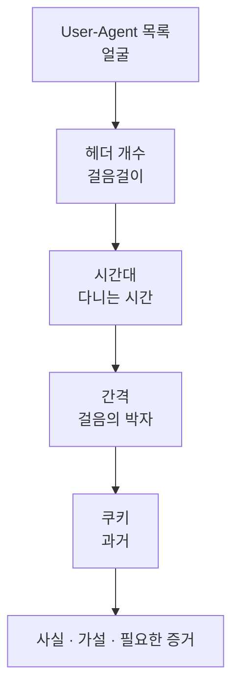

# 2.4강 — 실습 가이드: HTTP 프로파일링 { #lab-http-profiling }

!!! abstract "이번 회차의 범위"
    - 쓸모 있는 HTTP 흔적을 모으는 전략: 어떤 필드를, 어떤 단위로 묶어 볼 것인가
    - **눈에 띄는 것(이상치)** 찾기: User-Agent 목록, 헤더의 개수, 시간대
    - **사람인가 프로그램인가**에 대한 가설 세우기: 시간 간격의 규칙성, 근무 시간, 하위 자원 요청
    - **광고 쿠키로 증거 너머의 과거 보기**: 하루 치 pcap에서 일곱 달 전 첫 방문 찾기
    - 결과를 사실, 가설, 필요한 증거로 나눠 쓰기

!!! note "실습 환경과 표기"
    **(직접 실행 결과)**는 이 작업 환경의 tshark 4.2.2와 GNU awk로 얻었습니다. 실습 pcap `day.pcap`은 한 사무실 구간의 **하루(2026-11-02, UTC)** HTTP를 흉내 내도록 파이썬으로 직접 조립했습니다(패킷 9,162개, 사설·문서용 주소와 예시 도메인만 사용). 사람의 웹 사용, 정상 업데이트 프로그램, 그리고 일부러 숨겨 둔 자동 통신이 섞여 있습니다. 조립한 파일이라 **사람의 행동을 단순화한** 모양이고, 실제 트래픽은 훨씬 지저분하다는 점을 기억하세요.

## 1. 단서 없이 "이 구간에서 이상한 것"을 찾아야 할 때 { #why-profiling }

**(가상 사례)** 1.11강의 "연구소 쪽이 좀 이상하다" 사건의 다음 날입니다. 연구 구간 앞의 수집 장비에 하루 치 pcap이 있고, 프록시 로그도 있습니다. 그런데 프록시 로그는 1.3강의 기본 형식이라 User-Agent가 없고, URL과 크기뿐이에요. 교재의 실습 정리처럼 **가진 데이터의 형식이 늘 이상적이지는 않습니다.** 이번에는 헤더까지 담긴 pcap 쪽이 더 유연하니, pcap으로 프로파일을 만듭니다.

**프로파일링**이란 "이 구간에서 **평소** 무엇이 오가는가"를 요약해, 거기서 **벗어나는 것**을 찾는 일입니다. 출입문 경비원에 비유하면, 매일 오가는 직원들의 얼굴과 출퇴근 시각을 알고 있어야 낯선 사람이나 새벽에 들어오는 사람을 알아볼 수 있는 것과 같아요. 비유와 다른 점은, 우리는 **얼굴(User-Agent)조차 위조될 수 있다**는 걸 알고 있다는 것입니다(2.1강). 그래서 얼굴 하나가 아니라 걸음걸이(헤더 조합), 다니는 시간(시간대), 걸음의 박자(간격)까지 함께 봅니다.

## 2. 실습 안내 { #how-to-use }

**목표**

1. 쓸모 있는 HTTP 흔적을 모으는 전략을 세운다(어떤 필드를, 무엇으로 묶을지).
2. 더 조사할 만한 이상치를 찾는다.
3. 사람의 활동과 프로그램의 활동을 가르는 가설을 세운다.
4. 광고 쿠키로 가진 증거의 기간 너머를 본다.

**준비**

- tshark, awk, `sort`, `uniq`, `date`
- 실습 pcap `day.pcap`. 출발점이 되는 단서는 없습니다. "연구 구간이 이상하다"는 말뿐이에요.

받자마자 해시부터 남깁니다.

```bash
sha256sum day.pcap
capinfos -c -a -e day.pcap
```

**(직접 실행 결과)**

```text
2cc699cf6bd7d49b69f8dd12b8589cbe052fc65255efcca74ebb69c58fc03bf6  day.pcap
Number of packets:   9162
First packet time:   2026-11-02 00:02:17.000000
Last packet time:    2026-11-02 23:55:02.382120
```

하루 꼬박입니다. **새벽 0시부터 밤 12시 직전까지** 패킷이 있다는 점부터 기억해 두세요. 사무실 구간에서 새벽에 HTTP가 오간다면 누가(무엇이) 보낸 걸까요?



**그림 읽는 법:** 위에서 아래로, 이번 실습의 순서입니다. 각 단계는 앞 단계에서 걸러지지 않은 것을 다른 각도로 다시 봅니다.

## 3. 1단계: User-Agent 목록, 이 구간의 "얼굴" { #ua-inventory }

```bash
tshark -n -r day.pcap -Y http.request -T fields -e http.user_agent | sort | uniq -c | sort -rn
```

**(직접 실행 결과)**

```text
   2823 Mozilla/5.0 (Windows NT 10.0; Win64; x64) AppleWebKit/537.36 (KHTML, like Gecko) Chrome/141.0.0.0 Safari/537.36
    951 Mozilla/5.0 (Windows NT 10.0; Win64; x64; rv:144.0) Gecko/20100101 Firefox/144.0
    777 Mozilla/5.0 (Windows NT 10.0; Win64; x64) AppleWebKit/537.36 (KHTML, like Gecko) Chrome/141.0.0.0 Safari/537.36 Edg/141.0.0.0
     30 VendorUpdate/5.3 (Windows)
```

교재의 실습 정리처럼 tshark의 `-T fields` 출력은 이런 보고를 금방 만들어 줍니다(1.10강). 얼굴은 넷뿐이에요. Chrome, Firefox, Edge, 그리고 `VendorUpdate/5.3`이라는 업데이트 프로그램. 낯선 얼굴은 없습니다. **User-Agent만 보면 이 구간은 깨끗해 보입니다.** 여기서 멈추면 이번 실습은 실패예요.

`VendorUpdate/5.3`이 정말 그 회사의 업데이트 프로그램인지는 관리 부서의 허용 목록과 맞춰 봅니다(2.2강 5절). 이번 실습에서는 허용된 프로그램이라고 가정합니다.

## 4. 2단계: 헤더의 개수, 이 구간의 "걸음걸이" { #header-count }

2.1강에서 `curl`은 헤더 셋, 브라우저는 열넷이었던 걸 기억하나요? User-Agent는 한 줄로 꾸밀 수 있지만, **헤더 전체의 조합**까지 똑같이 흉내 내는 프로그램은 많지 않습니다. 출발지와 사이트별로 요청 하나에 붙은 헤더 줄 수를 셉니다. 하위 자원을 주는 `cdn.example.net`은 너무 많아 뺐어요.

```bash
tshark -n -r day.pcap -Y 'http.request && http.host != "cdn.example.net"' -T fields -E aggregator='|' \
  -e ip.src -e http.host -e http.request.line \
  | awk -F'\t' '{n=split($3,a,"|"); print $1, $2, n}' | sort | uniq -c | sort -k2,2 -k3,3
```

- `-e http.request.line`: 요청 줄 뒤의 **헤더 줄들**입니다. 헤더가 여러 줄이니 한 칸에 여러 값이 들어갑니다(1.10강 7.2절).
- `-E aggregator='|'`: 그 여러 값을 쉼표 대신 `|`로 잇습니다. 헤더 **값 안에** 쉼표가 들어 있어서(`Accept`의 값처럼), 쉼표로 이으면 개수가 틀려요. 처음에 쉼표로 셌더니 실제보다 큰 값이 나와서 바꿨습니다.
- `awk ... split($3,a,"|")`: `|`로 나눈 조각 수가 헤더 줄 수입니다.

**(직접 실행 결과, 10.10.6.14 부분과 다른 PC 한 대)**

```text
    144 10.10.6.14 cdn-sync.example 3
     31 10.10.6.14 docs.example.com 10
     24 10.10.6.14 intranet.lab.example 10
     19 10.10.6.14 jobs.rival.example 10
     18 10.10.6.14 mail.example.org 10
     26 10.10.6.14 news.example 10
      6 10.10.6.14 update.vendor.example 3
     ...
     36 10.10.7.11 docs.example.com 10
     29 10.10.7.11 intranet.lab.example 10
     30 10.10.7.11 mail.example.org 10
     31 10.10.7.11 news.example 10
      6 10.10.7.11 update.vendor.example 3
```

두 가지가 보입니다.

- 모든 PC의 브라우저 요청은 헤더가 **10줄**, 업데이트 프로그램은 **3줄**입니다. 이게 이 구간의 "평소 걸음걸이"예요.
- **`10.10.6.14`(hq-rd-04)만** `cdn-sync.example`로 **3줄짜리** 요청을 **144번** 보냈습니다. 다른 PC에는 이 사이트가 아예 없어요.

그런데 그 3줄짜리 요청의 User-Agent는 무엇이었을까요? 3절의 목록에는 낯선 얼굴이 없었으니, 이미 있던 얼굴 중 하나를 쓴 것입니다.

```bash
tshark -n -r day.pcap -Y 'http.host == "cdn-sync.example"' -T fields -e http.user_agent | sort | uniq -c
```

**(직접 실행 결과)** `144 Mozilla/5.0 (Windows NT 10.0; Win64; x64) AppleWebKit/537.36 (KHTML, like Gecko) Chrome/141.0.0.0 Safari/537.36`

정상 Chrome과 **글자 하나 다르지 않은** User-Agent입니다. 3절의 Chrome 2,823건 안에 이 144건이 섞여 있었던 거예요. 얼굴은 같은데 걸음걸이가 다릅니다. Chrome이 페이지를 열 때 보내는 `Accept-Language`, `Accept-Encoding`, `Sec-Fetch-*`, 쿠키가 하나도 없어요(2.1강 6.2절, 문제 5).

## 5. 3단계: 시간대, 이 구간의 "다니는 시간" { #hours }

사람은 출근해서 일하고, 점심을 먹고, 퇴근합니다. 출발지와 사이트별로 요청이 나타난 **가장 이른 시각과 가장 늦은 시각**(UTC 시)을 봅니다.

```bash
tshark -n -r day.pcap -Y 'http.request && http.host != "cdn.example.net"' -T fields -e ip.src -e http.host -e frame.time_epoch \
  | awk -F'\t' '{h=strftime("%H",$3,1); k=$1" "$2; c[k]++;
                 if(!(k in mn)||h<mn[k])mn[k]=h; if(!(k in mx)||h>mx[k])mx[k]=h}
                END{for(k in c) print k, c[k], mn[k]"-"mx[k]}' | sort
```

- `strftime("%H",$3,1)`: 유닉스 시각을 **UTC**의 "시"로 바꿉니다. 마지막 인자 `1`이 UTC라는 뜻이에요(GNU awk). 1.10강에서 본 시간대 함정을 피하려고 UTC로 고정했습니다.
- `mn[k]`, `mx[k]`: 묶음마다 가장 이른 시와 가장 늦은 시를 기억합니다.

**(직접 실행 결과, 10.10.6.14 부분)**

```text
10.10.6.14 cdn-sync.example 144 00-23
10.10.6.14 docs.example.com 31 08-17
10.10.6.14 intranet.lab.example 24 08-17
10.10.6.14 jobs.rival.example 19 09-17
10.10.6.14 mail.example.org 18 08-17
10.10.6.14 news.example 26 08-17
10.10.6.14 update.vendor.example 6 00-20
```

다른 PC들의 브라우저 요청도 모두 08시부터 17시 사이였습니다**(직접 실행 결과)**. 즉 이 구간에서 사람의 웹 사용은 **근무 시간**에 몰려 있고, 하루 종일(00~23시) 나타나는 것은 `update.vendor.example`(모든 PC)과 **`cdn-sync.example`(10.10.6.14만)** 둘뿐입니다. 새벽의 패킷은 이 두 프로그램이 보낸 것이었어요.

!!! info "[보충] 로그온·로그오프 기록이 없을 때"
    교재의 실습 정리는 "로그온·로그오프 기록이 없어서 사람의 활동을 특징짓기 어렵고, 그래서 다른 단서로 간다"고 말합니다. 이번 실습이 바로 그 경우입니다. 단말의 로그인 기록(1.11강 2.2절)이 있다면 "그 시각에 누가 앉아 있었나"를 바로 알 수 있지만, 없을 때는 **시간대, 간격, 하위 자원 요청, 사람다운 불규칙함**으로 추정합니다. 물론 추정이니 보고서에는 그렇게 씁니다.

## 6. 4단계: 간격, 이 구간의 "걸음의 박자" { #intervals }

같은 출발지가 같은 사이트에 보낸 요청 사이의 간격을 재서 평균, 표준편차, 최소, 최대를 냅니다. 사람의 탐색은 불규칙하고, 프로그램은 규칙적인 경우가 많아요(1.10강의 900초, 1.11강의 5분).

```bash
for h in cdn-sync.example update.vendor.example jobs.rival.example; do
  tshark -n -r day.pcap -Y "http.request && http.host == \"$h\" && ip.src == 10.10.6.14" -T fields -e frame.time_epoch \
  | awk -v h=$h 'NR>1{d=$1-p; s+=d; ss+=d*d; n++; if(n==1||d<mn)mn=d; if(n==1||d>mx)mx=d} {p=$1}
                 END{m=s/n; printf "%-22s n=%d mean=%.1f sd=%.1f min=%.1f max=%.1f\n", h, n+1, m, sqrt(ss/n-m*m), mn, mx}'
done
```

**(직접 실행 결과)**

```text
cdn-sync.example       n=144 mean=600.0 sd=2.5 min=594.3 max=605.7
update.vendor.example  n=6 mean=14400.0 sd=0.0 min=14400.0 max=14400.0
jobs.rival.example     n=19 mean=1601.6 sd=1663.5 min=4.8 max=5652.3
```

- **`cdn-sync.example`:** 평균 **600초(10분)**, 표준편차 2.5초. 594~606초 사이에서 거의 흔들리지 않습니다. 하루 144번 = 24시간 × 6번. **기계의 박자**예요. 몇 초의 흔들림은 일부러 넣은 "지터(jitter)"일 수 있습니다. 탐지를 피하려고 간격을 살짝 흔드는 도구가 많거든요.
- **`update.vendor.example`:** 정확히 4시간(14,400초)마다. 이것도 기계의 박자지만, 모든 PC에서 똑같이 나타나고 허용 목록에 있는 프로그램입니다.
- **`jobs.rival.example`:** 간격이 5초에서 1시간 반까지 들쭉날쭉합니다. 표준편차가 평균만큼 커요. **사람의 박자**에 가깝습니다. 요청 줄을 보면 페이지마다 `Sec-Fetch-User: ?1`이 붙어 있고, 그 뒤로 하위 자원 요청이 몰려 있습니다(2.1강 6.7절).

여기까지 오면 `cdn-sync.example`은 "Chrome인 척하는, 10분마다 하루 종일 응답 없는(`204`) 요청을 보내는 무언가"로 좁혀집니다. 요청 경로도 봅니다.

**(직접 실행 결과, 앞부분)**

```text
1793577902.857440000	198.51.100.66	/api/ping?id=7f3a&n=0
1793578501.155126000	198.51.100.66	/api/ping?id=7f3a&n=1
1793579101.926539000	198.51.100.66	/api/ping?id=7f3a&n=2
1793579698.945641000	198.51.100.66	/api/ping?id=7f3a&n=3
```

`id=7f3a`는 감염된 기기의 식별 값처럼, `n=`은 하나씩 늘어나는 순번처럼 보입니다. 응답은 매번 본문 없는 `204 No Content`예요. 2.2강의 표에서 "비컨의 할 일 없음 응답으로 흔함"이라고 적은 그 모양입니다.

## 7. 5단계: 쿠키로 과거 보기 { #cookies }

이제 사람 쪽 이야기로 갑니다. `10.10.6.14`의 사용자는 근무 시간에 경쟁사 채용 사이트 `jobs.rival.example`을 19번 열었습니다. 언제부터 이 사이트를 봤을까요? 가진 pcap은 하루뿐이지만, 2.3강의 방법으로 쿠키를 봅니다.

```bash
tshark -n -r day.pcap -Y 'http.request && ip.src == 10.10.6.14 && http.cookie && http.host != "cdn.example.net"' \
  -T fields -e http.host -e http.cookie | sort -u
```

**(직접 실행 결과)**

```text
docs.example.com	_ga=GA1.1.16400249.1783036800
intranet.lab.example	_ga=GA1.1.19789581.1773446400
jobs.rival.example	_ga=GA1.1.18205781.1773792000
mail.example.org	_ga=GA1.1.16424006.1782777600
news.example	_ga=GA1.1.13668194.1785715200
```

사이트마다 `_ga` 값이 **하나씩**입니다. 같은 브라우저 저장소가 그 사이트마다 받은 쿠키를 계속 보낸 거예요. 마지막 숫자를 날짜로 바꿉니다.

```bash
date -u -d @1773792000 +%F
```

**(직접 실행 결과)**

| 사이트 | `_ga`의 마지막 숫자 | 날짜(UTC) |
| --- | --- | --- |
| `jobs.rival.example` | 1773792000 | **2026-03-18** |
| `intranet.lab.example` | 1773446400 | 2026-03-14 |
| `mail.example.org` | 1782777600 | 2026-06-30 |
| `docs.example.com` | 1783036800 | 2026-07-03 |
| `news.example` | 1785715200 | 2026-08-03 |

2.3강 3절의 해석(마지막 숫자 = 쿠키가 처음 만들어진 시각)을 따르면, 이 브라우저 저장소는 **2026년 3월 18일**에 경쟁사 채용 사이트의 쿠키를 처음 받았습니다. 하루 치 pcap으로 **일곱 달 반 전**까지 거슬러 본 셈이에요. 사내 인트라넷 쿠키가 3월 14일인 것도 흥미롭습니다. 이 브라우저 저장소가 3월 중순부터 쓰이기 시작했을 수 있어요(새 PC, 새 브라우저 프로필, 쿠키 삭제). 그렇다면 3월 18일은 "그 저장소가 생긴 지 나흘 뒤"이고, 그 **전에도** 다른 저장소로 그 사이트를 봤을 가능성이 남습니다. 2.3강 4절의 "사용자는 저장소다"가 이런 뜻이에요.

!!! warning "[주의] 이 실습의 쿠키는 지어낸 값이다"
    실습 pcap의 `_ga` 값은 구조를 보여 주려고 만든 것입니다. 실제 증거에서는 ① 2.3강의 주의대로 값의 형식과 해석의 근거를 확인하고, ② 브라우저의 쿠키 수명 제한(Chrome 400일, Safari 7일)으로 상한을 따지고, ③ 단말의 쿠키 데이터베이스, 프록시 로그의 과거 기록과 맞춰 봅니다.

## 8. 정리해서 쓰기 { #report }

- **관찰(사실):**
    - 2026-11-02 하루 동안 이 수집 지점에서 HTTP 요청의 User-Agent는 네 종류였다.
    - `10.10.6.14`만 `cdn-sync.example`(`198.51.100.66`)로 요청 144건을 보냈다. 간격은 평균 600초, 표준편차 2.5초였고, 00시부터 23시까지 이어졌다.
    - 그 요청들은 정상 Chrome과 같은 User-Agent를 썼지만 헤더는 3줄이었다(같은 PC의 브라우저 요청은 10줄). 응답은 모두 `204`였다.
    - 같은 PC는 근무 시간(09~17시)에 `jobs.rival.example`을 19번 열었다. 그 사이트로 간 요청의 `_ga` 쿠키 마지막 값은 2026-03-18에 해당한다.
- **해석(가설):**
    - `cdn-sync.example` 통신은 사람의 브라우저가 아니라 **Chrome을 흉내 내는 자동화된 프로그램**의 주기적 확인(비컨)으로 보인다.
    - 채용 사이트 방문은 사람의 탐색으로 보이며, 이 브라우저 저장소 기준으로는 늦어도 3월 중순부터 이어졌을 수 있다.
    - 두 활동이 서로 관련이 있는지는 아직 알 수 없다.
- **더 필요한 증거:**
    - 단말에서 `198.51.100.66` 연결을 연 프로세스.
    - `cdn-sync.example`의 DNS 기록(2.6~2.7강)과 처음 나타난 날짜.
    - 다른 날의 pcap과 프록시 로그(10분 박자가 언제 시작됐나).
    - 다른 구간의 PC에도 같은 박자가 있는지(범위 산정).
    - 채용 사이트 방문에 대해서는 인사·법무 부서의 판단이 필요한지.
- **관찰의 한계:**
    - 하루 치, 평문 HTTP만 본 결과다. HTTPS 통신은 이 방법으로 헤더를 볼 수 없다.
    - 쿠키의 해석은 공식 문서가 아닌 널리 쓰이는 해석에 기댄다.

마지막 항목처럼, 채용 사이트 방문은 **보안 사고가 아니라 인사 문제**일 수도 있습니다. 조사자는 사실을 정확히 적고, 그 사실을 어떻게 다룰지는 권한 있는 부서가 정하게 둡니다.

## 9. 정리 { #summary }

- 가진 데이터의 형식은 늘 이상적이지 않습니다. 헤더가 없는 프록시 로그보다 헤더가 있는 pcap이 프로파일에 유연할 때가 많습니다.
- User-Agent 목록만으로는 아무것도 못 찾았습니다(낯선 얼굴 없음). **같은 User-Agent 안에 숨어 있던** 144건을 헤더 개수(3줄 대 10줄)로 찾았습니다.
- 사람의 웹 사용은 근무 시간(08~17시)에 몰렸고, 하루 종일 나타난 것은 프로그램 둘뿐이었습니다.
- 간격의 표준편차가 사람과 기계를 갈랐습니다. 10분 ± 2.5초(기계), 4시간 정각(허용된 업데이트), 5초~1.5시간(사람).
- 쿠키로 하루 치 pcap에서 일곱 달 반 전의 첫 방문(2026-03-18)을 읽었고, "저장소" 단서도 함께 붙였습니다.
- 결과는 사실, 가설, 필요한 증거, 한계로 나눠 씁니다.

## 복습 문제 { #review }

**문제 1. (전략)** 3절에서 User-Agent 목록이 깨끗해 보였는데도 멈추지 않았습니다. 같은 User-Agent 안에 숨은 프로그램을 찾는 방법을 이번 실습 말고도 두 가지 이상 들어 보세요.

??? success "정답과 해설"
    ① **헤더의 개수와 순서**(이번 실습), ② **헤더의 값 조합**: 같은 브라우저라면 `Accept`, `Accept-Language`, `Accept-Encoding`의 값이 PC마다 거의 같습니다. ③ **Client Hints와 `Sec-Fetch-*`의 유무**(2.1강): Chrome이라고 밝히면서 `sec-ch-ua`가 없다면 이상합니다. ④ **쿠키의 유무**: 사람이 쓰는 브라우저는 자주 가는 사이트의 쿠키를 보냅니다. ⑤ **시간대와 간격**(5~6절). ⑥ HTTPS라면 **TLS 핸드셰이크의 지문**(5부): 같은 User-Agent라도 TLS 라이브러리가 다르면 지문이 다릅니다. 어느 방법이든 하나만으로 단정하지 말고 여러 특징을 함께 봅니다.

**문제 2. (명령 읽기)** 4절의 명령에서 `-E aggregator='|'` 없이 쉼표로 이어 세면 어떤 문제가 생기나요?

??? success "정답과 해설"
    `-T fields`는 한 칸의 여러 값을 기본으로 **쉼표**로 잇습니다(1.10강 7.2절). 그런데 헤더 줄 **안에도** 쉼표가 들어 있어요. 예를 들어 `Accept: text/html,application/xhtml+xml,...`이나 `Accept-Encoding: gzip, deflate, br, zstd`는 한 줄인데 쉼표가 여러 개입니다. 그래서 쉼표로 나눠 세면 헤더 줄 수보다 **큰 값**이 나오고, 값에 쉼표가 많은 브라우저일수록 더 크게 틀립니다. 이번 실습에서도 처음 쉼표로 셌을 때는 실제보다 큰 값이 나왔습니다. 헤더 값에 나오지 않는 문자(`|`)를 구분자로 써야 정확합니다.

**문제 3. (계산)** 6절에서 `cdn-sync.example`의 요청 144건이 하루 동안 이어졌습니다. 간격이 정확히 600초라면 하루(86,400초) 동안 몇 번이어야 하고, 실제 숫자와 맞나요?

??? success "정답과 해설"
    86,400 ÷ 600 = **144**번입니다. 실습 결과의 144건과 정확히 맞아요. 이렇게 "하루 요청 수 = 하루 ÷ 간격"이 딱 맞아떨어지는 것 자체가 **쉬지 않고 도는 프로그램**의 표시입니다. 사람이라면 잠을 자고, PC를 끄고, 자리를 비우니까요. 반대로 숫자가 모자란다면 PC가 꺼졌거나, 네트워크가 끊겼거나, 수집이 빠진 시간대가 있다는 뜻이니 그 빈틈을 찾아보면 PC 사용 패턴이 보이기도 합니다(1.10강 문제 5).

**문제 4. (해석)** `update.vendor.example`도 정확히 4시간마다 하루 종일 나타났습니다. 왜 이것은 `cdn-sync.example`처럼 의심하지 않았나요? 그래도 확인해야 할 것은 무엇인가요?

??? success "정답과 해설"
    ① **모든 PC**에서 같은 박자로 나타났습니다(조직 전체에 깔린 프로그램의 모양). ② User-Agent가 그 프로그램 자신의 이름이고, 헤더 조합도 모든 PC에서 같습니다. ③ 허용 목록에 있는 프로그램이라고 가정했습니다. 반면 `cdn-sync.example`은 **한 PC에만**, **남의 이름(Chrome)으로**, **허용 목록에 없는 목적지**로 갔어요. 그래도 확인할 것은 `update.vendor.example`의 목적지 주소(`203.0.113.120`)가 그 회사의 진짜 주소가 맞는지, 응답 크기가 평소와 같은지, 프로그램 파일의 서명입니다. 공급망 공격처럼 **정상 업데이트 경로가 악용되는** 경우도 있으니까요.

**문제 5. (흔한 오해)** "`cdn-sync.example`은 CDN이라는 이름이 들어 있고 응답도 `204`라 아무 내용도 오가지 않았으니 무해하다." 무엇이 틀렸나요?

??? success "정답과 해설"
    ① 이름은 누구나 지을 수 있습니다. `cdn`이나 `sync`는 정상처럼 보이려고 흔히 쓰는 단어예요. ② `204`는 **그 순간 서버가 보낼 명령이 없었다**는 뜻일 수 있습니다. 비컨은 대부분의 시간 동안 "할 일 없음"을 받다가, 공격자가 명령을 넣는 순간 다른 응답(200과 본문)을 받습니다. ③ 요청 쪽에도 정보가 실려 있습니다. `id=7f3a`는 기기 식별 값, `n=`은 순번처럼 보이고, 요청 자체가 "이 기기가 살아 있다"는 신호예요. ④ 무엇보다 **Chrome을 흉내 냈다**는 점이 정상 프로그램답지 않습니다. 그러니 다른 날의 기록에서 `204`가 아닌 응답이 있었는지, 그 직후 PC에서 무슨 일이 있었는지를 찾아야 합니다.

**문제 6. (변경된 조건)** 같은 조사를 해야 하는데, 이번에는 pcap 없이 1.3강의 **기본 형식** Squid 로그만 있습니다(User-Agent 없음). 이번 실습의 어느 단계를 할 수 있고, 어느 단계는 할 수 없나요?

??? success "정답과 해설"
    **할 수 있는 것:** 5절의 시간대(로그의 시각과 출발지 주소), 6절의 간격(같은 주소와 같은 목적지 사이의 시각 차), 응답 코드와 크기(`204`와 0바이트), 요청 URL(`/api/ping?id=7f3a&n=...`). 실제로 이것만으로도 10분 박자의 하루 종일 통신은 충분히 드러납니다. **할 수 없는 것:** 3절의 User-Agent 목록, 4절의 헤더 개수, 7절의 쿠키. 그래서 "Chrome을 흉내 냈다"는 사실과 채용 사이트의 첫 방문 시각은 알 수 없어요. 교재의 실습 정리처럼 가진 데이터의 형식이 이상적이지 않을 때는 **가진 필드로 할 수 있는 것부터** 하고, 앞으로를 위해 로그 형식에 User-Agent를 넣도록 권고합니다(1.3강).

**문제 7. (해석)** 7절에서 인트라넷 쿠키가 3월 14일, 채용 사이트 쿠키가 3월 18일이었습니다. 이 두 날짜로 세울 수 있는 해석 두 가지를 들고, 각각을 어떻게 확인할지 말해 보세요.

??? success "정답과 해설"
    **해석 ①:** 3월 14일 무렵 이 브라우저 저장소가 새로 생겼다(새 PC, 새 프로필, 쿠키 전체 삭제). 그렇다면 직원이 매일 쓰는 인트라넷의 쿠키가 그날 다시 만들어졌을 것이고, 채용 사이트도 그 이전에 봤을 수 있습니다. 확인: PC 지급·재설치 기록, 단말의 브라우저 프로필 생성 시각, 3월 14일 이전의 프록시 로그에서 같은 PC의 인트라넷과 채용 사이트 접속. **해석 ②:** 저장소는 그 전부터 있었고 인트라넷 쿠키만 그날 바뀌었다(인트라넷의 분석 설정 변경 등). 그렇다면 3월 18일이 채용 사이트 첫 방문일 가능성이 커집니다. 확인: 다른 PC들의 인트라넷 쿠키 날짜도 3월 14일 근처에 몰려 있는지. 몰려 있다면 사이트 쪽의 변경이에요.

**문제 8. (적용)** 이번 실습의 방법을 조직 전체의 상시 탐지로 바꾸려 합니다. 어떤 규칙을 만들겠고, 무엇을 주의하겠습니까?

??? success "정답과 해설"
    예를 들어 ① "같은 출발지가 같은 목적지에 하루 50번 넘게, 간격의 표준편차가 평균의 5% 미만으로 요청"(박자), ② "브라우저 User-Agent인데 헤더 수가 그 브라우저의 평소보다 크게 적음"(걸음걸이), ③ "근무 시간 밖에 사람 브라우저 모양의 요청"(시간대), ④ "처음 보는 목적지로의 규칙적 요청"(새로움) 같은 규칙입니다. 주의할 점은 ① 정상 프로그램(업데이트, 모니터링, 메신저)도 규칙적이라 **허용 목록**을 함께 관리해야 하고, ② 지터를 크게 주는 도구는 표준편차 기준을 피할 수 있으며, ③ HTTPS에서는 헤더를 못 보니 플로우와 TLS 지문 기반 규칙이 필요하다는 것입니다. 규칙마다 근거와 만든 날짜, 오탐 사례를 기록해 둡니다.

## 참고 자료 { #references }

- 작업 환경에서 쓴 도구: tshark 4.2.2, GNU awk(`strftime`의 UTC 옵션), coreutils `sort`·`uniq`·`date`·`sha256sum`, capinfos. 실습 pcap은 파이썬으로 직접 조립했고, 실행 결과는 2026-11-05에 얻었습니다.
- 이 실습은 2.1강(요청 헤더), 2.2강(응답 코드), 2.3강(추적 쿠키)과 1.10강(tshark 표 만들기)의 내용을 씁니다. 각 회차의 참고 자료를 함께 보세요.
- GNU, [Gawk 설명서의 시간 함수](https://www.gnu.org/software/gawk/manual/html_node/Time-Functions.html). `strftime([format [, timestamp [, utc-flag]]])`.

!!! note "이 페이지에 대하여"
    여러 학습 자료를 바탕으로 직접 다시 쓴 개인 학습 노트입니다. 실습 절차와 연습용 pcap은 직접 만들었고, 사례는 가상입니다.
