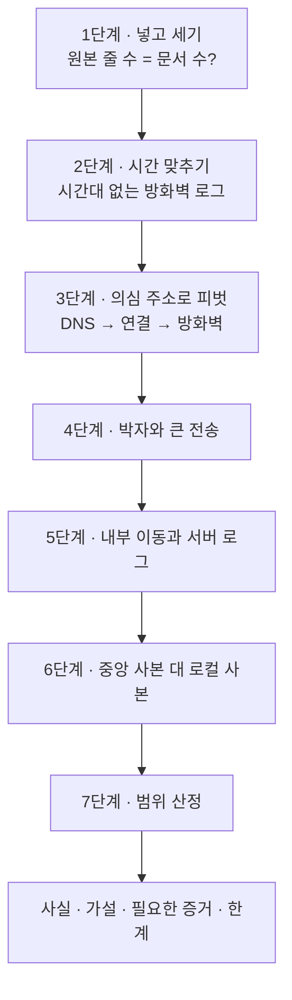
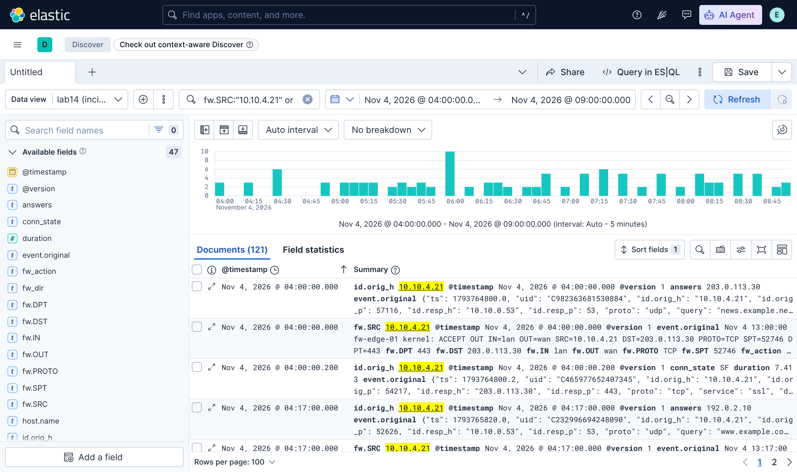

# 2.14강 — 실습 가이드: 로그 집계와 분석 { #lab-log-aggregation }

!!! abstract "이번 회차의 범위"
    - 출처가 다른 로그 네 가지(방화벽 syslog, Zeek `dns.log`·`conn.log`, 파일 서버 `auth.log`의 중앙 사본과 로컬 사본)를 한 Elastic Stack에 모아 하나의 사건으로 엮기
    - 넣은 만큼 들어왔는지 세기, 그리고 [주의] **시간대가 없는 로그**를 다른 로그와 맞추기
    - 의심 주소 하나로 피벗: DNS → 연결 → 방화벽 → 내부 이동 → 서버 로그
    - 박자(비컨), 큰 전송, 측면 이동, 로그 조작(중앙 사본과 로컬 사본의 차이), 범위 산정
    - 결과를 사실, 가설, 필요한 증거, 한계로 나눠 쓰기

!!! note "실습 환경과 표기"
    **(직접 실행 결과)**는 2.13강에서 띄운 **Elasticsearch·Logstash·Kibana 9.4.3**으로 얻었습니다. 실습 데이터는 한 사무실 구간의 **하루(2026-11-04, UTC)**를 흉내 내도록 Python으로 **직접 조립**한 다섯 파일입니다. 방화벽은 **한국 표준시(UTC+9)로 시각을 적고 시간대 표시가 없는** RFC 3164 모양, Zeek 로그는 UTC의 JSON, 파일 서버의 `auth.log`는 UTC의 RFC 3339 시각입니다. 주소는 사설·문서용 주소, 도메인은 예시용이고, 공격자 행동과 계정 이름은 모두 지어낸 것입니다. SOF-ELK 가상 머신 대신 같은 버전의 Elastic Stack에 직접 만든 Logstash 설정으로 넣었기 때문에, SOF-ELK의 대시보드 대신 Kibana Discover와 ES|QL을 씁니다.

## 1. 상황 { #scenario }

**(가상 사례)** 재무팀 파일 서버 `fs-01`(`10.10.0.30`)의 관리자가 "어제 오후에 서버가 잠깐 느렸고, 로그에는 이상한 게 없다"고 합니다. 그런데 보안팀은 같은 날 외부 주소 `203.0.113.66`이 위협 정보 목록에 올라온 것을 봤어요. 손에 있는 것은 이렇습니다.

| 출처 | 파일 | 형식 | 시각 |
| --- | --- | --- | --- |
| 경계 방화벽 `fw-edge-01` | `fw/2026/fw-edge-01.log` | syslog(RFC 3164), 키=값 | **지역 시각(UTC+9), 시간대 표시 없음** |
| 사내 센서의 Zeek | `zeek/dns.log`, `zeek/conn.log` | JSON | UTC(유닉스 시각) |
| 중앙 로그 서버에 모인 `fs-01`의 인증 로그 | `auth/central/fs-01-auth.log` | syslog(RFC 3339 시각) | UTC |
| `fs-01`에서 직접 복사한 인증 로그 | `auth/local/fs-01-auth.log` | 같음 | UTC |

목표는 2.12강의 말 그대로, **모든 데이터를 한곳에 두고** 의심 주소 하나로 사건 전체를 따라가는 것입니다.

**그림 1-1. 이번 실습의 순서** (위에서 아래로)



**읽는 법:** 위에서 아래로 진행합니다. 1~2단계는 "분석할 준비가 됐나"를 확인하는 단계예요. 여기서 틀리면 뒤의 모든 결론이 흔들립니다.

## 2. 1단계: 넣고 세기 { #ingest }

받자마자 원본의 해시와 줄 수를 남깁니다.

```bash
sha256sum fw/2026/*.log zeek/*.log auth/*/*.log
wc -l fw/2026/*.log zeek/*.log auth/*/*.log
```

**(직접 실행 결과, 해시는 앞 16자리)**

```text
6f9526a8acc2b08d  fw/2026/fw-edge-01.log       677줄
fd21ddc200aa18a7  zeek/dns.log                 485줄
1d448214ede60f8c  zeek/conn.log                678줄
71e794f8ef083805  auth/central/fs-01-auth.log    9줄
9689ab5a2d490055  auth/local/fs-01-auth.log      3줄
```

Logstash 설정의 요점은 이렇습니다(전체는 2.13강의 설정과 같은 모양).

- 방화벽: syslog 앞부분을 grok으로 떼고, 나머지 `SRC=… DST=… DPT=…`를 **`kv` 필터**(키=값 쌍을 필드로 나눔)로 `fw.SRC`, `fw.DST` 같은 필드로 만듭니다. 경로의 `2026`을 연도로 붙입니다(2.13강 2.3절).
- Zeek: `json` 코덱으로 읽고 `ts`(유닉스 시각)를 `@timestamp`로.
- `auth.log`: `TIMESTAMP_ISO8601`로 시각을 읽고, SSH 로그인 줄에서 사용자와 출발 주소를 뽑습니다. 중앙 사본과 로컬 사본은 **다른 색인**에 넣습니다.

색인별 문서 수를 원본과 맞춥니다.

```text
GET /_cat/indices/lab14-*?v&h=index,docs.count&s=index
```

**(직접 실행 결과)**

```text
index                docs.count
lab14-auth-central            9
lab14-auth-local              3
lab14-fw                    677
lab14-fw-assumed-utc        677
lab14-zeek-conn             678
lab14-zeek-dns              485
```

모두 원본 줄 수와 같습니다. 방화벽 색인이 둘인 이유는 다음 단계에서 설명해요.

!!! warning "[주의] 넣는 과정에서 직접 만난 두 가지"
    - **`clone` 필터의 표시가 바뀌었다.** 방화벽 로그를 두 가지 시간대 가정으로 동시에 넣으려고 `clone` 필터로 복사본을 만들고 `[type]`으로 갈랐는데, 처음에는 1,354건이 전부 한 색인으로 갔습니다. Logstash 9의 ECS 호환 모드에서 `clone`은 복사본의 표시를 `type`이 아니라 **`tags`**에 넣기 때문이었어요. 조건을 `if "fw_kst" in [tags]`로 고쳐 해결했습니다. 2.13강 2.2절처럼, 오래된 설정 예제를 그대로 쓰면 이런 차이로 결과가 조용히 틀어질 수 있습니다. 문서 수를 세는 습관이 이걸 잡아냈어요.
    - **와일드카드로 색인을 지울 수 없다.** 다시 넣으려고 `DELETE /lab14-*`를 보내자 `Wildcard expressions or all indices are not allowed`라는 오류가 났습니다. Elasticsearch 8부터 기본 설정(`action.destructive_requires_name`)이 실수로 많은 색인을 지우는 것을 막기 때문이에요. 이름을 하나씩 적어 지웠습니다. 증거 저장소로서는 반가운 기본값입니다.

## 3. 2단계: 시간 맞추기 { #time-alignment }

방화벽 로그의 한 줄을 봅니다.

```text
Nov  4 14:14:07 fw-edge-01 kernel: ACCEPT OUT IN=lan OUT=wan SRC=10.10.4.21 DST=203.0.113.66 PROTO=TCP SPT=… DPT=443
```

시각에 **연도도 시간대도 없습니다**. 연도는 경로로 해결했지만, 시간대는 로그 안에서 알 방법이 없어요. 그래서 같은 로그를 두 가지 가정으로 넣었습니다. `lab14-fw-assumed-utc`는 "UTC라고 가정", `lab14-fw`는 "장비 설정 문서에 적힌 한국 표준시(`Asia/Seoul`)". 어느 쪽이 맞는지는 **다른 출처의 같은 사건**과 맞대어 확인합니다. `10.10.4.21` → `203.0.113.66`의 첫 기록을 세 곳에서 찾았습니다.

```text
FROM lab14-fw-assumed-utc, lab14-fw METADATA _index
| WHERE fw.SRC == "10.10.4.21" AND fw.DST == "203.0.113.66"
| STATS first_seen = MIN(@timestamp), n = COUNT(*) BY _index
```

**(직접 실행 결과)**

```text
       first_seen       |       n       |       _index
2026-11-04T14:14:07.000Z|114            |lab14-fw-assumed-utc
2026-11-04T05:14:07.000Z|114            |lab14-fw
```

같은 질의를 Zeek `conn.log`에 하면 첫 연결은 **2026-11-04T05:14:07Z**였습니다(3단계 결과). UTC로 가정한 쪽은 **정확히 9시간** 어긋나고, `Asia/Seoul`로 넣은 쪽은 초까지 맞아요. 건수(114건)도 Zeek의 연결 수와 같았습니다. 그러니 이 방화벽은 한국 표준시로 기록한다는 가정이 **두 독립된 출처의 대조로 뒷받침**됩니다.

!!! tip "ES|QL의 예약어"
    처음에 열 이름을 `first`, `last`로 썼더니 `no viable alternative at input 'first ='`라는 구문 오류가 났습니다(직접 실행 결과). ES|QL에서 `first`, `last`는 예약어라 `first_seen`처럼 다른 이름을 써야 합니다.

**조사에서의 의미:** 시간대가 없는 로그는 **반드시 다른 출처와 대조해** 시간대를 정하고, 그 근거(어떤 사건을 기준으로 몇 시간 차이였나)를 보고서에 적으세요. 대조 없이 UTC로 넣었다면, 이 사건의 방화벽 기록은 실제보다 9시간 **늦게**, 즉 서버 관리자가 말한 "오후"와 전혀 다른 시각에 놓였을 것입니다. 9시간 차이가 아니라 몇 분 차이라면 시간대가 아니라 **장비 시계의 오차**일 수 있고, 그 경우는 따로 기록합니다.

이후 단계에서는 `lab14-fw`(한국 표준시로 바로잡은 쪽)만 씁니다.

## 4. 3단계: 의심 주소로 피벗 { #pivot }

위협 정보의 주소 `203.0.113.66`에서 출발합니다. 먼저 누가 그 주소와 연결했는지.

```text
FROM lab14-zeek-conn | WHERE id.resp_h == "203.0.113.66"
| STATS conns = COUNT(*), first_seen = MIN(@timestamp), last_seen = MAX(@timestamp), max_out = MAX(orig_bytes) BY id.orig_h
```

**(직접 실행 결과)**

```text
     conns     |       first_seen       |       last_seen        |    max_out    |   id.orig_h
114            |2026-11-04T05:14:07.000Z|2026-11-04T23:53:53.507Z|48211907       |10.10.4.21
98             |2026-11-04T07:40:02.000Z|2026-11-04T23:50:11.166Z|419            |10.10.5.17
```

두 PC가 그 주소와 통신했습니다. 그 주소를 어떻게 알았는지 DNS로 봅니다.

```text
FROM lab14-zeek-dns | WHERE query == "beacon.example.org"
| STATS n = COUNT(*), first_seen = MIN(@timestamp) BY id.orig_h
```

(그 전에 `answers`에 `203.0.113.66`이 든 질의를 찾아 이름이 `beacon.example.org`임을 확인했습니다.)

**(직접 실행 결과)**

```text
       n       |       first_seen       |   id.orig_h
19             |2026-11-04T05:14:06.600Z|10.10.4.21
1              |2026-11-04T07:40:01.700Z|10.10.5.17
```

두 PC 모두 첫 연결 **0.3~0.4초 전**에 `beacon.example.org`를 조회했습니다. 이름 → 주소 → 연결의 순서가 초 단위로 이어져요. 그런데 `10.10.4.21`은 연결이 114번인데 DNS 조회는 19번뿐입니다. TTL이 300초라면 10분마다 연결할 때마다 다시 물어야 할 텐데 그렇지 않으니, 프로그램이 이름의 답을 **자체적으로 더 오래 기억**하는 것으로 보입니다(가설). 2.6강에서 본 리졸버 캐시와는 다른, 클라이언트 쪽의 동작이에요. 그래서 DNS 기록만으로 비컨의 횟수를 세면 적게 셉니다.

같은 피벗을 Kibana에서도 해 봤습니다. 데이터 뷰를 `lab14-*`(UTC로 가정한 방화벽 색인은 제외)로 잡고, KQL로 세 출처의 필드 이름을 한꺼번에 걸었어요.

```text
fw.SRC:"10.10.4.21" or id.orig_h:"10.10.4.21" or ssh_src_ip:"10.10.4.21"
```

{ loading=lazy }

**그림 4-1. 한 주소로 세 출처를 엮은 Discover(직접 실행 결과).** 시간 범위는 2026-11-04 04:00~09:00 UTC, 오래된 순서입니다. 같은 04:00:00에 Zeek의 DNS(`answers 203.0.113.30`), 방화벽(`event.original`이 지역 시각 `Nov 4 13:00:00`인 줄), Zeek의 연결이 나란히 놓였어요. 시간대를 바로잡았기 때문에 가능한 모습입니다. 히스토그램의 06:00 무렵 막대가 유난히 높은 것은 5단계의 SSH 시도와 로그인 때문입니다.

**조사에서의 의미:** 출처마다 **같은 뜻의 필드 이름이 다릅니다**(`fw.SRC`, `id.orig_h`, `ssh_src_ip`). 하나만 걸면 나머지 출처가 빠져요. 실제 환경에서는 해석 단계에서 ECS의 `source.ip` 같은 공통 이름으로 맞춰 두면 이런 피벗이 훨씬 쉬워집니다(2.13강 2.2절).

## 5. 4단계: 박자와 큰 전송 { #beacon-exfil }

`10.10.4.21` → `203.0.113.66`의 작은 연결(1,000바이트 미만)들의 간격을 계산했습니다(ES|QL로 시각을 뽑아 Python으로 계산).

**(직접 실행 결과)**

```text
n 113 mean 599.9 s, stdev 1.7 s, min 597.1, max 603.0
```

평균 **600초**, 표준편차 1.7초. 2.4강에서 본 것처럼 사람이 아니라 프로그램의 **비컨** 박자입니다. 그리고 하나만 크기가 달랐어요.

```text
FROM lab14-zeek-conn | WHERE id.orig_h == "10.10.4.21" AND id.resp_h == "203.0.113.66"
| SORT orig_bytes DESC | KEEP @timestamp, orig_bytes, resp_bytes, duration | LIMIT 3
```

**(직접 실행 결과)**

```text
       @timestamp       |  orig_bytes   |  resp_bytes   |     duration
2026-11-04T06:47:31.000Z|48211907       |5120           |412.0
2026-11-04T09:24:04.259Z|420            |218            |0.3824181854724884
2026-11-04T15:44:14.688Z|420            |231            |0.4622810482978821
```

06:47:31(UTC)에 `10.10.4.21`이 **약 46MB를 보내고** 5KB만 받은 연결이 412초 동안 이어졌습니다. 평소의 비컨(400바이트 안팎)과 전혀 다른, **바깥으로 많이 보낸** 모양이에요(2.8강 복습 문제 4의 질의와 같은 생각). HTTPS(443)라 내용은 보이지 않습니다.

## 6. 5단계: 내부 이동과 서버 로그 { #lateral }

`10.10.4.21`이 바깥 말고 **사내 어디와** 통신했는지 봅니다.

```text
FROM lab14-zeek-conn | WHERE id.orig_h == "10.10.4.21" AND id.resp_h != "203.0.113.66" AND id.resp_h LIKE "10.*"
| KEEP @timestamp, id.resp_h, id.resp_p, duration, orig_bytes, resp_bytes
```

**(직접 실행 결과)**

```text
       @timestamp       |   id.resp_h   |   id.resp_p   |   duration    |  orig_bytes   |  resp_bytes
2026-11-04T06:02:12.000Z|10.10.0.30     |22             |1520.0         |5120           |90311
```

06:02:12에 **파일 서버 `10.10.0.30`의 SSH(22)**로 연결해 1,520초(약 25분) 머물렀습니다. 이제 파일 서버의 인증 로그(중앙 사본)를 봅니다.

```text
FROM lab14-auth-central | KEEP @timestamp, syslog_msg | SORT @timestamp
```

**(직접 실행 결과)**

```text
2026-11-04T01:05:02.000Z|Accepted publickey for admin_kim from 10.10.1.12 port 51022 ssh2
2026-11-04T02:30:40.000Z|Accepted publickey for admin_kim from 10.10.1.12 port 51190 ssh2
2026-11-04T06:01:50.000Z|Failed password for svc_backup from 10.10.4.21 port 52200 ssh2
2026-11-04T06:01:54.000Z|Failed password for svc_backup from 10.10.4.21 port 52201 ssh2
2026-11-04T06:01:59.000Z|Failed password for svc_backup from 10.10.4.21 port 52202 ssh2
2026-11-04T06:02:12.400Z|Accepted password for svc_backup from 10.10.4.21 port 52203 ssh2
2026-11-04T06:09:03.000Z|svc_backup : TTY=pts/2 ; PWD=/srv/finance ; USER=root ; COMMAND=/usr/bin/tar czf /tmp/.c.tgz /srv/finance
2026-11-04T06:27:40.000Z|Disconnected from user svc_backup 10.10.4.21 port 52203
2026-11-04T08:15:00.000Z|Accepted publickey for admin_kim from 10.10.1.12 port 52011 ssh2
```

네트워크 기록과 서버 로그가 맞물립니다.

- 06:01:50~59, `10.10.4.21`에서 **백업용 서비스 계정 `svc_backup`**의 비밀번호 실패 3번, 06:02:12.4에 **성공**. Zeek의 연결 시작(06:02:12.0)과 0.4초 차이입니다.
- 06:09:03, 그 계정이 `sudo`로 root가 되어 **`/srv/finance`를 `/tmp/.c.tgz`로 압축**했습니다(점으로 시작하는 숨김 파일 이름).
- 06:27:40 연결 종료. Zeek의 연결 시작 + 1,520초 = 06:27:32로, 8초 안에서 맞습니다.
- 그리고 20분 뒤인 06:47:31에 `10.10.4.21`이 바깥으로 46MB를 보냈습니다(4단계).

평소의 관리자 접속(`admin_kim`, 공개 키, `10.10.1.12`)과 견주면, 비밀번호로, 서비스 계정으로, 처음 보는 PC에서 들어온 이 접속은 기준선에서 크게 벗어나요.

## 7. 6단계: 중앙 사본 대 로컬 사본 { #central-vs-local }

서버 관리자는 "로그에 이상한 게 없다"고 했습니다. 관리자가 본 것은 서버의 **로컬** `auth.log`였어요. 두 사본을 셉니다.

```text
FROM lab14-auth-central, lab14-auth-local METADATA _index | STATS n = COUNT(*) BY _index
```

**(직접 실행 결과)**

```text
       n       |      _index
3              |lab14-auth-local
9              |lab14-auth-central
```

로컬 사본에는 3줄, 중앙 사본에는 9줄. 로컬에 남은 세 줄은 `admin_kim`의 평범한 로그인뿐이었습니다. 중앙 사본에서 사라진 줄을 KQL로 세면:

```text
FROM lab14-auth-central | WHERE KQL("ssh_src_ip:10.10.4.21 or syslog_msg:*svc_backup*") | STATS n = COUNT(*)
```

**(직접 실행 결과)** `6`

`10.10.4.21`과 `svc_backup`에 관련된 **여섯 줄이 정확히 로컬에서만 빠졌습니다.** 2.12강 3절의 실험과 같은 모양이에요. 관리자가 "이상한 게 없다"고 본 이유가 이것입니다. 이 차이 자체가 "공격자가 무엇을 숨기려 했나"를 보여 주는 증거이고, 서버를 켜 둔 채라면 2.12강 3.2절처럼 로그 데몬이 열어 둔 지워진 원본 파일(`/proc/<PID>/fd`)도 확인할 가치가 있습니다.

## 8. 7단계: 범위 산정 { #scoping }

3단계에서 `203.0.113.66`과 통신한 PC가 **둘**이었습니다. `10.10.5.17`을 봅니다.

- 07:40:01.7 `beacon.example.org` 조회 → 07:40:02 첫 연결 → 그 뒤로 10분마다 98번(3단계 결과).
- 최대 전송 419바이트: 큰 전송은 **없었습니다**.
- `10.10.0.30`을 비롯한 사내 주소로의 연결은 **0건**이었습니다(5단계와 같은 질의를 `10.10.5.17`로 바꿔 직접 실행한 결과).

즉 `10.10.5.17`은 **같은 비컨을 07:40부터 시작한 두 번째 감염 PC**로 보이고, 이 데이터 범위 안에서는 자료를 보낸 흔적이 없습니다. 이 PC는 아직 "초기 단계"일 수 있어 우선순위가 높아요. 지금 격리하면 `10.10.4.21`에서 일어난 일(내부 이동, 대량 전송)을 막을 수 있을지 모릅니다.

## 9. 정리해서 쓰기 { #report }

- **관찰(사실):** 시각은 모두 UTC.
    - `10.10.4.21`은 05:14:06.6에 `beacon.example.org`를 조회해 `203.0.113.66`을 받았고, 05:14:07부터 23:53까지 그 주소의 443번으로 114번 연결했다. 작은 연결의 간격은 평균 599.9초, 표준편차 1.7초였다.
    - 06:01:50~59에 `10.10.4.21`에서 `fs-01`로 `svc_backup` 계정의 비밀번호 실패가 3번 있었고, 06:02:12에 로그인에 성공했다(중앙 로그와 Zeek 연결이 0.4초 차이로 일치). 06:09:03에 그 계정이 `sudo`로 `/srv/finance`를 `/tmp/.c.tgz`로 압축했고, 06:27:40에 연결이 끝났다.
    - 06:47:31에 `10.10.4.21`이 `203.0.113.66`으로 48,211,907바이트를 보내고 5,120바이트를 받는 연결이 412초 동안 있었다.
    - `fs-01`의 로컬 `auth.log`에는 위 SSH·sudo 관련 6줄이 없고, 중앙 로그 서버의 사본에는 있다.
    - `10.10.5.17`은 07:40:01.7에 같은 이름을 조회하고 07:40:02부터 같은 주소로 10분 간격 연결 98번을 했다. 큰 전송은 없었다.
    - 방화벽 로그는 한국 표준시로 기록되며, 이 해석은 Zeek 연결과의 대조(첫 연결의 초까지 일치, 건수 일치)로 확인했다.
- **해석(가설):**
    - `10.10.4.21`은 05:14 무렵부터 `203.0.113.66`을 C2로 쓰는 악성코드에 감염됐다.
    - 공격자는 `10.10.4.21`을 거쳐 `svc_backup`의 비밀번호를 맞히고(3번 실패 뒤 성공: 추측이거나 다른 곳에서 얻은 비밀번호) 파일 서버에 들어가, 재무 자료를 압축한 뒤 `10.10.4.21`로 가져가 바깥으로 보냈을 수 있다(06:47의 46MB). 압축 파일이 `10.10.4.21`로 옮겨진 경로와 46MB가 그 압축 파일인지는 아직 확인되지 않았다.
    - 공격자는 `fs-01`의 로컬 로그에서 흔적을 지웠다.
    - `10.10.5.17`은 같은 악성코드의 두 번째 감염이다.
- **더 필요한 증거:**
    - `fs-01`의 `/tmp/.c.tgz` 존재 여부와 크기, 해시. 켜져 있다면 로그 데몬의 열린 파일 핸들(지워진 원본 로그). 셸 기록.
    - `10.10.4.21`과 `10.10.5.17`의 단말 증거: 감염 경로, `beacon.example.org`를 조회한 프로세스, `fs-01`에서 받은 파일.
    - `svc_backup` 계정의 비밀번호가 어디에 쓰이고 저장돼 있었는지(다른 서버, 스크립트, 설정 파일).
    - 프록시·TLS 협상 기록(`203.0.113.66` 연결의 서버 이름, 인증서), 하루 전후의 로그(감염이 언제 시작됐나).
    - 방화벽의 시간대 설정 문서(대조로 얻은 결론의 확인).
- **관찰의 한계:**
    - 443번 통신이라 내용은 보지 못했다. "46MB가 재무 자료"는 시각과 크기에 기댄 추론이다.
    - SSH 연결(06:02~06:27) 안에서 무엇이 오갔는지는 서버 로그의 `sudo` 한 줄 외에는 모른다.
    - `fs-01` 로그의 출처 주소와 시각은 중앙 서버가 받은 값이며, 수신 시각·송신 주소 같은 2.10강 3.4절의 정보는 이 데이터에 없다.
    - 이 데이터는 연습용으로 조립했다.

## 10. 정리 { #summary }

- 네 출처의 로그를 한 Elastic Stack에 모으고, **원본 줄 수와 문서 수가 같은지**부터 확인했습니다. 그 습관이 `clone` 필터의 ECS 동작 차이를 잡아냈습니다.
- 시간대가 없는 방화벽 로그는 두 가정으로 넣고 Zeek과 대조해, **UTC 가정이 정확히 9시간 어긋나고 한국 표준시 가정이 초까지 맞는** 것으로 시간대를 정했습니다.
- 의심 주소 하나로 DNS(이름) → Zeek(연결) → 방화벽(허용) → 사내 이동(SSH) → 서버 로그(로그인, `sudo tar`) → 큰 전송(46MB)을 이었고, 출처마다 다른 필드 이름을 KQL 하나에 함께 걸었습니다.
- 600초 박자의 비컨, 처음 보는 PC에서 서비스 계정으로 들어온 비밀번호 로그인, 로컬에서만 사라진 여섯 줄, 07:40에 시작한 두 번째 감염 PC를 찾았습니다.
- 결과를 사실, 가설, 필요한 증거, 한계로 나눠 썼습니다.

## 복습 문제 { #review }

**문제 1. (기본)** 1단계에서 "원본 줄 수와 문서 수가 같은지"를 확인한 것이 이 실습에서 실제로 어떤 문제를 잡아냈나요? 그리고 SOF-ELK를 썼다면 무엇을 추가로 의심해야 하나요?

??? success "정답과 해설"
    방화벽 로그를 두 시간대 가정으로 나눠 넣으려 했는데 1,354건이 전부 한 색인에 들어간 것을 세는 단계에서 알아챘습니다. Logstash 9의 ECS 모드에서 `clone` 필터가 복사본 표시를 `type`이 아니라 `tags`에 넣기 때문이었어요(2절의 [주의]). 세지 않았다면 한 색인에 두 시간대의 같은 기록이 섞여 모든 시각 분석이 엉망이 됐을 것입니다. SOF-ELK라면 Filebeat 9의 규칙(1,024바이트보다 작은 파일은 읽지 않음, 첫 1,024바이트가 같은 파일은 중복으로 건너뜀, 2.13강 4.1절)도 의심합니다. 예를 들어 이 실습의 로컬 `auth.log`(3줄)는 1,024바이트보다 작아 아예 안 들어갔을 수 있어요.

**문제 2. (변경된 조건)** 방화벽 로그를 UTC 가정(`lab14-fw-assumed-utc`)으로만 넣고 분석했다면, 이 사건의 타임라인에서 무엇이 어떻게 달라졌을까요?

??? success "정답과 해설"
    방화벽 기록이 실제보다 **9시간 늦게** 놓입니다. `10.10.4.21` → `203.0.113.66`의 첫 기록이 05:14가 아니라 14:14 UTC로 보여, Zeek(05:14)·DNS(05:14)와 어긋나요. 그러면 ① "방화벽은 이 통신을 9시간 뒤에야 봤다"거나 "두 기록은 서로 다른 통신이다" 같은 잘못된 해석이 생기고, ② 46MB 전송(06:47)에 해당하는 방화벽 기록이 15:47에 놓여 SSH 로그인(06:02)과의 선후 관계가 뒤틀리며, ③ 방화벽만 있는 다른 사건(Zeek이 없는 구간)은 시각 전체가 틀립니다. 그래서 시간대가 없는 출처는 다른 출처와 대조해 정하고, 그 근거를 적어야 합니다(3절).

**문제 3. (해석)** 3단계에서 `10.10.4.21`의 연결은 114번인데 DNS 조회는 19번뿐이었습니다. 이것을 어떻게 해석하고, 조사에 어떤 영향이 있나요?

??? success "정답과 해설"
    TTL이 300초인데 10분마다 연결하면서 매번 묻지 않았으니, 프로그램이 이름의 답을 **자체적으로 더 오래 기억**하거나 주소를 직접 쓰는 것으로 보입니다(가설). 영향: ① DNS 기록만으로 비컨 횟수나 활동 기간을 세면 적게, 짧게 봅니다. ② 공격자가 이름의 주소를 바꿔도 이 프로그램은 한동안 옛 주소로 갈 수 있어, DNS 싱크홀만으로는 즉시 끊기지 않을 수 있어요. ③ 그래서 DNS(이름)와 연결 기록(주소)을 함께 봐야 하고, 차단은 이름과 주소 양쪽에 겁니다. 리졸버 캐시(2.6강)는 리졸버 쪽의 동작이라 여기서는 원인이 아닙니다. 이 데이터는 클라이언트와 리졸버 사이를 본 것이니까요.

**문제 4. (흔한 오해)** "`fs-01`의 로컬 `auth.log`에 이상한 기록이 없으니, 파일 서버는 침해되지 않았다." 이 실습의 결과로 반박하세요.

??? success "정답과 해설"
    6단계에서 로컬 사본은 3줄, 중앙 사본은 9줄이었고, 빠진 6줄은 정확히 `10.10.4.21`과 `svc_backup`에 관련된 줄(실패 3번, 성공, `sudo tar`, 연결 종료)이었습니다. 로컬 로그가 깨끗한 것은 **누군가 지웠기 때문**이고, 그 차이 자체가 침해와 은폐의 증거예요(2.12강 3절). 또 Zeek의 연결 기록(06:02:12, 22번, 1,520초)이라는 **네트워크 쪽 독립된 증거**도 같은 이야기를 합니다. 서버의 로그 하나만 보고 결론 내리지 않고, 중앙 사본과 네트워크 기록을 함께 봅니다.

**문제 5. (적용)** 4단계의 46MB 전송이 정말 `/srv/finance`의 압축 파일인지 확인하려면, 이 데이터 외에 무엇이 필요하고 어떤 순서로 보겠습니까?

??? success "정답과 해설"
    ① `fs-01`의 `/tmp/.c.tgz`가 남아 있다면 **크기와 해시**(46MB 언저리인가). 지워졌다면 디스크 포렌식으로 흔적을 찾습니다. ② `fs-01`에서 `10.10.4.21`로 그 파일이 어떻게 옮겨졌는지: SSH 연결의 `resp_bytes`가 90,311바이트뿐이라 이 SSH 세션으로 46MB가 옮겨지지는 않았어요. 그러니 **다른 경로**(다른 연결, SMB, 다른 시각의 SCP)를 Zeek `conn.log`에서 06:09~06:47 사이 `10.10.0.30` ↔ `10.10.4.21`로 찾습니다. 이 데이터에서는 그 사이 `10.10.0.30`이 끼인 연결이 **0건**이었어요(직접 실행 결과). 그렇다면 이 센서가 보지 못하는 경로(같은 스위치 안의 통신, 다른 구간)나, 파일이 아직 서버에만 있을 가능성도 생각합니다. ③ `10.10.4.21`의 단말에서 그 파일이나 흔적, 06:47의 연결을 만든 프로세스. ④ 프록시나 TLS 가로채기 기록이 있다면 06:47 연결의 내용이나 크기 정보. 이 조각들이 맞물릴 때까지는 "46MB = 재무 자료"를 가설로 둡니다.

**문제 6. (해석)** 피벗에서 KQL을 `fw.SRC:"10.10.4.21"` 하나로만 걸었다면 무엇이 빠지나요? 실제 환경이라면 어떻게 이 문제를 줄이겠습니까?

??? success "정답과 해설"
    방화벽 기록만 남고, 같은 PC의 Zeek DNS·연결(`id.orig_h`)과 서버 로그의 출발 주소(`ssh_src_ip`)가 **모두 빠집니다**. 출처마다 같은 뜻의 필드 이름이 달랐기 때문이에요(4절). 줄이는 방법: ① 해석 단계(Logstash)에서 ECS 같은 **공통 필드 이름**(`source.ip`, `destination.ip`, `destination.port`, `user.name`)으로 맞춘다. ② 그게 안 되면 피벗할 때 필드를 모두 OR로 걸거나 필드 없이 값만으로 넓게 검색한다. ③ 데이터 뷰마다 어떤 필드가 같은 뜻인지 정리해 둔다. 2.13강 복습 문제 7의 형식 충돌처럼, 이름이 같아도 뜻이 다른 필드에도 주의합니다.

**문제 7. (적용)** 이 사건의 보고를 받은 책임자가 "두 PC를 지금 바로 격리할까요, 아니면 더 지켜볼까요?"라고 묻습니다. 이 실습의 결과로 어떤 판단 근거를 주겠습니까?

??? success "정답과 해설"
    근거: ① `10.10.4.21`은 C2와 하루 종일 통신하고, 서비스 계정으로 파일 서버에 들어가 자료를 압축했으며, 46MB를 바깥으로 보낸 것으로 보입니다. 피해가 **이미 진행된** PC예요. ② `10.10.5.17`은 07:40부터 같은 비컨을 시작했지만 큰 전송과 내부 이동 흔적은 이 데이터에 없습니다. **초기 단계**라 지금 막으면 더 큰 피해를 막을 수 있습니다. ③ `svc_backup` 계정은 공격자가 알고 있으니 **비밀번호 교체와 사용처 점검**이 필요합니다. ④ 다만 격리하면 공격자가 알아챌 수 있고, 단말의 메모리 증거가 사라질 수 있으니, 격리 전에 메모리와 디스크 증거를 확보할지, 두 PC를 동시에 격리할지(하나만 하면 다른 쪽이 경고가 될 수 있음)를 함께 정해야 합니다. 판단 자체는 책임자의 몫이고, 조사자는 사실·가설·위험을 분명히 전합니다.

## 참고 자료 { #references }

- 작업 환경에서 쓴 도구: Elasticsearch·Logstash·Kibana 9.4.3(공식 Docker 이미지, `kv`·`clone`·`date`·`grok` 필터, ES|QL), Playwright(화면 캡처), Python 3.13(데이터 조립과 간격 계산). 실행 결과는 2026-11-05에 얻었습니다.
- 실습 데이터: 직접 조립. SHA-256 앞 16자리 `fw-edge-01.log` 6f9526a8acc2b08d, `dns.log` fd21ddc200aa18a7, `conn.log` 1d448214ede60f8c, 중앙 `fs-01-auth.log` 71e794f8ef083805, 로컬 `fs-01-auth.log` 9689ab5a2d490055.
- Elastic, [Logstash kv 필터](https://www.elastic.co/docs/reference/logstash/plugins/plugins-filters-kv), [clone 필터](https://www.elastic.co/docs/reference/logstash/plugins/plugins-filters-clone) (ECS 호환 모드의 동작), [ES|QL](https://www.elastic.co/docs/explore-analyze/query-filter/languages/esql), [`action.destructive_requires_name`](https://www.elastic.co/docs/reference/elasticsearch/configuration-reference/index-management-settings).
- 이 실습의 개념은 2.4강(비컨 박자), 2.6~2.9강(DNS), 2.8강(Zeek), 2.10강(syslog의 시각), 2.12강(중앙 사본), 2.13강(Elastic Stack)을 바탕으로 합니다.

!!! note "이 페이지에 대하여"
    여러 학습 자료를 바탕으로 직접 다시 쓴 개인 학습 노트입니다. 실습 데이터와 시나리오는 직접 만들었고, 사례는 가상입니다.
