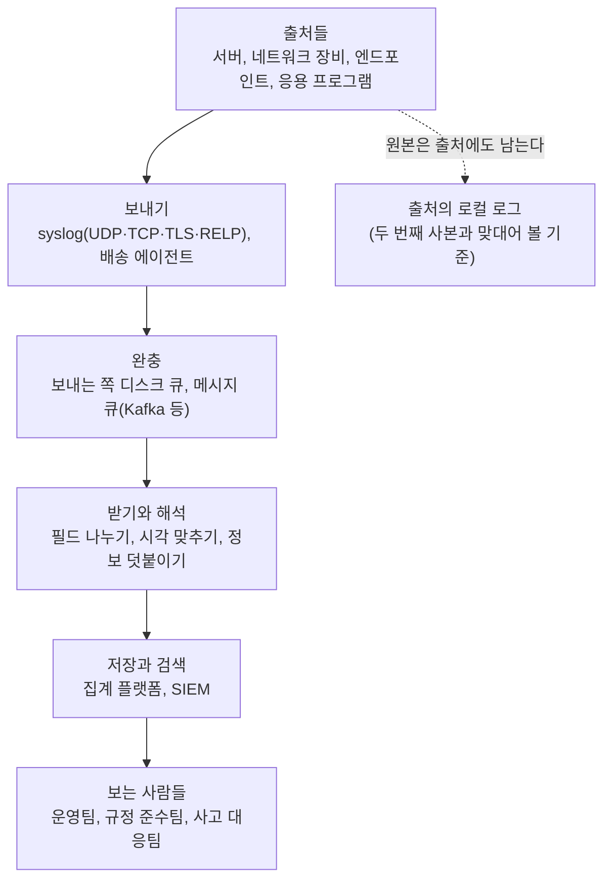

# 2.12강 — 로그 집계: 왜 모으는가, 어떻게 보내는가, 무엇으로 다루는가 { #log-aggregation }

!!! abstract "이번 회차의 범위"
    - 로그는 네트워크 조사의 숨은 주인공이다. 그리고 로그에 딸려 오는 짐(표준 없음, 양, 흩어짐)
    - 중앙 집계의 이점: 공격자가 지운 기록의 **두 번째 사본**, 함께 나눠 보기, 여러 관측 지점
    - 직접 확인: 로컬 로그를 지운 뒤 중앙 사본과 맞대기, [주의] `sed -i`로 지운 파일에 데몬이 계속 쓰는 현상
    - 더 나은 전송: rsyslog·syslog-ng, 큐, TLS, RELP, 로그 배송 도구, 메시지 큐
    - 집계 플랫폼 고르기: 파일 입력, 해석(파싱), 사용자 정의 형식. [변경됨] 교재 이후의 변화

!!! note "실습 환경과 표기"
    **(직접 실행 결과)**는 이 작업 환경의 rsyslog 8.2312.0(Ubuntu 24.04 패키지, `rsyslog-gnutls` 포함)으로 얻었습니다. "서버" 역할의 rsyslog가 로컬 파일에 쓰면서 동시에 "중앙 집계 서버" 역할의 다른 rsyslog(`127.0.0.40`)로 TCP와 UDP로 보내게 했습니다. 로그 메시지와 "공격자의 로그 지우기"는 모두 연습용으로 지어낸 것이고, 주소는 사설·문서용 주소입니다.

## 1. 로그는 숨은 주인공이다 { #why-logs }

네트워크 통신 하나가 출발지에서 목적지까지 거치는 시스템의 수를 떠올려 보세요. 그 시스템들과 그 위의 소프트웨어 하나하나가 그 패킷이 있었다는 귀한 증거를 어떤 로그에든 남기고 있을 수 있습니다.

조사자에게는 아주 좋은 일이에요. 로그는 보통 작고 압축이 잘 됩니다. 규정 준수나 일반적인 업무 기록 때문에 **오래 보관**되는 경우가 많고, 그 방식이 포렌식적으로 믿을 만한 경우도 많습니다. "포렌식적으로 믿을 만한 증거를 오래 보관한다"는 말에 귀가 솔깃하지 않다면 직업을 잘못 고른 걸지도 몰라요. 오래전에 일어난 사건이라도, 그때의 상황을 다시 그려 낼 가장 좋은 재료가 로그일 때가 많습니다.

하지만 이 금광에는 **짐**이 딸려 옵니다.

- **일반적인 "로그"의 표준이 없다.** syslog(2.10강)나 HTTP의 Common Log Format(2.5강)처럼 특정 형식의 표준은 있지만, 로그 전체에 대한 RFC나 IEEE 표준은 없습니다. TCP 통신에 참여하려면 정해진 프로토콜을 따라야 하지만, 로그는 소프트웨어(심지어 하드웨어) 개발자가 꿈꾸는 어떤 모양으로든 남길 수 있어요.
- **양에 한계가 없다.** 형식도 제각각인 엄청난 양을 손으로 보다가는 조사자의 정신이 남아나지 않습니다.
- **장비에 저장 공간이 없다.** 많은 네트워크 장비는 영구 저장 장치가 없어 로그를 **메모리에** 둡니다. 할당된 메모리가 차면 오래된 기록이 밀려나 영영 사라지고, 재부팅하면 빈 버퍼로 시작해요. 포렌식에 좋은 상황이 아니죠.
- **흩어져 있다.** 수천 대의 시스템이 각자 로그를 들고 있다면, 원격으로 모아 한곳에서 분석하는 게 최선이지만 지리적으로 흩어지거나 구조가 복잡한 환경에서는 말처럼 쉽지 않습니다. 모을 수 있다 해도 분석가의 시간을 모으는 데 쓰게 되고, 여러 출처의 이벤트를 손으로 엮어야 해서 분석의 질도 떨어집니다.
- **공통 프로토콜이 없다.** 출처마다 형식이 달라 각각을 해석하는 스크립트가 쌓이고, 결국 Perl·Python·PowerShell·bash 스크립트로 넘쳐나는 공구함이 됩니다.

정리하면, 로그 분석은 겉보기엔 단순하지만 실제로는 **엄청난 양의 자유 형식 데이터 속에 결정적인 증거가 묻혀 있는** 넓은 문제입니다. 때로는 그 사건의 **유일하게 남은 증거**이기도 하고요.

## 2. 중앙 집계: 실시간으로 한곳에 { #why-aggregate }

해결책이 **실시간 중앙 집중식 로그 집계**입니다. 조사 책임자의 속을 덜 태우는 것 말고도 조직에 이점이 많아요.

**두 번째 사본.** 대부분의 공격자는 장악한 시스템이 자기 활동을 기록한다는 걸 알고, 로그를 **지우거나 통째로 없애려** 합니다. 하지만 집계 환경에서는 로그가 **동시에 여러 곳**에 기록돼요. 공격자가 그걸 알고 집계 서버까지 장악하지 않는 한, 활동의 두 번째 기록이 남습니다. 그리고 시스템 안의 로그와 집계된 로그 사이의 **차이** 자체가, 공격자가 무엇을 숨기고 싶었는지 보여 주는 분명한 단서가 됩니다.

**나눠서, 함께.** 집계된 데이터에는 여러 분석가가 동시에 접근할 수 있어, 큰 일을 팀원들이 나눠 맡을 수 있습니다(많은 플랫폼이 웹 화면을 제공). 일부 집계 기술은 같은 로그를 **여러 목적지로** 동시에 보낼 수 있어, 특수한 분석 소프트웨어와 장기 보관 플랫폼이 같은 원본을 받을 수도 있어요.

**한곳에서 사건 전체를 따라가기.** 진짜 힘은 환경 전체의 데이터가 **한곳에** 있다는 데 있습니다. 감염된 PC 하나를 기준으로 질의하면 악성코드 다운로드(프록시), 실행과 설치(엔드포인트), C2 통신(DNS, 방화벽)이 한 화면에 그려져요.

**같은 사건, 여러 관측 지점.** 경계의 IDS는 내부 서브넷 사이의 활동을 전혀 보지 못하지만, 내부 방화벽이나 라우터는 그 사건 타임라인에 중요한 이벤트를 남겼을 수 있습니다(2.6강의 관측 지점과 같은 생각).

새로운 생각은 아닙니다. 보안이 엄격한 곳에서는 예전에 **출입 카드 단말을 다른 방의 라인 프린터에 연결**해 두기도 했어요. 카드를 찍으면 단말의 메모리에도 남고, 동시에 종이에도 인쇄됩니다. 전자적으로 장악당하더라도 모든 기록이 지워지지는 않게 하려는 거예요. 프린터를 잠긴 곳에 두고 연속 용지만 계속 넣어 주면, 사실상 지울 수 없는 기록이 남습니다. 중앙 집계는 그 프린터의 현대판입니다. 비유가 깨지는 곳: 종이에 찍힌 기록은 나중에 고칠 수 없지만, 집계 서버의 파일은 **그 서버를 장악하면 고칠 수 있어요**. 그래서 집계 서버 자체의 접근 통제와 무결성(별도 권한, 추가만 가능한 저장소, 해시)이 중요합니다.

**역할마다 다른 요구.** 네트워크 운영팀은 스위치·라우터·방화벽·프록시 정도만, 한 달쯤만 필요할 수 있습니다. 카드 결제를 처리하는 조직의 PCI 준수팀은 결제 관련 기록을 실시간으로 보고 PCI-DSS가 정한 기간만큼 보관해야 하며, 민감한 정보라 접근 통제도 더 엄격해야 해요. 사고 대응팀과 헌팅팀은 가능한 한 많은 증거를, 법무팀이 허락하는 한 오래 보길 원합니다(이 숫자들은 예시일 뿐, 조직마다 크게 다릅니다). 여러 사무실, 서로 다른 법 관할, 인수와 매각, 외부 컨설턴트까지 생각하면, 현대의 네트워크 환경은 어떤 형태로든 로그 집계 없이는 운영하기 어렵습니다.

**그림 2-1. 로그 집계의 큰 그림** (위에서 아래로 로그가 흐르는 방향)



**읽는 법:** 실선이 로그가 중앙으로 가는 길, 점선은 출처에 남는 원본입니다. 조사자는 두 줄기를 **맞대어** 봅니다(3절). 각 단계에서 로그가 **잃어버려지거나(보내기), 늦어지거나(완충), 모양이 바뀔(해석)** 수 있다는 점도 기억하세요.

## 3. 직접 확인: 지워진 로컬 로그와 중앙 사본 { #scrub-lab }

### 3.1 지우기 전과 후 { #before-after }

"서버"에서 인증 이벤트 여섯 개를 기록했습니다. 로컬 파일 `auth.log`에 쓰는 동시에, 중앙 집계 서버로 TCP로 보냅니다. 그다음 "공격자"가 자기 흔적(공격자 주소 `203.0.113.9`가 든 줄과 `/etc/shadow`를 압축한 `sudo` 줄)을 `sed -i`로 지웠어요.

```bash
sed -i '/203\.0\.113\.9\|\/etc\/shadow/d' auth.log
```

**(직접 실행 결과, 지운 뒤의 로컬 파일)**

```text
2026-11-05T08:17:44.716341+00:00 vm sshd: Accepted password for jkim from 10.10.1.19 port 50111 ssh2
2026-11-05T08:17:44.726769+00:00 vm sshd: Accepted password for mlee from 10.10.1.30 port 50190 ssh2
```

평범한 로그인 두 줄만 남았습니다. 이제 메시지 부분만 떼어 중앙 사본과 비교합니다.

```bash
diff <(sed -E 's/^\S+ \S+ //' auth.log) <(grep via=imtcp central.log | sed -E 's/^.* host=\S+ //')
```

`sed -E 's/^\S+ \S+ //'`는 로컬 줄의 앞 두 칸(시각과 호스트 이름)을, 중앙 쪽 `sed`는 `host=` 칸까지를 떼어 내 두 파일의 **메시지 부분**만 비교하게 합니다. `<( … )`는 명령의 출력을 파일처럼 `diff`에 넘기는 bash 기능이에요.

**(직접 실행 결과)**

```text
1a2,5
> sshd: Failed password for root from 203.0.113.9 port 4444 ssh2
> sshd: Failed password for root from 203.0.113.9 port 4445 ssh2
> sshd: Accepted password for root from 203.0.113.9 port 4446 ssh2
> sudo: root : TTY=pts/1 ; PWD=/root ; USER=root ; COMMAND=/usr/bin/tar czf /tmp/x.tgz /etc/shadow
```

`diff`가 보여 준 **로컬에서 사라진 네 줄**이 곧 공격자가 숨기고 싶었던 것입니다. 비밀번호 두 번 실패 → root 로그인 성공 → 비밀번호 해시 파일을 압축. 교재의 말 그대로, 로컬과 집계 사이의 차이가 "무엇을 숨기려 했나"를 분명하게 보여 줬어요.

중앙 사본의 한 줄은 이런 모양이었습니다(템플릿으로 받은 시각, 보고된 시각, 보낸 주소, 입력 경로를 함께 남김. 2.10강 3.4절).

**(직접 실행 결과, 일부)**

```text
received=2026-11-05T08:17:44.719731+00:00 reported=2026-11-05T08:17:44+00:00 from=127.0.0.1 via=imtcp host=vm sshd: Failed password for root ...
```

**[주의]** `reported`가 **초 단위**로 줄었습니다. 로컬 파일은 마이크로초까지 있었는데요. 보내는 쪽의 전달 동작이 기본 템플릿(전통 형식, RFC 3164 모양)으로 보냈기 때문입니다. 중앙으로 보낼 때도 RFC 5424 템플릿(rsyslog의 `RSYSLOG_SyslogProtocol23Format` 등)을 쓰도록 설정해야 정밀도와 연도·시간대가 살아남아요.

### 3.2 [주의] `sed -i`로 지운 파일에 데몬은 계속 쓴다 { #deleted-inode }

공격자가 지운 뒤, 같은 서버에서 새 이벤트 세 개가 생겼습니다(3.3절의 실험). 그런데 로컬 `auth.log`에는 **새 줄이 하나도 생기지 않았어요.** 이유를 찾아봤습니다.

```bash
ls -l /proc/$(cat cli/pid)/fd | grep auth.log
```

**(직접 실행 결과)**

```text
l-wx------ 1 root root 64 Nov  5 08:18 6 -> …/cli/auth.log (deleted)
```

`sed -i`는 파일을 "그 자리에서" 고치는 게 아니라, **새 파일을 만들어 원래 이름으로 바꿔치기**합니다. rsyslog는 여전히 **원래 파일(이제 이름이 없어진, 지워진 파일)**을 열어 둔 채 그쪽에 계속 쓰고 있었어요. 열린 파일 핸들로 그 지워진 파일을 읽어 봤습니다.

**(직접 실행 결과)**

```text
lines in deleted inode: 9; with 203.0.113.9: 3
visible file lines: 2
inode 829105 (보이는 auth.log)   inode 829062 (rsyslog가 열어 둔 파일)
```

지워진 원래 파일에는 **공격자가 지우기 전의 여섯 줄 전부**(공격자 주소가 든 세 줄 포함)와 그 뒤의 새 줄 세 개, 모두 아홉 줄이 그대로 있었습니다. 눈에 보이는 `auth.log`(다른 inode)에는 두 줄뿐이고요.

**조사에서의 의미:**

- **켜져 있는 시스템을 조사한다면**, 로그 데몬을 재시작하기 **전에** `/proc/<PID>/fd/`에서 `(deleted)`로 표시된 로그 파일을 찾아 복사하세요. 공격자가 지운 원본이 거기 있을 수 있습니다. 재시작하거나 로그 회전으로 파일을 다시 열면 그 핸들은 닫히고, 내용은 디스크의 빈 공간으로 돌아갑니다(그때는 디스크 포렌식의 영역).
- 반대로, 공격자가 이렇게 지우면 **그 뒤의 로컬 로그가 보이는 파일에 남지 않는** 부작용이 생깁니다. 로그가 어느 순간부터 "조용해졌다"면, 이런 조작을 의심하는 단서가 돼요.
- 그리고 중앙 사본은 이 모든 것과 무관하게 **계속 받고 있었습니다**(다음 절).

### 3.3 집계 서버가 잠시 내려가면: 큐 { #queue }

중앙 집계 서버를 내리고, 그사이 같은 이벤트를 TCP 전달(디스크 큐를 켠 것)과 UDP 전달 **둘 다로** 보냈습니다. 보내는 쪽의 TCP 전달 설정은 이랬어요.

```text
authpriv.* action(type="omfwd" target="127.0.0.40" port="10601" protocol="tcp"
                 queue.type="LinkedList" queue.filename="fwd_tcp" queue.saveOnShutdown="on"
                 action.resumeRetryCount="-1" action.resumeInterval="5")
```

- `queue.type="LinkedList"`와 `queue.filename`: 메모리 큐를 쓰되, 넘치거나 종료할 때는 **디스크에 저장**하는(disk-assisted) 큐.
- `action.resumeRetryCount="-1"`: 목적지가 돌아올 때까지 **끝없이 다시 시도**.
- `action.resumeInterval="5"`: 5초 간격으로 다시 시도.

08:18:02~04에 이벤트 세 개를 만들고, 08:18:17쯤 집계 서버를 다시 올렸습니다.

**(직접 실행 결과, 중앙 사본)**

```text
received=2026-11-05T08:18:22.238783+00:00 reported=2026-11-05T08:18:02+00:00 from=127.0.0.1 via=imtcp … while-down 1 …
received=2026-11-05T08:18:22.238783+00:00 reported=2026-11-05T08:18:03+00:00 from=127.0.0.1 via=imtcp … while-down 2 …
received=2026-11-05T08:18:22.238783+00:00 reported=2026-11-05T08:18:04+00:00 from=127.0.0.1 via=imtcp … while-down 3 …
UDP로 보낸 같은 세 이벤트: 0건
```

TCP로 보낸 세 이벤트는 집계 서버가 돌아오자 **모두 도착**했고, 받은 시각은 셋 다 08:18:22(밀린 것을 한꺼번에 받음), 보고된 시각은 08:18:02~04 그대로였습니다. UDP로 보낸 쪽은 **하나도 남지 않았어요**. 보낸 쪽도 받은 쪽도 잃어버린 사실을 모릅니다.

**조사에서의 의미:** 중앙 사본에서 **받은 시각이 한꺼번에 몰린 묶음**이 보인다면, 그 앞에 집계 서버나 네트워크가 끊긴 구간이 있었다는 뜻일 수 있습니다. 그 구간은 보고된 시각으로 다시 정렬하고, UDP로만 받는 출처는 그 구간이 **비어 있을 수 있다**는 점을 기록하세요. 큐의 크기에도 한계가 있으니, 오래 끊기면 TCP라도 잃을 수 있습니다.

## 4. syslog보다 나은 전송 { #better-transport }

2.10강에서 본 syslog의 두 약점은 **UDP의 비신뢰성**(보내고 잊는 프로토콜이라 조용히 잃거나 위조될 수 있음)과 **평문**(root만 읽을 수 있는 파일에 넣어 두던 민감한 로그를 누구나 엿보고, 가로채고, 바꿀 수 있는 선 위로 내보냄)입니다. 대부분의 유닉스에 기본으로 들어 있다 해도, 평문 로그 프로토콜을 쓰기 전에 위험을 따져야 해요. 다행히 공개 소스 덕분에 개선된 구현들이 있습니다.

### 4.1 rsyslog와 syslog-ng { #rsyslog-syslogng }

- **rsyslog**: Red Hat 계열(Fedora, CentOS 계열 등)과 Ubuntu를 비롯한 여러 리눅스 배포판의 기본 로그 서비스이고, BSD·Solaris 같은 다른 유닉스용으로도 빌드할 수 있습니다. 큰 장점은 **옛 syslog의 설정 파일을 그대로** 쓸 수 있다는 것이라 이전이 수월해요(2.10강 5절의 설정이 그대로 동작했음).
- **syslog-ng**: 설정 파일 형식이 다르지만, 훨씬 세밀한 거르기와 해석 기능을 줍니다.

둘 다 **TCP 전송과 암호화**를 지원하고, 서버를 쓸 수 없는 동안 클라이언트에서 생긴 메시지를 **큐에 쌓아 두었다가** 서버가 돌아오면 보냅니다(3.3절에서 직접 확인). 옛 syslog 데몬을 아주 적은 노력으로 대신하면서 무결성과 보안 기능을 많이 더해 줘요.

### 4.2 TLS: 선 위에서 읽히지 않게 { #tls-lab }

연습용 인증 기관을 만들어 집계 서버에 인증서를 주고(`logs.example.net`), 보내는 쪽은 인증서의 이름을 확인하도록(`x509/name`) 해서 6514번 포트로 보냈습니다.

```text
# 보내는 쪽
*.* action(type="omfwd" target="127.0.0.41" port="6514" protocol="tcp" StreamDriver="gtls"
           StreamDriverMode="1" StreamDriverAuthMode="x509/name" StreamDriverPermittedPeers="logs.example.net")
```

**(직접 실행 결과)**

```text
== 집계 서버에 저장된 줄
2026-11-05T08:18:59+00:00 vm sshd: TLS-TEST Failed password for root from 203.0.113.9
== 선 위의 패킷
      6 TCP
      5 TLSv1.2
pcap 안에서 평문 "TLS-TEST" 찾기: 0
```

집계 서버에는 그대로 저장됐지만, 캡처한 패킷에서는 메시지 글자를 **찾을 수 없었습니다**. 2.10강의 평문 syslog와 정반대예요. 이 rsyslog의 TLS 드라이버(GnuTLS)는 TLS 1.2로 협상했습니다.

**네트워크 포렌식의 관점에서 양면이 있습니다.** TLS를 쓰면 로그가 엿보이거나 바뀌지 않지만, 2.10강 6.2절처럼 **pcap이 두 번째 사본이 되는 일도 없습니다**. 그러니 TLS를 쓸수록 집계 서버 자체의 보존과 무결성이 더 중요해져요.

### 4.3 RELP, 로그 배송 도구, 메시지 큐 { #shippers-queues }

- **RELP**(Reliable Event Logging Protocol): rsyslog 개발팀이 만든 프로토콜로, 각 메시지가 목적지에 **도착했음을 확인**하도록 설계됐습니다. TCP만으로는 연결이 끊기는 순간 버퍼에 있던 메시지가 사라질 수 있는데, RELP는 응용 계층에서 확인을 주고받아 이를 막아요. TLS 암호화도 기본으로 지원합니다(이 환경에 `rsyslog-relp` 모듈을 설치해 두었지만, 실험은 하지 않았습니다).
- **로그 배송 도구(log shipper)**: 각 시스템에서 도는 작은 에이전트가 데이터 출처를 지켜보다가, 정규화해서 저장소로 바로 보내거나 해석·보강 단계로 넘깁니다. Elastic의 **Beats**가 대표적이에요. 원시 파일은 Filebeat, Windows 이벤트 로그는 Winlogbeat(2.11강), 시스템 상태는 Metricbeat 등. 공동체가 만든(지원되지 않는) Beat 모듈도 많습니다.
- **메시지 큐**: 원래는 프로세스 간 통신(IPC)을 위한 구조지만, 그 성격상 로그를 만든 쪽과 받는 쪽 사이에 로그를 주고받는 데 아주 잘 맞습니다. RabbitMQ, ZeroMQ, Apache Kafka 등 수십 가지가 쓰이고, 대부분의 집계 플랫폼이 이 중 일부를 입력으로 받을 수 있어요. 집계 서버가 잠시 느려지거나 멈춰도 큐가 **완충** 역할을 합니다(그림 2-1).

!!! info "[보충] 교재 이후 흔해진 배송·수집 도구(2026-11-05 기준)"
    Beats와 함께 Elastic Agent(2.11강), 그리고 공급사에 덜 묶인 **Fluentd·Fluent Bit**, **Vector**, **OpenTelemetry Collector**(로그·지표·추적을 함께 다룸) 같은 도구가 널리 쓰입니다. 클라우드 환경에서는 각 클라우드의 로그 서비스가 출처이자 목적지가 되기도 해요. 도구가 무엇이든 조사자가 확인할 질문은 같습니다. **무엇을 버리고, 무엇을 바꾸고, 끊기면 얼마나 쌓아 두는가.**

## 5. 집계 플랫폼 고르기 { #platforms }

로그 집계와 분석 기능을 주는 도구는 많습니다. 대부분의 **SIEM**은 로그를 핵심 데이터로 쓰고, 규모와 범위 때문에 상용 제품이 많지만 무료(또는 거의 무료)인 도구도 있어요. 범용 로그 집계·분석 도구로는 아마 가장 빠르게 퍼진 것이 **Elastic Stack**("ELK": 저장·검색의 Elasticsearch, 수집·해석·보강의 Logstash, 화면의 Kibana)이고, 이 교육 과정에서 쓰는 **SOF-ELK**는 ELK를 완전히 갖춘 무료 공동체 배포판입니다(2.13강). 그 밖에 무료 쪽의 ELSA(Enterprise Log Search and Archive), 상용 쪽의 Splunk, LogRhythm 등이 있습니다.

SIEM과 집계 도구 시장은 북적이고 선택지가 수십 가지입니다. 조사·대응·헌팅의 관점에서 평가할 때 볼 것:

1. **어떻게 데이터를 넣나.** 대부분의 로그 증거는 **파일**로 옵니다. 파일을 넣을 수 없는 플랫폼은 대부분의 DFIR 작업 흐름에 맞지 않아요. 기존 파일 증거와 실시간 출처를 **둘 다** 넣을 수 있다면, 진행 중인 사고와 헌팅에 아주 강력한 조합이 됩니다.
2. **형식을 어떻게 다루나.** syslog 메시지는 자유로운 글일 뿐이고, 응용 프로그램마다 제 모양을 정합니다. 그대로는 분석이 쉽지 않아요. 대부분의 집계 도구는 흔한 형식을 **자동으로 해석**하고, 사용자가 **형식을 정의**해 자주 만나는 데이터를 의미 있는 필드로 나누게 해 줍니다. 별도 정의가 없어도 IP 주소나 날짜 같은 흔한 데이터 형식을 알아보고 검색하기 쉽게 토큰으로 나누는 도구도 많습니다.
3. **사용자 정의 해석에 무엇을 쓰나.** 사용자 정의 해석은 **거의 늘** 필요합니다. 예를 들어 Logstash는 **grok**이라는 문법을, ELSA는 XML 기반 구조를 썼어요. 평가할 때 그 언어나 틀이 우리 데이터에 맞는지 보세요.

!!! warning "[변경됨] 교재 이후 플랫폼 지형의 변화(2026-11-05 기준)"
    - **Elastic의 라이선스**: 교재는 Elastic Stack을 "무료 소프트웨어"로 소개합니다. Elastic은 2021년에 Elasticsearch와 Kibana의 라이선스를 Apache 2.0에서 Elastic License와 SSPL로 바꿨고(무료로 쓸 수는 있지만 OSI가 인정한 공개 소스 라이선스는 아님), AWS는 이에 대응해 7.10.2를 갈라 **OpenSearch**(Apache 2.0)를 만들었습니다. 2024년 8월에는 Elastic이 **AGPL**을 세 번째 선택지로 더해 다시 공개 소스 라이선스로도 쓸 수 있게 했어요(관련 보도로 확인). 조직에서 도입을 검토한다면 라이선스와 기능별 구독 조건을 확인하세요.
    - **ELSA**: 검색으로 확인한 범위에서 ELSA는 활발히 개발되지 않는 것으로 보이고, ELSA를 쓰던 Security Onion도 Elastic 기반으로 옮겼습니다(Security Onion 2.x 문서에 ELSA가 없음). 오래된 사건의 증거가 ELSA에 남아 있는 경우가 아니라면 새로 고를 대상은 아닙니다.

## 6. 실제 조사에서는 이렇게 씁니다 { #in-practice }

1. **사본이 어디 있는지부터 그린다.** 출처의 로컬 로그, 중앙 집계, 그 사이의 큐, 보관 저장소(그림 2-1).
2. **로컬과 중앙을 맞댄다.** 차이가 곧 단서입니다(3.1절). 메시지 부분만 비교할 수 있게 앞부분을 정리한 뒤 `diff`합니다.
3. **켜진 시스템에서는 열린 로그 핸들을 먼저 확보한다.** `/proc/<PID>/fd`의 `(deleted)` 파일(3.2절). 데몬 재시작은 그다음입니다.
4. **받은 시각이 몰린 묶음과 빈틈을 찾는다.** 끊겼던 구간과 UDP 출처의 손실(3.3절).
5. **전송 중의 변형을 확인한다.** 정밀도·연도·시간대가 줄지 않았는지(3.1절의 초 단위), 필드가 빠지지 않았는지(2.11강 5.1절).
6. **집계 서버 자체를 증거로 다룬다.** 접근 기록, 무결성, 설정(어떤 템플릿으로, 어디서 받는가).
7. **역할별 보관 기간을 안다.** 사건이 오래전이라면 어느 팀의 저장소에 그 기간이 남아 있는지.

## 7. 정리 { #summary }

- 로그는 작고, 압축이 잘 되고, 오래 보관되는 경우가 많아 오래된 사건도 다시 그리게 해 줍니다. 하지만 일반 표준이 없고, 양이 많고, 장비 메모리에만 있다 사라지기도 하고, 흩어져 있고, 공통 프로토콜이 없습니다.
- 중앙 집계의 이점: **두 번째 사본**(공격자가 지운 것이 남고, 차이가 단서가 됨), 함께 나눠 보기, 한곳에서 사건 전체를 따라가기, 여러 관측 지점. 출입 카드와 라인 프린터의 현대판이지만, 집계 서버는 장악되면 고칠 수 있으니 무결성이 중요합니다.
- 직접 확인: 로컬에서 지운 네 줄이 `diff`로 그대로 드러났고(실패 두 번 → root 로그인 → `/etc/shadow` 압축), **`sed -i`로 지운 뒤에도 rsyslog는 지워진 원래 파일에 계속 써서** 원본 아홉 줄이 `/proc/<PID>/fd`에 남아 있었습니다. 기본 전달 템플릿은 시각을 초 단위로 줄였습니다.
- 집계 서버가 내려간 동안 TCP(디스크 큐)로 보낸 이벤트는 돌아온 뒤 모두 도착했고(받은 시각이 한꺼번에 몰림), UDP로 보낸 것은 하나도 남지 않았습니다. TLS로 보낸 로그는 pcap에서 읽히지 않았습니다.
- 더 나은 전송: rsyslog(옛 설정 호환), syslog-ng(세밀한 해석), TCP·TLS·큐, RELP, Beats 같은 배송 도구, Kafka 같은 메시지 큐. **[보충]** Fluent Bit, Vector, OpenTelemetry Collector.
- 플랫폼 평가: 파일 입력과 실시간 입력, 자동 해석과 사용자 정의 형식(grok 등). **[변경됨]** Elastic의 라이선스 변화(2021년 SSPL·ELv2, OpenSearch 분기, 2024년 AGPL 추가), ELSA의 쇠퇴.

## 복습 문제 { #review }

**문제 1. (기본)** 중앙 집계가 조사에 주는 이점 세 가지를 들고, 각각 이 강의의 실험이나 예와 연결해 설명해 보세요.

??? success "정답과 해설"
    예: ① **두 번째 사본**: 공격자가 로컬 로그를 지워도 중앙에는 남고, 그 **차이가 숨기려던 것**을 보여 줍니다(3.1절에서 지운 네 줄이 `diff`로 드러남). ② **한곳에서 사건 전체를 따라가기**: 감염된 PC 하나로 질의해 프록시의 다운로드, 엔드포인트의 실행, DNS·방화벽의 C2를 한 화면에 엮습니다(2절). ③ **여러 관측 지점**: 경계 IDS가 못 보는 내부 서브넷 사이의 활동을 내부 방화벽 로그가 보여 줍니다. 그 밖에 여러 분석가가 동시에 나눠 보기, 같은 로그를 여러 목적지로 보내기도 이점입니다.

**문제 2. (해석)** 한 리눅스 서버를 켜진 채로 조사하는데, `/var/log/auth.log`의 마지막 줄이 사흘 전이고 그 뒤로 아무것도 없습니다. 하지만 `rsyslogd`는 돌고 있어요. 무엇을 의심하고, 무엇을 먼저 하겠습니까?

??? success "정답과 해설"
    3.2절처럼 누군가 `sed -i` 같은 방법으로 파일을 **바꿔치기**해서, rsyslog가 **지워진 원래 파일**에 계속 쓰고 있을 가능성을 의심합니다(보이는 파일에는 새 줄이 안 생김). 먼저 할 일: rsyslog를 **재시작하지 말고** `ls -l /proc/$(pidof rsyslogd)/fd`에서 `(deleted)`로 표시된 로그 파일을 찾아, 그 핸들을 통해 내용을 복사하고(`cp /proc/<PID>/fd/<N> 증거파일`) 해시를 남깁니다. 그 안에 지워지기 전의 원본과 그 뒤의 새 줄이 있을 수 있어요. 그다음 보이는 파일의 inode와 수정 시각, 셸 기록, 중앙 사본과 비교합니다. 그 밖의 가능성(로그 회전 설정 문제, 디스크 가득 참, 설정 변경)도 함께 확인합니다.

**문제 3. (변경된 조건)** 3.3절의 실험에서 보내는 쪽 설정에 큐가 없고(`queue.type` 생략), 재시도 횟수도 기본값이었다면 결과가 어떻게 달라졌을 거라고 예상하나요? 그리고 그 예상을 어떻게 확인하겠습니까?

??? success "정답과 해설"
    **예상(가설):** 집계 서버가 내려가 있던 동안의 이벤트를 TCP라도 **일부 또는 전부 잃었을** 가능성이 큽니다. 기본 설정에서는 동작이 몇 번 실패하면 일시 중단되고, 그동안의 메시지를 보관할 디스크 큐가 없으니까요. 메모리에 쌓을 수 있는 양도 제한돼 있고, 보내는 쪽 rsyslog를 재시작하면 메모리의 메시지는 사라집니다. **확인:** 같은 실험을 큐 없는 설정으로 되풀이해 중앙 사본의 줄 수를 세고, 보내는 쪽 rsyslog의 내부 메시지(동작 일시 중단, 메시지 버림)를 봅니다. 이 강의에서는 이 변형을 실행하지 않았으므로, 결과를 단정하지 않고 실험으로 확인해야 합니다.

**문제 4. (흔한 오해)** "중앙 집계 서버가 있으니, 공격자가 로그를 지워도 아무 문제 없다." 이 주장의 허점을 세 가지 이상 말해 보세요.

??? success "정답과 해설"
    ① **집계 서버 자체가 장악**되면 사본도 고칠 수 있습니다(2절의 비유가 깨지는 곳). 별도 권한, 추가만 가능한 저장, 해시가 필요해요. ② **보내지 않은 로그는 없다**: 모든 출처와 모든 이벤트를 보내도록 설정하지 않았다면 사본이 없습니다(2.10강의 선택자). ③ **전송 중 손실**: UDP는 조용히 잃고(3.3절), TCP도 큐가 없으면 끊긴 동안 잃을 수 있습니다. ④ **지연**: Windows 이벤트 전달처럼 묶어서 보내는 경우, 보내기 전에 지우면 사본이 없습니다(2.11강 3.2절). ⑤ **공격자가 먼저 전송을 끊을 수 있다**: 로그 데몬을 멈추거나 설정을 바꾸면, 그 뒤의 이벤트는 중앙에 가지 않아요(다만 "어느 순간부터 조용해졌다"는 것 자체가 단서). ⑥ **변형**: 정밀도, 필드, 시간대가 줄어든 사본은 원본만큼 쓸모 있지 않을 수 있습니다(3.1절).

**문제 5. (해석)** 중앙 사본에서 한 서버의 이벤트 40개가 받은 시각 `02:31:07.4`로 **모두 같고**, 보고된 시각은 `02:12:00`부터 `02:30:55`까지 흩어져 있습니다. 무엇이 일어났을까요? 어떻게 다루겠습니까?

??? success "정답과 해설"
    3.3절의 모양입니다. 02:12 무렵부터 02:31 직전까지 그 서버와 집계 서버 사이의 전송이 **끊겼고**(집계 서버 중단, 네트워크 장애, 방화벽 변경 등), 보내는 쪽 큐에 쌓였던 이벤트가 02:31:07에 **한꺼번에** 도착한 것으로 보입니다. 다루는 법: ① 타임라인은 **보고된 시각**으로 정렬하되, 보고된 시각은 보낸 쪽의 주장이라는 점을 기억합니다. ② 그 19분 동안 **UDP로만 받는 다른 출처**는 빈틈이 있을 수 있다고 기록합니다. ③ 끊긴 원인(집계 서버 로그, 네트워크 장비 로그)을 확인합니다. 공격자가 일부러 끊었을 가능성도 있어요. ④ 실시간 경보가 이 구간에서 늦었는지도 점검합니다.

**문제 6. (적용)** 조직이 새 집계 플랫폼을 고르고 있습니다. 사고 대응팀의 관점에서 평가 질문 다섯 가지를 만들어 보세요.

??? success "정답과 해설"
    예: ① **기존 파일 증거**(pcap에서 뽑은 Zeek 로그, 압수한 서버의 로그 파일, CSV)를 쉽게 넣을 수 있는가, 실시간 입력과 함께 쓸 수 있는가(5절). ② 흔한 형식을 **자동 해석**하는가, **사용자 정의 해석**(grok 같은)을 어떤 언어로 하는가, 해석 실패한 원본도 보존하는가. ③ **받은 시각과 원래 시각**, 보낸 주소를 따로 저장하는가(2.10강 3.4절). 시간대를 어떻게 다루는가. ④ 보존 기간과 비용, 오래된 데이터의 검색 속도, **무결성**(변경 기록, 접근 기록). ⑤ 내보내기: 조사 결과를 원본 형식이나 JSON으로 뽑아 다른 도구와 보고서에 쓸 수 있는가. ⑥ 라이선스와 비용 구조(5절의 [변경됨]), 공급사에 묶이는 정도. ⑦ 여러 분석가의 동시 사용과 권한 분리.

**문제 7. (흔한 오해)** "TLS로 로그를 보내면 무조건 조사에 더 좋다." 이 강의의 실험으로 장단점을 정리해 보세요.

??? success "정답과 해설"
    **장점:** 선 위에서 엿보이거나 바뀌지 않습니다(4.2절: pcap에서 메시지 글자를 찾을 수 없었음). 인증서 이름 확인(`x509/name`)을 쓰면 엉뚱한 서버로 보내지도 않아요. **단점(조사 관점):** 2.10강 6.2절처럼 **pcap이 로그의 두 번째 사본이 되는 일이 없어집니다**. 그만큼 집계 서버 자체의 보존과 무결성에 기대게 되고, 인증서 만료나 설정 오류로 전송이 멈추면 그동안의 로그가 쌓이거나 사라질 수 있어요(큐 설정이 중요). 결론적으로 TLS는 대부분의 환경에서 써야 하지만, 그와 함께 **집계 서버를 증거 저장소로 지키는 장치**와 **전송 실패를 알아채는 감시**가 필요합니다.

## 참고 자료 { #references }

- 작업 환경에서 쓴 도구: rsyslog 8.2312.0(Ubuntu 24.04 패키지, `omfwd`의 디스크 보조 큐, `rsyslog-gnutls`의 TLS 드라이버, `rsyslog-relp` 설치), OpenSSL(연습용 인증 기관과 인증서), util-linux `logger` 2.39.3, GNU `sed`·`diff`, tcpdump, TShark 4.2.2. 실행 결과는 2026-11-05에 얻었습니다.
- rsyslog, [설명서](https://www.rsyslog.com/doc/) (`omfwd`, 큐 매개변수 `queue.type`·`queue.filename`·`action.resumeRetryCount`, TLS 드라이버 `gtls`, RELP).
- syslog-ng, [설명서](https://syslog-ng.github.io/).
- IETF, [RFC 5425](https://www.rfc-editor.org/rfc/rfc5425) (syslog over TLS, 6514번 포트).
- Elastic, [Beats](https://www.elastic.co/beats/) (Filebeat, Winlogbeat, Metricbeat).
- Apache Kafka, RabbitMQ, ZeroMQ 각 프로젝트 문서(메시지 큐).
- Elastic 라이선스 변화: 2021년의 ELv2·SSPL 전환과 OpenSearch 분기, 2024년 8월의 AGPL 추가(관련 보도로 2026-11-05 확인). [OpenSearch](https://opensearch.org/).
- ELSA와 Security Onion의 이전: Security Onion 문서와 메일링 리스트(2026-11-05 검색 결과로 확인).

!!! note "이 페이지에 대하여"
    여러 학습 자료를 바탕으로 직접 다시 쓴 개인 학습 노트입니다. 로그 메시지와 조작 실험은 직접 만들었고, 사례는 가상입니다.
