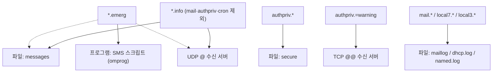

# 2.10강 — syslog: 메시지 형식, facility와 severity, 설정 파일 읽기 { #syslog }

!!! abstract "이번 회차의 범위"
    - syslog는 **데몬**이자 **프로토콜**이다. 그리고 왜 조사자에게 귀한가
    - 누가 syslog를 보내고, 누가 받는가
    - 메시지 읽기: 전통 형식(RFC 3164)과 현재 표준(RFC 5424). [주의] 연도와 시간대가 없다, 시각과 호스트 이름은 **보낸 쪽이 정한다**
    - facility, severity, 그리고 PRI 계산
    - 설정 파일 읽기: 선택자(selector)와 동작(action). [정정] `!` 선택자는 혼자서는 아무것도 고르지 않는다
    - 전송: UDP의 손실, TCP, 그리고 [변경됨] journald 시대의 syslog

!!! note "실습 환경과 표기"
    **(직접 실행 결과)**는 이 작업 환경(Ubuntu 24.04)의 **rsyslog 8.2312.0**과 util-linux의 `logger` 2.39.3, TShark 4.2.2로 얻었습니다. 수신 서버 역할의 rsyslog를 `127.0.0.30`의 10514번 포트(UDP·TCP)에 띄우고, 보내는 쪽 역할의 rsyslog는 별도의 소켓으로 메시지를 받게 해 두 인스턴스 사이의 흐름을 봤습니다. 컨테이너의 호스트 이름이 `vm`이라 메시지에 `vm`이 찍힙니다. 연도 넘김 실험은 `faketime`으로 **수신 서버의 시계만** 2027-01-01로 흉내 냈습니다. 메시지 내용(로그인 실패, DHCP 등)은 모두 연습용으로 지어낸 것입니다.

## 1. syslog: 데몬이자 프로토콜 { #what-is-syslog }

이름 그대로 syslog는 시스템의 로그 이벤트를 다룹니다. 그런데 이 말은 **두 가지**를 가리켜요.

- **데몬**: 오래된 유닉스 프로그램으로, 로그 메시지를 받아 설정 파일에 따라 **하나 이상의 목적지**(파일, 다른 프로그램, 네트워크의 다른 시스템)로 보냅니다. rsyslog, syslog-ng 같은 것이 오늘날의 구현이에요.
- **프로토콜**: 네트워크로 메시지를 보낼 때 **선 위에서 어떤 모양인지**를 정한 약속입니다.

비유하면 syslog 데몬은 **회사 우편실**이고, 프로토콜은 **봉투 양식**입니다. 각 부서(프로그램)가 쪽지를 우편실에 넘기면, 우편실은 봉투 겉의 표시(facility와 severity, 4절)를 보고 어느 서류함(파일)에 넣을지, 본사(원격 서버)로 보낼지, 급하면 사장실 전화(모든 사용자의 화면)로 알릴지 정해요. 비유가 깨지는 곳: 진짜 우편실은 보낸 사람을 확인하지만, syslog는 봉투에 적힌 **보낸 사람과 날짜를 그대로 믿습니다**(3.4절). 그리고 UDP로 보낸 봉투는 **잃어버려도 아무도 모릅니다**(6절).

syslog는 원래 관리자의 운영을 돕기 위해 만들어졌지만, 보안 분야도 곧 그 가치를 알아봤습니다. 로그는 과거 사건의 **부분적인 기록**이에요. 로그의 한계를 알고 확인하며 쓴다면, 증거 묶음에 넣었을 때 과거를 훨씬 잘 이해하게 해 주고, **더 찾아야 할 증거**가 무엇인지도 알려 줍니다. 그래서 오래 남는 로그는 보안의 핵심 요소이고, 교재는 모든 조직이 **적어도 1년치 로그를 바로 꺼내 볼 수 있게** 두라고 권합니다. 저장 공간은 싸지고 있고 로그는 압축이 잘 되니 더 오래 보관하는 것도 좋아요. PCI-DSS, HIPAA, SOX, FISMA 같은 규제가 적용되는 환경이라면 요구 사항이 분명하고 융통성이 없으며, 일부는 네트워크로 로그를 모아(2.12강) **여러 곳에 보관**하라고까지 요구합니다.

## 2. 누가 보내고, 누가 받는가 { #sources-destinations }

**보내는 쪽**

- **유닉스·리눅스·BSD**: 원래 syslog를 아는 시스템입니다. 개발자가 기능을 넣은 사용자 프로그램도 마찬가지예요.
- **네트워크 장비**: 라우터, 스위치, IDS, 방화벽, 무선 AP 등 대부분의 핵심 장비가 오래전부터 로그를 syslog 프로토콜로 다른 호스트에 보낼 수 있었습니다. 장비 안에서는 syslog 데몬을 쓰지 않더라도요. 요즘은 가정용 장비도 이 기능이 늘고 있습니다.
- **그 밖의 장비**: NAS, 대형 SAN의 디스크 묶음, 시야의 변화를 감지하면 이벤트를 보내는 감시 카메라, 문·창문 이벤트를 남기는 경보 시스템, 동작 감지기까지. 많은 장비가 내장형 유닉스 계열 운영체제를 쓰니 syslog를 넣기가 쉽습니다.
- **Windows**: 자체 로그 형식(2.11강)을 쓰지만, 서드파티 서비스 프로그램으로 syslog 목적지에 "밀어 보낼" 수 있습니다.

조사자에게 편리한 점은, 이렇게 다양한 장비가 **공통의 로그 수단**을 갖는다는 것입니다. 새 도구를 배우거나 수많은 형식을 손으로 해석하는 대신, syslog를 완전히 다룰 줄 알면 수천 가지 장비의 로그를 한꺼번에 들여다볼 수 있어요. 포렌식에서 이런 행운은 흔치 않습니다.

**받는 쪽**

- **syslog 데몬 자체**: 원격에서 오는 메시지를 받도록 쉽게 설정할 수 있습니다(이 실습의 수신 서버처럼).
- **NAS**: 내장형 유닉스 기반에 저장 공간이 많으니, 수신 기능을 넣은 제품이 많습니다.
- **로그 집계 플랫폼**: 무료 SOF-ELK(2.13강)나 상용 Splunk 같은 집계 도구, 그리고 조사자가 주로 만나는 **SIEM**(Security Information and Event Management)은 syslog 수신이 기본 기능입니다. 가능한 한 많은 로그를 빨아들이도록 만든 도구가 가장 오래되고 검증된 로그 프로토콜을 무시할 리 없죠.
- **Windows 서버**: SolarWinds Kiwi Syslog Server나 Snare Server 같은 서드파티 프로그램으로 원격 syslog를 받을 수 있습니다.

## 3. 메시지 읽기 { #message-format }

### 3.1 선 위의 모양: 전통 형식(RFC 3164) { #rfc3164 }

`logger`로 수신 서버에 UDP 메시지를 하나 보내고, 선 위의 바이트를 캡처했습니다.

```bash
logger --rfc3164 -n 127.0.0.30 -P 10514 -d -p local7.info -t dhcpd "DHCPACK on 10.10.1.19 to 02:00:00:00:01:19 via eth0"
```

`-n`은 보낼 서버, `-P`는 포트, `-d`는 UDP, `-p`는 facility.severity(4절), `-t`는 태그(프로그램 이름)입니다.

**(직접 실행 결과, UDP 페이로드)**

```text
<190>Nov  5 07:59:40 vm dhcpd: DHCPACK on 10.10.1.19 to 02:00:00:00:01:19 via eth0
```

| 부분 | 값 | 뜻 |
| --- | --- | --- |
| PRI | `<190>` | facility와 severity를 합친 숫자(4절). 190 = local7.info |
| 시각 | `Nov  5 07:59:40` | 메시지를 **만든 쪽**의 시계. **연도와 시간대가 없다** |
| 호스트 이름 | `vm` | 메시지를 **만든 쪽**이 적은 이름 |
| 태그 | `dhcpd:` | 보통 프로그램 이름과 프로세스 ID(`sshd[999]:` 같은). 하지만 프로그램이 **아무 문자열이나** 적을 수 있다 |
| 메시지 | `DHCPACK on …` | 자유로운 글 |

이 형식은 BSD 시스템에서 쓰던 관행을 나중에 정리한 것(RFC 3164, 2001년, 정보 제공용 문서)이라, 엄밀한 "표준"이라기보다 **관행**입니다. 그래서 장비마다 조금씩 다른 변형이 많아요.

수신 서버의 전통 형식 파일(`RSYSLOG_TraditionalFileFormat`)에는 PRI가 빠진 채 이렇게 남았습니다.

**(직접 실행 결과)**

```text
Nov  5 07:59:40 vm dhcpd: DHCPACK on 10.10.1.19 to 02:00:00:00:01:19 via eth0
```

### 3.2 현재 표준: RFC 5424 { #rfc5424 }

```bash
logger --rfc5424 -n 127.0.0.30 -P 10514 -d -p authpriv.warning -t sshd "Failed password for invalid user admin from 198.51.100.23 port 51122 ssh2"
```

**(직접 실행 결과, UDP 페이로드)**

```text
<84>1 2026-11-05T07:59:40.968247+00:00 vm sshd - - [timeQuality tzKnown="1" isSynced="0"] Failed password for invalid user admin from 198.51.100.23 port 51122 ssh2
```

`<84>`(PRI) 다음의 `1`은 **형식 버전**, 그 뒤로 **연도와 시간대가 있는 시각**(마이크로초까지), 호스트 이름, 앱 이름(`sshd`), 프로세스 ID(`-` = 없음), 메시지 ID(`-`), **구조화된 데이터**(`[timeQuality …]`), 메시지가 옵니다.

!!! info "[보충] RFC 5424(2009)가 현재 표준이다"
    교재는 기본 형식과 "강화된 형식(ISO 8601 시각과 PRI를 넣은 것)"을 나눠 보여 주는데, 선 위의 형식으로는 2009년의 **RFC 5424**가 RFC 3164를 대신하는 표준입니다. 위 결과의 구조화된 데이터 `timeQuality`에서 `tzKnown="1"`은 "시간대를 안다", **`isSynced="0"`은 "보낸 쪽의 시계가 시간 동기화(NTP 등)되어 있지 않다"**는 뜻이에요. 보낸 쪽이 스스로 시계의 품질을 알려 주는 셈이라, 조사자에게 쓸모 있는 단서입니다(이 컨테이너는 실제로 시간 동기화 정보를 갖고 있지 않았음). 다만 아직 많은 장비가 RFC 3164 모양이나 그 변형을 보냅니다.

### 3.3 [주의] 연도와 시간대가 없다 { #no-year }

RFC 3164 모양의 시각에는 **연도와 시간대가 없습니다**. 받는 쪽은 연도를 **짐작**해서 채워야 해요. rsyslog가 어떻게 채우는지 시험했습니다.

먼저 수신 서버의 실제 시계(2026-11-05)로, 시각만 바꾼 메시지 세 개를 보냈습니다.

**(직접 실행 결과, 받은 쪽이 해석한 "보고된 시각"과 실제로 받은 시각)**

```text
<14> reported=2026-12-31T23:59:59+00:00 received=2026-11-05T07:59:53.993084+00:00
<14> reported=2026-11-30T12:00:00+00:00 received=2026-11-05T07:59:53.993084+00:00
<14> reported=2026-11-04T23:00:00+00:00 received=2026-11-05T07:59:53.993149+00:00
```

다음으로 `faketime`으로 **수신 서버의 시계를 2027-01-01 00:00:30으로** 흉내 내고, 연말 직전에 만들어진 메시지가 해를 넘겨 도착하는 상황을 만들었습니다.

**(직접 실행 결과)**

```text
<14> reported=2027-12-31T23:59:58+00:00 received=2027-01-01T00:00:32.516385+00:00
<14> reported=2027-01-01T00:00:29+00:00 received=2027-01-01T00:00:32.516385+00:00
```

`Dec 31 23:59:58`로 만들어진 메시지가 **2027-12-31**, 즉 받은 시각보다 **1년 가까이 미래**로 해석됐습니다. 이 버전의 rsyslog는 연도가 없는 시각에 **받는 쪽의 현재 연도**를 붙였어요. 실제로는 2026-12-31에 만들어진 메시지일 텐데요.

**조사에서의 의미:** 연말연시에 걸친 사건에서 RFC 3164 모양의 로그를 시간순으로 정렬하면 순서가 크게 어긋날 수 있습니다. 파일의 `Dec 31` 줄이 사실은 작년의 것인지, 파일의 마지막 수정 시각, 로그 회전 날짜, 앞뒤 줄의 흐름으로 확인하세요. 그리고 **시간대도 없으니**, 보낸 장비가 지역 시각을 쓰는지 UTC를 쓰는지 장비 설정으로 확인해야 합니다.

### 3.4 [주의] 시각과 호스트 이름은 보낸 쪽이 정한다 { #sender-controlled }

메시지의 시각과 호스트 이름은 **메시지를 만든 쪽이** 적고, 받는 쪽은 그 값을 **그대로** 기록합니다. 그래서 시계가 틀린 장비의 시각은 틀린 채로 남고, 마음먹으면 **꾸밀 수도** 있어요. 다른 호스트 이름과 올해 초의 시각을 적은 메시지를 직접 만들어 보냈습니다.

```bash
printf '<38>Jan  2 03:04:05 fw-core-01 sshd[999]: Accepted password for root from 203.0.113.9 port 4444 ssh2' > /dev/udp/127.0.0.30/10514
```

`/dev/udp/주소/포트`는 bash의 기능으로, 그 주소로 UDP 데이터그램을 보냅니다. 아무 프로그램 없이도 syslog 메시지를 "지어서" 보낼 수 있다는 뜻이에요.

**(직접 실행 결과)**

```text
전통 형식 파일:
Jan  2 03:04:05 fw-core-01 sshd[999]: Accepted password for root from 203.0.113.9 port 4444 ssh2

받는 쪽의 정보를 함께 남긴 파일:
<38> reported=2026-01-02T03:04:05+00:00 received=2026-11-05T07:59:40.970961+00:00 claimed_host=fw-core-01 from_ip=127.0.0.1 proto=imudp tag=sshd[999]: msg= Accepted password for root from 203.0.113.9 port 4444 ssh2
```

전통 형식 파일만 보면 "1월 2일 새벽, 핵심 방화벽 `fw-core-01`에 root가 로그인했다"는 기록으로 보입니다. 하지만 받는 쪽 정보를 함께 남긴 줄에는 **실제로 받은 시각**(11월 5일)과 **실제로 보낸 주소**(`127.0.0.1`, 방화벽이 아님)가 있어요.

이 두 번째 파일은 수신 서버에 이런 **템플릿**(출력 모양)을 정의해 만든 것입니다.

```text
template(name="Forensic" type="string"
  string="<%PRI%> reported=%timereported:::date-rfc3339% received=%timegenerated:::date-rfc3339% claimed_host=%HOSTNAME% from_ip=%fromhost-ip% proto=%inputname% tag=%syslogtag% msg=%msg:::drop-last-lf%\n")
```

| 속성 | 뜻 |
| --- | --- |
| `%timereported%` | 메시지 안에 **적혀 있던** 시각(보낸 쪽이 정함) |
| `%timegenerated%` | 수신 서버가 메시지를 **받은** 시각(받는 쪽의 시계) |
| `%HOSTNAME%` | 메시지 안에 **적혀 있던** 호스트 이름 |
| `%fromhost-ip%` | 메시지를 **실제로 보낸** 네트워크 주소 |
| `%inputname%` | 받은 입력 모듈(`imudp`, `imtcp`) |

**조사에서의 의미:** 중앙 수집 서버를 운영한다면, 이처럼 **받은 시각과 보낸 주소를 함께 남기도록** 설정해 두세요. 남겨져 있지 않다면, 기록된 호스트 이름과 시각은 **주장**일 뿐이라는 점을 보고서에 밝히고, 그 장비 자체의 로그나 네트워크 기록(syslog 패킷의 실제 출발지)으로 확인합니다. 교재의 개선된 형식 예(`<%PRI%>%timegenerated:::date-rfc3339% …`)가 `timegenerated`를 쓰는 것도 같은 이유예요. 둘 중 하나만 고른다면 그 선택의 의미를 알고 있어야 합니다.

### 3.5 메시지의 크기 { #size }

메시지의 최대 길이는 syslog 구현마다 다릅니다. 많은 옛 구현은 메시지를 **1,024바이트**로 잘랐어요(RFC 3164가 말하는 한계). UDP 자체의 한계도 있는데, IPv4에서 UDP 데이터그램 하나에 담을 수 있는 데이터는 최대 65,507바이트입니다(65,535 − IP 헤더 20 − UDP 헤더 8). 교재의 65,527은 IP 헤더를 빼지 않은 값이에요.

이 rsyslog에 여러 길이의 메시지를 UDP로 보냈습니다.

**(직접 실행 결과, 메시지의 앞부분과 수신 파일에 남은 줄의 길이)**

```text
LEN01000  1156
LEN02000  2156
LEN08000  8156
LEN09000  8210
LEN20000  8210
```

9,000바이트와 20,000바이트 메시지는 **똑같이 8,210바이트 줄**로 잘렸습니다(줄에는 템플릿이 붙인 앞부분이 포함됨). 이 rsyslog의 기본 최대 메시지 크기가 8KB이기 때문이고, 잘렸다는 표시는 줄에 남지 않았어요. 긴 명령줄, 웹 요청 전체, 스택 추적처럼 긴 내용을 담는 로그라면 **끝부분이 사라졌을 수 있다**는 점을 기억하세요. 필요하면 송·수신 양쪽의 `maxMessageSize`를 확인합니다.

## 4. facility와 severity, 그리고 PRI { #facility-severity }

모든 syslog 메시지에는 데몬이 메시지를 어떻게 처리하고 **어디에 저장할지** 정하는 두 값이 있습니다.

- **facility**: 메시지의 **출처**를 나타내는 표시. 데몬은 이 값으로 어느 파일에 넣을지 정합니다. 관리자가 쓰라고 남겨 둔 `local0`~`local7`이 있고, 시간이 지나며 관행도 생겼어요(예: 많은 리눅스 배포판이 DHCP 메시지에 `local7`을 씀). 하지만 **할당은 임의적**이라, FTP 메시지에 `mail`을 붙이는 것도 막을 수 없고, 복잡한 구성에서는 `news`, `uucp` 같은 옛 facility를 다른 용도로 쓰기도 합니다. 그래서 조사할 때 **관련 서비스의 설정 파일**을 꼭 확보해야 해요.
- **severity**: **중요도**. 뜻은 더 단순하지만 이것도 보내는 쪽이 임의로 정합니다. 데몬은 이 값으로 할 일을 정해요. 예를 들어 debug는 버리고, info는 자주 비우는 파일로, error는 관리자에게 메일로, alert·emergency는 로컬·원격 터미널을 포함한 모든 목적지로 보내는 식입니다.

**facility (RFC 5424)**

| 번호 | 이름 | 뜻 | 번호 | 이름 | 뜻 |
| --- | --- | --- | --- | --- | --- |
| 0 | kern | 커널 | 12 | (없음) | NTP |
| 1 | user | 사용자 수준 | 13 | (없음) | 로그 감사 |
| 2 | mail | 메일 | 14 | (없음) | 로그 경보 |
| 3 | daemon | 시스템 데몬 | 15 | cron | 예약 작업(clock daemon) |
| 4 | auth | 보안·인증 | 16 | local0 | 로컬 용도 |
| 5 | syslog | syslogd 자체 | 17 | local1 | 로컬 용도 |
| 6 | lpr | 프린터 | 18 | local2 | 로컬 용도 |
| 7 | news | 네트워크 뉴스 | 19 | local3 | 로컬 용도 |
| 8 | uucp | UUCP | 20 | local4 | 로컬 용도 |
| 9 | (없음) | clock daemon | 21 | local5 | 로컬 용도 |
| 10 | authpriv | 보안·인증(비공개) | 22 | local6 | 로컬 용도 |
| 11 | ftp | FTP | 23 | local7 | 로컬 용도 |

**severity (RFC 5424)**

| 번호 | 이름 | 뜻 |
| --- | --- | --- |
| 0 | emerg (panic) | 시스템을 쓸 수 없음 |
| 1 | alert | 즉시 조치 필요 |
| 2 | crit | 치명적인 상태 |
| 3 | err (error) | 오류 |
| 4 | warning (warn) | 경고 |
| 5 | notice | 정상이지만 중요한 상태 |
| 6 | info | 정보 |
| 7 | debug | 디버그 |

**PRI**는 둘을 하나의 숫자로 합친 것입니다.

```text
PRI = facility × 8 + severity
facility = PRI ÷ 8 의 몫,  severity = PRI ÷ 8 의 나머지
```

**(직접 실행 결과, Python의 `divmod`로 풀기)**

```text
190 -> facility 23 severity 6     # local7.info  (3.1절의 DHCP 메시지)
84 -> facility 10 severity 4      # authpriv.warning  (3.2절의 sshd 메시지)
8 -> facility 1 severity 0        # user.emerg
38 -> facility 4 severity 6       # auth.info  (3.4절의 꾸민 메시지)
13 -> facility 1 severity 5       # user.notice  (logger의 기본값)
165 -> facility 20 severity 5     # local4.notice
```

TShark도 syslog를 해석할 때 PRI를 facility와 level로 나눠 보여 줍니다(이 실습은 10514번 포트라 `-d udp.port==10514,syslog`로 해석기를 지정했음). 기본 파일 형식에는 PRI가 빠지므로(3.1절의 전통 형식 파일), 로그만 보고는 그 메시지가 어떤 facility·severity였는지 알기 어렵습니다. 그래서 관리자들은 설정에서 PRI를 함께 남기곤 해요.

## 5. 설정 파일 읽기: "이 시스템의 로그는 어디로 가나" { #config }

교재의 예를 이 환경에 맞게 옮긴 보내는 쪽 설정입니다(경로와 주소만 바꿈).

```text
template(name="FullDateWithPRI" type="string" string="<%PRI%>%timegenerated:::date-rfc3339% %HOSTNAME% %syslogtag%%msg:::drop-last-lf%\n")
template(name="smsTemplate" type="string" string="%TIMESTAMP% %HOSTNAME% %syslogtag% %msg%\n")
$ActionFileDefaultTemplate FullDateWithPRI

*.info;mail.none;authpriv.none;cron.none     /…/log/messages
*.info;mail.none;authpriv.none;cron.none     @127.0.0.30:10514
authpriv.*                                   /…/log/secure
authpriv.=warning                            @@127.0.0.30:10514
mail.*                                       /…/log/maillog
local7.*                                     /…/log/dhcp.log
local3.*                                     /…/log/named.log
local6.!notice                               /…/log/clamd_debug.log
*.emerg                                      action(type="omprog" binary="/…/sms_send.sh" template="smsTemplate")
```

### 5.1 선택자(왼쪽) { #selectors }

`facility.severity` 꼴이고, 세미콜론(`;`)으로 이어 붙이며 와일드카드(`*`)를 쓸 수 있습니다.

- **severity는 "그 이상"**: `*.info`는 info와 그보다 중요한 notice, warning, err, crit, alert, emerg를 모두 고릅니다.
- **`none`**: `mail.none`은 "mail은 빼라".
- **`=`**: 딱 그 severity만. `authpriv.=warning`은 warning만.
- **`!`**: 그 severity 이상을 **뺀다**. 아래 [정정]을 보세요.

### 5.2 동작(오른쪽) { #actions }

| 모양 | 뜻 |
| --- | --- |
| `/경로/파일` | 그 파일에 쓴다 |
| `@호스트:포트` | **UDP**로 원격 서버에 보낸다 |
| `@@호스트:포트` | **TCP**로 보낸다 ([보충] 교재의 예에는 `@`만 있음) |
| `^/경로/프로그램;템플릿` | 메시지마다 프로그램을 실행한다(옛 문법) |
| `action(type="omprog" …)` | 프로그램을 띄워 두고 표준 입력으로 메시지를 넘긴다(rsyslog의 현재 방식) |
| `:omusrmsg:*` | 로그인한 **모든 사용자의 터미널**에 띄운다(`wall`처럼) |

`$ActionFileDefaultTemplate`은 파일에 쓸 때의 기본 템플릿을 정합니다. 템플릿을 여러 개 쓰면 **같은 이벤트가 목적지마다 다른 모양으로** 남는다는 점을 기억하세요.

### 5.3 실제로 보내 보기 { #config-lab }

보내는 쪽 rsyslog에 여덟 개의 메시지를 넣었습니다.

```bash
L="logger -u …/dev-log"                    # 보내는 쪽 rsyslog의 소켓
$L -p local7.info     -t dhcpd   "DHCPACK on 10.10.1.19"
$L -p authpriv.info   -t sshd    "Accepted publickey for jkim from 10.10.1.19"
$L -p authpriv.warning -t sshd   "Failed password for root from 198.51.100.23"
$L -p mail.err        -t postfix "connect to mx.example.net: Connection timed out"
$L -p local6.debug    -t clamd   "scan detail"
$L -p local6.warning  -t clamd   "Eicar-Test-Signature FOUND"
$L -p user.emerg      -t root    "LAB_EMERGENCY_TEST"
$L -p user.debug      -t app     "debug noise"
```

**(직접 실행 결과, 파일별로 남은 줄)**

```text
== dhcp.log
<190>2026-11-05T08:00:28.816246+00:00 vm dhcpd: DHCPACK on 10.10.1.19
== maillog
<19>2026-11-05T08:00:28.821820+00:00 vm postfix: connect to mx.example.net: Connection timed out
== messages
<190>2026-11-05T08:00:28.816246+00:00 vm dhcpd: DHCPACK on 10.10.1.19
<180>2026-11-05T08:00:28.825199+00:00 vm clamd: Eicar-Test-Signature FOUND
<8>2026-11-05T08:00:28.826954+00:00 vm root: LAB_EMERGENCY_TEST
== secure
<86>2026-11-05T08:00:28.818307+00:00 vm sshd: Accepted publickey for jkim from 10.10.1.19
<84>2026-11-05T08:00:28.820128+00:00 vm sshd: Failed password for root from 198.51.100.23
== sms.out  (omprog로 띄운 스크립트가 받은 것)
SMS-GATEWAY got: Nov  5 08:00:28 vm root:  LAB_EMERGENCY_TEST
== 수신 서버(127.0.0.30)
<190> … proto=imudp tag=dhcpd: …
<84>  … proto=imtcp tag=sshd: …
<180> … proto=imudp tag=clamd: …
<8>   … proto=imudp tag=root: …
```

읽는 법:

- DHCP 메시지(`local7.info`)는 `dhcp.log`와 `messages` **두 곳**에, 그리고 수신 서버에도 갔습니다(`*.info`가 local7도 고르므로).
- 인증 메시지는 `messages`에 **없고**(`authpriv.none`) `secure`에만 있습니다. 그중 warning인 실패 로그인만 **TCP로**(`proto=imtcp`) 수신 서버에 갔어요(`authpriv.=warning` → `@@`). 성공 로그인은 원격에 없습니다.
- 메일 오류는 `maillog`에만, 수신 서버에는 없습니다(`mail.none`).
- 긴급 메시지(`user.emerg`)는 `messages`, 수신 서버, 그리고 SMS 스크립트로 갔고, 스크립트에는 `smsTemplate` 모양(PRI 없음, 연도 없는 시각)으로 넘어갔습니다. **같은 이벤트가 세 가지 모양**으로 남았어요.
- `user.debug`는 어디에도 없습니다(`*.info` 미만).
- `local6.debug`를 받으려던 `clamd_debug.log`는 **만들어지지도 않았습니다.** 다음 상자를 보세요.

!!! warning "[정정] `kern.!notice`는 혼자서는 아무것도 고르지 않는다"
    교재는 "`kern.!notice`는 notice보다 낮은 severity의 모든 커널 메시지와 맞는다"고 설명합니다. rsyslog(그리고 그 바탕인 sysklogd)의 규칙에서 `!`는 **이미 고른 것에서 빼는** 표시라, 앞에 고른 것이 없으면 결과가 비어 있어요. 직접 확인했습니다.

    **(직접 실행 결과, local6의 debug·info·notice·warning·err를 하나씩 보냄)**

    ```text
    local6.!notice              → 파일이 만들어지지 않음(아무것도 안 맞음)
    local6.*;local6.!notice     → debug, info  (notice 미만)
    local6.=warning             → warning
    ```

    "notice 미만"을 고르려면 `local6.*;local6.!notice`처럼 **먼저 전부 고르고 뺍니다**. 조사에서 남의 설정 파일을 읽을 때, `!` 줄이 의도와 달리 아무것도 남기지 않았을 수 있다는 점을 기억하세요. 확인할 수 있다면 `rsyslogd -N1 -f 설정파일`(설정 검사)과 실제 파일의 존재로 확인합니다.

!!! info "[보충] `^` 프로그램 실행의 실제 동작"
    교재의 `^/usr/local/bin/sms_send.py;smsTemplate`(옛 문법)도 rsyslog 8.2312에서 여전히 동작했습니다. 직접 실행해 보니 **메시지마다 프로그램을 새로 실행하고, 메시지를 명령줄 인자로** 넘겼어요(스크립트가 받은 인자: ` CARET_TEST`). 메시지가 많으면 프로세스가 그만큼 생기고, 메시지 내용이 명령줄에 그대로 실리므로, rsyslog 설명서는 프로그램을 띄워 두고 표준 입력으로 넘기는 `omprog`를 권합니다.

**그림 5-1. 이 설정에서 로그가 가는 곳** (위에서 아래로: 선택자 → 목적지 종류)



**읽는 법:** 왼쪽 위의 선택자에 맞는 메시지가 화살표 끝의 목적지로 갑니다. 한 메시지가 여러 선택자에 맞으면 **모든** 목적지로 가요(점선: `*.emerg` 메시지는 `*.info`에도 맞아 messages와 UDP 전송에도 감). 교재가 말하듯, "이 시스템의 로그 데이터는 어디로 가나?"는 단순한 설정에서도 답이 꽤 복잡합니다. 조사할 때는 설정 파일(그리고 `/etc/rsyslog.d/*.conf`처럼 **포함된 파일들**)을 모두 확보해 이런 그림을 직접 그려 보세요.

## 6. 전송: UDP, TCP, 그리고 그 너머 { #transport }

### 6.1 UDP는 잃어버려도 모른다 { #udp-loss }

같은 컴퓨터 안(루프백)에서, 수신 서버에 짧은 메시지 20만 개를 UDP와 TCP로 한꺼번에 보냈습니다.

**(직접 실행 결과)**

```text
UDP: sent 200000 in 0.63s   → received: 196760
TCP: sent 200000 over TCP in 0.19s → received: 200000
```

UDP는 **3,240개(약 1.6%)**를 잃었고, 보낸 쪽도 받은 쪽도 그 사실을 기록하지 않았습니다. 네트워크도 거치지 않은 루프백에서조차요. 수신 버퍼가 넘치면 운영체제가 조용히 버리기 때문입니다. TCP는 모두 도착했어요.

**조사에서의 의미:** 중앙 syslog 서버의 기록에 **빈틈이 있다고 해서 그 시간에 아무 일도 없었던 것은 아닙니다.** 특히 사건 중처럼 로그가 폭증할 때 손실이 커요. 가능하면 원래 장비의 로컬 로그와 맞대어 보고, UDP 수신 서버라면 운영체제의 UDP 수신 오류 통계(`netstat -su`의 receive buffer errors 같은)도 확인합니다.

### 6.2 TCP, TLS, RELP { #tcp-tls }

!!! info "[보충] 전송 방식의 선택지(2026-11-05 기준)"
    - **UDP 514**(RFC 5426): 가장 흔하고, 가장 잃어버리기 쉽고, **평문**입니다.
    - **TCP**(관행은 514, RFC 6587이 틀짓기 방식을 정리): 연결이 끊기지 않는 한 잃지 않지만, 수신 서버가 내려가면 보내는 쪽 버퍼에 쌓이다 넘칠 수 있습니다. 이 실습의 TCP 메시지는 줄바꿈(`\n`)으로 메시지를 구분하는 방식이었습니다.
    - **TLS 위의 syslog**(RFC 5425, 보통 6514번): 암호화와 상대 인증.
    - **RELP**(rsyslog의 신뢰 전송 프로토콜): 응용 계층에서 받았다는 확인을 주고받아 손실을 막습니다.

    **네트워크 포렌식의 관점:** 평문 syslog(UDP·TCP 514)는 **패킷 캡처로 그대로 읽힙니다.** 이 실습에서도 선 위의 메시지를 TShark로 그대로 봤어요. 중앙 서버의 로그가 지워졌거나 조작됐다면, 그 사이 구간의 pcap이 **두 번째 사본** 역할을 할 수 있습니다. 반대로 그 안에 인증 실패 기록, 사용자 이름, 내부 주소 같은 민감한 정보가 평문으로 흐른다는 뜻이기도 합니다.

## 7. [변경됨] journald 시대의 syslog { #journald }

!!! warning "[변경됨] 요즘 리눅스에는 `/var/log/messages`가 없을 수 있다"
    systemd를 쓰는 리눅스는 **systemd-journald**가 로그를 먼저 받아 자체 **이진 형식**(저널)으로 저장하고, `journalctl`로 읽습니다. 그리고 배포판에 따라 전통적인 syslog 데몬을 기본으로 깔지 않기 시작했어요. 예를 들어 **Debian 12(2023년)는 rsyslog를 기본 설치에서 뺐고**, 저널을 디스크(`/var/log/journal`)에 영구 저장하는 쪽으로 바꿨습니다(Debian 메일링 리스트의 논의와 관련 보도로 확인. 공식 릴리스 노트는 이 환경에서 열리지 않았음, 2026-11-05). 반면 이 실습의 Ubuntu 24.04처럼 rsyslog를 함께 쓰는 배포판도 있습니다.

    **조사에서의 의미:** ① 리눅스 서버를 조사할 때 `/var/log/messages`나 `/var/log/syslog`가 없다고 "로그가 없다"고 결론 내리면 안 됩니다. `/var/log/journal/`의 저널 파일을 확보하고 `journalctl --file`로 읽으세요. ② 저널은 syslog와 달리 각 항목에 **보낸 프로세스의 정보**(PID, UID, 실행 파일 경로, systemd 유닛)를 커널이 확인한 값으로 남겨, 3.4절의 "꾸민 태그" 문제에 더 강합니다. ③ 중앙 수집으로 보내려면 rsyslog·syslog-ng가 저널에서 읽어 보내거나(`imjournal`), systemd-journal-remote 같은 도구를 씁니다. 이때 네트워크 위에서는 다시 syslog 형식이 됩니다.

## 8. 실제 조사에서는 이렇게 씁니다 { #in-practice }

1. **설정 파일부터 확보한다.** `/etc/rsyslog.conf`와 `/etc/rsyslog.d/*.conf`(또는 syslog-ng 설정)로 "무엇이 어디로 가나"를 그립니다(5절). facility 할당은 관행일 뿐입니다.
2. **보낸 쪽이 정한 값과 받은 쪽이 확인한 값을 구분한다.** 시각과 호스트 이름은 주장이고, 받은 시각과 보낸 주소가 있다면 그것과 비교합니다(3.4절).
3. **연도와 시간대를 확인한다.** RFC 3164 모양이면 연도는 받는 쪽의 짐작이고, 연말연시에 어긋날 수 있습니다(3.3절). 장비의 시간대 설정을 확인합니다.
4. **빈틈과 잘림을 의심한다.** UDP 손실(6.1절), 최대 메시지 크기(3.5절).
5. **원본과 사본을 맞댄다.** 장비의 로컬 로그, 중앙 서버의 로그, 그 사이의 pcap.
6. **저널을 잊지 않는다.** systemd 시스템은 `/var/log/journal/`(7절).

## 9. 정리 { #summary }

- syslog는 메시지를 받아 목적지로 나누는 **데몬**이자 네트워크 위의 **프로토콜**이고, 유닉스, 네트워크 장비, 각종 내장형 장비, (서드파티로) Windows까지 공통으로 씁니다. 받는 쪽은 syslog 데몬, NAS, 집계 플랫폼, SIEM입니다.
- 전통 형식(RFC 3164)은 PRI, 시각, 호스트 이름, 태그, 메시지. **연도와 시간대가 없고**, 직접 확인한 결과 rsyslog는 받는 쪽의 연도를 붙여 해를 넘긴 `Dec 31` 메시지가 **1년 뒤**로 해석됐습니다. **[보충]** 현재 표준 RFC 5424는 연도·시간대·구조화된 데이터(`timeQuality isSynced`)를 담습니다.
- 시각과 호스트 이름은 보낸 쪽이 정하므로 꾸밀 수 있습니다. 직접 꾸민 메시지가 전통 형식 파일에 그대로 남았고, `timegenerated`와 `fromhost-ip`가 진실을 보여 줬습니다.
- 메시지 크기: 옛 구현은 1,024바이트, 이 rsyslog는 기본 8KB에서 **표시 없이** 잘랐습니다. IPv4 UDP의 최대 데이터는 65,507바이트입니다.
- PRI = facility × 8 + severity. 190 = local7.info. facility 할당은 임의적이라 설정 파일이 필요합니다.
- 선택자는 "그 이상", `none`, `=`, `!`. **[정정]** `!`는 혼자서는 아무것도 고르지 않고, `local6.*;local6.!notice`처럼 써야 "notice 미만"입니다. 동작은 파일, `@` UDP, `@@` TCP, 프로그램(`^`는 메시지마다 실행, `omprog` 권장), 모든 사용자 터미널.
- UDP는 루프백에서도 20만 개 중 3,240개를 조용히 잃었고, TCP는 모두 도착했습니다. **[보충]** TLS(RFC 5425), RELP. 평문 syslog는 pcap으로 읽히는 두 번째 사본입니다.
- **[변경됨]** journald가 기본인 배포판이 늘었고, Debian 12는 rsyslog를 기본 설치에서 뺐습니다.

## 복습 문제 { #review }

**문제 1. (기본)** 다음 줄의 각 부분을 설명하고, 이 줄만으로 알 수 없는 것을 두 가지 이상 말해 보세요.

```text
<86>Mar  3 02:17:44 web-03 sshd[2231]: Accepted password for deploy from 203.0.113.50 port 50122 ssh2
```

??? success "정답과 해설"
    `<86>`: PRI. 86 = 10 × 8 + 6이므로 facility 10(authpriv), severity 6(info). `Mar  3 02:17:44`: 보낸 쪽 시계의 시각. `web-03`: 보낸 쪽이 적은 호스트 이름. `sshd[2231]:`: 태그(프로그램 이름과 PID). 나머지는 메시지로, `deploy` 계정이 `203.0.113.50`에서 비밀번호로 로그인에 성공했다는 내용입니다. **알 수 없는 것:** ① **연도**(3.3절), ② **시간대**(그 서버가 UTC인지 지역 시각인지), ③ 그 서버의 시계가 맞았는지, ④ 이 메시지를 **정말 `web-03`이 보냈는지**(3.4절. 받은 쪽의 `fromhost-ip`가 필요), ⑤ 이 메시지가 원래 장비의 로그인지, 중앙 서버의 사본인지.

**문제 2. (변경된 조건)** 사건은 2026년 12월 31일 밤부터 2027년 1월 1일 새벽에 걸쳐 일어났습니다. 중앙 syslog 서버의 파일(RFC 3164 모양으로 받아 RFC 3339 시각으로 저장)을 시각순으로 정렬했더니, 사건의 시작으로 보이는 줄들이 맨 끝(2027-12-31)에 갔습니다. 무엇이 일어났고 어떻게 바로잡겠습니까?

??? success "정답과 해설"
    RFC 3164 모양의 메시지에는 연도가 없어서, 받는 쪽이 연도를 채웠습니다. 3.3절의 실험처럼 이 rsyslog는 **받은 순간의 연도(2027)**를 붙여, 2026-12-31에 만들어진 메시지가 2027-12-31로 저장된 거예요. 바로잡기: ① 받은 시각(`timegenerated`)이 함께 남아 있다면 그것과 비교해 "보고된 시각이 받은 시각보다 훨씬 미래"인 줄의 연도를 하나 줄입니다. ② 받은 시각이 없다면 파일 안의 줄 순서(받은 순서로 쓰임), 로그 회전 시각, 다른 장비의 로그와의 대조로 판단합니다. ③ 바로잡은 방법과 근거를 보고서에 적습니다. 앞으로를 위해서는 장비가 RFC 5424(연도·시간대 포함)로 보내게 하고, 수신 서버가 받은 시각을 함께 남기게 합니다.

**문제 3. (흔한 오해)** "중앙 syslog 서버에 `fw-core-01`의 로그인 성공 기록이 있으니, 그 방화벽에 누군가 로그인한 것이 확실하다." 무엇을 더 확인해야 하나요?

??? success "정답과 해설"
    syslog 메시지의 호스트 이름과 시각은 **보낸 쪽이 적은 값**이라 꾸밀 수 있습니다(3.4절에서 직접 꾸민 메시지가 전통 형식 파일에 그대로 남았음). 확인할 것: ① 그 줄을 **실제로 보낸 주소**(`fromhost-ip`가 남아 있는지, 없다면 그 시간대의 syslog 패킷 pcap이나 방화벽의 세션 기록), ② **방화벽 자체의 로컬 로그**에 같은 기록이 있는지, ③ 방화벽의 인증 서버(RADIUS, TACACS+) 기록, ④ 메시지의 형식이 그 장비가 평소 보내는 모양과 같은지(태그, 필드 순서, 공백). 수신 서버가 아무 주소에서나 UDP 514를 받는다면, 같은 망의 누구든 이런 줄을 "지어 넣을" 수 있습니다.

**문제 4. (설정 읽기)** 다음 설정에서 `authpriv.info` 메시지와 `authpriv.err` 메시지는 각각 어디로 가나요?

```text
*.info;authpriv.none        /var/log/messages
authpriv.*                  /var/log/secure
authpriv.=err               @@198.51.100.5:514
*.err                       @198.51.100.6:514
```

??? success "정답과 해설"
    **`authpriv.info`**: `messages`에는 안 감(`authpriv.none`), `secure`에 감(`authpriv.*`), `=err`가 아니므로 `198.51.100.5`에는 안 감, `*.err`는 err 이상이라 info는 해당 없음 → **`secure`에만**. **`authpriv.err`**: `messages`에는 안 감, `secure`에 감, `198.51.100.5`로 **TCP**(`@@`)로 감, `*.err`에 맞으므로 `198.51.100.6`으로 **UDP**(`@`)로도 감 → **세 곳**. 이처럼 한 메시지가 여러 줄에 맞으면 모든 목적지로 가고, `*.err`의 `*`에는 `authpriv`도 포함된다는 점(첫 줄의 `authpriv.none`은 그 줄에만 적용)을 기억하세요.

**문제 5. (정정된 내용)** 동료가 디버그 메시지만 따로 모으려고 `kern.!info /var/log/kern-debug.log`를 넣었는데 파일이 비어 있다고 합니다. 왜 그렇고, 어떻게 고쳐야 하나요?

??? success "정답과 해설"
    `!`는 **이미 고른 것에서 빼는** 표시라, 앞에 고른 것이 없으면 아무것도 맞지 않습니다(5.3절의 [정정]: `local6.!notice` 혼자서는 파일이 만들어지지도 않았음). "info 미만(= debug)"을 고르려면 `kern.*;kern.!info`처럼 먼저 전부 고르고 빼거나, 딱 debug만 원한다면 `kern.=debug`를 씁니다. 바꾼 뒤에는 `rsyslogd -N1`로 설정을 검사하고, `logger -p kern.debug`는 사용자 프로그램이 kern facility로 보내기 어려우니 다른 facility로 같은 문법을 시험해 보는 것이 안전합니다.

**문제 6. (해석)** 사건 당일 중앙 syslog 서버(UDP 수신)에서 한 웹 서버의 로그가 14:02부터 14:09까지 듬성듬성 비어 있습니다. 그 시각은 공격자의 스캔으로 웹 서버 로그가 폭증한 때였어요. 어떤 가능성을 생각하고, 무엇으로 확인하겠습니까?

??? success "정답과 해설"
    **UDP 손실**을 먼저 생각합니다(6.1절: 루프백에서조차 20만 개 중 1.6%를 조용히 잃었음). 로그가 폭증하면 수신 버퍼가 넘치거나, 중간 네트워크에서 버려질 수 있어요. 그 밖에 보내는 쪽의 속도 제한(rsyslog의 rate limiting), 공격자가 로그 전송을 막았을 가능성도 있습니다. 확인: ① 웹 서버 **자체의 로컬 로그**(같은 시간에 줄이 연속적인가), ② 수신 서버 운영체제의 UDP 수신 오류 통계와 rsyslog 자체의 통계(impstats를 켰다면), ③ 그 구간의 pcap(실제로 syslog 패킷이 왔는가), ④ 보내는 쪽 rsyslog의 내부 메시지("messages lost due to rate-limiting" 같은). 빈틈을 "아무 일도 없었다"로 해석하지 않습니다.

**문제 7. (변경된 조건)** Debian 12 서버를 조사하는데 `/var/log/syslog`도 `/var/log/auth.log`도 없습니다. 로그가 지워진 걸까요?

??? success "정답과 해설"
    꼭 그렇지는 않습니다. Debian 12는 rsyslog를 기본 설치에서 뺐고 저널을 `/var/log/journal/`에 영구 저장합니다(7절). 먼저 `/var/log/journal/` 아래의 `*.journal` 파일을 확보하고(이미지에서라면 `journalctl --file` 또는 `--directory`로 읽음), 시스템에 rsyslog가 설치된 적이 있는지(패키지 기록, 설정 파일)도 확인합니다. rsyslog가 설치돼 있었는데 파일이 없다면 그때 삭제나 회전 설정을 의심해요. 저널에는 각 항목의 PID, UID, 실행 파일, 유닛 같은 정보가 함께 있어 오히려 더 많은 것을 알 수 있습니다. 저널 파일 자체의 무결성 검사(`journalctl --verify`)도 해 둡니다.

**문제 8. (적용)** 새로 중앙 syslog 서버를 설계한다면, 조사를 위해 어떤 원칙을 넣겠습니까? 네 가지 이상 들어 보세요.

??? success "정답과 해설"
    예: ① **받은 시각과 보낸 주소를 함께 저장**(`timegenerated`, `fromhost-ip`)하고, 보고된 시각·호스트 이름과 구분해 남긴다(3.4절). ② 장비에 **RFC 5424**(연도·시간대 포함)와 **UTC**, 시간 동기화를 요구한다(3.3절). ③ 중요한 출처는 **TCP나 TLS(RFC 5425), RELP**로 받아 손실과 도청을 줄인다(6절). ④ **받을 주소를 제한**하고(방화벽, rsyslog의 허용 목록), 처음 보는 출처를 경보한다(꾸민 메시지 방지). ⑤ 최대 메시지 크기를 충분히 키운다(3.5절). ⑥ 수신 통계(impstats)를 남겨 손실을 측정한다. ⑦ **1년 이상** 보관하고, 규제에 따라 다른 장소에도 사본을 둔다(1절). ⑧ 원본 장비의 로컬 로그도 일정 기간 남게 해 대조할 수 있게 한다.

## 참고 자료 { #references }

- 작업 환경에서 쓴 도구: rsyslog 8.2312.0(Ubuntu 24.04 패키지, `imudp`·`imtcp`·`imuxsock`·`omprog`), util-linux `logger` 2.39.3, faketime(수신 서버의 시계 흉내), TShark 4.2.2, tcpdump, bash의 `/dev/udp`, Python 3.13. 실행 결과는 2026-11-05에 얻었습니다.
- IETF, [RFC 3164](https://www.rfc-editor.org/rfc/rfc3164) (BSD syslog 프로토콜, 2001, 정보 제공용), [RFC 5424](https://www.rfc-editor.org/rfc/rfc5424) (syslog 프로토콜, 2009: facility·severity 표, PRI, 형식 버전, 구조화된 데이터, `timeQuality`), [RFC 5426](https://www.rfc-editor.org/rfc/rfc5426) (UDP 전송), [RFC 5425](https://www.rfc-editor.org/rfc/rfc5425) (TLS 전송), [RFC 6587](https://www.rfc-editor.org/rfc/rfc6587) (TCP 전송의 틀짓기).
- rsyslog, [설명서](https://www.rsyslog.com/doc/) (선택자 문법, 속성 `timereported`·`timegenerated`·`fromhost-ip`, 템플릿, `omprog`, `maxMessageSize`, RELP).
- Debian 12의 로깅 변경: Debian 개발자 메일링 리스트의 2021년 11월 논의와 관련 보도(2026-11-05 검색 결과로 확인. 공식 [릴리스 노트](https://www.debian.org/releases/bookworm/amd64/release-notes/ch-information.en.html)는 이 환경에서 열리지 않음).
- systemd, [journalctl 설명서](https://www.freedesktop.org/software/systemd/man/latest/journalctl.html).

!!! note "이 페이지에 대하여"
    여러 학습 자료를 바탕으로 직접 다시 쓴 개인 학습 노트입니다. 설정과 메시지는 직접 만들었고, 사례는 가상입니다.
