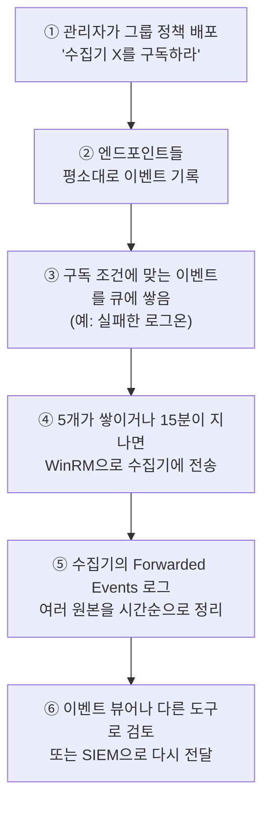

# 2.11강 — Windows 이벤트 로그와 이벤트 전달 { #windows-event-logs }

!!! abstract "이번 회차의 범위"
    - Windows 이벤트 로그의 기본: System, Application, Security, 그리고 이벤트 ID
    - 옛 형식(EVT)과 Vista 이후의 형식(EVTX, XML 스키마). [보충] 옛 ID와 새 ID의 관계
    - 직접 열어 보기: 공개 샘플 Security.evtx의 구조, 레코드 번호와 시각, [주의] 시계가 바뀐 흔적
    - Windows 이벤트 전달(WEF): 구독, 밀어 보내기와 당겨 오기, 전송 지연, 수집기의 Forwarded Events
    - 네트워크에서 본 WEF: WinRM, 포트, 암호화, 그리고 그 흔적
    - Windows 이벤트를 syslog로: 다리(bridge)와 로그 배송 도구, [주의] 직접 만들어 보며 만난 함정 두 가지

!!! note "실습 환경과 표기"
    이 작업 환경에는 Windows가 없습니다. **(직접 실행 결과)**는 공개 EVTX 해석 라이브러리 python-evtx의 시험용 데이터에 들어 있는 **공개 샘플 `security.evtx`**(2016~2017년에 어느 시험용 가상 머신에서 기록된 것)를 **evtx 0.15.0**(Rust로 만든 EVTX 해석기의 Python 바인딩)으로 읽어 얻었습니다. 샘플의 컴퓨터 이름과 계정 이름은 그 시험 데이터의 것이고, 이 강의의 사례와는 관계가 없습니다. syslog로 보내는 실험은 2.10강의 rsyslog 8.2312.0 수신 서버로 했습니다. WEF의 네트워크 흔적은 이 환경에서 만들 수 없어 **문서로만 확인**했습니다.

## 1. Windows 이벤트 로그의 기본 { #basics }

Windows NT의 첫 출시(1993년)부터 Windows에는 핵심 로그 기능이 있었고, 그 틀은 2007년까지 쓰였습니다. 이 옛 틀을 쓰는 Windows는 모두 지원이 끝났지만, 기업 어딘가에서 발견돼도 놀랍지 않아요. 오래된 소프트웨어는 죽지 않고, 업무에 꼭 필요한 일을 하나 맡아 누군가의 책상 밑에서 십 년쯤 숨어 지내니까요.

모든 Windows 이벤트 로그에는 **세 가지 핵심 로그**가 있습니다.

| 로그 | 담는 것 |
| --- | --- |
| **System** | 드라이버, 서비스 같은 시스템 구성 요소 |
| **Application** | 시스템에서 도는 프로그램들의 이벤트 |
| **Security** | 로그온 시도, 파일 접근과 삭제 등 보안 감사 |

각 이벤트에는 **이벤트 ID**가 있어, 그 기록이 왜 만들어졌는지 알려 줍니다. 예를 들어 Security 로그의 **4720**(Vista 이후)은 "사용자 계정이 만들어졌다"는 뜻이고, 그 기록에는 만들어진 계정 이름, 누가 만들었는지 같은 세부가 들어 있어요. 이벤트 ID의 뜻은 공동체가 만든 EventID 사이트나 Randy Franklin Smith의 "Windows Security Log Encyclopedia" 같은 서드파티 자료가 가장 자세합니다.

비유하면 이벤트 ID는 **병원의 진단 코드**입니다. 코드만 봐도 대략 무슨 일인지 알 수 있고, 차트(이벤트 데이터)를 열면 세부가 있어요. 비유가 깨지는 곳: 진단 코드는 표준 기관이 관리하지만, Windows의 이벤트 ID는 **제공자(provider)마다 따로** 매겨집니다. 같은 4624라도 Security 감사 제공자의 4624와 다른 제공자의 4624는 전혀 다른 뜻일 수 있어서, ID와 함께 **제공자 이름과 채널**을 봐야 합니다.

### 1.1 옛 형식(EVT)의 한계 { #evt }

Vista와 Server 2008 이전의 Windows는 **EVT 형식**을 썼습니다. 처음에는 세 로그뿐이었고, Windows 2000부터 응용 프로그램이 자기 로그 파일을 만들 수 있게 됐어요. 한계는 이랬습니다.

- **철저히 그 컴퓨터 안의 로그**였습니다. 관리자가 각 시스템에 직접 연결해 봐야 했어요.
- 로그 크기가 작았고, 중요한 이벤트가 **기본으로 기록되지 않았습니다**(실패한 로그온 등).
- 작은 작업 그룹이라면 몰라도, 컴퓨터가 수천, 수만 대인 기업에는 맞지 않았습니다.

XP SP2와 Server 2003 SP1에서 기본적인 원격 수집 기능이 더해졌고, 이벤트 로그를 네트워크로(흔히 syslog로) 보내 주는 서드파티 도구도 많았습니다.

## 2. Vista 이후: EVTX와 XML { #evtx }

Microsoft는 Vista와 Server 2008에서 이벤트 로그를 완전히 다시 만들었습니다(**Windows Eventing 6.0**). 바뀐 점:

- 각 이벤트를 **공개된 XML 스키마**로 설명합니다. 훨씬 세밀한 질의와 거르기가 가능해졌고, 서드파티 소프트웨어가 꼼수 없이 이벤트를 만들고 해석할 수 있게 됐어요.
- 핵심 로그가 둘 늘었습니다. **Setup**(소프트웨어 설치 관련)과 **Forwarded Events**(다른 컴퓨터에서 모아 온 이벤트, 3절).
- 응용 프로그램과 서비스가 자기 로그를 만들 수 있습니다("Applications and Services Logs" 아래의 수많은 채널. 2.7강의 DNS 서버 분석 로그도 그중 하나).
- **원격 전달**이 기본 기능이 됐습니다(3절).

!!! info "[보충] 옛 이벤트 ID + 4096 = 새 이벤트 ID (Security 로그의 경우)"
    교재의 예처럼 계정 생성은 옛 형식에서 **624**, Vista 이후 **4720**입니다. 624 + 4096 = 4720이에요. Security 감사 이벤트의 많은 ID가 이 관계를 따릅니다. 예를 들어 로그온 성공 528 → **4624**, 로그온 실패 529 → **4625**(529 + 4096). 다만 옛 ID 여러 개가 새 ID 하나로 합쳐지거나(옛 540 네트워크 로그온도 4624가 됨, 대신 로그온 유형 칸으로 구분), 새로 생긴 ID도 있어서, 일대일 대응표처럼 쓰지는 말고 오래된 보고서의 ID를 읽을 때 길잡이로만 쓰세요.

### 2.1 직접 열어 보기: 공개 샘플 Security.evtx { #sample }

```bash
sha256sum security.evtx
file security.evtx
```

**(직접 실행 결과)**

```text
5f29a03cf8c1b4bfbd82c4074ccc81ecfe85d7ee15375afc352ed5025c9a4d8d  security.evtx
security.evtx: MS Windows Vista-8.1 Event Log, 26 chunks (no. 25 in use), next record no. 2226, DIRTY
```

EVTX는 64KB 단위의 **청크(chunk)**로 이루어진 이진 파일이고, 각 레코드 안의 XML도 **이진 XML**로 압축돼 있습니다. 텍스트 편집기로는 읽을 수 없고 해석기가 필요해요. `DIRTY`는 파일 머리말의 표시로, 로그 서비스가 이 파일을 **깨끗하게 닫지 않았다**는 뜻입니다. 켜져 있는 시스템에서 그대로 복사한 파일에서 흔해요. 그래서 머리말이 말하는 "다음 레코드 번호"(2226)와 실제로 들어 있는 마지막 레코드(아래에서 2261)가 다를 수 있습니다. 해석기는 머리말만 믿지 말고 청크를 직접 훑어야 합니다.

전체를 요약했습니다(evtx 라이브러리로 각 레코드를 JSON으로 바꿔 셈).

**(직접 실행 결과)**

```text
records 2261  first 2016-07-08T18:12:51.6816408Z  last 2017-04-14T01:21:10.9069499Z
channel: Security 2261
computer: WIN-03DLIIOFRRA 2219, 37L4247F27-25 42
top event IDs: 4907 620, 4624 583, 4672 459, 5058 102, 5061 102, 4648 45, 4608 40, 4902 40, 4735 36, 1100 36, 4647 36, 4904 31, 4905 31, 4616 26, 4781 14
```

한 파일 안에 **컴퓨터 이름이 둘**입니다. 처음 42개 레코드는 `37L4247F27-25`, 나머지는 `WIN-03DLIIOFRRA`예요. 같은 시스템의 이름이 중간에 바뀌었을 가능성이 큽니다(4781은 "계정 이름이 바뀌었다"는 이벤트). 로그 파일을 "한 컴퓨터의 기록"이라고 단정하지 말고 `Computer` 칸을 확인해야 하는 이유입니다.

### 2.2 이벤트 하나의 구조 { #event-xml }

레코드 39번(로그온 성공, 4624)을 XML로 꺼냈습니다.

**(직접 실행 결과, 일부)**

```xml
<Event xmlns="http://schemas.microsoft.com/win/2004/08/events/event">
  <System>
    <Provider Name="Microsoft-Windows-Security-Auditing" Guid="{54849625-5478-4994-a5ba-3e3b0328c30d}"/>
    <EventID>4624</EventID>
    <Level>0</Level>
    <Task>12544</Task>
    <Keywords>0x8020000000000000</Keywords>
    <TimeCreated SystemTime="2016-07-08T18:14:59.1338646Z"/>
    <EventRecordID>39</EventRecordID>
    <Execution ProcessID="456" ThreadID="584"/>
    <Channel>Security</Channel>
    <Computer>37L4247F27-25</Computer>
  </System>
  <EventData>
    <Data Name="TargetUserName">SYSTEM</Data>
    <Data Name="LogonType">5</Data>
    <Data Name="AuthenticationPackageName">Negotiate</Data>
    <Data Name="ProcessName">C:\Windows\System32\services.exe</Data>
    <Data Name="IpAddress">-</Data>
  </EventData>
</Event>
```

| 부분 | 뜻 |
| --- | --- |
| `Provider` | 이 이벤트를 만든 **제공자**. 이벤트 ID는 제공자마다 따로다 |
| `EventID` | 4624 = 로그온 성공 |
| `TimeCreated SystemTime` | 이벤트가 만들어진 시각. **UTC**, 소수점 아래 **7자리**(100나노초 단위) |
| `EventRecordID` | 이 로그 파일 안의 **일련번호** |
| `Channel`, `Computer` | 로그 이름, 기록한 컴퓨터 |
| `EventData` | 이벤트별 세부. 4624라면 대상 계정, 로그온 유형(5 = 서비스), 인증 방식, 프로세스, 원격 주소 |

`Keywords`의 `0x8020000000000000`은 "감사 성공"을 뜻하는 비트를 담고 있습니다. 실패한 로그온(4625)이라면 "감사 실패" 비트가 서요. 로그온 유형별로 세어 보니 5(서비스) 416, 2(대화형) 84, 0(시스템) 40, 3(네트워크) 39, 7(잠금 해제) 4였습니다(직접 실행 결과). 이 샘플의 네트워크 로그온은 모두 `ANONYMOUS LOGON`이고 `IpAddress`가 `-`인, 원격 접속이 거의 없는 시험용 가상 머신의 모습이었어요.

### 2.3 [주의] 레코드 번호는 차례대로, 시각은 그렇지 않다 { #order }

`EventRecordID` 순서로 늘어놓고, 바로 다음 레코드의 시각이 **앞 레코드보다 이른** 경우를 셌습니다.

**(직접 실행 결과)**

```text
records 2261 id range 1 2261 time going backwards between consecutive IDs: 36
(38, '2016-07-08T18:14:59.6174655Z', 1100) -> (39, '2016-07-08T18:14:59.1338646Z', 4624)
(273, '2016-07-08T23:05:19.6903545Z', 1100) -> (274, '2016-07-08T23:05:19.2691537Z', 4647)
(300, '2016-07-08T23:05:58.8456462Z', 1100) -> (301, '2016-07-08T23:05:58.0656449Z', 4647)
```

레코드 번호는 1부터 2261까지 빠짐없이 이어지지만, 시각이 **거꾸로 가는 곳이 36군데** 있었습니다. 모두 1100(이벤트 로그 서비스 종료) 바로 뒤에 그보다 1초 안쪽 이른 이벤트가 쓰인 모양이에요. 종료 직전의 이벤트가 **만들어진 순서와 파일에 쓰인 순서가 다를 수 있다**는 뜻입니다. 이 정도 어긋남은 흔하지만, 타임라인을 만들 때는 레코드 번호가 아니라 시각으로 정렬하고, 시각이 같은 구간에서는 레코드 번호를 참고합니다.

더 큰 문제는 **시계 자체가 바뀐 경우**입니다. 이 샘플에는 4616(시스템 시각 변경)이 26건 있었어요.

**(직접 실행 결과, 레코드 143)**

```text
4616 143 2016-07-08T22:16:31.2450000Z
  PreviousTime = 2016-07-08T18:16:31.1081039Z
  NewTime      = 2016-07-08T22:16:31.2450000Z
  ProcessName  = C:\Program Files\VMware\VMware Tools\vmtoolsd.exe
  SubjectUserName = WIN-03DLIIOFRRA$
```

가상 머신 도구(`vmtoolsd.exe`)가 시계를 **4시간 앞으로** 옮겼습니다. 아마 호스트와 시간대 해석이 달라 맞춘 것으로 보입니다(가설). 그러니 레코드 142와 143 사이에는 실제로는 몇 초밖에 지나지 않았는데 **시각은 4시간을 건너뛰어** 보입니다.

**조사에서의 의미:** ① Windows 로그를 다른 로그(방화벽, 프록시, Zeek)와 맞출 때 **4616을 먼저 찾아** 시계가 언제 얼마나 움직였는지 확인하세요. ② 공격자가 시각을 바꿔 흔적을 흐리려 한 경우에도 4616이 남습니다(누가, 어떤 프로세스로). ③ 레코드 번호가 끊긴 곳이 있다면 그 사이가 지워졌거나 로그가 덮어써졌을 수 있습니다. 이 샘플은 번호가 빠짐없었어요. 로그가 지워지면 Security의 **1102**(감사 로그 지움), System의 **104**(로그 지움)가 남는다는 것도 함께 기억하세요.

## 3. Windows 이벤트 전달(WEF) { #wef }

"Forwarded Events" 로그가 생겼다는 건, 원격 수집과 집계 기능이 좋아졌다는 뜻입니다. Windows 이벤트 전달(Windows Event Forwarding)은 **추가 소프트웨어 없이** 로그를 네트워크로 다른 시스템에 보낼 수 있고, 받는 쪽은 또 다른 곳으로 넘겨 저장이나 처리를 맡길 수 있어요.

### 3.1 용어 { #wef-terms }

- **원본(source)**: 이벤트를 만드는 컴퓨터.
- **수집기(collector)**: 이벤트를 모으는 서버. 기본으로 자기의 **Forwarded Events** 로그에 저장합니다.
- **구독(subscription)**: "어느 원본에서 어떤 이벤트를 모을지"의 정의.
- **밀어 보내기(push, 원본이 시작)**: 수집기가 원본에게 "이런 이벤트를 보내라"고 지시하면, 원본이 조건에 맞는 이벤트를 수집기로 보냅니다.
- **당겨 오기(pull, 수집기가 시작)**: 수집기가 원본에 연락해 조건에 맞는 이벤트를 가져갑니다.

비유하면 WEF는 **본사의 정기 보고 체계**입니다. 본사(수집기)가 "이런 일은 보고하라"는 지침(구독)을 지점들(원본)에 내려 두면, 지점은 보고할 일이 생겨도 **바로 전화하지 않고 모아서** 정해진 때에 보냅니다. 비유가 깨지는 곳: 본사는 보고가 늦으면 독촉하지만, WEF의 지연은 설정된 대로 **늘 있는** 것이고, 지점(원본)이 꺼져 있거나 연결이 끊기면 그동안의 이벤트는 원본의 로그 크기 한도 안에서만 기다립니다.

### 3.2 [주의] 전송은 즉시가 아니다 { #wef-latency }

교재는 기본값으로 **이벤트 5개가 쌓이거나 15분이 지나면** 한 묶음으로 보내고, "빠르게"로 바꾸면 30초, 반대로 6시간까지 늘릴 수 있으며, **즉시 보내는 방법은 없다**고 설명합니다.

!!! info "[보충] 구독의 전송 최적화 설정(2026-11-05 검색 결과로 확인)"
    | 설정 | 전송 방식 | 묶음 시간 제한 |
    | --- | --- | --- |
    | Normal(기본) | 당겨 오기 | 15분, 5개씩 |
    | Minimize Bandwidth | 밀어 보내기 | 6시간(하트비트도 6시간) |
    | Minimize Latency | 밀어 보내기 | 30초 |

    Normal과 Minimize Bandwidth의 값은 Microsoft의 문서와 지원 문서(이벤트 로그 전달 성능 모범 사례)로, Minimize Latency의 30초는 서드파티 문서로 확인했습니다. 사용자 지정(custom) 설정으로 다른 값도 쓸 수 있습니다. learn.microsoft.com은 이 환경에서 직접 열리지 않아 검색 결과에 의존했습니다.

**조사에서의 의미:** 수집기의 Forwarded Events에서 보는 이벤트의 **만들어진 시각(`TimeCreated`)**과 **수집기에 도착한 시각**은 최대 15분(설정에 따라 6시간) 차이 날 수 있습니다. 수집기가 여러 원본의 이벤트를 시간순으로 다시 정렬해 보여 주지만, "수집기에 이벤트가 아직 없다"가 "아직 일어나지 않았다"는 뜻은 아니에요. 실시간 대응 중이라면 이 지연을 감안하고, 급한 원본은 직접 확인합니다.

### 3.3 그룹 정책과 수집기 { #wef-gpo }

WEF의 편리한 점 하나는 **그룹 정책으로 구독을 관리**할 수 있다는 것입니다. 도메인 관리자가 정책 하나로 어떤 엔드포인트의 어떤 이벤트를 어느 수집기로 보낼지 정하고 강제할 수 있어요. 모두 같은 도메인에 있다면 인증과 권한은 거의 투명하게 처리됩니다.

**그림 3-1. 도메인 환경의 WEF 흐름** (위에서 아래로 시간 순서)



**읽는 법:** ①은 한 번의 설정, ②~⑤는 계속 되풀이되는 흐름입니다. ③과 ④ 사이가 3.2절의 지연이에요. 수집기를 보는 사람은 ⑤의 결과만 보므로, ④의 시점을 모르면 이벤트가 "늦게 나타난" 것처럼 보입니다.

수집기에서는 이벤트 뷰어로 Forwarded Events를 질의해 여러 시스템의 데이터를 한꺼번에 봅니다. 그리고 WEF의 공개 API 덕분에 서드파티 소프트웨어도 **이벤트 수신자**가 될 수 있어요. 예를 들어 Splunk는 Windows 이벤트 로그를 구독할 수 있고, ArcSight SIEM은 Windows 이벤트를 공통 이벤트 형식(CEF)으로 바꾸는 중간 도구를 제공합니다. 어떤 방식이든 데이터에 접근하려면 **인증**해야 합니다. 보통의 도메인 권한이나, 도메인 밖이라면 클라이언트 TLS 인증서를 써요. HTTP Basic 인증도 가능하지만 기본으로 꺼져 있고, 암호화되지 않은 HTTP 위에서는 충분한 보안이 되지 않습니다.

## 4. 네트워크에서 본 WEF { #wef-network }

WEF의 네트워크 전송은 디스크에 쓰는 것과 **같은 XML 이벤트 레코드**를, **WinRM**(Windows Remote Management, WS-Management 프로토콜의 Microsoft 구현)으로 HTTP나 HTTPS 위에 실어 보냅니다.

- **포트**: WinRM의 기본은 HTTP **5985**, HTTPS **5986**입니다.
- **암호화**: 모든 접근은 인증되고, 보통 Windows 인증(도메인이라면 Kerberos)을 씁니다. 그래서 **HTTP로 보내더라도 내용(RPC 페이로드)은 암호화**돼 있어요. 올바른 도메인 자격 증명 없이는 평문으로 엿보기가 사실상 불가능합니다.
- **User-Agent**: HTTP 요청에 **`Microsoft WinRM Client`**라는 독특한 User-Agent가 붙습니다.

!!! info "[보충] 네트워크 기록에서 WinRM을 알아보기 (문서로만 확인, 이 환경에서 실행하지 않음)"
    HTTP(5985) 위의 WinRM이라면 내용이 암호화돼 있어도 **HTTP 헤더는 평문**입니다. 그래서 2.8강의 Zeek `http.log`에는 `method`가 `POST`, `uri`가 `/wsman`, `user_agent`가 `Microsoft WinRM Client`인 줄이 남고, 요청 본문의 형식(`Content-Type`)은 Kerberos로 암호화된 멀티파트(`multipart/encrypted`)로 보일 것입니다. 이 정보로 **누가 누구에게 WinRM을 썼는지**는 알 수 있어요.

    **조사에서의 의미:** WinRM은 WEF만 쓰는 게 아닙니다. PowerShell 원격(`Enter-PSSession`, `Invoke-Command`)도 같은 WinRM을 쓰고, 공격자도 **측면 이동**에 이를 즐겨 씁니다. 그러니 "평소 WEF 원본 → 수집기로만 흐르던 5985/5986 트래픽"이 **엔드포인트 → 엔드포인트**나 **엔드포인트 → 서버**로 나타나면 눈여겨볼 만해요. 평소의 방향(원본 → 수집기, 또는 당겨 오기라면 수집기 → 원본)을 기준선으로 알아 두세요.

## 5. Windows 이벤트를 Windows 밖으로 { #to-non-windows }

지금까지는 Windows 기본 도구로 로그를 검토하는 모델이었습니다. 이걸로 충분할 때도 있지만, 이런 로그의 진짜 힘은 **분석 소프트웨어**로 필요한 것을 뽑고, 추세를 찾고, 다른 로그와 엮는 데서 나옵니다. 일부 서드파티 제품은 직접 수집기가 될 수 있지만 그러려면 Windows 플랫폼이 필요해요.

결국 **Windows 이벤트를 Windows가 아닌 시스템으로** 보낼 일이 생깁니다. Splunk처럼 자체 전달 프로토콜로 Windows 수집기에서 리눅스 쪽으로 넘기는 방법도 있지만, syslog가 워낙 널리 쓰이니 **Windows 이벤트를 syslog 메시지로 바꾸는 다리(bridge)**가 가장 쉬운 해결책일 때가 많아요. 작은 에이전트가 이벤트 로그를 지켜보다 다른 시스템으로 보내는 **로그 배송 도구(log shipper)**도 있습니다.

| 도구 | 비고 |
| --- | --- |
| NTSyslog | NT 4.0, Windows 2000용 서비스. 옛 플랫폼에 |
| Snare | 2.10강에서 본 Snare의 에이전트 |
| Eventlog-to-Syslog | 이벤트 로그를 syslog로 |
| Winlogbeat | Elastic의 "beat" 배송 도구. Elastic Stack(2.13강)과 함께 |

!!! info "[보충] 교재 이후에 흔해진 선택지(2026-11-05 기준)"
    Elastic은 Winlogbeat와 함께 **Elastic Agent**(Windows·System 통합)로도 Windows 이벤트를 수집하게 합니다. 다만 둘이 만드는 데이터의 위치(인덱스·데이터 스트림)가 달라 탐지 규칙이 깨질 수 있다는 사용자 보고도 있어, 바꿀 때는 확인이 필요해요. 그 밖에 NXLog, Splunk Universal Forwarder, 그리고 각 SIEM 제품의 에이전트가 흔히 쓰입니다. 어떤 도구든 **무엇을 어떤 모양으로 바꿔 보내는지**가 조사 결과에 영향을 줍니다. 다음 절의 실험이 그 예예요.

### 5.1 직접 만들어 본 다리와 두 가지 함정 { #bridge-lab }

샘플의 이벤트 세 개(4624, 4720, 4616)를 RFC 5424 syslog 메시지로 바꿔 2.10강의 수신 서버로 보내는 **연습용 다리**를 짧게 만들었습니다. 이벤트의 `TimeCreated`를 syslog 시각으로, `Computer`를 호스트 이름으로, 제공자를 앱 이름으로, 이벤트 ID를 메시지 ID로, 주요 `EventData`를 **구조화된 데이터**로 옮겼어요.

**보낸 메시지 (직접 실행 결과, 하나만)**

```text
<166>1 2016-07-08T18:14:59.1338646Z 37L4247F27-25 Microsoft-Windows-Security-Auditing - 4624 [win@32473 EventRecordID="39" Channel="Security" TargetUserName="SYSTEM" LogonType="5" IpAddress="-" ProcessName="C:\\Windows\\System32\\services.exe"] EventID 4624
```

**수신 서버에 남은 줄 (직접 실행 결과)**

```text
<166> reported=2016-07-08T18:14:59.FZ received=2026-11-05T08:11:29.308915+00:00 claimed_host=37L4247F27-25 from_ip=127.0.0.1 proto=imudp tag=Microsoft-Windows-Security-Auditing msg=EventID 4624
<166> reported=2016-07-08T18:15:23.Z  received=2026-11-05T08:11:29.308915+00:00 claimed_host=WIN-03DLIIOFRRA ...
<166> reported=2016-07-08T22:16:31.�Z received=2026-11-05T08:11:29.309153+00:00 claimed_host=WIN-03DLIIOFRRA ...
```

두 가지가 잘못됐습니다.

1. **시각이 깨졌다.** `18:14:59.FZ`, `.Z`, 깨진 글자까지. Windows의 `SystemTime`은 소수점 아래 **7자리**인데, RFC 5424는 소수 초를 **최대 6자리**까지만 허용합니다. 표준에 어긋난 시각을 받은 rsyslog가 엉뚱하게 풀어 버렸어요. 내 다리의 잘못입니다.
2. **이벤트의 세부가 사라졌다.** 수신 서버의 템플릿(2.10강 3.4절)이 `%msg%`만 남기고 **구조화된 데이터를 담지 않아서**, 대상 계정, 로그온 유형, 프로세스가 파일에 하나도 없습니다. 메시지 본문은 `EventID 4624`뿐이에요.

다리가 소수 초를 6자리로 자르게 고치고, 수신 서버에 구조화된 데이터(`%structured-data%`), 앱 이름(`%app-name%`), 메시지 ID(`%msgid%`)를 담는 템플릿을 더했습니다.

**(직접 실행 결과, 고친 뒤)**

```text
reported=2016-07-08T18:14:59.133864Z received=2026-11-05T08:11:45.212785+00:00 claimed_host=37L4247F27-25 from_ip=127.0.0.1 app=Microsoft-Windows-Security-Auditing msgid=4624 sd=[win@32473 EventRecordID="39" Channel="Security" TargetUserName="SYSTEM" LogonType="5" IpAddress="-" ProcessName="C:\\Windows\\System32\\services.exe"] msg=EventID 4624
reported=2016-07-08T22:16:31.245000Z received=2026-11-05T08:11:45.213118+00:00 claimed_host=WIN-03DLIIOFRRA from_ip=127.0.0.1 app=Microsoft-Windows-Security-Auditing msgid=4616 sd=[win@32473 EventRecordID="143" Channel="Security" PreviousTime="2016-07-08T18:16:31.1081039Z" NewTime="2016-07-08T22:16:31.2450000Z" ProcessName="C:\\Program Files\\VMware\\VMware Tools\\vmtoolsd.exe"] msg=EventID 4616
```

이제 시각이 제대로 읽히고, 세부도 남았습니다. 그래도 **7자리째(100나노초)는 잃었어요**. 그리고 `reported`(2016년)와 `received`(2026년)의 차이, `claimed_host`와 `from_ip`(실제 보낸 다리의 주소)의 차이가 그대로 보입니다. 다리를 거친 이벤트의 시각과 컴퓨터 이름은 **다리가 원본에서 옮겨 적은 값**이고, syslog 수신 서버가 확인한 것은 "다리가 언제 어디서 보냈나"뿐이에요.

**조사에서의 의미:** 중앙 서버에서 Windows 이벤트를 볼 때, ① 원본 EVTX와 비교해 **빠진 필드**가 없는지(배송 도구와 수신 템플릿이 무엇을 남기는지), ② 시각의 **정밀도와 형식**이 맞는지, ③ 같은 이벤트의 **레코드 번호**가 남아 있는지(원본과 대조할 열쇠) 확인하세요. 레코드 번호가 없다면, 원본에서 지워진 이벤트가 사본에만 남았는지도 가리기 어렵습니다.

## 6. 실제 조사에서는 이렇게 씁니다 { #in-practice }

1. **원본 EVTX를 확보하고 해시를 남긴다.** 켜진 시스템에서 복사한 파일은 `DIRTY`일 수 있으니, 머리말보다 청크를 직접 훑는 해석기를 씁니다.
2. **제공자, 채널, 이벤트 ID를 함께 본다.** ID만으로 판단하지 않습니다.
3. **시각을 점검한다.** UTC인지, 4616(시계 변경)이 있는지, 레코드 번호 순서와 시각 순서가 크게 어긋나는 곳이 있는지.
4. **로그 지우기와 빈틈을 찾는다.** 1102, 104, 그리고 레코드 번호가 끊긴 곳.
5. **수집기의 사본과 원본을 맞댄다.** 원본에서 지워진 이벤트가 수집기에는 남아 있을 수 있습니다(2.12강). 지연(최대 15분, 설정에 따라 그 이상)을 감안합니다.
6. **네트워크에서 WinRM의 방향을 본다.** 5985/5986, `Microsoft WinRM Client`, `/wsman`. 평소의 원본 → 수집기 흐름이 아닌 방향은 측면 이동일 수 있습니다.
7. **배송 경로를 안다.** 다리나 에이전트가 무엇을 바꾸고 무엇을 버리는지(필드, 시각의 정밀도, 레코드 번호).

## 7. 정리 { #summary }

- 핵심 로그는 System, Application, Security이고, 이벤트 ID는 **제공자마다** 뜻이 있습니다(예: 4720 계정 생성). **[보충]** Security의 옛 ID + 4096 = 새 ID인 경우가 많습니다(624 → 4720, 528 → 4624).
- 옛 EVT는 컴퓨터 안에만 있고, 작고, 중요한 이벤트가 기본으로 빠졌습니다. Vista 이후 EVTX는 공개 XML 스키마, Setup과 Forwarded Events, 응용 프로그램별 로그, 원격 전달을 갖췄습니다.
- 공개 샘플을 직접 열어 봤습니다. 이진 청크 구조와 `DIRTY` 표시, 한 파일 안의 두 컴퓨터 이름, UTC·7자리 소수 초의 `TimeCreated`, 레코드 번호는 이어지지만 시각은 36곳에서 거꾸로 감, 그리고 가상 머신 도구가 시계를 4시간 옮긴 4616.
- WEF: 그룹 정책으로 구독, 밀어 보내기와 당겨 오기, 수집기의 Forwarded Events. **[주의]** 기본(Normal)은 5개 또는 15분 묶음이라 즉시가 아닙니다.
- 네트워크: WinRM over HTTP 5985 / HTTPS 5986, 인증과 암호화, User-Agent `Microsoft WinRM Client`. WinRM은 측면 이동에도 쓰이니 방향을 기준선과 비교합니다.
- Windows 밖으로: NTSyslog, Snare, Eventlog-to-Syslog, Winlogbeat(그리고 Elastic Agent 등). 직접 만든 다리에서 **7자리 소수 초가 시각을 깨뜨리고**, 수신 템플릿이 **구조화된 데이터를 버리는** 함정을 만났고, 고친 뒤에도 100나노초 정밀도는 잃었습니다.

## 복습 문제 { #review }

**문제 1. (기본)** 오래된 사고 보고서에 "Security 로그의 이벤트 529가 수백 건"이라고 적혀 있습니다. 요즘 Windows에서 같은 현상을 찾으려면 어떤 이벤트를 보겠습니까? 무엇을 조심해야 하나요?

??? success "정답과 해설"
    529는 옛 형식의 "로그온 실패(알 수 없는 사용자 이름 또는 잘못된 비밀번호)"이고, 529 + 4096 = **4625**(계정 로그온 실패)가 Vista 이후의 대응 이벤트입니다(2절의 [보충]). 조심할 점: ① 옛 형식은 실패 이유마다 ID가 달랐지만(529~537 등), 새 형식은 **4625 하나에 실패 이유 코드**(`Status`, `SubStatus`)로 나뉩니다. ② 제공자가 Security 감사(`Microsoft-Windows-Security-Auditing`)인지 확인합니다. ③ 실패한 로그온이 기록되려면 감사 정책이 켜져 있어야 하니, 기록이 없다고 시도가 없었다고 단정하지 않습니다. ④ 로그온 유형(3 = 네트워크, 10 = 원격 대화형)과 원본 주소(`IpAddress`)를 함께 봅니다.

**문제 2. (해석)** 한 서버의 Security.evtx에서 레코드 번호 18,200과 18,201 사이의 시각이 3시간 거꾸로 가 있습니다. 어떤 가능성을 생각하고, 무엇으로 확인하겠습니까?

??? success "정답과 해설"
    레코드 번호는 이어지는데 시각만 크게 뒤로 갔다면, **시계가 바뀌었을** 가능성이 큽니다(2.3절). 확인: ① 그 근처의 **4616**(시스템 시각 변경) 이벤트. `PreviousTime`, `NewTime`, 바꾼 `ProcessName`과 계정. 가상 머신 도구, 시간 동기화 서비스(`svchost.exe`의 W32Time), 사용자의 수동 변경, 공격자 도구 중 무엇인지 봅니다. ② System 로그의 시간 서비스 이벤트. ③ 같은 시간대의 다른 시스템 로그와 네트워크 기록(Zeek `conn.log`)으로 실제 시각을 맞춥니다. 1초 안팎의 작은 역전이라면 2.3절의 서비스 종료 무렵처럼 쓰인 순서의 차이일 수 있지만, 3시간은 그 설명으로 맞지 않습니다.

**문제 3. (변경된 조건)** 원본 PC에서 공격자가 Security 로그를 지웠습니다(1102). 다행히 WEF로 수집기에 이벤트가 모이고 있었어요. 수집기의 Forwarded Events에 지워지기 직전 10분의 이벤트가 **없습니다**. 무엇을 생각해야 하나요?

??? success "정답과 해설"
    WEF의 전송 지연입니다(3.2절). 기본(Normal)이라면 이벤트가 5개 쌓이거나 **15분**이 지나야 전달되므로, 지워지기 직전 10분의 이벤트는 **아직 원본의 큐에 있다가** 로그와 함께 지워졌을 수 있어요. 공격자가 그 지연을 알고 있었을 수도 있습니다. 확인: ① 구독의 전송 최적화 설정(Normal인지 Minimize Latency인지), ② 원본의 디스크에서 지워진 EVTX를 복구할 수 있는지(디스크 포렌식), ③ 그 10분 동안의 **네트워크 기록**(Zeek, 방화벽, 프록시)과 다른 시스템의 로그(도메인 컨트롤러의 인증 로그 4768/4769/4776 등), ④ 1102 자체는 수집기에 도착했는지(지운 계정과 시각). 앞으로를 위해 중요한 원본은 Minimize Latency로 바꾸는 것을 검토합니다.

**문제 4. (흔한 오해)** "WEF는 HTTP(5985)를 쓰니까 패킷을 캡처하면 이벤트 내용을 그대로 읽을 수 있다." 무엇이 틀렸고, 그래도 네트워크에서 알 수 있는 것은 무엇인가요?

??? success "정답과 해설"
    WinRM은 HTTP 위에서도 **인증과 메시지 암호화**(도메인에서는 보통 Kerberos)를 하므로, 이벤트 내용은 평문으로 볼 수 없습니다(4절). 올바른 도메인 자격 증명 없이는 사실상 불가능해요. 그래도 HTTP 헤더는 평문이라, 출발지와 목적지, 시각, 양, `POST /wsman`, User-Agent `Microsoft WinRM Client` 같은 **메타데이터**는 보입니다. 이걸로 "어느 PC가 어느 수집기에 얼마나 자주 보냈나"(원본이 꺼졌거나 전송이 끊긴 시점 찾기), 그리고 WEF가 아닌 **WinRM 사용**(측면 이동, PowerShell 원격)의 흔적을 찾을 수 있습니다.

**문제 5. (해석)** 중앙 SIEM에서 본 Windows 로그온 이벤트의 시각이 `2026-11-03T09:15:22.Z`처럼 소수 초 부분이 비어 있고, 다른 이벤트는 정상입니다. 무엇을 의심하고, 어떻게 확인하겠습니까?

??? success "정답과 해설"
    5.1절의 실험처럼, 배송 경로 어딘가에서 Windows의 **7자리 소수 초**가 RFC 5424(최대 6자리) 같은 형식에 맞지 않게 옮겨져 **시각 해석이 깨졌을** 가능성을 의심합니다. 확인: ① 원본 EVTX에서 같은 이벤트(레코드 번호로 찾기)의 `TimeCreated`, ② 배송 도구의 버전과 설정(시각 형식), ③ 중간의 syslog 서버나 수집 파이프라인이 받은 원본 메시지(가능하면 pcap). 소수 초만 깨졌다면 초 단위까지는 믿을 수 있을지 모르지만, 형식이 깨진 값은 초 이하뿐 아니라 **시간대나 날짜 해석까지** 틀어질 수 있으니 원본과 대조하기 전에는 타임라인에 쓰지 않습니다.

**문제 6. (적용)** Windows 이벤트를 syslog로 바꿔 보내는 다리를 고를 때, 조사를 위해 확인하겠다고 할 항목을 다섯 가지 이상 들어 보세요.

??? success "정답과 해설"
    예: ① **어떤 필드를 보내는가**: `EventData` 전체인가, 일부인가(5.1절에서 구조화된 데이터가 수신 쪽에서 버려졌음). ② **레코드 번호(`EventRecordID`)와 채널, 제공자**를 함께 보내는가(원본 대조). ③ **시각의 형식과 정밀도**: UTC인가, 소수 초를 어떻게 다루는가(7자리 문제). ④ **전송 방식**: UDP인가 TCP·TLS인가(2.10강 6절의 손실). ⑤ **원본이 꺼지거나 연결이 끊겼을 때** 쌓아 두었다 보내는가, 얼마나 쌓을 수 있는가. ⑥ **최대 메시지 크기**: 긴 이벤트(PowerShell 스크립트 블록 등)가 잘리지 않는가(2.10강 3.5절). ⑦ 문자 인코딩(한글 계정 이름, 경로). ⑧ 수신 쪽 템플릿이 이 모든 것을 **실제로 저장하는가**.

**문제 7. (흔한 오해)** "Security.evtx 파일 하나는 그 컴퓨터 한 대의 기록이니, `Computer` 칸은 볼 필요가 없다." 2절의 샘플 결과로 반박해 보세요.

??? success "정답과 해설"
    샘플 Security.evtx 안에 컴퓨터 이름이 **둘**(`37L4247F27-25` 42건, `WIN-03DLIIOFRRA` 2,219건)이었습니다(2.1절). 같은 시스템의 이름이 도중에 바뀐 것으로 보이며, 이름이 바뀌기 전후의 이벤트를 다른 로그(예: 바뀌기 전 이름으로 남은 DNS·DHCP 기록, 도메인 컨트롤러의 기록)와 맞추려면 두 이름을 모두 알아야 해요. 또 수집기의 Forwarded Events나 다른 경로로 모인 파일이라면 **여러 컴퓨터의 이벤트가 한 파일에** 섞여 있습니다. `Computer` 칸은 늘 확인합니다.

**문제 8. (적용)** 사내 네트워크 센서에서 5985번 포트로 가는 연결 목록을 뽑았더니, 대부분은 사용자 PC들 → 수집기 `10.10.0.40`이었고, 하나는 PC `10.10.1.19` → PC `10.10.1.22`였습니다. 어떤 가설을 세우고 무엇을 확인하겠습니까?

??? success "정답과 해설"
    **가설:** 평소의 WEF 흐름(원본 → 수집기)이 아닌 **PC 사이의 WinRM**이므로, PowerShell 원격 같은 관리 작업이거나 공격자의 **측면 이동**일 수 있습니다(4절의 [보충]). 확인: ① 그 연결의 시각, 양, 지속 시간, 반복 여부(Zeek `conn.log`), ② HTTP 메타데이터(Zeek `http.log`: `/wsman`, User-Agent), ③ **`10.10.1.22`의 이벤트 로그**: 그 시각의 4624(로그온 유형 3, 원본 주소 `10.10.1.19`), WinRM 운영 로그(`Microsoft-Windows-WinRM/Operational`), PowerShell 로그(4103/4104), 새 프로세스(4688), ④ `10.10.1.19`에서 그 연결을 시작한 계정과 프로세스, ⑤ 같은 시기에 `10.10.1.19`가 다른 PC로도 같은 일을 했는지(범위). 관리팀의 정상 작업인지도 확인해 오탐을 거릅니다.

## 참고 자료 { #references }

- 작업 환경에서 쓴 도구: evtx 0.15.0(Python 바인딩, PyPI), `file`, rsyslog 8.2312.0, Python 3.13. 실행 결과는 2026-11-05에 얻었습니다.
- 공개 샘플: python-evtx 저장소의 시험용 데이터 [`tests/data/security.evtx`](https://github.com/williballenthin/python-evtx/tree/master/tests/data) (SHA-256 `5f29a03c…5c9a4d8d`).
- Microsoft, "Windows Event Forwarding"·"Configure Advanced Subscription Settings"·이벤트 로그 전달 성능 모범 사례 지원 문서(전송 최적화 값. 2026-11-05 검색 결과로 확인, learn.microsoft.com은 이 환경에서 직접 열리지 않음).
- Microsoft, [Windows Remote Management](https://learn.microsoft.com/windows/win32/winrm/portal) (WS-Management, 기본 포트 5985/5986).
- Randy Franklin Smith, [Windows Security Log Encyclopedia](https://www.ultimatewindowssecurity.com/securitylog/encyclopedia/) (이벤트 ID, 옛 ID와 새 ID).
- Elastic, [Winlogbeat](https://www.elastic.co/beats/winlogbeat)와 Windows 통합 문서(2026-11-05 검색 결과로 확인).

!!! note "이 페이지에 대하여"
    여러 학습 자료를 바탕으로 직접 다시 쓴 개인 학습 노트입니다. syslog 다리와 실험은 직접 만들었고, 공개 샘플 외의 사례는 가상입니다.
