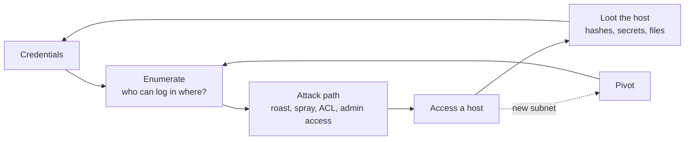

# Active Directory { #active-directory }

**배점:** 40 / 100 (10 + 10 + 20) · **우선순위:** 최상 · **최종 수정:** 2026-10-23

!!! abstract "한 문장 요약"
    AD 세트는 주어진 도메인 사용자 계정(assumed breach)에서 시작해 머신 두 대를 거쳐 도메인 컨트롤러까지 이어집니다. 부분 점수도 인정되지만 합격 후기 대부분은 40점을 다 땄고, 발목을 잡는 건 보통 고급 기법이 아니라 놓친 크리덴셜 하나나 못 한 피벗입니다.

!!! note "이 페이지 구성"
    이 페이지는 **공부 지도**이지, 복붙용 플레이북이 아닙니다. 각 단계는 핸드북의 공격 기법(adversary) 페이지로 연결되고, 그 페이지들이 기법의 원리와 탐지 쪽을 함께 다룹니다. 그 페이지들을 공부한 뒤 [실습 랩](practice-labs.md)에서 전체 사슬을 직접 연습하세요.

## AD 루프 { #ad-loop }

모든 AD 세트는 DC가 넘어갈 때까지 같은 루프를 반복합니다.

!!! tip "시간을 가장 많이 아끼는 습관"
    **새 크리덴셜은 어디서나 다 시도해 봅니다** — 모든 호스트, 모든 프로토콜(SMB, WinRM, RDP, MSSQL), 도메인 계정으로 *그리고* 로컬 계정으로요. `creds.txt` 를 하나 만들어 두고, 뭔가 찾는 즉시 적어 넣으세요.

## 1. Assumed breach 시작 { #assumed-breach-start }

도메인 아이디와 비밀번호를 받습니다. 먼저 할 일:

- **이름 해석 설정.** Kerberos는 IP가 아니라 이름으로 동작합니다 — DC와 도메인을 `/etc/hosts` 에 넣지 않으면 Kerberos 기반 도구가 이상한 오류로 실패해요.
- **이 사용자가 어디에 인증되는지 확인.** SMB, WinRM, RDP, MSSQL에 크리덴셜을 확인해 봅니다. 명령을 실행할 수 있는 로그인이 발판이고, 접근은 안 돼도 유효한 로그인은 그 계정이 존재하고 비밀번호가 맞다는 정보를 줍니다.
- **첫 호스트에서 방향 잡기.** `whoami /all`(그룹과 권한), `ipconfig /all`(두 번째 NIC이 있으면 피벗할 내부 서브넷), 전에 누가 로그온했는지.

관리자가 아닌 상태로 들어왔다면 로컬 권한 상승 문제입니다 → [Windows 권한 상승](privesc-windows.md). 두 번째 네트워크가 있으면 터널을 세웁니다 → [피벗팅](pivoting.md).

## 2. 정보 수집 { #enumeration }

여기서 공부 목표는 도메인을 BloodHound처럼 읽고, 수동으로 확인하는 것입니다.

- **도메인 정보:** 사용자, 그룹, **비밀번호 정책**(스프레이 전에 lockout threshold를 꼭 읽기), 읽기·쓰기 가능한 공유, 그 공유 안의 파일(스크립트, 설정, 백업, KeePass 파일).
- **BloodHound.** 수집한 뒤 내 사용자를 *Owned* 로 표시하고, 순서대로: Owned에서 나가는 최단 경로, kerberoastable 사용자, AS-REP roastable 사용자, 내 사용자의 outbound object control(GenericAll / GenericWrite / WriteDACL / ForceChangePassword), Domain Admins까지의 최단 경로.
    - 수집기와 GUI를 맞추세요: BloodHound **CE** 는 CE 수집기가, 레거시 GUI는 레거시 수집기가 필요합니다. 안 맞으면 아무것도 들어오지 않아요 — 시험 전에 무엇을 쓸지 정해 두세요.
- **수동(PowerView / nxc 모듈):** SPN이 있는 계정, pre-auth가 필요 없는 계정, 내가 로컬 관리자인 곳, 눈여겨볼 ACL.

## 3. 크리덴셜 공격 { #credential-attacks }

시험 세트가 이 경로들을 중심으로 만들어져 있습니다. 각 항목은 탐지까지 포함한 전체 설명으로 연결됩니다.

- **[Kerberoasting](../../adversary/kerberoasting.md)** — 아무 도메인 사용자나 SPN 계정의 서비스 티켓을 요청해 오프라인으로 크랙. hashcat 모드 `13100`(RC4) / `19700`(AES256).
- **[AS-REP Roasting](../../adversary/asrep-roasting.md)** — pre-auth가 꺼진 계정은 비밀번호 없이도 크랙 가능한 블롭을 내줌. hashcat 모드 `18200`.
- **Targeted Kerberoast** — BloodHound가 어떤 사용자에 대한 쓰기 권한을 보여 주면, 그 계정에 SPN을 걸고 roast한 뒤 SPN을 지움.
- **비밀번호 스프레이와 재사용** — 가능성 높은 비밀번호 하나를 lockout threshold 아래로 모든 사용자에게. 후보: 받은 비밀번호, `Season+Year!`, 회사 이름, 사용자명, 공유 파일이나 계정 설명에서 찾은 것.

크랙 참고 (어떤 해시에 어떤 모드):

| 해시 | 생김새 | hashcat `-m` |
|---|---|---|
| NTLM | 16진수 32자 | 1000 |
| NetNTLMv2 | `user::DOMAIN:...` | 5600 |
| Kerberoast (RC4 / AES256) | `$krb5tgs$23$` / `$krb5tgs$18$` | 13100 / 19700 |
| AS-REP | `$krb5asrep$23$` | 18200 |
| 캐시된 도메인 크리덴셜 (DCC2) | `$DCC2$10240#...` | 2100 |
| KeePass | `keepass2john` 출력 | 13400 |

## 4. 수평 이동 { #lateral-movement }

가진 것과 열린 포트에 맞춰 방법을 고릅니다. 탐지 쪽 페이지가 각각을 다룹니다.

- **[Pass-the-Hash](../../adversary/pass-the-hash.md)** — 로컬 관리자 계정이 공유되는 곳에서 NT 해시 재사용.
- **[PsExec / SMB](../../adversary/psexec-smb.md)** 와 **[WMI / WinRM](../../adversary/wmi-winrm.md)** — 로컬 관리자인 호스트에서 명령 실행(PsExec → SYSTEM; WMI/WinRM이 더 조용함).
- **[RDP](../../adversary/rdp.md)** — RDP 권한이 있는 곳에서 대화형 세션.
- **Overpass-the-Hash / Pass-the-Ticket** — NTLM이 막혔거나 서비스가 Kerberos만 받을 때, 해시를 티켓으로 바꾸고 IP가 아니라 호스트 *이름* 을 사용.
- **MSSQL** — SQL 로그인으로 종종 `xp_cmdshell` 에 닿을 수 있음; 그 뒤 서비스 계정 권한 확인(`SeImpersonatePrivilege` 흔함 → [potato](privesc-windows.md#token-privileges)).

## 5. 머신마다 정보 수집 { #looting }

호스트에서 관리자 / SYSTEM이 되는 즉시 — **넘어가기 전에** — 크리덴셜을 모읍니다. 보통 여기에 다음 머신의 열쇠가 숨어 있어요.

- **Secrets 덤프:** 로컬 SAM 해시, LSA secrets(서비스 계정 비밀번호, 가끔 평문), 캐시된 도메인 로그온 — [SAM / NTDS 추출](../../adversary/sam-ntds-extraction.md), [LSASS 덤프](../../adversary/lsass-dumping.md) 참고.
- **수동:** 저장된 자격 증명(`cmdkey /list`), PowerShell 히스토리, `C:\Users` 아래의 설정 / XML / 스크립트 파일, 레지스트리의 auto-logon 값.

찾은 것은 모두 1단계로 되먹입니다 (어디서나 다 시도).

## 6. 도메인 장악 { #domain-compromise }

DC가 마지막 20점입니다. 공부 주제는 각각 페이지가 있어요.

- **[DCSync](../../adversary/dcsync.md)** — 디렉터리 복제 권한이 있는 계정은 DC에서 아무 해시나, `krbtgt` 계정까지 끌어올 수 있음.
- **[Golden & Silver Tickets](../../adversary/golden-silver-tickets.md)** — `krbtgt` 나 서비스 해시를 알게 된 뒤 위조하는 Kerberos 티켓(시험에서는 주로 지속성 용도).
- **[AD CS 악용](../../adversary/adcs-abuse.md)** — 인증서 템플릿 설정 실수(ESC1 계열)로 도메인 권한 획득.
- **위임과 GPO 악용** — constrained / unconstrained / resource-based 위임, 그리고 알맞은 OU에 연결된 쓰기 가능한 GPO.

## AD 세트에서 걸리는 시험 규칙 { #exam-rules }

- **스푸핑 / 포이즈닝 금지.** Responder로 LLMNR/NBNS 포이즈닝은 **안 됩니다.** NetNTLMv2를 얻으려면 이름 해석을 포이즈닝하지 말고, 대상이 내가 통제하는 곳으로 접속하게 *유도* 해야 합니다(예: 내 SMB 서버, 파일 안의 UNC 경로). 최신 문구는 [시험 규칙](exam-format.md#restricted)에서 확인.
- **Metasploit은 한 대에만, 피벗 금지** — 그래서 AD 사슬은 수동 도구(Impacket, NetExec, Rubeus, Mimikatz)로 합니다. [Metasploit 제한](exam-format.md#metasploit) 참고.
- **부분 점수 인정** — 첫 워크스테이션 발판만으로도 DC까지 못 가도 10점이니, 딴 것은 항상 제출하세요.

## 2025–2026 후기에서 나온 함정 { #pitfalls }

- **AD 방법론 부재** 가 1차 탈락의 1위 원인이었습니다. 위 루프가 몸에 밸 때까지 반복하세요.
- **피벗팅** 이 가장 흔한 정체 — 호스트 #1은 땄는데 #2의 서브넷에 못 닿는 경우. → [피벗팅](pivoting.md).
- **관리자 된 뒤 과도한 탐색.** 호스트에서 정보는 모으되, 다음 플래그가 크리덴셜 하나 거리에 있을 때 한 시간을 쓰지 마세요.
- **지친 상태로 AD 세트.** 사슬로 묶인 40점이니, 시험 초반 머리가 맑을 때 하세요.

## 관련 페이지 { #related-pages }

- 탐지 쪽: [Kerberoasting](../../adversary/kerberoasting.md) · [AS-REP Roasting](../../adversary/asrep-roasting.md) · [Pass-the-Hash](../../adversary/pass-the-hash.md) · [DCSync](../../adversary/dcsync.md) · [Golden & Silver Tickets](../../adversary/golden-silver-tickets.md) · [AD CS 악용](../../adversary/adcs-abuse.md) · [LLMNR / NTLM Relay](../../adversary/llmnr-ntlm-relay.md) · [LSASS 덤프](../../adversary/lsass-dumping.md) · [SAM / NTDS 추출](../../adversary/sam-ntds-extraction.md) · [PsExec / SMB](../../adversary/psexec-smb.md) · [WMI / WinRM](../../adversary/wmi-winrm.md) · [RDP](../../adversary/rdp.md)
- 다음 단계: [피벗팅과 터널링](pivoting.md) · [Windows 권한 상승](privesc-windows.md)

## 참고 자료 { #references }

- [OffSec — OSCP Exam with AD Preparation](https://help.offsec.com/hc/en-us/articles/4547917816468-Offensive-Security-OSCP-Exam-with-AD-Preparation)
- [The Dog Whisperer's Handbook (BloodHound)](https://bloodhound.specterops.io/)
