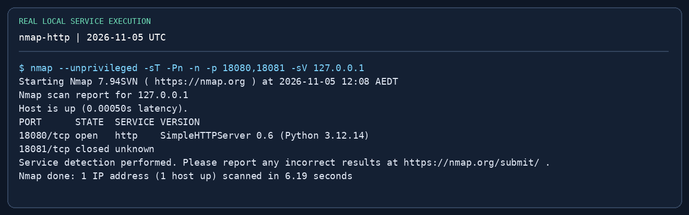
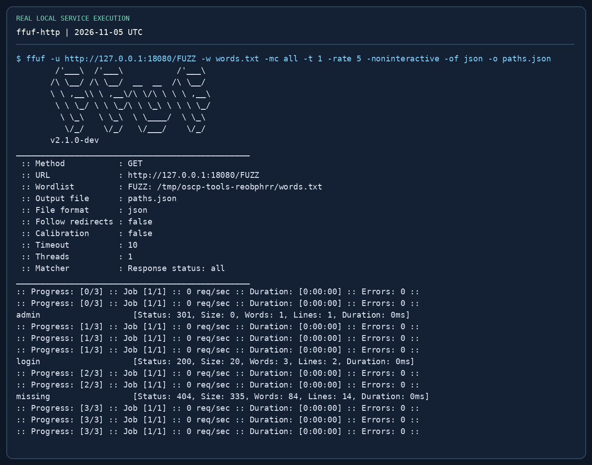
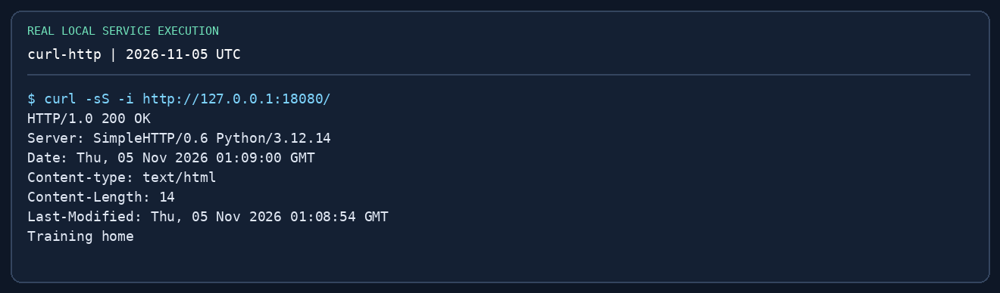
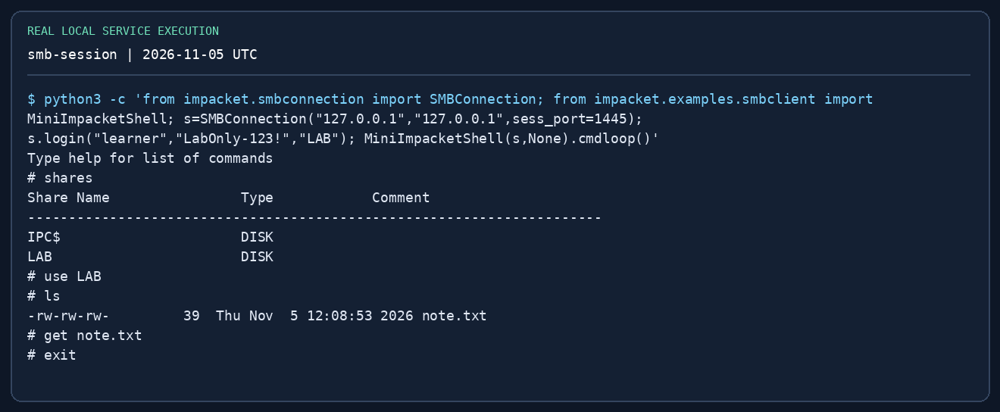
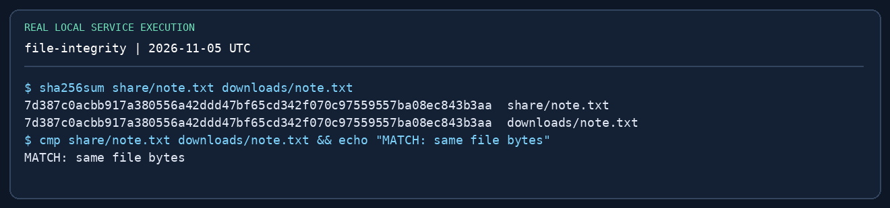

# 도구 실습: HTTP와 SMB { #labs-tool-practice }

**Updated / 최종 수정:** 2026-11-05

!!! abstract "직접 실행할 내용"
    루프백 전용 HTTP 서비스와 인증된 SMB 공유를 만듭니다. Nmap으로 HTTP 발견, ffuf로 경로 세 개 탐색, curl로 응답 확인, Impacket으로 무해한 텍스트 파일 전송, SHA-256 비교까지 합니다. Windows VM·도메인이 없어도 됩니다.

**준비:** Linux/Kali VM, Python 3·Nmap·ffuf·curl·Impacket, 터미널 두 개. `127.0.0.1`만 사용합니다. 18080·1445 포트가 비어 있어야 합니다. 높은 SMB 포트는 root 없이 Impacket client로 연습하기 위한 것이며 일반 Windows UNC 접속용이 아닙니다.

```bash
sudo apt install nmap ffuf curl impacket-scripts python3-impacket
mkdir -p ~/oscp-tool-lab/{web/admin,share,downloads}
cd ~/oscp-tool-lab
printf 'Training home
' > web/index.html
printf 'Training admin page
' > web/admin/index.html
printf 'Training login page
' > web/login
printf 'admin
login
missing
' > words.txt
printf 'OSCP practice: controlled SMB transfer
' > share/note.txt
```

취약한 앱이나 시험 자료는 없습니다. `admin` 경로 발견은 정보 수집 연습이지 침투 성공이 아닙니다.

## 1. HTTP 발견과 오탐 구분 { #http }

터미널 A:

```bash
cd ~/oscp-tool-lab
python3 -m http.server 18080 --bind 127.0.0.1 --directory web
```

터미널 B:

```bash
cd ~/oscp-tool-lab
nmap --unprivileged -sT -Pn -n -p 18080,18081 -sV 127.0.0.1
curl -i http://127.0.0.1:18080/
curl -i http://127.0.0.1:18080/missing
ffuf -u http://127.0.0.1:18080/FUZZ -w words.txt -mc all   -t 1 -rate 5 -noninteractive -of json -o paths.json
curl -i http://127.0.0.1:18080/admin/
```

**결과 해석:** 18080은 open, 사용 중이 아니라면 18081은 closed입니다. `admin`은 `/admin/`으로 이동, `login`은 200, `missing`은 404입니다. 서비스명이 다르면 이름 암기보다 실제 배너·포트 응답을 따르세요. 301은 이동 단서이며 어디로 이동하는지 기록한 다음 `curl -L`을 사용합니다.

{ loading=lazy }

{ loading=lazy }

{ loading=lazy }

**오류 연습:** A를 종료하고 curl 한 번을 반복하세요. 연결 거절과 HTTP 404가 어떻게 다른지 설명합니다. 서버를 다시 켠 뒤 다음으로 진행하세요.

## 2. 인증된 SMB 파일 전송 { #smb }

터미널 A (켜 둡니다):

```bash
cd ~/oscp-tool-lab
impacket-smbserver LAB "$PWD/share" -smb2support -ip 127.0.0.1 -port 1445   -username learner -password 'LabOnly-123!'
```

터미널 B:

```bash
cd ~/oscp-tool-lab/downloads
# Impacket 0.13.1 CLI restricts -port to 139/445; use its API mini-shell here:
python3 -c 'from impacket.smbconnection import SMBConnection; from impacket.examples.smbclient import MiniImpacketShell; s=SMBConnection("127.0.0.1","127.0.0.1",sess_port=1445); s.login("learner","LabOnly-123!","LAB"); MiniImpacketShell(s,None).cmdloop()'
```

SMB `#` 프롬프트에서:

```text
shares
use LAB
ls
get note.txt
exit
```

로컬 셸로 나온 뒤:

```bash
cd ~/oscp-tool-lab
sha256sum share/note.txt downloads/note.txt
cmp share/note.txt downloads/note.txt && echo 'MATCH: same file bytes'
```

해시 두 개가 같아야 하며 `cmp`는 동일하면 0으로 끝납니다. 인증 후 허용된 공유를 읽은 것이지 **Windows 셸·도메인 관리자 획득은 아닙니다**. `shares`, `use LAB`은 SMB 미니 셸, `sha256sum`은 Bash 명령입니다.

{ loading=lazy }

{ loading=lazy }

**오류 연습:** (1) 비밀번호를 한 번만 틀려 인증 실패 확인, (2) 존재하지 않는 공유를 선택해 로그인 실패와 구분, (3) 1445 대신 비어 있는 높은 포트로 연결해 통신 실패와 구분. 비밀번호 반복 루프는 필요 없습니다. 실습 후 Ctrl-C로 서버를 종료하세요.

## 3. 다음은 Windows·AD 랩 { #ad-next }

루프백 랩으로는 LDAP·Kerberos·WMI·SCM·Windows 토큰·복제를 검증할 수 없습니다. 격리된 본인 Windows 도메인 또는 허가된 교육 환경에 일반 도메인 사용자·멤버 서버·DC와 범위를 제한한 테스트 권한을 준비하세요. [Impacket 가이드](../impacket.md)를 따라 아래를 기록합니다.

| 연습 | 성공 증거 | 의도한 거절 사례 |
|---|---|---|
| 공유 읽기 | 목록·다운로드·동일 해시 | 읽을 수 없는 관리자 공유 |
| SPN·AS-REP | 계정 연결과 정확한 해시 형식 | AS-REP 대상이 아닌 계정 |
| MSSQL | SQL 주체·역할·실제 명령 실행 계정 | 다른 서비스 인증은 되지만 SQL 권한 없음 |
| WMI·SCM | 대상 셸에서 확인한 인증 주체 | 일반 사용자는 관리자 서비스 생성 불가 |
| 오프라인 SAM | 올바른 하이브 쌍과 필드 해석 | 틀리거나 없는 SYSTEM 하이브 |
| DCSync | 의도적으로 복제 권한을 준 계정에서만 | 멤버 호스트 로컬 관리자만으로는 불가 |
| Kerberos 캐시 | 맞는 realm·호스트 이름·캐시 | 잘못된 서비스 이름·만료 캐시 |

모든 OSCP 세트에 모든 기법이 나온다고 기대하지 마세요. 전제 조건과 대안을 이해하는 것이 실습 성공 기준입니다.

## 4. 화면 출처와 한계 { #provenance }

저장소 `scripts/oscp-captures/capture.py`가 로컬 예제를 실행하고 upstream Impacket 도움말 출력을 수집합니다. `render.py`는 출력을 편집하지 않고 수집한 텍스트를 PNG로 렌더링하며, 이미지 제목에 도움말과 실제 서비스 연동을 구분합니다. 원본 `.txt` 로그와 `manifest.json`에는 명령·버전·SHA-256·촬영 시각이 있습니다. 원격 데스크톱·GUI 캡처가 아니라 터미널 출력 렌더링입니다. AD 성공 화면을 임의로 만들지 않았습니다.

Linux 작업 환경에서 저장소 화면 전체를 재현하려면:

```bash
python3 -m venv /tmp/oscp-captures-venv
/tmp/oscp-captures-venv/bin/pip install -r scripts/oscp-captures/requirements.txt
PATH="/tmp/oscp-captures-venv/bin:$PATH" python3 scripts/oscp-captures/capture.py
/tmp/oscp-captures-venv/bin/python scripts/oscp-captures/render.py
```

Nmap·ffuf·curl은 배포판으로 먼저 설치하세요. 스크립트는 임시 작업 폴더와 루프백 서비스를 사용하고 자신이 만든 프로세스만 종료하며 저장소 안에 캡처 파일을 씁니다. 도메인에 접속하거나 네트워크를 스캔하지 않습니다. 포트 충돌은 명확히 실패 처리하고 관련 없는 프로세스를 종료하지 않습니다.

## 완료 기록 { #completion }

연습마다 명령·예상 결과·관찰 결과·실패 이유·다음 행동을 적습니다. Windows·AD 모의 리포트에는 대상 주체와 IP가 보이는 화면을 남기세요. 루프백 파일 전송 이미지는 시험 proof를 대신하지 않습니다.

[실전 종합 가이드로](../practical-guide.md) · [Impacket 집중 가이드](../impacket.md) · [리포트](../reporting.md)
