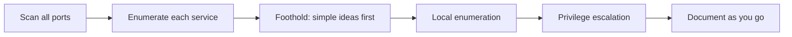

# 방법론과 습관 { #methodology-habits }

**적용:** 모든 머신 · **최종 수정:** 2026-10-23

!!! abstract "한 문장 요약"
    후기에서 점수를 잃는 이유는 대부분 고급 기법을 몰라서가 아니라, enumeration을 놓치거나 rabbit hole에 시간을 쓴 탓입니다.

!!! note "이 페이지 구성"
    지식을 시계 아래에서 점수로 바꿔 주는 습관들입니다. 연습하면서 몸에 익혀, 시험에서 자동으로 나오게 하세요.

## 머신별 루프 { #loop }

## Enumeration 체크리스트 { #enumeration-checklist }

- **모든 포트, 두 프로토콜.** 전체 TCP(`-p-`), 그다음 열린 것에 서비스/버전. 흔한 포트의 UDP 스캔도 잊지 말기 — SNMP 등이 거기 숨어요.
- **출력 전부 읽기.** 의도된 경로는 보통 보입니다; 실력은 숨은 걸 찾는 게 아니라 그걸 알아차리는 데 있어요.
- **지루한 것도 조사하기.** 평범해 보이는 서비스나 비어 보이는 공유가 종종 입구입니다.

## 단순한 것부터 { #simple-first }

익스플로잇 체인에 들어가기 전에 값싼 발상부터 시도하세요:

- 기본 크리덴셜(`admin:admin`, 제품 기본값), 사용자명을 비밀번호로, anonymous / 빈 로그인.
- 비밀번호 재사용 — 한 박스나 사용자의 크리덴셜을 어디서나 시도.
- "Nmap은 거짓말하지 않는다" — 포트가 열려 있으면 뭔가 듣고 있는 거예요. 막다른 길이라 단정하기 전에 그게 뭔지 알아내세요.

## 스캔을 기다리지 말기 { #parallel }

긴 스캔은 작업하는 동안 뒤에서 돕니다. WordPress 플러그인을 찾았나요? 지금 조사하세요. 스캔이 끝나길 기다리지 말고요. 조사 두세 갈래를 동시에 굴리세요.

## Rabbit hole { #rabbit-holes }

- **시간 제한.** 단서 하나에 정해진 예산(예: 30~45분)을 주세요. 안 움직이면 적어 두고 대상을 바꿉니다 — 머리를 식히고 돌아오세요.
- **어려운 게 다 경로는 아닙니다.** OffSec은 일부러 미끼를 넣습니다. 좋은 enumeration은 *배제하는 것* 이기도 해요.
- **되돌아가기는 지칩니다** — 처음에 꼼꼼히 해서, 15시간째에 박스를 다시 하지 않게 하세요.

## Metasploit 사용 계획 { #metasploit }

한 대에만, 한 번 쓰면 고정 ([시험 규칙](exam-format.md#metasploit)). 가장 도움 되는 곳에 쓰세요 — 많은 사람이 초기 침투보다, 유독 안 풀리는 한 박스의 권한 상승 제안에 아껴 둡니다. `msfvenom` 과 `multi/handler` 는 어디서나 허용돼요.

## 노트와 나만의 치트시트 { #notes }

- **머신당 한 페이지**, 매번 같은 구조: 스캔 → 정보 수집 → 초기 침투 → 로컬 정보 수집 → 권한 상승 → 플래그. 이게 곧 리포트 초안입니다 — [리포트](reporting.md) 참고.
- **진행하면서 스크린샷**, 증거 요구 사항까지 포함해서요. 그래야 빠진 스크린샷 하나 때문에 박스를 다시 뚫지 않습니다.
- **내 실수로 치트시트 만들기** — 일반적인 팁 말고, 내가 까먹은 명령, 건너뛴 단계로요. 이건 어떤 과정도 주지 않는 유일한 자료예요.

## 작업 환경 준비 { #workflow }

- 대상 IP, 내 IP, 도메인을 변수로 — 새 박스로 넘어갈 때 한 번만 고치게.
- 대상마다 깔끔한 폴더; 터미널 멀티플렉서(tmux) 탭 하나당 머신 하나.
- 스크립트, 워드리스트, 페이로드를 시험 시작 전에 정해진 자리에 둡니다.

## 마음가짐 { #mindset }

- 전날 밤 준비가 덜 된 느낌이 드는 건 정상입니다. 할 일을 했다면 그 느낌은 거짓말이에요.
- 행동이 불안을 없앱니다 — 첫 스캔이 돌기 시작하면 근육 기억이 이어받아요.
- 진짜 휴식을 하고 가볍게 먹으세요. 번아웃은 핑계가 아니라 기록된 시험 요인입니다. 돌파구 대부분은 자리를 비운 뒤에 옵니다.

## 관련 페이지 { #related-pages }

- [Nmap](../../pentesting/recon/nmap/index.md) · [리포트](reporting.md) · [시험 당일 전략](exam-day.md)

## 참고 자료 { #references }

- [ippsec.rocks](https://ippsec.rocks/) — 기법으로 IppSec 영상 검색
